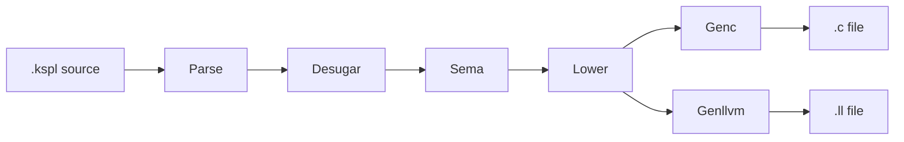

# ksplc

**`ksplc` is the KSPL compiler.** It reads KSPL source and writes C99 by default (`--to=c`), or LLVM IR (`--to=llvm`), the text form of code that LLVM turns into machine code. It is written in KSPL itself, so it compiles its own source (*self-hosting*).

**This page is a map of the compiler's source, for whoever reads or changes it.** The internal design and its reasons are in [`ksplc/docs/DESIGN-compiler.md`](docs/DESIGN-compiler.md), whose "The glossary" defines the words used here. To only use the compiler, the quick start in the root README is enough.

## Run it

```sh
ksplc build hello.kspl hello            # the default target, C99, compiled and linked by clang
ksplc --to=llvm hello.kspl hello.ll   # then clang hello.ll with the runtime ksplc emit-runtime puts out
```

The first line makes an executable `hello`. The second writes LLVM IR, which clang compiles together with the C runtime (the support code every program needs) that `ksplc emit-runtime` writes.

Two `make` commands, run in this folder ([`ksplc/Makefile`](Makefile)), test and rebuild the compiler:

| Command | What it does | What it needs |
| :-- | :-- | :-- |
| `make test` | **Runs the compiler's own tests.** First the compiler's answers, checked by programs it builds (`make test-answers`, [`ksplc/tests/`](tests/)). Then the suites that drive this folder's compiler from outside (`make test-suites`, [`ksplc/tests/suite/`](tests/suite/)) | Only a `ksplc` and the kspeg this package uses |
| `make self-host` | **Rebuilds this folder's compiler** from the `ksplc` it is given, and requires the result to reproduce itself exactly | A `ksplc` |

ksplc names itself as a package in [`ksplc/ksplc.cfg`](ksplc.cfg), so a copy of this folder runs both the same way. The repository's `make` does the same rebuild, starting from [`seed.c`](seed.c). Building from the seed, and the checks that reach past this folder (the repository's `tests/`), are the repository's job.

## The idea

**The compiler is a pipeline: one tree, the AST (abstract syntax tree), passes through a fixed row of stages, strictly one way.** Each stage reads the tree the stage before it left and never reaches back (why is "From source code to a binary" in [`ksplc/docs/DESIGN-compiler.md`](docs/DESIGN-compiler.md)).



| Stage | What it does | Folder |
| :-- | :-- | :-- |
| **Parse** | Reads the text and builds the tree | `parse/` |
| **Desugar** | Rewrites shorthand (*syntactic sugar*) into plainer forms, where the types are not needed | `parse/` |
| **Sema** (semantic analysis) | Finds what each name means, works out every type, and reports type errors | `sema/` |
| **Lower** | Flattens the checked tree into a simple shape that suits either output | `lower/` |
| **Genc / Genllvm** (the *backends*) | Write the C99 or the LLVM IR | `gen/c/`, `gen/llvm/` |

## What is here

The pipeline's folders come first, in the order the data flows. Then come `base/`, `lsp/`, `fmt/` and `tools/`, the grammar and the seed, and the suites under `tests/`. Each section names its folder's files and ends with its design chapter.

Directly in this folder:

* [`main.kspl`](main.kspl) — the entry point: it starts the subcommand [`cli.kspl`](cli.kspl) read from the command line. The usage text is in [`usage.kspl`](usage.kspl).
* [`pipeline.kspl`](pipeline.kspl) — the `Compiler` that runs the stages in order.
* [`source_checks.kspl`](source_checks.kspl) — the checks on the source's own spelling (the indentation, the comments), run once the declarations are collected.

### parse/ — the Parse layer

**It reads the source text, builds the AST and normalizes it**, so that every kind of node has one fixed layout.

* [`load.kspl`](parse/load.kspl) — `load_and_parse_file`, the one function that runs the loading, and follows the `import`s itself.
* [`normalize.kspl`](parse/normalize.kspl), with [`normalize_decl.kspl`](parse/normalize_decl.kspl) and [`normalize_stmt.kspl`](parse/normalize_stmt.kspl) — normalizing the tree, with declarations and statements apart.
* [`layout.kspl`](parse/layout.kspl) — turns the indentation notation (`.kspl`) into the brace shape; [`line_cont.kspl`](parse/line_cont.kspl) decides what joins a line to the next, for the formatter too.
* [`source_fix.kspl`](parse/source_fix.kspl) — fixes the source's spelling before analysis.
* [`desugar.kspl`](parse/desugar.kspl), with [`desugar_slice.kspl`](parse/desugar_slice.kspl) and [`desugar_closure.kspl`](parse/desugar_closure.kspl) — the sugar that needs no types; [`format_spec.kspl`](parse/format_spec.kspl) reads a string interpolation's format specifier (the `6` in `\{x:6\}`).
* [`ast_cache.kspl`](parse/ast_cache.kspl) — keeps the normalized AST on disk so the next parse is skipped; [`syntax_msg.kspl`](parse/syntax_msg.kspl) writes a syntax error's message.

It drives the grammar [`kspl.kspeg`](kspl.kspeg) through the engine in [kspeg](../kspeg/README.md).

```sh
make test-notation   # a .kspl file reads the same saved with LF or CRLF, and the editor finds its lines
```

The design is "The Parse layer: from text to an AST (Desugar included)" in [`ksplc/docs/DESIGN-parse.md`](docs/DESIGN-parse.md).

### sema/ — the Sema layer

**It works out the types, finds what each name refers to, and tracks scopes.** `run` in [`decl/collect.kspl`](sema/decl/collect.kspl) registers every file's declarations first; `run` in [`body/infer.kspl`](sema/body/infer.kspl) is the main walk. The folders are listed from the bottom up; each imports only those below it ("How sema is split into folders, and their dependencies" in [`ksplc/docs/DESIGN-sema.md`](docs/DESIGN-sema.md)).

| Folder | The question it answers | Files |
| :-- | :-- | :-- |
| [`type/`](sema/type/) | How is a type or a name expressed? | `def` (the types' shapes), `env` / `query` / `arc` (the type table and its queries), `naming` (output names and cache keys), `scope` (the symbol table), `display` (what a diagnostic prints) |
| [`session/`](sema/session/) | What is shared through one analysis? | `ctx` (`Sema_ctx`, the diagnostics, declaring a symbol), `state`, `import_table` / `imports` (the imports and their ledger), `pointer` (a comment's pointer), `c_boundary` (what the generated C cannot hold), `prof` (sema's time) |
| [`decl/`](sema/decl/) | What is there, under what name, and of what type? | `collect` (the entry point), `declare`, `registry` / `layout`, `resolve`, `name` (what a written name names), `access`, `attrs`, `eval`, `reflect`, `type_check`, the generics (`mono*` / `subst`), the traits (`trait_check` / `trait_default`) |
| [`flow/`](sema/flow/) | Which state is a binding in, and when? | `track`, `stmt` (branching and joining), `release`, `report` (the diagnostics) |
| [`body/`](sema/body/) | Is the code right? | `infer` (the main walk), the expressions, the statements, the calls (`generic_infer` reads a call's type arguments off its arguments), the coercions, `lint_stmt` and `lint_written` |

```sh
make debug-ksplc   # the compiler's own tests, the type checks and the diagnostics among them
```

The design is "The Sema layer: it knows the types" in [`ksplc/docs/DESIGN-sema.md`](docs/DESIGN-sema.md). The rules for checks are "The design rules for the checks and the diagnostics" in [`ksplc/docs/DESIGN-diagnostics.md`](docs/DESIGN-diagnostics.md), and the codes are in [`ksplc/docs/SPEC-diagnostics.md`](docs/SPEC-diagnostics.md).

### lower/ — the Lower layer

**It flattens the checked tree into a shape that does not depend on either backend.** The order of its passes is "The internal flow: flatten, add vtables, mangle, prune, verify" in [`ksplc/docs/DESIGN-lower.md`](docs/DESIGN-lower.md).

* [`root.kspl`](lower/root.kspl) — the one recursive walk that flattens the control flow. Inside it:
  * [`expr.kspl`](lower/expr.kspl) hoists expressions: it moves a part out into a temporary before the statement.
  * [`defer.kspl`](lower/defer.kspl) flattens `defer` and the exits that run it.
  * [`order.kspl`](lower/order.kspl) moves an operand into a temporary where C could run it out of the written order.
  * [`ctx.kspl`](lower/ctx.kspl) holds the walk's state.
* [`arc.kspl`](lower/arc.kspl) — inserts ARC's `retain()` / `release()` (automatic reference counting).
* [`vtable.kspl`](lower/vtable.kspl) — a trait value's thunks and vtables, which let one call reach whichever type stands behind a trait.
* [`abi.kspl`](lower/abi.kspl) — the ABI mangling (unique output names by a fixed rule), and desugaring the method calls.
* [`prune.kspl`](lower/prune.kspl) — drops the functions and types nothing calls.
* [`verify.kspl`](lower/verify.kspl) — checks that the tree's types mesh at the exit.

```sh
make test-equiv   # the C and the LLVM outputs of one program agree, so what lower hands down is backend-neutral
```

The design is "The Lower layer: a flat tree independent of backends" in [`ksplc/docs/DESIGN-lower.md`](docs/DESIGN-lower.md), and ARC's is "The rules for implementing ARC" in [`ksplc/docs/DESIGN-lower.md`](docs/DESIGN-lower.md).

### gen/ — what the two backends share

**What the two outputs must agree on is written once, directly under `gen/`** (why is "What the two generators share: the decisions, not the spelling" in [`ksplc/docs/DESIGN-backends.md`](docs/DESIGN-backends.md)).

* [`runtime.kspl`](gen/runtime.kspl) — hands out the C runtime that every program links. The runtime itself is [`gen/runtime/`](gen/runtime/): `core.*` for every target, plus `hosted.*` for an OS beneath the program or `freestanding.*` for bare metal. `hosted.*` is split into `hosted_fs` / `hosted_net` / `hosted_proc` / `hosted_spawn` / `hosted_thread`.
* [`entry.kspl`](gen/entry.kspl) — what the generated `main` does around `kspl_main`.
* [`embed.kspl`](gen/embed.kspl) — reads the file an `embed` names.

```sh
make test-emit-runtime   # the runtime handed out whole, and one entry point whichever backend built the program
```

### gen/c/ — the C99 backend

**It turns the flattened AST into C99.** The `.c` file holds the C runtime too. Under `--library`, everything in it but the `#export` functions is `static`.

* [`root.kspl`](gen/c/root.kspl) — `run`, the single entry.
* [`ctx.kspl`](gen/c/ctx.kspl) — the context and its fluent output API (calls chained one after another).
* [`decl.kspl`](gen/c/decl.kspl) the declarations, [`types.kspl`](gen/c/types.kspl) the types, [`stmt.kspl`](gen/c/stmt.kspl) the statements, and [`expr.kspl`](gen/c/expr.kspl) the expressions, with the postfix forms in [`expr_postfix.kspl`](gen/c/expr_postfix.kspl).
* [`literal.kspl`](gen/c/literal.kspl) — turns KSPL's literals into C strings.

```sh
make test-ship   # two libraries built with --library link into one C program and one KSPL program
```

### gen/llvm/ — the LLVM IR backend

**It turns the same flattened AST into LLVM IR** (`--to=llvm`), with no debug information. Its output links against the C runtime ([`gen/runtime/`](gen/runtime/)) for what needs the OS.

* [`module.kspl`](gen/llvm/module.kspl) — `run`, the entry, matching the C backend's.
* [`ctx.kspl`](gen/llvm/ctx.kspl) — the context at the centre: the output buffer and the SSA numbering (in LLVM IR each value gets a fresh number, `%1`, `%2`, …).
* [`decl.kspl`](gen/llvm/decl.kspl) the top-level declarations, [`types.kspl`](gen/llvm/types.kspl) the types and their LLVM spellings, [`stmt.kspl`](gen/llvm/stmt.kspl) the statements, and [`expr.kspl`](gen/llvm/expr.kspl) the expressions, with the aggregates (structs and arrays) in [`expr_agg.kspl`](gen/llvm/expr_agg.kspl) and the calls in [`expr_call.kspl`](gen/llvm/expr_call.kspl).

Both backends' design, and what each refuses, is "The backends (Genc / Genllvm) and the runtime ABI" in [`ksplc/docs/DESIGN-backends.md`](docs/DESIGN-backends.md).

### base/ — the foundation every layer stands on

**The lowest tier, below the pipeline.** Every layer imports it; nothing here runs on its own.

```kspl
import "ksplc/base/ast" { Ast_node }
```

| Subject | Files |
| :-- | :-- |
| **The tree** | [`ast.kspl`](base/ast.kspl) is the general-purpose node `Ast_node` and its verification. [`ast_kinds.kspl`](base/ast_kinds.kspl) is the closed set of node kinds. [`ast_ext.kspl`](base/ast_ext.kspl) holds the safe accessors. [`ast_place.kspl`](base/ast_place.kspl) holds the predicates a node's shape alone answers (does an expression have a side effect?). [`ast_spell.kspl`](base/ast_spell.kspl) spells a node back as text. [`ast_doc.kspl`](base/ast_doc.kspl) reads the `//<` description that a declaration carries |
| **The shared state** | [`core.kspl`](base/core.kspl) holds the shared arenas, the string pool and the compiler's configuration. [`setup.kspl`](base/setup.kspl) starts and ends the layer in one go. [`target.kspl`](base/target.kspl) is the table of machines that ksplc lays values out for, and which one a compile is for |
| **The source** | [`as_written.kspl`](base/as_written.kspl) keeps the text as typed before the indentation is fixed (what a diagnostic quotes). [`locate.kspl`](base/locate.kspl) says where a source comes from and its logical name. [`lines.kspl`](base/lines.kspl) finds where a line begins and ends. [`literal.kspl`](base/literal.kspl) reads a literal's spelling |
| **The diagnostics** (the compiler's messages about your code) | [`diag.kspl`](base/diag.kspl) prints them, [`lint_codes.kspl`](base/lint_codes.kspl) is the registry of their codes, and [`cfg_inactive.kspl`](base/cfg_inactive.kspl) keeps the ranges a `#cfg()` left out, so the editor can say why nothing stands there |
| **The names emitted** | [`mangle.kspl`](base/mangle.kspl) turns KSPL's names into C and LLVM identifiers, and [`c_name.kspl`](base/c_name.kspl) avoids the C names that cannot be used plain |
| **The settings and the packages** | [`config_file.kspl`](base/config_file.kspl) reads `ksplc.cfg`, and [`package.kspl`](base/package.kspl) its `[package]` section: a package's name, what it uses, and the logical name of a file inside it |
| **The measurements** | [`cache.kspl`](base/cache.kspl) places the cache on disk, and [`stats.kspl`](base/stats.kspl) counts each stage's time and arena use |

The design is "The compiler as a whole", "The rules for handling an AST, shared by every layer" and "Memory management: the arena model" in [`ksplc/docs/DESIGN-compiler.md`](docs/DESIGN-compiler.md).

### lsp/ — the language server

**It answers an editor's questions (go to definition, hover, completion) over the Language Server Protocol, driving the pipeline once per request.**

* [`server.kspl`](lsp/server.kspl) — the supervisor of a child worker.
* [`worker.kspl`](lsp/worker.kspl) — builds the state a request is answered from, and routes each method from one table.
* [`state.kspl`](lsp/state.kspl) — what lasts between requests (the open documents' texts, the analysed state, the arena's rewind point).
* [`msg.kspl`](lsp/msg.kspl) — reads and writes the JSON-RPC messages.
* Each answer has its own file. It reads the state alone, never the dispatch.
  * Which node a position stands on: [`position.kspl`](lsp/position.kspl).
  * Navigation: [`nav.kspl`](lsp/nav.kspl).
  * How a declaration's types and signature are spelt: [`spell.kspl`](lsp/spell.kspl).
  * Hover: [`hover.kspl`](lsp/hover.kspl).
  * Completion: [`complete.kspl`](lsp/complete.kspl).
  * References and renaming: [`uses.kspl`](lsp/uses.kspl). What a rename refuses is in [`rename.kspl`](lsp/rename.kspl).
  * The call hierarchy: [`call_hier.kspl`](lsp/call_hier.kspl).
  * The outline, what a file declares, nested: [`outline.kspl`](lsp/outline.kspl).
  * Which files are in the workspace: [`workspace.kspl`](lsp/workspace.kspl).

```sh
make test-lsp   # starts the server once and drives every request against it
```

The design is [`ksplc/docs/DESIGN-tools.md`](docs/DESIGN-tools.md) from "The arena is rewound after each request (a worked example)" to "A URI is converted to the logical name and back". What the editor can rely on is "The language server (ksplc lsp)" in [`ksplc/docs/SPEC-tools.md`](docs/SPEC-tools.md).

### fmt/ — the formatter

**It turns the Parse layer's AST back into neatly laid-out source text** (`ksplc fmt`).

* [`printer.kspl`](fmt/printer.kspl) — the printer, moving forward through the original text and never back.
* [`trivia.kspl`](fmt/trivia.kspl) the comments and blank lines between the tokens. [`comment.kspl`](fmt/comment.kspl) decides where a comment that is too wide is cut. [`space.kspl`](fmt/space.kspl) the whitespace and wrapping, including carrying a string onto the next line. [`style.kspl`](fmt/style.kspl) the settings that `--style` reads.
* What it reads from, kept apart. [`kinds.kspl`](fmt/kinds.kspl) sorts the node kinds and the token spellings. [`source.kspl`](fmt/source.kspl) reads the original text around a position. [`measure.kspl`](fmt/measure.kspl) reads a node's shape and width.
* [`import.kspl`](fmt/import.kspl) — puts the run of `import`s into name order before the printer runs.
* [`text.kspl`](fmt/text.kspl) — the one path through a text that both `ksplc fmt` and the lint take (the imports' order, the printer, the rounds that put parentheses in).
* [`file.kspl`](fmt/file.kspl) — one file's round trip for `ksplc fmt`, and writing back. It takes off and puts back the line terminator, the shebang and the BOM.

```sh
make fmt    # every tracked .kspl
```

What `ksplc fmt` and `--style` promise is "3. The formatter (ksplc fmt)" in [`ksplc/docs/SPEC-tools.md`](docs/SPEC-tools.md). Its own decisions are in [`ksplc/docs/DESIGN-tools.md`](docs/DESIGN-tools.md), from "The formatter reorders the `import`s as text, before the printer" to "Blank lines and the line terminator".

### tools/ — the tools that work on the pipeline's artifact

**Commands built on what the pipeline produces, and the tools that inspect the compiler's own parts.**

| File | What it does | How you reach it |
| :-- | :-- | :-- |
| [`keywords.kspl`](tools/keywords.kspl) | Derives the keyword list from the grammar | — |
| [`surface.kspl`](tools/surface.kspl) | The record of the API a package offers | `ksplc doc --emit-surface=` |
| [`interface.kspl`](tools/interface.kspl) | A library's interface, a C header or an `extern "C"` block, from its `#export` functions | `--library=` |
| [`doc.kspl`](tools/doc.kspl) | What a file, an entry or a folder publishes, rendered from the source as the reference to read | `ksplc doc` |
| [`explain.kspl`](tools/explain.kspl) | Prints a diagnostic code's section of the diagnostics specification (`ksplc/docs/SPEC-diagnostics.md`) | `ksplc explain` |
| [`run.kspl`](tools/run.kspl) | Compiles, links and runs a program in one command | `ksplc run` |
| [`libs.kspl`](tools/libs.kspl) | The libraries a program names with `#link`: written by a compile, read back for the link | `--emit-libs=`, `ksplc run`, `ksplc build` |

```sh
make lint   # the static analysis alone; zero down to hints is a pass
```

The CLI options, and the formatter, the language server and the linter as seen from outside, are specified in [`ksplc/docs/SPEC-tools.md`](docs/SPEC-tools.md). Why lint is switched per code and where the settings file sits is "The design of the tool settings" in [`ksplc/docs/DESIGN-tools.md`](docs/DESIGN-tools.md).

### kspl.kspeg / seed.c — the grammar and the seed

**`ksplc/kspl.kspeg` is the canonical text of KSPL's own grammar**, a build input that `ksplc/main.kspl` embeds. Its notation is specified in [`kspeg/docs/SPEC-notation.md`](../kspeg/docs/SPEC-notation.md), and the engine that interprets it is in `kspeg/`.

**`ksplc/seed.c` is the bootstrap's seed compiler**: the compiler at one moment, translated to C and checked in, so the first build needs only a C compiler.

Caution: **After any change under `ksplc/` (`ksplc/kspl.kspeg` included), update the seed with `make commit-seed`.** Otherwise the seed keeps building the old compiler. Follow "The bootstrap, and keeping the seed in step" and "Keeping the grammar and the AST node kinds in step" in [`ksplc/docs/DESIGN-compiler.md`](docs/DESIGN-compiler.md).

### tests/ — the suites and their fixtures

**A suite is a test program run by one ksplc that inspects another**, so a broken compiler and a failed check do not look alike. [`ksplc/Makefile`](Makefile) names the three places a suite uses:

| Name | What it is | What the repository fills it with |
| :-- | :-- | :-- |
| `RUNNER` | The compiler that runs the suite | Its seed |
| `UNDER` | The compiler under inspection | Its Stage1 (the compiler the seed built) |
| `SCRATCH` | Where a suite writes its files | A place of its own |

`make test-<name>` runs one suite, here or from the repository's root. The names are `SUITES` in [`ksplc/Makefile`](Makefile), and what each suite checks is its opening comment, in `tests/suite/<name>_test.kspl` (`-` written `_`).

| Folder | What lives there |
|---|---|
| [`tests/suite/`](tests/suite/) | One suite, `<name>_test.kspl`, run by `make test-<name>` |
| [`tests/support/`](tests/support/) | Code the suites read: `harness*`, shared by every suite, and `<suite name>_<subject>`, one suite's own piece |
| [`tests/parse/`](tests/parse/) [`tests/negative/`](tests/negative/) [`tests/lint/`](tests/lint/) [`tests/runtime/`](tests/runtime/) | The fixtures `test-negative`, `test-lint` and `test-runtime` read: many cases to a file by subject |
| [`tests/prog/`](tests/prog/) | A program under inspection. A suite builds it on both backends, or reads a line-number landmark from it. It is one file, or `equiv.kspl`. `equiv.kspl` imports `equiv_shapes.kspl`, which holds the shapes that C leaves open |
| [`tests/filepath/`](tests/filepath/) | `test-file-path`'s material. **It takes two files**: with one, the unspecified-visibility path is never taken |
| [`tests/notation/`](tests/notation/) | `test-notation`'s samples of the indentation notation. The language tour is written from one of them |
| [`tests/ship/`](tests/ship/) | `test-ship`'s two vendors and two customers: libraries built with `--library`, a C program and a KSPL program using them. `app.kspl` imports an interface the suite writes, so it compiles only there |

**The shared foundation is split by the reason for reading it**: `harness`, `harness_build`, `harness_expect`, `harness_markers` and `harness_grow`. `harness_build` is the only caller of the C compiler and the linker.

Two suites are split in two. `tests/suite/cli_test.kspl` keeps command selection and diagnostics, and `tests/support/cli_emit.kspl` the emitted-file checks. `tests/suite/std_dir_test.kspl` keeps std discovery, and `tests/support/std_dir_named.kspl` the named-package and path-identity checks.

## Adding a fixture

The steps, the marks a fixture carries and the rules each fixture folder keeps are [`ksplc/docs/HOWTO-add-a-fixture.md`](docs/HOWTO-add-a-fixture.md).

## Files near the limit and how they split

**How to choose the cut is "Choosing where to split a file" in [`docs/DESIGN-principles.md`](../docs/DESIGN-principles.md).** This package adds two constraints of its own:

* **`make fmt` uses the seed**, so in a split that touches the grammar, run `make commit-seed` first (why is "The bootstrap, and keeping the seed in step" in [`ksplc/docs/DESIGN-compiler.md`](docs/DESIGN-compiler.md)).
* [`fmt/printer.kspl`](fmt/printer.kspl): **the decisions on where a line breaks** move to a new `fmt/wrap.kspl`, an `impl Formatter` as `fmt/trivia.kspl` is. That is `calc_will_break`, `reader_joins`, `ends_open_catch`, `break_before_choice` and `wrap_before_next_element`. The cut lies between deciding a break and writing tokens: `write_token` and `format_internal` stay, and call across it.
* [`gen/runtime/hosted_fs.c`](gen/runtime/hosted_fs.c): **the Windows half** (from its `#else` to the closing `#endif`) moves to a new `gen/runtime/hosted_fs_win.c`. A second `embed` in `gen/runtime.kspl` joins it right after the POSIX half, and the shared head stays. The two halves are read for different systems, and no name crosses between them.
* [`sema/flow/track.kspl`](sema/flow/track.kspl): call-release effects and raw-storage argument checks move into `sema/flow/call.kspl`. Local state, expression traversal and assignment tracking remain together.
* [`tests/lang_test.kspl`](tests/lang_test.kspl): **the tests of generic functions** (`test_generic_fn_returning_own_type_param` to `test_instantiation_before_generic_impl`) move into a new file of tests, `lang_generic_test.kspl`, beside it.
* [`tests/lang_types_test.kspl`](tests/lang_types_test.kspl): **the tests of a trait upcast** (`test_trait_upcast_lifetimes` and the three after it) move into a new file of tests, `lang_upcast_test.kspl`, beside it.
* **A file of tests splits with no list to edit.** The new file needs one import line in `tests/all.kspl`, whose suite then runs its `test_…` functions.
* **A suite splits where what it reads splits.** A copy of this folder has no repository tree, so an answer that needs one (a rename reaching another package) is not asked here. The queries this folder can answer stay in `lsp`, with this folder as the workspace.

## Further reading

| Document | What it is for | Who reads it |
| :-- | :-- | :-- |
| [`ksplc/docs/SPEC-tools.md`](docs/SPEC-tools.md) | The CLI options, the formatter, the language server and the linter as seen from outside. | Whoever writes KSPL and runs the tools. Needs a built `ksplc` to try them against |
| [`ksplc/docs/SPEC-diagnostics.md`](docs/SPEC-diagnostics.md) | What each diagnostic code means and how to fix it, and the errors that have no code; the text `ksplc explain` prints. | Whoever meets a diagnostic, and whoever adds one |
| [`ksplc/docs/DESIGN-compiler.md`](docs/DESIGN-compiler.md) | The compiler's internal design as a whole, the rules every layer shares, and the glossary. | Whoever changes ksplc. **Read at least "The compiler as a whole" and "The Development Principles" before touching anything here** |
| [`ksplc/docs/DESIGN-parse.md`](docs/DESIGN-parse.md) | The Parse layer with Desugar: from the source text to the normalized AST, and the sugar rewritten without the types. | Whoever changes `parse/` or the grammar |
| [`ksplc/docs/DESIGN-sema.md`](docs/DESIGN-sema.md) | The Sema layer: type inference, name resolution, generics' instantiation, and the AST nodes it creates. | Whoever changes `sema/` |
| [`ksplc/docs/DESIGN-lower.md`](docs/DESIGN-lower.md) | The Lower layer, which flattens the typed tree for both backends, and the rules for implementing ARC. | Whoever changes `lower/` or what ARC inserts |
| [`ksplc/docs/DESIGN-backends.md`](docs/DESIGN-backends.md) | The backends (Genc / Genllvm), what the two share, and the runtime ABI. | Whoever changes `gen/` or the C runtime |
| [`ksplc/docs/DESIGN-diagnostics.md`](docs/DESIGN-diagnostics.md) | The design rules for the checks and the diagnostics. | Whoever adds or changes a check or a message |
| [`ksplc/docs/DESIGN-tools.md`](docs/DESIGN-tools.md) | How the language server, the formatter and `ksplc run` work inside, and how the tools' settings are read. | Whoever changes `lsp/`, `fmt/`, `ksplc run` or a setting |
| [`ksplc/docs/HOWTO-extend.md`](docs/HOWTO-extend.md) | The steps for a diagnostic code, an AST node kind, a primitive type, a subcommand, a target machine and the seed update. | Whoever extends the compiler; needs a clone that builds |
| [`ksplc/docs/HOWTO-add-a-fixture.md`](docs/HOWTO-add-a-fixture.md) | The steps for adding a fixture to a suite, and the rules each fixture folder keeps. | Whoever adds or moves a test case; needs a clone that builds |
| [`docs/SPEC-programming-language.md`](../docs/SPEC-programming-language.md) | The language specification being implemented. | Whoever writes KSPL, and whoever changes ksplc |
| [`docs/HOWTO-build.md`](../docs/HOWTO-build.md) | The build procedure and the two-stage bootstrap. | Whoever changes ksplc. Needs a C compiler |
| [`docs/SPEC-gates.md`](../docs/SPEC-gates.md) | What every gate checks, per platform. | Whoever changes ksplc |
| [std](../std/README.md) | The standard library the compiler is itself written on; every file it publishes is listed by `ksplc doc std`. | Whoever changes ksplc |
| [kspeg](../kspeg/README.md) | The engine that drives `kspl.kspeg`, the grammar. | Whoever changes how the language is read |
