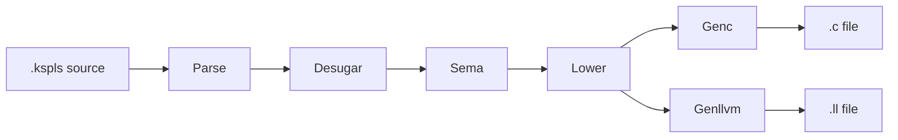

# ksplc

**`ksplc` is the KSPL compiler.** It reads KSPL source and writes C99 (the 1999 edition of C) by default (`--to=c`), or LLVM IR (`--to=llvm`, the text form of code that LLVM, the toolkit behind clang, turns into machine code). It is written in KSPL itself, so it compiles its own source (*self-hosting*).

**This page is a map of the compiler's source, for whoever reads or changes it**: which folder does what, and which file holds what. The internal design and its reasons are in [`ksplc/docs/DESIGN.md`](docs/DESIGN.md); the words it uses (AST, Sema, ARC and the rest) are defined in its glossary, "The glossary" in [`ksplc/docs/DESIGN.md`](docs/DESIGN.md). To only use the compiler, the quick start in the root README is enough.

## Run it

```sh
ksplc build hello.kspls hello            # the default target, C99, compiled and linked by clang
ksplc --to=llvm hello.kspls hello.ll   # then clang hello.ll with the runtime ksplc emit-runtime puts out
```

The first line makes an executable `hello`. The second writes LLVM IR; to make an executable from it, compile it with clang together with the C runtime (the support code every program needs) that `ksplc emit-runtime` writes.

Two `make` commands, run in this folder ([`ksplc/Makefile`](Makefile)), test and rebuild the compiler:

| Command | What it does | What it needs |
| :-- | :-- | :-- |
| `make test` | **Runs the compiler's own tests.** First the compiler's answers, checked by programs it builds (`make test-answers`, [`ksplc/tests/`](tests/)). Then the suites that drive this folder's compiler from outside (`make test-suites`, [`ksplc/tests/suite/`](tests/suite/)) | Only a `ksplc` and the kspeg this package uses |
| `make self-host` | **Rebuilds this folder's compiler** from the `ksplc` it is given, and requires the result to reproduce itself exactly | A `ksplc` |

ksplc names itself as a package in [`ksplc/ksplc.cfg`](ksplc.cfg), so a copy of this folder runs both the same way. The repository's `make` does the same rebuild, starting from [`seed.c`](seed.c). Building that first compiler from the seed is the repository's job, and so are the checks on the built compiler that reach past this folder (the repository's `tests/`).

## The idea

**The compiler is a pipeline: one tree passes through a fixed row of stages, strictly one way.** The tree is the AST (abstract syntax tree), the program held as nested nodes instead of text. Each stage reads the tree the stage before it left and never reaches back (why is "From source code to a binary" in [`ksplc/docs/DESIGN.md`](docs/DESIGN.md)).



| Stage | What it does | Folder |
| :-- | :-- | :-- |
| **Parse** | Reads the text and builds the tree | `parse/` |
| **Desugar** | Rewrites shorthand (*syntactic sugar*) into plainer forms, where the types are not needed | `parse/` |
| **Sema** (semantic analysis) | Finds what each name means, works out every type, and reports type errors | `sema/` |
| **Lower** | Flattens the checked tree into a simple shape that suits either output | `lower/` |
| **Genc / Genllvm** (the *backends*) | Write the C99 or the LLVM IR | `gen/c/`, `gen/llvm/` |

## What is here

The pipeline's folders come first, in the order the data flows (the two backends and their shared runtime under `gen/`). Then come the four folders outside the pipeline: `base/`, `lsp/`, `fmt/` and `tools/`. Each folder's section names its files; the design of each stage is the chapter of [`ksplc/docs/DESIGN.md`](docs/DESIGN.md) named at the section's end.

Directly in this folder:

* [`main.kspls`](main.kspls) — the entry point: it reads the command line and starts each subcommand, with the usage text in [`usage.kspls`](usage.kspls).
* [`pipeline.kspls`](pipeline.kspls) — the `Compiler` that runs the stages in order.
* [`source_checks.kspls`](source_checks.kspls) — the checks on the source's own spelling (the indentation, a `//<` that reaches nothing, a comment's pointer), run once the declarations are collected.

### parse/ — the Parse layer

**It reads the source text, builds the abstract syntax tree and normalizes it**: it reshapes the parser's raw tree so that every kind of node has one fixed layout.

* [`load.kspls`](parse/load.kspls) — `load_and_parse_file`, the one function that runs the loading, and follows the `import`s itself.
* [`normalize.kspls`](parse/normalize.kspls), with [`normalize_decl.kspls`](parse/normalize_decl.kspls) and [`normalize_stmt.kspls`](parse/normalize_stmt.kspls) — normalizing the tree, with declarations and statements apart.
* [`layout.kspls`](parse/layout.kspls) — turns a file in the indentation notation (`.kspls`) into the brace shape; [`line_cont.kspls`](parse/line_cont.kspls) decides what joins a line to the next. The formatter asks it too, so both read a line alike.
* [`source_fix.kspls`](parse/source_fix.kspls) — fixes the source's spelling before analysis.
* [`desugar.kspls`](parse/desugar.kspls), with [`desugar_slice.kspls`](parse/desugar_slice.kspls) and [`desugar_closure.kspls`](parse/desugar_closure.kspls) — the sugar that needs no types; [`format_spec.kspls`](parse/format_spec.kspls) reads a string interpolation's `SPEC`, its format specifier (the `6` in `\{x:6\}`).
* [`ast_cache.kspls`](parse/ast_cache.kspls) — keeps the normalized AST on disk so the next parse is skipped; [`syntax_msg.kspls`](parse/syntax_msg.kspls) writes a syntax error's message.

It drives the grammar [`kspl.kspeg`](kspl.kspeg) through the engine in [kspeg](../kspeg/README.md).

```sh
make test-kspls   # the two notations of tests/kspls/tour.kspl(s) give one AST, one C, one set of positions
```

The design is "The Parse layer: from text to an AST (Desugar included)" in [`ksplc/docs/DESIGN.md`](docs/DESIGN.md).

### sema/ — the Sema layer

**It walks the AST to work out the types (type inference), to find what each name refers to (symbol resolution), and to track scopes.** It has two entry points. `run` in [`decl/collect.kspls`](sema/decl/collect.kspls) registers every file's declarations first. `run` in [`body/infer.kspls`](sema/body/infer.kspls) is the main walk. There are five folders, stacked like floors and listed from the bottom: a folder may import the ones below it, never those above (the exact directions are "How sema is split into folders, and the direction of the dependencies" in [`ksplc/docs/DESIGN.md`](docs/DESIGN.md)).

| Folder | The question it answers | Files |
| :-- | :-- | :-- |
| [`type/`](sema/type/) | How is a type or a name expressed? | `def` (the types' shapes), `env` / `query` / `arc` (the type table and its queries), `naming` (output names and instantiation-cache keys), `scope` (the symbol table: from a name to what it declares), `display` (the strings a diagnostic prints) |
| [`session/`](sema/session/) | What is shared through one analysis? | `ctx` (`Sema_ctx` itself, the diagnostics, declaring a symbol), `state`, `import_table` / `imports` (the import declarations and their ledger), `pointer` (what a comment's pointer stands for), `c_boundary` (what the generated C cannot hold), `prof` (the breakdown of sema's time) |
| [`decl/`](sema/decl/) | What is there, under what name, and of what type? | `collect` (the entry point), `declare`, `registry` / `layout`, `resolve`, `name` (what a written name names), `access`, `attrs`, `eval`, `reflect`, `type_check`, the generics (`mono*` / `subst`), the traits (`trait_check` / `trait_default`) |
| [`flow/`](sema/flow/) | Which state is a binding in, and when? | `track`, `stmt` (branching and joining), `release`, `report` (the diagnostics) |
| [`body/`](sema/body/) | Is the code right? | `infer` (the main walk), the expressions, the statements, the calls (`generic_infer` reads a call's type arguments off its arguments), the coercions, `lint_stmt` |

```sh
make debug-ksplc   # the compiler's own tests, the type checks and the diagnostics among them
```

The design is "The Sema layer: it knows the types" in [`ksplc/docs/DESIGN.md`](docs/DESIGN.md); where a check goes and what a diagnostic points at is "The design rules for the checks and the diagnostics" in [`ksplc/docs/DESIGN.md`](docs/DESIGN.md). The diagnostic codes this layer emits are listed in [`ksplc/docs/SPEC-tools.md`](docs/SPEC-tools.md).

### lower/ — the Lower layer

**It flattens the checked tree into a shape that does not depend on either backend**: nested control flow becomes a plain sequence of steps that C and LLVM IR can both write directly. The passes run in the order "The internal flow: one MIR-flattening walk → generating thunks and vtables → the ABI mangling → dead-code elimination → verification" in [`ksplc/docs/DESIGN.md`](docs/DESIGN.md) gives.

* [`root.kspls`](lower/root.kspls) — the one recursive walk that flattens the control flow. Inside it, [`expr.kspls`](lower/expr.kspls) hoists expressions (moves a part out into a temporary before the statement), [`defer.kspls`](lower/defer.kspls) flattens `defer` and the exits that run it, [`order.kspls`](lower/order.kspls) moves an operand into a temporary where C could run it out of the written order, and [`ctx.kspls`](lower/ctx.kspls) holds the walk's state.
* [`arc.kspls`](lower/arc.kspls) — inserts ARC's `retain()` / `release()` on the way (ARC: automatic reference counting, where a value is freed when its last holder lets go).
* [`vtable.kspls`](lower/vtable.kspls) — a trait value's thunks and vtables (the go-between functions and tables of function pointers that let one call reach whichever type stands behind a trait).
* [`abi.kspls`](lower/abi.kspls) — the ABI mangling (turning KSPL's names into unique names in the output by a fixed rule), and desugaring the method calls.
* [`prune.kspls`](lower/prune.kspls) — drops the functions and types nothing calls.
* [`verify.kspls`](lower/verify.kspls) — checks that the tree's types mesh at the exit.

```sh
make test-equiv   # the C and the LLVM outputs of one program agree, so what lower hands down is backend-neutral
```

The design is "The Lower layer: a flat tree that depends on no backend" in [`ksplc/docs/DESIGN.md`](docs/DESIGN.md), and ARC's is "The rules for implementing ARC" in [`ksplc/docs/DESIGN.md`](docs/DESIGN.md).

### gen/ — what the two backends share

**What the two outputs must agree on is written once, directly under `gen/`** (why is "What the two generators share: the decisions, not the spelling" in [`ksplc/docs/DESIGN.md`](docs/DESIGN.md)).

* [`runtime.kspls`](gen/runtime.kspls) — hands out the C runtime that completes either output: the support code in C that every program links, such as reading files or stopping with a message. The runtime itself is [`gen/runtime/`](gen/runtime/): `core.*` for every target, plus one of two halves. `hosted.*` is for an OS beneath the program, split by subject into `hosted_fs` / `hosted_net` / `hosted_proc` / `hosted_spawn` / `hosted_thread`; `freestanding.*` is for bare metal (no OS).
* [`entry.kspls`](gen/entry.kspls) — what the generated `main` does around `kspl_main`.
* [`embed.kspls`](gen/embed.kspls) — reads the file an `embed` names.

```sh
make test-emit-runtime   # the runtime handed out whole, and one entry point whichever backend built the program
```

### gen/c/ — the C99 backend

**It turns the flattened AST into C99.** The `.c` file holds the C runtime too (`gen/` above). Under `--library`, everything in it but the `#export` functions is `static`.

* [`root.kspls`](gen/c/root.kspls) — `run`, the single entry.
* [`ctx.kspls`](gen/c/ctx.kspls) — the context and its fluent output API (calls chained one after another).
* [`decl.kspls`](gen/c/decl.kspls) the declarations, [`types.kspls`](gen/c/types.kspls) the types, [`stmt.kspls`](gen/c/stmt.kspls) the statements, and [`expr.kspls`](gen/c/expr.kspls) the expressions, with the postfix forms in [`expr_postfix.kspls`](gen/c/expr_postfix.kspls).
* [`literal.kspls`](gen/c/literal.kspls) — turns KSPL's literals into C strings.

```sh
make test-ship   # two libraries built with --library link into one C program and one KSPL program
```

### gen/llvm/ — the LLVM IR backend

**It turns the same flattened AST into LLVM IR** (`--to=llvm`). It emits no debug information. The bodies of the features that need the OS are the C runtime's ([`gen/runtime/`](gen/runtime/)), which its output links against.

* [`module.kspls`](gen/llvm/module.kspls) — `run`, the entry, matching the C backend's.
* [`ctx.kspls`](gen/llvm/ctx.kspls) — the context at the centre: the output buffer and the SSA numbering (in LLVM IR each value gets a fresh number, `%1`, `%2`, …).
* [`decl.kspls`](gen/llvm/decl.kspls) the top-level declarations, [`types.kspls`](gen/llvm/types.kspls) the types and their LLVM spellings, [`stmt.kspls`](gen/llvm/stmt.kspls) the statements, and [`expr.kspls`](gen/llvm/expr.kspls) the expressions, with the aggregates (structs and arrays) in [`expr_agg.kspls`](gen/llvm/expr_agg.kspls) and the calls in [`expr_call.kspls`](gen/llvm/expr_call.kspls).

Both backends' design, and what each refuses, is "The backends (Genc / Genllvm) and the runtime ABI" in [`ksplc/docs/DESIGN.md`](docs/DESIGN.md).

### base/ — the foundation every layer stands on

**The lowest tier, below the pipeline.** Every layer opens with a line like this one; nothing here runs on its own.

```kspls
import "ksplc/base/ast" { Ast_node }
```

| Subject | Files |
| :-- | :-- |
| **The tree** | [`ast.kspls`](base/ast.kspls) is the general-purpose node `Ast_node` and its verification, [`ast_kinds.kspls`](base/ast_kinds.kspls) the closed set of node kinds, [`ast_ext.kspls`](base/ast_ext.kspls) the safe accessors, [`ast_place.kspls`](base/ast_place.kspls) the place predicates (does an expression name existing memory?), [`ast_spell.kspls`](base/ast_spell.kspls) spelling a node back as text, and [`ast_doc.kspls`](base/ast_doc.kspls) the `//<` description a declaration carries |
| **The shared state** | [`core.kspls`](base/core.kspls) holds the shared arenas (memory pools freed all at once), the compiler's configuration and the string pool (each distinct string kept once), [`setup.kspls`](base/setup.kspls) starts and ends the layer in one go, and [`target.kspls`](base/target.kspls) is the table of machines ksplc lays values out for, and which one a compile is for |
| **The source** | [`as_written.kspls`](base/as_written.kspls) keeps the text as typed before the indentation is fixed (what a diagnostic quotes), [`locate.kspls`](base/locate.kspls) says where a source comes from and its logical name, [`lines.kspls`](base/lines.kspls) finds where a line begins and ends, and [`literal.kspls`](base/literal.kspls) reads a literal's spelling |
| **The diagnostics** (the compiler's messages about your code) | [`diag.kspls`](base/diag.kspls) prints them, [`lint_codes.kspls`](base/lint_codes.kspls) is the registry of their codes, and [`cfg_inactive.kspls`](base/cfg_inactive.kspls) keeps the ranges a `#cfg()` left out, so the editor can say why nothing stands there |
| **The names emitted** | [`mangle.kspls`](base/mangle.kspls) turns KSPL's names into C and LLVM identifiers, and [`c_name.kspls`](base/c_name.kspls) avoids the C names that cannot be used plain |
| **The settings and the packages** | [`config_file.kspls`](base/config_file.kspls) reads `ksplc.cfg`, and [`package.kspls`](base/package.kspls) its `[package]` section: a package's name, what it uses, and the logical name of a file inside it |
| **The measurements** | [`cache.kspls`](base/cache.kspls) places the cache on disk, and [`stats.kspls`](base/stats.kspls) counts each stage's time and arena use |

The design is "The compiler as a whole" in [`ksplc/docs/DESIGN.md`](docs/DESIGN.md); the rules for handling the AST every layer shares, and the arena model, are "The rules for handling an AST, shared by every layer" and "Memory management: the arena model" in [`ksplc/docs/DESIGN.md`](docs/DESIGN.md).

### lsp/ — the language server

**It answers an editor's questions (go to definition, hover, completion) by driving the pipeline from outside, once per request.** The editor and the server talk the Language Server Protocol (LSP), in JSON-RPC messages.

* [`server.kspls`](lsp/server.kspls) — the supervisor of a child worker.
* [`worker.kspls`](lsp/worker.kspls) — builds the state a request is answered from, and routes each method from one table.
* [`state.kspls`](lsp/state.kspls) — what lasts between requests (the open documents' texts, the analysed state, the arena's rewind point).
* [`msg.kspls`](lsp/msg.kspls) — reads and writes the JSON-RPC messages.
* Each answer has its own file, reading the state alone, never the dispatch: which node a position stands on ([`position.kspls`](lsp/position.kspls)), navigation ([`nav.kspls`](lsp/nav.kspls)), how a declaration's types and signature are spelt ([`spell.kspls`](lsp/spell.kspls)), hover ([`hover.kspls`](lsp/hover.kspls)), completion ([`complete.kspls`](lsp/complete.kspls)), references and renaming ([`uses.kspls`](lsp/uses.kspls), with what a rename refuses in [`rename.kspls`](lsp/rename.kspls)), the call hierarchy ([`call_hier.kspls`](lsp/call_hier.kspls)), semantic tokens (the colouring of each word by what it is, [`semtok.kspls`](lsp/semtok.kspls)), the outline (what a file declares, nested, [`outline.kspls`](lsp/outline.kspls)), and which files are in the workspace ([`workspace.kspls`](lsp/workspace.kspls)).

```sh
make test-lsp   # starts the server once and drives every request against it
```

The design is "The arena is rewound after each request (a worked example)" to "A document URI is converted to the logical name on the way in, and back to the editor's spelling on the way out" in [`ksplc/docs/DESIGN-tools.md`](docs/DESIGN-tools.md). What the editor may rely on is [`ksplc/docs/SPEC-tools.md`](docs/SPEC-tools.md), "The language server (ksplc lsp)".

### fmt/ — the formatter

**It turns the Parse layer's AST back into neatly laid-out source text** (`ksplc fmt`).

* [`printer.kspls`](fmt/printer.kspls) — the printer, moving forward through the original text and never back.
* [`trivia.kspls`](fmt/trivia.kspls) the comments and blank lines between the tokens (with [`comment.kspls`](fmt/comment.kspls) deciding where a comment too wide is cut), [`space.kspls`](fmt/space.kspls) the whitespace and wrapping (carrying a string onto the next line among them), and [`style.kspls`](fmt/style.kspls) the settings `--style` reads.
* What it reads from, kept apart: [`kinds.kspls`](fmt/kinds.kspls) sorts the node kinds and the token spellings, [`source.kspls`](fmt/source.kspls) reads the original text around a position, and [`measure.kspls`](fmt/measure.kspls) a node's shape and width.
* [`import.kspls`](fmt/import.kspls) — puts the run of `import`s into name order before the printer runs.
* [`text.kspls`](fmt/text.kspls) — the one path through a text that both `ksplc fmt` and the lint take (the imports' order, the printer, the rounds that put parentheses in).
* [`file.kspls`](fmt/file.kspls) — one file's round trip for `ksplc fmt`: taking off and putting back the BOM (an invisible mark some editors put at a file's start), the line terminator and the shebang (`#!` first line), and writing back.

```sh
make fmt    # every tracked .kspl / .kspls, each in its own notation
```

What `ksplc fmt` and `--style` promise is [`ksplc/docs/SPEC-tools.md`](docs/SPEC-tools.md), "3. The formatter (ksplc fmt)". The formatter's own decisions (the `import`s reordered as text before the printer, nothing folded by default, four spaces a level, blank lines and the line terminator) are in [`ksplc/docs/DESIGN-tools.md`](docs/DESIGN-tools.md), from "The formatter reorders the `import`s as text, before the printer" to "Blank lines and the line terminator".

### tools/ — the tools that work on the pipeline's artifact

**Commands built on what the pipeline produces, and the tools that inspect the compiler's own parts.**

| File | What it does | How you reach it |
| :-- | :-- | :-- |
| [`keywords.kspls`](tools/keywords.kspls) | Derives the keyword list from the grammar | — |
| [`surface.kspls`](tools/surface.kspls) | The record of the API a package offers | `--emit-surface=` |
| [`interface.kspls`](tools/interface.kspls) | A library's interface, a C header or an `extern "C"` block, from its `#export` functions | `--library=` |
| [`doc.kspls`](tools/doc.kspls) | What a file, an entry or a folder publishes, rendered from the source as the reference to read | `ksplc doc` |
| [`explain.kspls`](tools/explain.kspls) | Prints a diagnostic code's section of the tools specification | `ksplc explain` |
| [`run.kspls`](tools/run.kspls) | Compiles, links and runs a program in one command | `ksplc run` |

```sh
make lint   # the static analysis alone; zero down to hints is a pass
```

The CLI options, and the formatter, the language server and the linter as seen from outside, are specified in [`ksplc/docs/SPEC-tools.md`](docs/SPEC-tools.md). Why lint is switched per code and where the settings file sits is "The design of the tool settings" in [`ksplc/docs/DESIGN.md`](docs/DESIGN.md).

### kspl.kspeg / seed.c — the grammar and the seed

**`ksplc/kspl.kspeg` is the canonical text of KSPL's own grammar** (the one place the rules for reading KSPL text live). It is a build input that `ksplc/main.kspls` embeds, not documentation. Its KSPEG notation is specified in [`kspeg/docs/SPEC-notation.md`](../kspeg/docs/SPEC-notation.md), and the engine that interprets it is in `kspeg/`.

**`ksplc/seed.c` is the bootstrap's seed compiler**: the compiler at one moment, translated to C and checked in, so the first build needs only a C compiler.

Caution: **After any change under `ksplc/` (`ksplc/kspl.kspeg` included), update the seed with `make commit-seed`**, following "The bootstrap, and keeping the seed in step" and "Keeping the grammar and the AST node kinds in step" in [`ksplc/docs/DESIGN.md`](docs/DESIGN.md). Otherwise the seed keeps building the old compiler.

## The suites' folders, and adding a fixture

**A suite is a test program run by one ksplc that inspects another.** A broken compiler and a failed check would look alike if one compiler did both. [`ksplc/Makefile`](Makefile) names the three places a suite uses:

| Name | What it is | What the repository fills it with |
| :-- | :-- | :-- |
| `RUNNER` | The compiler that runs the suite | Its seed |
| `UNDER` | The compiler under inspection | Its Stage1 (the compiler the seed built) |
| `SCRATCH` | Where a suite writes its files | A place of its own |

`make test-<name>` runs one suite, here or from the repository's root. The names are `SUITES` in [`ksplc/Makefile`](Makefile), and what each suite checks is its opening comment, in `tests/suite/<name>_test.kspls` (`-` written `_`).

| Folder | What lives there |
|---|---|
| [`tests/suite/`](tests/suite/) | One suite, `<name>_test.kspls`, run by `make test-<name>` |
| [`tests/support/`](tests/support/) | Code the suites read: `harness*`, shared by every suite, and `<suite name>_<subject>`, one suite's own piece |
| [`tests/negative/`](tests/negative/) [`tests/lint/`](tests/lint/) [`tests/runtime/`](tests/runtime/) | The fixtures `test-negative`, `test-lint` and `test-runtime` read: many cases to a file by subject |
| [`tests/prog/`](tests/prog/) | A program under inspection, which a suite builds on both backends or reads a line-number landmark from: one file, or `equiv.kspls` with the shapes C leaves open in the `equiv_shapes.kspls` it imports |
| [`tests/filepath/`](tests/filepath/) | `test-file-path`'s material. **It takes two files**: with one, the unspecified-visibility path is never taken |
| [`tests/kspls/`](tests/kspls/) | `test-kspls`'s twins: one source in both notations, which must give the same C. The language tour is written from one of them |
| [`tests/ship/`](tests/ship/) | `test-ship`'s two vendors and two customers: libraries built with `--library`, a C program and a KSPL program using them. `app.kspls` imports an interface the suite writes, so it compiles only there |

**The shared foundation is split by the reason for reading it**: `harness`, `harness_build` (the only caller of the C compiler and the linker), `harness_expect`, `harness_markers` and `harness_grow`, each saying in its opening comment what it holds.

The CLI suite keeps command selection and diagnostics in `tests/suite/cli_test.kspls`; `tests/support/cli_emit.kspls` holds the emitted-file checks and their shared command assertions. The package-location suite keeps std discovery in `tests/suite/std_dir_test.kspls`; `tests/support/std_dir_named.kspls` holds named-package and path-identity checks, with the child-environment setup both halves use.

**A fixture is one small source with its expected result written in its opening comment.** The three fixture folders share the marks (read by `harness_markers.markers()`):

```kspls
//< Write in 1 to 4 lines what is being pinned down (why it breaks if it is otherwise).
// ARGS: --to=llvm          the arguments to prefix to the compiler (omissible)
// EXPECT: <what the output must contain>
// EXPECT-NOT: <what the output must not contain>
program
```

**The description holds at most four lines of text**, a bare `//<` parting aside: the cases are a few lines each, so a longer one outgrows what it describes. A trap one case guards goes beside that case, as a `//` above it.

What each folder runs, and what exit code it demands:

| Folder | What runs | The exit code |
| :-- | :-- | :-- |
| `tests/negative/` | `ksplc [ARGS] <file> <out.c>` | **Must be non-zero** (the compiler refuses the program) |
| `tests/lint/` | `ksplc lint [ARGS] <file>` | Not looked at: lint exits 0 even with diagnostics |
| `tests/runtime/` | The compile must pass; then it links and runs the program and matches its own output | **Must be non-zero** (this folder pins down stopping at run time) |

Rules for `tests/runtime/`:

* **Write the subscript and the like so that it is decided at run time.** A constant subscript inside the range emits no check (`index_is_static_in_range` in `sema/body/postfix.kspls`), so the test would never take the run-time path.
* The exception is a fixture pinning down "the boundary that may be omitted" (the case `array_index_constant_out_of_bounds` in `tests/runtime/stops.kspls`).
* Caution: **Put the position (`at <file>:`) in `EXPECT` too.** Matching the sentence alone lets a wrongly spelt file name slip past (LLVM puts it in the string pool, where its head and tail drop if the wrapping is wrong). A case is compiled from its own folder by its file name, outside any package, so the position names the case (`at <name>:`).
* Each fixture is built and run twice, once by the C backend and once by the LLVM backend, and the same marks are matched against both outputs. So write marks that **hold on both**. Write in full what both print the same way every run, such as `panic: index out of bounds in array (idx: 7, len: 4)`: then one mark also catches the two backends printing it differently. Leave out a part that changes from run to run, such as an address.
* **A fixture imports nothing beyond what this package uses**: a stop only another package's code can reach is that package's to pin.

Rules for every fixture folder:

* Do not repeat an `EXPECT-NOT:` string in the same file's comments: a diagnostic quotes the source line, so the comment appears in the output and fails its own check.
* **A case with an `EXPECT-NOT:` names every error it reports**: each `error:` line in its output holds one of its `EXPECT:` strings, or the suite fails the case and prints the line. An error the case does not foresee can stop the check the `EXPECT-NOT:` is about (after an error in a body, the analysis of the rest of that body is skipped), and the `EXPECT-NOT:` then holds whatever the compiler does.
* Caution: **A case that must fail, yet pins that a check stays silent, fails through that same check**: on another name, after the places that must stay silent, with its count pinned (`EXPECT: Finished with 1 error(s)`), as the case `use_after_free_block_dealloc_ok` in `tests/negative/import.kspls` does. **The suite cannot check this one**: an unrelated error the case names (an undefined name, say) passes the rule above and still stops the check.
* **In each fixture folder, a file holds the cases of one subject**, each opened by a line `// ==== case <name>` (the name in lower case letters, digits and `_`). The case is the text from the line after its head to the next head, and it is **compiled alone**, as the file `<name>.kspls` (or `.kspl`, the group file's notation) in the suite's scratch. So a case reads as the file it would be alone: its marks are its own, a position in a mark counts lines from the line after its head, and nothing one case declares reaches another. A mark above the first head, or two cases with one name in a folder, fails the suite.
* **A case that only compiles where it stands stays a file of its own**, with no head: such a file is compiled in place. That is a case whose message carries its module's full name or that imports this package's code, both of which change outside it, the `deep_*` material of a limit, and a source another gate also compiles by its path (`tests/runtime/main_result_without_sys.kspls`). Each says why in its opening comment.
* Add a case to the file of its subject; a new file only for a new subject or a new notation. Keep a file under about 600 lines, so a reader can still find a case in it.
* A case may show several shapes of one subject, one function each (`fn case_<name>()`), with every shape's marks together at its head. The same `EXPECT:` line written N times must match N places in the output. **Only checks raised inside a function body may share a case this way**, and only where the compile really reports every shape. Some checks stop at the first problem they find and say nothing of the rest; a cycle check is one. Such a check takes a case of its own: merged, the shapes after the first are lost silently and the gate stays green.
* Prove a move between files by the marks. List every `EXPECT` line in the folder before and after, keeping duplicates (`grep -h '^// EXPECT' tests/negative/* | sort`, run in this folder). The two lists must be the same, line for line: each case then still demands its own error.

## Files near the limit and how they split

**How to choose the cut is "Choosing where to split a file" in [`docs/DESIGN.md`](../docs/DESIGN.md).** This package adds two constraints of its own:

* **`make fmt` uses the seed**, so in a split that touches the grammar, run `make commit-seed` first (why is "The bootstrap, and keeping the seed in step" in [`ksplc/docs/DESIGN.md`](docs/DESIGN.md)).
* **A suite splits where what it reads splits.** What only the repository's whole tree can show (a common word read across every package, a rename reaching another package's files) is not asked here, since a copy of this folder has no such tree; the queries this folder can answer for itself stay in `lsp`, with this folder as the workspace.

## Further reading

| Document | What it is for | Who reads it |
| :-- | :-- | :-- |
| [`ksplc/docs/SPEC-tools.md`](docs/SPEC-tools.md) | The CLI options, the formatter, the language server and the linter as seen from outside, and what each diagnostic code means. | Whoever writes KSPL and runs the tools. Needs a built `ksplc` to try them against |
| [`ksplc/docs/DESIGN.md`](docs/DESIGN.md) | The compiler's internal design, data flow and implementation conventions, and why it is built this way. | Whoever changes ksplc. **Read at least "The compiler as a whole" and "The Development Principles" before touching anything here** |
| [`ksplc/docs/DESIGN-tools.md`](docs/DESIGN-tools.md) | How the language server, the formatter and `ksplc run` work inside, split from the internal design for length. | Whoever changes `lsp/`, `fmt/` or `ksplc run` |
| [`ksplc/docs/HOWTO-extend.md`](docs/HOWTO-extend.md) | The steps for a diagnostic code, an AST node kind, a primitive type, a subcommand, a target machine and the seed update. | Whoever extends the compiler; needs a clone that builds |
| [`docs/SPEC-language.md`](../docs/SPEC-language.md) | The language specification being implemented. | Whoever writes KSPL, and whoever changes ksplc |
| [`docs/HOWTO-build.md`](../docs/HOWTO-build.md) | The build procedure and the two-stage bootstrap. | Whoever changes ksplc. Needs a C compiler |
| [`docs/SPEC-gates.md`](../docs/SPEC-gates.md) | What every gate checks, per platform. | Whoever changes ksplc |
| [std](../std/README.md) | The standard library the compiler is itself written on; every file it publishes is listed by `ksplc doc std`. | Whoever changes ksplc |
| [kspeg](../kspeg/README.md) | The engine that drives `kspl.kspeg`, the grammar. | Whoever changes how the language is read |
