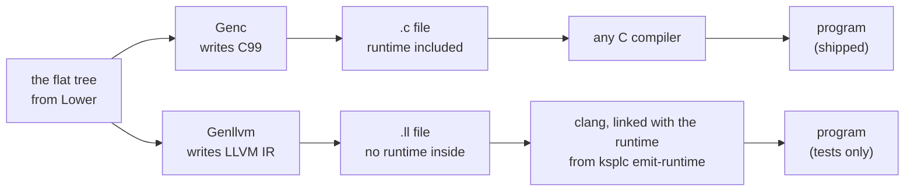
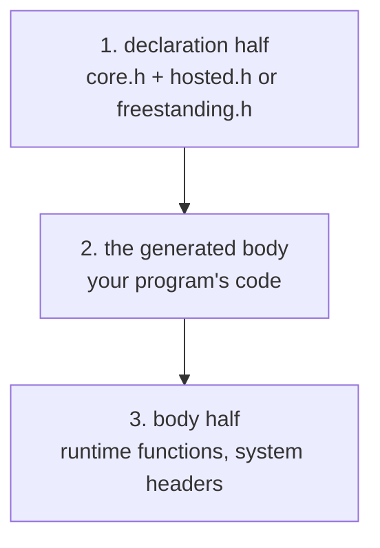
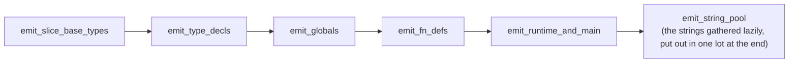
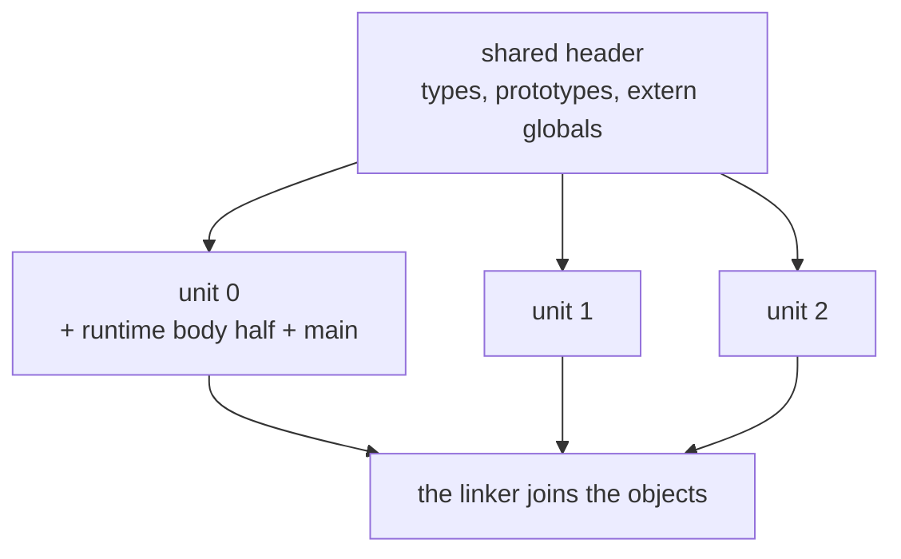

# ksplc's backends and the runtime ABI

**This document holds the design of ksplc's last layer, the two backends.** It says three things:

* how Genc writes C and Genllvm writes LLVM IR from the finished tree;
* what the two must agree on;
* the ABI the runtime shares with them.

It is one chapter of the compiler's internal design. [`DESIGN-compiler.md`](DESIGN-compiler.md) holds the rest:

* the map of the whole compiler and the Development Principles;
* the rules for handling an AST that every layer shares;
* the arena, the conventions and the glossary.

Read "The compiler as a whole" in [`DESIGN-compiler.md`](DESIGN-compiler.md) first.

## The backends (Genc / Genllvm) and the runtime ABI

A *backend* is the last stage of the compiler: it turns the finished tree into code for a target. ksplc has two. **Genc** writes C99 source, and every shipped program is built through it. **Genllvm** writes LLVM IR, the text form that the LLVM toolchain (clang's back half) compiles. It exists to check the stages above it, and is not shipped.

The diagram shows both routes from the tree Lower hands over to a running program.



**Why two are held**: C99 is the default output, and every shipped artifact is built through it. A C compiler exists on nearly every platform, bare-metal ARM included (clang builds for `thumbv7m`; *bare metal* means a chip with no operating system). So nothing beats generated C for portability. The LLVM IR backend (`--to=llvm` / `make LLVM=1`) has two roles:

1. **It proves that the layers above the backends (parse / sema / lower) are neutral.** When two outputs from the same AST behave alike (`make test-equiv` / `make test-llvm-abi`), no backend dependency has leaked upstream, which bears on the C output's quality.
2. **It keeps an option open**, so a target with no C compiler does not start from zero.

**The LLVM backend is a mirror, not an exit.** Shipping uses C99 alone, so no second exit is held (Principle 6).

**Only the C runtime holds the bodies of `kspl_*` symbols.** The *runtime* is the C code every program needs besides its own: files, directories, sockets, processes, threads, secure random numbers and the clock. It has one implementation, in `gen/runtime/`, and genllvm does not reimplement it. The IR only emits `declare`s (LLVM's "this function exists elsewhere") from `std/`'s `extern "C"` declarations. It is then linked with the C runtime that `ksplc emit-runtime` writes (`STAGE1_RT` under `make LLVM=1`; `tests/support/harness_build.kspl` for the tests). A symbol the IR's `main` calls stops a runtime of another version from linking ("The runtime written alone, and its version symbol"). So both artifacts can do the same things. The IR's own share is only the `main` entry point and what is `static inline` on the C side: the bounds, division and shift checks. `make test-conventions`'s "there is no `kspl_*` body on LLVM's side" holds this. Both backends spell the entry point's work from `gen/entry.kspl` ("What the two generators share: the decisions, not the spelling").

**An LLVM artifact is not shipped.** It carries no debug information ("Genllvm (LLVM IR): why the structure differs, and managing SSA"). So a fault in a shipped build could not be traced to a `.kspl` line. `ksplc run` / `--split` / `--library` / `commit-seed` refuse `--to=llvm` as well. Shipping one needs debug information first.

| | Genc (C99) | Genllvm (LLVM IR) |
| :-- | :-- | :-- |
| Role | the output that ships | a mirror that checks the layers above |
| Runtime | written into every `.c` | linked in from `ksplc emit-runtime` |
| Debug information | `#line` before every statement | none |
| `ksplc run`, `--split`, `--library`, `commit-seed` | yes | refused |
| Machines | every row of `MACHINES` in `base/target.kspl` | those with 8-byte pointers, by their `target triple`; refused otherwise |

**genllvm lays out only 8-byte pointers and `Sz`** (a slice is `{ ptr, i64 }`, "The runtime memory layout and the ABI specification"). So `check_machine` in `cli.kspl` refuses `--to=llvm` for a machine whose row has no LLVM triple. It does so before any IR is written. The IR names the row's `target triple` and no `target datalayout`. LLVM derives the layout from the triple. clang replaces a module's own layout with its target's without a word. So a copy would state what nothing reads.

### What they answer for

The backends only translate; every decision has been made before them. They are the first stage that knows the target. They receive a normalized, plain AST: semantic analysis, desugaring, mangling and thunk generation are all done. They are **pure emitters** writing the target language ("A backend writes straight out rather than assembling" in [`DESIGN-compiler.md`](DESIGN-compiler.md)). They hold no logic for type inference, control flow or method resolution. Both start from the same `switch target` in `pipeline.kspl` on the same flattened `root_file`. Only their internal stages differ ("Genc (C99): the topological output order", "Genllvm (LLVM IR): why the structure differs, and managing SSA").

### What the two generators share: the decisions, not the spelling

**What the two outputs must agree on is written once, in a shared file directly under `gen/`. Each backend writes it out in its own language.** Neither backend imports the other.

| What is shared | The file | What it holds |
| :-- | :-- | :-- |
| the C runtime that completes either output | `gen/runtime.kspl` | The embedded `gen/runtime/` files in order. Also the version symbol that stops a runtime of another version from linking ("The runtime written alone, and its version symbol"). |
| what the generated `main` does around `kspl_main` | `gen/entry.kspl` | the startup calls and their order, how the return value becomes an exit code, and the kind of error a failure passes to the runtime's `kspl_main_fail` |
| reading the file an `embed` names | `gen/embed.kspl` | finding it the way an import is found, and refusing one that cannot be read |

**A decision written twice drifts with no warning until someone runs the other backend.** A `main` written per backend can lack a call in one of them. Take the call that puts standard output into binary mode. Without it, a program built with `--to=llvm` writes `\r\n` on Windows where the C one writes `\n`. The reason is "Standard output carries the bytes a program writes" in [`../../docs/DESIGN-programming-language.md`](../../docs/DESIGN-programming-language.md). And a symbol that one backend owns, such as the runtime's version symbol, would make the other import it.

**An `embed` with no path in the tree stops with an ICE** (an internal compiler error, see [the glossary](DESIGN-compiler.md#the-glossary)). The parser always gives an `embed` its path as a string literal, so a missing one is a broken invariant. Returning silently would be the stopgap "Failing fast through an exception or an ICE" in [`DESIGN-compiler.md`](DESIGN-compiler.md) forbids.

**Where the spelling differs, the table belongs to the backend.** The functions the LLVM preamble declares or defines itself form one table, `PREAMBLE_FNS` in `gen/llvm/ctx.kspl`. It drives both the `declare`s and the skipping of `std`'s own declarations, so the two cannot disagree. `make test-conventions` holds its hand-defined entries against the `define`s in `gen/llvm/module.kspl`.

**The emission itself is not shared**: the bodies of genc and genllvm overlap in only a few short windows, a small fraction of the whole.

| The overlap | How it is handled |
| :-- | :-- |
| the composite types' de-duplication (10 lines × 3 places) | **gathered** in `Mangle_seen` in `ksplc/sema/type/naming.kspl` (the key is the output name, so it sits with its spelling) |
| `clear_scratch` / `take_scratch` (6 lines × 2 places) | not gathered: each is one statement, and a shared function would need as many lines at each caller |

**There is no trait for the output destination.** The shared files touch the source map, the type table and plain values, never the output buffer, so plain functions are enough. Do not add a trait that binds `Genc_ctx` and `Genllvm_ctx` together.

### The runtime memory layout and the ABI specification

Every KSPL value has one fixed layout in memory, and both backends follow it, so C output and LLVM output can call each other. This agreement is the *ABI* (application binary interface, see "Words used throughout" in [`../../docs/DESIGN-principles.md`](../../docs/DESIGN-principles.md#words-used-throughout)). Sema fixes it, and it keeps C and LLVM output binary-compatible.

| KSPL value | Its layout | Note |
| :-- | :-- | :-- |
| a pointer | LLVM's untyped `ptr` (opaque pointers, LLVM 15+) | Sema alone answers for pointer type safety, so the backend needs no casts |
| a slice `T[]` | `{ ptr, i64 }` | the elements and their count |
| a trait value | a fat pointer `{ ptr obj, ptr vtable }` | the object and its vtable (the table of its methods) |
| an enum with a payload | a tagged union: a tag, then a buffer | more below |
| an enum without a payload | its base type | as in genc's `typedef` of it |
| a struct | `{ <the fields> }` | more below |

A Result (`T!E`) is `std/lang`'s enum `Result<|T, E|>`, laid out as any enum with a payload. A payload field of type `Void` is not carried, so `Void!E`'s `ok` holds nothing.

The two longer rows:

* **Enums**: an enum with a payload is a *tagged union*: a tag that says which variant is active, then room for the largest payload. The tag has the enum's base type (`I32` where none is written; genc's `tag` field is that type too, not a C `enum`). The buffer is sized from the type layout. On LLVM it is `{ <tag>, [N x iW] }`, the words `W` bytes wide for the alignment (8 at most), so the type has sema's size. **A payload field is reached by its byte offset** from the value's start (`enum_payload_offset` plus `payload_field_offset`; `payload_field_ptr` in `gen/llvm/types.kspl`). It is never reached through a struct of the payload's types, which LLVM would lay out by its own alignments.
* **Structs**: on LLVM a struct is `{ <the fields> }`, laid out by LLVM's own alignments, which agree with C's. **One that is, or holds, an `#align(N)` struct, or a tagged union aligned past 8, is laid instead** (`is_laid` in `gen/llvm/types.kspl`). No LLVM type carries such an alignment, so the struct is written *packed* (no automatic gaps). Each field sits at sema's offset, with `i8` padding bytes between and after. A field's element index is counted past the padding (`field_index`), and every alloca and global of it is told the alignment (`get_struct_align`). Unlaid, a field after it would sit elsewhere than C and `offsetof` say.

#### A field of a `#packed` struct is reached byte-wise

**A field of a `#packed` struct sits at any byte. So each load and store of it is made at the alignment it keeps, and nothing makes a pointer to it.** One function answers what that alignment is: `packed_place_align` in `sema/decl/layout.kspl`. It walks the place's path (`.` and an array's `[]`). A step through a pointer starts afresh at the type's own alignment. It gives the alignment where it is below the type's own, else 0. Each reader asks it:

| Who | What it does with the answer |
| :-- | :-- |
| sema | Refuses whatever would take the address (`refuse_packed_address` / `refuse_packed_receiver`), and an ARC-managed field, whose helpers take it (`check_packed_managed_fields`); why is "Why a field `#packed` leaves under-aligned has no address" in [`../../docs/DESIGN-programming-language.md`](../../docs/DESIGN-programming-language.md) |
| genc | Leaves the access to C, which knows the packing from the member path. Only the target an assignment fixes first (`_kspl_dst_N` in `emit_assign_stmt`, `gen/c/stmt.kspl`) is held through a pointer to a one-field packed struct, never a `T*` |
| genllvm | Writes `, align N` on the load or store (`op_load_place` / `op_store_place` in `gen/llvm/types.kspl`), and on a struct literal's field store (`packed_field_align`) |
| lower | Fixing an operand's address early (`hoist_address` in `lower/order.kspl`) fixes the struct holding the field instead (`hoist_packed_holder`) |
| lower's exit check | An `@` of such a field is an ICE (`lower/verify.kspl`): sema refuses every form a writer can write, so one there was made by lower |

Caution: **An LLVM load or store with no `align` takes its type's own, and a C `T*` promises `T`'s.** Both are wrong for such a field, and x86 hides it. `make test-equiv` builds its program's C with C's alignment trap and reads the IR's `align` (`check_traps` / `check_packed_ir` in `tests/suite/equiv_test.kspl`).

**What is given up**: an index between the holding struct and the field, in an operand fixed early (`p[f()].grid[j][g()] += 1`), moves into a temporary by value. So its bounds check runs where the field is used, after the operands that follow it.

### Embedding the runtime, and what a library keeps to itself

**ksplc carries the C runtime (`gen/runtime/`) inside itself and writes it into every generated `.c` as a preamble, so the output builds with nothing else installed.** The runtime has three parts:

| Part | Used | What it holds |
| :-- | :-- | :-- |
| `core.*` | always | primitive type aliases, the linkage and export marks, the error-route trace, signed division and the atomic operations |
| `hosted.*` | where there is an OS | files, sockets, threads and the rest of what needs libc and the OS API |
| `freestanding.*` | under `--freestanding` (bare metal) | nothing OS-dependent; a breached run-time check stops in an endless loop, and the like |

Here the arena model ("Memory management: the arena model" in [`DESIGN-compiler.md`](DESIGN-compiler.md)) and the ABI ("The runtime memory layout and the ABI specification") become C.

The runtime sources `ksplc/gen/runtime/{core,hosted,freestanding}.{h,c}` are built into ksplc with `embed` (as in "Keeping the grammar and the AST node kinds in step" in [`DESIGN-compiler.md`](DESIGN-compiler.md)). genc writes the hosted or the freestanding set, by the target it starts with, into every generated `.c`, unconditionally. **So their reachability differs from an ordinary KSPL file's.** A `pub fn` in an ordinary file (`std/mem.kspl`, say) reaches the output only if the entry file imports its file, directly or not. An imported file whose symbols are never called can be dropped whole. `runtime/*.c` is emitted every time, whatever the import graph.

That matters for the calls clang inserts where the KSPL source shows none. Examples are passing a struct by value, zero initialization and a bounds check. The helpers are `__aeabi_memclr4`, `kspl_bounds_check` and the other AAPCS and runtime helpers (AAPCS is ARM's calling convention). Written as a KSPL `pub fn`, such a helper vanishes whenever its file is unreachable from the compilation unit. `#export` cannot save a file that is not emitted. So the helpers that do not, and must not, appear in KSPL's call graph live in `runtime/*.c` (`kspl_atomic_add` / `kspl_atomic_cas`, the AAPCS memclr/memcpy family, `kspl_get_sp` and so on).

**Each target is split into a declaration half (`.h`) and a body half (`.c`).**

| Half | What it holds | Where it goes |
| :-- | :-- | :-- |
| declaration half (`.h`) | macros, typedefs, `extern` declarations, `static inline` functions | every generated *translation unit* (one `.c` the C compiler reads) |
| body half (`.c`) | functions with external linkage, globals with initializers | exactly one translation unit, or `--split` ("Split compilation: emitting one program as several translation units (`--split`)") meets duplicate definitions at link time |

The head of each file says which goes where. The declaration half copies only what the generated body calls directly. genc emits the prototypes of functions KSPL declares with `extern fn kspl_...`, so a copy would be a second place to maintain. hosted's body half is split by subject into files attached in a fixed order (`write_impl` in `ksplc/gen/runtime.kspl`). Its declaration half stays one file, `hosted.h`. The split files are not translation units of their own.

The diagram shows the order of one generated `.c`, top to bottom.



**The declaration half comes first and the body half last**: the generated C runs declaration half → generated body → body half (`run` in `ksplc/gen/c/root.kspl`). The body reaches the body half through the declaration half's `extern` declarations, so the body half can come last.

Caution: **Do not put the body half before the generated body.** It includes everything from `<fcntl.h>` to `<netinet/in.h>`, and the names those headers `#define` clobber names in the generated body. The user sees not a KSPL diagnostic but the C compiler's `expected member name` (Principle 5).

**Do not grow the escaping list (`is_preamble_macro` in `ksplc/base/c_name.kspl`) to cover them.** With the body half in front, hundreds of names clash on Linux alone (`st_mtime` / `O_RDONLY` / `AF_INET` / `SEEK_SET` …), and the set differs per platform. A hand-kept list cannot keep up; the order removes most of them. Two gates hold this: `tests/suite/emit_runtime_test.kspl` checks the order, and `ksplc/tests/c_keyword_names.kspl` checks the names themselves (`st_mtime` and so on).

**A small remainder comes from the declaration half's own includes, and trimming them cannot remove it.** `<stdint.h>` (needed by the `I8` to `U64` typedefs in `gen/runtime/core.h`), `<signal.h>`, `<time.h>`, `<math.h>` and `<stdio.h>` cannot move to the body half. "The names a declaration-only header `#define`s" gives the reason and how each name they define is covered.

#### The names a declaration-only header `#define`s

Some C headers define macros with ordinary-looking names, and a KSPL name that happens to match one would be silently rewritten by the C preprocessor. This section says how each such name is kept safe.

The generated C's declaration half includes `<stdio.h>` / `<math.h>` / `<signal.h>` and the like, which cannot move to the body half. `std/` calls libc directly from the generated body, and genc emits no `extern "C"` prototypes for it (`write_decls` in `gen/runtime.kspl`; a build with `-Werror=implicit-function-declaration` confirms it). **Their object-form macros collide with the same names written in KSPL** where those come out as plain C names. Such names are a local, a parameter, a struct field, an enum's payload, a trait's method and a closure's capture. (An object-form macro is a `#define NAME …` with no parameter list, so every later `NAME` is replaced.) The user gets a C compiler error far from the cause (`member reference base type 'int' is not a structure`) instead of a KSPL diagnostic.

**Each such name gets exactly one of three covers.**

| the cover | what it covers | where |
| :-- | :-- | :-- |
| erased with `#undef` | names neither the runtime nor the generated C reads (POSIX's `si_*` / `sa_*` / `sigev_*` / `L_tmpnam` / `math_errhandling`; the Windows CRT's `environ` / `popen` / `strcasecmp` / `sys_errlist`) | `write_decls` in `gen/runtime.kspl` |
| given a suffix by the escaping list | names that cannot be erased (`typedef bool Bool;` uses `bool`; the runtime uses `NULL` / `EOF` / `errno` / `stdin` / `stdout` / `stderr`) | `is_preamble_macro` in `base/c_name.kspl` |
| turned away by the naming check | names that are not snake_case (`SIGINT` / `L_ctermid`): written at a plain-name position, [I0502] always reports them | `sema`'s naming check |

**Try `#undef` first**: a suffix hides the original name from whoever reads the generated C. An `#undef` of an undefined macro is valid C, so the names of POSIX and Windows share one run and pass on either target.

**The same name expands differently per target.** glibc's `#define stdin stdin` expands to itself, so the plain name survives; the Windows CRT expands to a function call: `#define stderr (__acrt_iob_func(2))`. Checking only on the target where it passes misses the names that need escaping.

Caution: **Do not keep the list by hand**: which names collide changes with the libc version. `tests/suite/decl_macros_test.kspl` collects them from the target's headers and checks that every remaining name is under one of the three covers. An `#undef`'d name vanishes from `-dM -E`'s output, so what it collects is exactly the names left unerased. The check at every position is `ksplc/tests/c_keyword_names.kspl`.

#### How linkage is chosen: one artifact, one program or library

*Linkage* decides whether a C name can be seen from other files at link time (external) or only inside its own file (`static`). A program keeps its names visible to its own pieces; a library hides everything but what it exports.

**The runtime's body half and std's definitions go into every artifact** ("Embedding the runtime, and what a library keeps to itself"). They are embedded for two reasons:

* The bootstrap: `ksplc/seed.c` must build in one C compiler run ("The bootstrap, and keeping the seed in step" in [`DESIGN-compiler.md`](DESIGN-compiler.md)).
* The targets: whatever builds the generated C builds the runtime with it, so ksplc carries no prebuilt runtime per target (`thumbv6m`, `wasm32` and the like).

**A program's symbols take the linkage their visibility gives**: `priv` is `static` and the rest external, so `--split`'s units reach each other (`has_file_local_c_symbol` in `gen/c/decl.kspl`). The runtime's `kspl_*` are external, since one program holds one runtime.

**A library's are all `static` but its `#export`s** (`--library`; what can be relied on is [`SPEC-tools.md` §2.10.1](SPEC-tools.md#2101-building-a-library---library)). [`../../docs/DESIGN-programming-language.md`](../../docs/DESIGN-programming-language.md) says why a library takes a private copy, and why `static` rather than a hidden visibility or an export list. The section is "A KSPL library crosses as C, holding its own runtime". This section holds how the generated C and the runtime make it so.

| What | How it becomes `static` |
| :-- | :-- |
| genc's functions | `has_file_local_c_symbol` answers yes for everything but an `#export` |
| genc's variables, constants and embeds | `global_word` in `gen/c/ctx.kspl`; the forward declaration is a `static` tentative definition, written once the types are complete (C refuses an incomplete type there) |
| the runtime's functions and data | `KSPL_LINK` on each declaration and definition in `gen/runtime/`, which is `static` where the generated C defined `KSPL_LIBRARY` before the preamble (`run` in `gen/c/root.kspl`) |
| std's `extern "C"` declarations of them | `KSPL_LINK` too (`extern_word` in `gen/c/decl.kspl`): C refuses a `static` definition after an `extern` declaration |

Caution: **Put `KSPL_LINK` on every runtime definition with external linkage.** One left out stays visible. Two libraries then collide on it, or in shared libraries bind to each other's copy without a word. `tests/suite/ship_test.kspl` lists what a library's object leaves visible. The object holds every runtime function, used or not, so a gap shows without a list of names.

**A library runs none of a program's start-up**: it has no generated `main`. Under `KSPL_LIBRARY` the runtime also leaves out what would set up the process before or around it. That is `hosted.c`'s SIGPIPE constructor, the re-raise after a write that found no reader, and the crash handler. What each means for the program linking the library is in SPEC-tools.md §2.10.1.

**Size is not part of the price.** `-ffunction-sections` and `--gc-sections` drop the unused runtime. The C compiler drops a `static` nobody calls. So bare-metal Flash does not grow.

**Functions the generated `main` calls directly as raw C belong in the declaration half** (the head of `hosted.h`). The body half comes after the generated body, so without a declaration the call is an implicit declaration.

#### The runtime written alone, and its version symbol

**The LLVM route needs the runtime as a separate C file.** `ksplc emit-runtime` writes it as one translation unit for `--to=llvm`, whose IR holds none ("The backends (Genc / Genllvm) and the runtime ABI"). It gives out source, not a prebuilt `.a` library. A prebuilt one would make ksplc carry every combination of targets, while the user's own tools build source.

**A runtime of another version must not link silently.** The IR only declares the `kspl_*` it calls, and a runtime whose bodies changed defines the same names. So `write_unit` in `gen/runtime.kspl` ends the runtime with an empty function named after a hash of the runtime's whole source (`append_abi_symbol`). The IR's `main` calls it first. A runtime of another version lacks the name, and the link stops on an undefined symbol.

Caution: **Keep the reference a call.** A `declare` alone, or one listed in `@llvm.used`, is dropped before the linker resolves it, and the mismatched link passes. Only code the program runs keeps its reference on every object format. `tests/suite/emit_runtime_test.kspl` links an IR file with a runtime whose symbol is renamed, and checks that the link fails.

### Genc (C99): the topological output order

**A value return omits C's outer `const`, including one hidden inside a fixed-array typedef.** Such a return spells the alias's unqualified target: C ignores the qualifier on a returned value, and GCC warns if it stays. Pointee qualifiers and qualifiers on stored values keep their meaning and stay in place.

C needs a name declared before it is used. Genc therefore writes everything in an order where each item comes after what it needs (a *topological* order). So the C compiler never meets an unknown name. The C compiler's forward-reference errors (undeclared identifier, incomplete type) are ruled out by construction: `emit_file_node` emits in a strict topological order.

1. **Forward declarations** (`emit_forward_declarations`) of structs, enums, compound types, aliases and externs.
2. **Bodies in dependency order** (`collect_pending_nodes` → `resolve_pending_queues`). Struct, enum and trait bodies, and the compound-type structs (slice, array), pass through a dependency queue (`dep_queue`). They come out topologically sorted. A true cycle falls back to forced output.
   * **A function type's typedef goes on the same queue** (`emit_single_complex_type`). C cannot name a function-pointer type without one, and a generic's field, a return type or an inferred local writes the type by name. A typedef has no forward form, so whatever names one, even through a pointer, waits for it (`fn_typedef_named_by` in `ksplc/gen/c/root.kspl`). The typedef itself waits only for other function types, since a declarator can name an incomplete struct.
3. **All function prototypes** (`emit_function_prototypes`), always before the variables and constants, so a generated vtable constant can name a thunk in its initializer.
4. **Global variables and vtable constants** (`emit_top_level_vars`), also in dependency order, not source order. A C static initializer can only name what is defined above it. So `const M: Sz = n * 3;` with `n` declared later fails with "initializer element is not a compile-time constant". Step 2's work-list scheme emits a variable once its initializer names nothing unemitted, and emits a cycle as it stands (sema's `check_static_initializer` reports it). Type annotations are not examined: sema has folded array lengths to numbers.
5. **Function and method bodies**, and the stmt_blocks (`emit_functions_and_impls`).
6. **`main`** (`emit_main_function`).

**The call chain** dispatches on `kind_id` in three tiers (`file` / `stmt` / `expr`) and returns to `Ast_node.emit` (`ksplc/gen/c/root.kspl`) between them: `emit_functions_and_impls` → `emit_fn_def` (`gen/c/decl.kspl`) → `emit_stmt` (`gen/c/stmt.kspl`, reached through `Ast_node.emit`'s default branch) → `emit_expr` (`gen/c/expr.kspl`). The emitters of declaration bodies (`emit_struct_decl` / `emit_enum_decl` / `emit_trait_decl` / `emit_impl_decl`) live in `gen/c/types.kspl`, not `gen/c/decl.kspl`. Type strings are formatted in `gen/c/ctx.kspl` (`t()` / `map_c_type_to`).

**A `#line` goes before every statement, not only where the line changes** (`emit_stmt` in `gen/c/stmt.kspl`). A `#line` directive tells the C compiler and the debugger which `.kspl` line the following C came from. C counts each line it reads past a directive as one more source line. Lower expands one line into several statements: `x: = f()!` becomes a temporary, an `if` and a `throw`. With a `#line` written only on a change, the `throw`'s `KSPL_RECORD_TRACE()` read two lines past the `!`. A loop's `for` sat three lines past the loop after its init. The debugger's position moves the same way. A loop's `for` gets one of its own after its init for the same reason. **The route a `!` records is genllvm's too.** It calls the same runtime functions with the line `sema.line_of` gives and the file `recorded_name_to` writes (`base/locate.kspl`). So the printed route agrees between the backends.

**The generated C is kept free of warnings.** Nobody reads it, so warnings left alone pile up until a new one goes unnoticed. `make test-c-warnings` (`tests/suite/c_warnings_test.kspl`) compiles the generated C of ksplc, of `make debug`'s executable and of `--freestanding` with `-std=c99 -pedantic -Wall -Wextra -O2 -fsyntax-only` on every C compiler found. It fails on a single warning. `-pedantic` holds the C to ISO C99 ("The generated C is ISO C99, not GNU C").

Caution: **Do not drop `--freestanding`, `-Wextra` or `-O2`.** Each catches cases that produce a wrong answer at run time:

| Flag | What only it catches |
| :-- | :-- |
| `--freestanding` | under hosted the system headers' declarations apply, so the `extern` declarations genc writes itself are seen only under freestanding. A mismatch between such a declaration and a call shows only there |
| `-Wextra` | `-Wsign-compare` is not in `-Wall`. C's usual arithmetic conversions go to unsigned, so a comparison involving a negative `Sz` inverts KSPL's meaning |
| `-O2` | `-Wstrict-aliasing` works only with optimization raised. Reinterpreting a type through a pointer garbles the value only in an optimized build |

Only `-Wmissing-field-initializers` and `-Woverlength-strings` are left out. The `{0}` / `{{0}}` genc writes is correct C (the standard zero-initializes the remaining members), and the complaint is one of style. 4095 bytes is the least a C99 compiler must take in one string literal: a floor, not a rule. An `embed`'s text goes out as one literal, a line of it per line of the file. So the generated C stays readable.

**Correct meaning is not enough**; Genc avoids two sources of warnings:

* **Parentheses** (`needs_warning_silencing_parens` in `ksplc/gen/c/expr.kspl`): C's precedence makes some optional, but compilers warn on pairs that "look confusing".
  * Caution: **Do not test on clang alone.** gcc also warns where clang stays quiet: an addition, subtraction or comparison as an operand of a bitwise operator.
* **Braces in a zero initializer** (`emit_zero_init` in `ksplc/gen/c/ctx.kspl`): C's `{0}` means "0 into the first element". When that element is an aggregate (a struct or an array), the braces must nest once per level. Too few gives `-Wmissing-braces`, too many `-Wbraced-scalar-init`. An array is not a plain C array but a `{ T data[N]; }` struct, so one array makes two levels.

**Aliases become C `typedef`s.** Their forward declarations (`emit_fwd_aliases`) come before the array and compound-type definitions (`Infer_fn[512]` and the like), or C reports an unknown type. Among themselves they go in dependency order, not source order. `typedef A = B;` with `B` declared later gives `unknown type name`, so the work-list scheme of `emit_top_level_vars` emits the referenced aliases first. Dependencies are compared by type id, since `emit_resolved_type` builds the name from the `type_id`, not the node's `text` (`type_mentions_waiting` sees through pointers, slices, arrays, immutability marks and aliases). A function-pointer right-hand side (`fn(I32): I32`) puts the alias's name in the middle of the C declaration (`typedef void (*Name)(int32_t);`). So `emit_c_decl` detects a `type_fn_sig` and uses its own walk and format.

#### Genc orders its type definitions after stripping immutability marks

**Genc decides which type definition must be written first by whether an element type is still in the pending set. It looks at the types with their immutability (read-only) marks stripped.** The element type of a `Row[2]` is `const_of(Row)`, not `Row`. Unstripped, it matches nothing pending and is taken to have no dependency. The wrapper struct then comes before the element's definition, and C fails with `array has incomplete element type`. There is no KSPL diagnostic, and the failure is asymmetric: a `Row[2]` that is not `const` (no `const_of` in between) is unaffected.

**An immutable slice's `ptr` is not `const` in the generated C.** genc writes `U8@` as `const U8 *`. But an immutable slice's C type is the alias `Const_U8_Slice = U8_Slice`, whose `ptr` is non-const. An `impl`'s target is always declared on the mutable side. Without one struct and ABI in C, a method call through an immutable value would fail on a type mismatch. The asymmetry needs two rules:

* **Do not emit an implicit `::` cast to restore the immutability.** The representations are identical in C and in LLVM, so restoring the type is enough. A cast would give `.ptr = (const U8 *)buf`, a discarded-qualifier warning against the non-const target.
* **Where the value really is a `const T *` (from KSPL's `T@`), cast explicitly to non-const.** This is emitted only for the `.ptr` of an immutable slice's descriptor literal (`gen/c/expr.kspl`; the same convention as `emit_slice_cast_prefix` for array-to-slice).

#### A switch reaches the backends grouped, its subject named

**The value a `switch` tests (its subject) must arrive at genc as a plain name: an identifier or a one-segment path (`is_plain_name` in `base/ast_ext.kspl`).** Genc's `switch` and each payload read write it more than once. **Lower makes it one, and only Lower**: `lower_stmt_switch` binds any other subject to a `let` temporary. A subject that reaches genc as anything else is an ICE. Spelled as a name, it would silently emit broken C, such as `switch (.tag)`.

**Lower also resolves every arm, so neither backend walks the patterns** (`group_switch_arms` in `lower/root.kspl`):

* Each `case` or `default` becomes one `switch_arm` node: its labels, then its block (`build_switch_arm` in `base/ast.kspl`).
* A label that names a variant of the subject's enum stays its `case_pattern`, with the variant's index in `ival`. Both backends read the variant back with `variant_at` in `sema/type/query.kspl`: genc for its enumerator's name, genllvm for its tag. Any other label is its constant value.
* A variant's payload bindings are ordinary declarations at the head of the arm's block. Each reads its field through a `payload_access` node (`build_payload_access`). Genc writes it as `<subject>.payload.<variant>.<field>`, and genllvm loads it at the field's offset (`payload_field_ptr` in `gen/llvm/types.kspl`).
* A declaration keeps its binding's identity (`def_node`), so the references and ARC's count for the binding (`register_arc_arm_bindings` in `lower/arc.kspl`) name the same local.

A `switch` whose arms are not grouped reaches a backend as an ICE.

Caution: **A `switch` built after Lower's walk binds its subject and groups its arms itself**, since nothing lowers it. The chained release ARC synthesizes for an enum (`emit_managed_enum_op` in `lower/arc.kspl`) binds its `p$` with `build_let_decl`, then calls `group_switch_arms`.

#### How the generated code makes overflow wrap around

In KSPL an integer that grows past its type's range wraps around (for `U8`, 255 + 1 is 0). C does not promise this, so the generated C computes in a type where it does. The specification defines overflow as `mod 2^N`, signed or unsigned ("6.8 Integer arithmetic: folding, overflow, division, shifts" in [`../../docs/SPEC-programming-language.md`](../../docs/SPEC-programming-language.md)). C gives neither directly, so **the generated code names the wrapping type explicitly**, for a different reason per signedness.

| KSPL type | What C does by itself | What the generated C does |
| :-- | :-- | :-- |
| narrower than 32 bits (`U8` / `U16` / `I8` / `I16`) | promotes to the signed `int`: the excess bits stay, and `U16::65535 * U16::65535` overflows `int`, which is *undefined behaviour* | computes in `unsigned` and converts the result back to the type |
| signed `I32` / `I64` / `Sz` | overflow is undefined behaviour: the optimizer can assume it never happens | computes in the unsigned type of the same width |
| `U32` and wider unsigned | wraps at its own width | nothing extra |

**C computes the types narrower than 32 bits after promotion to the signed `int`.** The excess stays, so a following `/`, `%`, `>>` or magnitude comparison sees the value before the wrap; the result is converted back to the type. A 16-bit product can pass `int`'s range (65535 × 65535), so the operands are converted to `unsigned` first, where the excess wraps instead of being undefined. `unsigned` is at least 32 bits on every target ksplc knows, so the excess never reaches its own wrap.

Caution: **For the signed types, C makes overflow undefined.** The optimizer relies on that, so emitted plainly, the answer changes with the optimization level. Once it assumes `i *= 2` never overflows, `i > 0` becomes always true and the loop never ends. So the operands are converted to the unsigned type of the same width and computed there.

* The conversion back (unsigned → outside the signed range) is implementation-defined in C99, not undefined. clang, gcc and MSVC all define it as a two's-complement wrap, out of the optimizer's reach.
* **Use the unsigned type of the same width.** All in `U64` would be 64-bit arithmetic on a 32-bit target, and `Sz`, whose width varies with the target, maps to C's `size_t`. Division and remainder cannot be moved, since an unsigned division gives a different answer. Their only overflow is the type's minimum divided by `-1`, answered by the dividend itself (remainder `0`). Branching on it reads the divisor twice, so they go to a run-time entry point taking both operands (`kspl_sdiv` / `kspl_smod`). It comes in the operands' width. A type of 32 bits or fewer goes to `kspl_sdiv32` / `kspl_smod32`. A 32-bit core has no 64-bit divide, and would make every `I32` division a call to a software one. That entry point checks for 0 as well, so the divisor-only entry point (`kspl_div_check`) serves only the unsigned types.

* Note: **The fast path remains.** A divisor that is a translation-time constant other than `0` and `-1` cannot overflow, so a plain `/` or `%` is emitted (the verdict is `divisor_cannot_overflow` in `sema/body/binary.kspl`). So `/ 2` does not become a call.
* **The check's width is `int64_t` / `i64`**, the same in both backends. As `ptrdiff_t`, a `U64` or `I64` divisor is truncated on a 32-bit target, and a non-zero value can look like `0` (or the reverse).

**A plain assignment does not show it**: `d: U8 = u8x + u8y;` adds, then narrows. Reading after the wrap shows it: `(u8x + u8y) / 2U8` gives 150 instead of 22, `(a + b) == U8::0` is false where it must be true, and `I32::(a + b)` gives 256 instead of 0.

The verdict is two functions in `gen/c/expr.kspl`, used by both `emit_binary_expr` and `emit_unary_expr`: `can_exceed_width` (only `+` `-` `*` `<<`) and `wrap_twin` (the type the operands move to). `narrow_unsigned` serves `~` alone, whose result needs only the conversion back.

* **A compound assignment counts too.** `i += 1`, `-=`, `*=` and `<<=` are emitted as `i = (I32)((U32)(i) + (U32)(1))` (`emit_wrapped_compound` in `gen/c/stmt.kspl`). Left as C's `+=`, a signed overflow is undefined, and at `-O2` a loop on `i > 0` with `i *= 2` never ends; a `U16`'s `*=` overflows `int`. `make test-property` runs both forms at `-O0` and `-O2`.
* **The unary operators count too.** For the unsigned types both `~` and unary minus exceed the width; for the signed types only unary minus does (negating the type's minimum). `!` yields a `Bool` and is out. Wrapping only the binary ones leaves `(~u8x) / 2U8` wrong.
* **Parenthesize a converted operand.** C's cast binds only to the next unary expression, so `(U32)x * y` is `((U32)x) * y`. Where the operand is a binary expression, the type it computes in changes.
* With `&` `|` `^` `/` `%` `>>`, operands that fit the width give a result that fits. C computes the unsigned types of `U32` and wider at their own width, so they need no conversion back.
* **genllvm is right from the start**: `add i8` and `add i32` both wrap at their width. Left unfixed, genc would make the answer depend on the backend. The folding (`fit_result`) produces `mod 2^N` too.
* Caution: **Self-hosting cannot notice it.** ksplc itself hardly ever reads after a wrap, and for the narrow unsigned types its output barely changes. On the signed side, the answer changes only at higher optimization.
* Two regression assets cover it. `ksplc/tests/const_fold_width_test.kspl` checks fixed shapes: a global `const` through the folding, and a local through the generated code. `tests/suite/property_test.kspl` checks random expressions over the eight integer types. **Do not rely on the shape that only assigns back into the same width**: it passes even when the conversion back is forgotten.
* **A check at `-O0` does not catch a signed wrap.** Plain C wraps too at `-O0`, so both value-checking assets pass. Property 3 in `tests/suite/property_test.kspl` checks that `-O0` and `-O2` give the same answer, because the failure is not a wrong value but a loop that never ends. `make test-equiv` also builds its program's C with C's signed-overflow trap (`TRAP_CFLAGS` in `tests/suite/equiv_test.kspl`), which stops on an overflow the answer hides.

#### In a top-level initializer, a constant becomes its value

**In a top-level initializer, both backends write a number as the value sema folded, never as the expression.** Sema decides each initializer once ("The static-initializer check is applied to both `var` and `const`" in [`DESIGN-diagnostics.md`](DESIGN-diagnostics.md)). Its record (`static_value`) is what genc's `emit_expr` and genllvm's `emit_llvm_const_init` read. So a reference to another constant, a division by `-1`, a `&&` and a conditional all reach C and LLVM as one number. C99 requires a constant expression in a file-scope initializer, and the name of an object is not one, `const` or not. gcc and clang accept such a name as an extension; other C compilers refuse it with "initializer element is not constant".

* **A literal or an enum variant keeps its spelling in genc.** It is a C constant already and is equal to its folded value, so the generated C stays readable.
* **A value is not expanded as an expression.** An expansion carries the whole initializer of the constant it names. So a chain `const A1 = A0 + 1;` n deep would nest n deep and hit C's limit on parenthesis depth (256 in clang).
* **A `sizeof` or `offsetof` is the number ksplc's layout model gives**, laid out for the machine named. The C compiler checks that number ("A layout is computed when it is first asked for" in [`DESIGN-sema.md`](DESIGN-sema.md)).

**A constant of any other shape is written as its initializer** (`emit_const_ref_inline` in `ksplc/gen/c/expr.kspl`, `named_const_init` in `gen/llvm/decl.kspl`). A struct, a string or a tagged union has no single number. `const_init_expr` in `sema/decl/eval.kspl` resolves the constant, and genc's record of the path cuts a cycle.

* **A name whose address is taken stays a name.** `&name` is a C99 address constant, while the address of the value written out is no constant at all (`&((I32)4LL)`), or a copy's (`&((T){ … })`), which breaks pointer identity. The root of the place under `@`, and of an array turned into a slice (`T[]::table`, whose `.ptr` is the array's address), is kept by name (`Genc_ctx.addr_root`). genllvm writes the same address as `ptr @name`, and a field's or an element's (`g.v@`, `g[2]@`) as a constant `getelementptr` from it (`emit_const_place_addr` in `gen/llvm/decl.kspl`).
* **A tagged union is written as its initializer, never as a number.** A tagged union's `.a` folded to `0` would put an integer where `{ tag, payload }` belongs.

#### The generated C is ISO C99, not GNU C

**Genc writes C that a C99 compiler takes with no extension, so a strict compiler builds what gcc and clang build.** gcc and clang accept several GNU forms without a word; another compiler refuses them, and the program then builds on some toolchains only. `make test-c-warnings` compiles with `-pedantic`, which reports each.

| Where | What genc writes | Why not the shorter form |
| :-- | :-- | :-- |
| A file-scope initializer, and each member of one | Plain braces: `const P g = { .x = 1 };`, a string as `KSPL_STR_INIT("…")` (`Genc_ctx.brace_init`) | A compound literal (`(P){ .x = 1 }`) is no constant expression in C99, which a file-scope initializer must be: "initializer element is not constant" |
| A trait whose vtable has no slot (a marker such as `Move_only`) | A member `char kspl_no_slot;` (`emit_trait_decl` in `gen/c/types.kspl`) | C99 has no empty struct |
| A cast between a function and an object pointer (a function passed as a `Void$@`, a thread's entry) | `kspl_fn_to_ptr` / `kspl_ptr_to_fn`, a union in `runtime/core.h` | ISO C has no conversion between the two; every target ksplc builds for gives them one representation, which POSIX's `dlsym` and Windows's `GetProcAddress` rely on too |
| A cast whose target is an aggregate (an immutable element read as its own type) | The operand alone (`emit_as_cast` in `gen/c/expr_postfix.kspl`) | C casts to a scalar type only |

* **A cast in a file-scope initializer stays a cast.** A call is no constant expression, so a function's address stored in a global `Void$@` keeps the plain cast. `-pedantic` reports it, and nothing in the repository writes one.
* **What stays compiler-specific is named and guarded where it matters.** `KSPL_UNUSED`, `KSPL_EXPORT` and `KSPL_SECTION` expand to GNU attributes or nothing (`runtime/core.h`). The runtime's `__attribute__((noreturn))` / `((constructor))`, its `__thread` (`KSPL_PER_THREAD`) and `__atomic_*` builtins, the frame address `kspl_stack_here` reads (`__builtin_frame_address`), and `asm_volatile`'s `__asm__ volatile` are GNU C, which gcc and clang (MSYS2's included) both take. MSVC's own compiler (`cl.exe`) takes none of them, nor a string literal past 65535 bytes; Kanso's build refuses that toolchain.


### Genc writes less code, not fewer bytes

**The C compiler's time follows the amount of code in function bodies, not the file's size.** A survey of the seed found no hot spot, so three everyday shapes are written shorter. Together they cut clang's work on the seed by about 8% at `-g -O0` and 5 to 9% at `-O2`.

| Shape | Written as | Where | Saving |
| :-- | :-- | :-- | --: |
| A string slice | A `static const` named `kspl_lit_N`, written once per unit before the first function using it | `name_string_literals` in `gen/c/literal.kspl` | about 4% |
| `a && b`, `a \|\| b` | C's own operator where the right side hoists nothing | `lower_logical_op` in `lower/expr.kspl` | about 3% |
| A `for … in` over a slice | The element read as `(coll.ptr + idx)$`; the loop condition already bounds the index | `build_index_loop` in `sema/body/for_in.kspl` | about 1% |

* A named constant is no compound literal: no stack slot and no copy at each use. Each unit numbers its own, so a split output names them alike only within a unit.
* **genllvm keeps the expanded `&&` / `||`**: it has no short-circuit of its own.
* Names took 78% of the seed's bytes, yet shortening them saved no compile time: the C compiler reads a name once.

### Genllvm (LLVM IR): why the structure differs, and managing SSA

**Genllvm is shorter than Genc because LLVM IR lets a name be used before it is defined, so no ordering work is needed (below). It also emits no debug information** (no `DIFile` / `DISubprogram` / `DILocation`, no `!dbg`), so a program built through it cannot be stepped through by `.kspl` line. Debugging by `.kspl` line is the C backend's alone, since Genc always writes `#line`s into the generated C ("Genc (C99): the topological output order"). An LLVM build's DWARF (the standard debug-information format) names no `.kspl`. Stepping through a `--to=llvm` build (`make LLVM=1 debug`'s binary among them) shows no source line: an unimplemented feature, not a fault. GNU ld says nothing about it, and only macOS's `ld64` warns (`warning: no debug symbols in executable`). For the same reason `tests/suite/debug_line_test.kspl` checks the C side only.

`gen_llvm_module.run` differs from Genc in structure, not only in its number of stages. LLVM IR allows forward references to `%struct` types and `@function` symbols, so **there is no forward-declaration phase and no dependency-order work list**. Its stages run in this order:



The call chain mirrors Genc's: `emit_llvm_fn_def` (`ksplc/gen/llvm/decl.kspl`) → `block.emit_llvm_stmt` (`ksplc/gen/llvm/stmt.kspl`) → `node.emit_llvm_expr` / `emit_llvm_lvalue` (`ksplc/gen/llvm/expr.kspl`). SSA registers and alloca hoisting sit on top. In *SSA* form every value gets a fresh numbered register (`%1`, `%2`, …) that is assigned once; an *alloca* reserves a stack slot for a local variable.

* `next_reg()` / `next_label()` in `ksplc/gen/llvm/ctx.kspl` are plain increasing counters, reset per function (`reset_fn_state()`).
* There is no `op_alloca`: `emit_alloca` writes the whole `<slot> = alloca <type>` line. `op_load` / `op_store` / `op_gep` and the like are thin builder wrappers (extension methods on the context) that keep the direct translation from the AST safe and clean.
* **Allocas are hoisted with two buffers**, `Emit_state{alloca_out, body_out, target}`. `emit_alloca` switches `target` to `alloca_out` and straight back. Once the body is done, `emit_llvm_fn_def` joins `alloca_out` before `body_out`. That gives the textbook frontend's shape, with every alloca at the head of the entry block, by ordering string buffers rather than basic blocks.

**How the expression files split the work**: `emit_llvm_expr` in `gen/llvm/expr.kspl` dispatches. It passes the aggregate values (`enum_init`, `enum_init_call`, `expr_upcast`, `struct_literal`) to `gen/llvm/expr_agg.kspl`. A call goes one level deeper. `emit_llvm_postfix`, reached from `.k_expr_postfix`, sees the `(` and passes the call to `emit_llvm_call` in `gen/llvm/expr_call.kspl`. That function also covers the built-in functions and dynamic dispatch through a trait or vtable, and calls back into `gen/llvm/expr.kspl` for its own arguments and receiver. So the three files are mutually recursive, not layered.

#### Stores and arguments are emitted at 'the receiver's type'

Genllvm can write a value into a field or pass it to a function. It first converts the value to the type that the field or parameter expects. Without this, a 4-byte number can land in an 8-byte slot and leave 4 bytes of garbage.

**Stores**: a compound literal's field initialization stores at the field's type. KSPL's integer literals default to `I32`. Stored at the value's type, `store i32 2` would go into an `i64` field: it writes 4 of the 8 bytes, and the rest relies on the `store zeroinitializer` just before it. The C backend has no such hole, since C converts on assignment.

**Arguments**: the same rule applies. Emitted at the argument expression's type, an `i32` is passed to an `Sz` parameter. Worse than the store, the destination is not zero-filled.

```llvm
define void @..._load_raw(ptr %sret, ptr %src, i64 %in_dim, i64 %out_dim, i64 %rank, ptr %arena)
call   void @..._load_raw(ptr %tmp,  ptr %flash,  i32 4,      i32 6,       i32 2,     ptr %sa)
```

**Why the verifier accepts it**: with opaque pointers, `@f` is a plain `ptr`. A call takes its signature from the call instruction's own text, not from the definition.

**Why it differs between platforms**: an argument in a register comes out right by luck, through a 32-bit operation's zero extension. An argument on the stack breaks: `movl` writes 4 bytes, and the upper 4 keep their old value.

| Platform ABI | Integer argument registers | The call above |
| :-- | :-- | :-- |
| Win64 | 4 | the fifth argument (of six, the `sret` included) goes on the stack, so it breaks |
| SysV (Linux / macOS) | 6 | no stack argument, so it works by luck |

The IR is identical on all three platforms, yet only Windows breaks. Identical IR says nothing about correct IR, since the ABI alone decides whether a self-contradiction shows.

**Why the literal stays `I32`**: on a generic call, sema leaves the arguments' expected types unknown. [`DESIGN-diagnostics.md`](DESIGN-diagnostics.md) explains this in "A generic call's arguments are checked after instantiation". So the literal takes the default `I32`, and the mismatch gathers at calls of monomorphized generic functions.

**The countermeasure**: look up the callee's parameter type, and convert a numeric scalar to it before passing. Aggregates are passed by pointer, so width matters only for numbers. Taking the parameter's type for an aggregate instead gives a "same structure under another name" mismatch, which LLVM rejects.

**The gate checks the IR**: Linux and macOS run-time tests cannot see this mismatch (no argument goes on the stack), and LLVM's verifier ignores it. `tests/tools/llvm_ir_abi_check.kspl` compares every direct call's argument types with its `define`'s parameter types (and the `ret`'s type too). It runs over both `ksplc/main.kspl` and `tests/debug/main.kspl` (for the reason in "Self-hosting does not test a feature ksplc does not use").

**A diagnostic prints a value that identifies the caller**, such as `arena_used`, not only the broken value.

#### Correctness is not entrusted to zero filling

genllvm does not rely on "the memory is already zeroed" to make a value right. A `store zeroinitializer` at the head of a compound literal tells the backend "the upper bytes are already 0", which makes it legal to narrow a following store. Even with every value emitted correctly, correctness then rests on the zero fill surviving.

**So where a compound literal fills every byte of its memory, the leading zero fill is left out.** That holds only for a fixed-length array whose element type has no internal padding, filled element by element with no index given. Do not include structs: even with every field written, the padding between fields stays uninitialized, and a `memcmp` or a raw-byte persistence reads an indeterminate value.

#### Runtime checks share their failure reports

Bounds, division, shift and enum-tag checks keep their comparisons in C's inline helpers and LLVM's IR so each optimizer can remove checks it proves unnecessary. On hosted targets, a failed check calls the C runtime's corresponding `kspl_*_fail` function. That function owns the message and uses one reporter to flush stdout, write and flush stderr, then abort. The backend passes the original operands and source position; unsigned shift amounts retain their unsigned spelling. Freestanding checks retain their target's failure policy.

**A `main` that returns an error is reported the same way.** Both backends call `kspl_main_fail` in `gen/runtime/hosted.c` with the error's kind (`Main_err` in `gen/entry.kspl`), the error as a 64-bit integer and an enum variant's name. The runtime function owns the failure line and the rule that turns the number into an exit status. The backend then prints the propagation trace and returns that status. Only the choice of the variant's name stays in each backend, because it reads the program's own enum.

#### Passing an aggregate is an explicit internal ABI

genllvm passes every struct-like value through a pointer, on every platform, instead of letting LLVM choose registers. LLVM IR can put a multi-field first-class aggregate straight into a `ret` or an argument. **But no ABI lays down which registers or memory it is assigned to.** clang does not use this shape for a C function: it classifies per target by the C ABI and lowers explicitly before emitting IR. Written this way on Win64, a 24-byte `Arena` rides in three registers. Yet the Win64 ABI passes any aggregate over 16 bytes through a hidden pointer and has no three-register return.

So genllvm passes every aggregate as a bare `ptr`, as a return value and as an argument. An aggregate is a slice, an array, an enum with a payload (a Result among them), a struct or a trait value. One place decides it: `ret_needs_sret` / `is_llvm_aggregate`.

**The `sret(%T)` / `byval(%T)` attributes are not used.** An attribute returns to the backend the choice of how the aggregate is passed (and `byval` is realized differently per target), which is what this avoids. So it is lowered to a plain pointer on every target. What `byval` guarantees, that the callee sees its own copy, a dedicated temporary slot per call provides.

* The caller allocates the destination among the allocas at the function's head. Placed in a loop's body, it would grow the stack on every iteration.
* Every `ret` goes through `Genllvm_ctx.emit_ret_value`. A path that writes a `ret` directly mixes a value-returning `ret` into an sret function and breaks the IR.
* `is_llvm_aggregate`'s branches must match the type-string output one to one. Kept as two tables, the ABI would drift silently ("the type is i64, yet it is treated as an aggregate").

**It stops at the C boundary.** An internal ABI can be set alone only where both ends are one's own. With `#export` the C compiler at the other end classifies, and genllvm cannot match it. So the LLVM backend cannot pass a struct across the C boundary by value, not even a plain POD one. The reason is in docs/DESIGN-programming-language.md, "The FFI boundary check looks inside the type". (POD, "plain old data", is a struct of plain fields only.)

**Do not give one option two meanings**: the thunks, vtable constants and ARC drop glue that `lower` synthesizes already carry their final names.

Caution: Do not borrow `is_export` to prevent a double prefix. `is_export` also means "pass by the C ABI". Under the internal ABI, the thunks alone would then use the C ABI, and caller and callee would disagree. The symptom is far from the cause: "`io.out().s(...)` prints nothing". The meanings are split into `is_premangled` (emit the name as it is) and `is_export` / `is_ext` (pass by the C ABI). **An option set as a redundant safeguard breaks silently the day its meanings multiply.**

#### A huge aggregate is not handled as a first-class value

A large array is never loaded as one value in LLVM IR, because LLVM then expands it element by element and can crash. LLVM IR can treat a struct or an array of any size as a first-class value. **But at `-O0`, SelectionDAG (LLVM's instruction selector) expands it into as many instructions as there are elements.**

Suppose a compound literal is always built in a temporary and then loaded as a value. A single `Sz$[4096] = ::{}` then takes about three times the stack frame of carrying it by pointer, and the generated assembly grows in proportion. With more elements, clang itself crashes with SIGSEGV (`Sz$[65536] = ::{}`), with no KSPL diagnostic.

There are two countermeasures:

1. Build directly into the declared memory, with no temporary and no load.
2. Zero-fill a large aggregate with `llvm.memset` from 256B up. Freestanding cannot resolve memset, so there it is still expanded.

**Being legal IR and being handled by the backend at a practical scale are different things.** Past the limit, the failure takes the least legible form there is: a compiler crash.

#### genllvm rebuilds a global initializer as an LLVM constant

**A global's starting value must be a constant that LLVM understands, so genllvm rebuilds it as an LLVM constant expression itself.** genc can pass `T x = <expression>;` to C as it is, since C's static initializer takes a constant expression.

**A failure to lower it becomes 0 with no warning.** A mutable global loses its initializer, and even under `const` a string literal becomes an empty slice. The C backend runs it correctly, so switching backends changes what the same source does.

Caution: If the FQN constants in `sema/type/arc.kspl` are hit, every ARC-related verdict silently compares unequal.

There are four requirements:

1. Handle an initializer the same way for `const` and `$var`.
2. Put a string literal in the string pool, emitted as `{ ptr, len }` for a slice type and as an address for a pointer type.
3. Reorder a compound literal into declaration order (LLVM requires every element, in order).
4. Write the array under a slice literal (`T[]::{ … }`) as a private constant `@.arr.N`, and point the slice at it. C builds that array in place as a file-scope compound literal. genc writes its members as plain braces, since C99 takes no compound literal as a member there. An LLVM initializer cannot hold one, and code built for a function body there does not assemble.

**genllvm writes only the shapes sema classified** (`sema/body/static_init.kspl`). A number is the value sema folded, a float included (`fold_float` in `sema/decl/fold_float.kspl`). Any other shape is written as it stands: a trait value as the object's address and the vtable's, a pointer cast of an integer as `inttoptr`. **A form sema did not classify is an ICE**: sema refuses what neither backend can write, so reaching one is ksplc's own fault.

**A value holding a tagged union is written as packed bytes** (`emit_llvm_laid_const` in `gen/llvm/decl.kspl`). A tagged union's LLVM type is an `i32` tag and raw words ("The runtime memory layout and the ABI specification"). No constant can fill that field by field. Each variant needs bytes of its own, so an array of them cannot be an LLVM array either. Such a global gets a packed struct type of its own. Every piece sits at ksplc's layout offset (`field_offset_of`, `enum_payload_offset`, `payload_field_offset`), with `i8` padding between and the type's alignment on the global. The code reads it at the same offsets. It reads a field through a named type's GEP (LLVM's "address of a field" instruction). It reads a payload field by its byte offset (`payload_field_ptr` in `gen/llvm/types.kspl`).

Caution: Do not let an initializer that cannot be evaluated silently fall back to `zeroinitializer`. **A backend that generates nothing is safer than one that changes the meaning of what it generates.**

**A test holds the backends equivalent**: `tests/prog/equiv.kspl` builds one program with both C and LLVM and compares the standard output. Only this catches a bug where one backend alone breaks.

### A function pointer breaks differently in each backend

**A function pointer is a kind of its own inside the compiler (`is_fn_ptr` in `sema/type/query.kspl`).** It is outside the composite classification (`.pointer` / `.slice` / `.array` / `.result`). **So every branch on "is it a pointer" lets it slip past.** It chokes in a different place in each backend, so each backend handles it separately.

**genc: the `const` cannot go before the type name.** `const I32 (*p)(I32)` is a pointer to a function returning a const I32, not an immutable binding. Assigning a function's address to it fails in C with a type mismatch. The `const` belongs inside the declarator (`I32 (* const p)(I32)`). (A C *declarator* is the part of a declaration around the name, such as `(* const p)(I32)`.)

Caution: **Decide the position on the same grounds as the code that emits the declarator decides its shape.** Whether `emit_c_decl` emits a function-pointer declarator (`is_type_fn_ptr`) depends on the type node written in the declaration, which can disagree with the resolved type ID. A declaration written with `typedef Op = fn(a: I32): I32` is a function pointer by type ID, but C gets the typedef name, so the `const` goes before it. Judged by type ID, the `const` is routed into a declarator that does not exist and silently vanishes. C compiles, the program behaves the same, and nobody notices it has left `.rodata` (the read-only data section). The verdict is `const_goes_before_type` / `const_goes_in_declarator` in `gen/c/decl.kspl`. Both places emitting a declaration share it: the forward declaration (`gen/c/decl.kspl`) and the body (`gen/c/stmt.kspl`).

A raw pointer leaves out the leading `const` for another reason: its type name already emits `const T*`, so another would qualify it twice (`emits_c_const` / `type_name_carries_const` in `gen/c/ctx.kspl`).

**genllvm: a function's address is written by name.** A function has no folded value, so `emit_llvm_const_init` writes it as the path a run-time reference takes (`emit_llvm_lvalue`). That path alone tells a global from a local. A local read as a global breaks by pointing at a different symbol, not as a link error.

The regression test is `tests/prog/equiv.kspl`. It stores a `const`, a mutable and a `null` in globals and reassigns the mutable one before the call, so folding to its initial value would show. **For the `const` it covers both a signature through an alias and one written directly.** C's position for the `const` differs between them, so with only one the mismatch above passes.

### An attribute: interpreted in both backends, or refused in one

**An attribute such as `#inline` must work under both backends, or be an error under the one that cannot do it. It is never quietly ignored. So never let only one backend read `has_attribute`.** If genc alone reads them, `#inline` / `#noreturn` / `#naked` / `#section(...)` and `#align(N)` on a function are silently dropped under `--to=llvm`. `#inline` sits on `List.push/get/set/at` in `std/ds.kspl` and on `Str_builder.s/c` in `std/str.kspl`, so losing it costs performance. Whoever wrote the attribute believes it takes effect, so this is Principle 5 itself, and there are only two ways:

1. **Implement it in both backends.** A function attribute nearly always maps to one LLVM IR word: `#inline`→`inlinehint`, `#noreturn`→`noreturn`, `#naked`→`naked`, `#section("s")`→`section "s"`. `emit_llvm_fn_attributes` in `gen/llvm/decl.kspl` emits them in the attribute position of `define ... ) <attributes> {`; a global variable's `section` adds `, section "s"` after the initializer.
   * Follow LangRef's order (LLVM's language reference: fn attrs → section → align). Reversed, `llvm-as` reports a syntax error.
   * Do not map `#inline` to `alwaysinline`: that forces inlining even at `-O0`, so debugging behaves differently from genc's output even though the meaning is the same.
2. **Declare it single-backend and make it a compile error**, only where there is no portable counterpart. `#interrupt` is a per-machine calling convention with no LLVM IR form. An `#align(N)` placed directly on a function or a variable reaches C as an expression genc copies. So no constant exists to pass to LLVM, which demands a number. On a struct, sema folds it into `Struct_def.align_attr`, and it works on both backends. `attr_rule` in `sema/decl/attrs.kspl` marks these two C-only, which makes them an error under `--to=llvm`.

**"Silently ignored on LLVM" is not a choice**: every new attribute takes one of the two ways. `#cfg` and `#link` are read before either backend, so the backends cannot differ on them. Normalization drops the declaration, and the libraries a kept `extern` block names are written from the tree (`write_libs_file` in `tools/libs.kspl`). The canonical source for the decision is the "Backends supported" column of the attribute table in `docs/SPEC-programming-language.md`. The regression tests are the cases `attr_interrupt_llvm_backend` and `attr_fn_align_llvm_backend` in `tests/negative/attr.kspl` (both with `// ARGS: --to=llvm`).

**The LLVM backend's missing debug information ("Genllvm (LLVM IR): why the structure differs, and managing SSA") is a gap of the same kind.** It stays open because `-g` is a build flag, not an attribute: there is nothing to refuse.

**`#section("name")` passes the string through unchanged** to `KSPL_SECTION("name")` (`__attribute__((section("name")))`). No leading dot is added, only the segment. Mach-O (macOS's object format) accepts only `segment,section` and does not even compile an ELF-style name. So `KSPL_SECTION` in `gen/runtime/core.h` prefixes `__DATA,` under `__APPLE__` alone. Matching the name against a linker script stays an ELF matter. A custom section the linker script names `.name` (the GNU/ELF convention for one answering to `.bss` / `.data`) must be written `#section(".name")`, dot included. Otherwise the linker places it by its default heuristics as an orphan (an input section no output rule matches). `(NOLOAD)` and the like then stop applying (keeping it out of the start-up zeroing, say). The build and the link still succeed, so nothing shows until real harm does.

### A sanitizer reaches LLVM IR through the marks ksplc writes

**clang's `-fsanitize=address`, `thread` and `memory` instrument only a function marked for them** (`sanitize_address`, `sanitize_thread`, `sanitize_memory`), and the mark is written by clang's own front end as it reads C. The C backend's output passes through that front end; `--to=llvm`'s IR passes through none. So without a mark, a sanitized build of the IR watches only the runtime's C. A read past an allocation in the program's own code runs unseen. `--sanitize=<names>` is ksplc doing the front end's share: `emit_sanitize_attrs` in `gen/llvm/ctx.kspl` writes the marks on **every** `define`, the hand-written ones too (`emit_by_hand` in `gen/llvm/module.kspl` for the run-time checks, and `main`). A naked function is marked as well, as clang marks a C one; the sanitizer itself passes over a body that is assembly alone.

**Asked for, not written always.** A mark is not free where no sanitizer runs. LLVM then declines to read memory earlier or wider than the program does. That read could fault or race under the sanitizer. Marking every build would slow every program to serve the sanitized ones.

**One way to ask, on the subcommand that needs it** (Principles 5 and 6):

* A compile that writes C has nothing to mark: its C compiler marks the C it reads. `--sanitize` there would change nothing, so it is refused, naming `-fsanitize=` for the C compiler instead.
* `ksplc build` runs the C compiler itself, so `--sanitize` hands it `-fsanitize=<names>`. The same word in `--cflags` would be a second way to ask, and is refused (`check_sanitize` in `cli.kspl`). The packages' fuzz builds ask this way.
* `ksplc run` does not take it: it caches one program a script, which a sanitized build would have to be kept apart from, and `ksplc build` already makes one.

**A compile with `--to=llvm` cannot check that the C compiler is told the same.** The link is the user's, as with `--machine`: the marks alone change nothing, and `-fsanitize=` alone watches only the runtime. The specification says to name both.

**`undefined` is refused for IR.** The undefined-behaviour sanitizer has no mark: clang's front end writes each of its checks into the code, knowing C's types, which IR has lost. KSPL keeps its own checks, in both backends, for what it defines as a stop. Those are an index, a shift, a divisor and a cast to an enum. It defines integer overflow as wrapping, so there is no signed overflow to watch. What stays unwatched through LLVM is what `docs/SPEC-programming-language.md` leaves undefined beyond those: a misaligned access through a pointer cast. A C build with `undefined` watches it. A floating-point value cast to an integer it does not fit is not among them: both backends saturate it. Writing such checks into the IR would be a second implementation of clang's, kept apart from it; it is not done.

**Bare metal and other machines.** `--freestanding` is refused: a sanitizer's runtime maps its shadow memory and writes its reports through the OS. Which hosted machine has which sanitizer is not copied into ksplc. clang refuses `-fsanitize=thread` for Windows and `-fsanitize=memory` for macOS, naming the target. A copy would drift from the C compiler that decides.

**The regression tests**: `tests/suite/sanitize_test.kspl` reads past a heap allocation through a raw pointer, which no bounds check sees. Built through LLVM with the marks, the address sanitizer must report it; built without them, nothing must be reported. ksplc's own tests are built through LLVM with the marks and must report nothing. `ksplc/tests/support/cli_sanitize.kspl` checks that every `define` is marked and each refusal.

### Split compilation: emitting one program as several translation units (`--split`)

`--split=N` cuts the generated C into several `.c` files so that the C compiler can work on them in parallel. With `--split=N` (N > 1), Genc walks the same `root_file` N+1 times and writes one shared header plus N unit `.c` files (`pipeline.Compiler.emit_c_units`). **Only code generation and C compilation are split**; Parse, Sema and Lower are untouched.

The diagram shows what `--split=3` writes and how the files meet.



| Walk | `gen_c_ctx.Emit_part` | Output |
| :-- | :-- | :-- |
| 1st | `shared_decls` | system headers, the runtime's declaration half, forward declarations, type bodies, non-`static` prototypes, `extern` declarations of globals |
| 2nd onward | `unit` (by `unit_index`) | `#include` of the shared header, then its own share's `static` prototypes, global bodies and function bodies |

`--split=1` (the default) is `whole`: declarations and bodies in one file.

**A definition's unit is decided by its file path's hash alone** (`gen_c_ctx.unit_for`). Balancing by size, or dealing out in order of appearance, would let an unrelated edit move definitions between units and invalidate every cached object. A monomorphized body carries the template's file in `loc.file` (`propagate_loc_file` in `sema/decl/mono.kspl`). So it goes to the unit of the file that defines the generic, not of the one that instantiates it.

**`priv` does not decide what becomes `static`.** A `priv` is not always referenced from its own file alone. ARC's `retain` / `release` are `priv fn`s in `std/refcount`, but Lower synthesizes their calls (`synth_arc_stmt` in `lower/arc.kspl`) in the user's file. Only a name unique within its own file can be made `static` (`Sema_symbol.has_program_unique_c_name` in `sema/type/scope.kspl`, `Ast_node.has_file_local_c_symbol` in `gen/c/decl.kspl`). A method (unique program-wide by its type's FQN) and a generic instance (unique by its type arguments) never are.

Caution: **Keep this answer the same as whether the mangling adds a file prefix (`is_private_symbol` in `lower/abi.kspl`).** If one changes alone, a name without the prefix becomes `static`. The link then breaks only when the split count changes. The grounds are "Visibility and linkage are separate axes" in [`../../docs/DESIGN-programming-language.md`](../../docs/DESIGN-programming-language.md).

**Emit the prototype and the body to the same unit** (`proto_belongs_here` in `gen/c/decl.kspl`). An impl's methods are placed by the impl's `loc`, not their own, and a mismatch leaves a unit holding a `static` declaration with no definition.

**Unit 0 alone** takes the runtime's body half ("Embedding the runtime, and what a library keeps to itself") and the `main` wrapper (`Genc_ctx.owns_singleton`).

**Splitting pays only when the units compile in parallel.** Every unit rereads the shared header (the type definitions and every prototype), so splitting increases the total C clang reads. The gain is running the N units at once, so set the split count near the core count. Units beyond it carry the fixed cost with nothing gained.

Caution: **Do not write a figure here.** It depends on the core count, `CFLAGS` and the size of the generated C, so any number rots. To measure, time C compilation plus link, serially and in parallel, with and without `--split`, and keep the result with its conditions.

**For small generated C, splitting by the core count is a loss, and that is accepted (a decision).** A script whose `import` closure is a dozen files puts nearly everything into unit 0. Unit 0 also takes the definitions of unknown origin and the runtime's body half. It pays the fixed cost N times with nothing to run in parallel. The only symptom is slowness, so no gate fails. `ksplc run` chooses `--split=N` before generation (`pick_unit_count` in `ksplc/tools/run.kspl`), so it does not know the size. The loss on a small program is small and the gain on a large one orders of magnitude larger, so one rule serves both (Principle 6).

**The self-host build splits, one unit per core.** Each stage's C is compiled in parallel, which the build of ksplc itself pays for at every change. Each stage writes into a folder of its own under one name (`out/gen/stage1/ksplc.*`, `out/gen/stage2/ksplc.*`), since every unit names its header. The self-host check compares the two stages unit by unit, and the header too, byte for byte. **The seed and the shipped build take stage2's C whole.** The seed is one file. The shipped build's `-O2` inlines only within one unit.

**Only the C backend splits.** genllvm has no forward-declaration phase ("Genllvm (LLVM IR): why the structure differs, and managing SSA"). It writes the string pool in one piece at the end. So its output cannot be split into translation units.

### Self-hosting does not test a feature ksplc does not use

**Self-hosting (the compiler compiling itself to a byte-identical result) is a strong check. But it proves only the features ksplc's own source uses. A feature it never uses can be broken while that check stays green.**

Caution: A defect in such a feature stays hidden while self-hosting stays green, and `make LLVM=1 debug` (the run-time tests through LLVM) fails on it at once. **After adding a backend, do not stop at "it can compile itself": run the whole run-time suite on that backend too.**

LLVM IR has no const. The immutability qualifier does not affect layout, so genllvm's type mapping applies `strip_const` before judging. A path that bypasses it produces IR naming a type that is never declared, and clang fails with no KSPL diagnostic. genc handles type names as strings and does not fall into the same hole. **Each backend breaks differently, so one passing proves nothing.**
