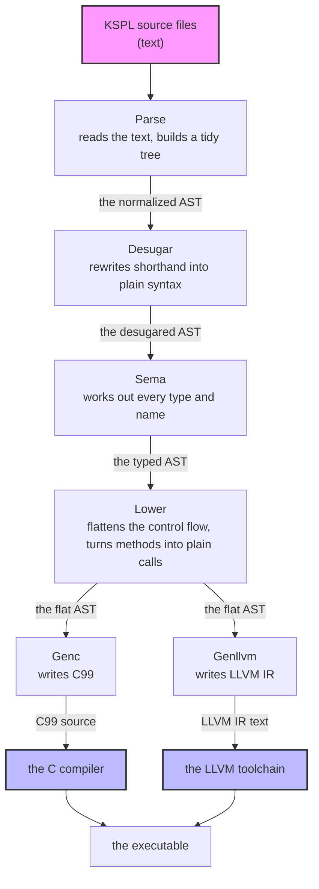
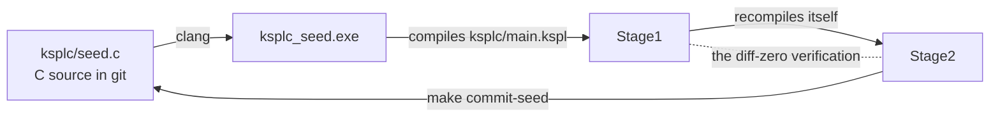

# The KSPL compiler's internal design

## About this document

**It is for a developer changing `ksplc/`, the compiler itself.** It explains how the compiler works inside, not how to use KSPL. It holds the map of the whole compiler and the rules every part shares. Each layer has a document of its own, listed with the others in "Further reading" in [`ksplc/README.md`](../README.md#further-reading).

Read "The compiler as a whole" and "The Development Principles" first. Read "The rules for handling an AST, shared by every layer" to "The development conventions" before writing any compiler code.

The compiler's terms (ICE, MIR, monomorphization and the rest) are in [the glossary](#the-glossary), the last chapter.

## The compiler as a whole

### From source code to a binary

**The compiler is a pipeline with a strictly one-way data flow**: each step's output is the next step's input. The first step, Parse, turns the text into an *AST* (abstract syntax tree, [the glossary](#the-glossary)). Every node has the same general-purpose type, `Ast_node`. Each later stage reshapes that same tree in place, until Genc or Genllvm write it out as text.

| layer | takes in | hands on | what it does | knows the types | knows where the output goes | see |
| :-- | :-- | :-- | :-- | :-- | :-- | :-- |
| **Parse** | source text | the normalized AST | turns text into a general-purpose AST and tidies its shape | no | no | "The Parse layer: from text to an AST (Desugar included)" in [`DESIGN-parse.md`](DESIGN-parse.md) |
| **Desugar** | the normalized AST | the desugared AST | expands the *sugar* (a shorthand notation) that the AST's shape alone can rewrite | no | no | "Desugar: expanding the syntactic sugar that needs no types" in [`DESIGN-parse.md`](DESIGN-parse.md) |
| **Sema** | the desugared AST | the typed AST | infers types, resolves names, instantiates generics (makes one copy of a generic per type it is used with: *monomorphization*, [the glossary](#the-glossary)) | yes | no | "The internal flow: registration, type inference, then generic instantiation", "The nodes Sema creates: its contract with Lower and Genc" in [`DESIGN-sema.md`](DESIGN-sema.md) |
| **Lower** | the typed AST | the flat AST | levels complex control flow and method calls into a simple shape | yes | not yet | "The internal flow: flatten, add vtables, mangle, prune, verify" in [`DESIGN-lower.md`](DESIGN-lower.md) |
| **Genc / Genllvm** | the flat AST | C99 or LLVM IR text | writes the levelled AST out in the target language, reshaping nothing | yes | yes | "What they answer for" in [`DESIGN-backends.md`](DESIGN-backends.md) |

**Why there are four layers.** Two questions sort them: "does this layer know the types?" and "does it know where the output goes?". The answers turn to "yes" one layer at a time (`no, no` → `yes, no` → `yes, yes`), so there are four layers, plus Desugar. A layer that reads what it does not know yet breaks the one-way flow. **Flowing backwards (an earlier layer importing a later layer's file) is strictly forbidden.**

**Where the order is written.** `main.run_compiler` drives it through `pipeline.Compiler`: `Compiler.parse_file` → `run_semantic_analysis` (Desugar, Scan over the declarations, Infer over the bodies) → `run_lower_and_codegen` (Lower, Genc/Genllvm).

"A worked example: one expression through each layer" in [`DESIGN-sema.md`](DESIGN-sema.md) follows `p.distance()` through every layer.

### The bootstrap, and keeping the seed in step

The compiler is *self-hosting*: it is written in KSPL, so building it needs a KSPL compiler. A C file checked into git, the *seed*, is that first compiler. A two-stage *bootstrap* runs the loop below.

| step | what it is |
| :-- | :-- |
| 1. **the seed** (`ksplc/seed.c`) | committed C source: the compiler at one moment, translated to C and frozen. `clang` builds it into `ksplc_seed.exe` |
| 2. **Stage1** | the current `ksplc/` tree (`ksplc/main.kspl` and everything it depends on), compiled by `ksplc_seed.exe` |
| 3. **Stage2** | the same tree compiled again, this time by Stage1 |
| 4. **the diff-zero verification** (`make self-host` / `make`) | Stage1's and Stage2's outputs must agree completely. This proves that the compiler reproduces itself stably |
| 5. **updating the seed** (`make commit-seed`) | Stage2's output, with its `#line`s dropped, overwrites `ksplc/seed.c` |

* **The steps belong to this folder** ([`ksplc/Makefile`](../Makefile)). The repository's `make` runs them with the seed; a copy of this folder runs them with `make self-host` and any `ksplc` (`make test-extract` does so on every change). A build takes its link flags from the compiler (`info exe-flags` / `info link-libs`), so the steps name no platform. Whoever builds the seed names its libraries.
* **The seed drops its `#line`s** (the C directives naming the `.kspl` line a C line came from). One added `.kspl` line would shift every later one and swell git's history. They serve only the seed's own debug information; a debugger follows Stage1 / Stage2.

**The seed is a snapshot of the `ksplc/` source at some past moment.** So anything it carries stays old until it is re-taken:

* **A change under `ksplc/` reaches the seed only through `make commit-seed`.** The repository's suites run on the seed, so a fix to what ksplc emits reaches them only then.
* **The grammar is embedded** (`embed "ksplc/kspl.kspeg" as kspl_grammar;` in `ksplc/main.kspl`). After a grammar change, tools that run the seed, such as `make fmt`, fail until `make commit-seed` has run.
* **So is the C runtime preamble**, written into every generated `.c` ("Embedding the runtime, and what a library keeps to itself" in [`DESIGN-backends.md`](DESIGN-backends.md)). `ksplc/gen/runtime/{core,hosted,freestanding}.{h,c}` and `hosted_*.c` are embedded into ksplc. Do not skip `make commit-seed` because no `ksplc/*.kspl` changed. The diff-zero verification cannot see that the seed's copy is old.
* **So the seed carries a record of what it was taken from.** `make commit-seed` writes `ksplc/seed.sum`: one SHA-256 over every file ksplc reads under `ksplc/`, runtime and grammar included, with line ends read as `\n`. The tests and `SPEC-diagnostics.md` are left out, since neither needs a re-bake. `make test-seed-sum`, a gate on every platform, fails while the tree differs from the record. A change to a comment alone also asks for the re-bake.
* **Adding a function to the C runtime takes two seed updates.** The runtime in Stage1's C (`out/gen/stage1/`) is the seed's. Once `std/` calls the new function, Stage1 fails to link, and `make commit-seed` needs Stage1. Stage1 embeds the source tree's runtime, so:
  1. Temporarily change `std/` so it does not call the new symbol. The declaration can stay.
  2. `make stage1` → `make commit-seed`. This seed holds the new runtime.
  3. Restore `std/`, then `make stage1` → `make commit-seed` again.
     * **A changed signature cannot go this way**: one run always pairs a declaration and a body that disagree (`conflicting types`). Add the function under a new name and delete the old one afterwards.

Caution: **Confirm diff-zero with `make self-host` (or `make ci`) before `make commit-seed`.** `make commit-seed` takes Stage2's output whatever the verdict, so it can burn a broken compiler's output into the seed.

**A change to how ksplc generates code (how it makes temporary names, say) needs the seed updated first.** `make self-host` then always shows a difference, since it compares the old seed's output with the new one's. So:

1. Run `make commit-seed` to burn the seed.
2. Run `make self-host` again. Green means the new compiler reproduces itself.
3. On red, `git checkout ksplc/seed.c` puts the seed back.

`make ci` runs this check too. No third stage is needed: the self-host after burning already answers "does the burned seed reproduce itself" (Principle 6).

**`make install` checks what it installs, and changes no file in the tree**: it runs `self-host` and `self-host-ship`, then installs the executable and the language server. Re-baking there would grow the history by the seed's size each time. `make lint` builds Stage1 itself, so it is the fast first check before `make ci`.

### Keeping the grammar and the AST node kinds in step

The *grammar* (`ksplc/kspl.kspeg`) is the file of rules the parser reads. Each node in the tree records its *kind* (which rule made it) as a number.

**Once a rule is added to the grammar (`ksplc/kspl.kspeg`), add its enum value to `ksplc/base/ast_kinds.kspl` by hand**; nothing generates it. `builtin_name` gives the value's own name past `k_`, so only a rule spelt otherwise (its capitalised token rules, such as `Format_spec`) needs a case there too. A miss is caught this way:

1. At start-up, `Global_pools.init()` interns `builtin_name(i)` for `1` to `Ast_kind.k_max`, in order ("String interning").
2. When the parser makes a node for a rule, it interns the rule's name into the same pool.
3. A name not registered up front grows the pool past `k_max`, and the self-check in `ksplc/main.kspl` panics with "Grammar sync error".

**There are three exceptions, and they are never added**: `Block_open` / `Block_close` / `Stmt_end`. They stand for the symbols that become a level and a newline in the indentation notation (`.kspl`). `rule_kind` in `ksplc/parse/load.kspl` turns them into `Literal` where they enter the tree.

Caution: **Do not make them kinds of their own.** Every stage that skips `kind_id == .k_literal` would need three more cases, and one that misses a case misreads silently (the `;` of `##lint(I0307 = off);` taken as an argument).

`kspl.kspeg`'s header lists which rule plays which role, and `make test-notation` recounts it from the grammar.

### The parts that are not in the pipeline: `base` / `lsp` / `fmt` / `tools`

**`base/` stands below the pipeline**: it holds the primitives every layer depends on. **`lsp/` drives the pipeline from outside**, once per editor request ("The language server runs as two processes: watcher and analyser" in [`DESIGN-tools.md`](DESIGN-tools.md)). **`fmt/` and `tools/` stand beside it**, built on what it produces. "What is here" in [`ksplc/README.md`](../README.md) says what each folder holds.

### String interning

**The compiler *interns* strings: each distinct string becomes an integer ID** (`String_pool` in `ksplc/base/core.kspl`). Comparing two IDs is one integer comparison, however long the strings are. `Global_pools` keeps three pools apart by use.

| pool | what it interns | the layer most involved |
| :-- | :-- | :-- |
| `pools.ast_kinds` (`intern_kind`) | The AST kind names (`decl_fn`, `expr_postfix` …), with the built-in ones registered at start-up ("Keeping the grammar and the AST node kinds in step"). `Ast_node.new` / `set_kind` (`base/ast.kspl`) use it to turn each node's kind string into its `kind_id`. | **Parse**: every path that makes a node, and "Keeping the grammar and the AST node kinds in step"'s drift check |
| `pools.source_files` (`intern_file` / `get_file_str`) | the sources' logical names, the counterpart of `Loc` (`base/ast.kspl`): a node holds this number, not the name | **Parse**: building a node and restoring one from the disk cache |
| `pools.symbol_names` (`intern_name`, `name_text`) | The symbol names in a scope (`sema/type/scope.kspl`) and the instance names monomorphization makes (`Vec_I32`; `sema/decl/mono.kspl`). It also holds the one copy of each name built from parts (an FQN, a path's segments joined), which `name_text` hands out. | **Sema**: name resolution, and monomorphization making no instance twice |

**`source_files` exists to shrink the tree's nodes**: a name held per node costs 16 bytes ("A tree node's size is fixed by rule and guarded").

**The pools are shared across the layers.** There is one global, `pools` (`base/core.kspl`), made by `Global_pools.init()` when compilation begins and released at the end. So the same string is always the same ID, which dispatching on `kind_id` and the symbol table's identity checks depend on.

### A tree node's size is fixed by rule and guarded

**The size in bytes of one tree node (`Ast_node`) and of its run of children (`std/ds`'s `List`) is a fixed number, guarded to the byte.** A self-host builds so many nodes that 8 bytes per node changes the tree by tens of MB. `ksplc/pipeline.kspl` prints `AST Node bytes` and `AST Kids bytes` under `--stats`. `perf_guard` compares them with `WANT_NODE_BYTES` / `WANT_KIDS_BYTES` in `tests/tools/perf_guard.kspl`.

Caution: **Do not compare the sizes as a ratio.** A ratio to a baseline lets one more pointer per node pass, and any difference means somebody touched a type. Where a node is to grow by decision, change `perf_guard`'s numbers and give the grounds.

### Measuring the compiler: `--stats` and the performance guard

**`ksplc --stats` prints what one translation cost in time and memory, stage by stage**, on standard error ("A line about the run goes to standard error" in [`DESIGN-diagnostics.md`](DESIGN-diagnostics.md)). The option's contract is `--stats` in [`SPEC-tools.md` §2.3](SPEC-tools.md#23-the-other-compiler-options). `make perf-log` keeps the same report for CI's performance guard.

**The report's blocks, in order:**

| block | what it shows | where it is explained |
| :-- | :-- | :-- |
| `[KSPEG Rule]` | how often the parser tries each grammar rule, and how each try ends | "What each rule takes (`--stats`'s `[KSPEG Rule]`)" |
| `[Sema Body / by self time]`, `[Sema Body / by instantiations]` | the declarations Sema spent the most time on, and those instantiated most often | "Profiling where Sema's time goes" in [`DESIGN-sema.md`](DESIGN-sema.md) |
| `[Layer]`, `[Overall]` | time and memory per stage, and the summary | below |

**`[AST Cache]` shows the disk cache's hits and misses** ("The normalized AST's disk cache (`ksplc/parse/ast_cache.kspl`)" in [`DESIGN-parse.md`](DESIGN-parse.md)). Without it, a cache that stops hitting only slows things, unnoticed.

**One place lays them out: `print_stats_report` in `pipeline.kspl`**, from what `base/stats.kspl` held. The summary goes last, since a terminal shows the last screen.

**A profiler reset builds a fresh value, so every counter starts at zero together.** Sema recreates its collections on the request arena, since old buffers would point at freed memory after an editor rewind.

**Each `[Layer]` row gives the time and the arena bytes side by side** (`Parse: N ms, M bytes`), so the log alone says which stage grew. The bytes are printed even on a target with no clock. **The remainder is printed as `Other`** (start-up, the CLI parse, what comes after the stages), so an unmeasured stage cannot grow unseen.

**CI's performance guard judges memory, not time.** `tests/tools/perf_guard.kspl` reads `make perf-log`'s log; its opening comment holds the reasons. Its verdicts:

| verdict | how it behaves |
| :-- | :-- |
| the peak memory | moves a whole chunk at a time, so growth inside a chunk goes unseen until it takes a new one |
| the two node sizes ("A tree node's size is fixed by rule and guarded") | fixed by rule |
| (the compile time) | recorded beside them, decides nothing: it measures the machine and its load as much as the work |

Caution: **Keep the characters of every line another program reads.** The guard finds its lines by the patterns at its head (`TIME_PATTERN` in `tests/tools/perf_guard.kspl` and the ones beside it). `STATS_HEAD` in `ksplc/tests/suite/ast_cache_test.kspl` finds `[AST Cache]`.

#### What each rule takes (`--stats`'s `[KSPEG Rule]`)

KSPEG is a *PEG* parser: for each rule it tries the alternatives in order and takes the first that matches. It also *memoizes* (a *packrat* parser): a second try of a rule at the same position is a lookup, a *memo hit*.

`--stats` prints four numbers per rule: **calls / memo hits / read and succeeded / read and failed** (`Rule_prof` in `kspeg/engine.kspl`). They are counts, not times, so a grammar change can be compared before and after under any load.

**"Read and failed" is derived, not counted**: it is `calls - memo hits - succeeded`. A counted one could lie while every column adds up. `kspeg/tests/engine_test.kspl` matches all four on a small grammar with a known answer.

| what you see | what it means |
| :-- | :-- |
| a rule whose memo hits do not grow | it visited each position once, so packrat has nothing to save there |
| a rule with few successes and many failures | it is speculating and missing. Of those, only the ones where a miss is costly repay a grammar change |

**Many failures are not waste in themselves**: most alternatives fail on a one- or two-character comparison. A miss is costly only where the rule reads another rule whole first. `expr_cast` (`type_expr "::" expr_unary`) and `expr_compound` (`( type_expr &"::{" )? …`) both read `type_expr` at one position, and the memo makes the second a hit.

Caution: **Do not avoid it by moving `expr_cast` behind `expr_postfix`.** The reason is written above that rule in `ksplc/kspl.kspeg`.

**Two of kspeg's devices pay off on this grammar** (both in [`../../kspeg/docs/DESIGN-engine.md`](../../kspeg/docs/DESIGN-engine.md)):

* **Folding a run of keywords into one lookup** takes `Primitive_type`'s thirteen names, otherwise tried millions of times in a cold compile of `ksplc/main.kspl`.
* **Skipping a rule that cannot begin with the next byte** catches most failures before they are entered.

**Together they remove about two fifths of the parse's work.** The way to retake the figure is callgrind on that cold compile.

## The Development Principles

The eight principles that hold for all of Kanso are "Development Principles" in [`../../docs/DESIGN-principles.md`](../../docs/DESIGN-principles.md); "Principle N" in this document points there. The two below assume the pipeline, so they hold only for the compiler.

### Failing fast through an exception or an ICE

**Do not cover an impossible state, a missing AST structure or an unexpected `null` with a stopgap such as `if (node == null) return;`.** Stop at once, so a bug is found near its source.

| situation | use |
| :-- | :-- |
| recovery is possible | a `throw` |
| it is not | `ice_assert` / `ice_panic` (`base/diag.kspl`; where a position can be given, the methods of the same names in `base/ast.kspl`) |

An *ICE* (internal compiler error) says "ksplc itself got something wrong", not "your code is wrong".

Caution: **If such a state is ignored, the diagnostic comes not from ksplc but from downstream.** A shape Sema let through breaks inside the generated C. The user then gets a `clang` error, far from the KSPL source in position and cause.

### A backend writes straight out rather than assembling

**An `emit` function writes straight to the context's output stream instead of returning a `Builder`** (a string that grows in memory). This removes needless allocation and leaks from code generation.

## The rules for handling an AST, shared by every layer

Besides the per-layer rules of [`DESIGN-parse.md`](DESIGN-parse.md), [`DESIGN-sema.md`](DESIGN-sema.md), [`DESIGN-lower.md`](DESIGN-lower.md) and [`DESIGN-backends.md`](DESIGN-backends.md), five rules hold **in every layer**:

| Rule | What it forbids | What goes wrong without it |
| :-- | :-- | :-- |
| 1. Safe accessors only | reaching a child by a number, `node.get_child(1)` | a grammar change crashes the compiler or makes wrong code |
| 2. One node, one place | putting one node in two places in the tree ("The normalized AST's invariants: no crash, no differing output" in [`DESIGN-parse.md`](DESIGN-parse.md)) | Sema keys types on a node's address, so the types collide and it crashes |
| 3. Positions (`loc`) propagate intact | losing where a node came from ("The normalized AST's invariants: no crash, no differing output" in [`DESIGN-parse.md`](DESIGN-parse.md)) | a compile error cannot report the exact position |
| 4. A kind is an `Ast_kind`, not a string | naming a node's kind by a string such as `"stmt_bock"` | a typo makes a node no check ever matches |
| 5. A local the compiler adds is named by `made_name` | spelling such a name in the identifiers' own space (`_e`, `_for_coll1`) | the source's `_e` reads the error a `catch` declares, and a local `_for_coll1` refuses the next `for … in` |

Rules 1, 4 and 5 in detail:

* Rule 1. **Safe accessors only.** Normalization ("The internal flow: KSPEG tree, AST conversion, normalizing, verification" in [`DESIGN-parse.md`](DESIGN-parse.md)) fixes every node's layout. Knowledge of the indices lives only in `base/ast_ext` (the safe accessors: `get_var_decl_id()`, `get_loop_cond()`, …), `base/ast_place` (what a node's shape alone tells) and `base/ast_spell` (assembling a name's string).
* Rule 4. **A kind is passed as an `Ast_kind`, not a string**: `Ast_node.new` / `set_kind` / `morph` take the enum in `base/ast_kinds`.
  * Caution: **Do not add a way to pass a kind as a string.** `String_pool.intern` issues a new number for a string it does not know (`base/core.kspl`). So a typo makes a node whose kind_id exceeds `k_max`, which matches nothing and draws no diagnostic.
  * The one conversion from a string to a kind is `Ast_node.peek_kind_id`, which `parse/load.kspl` uses for KSPEG's rule names. Everything else reads `kind_id == .k_xxx`.
* Rule 5. **A local the compiler adds is named by `made_name` in `base/c_name.kspl`.** Such locals are a `catch`'s unnamed error, Lower's temporaries, a `for … in`'s collection and index, and a closure's environment value. The name opens with `_%`, and no identifier can hold `%`. Each backend spells it in a space of its own:
  * C spells it `__k_<stem>` (`c_safe_name_to`), as in `__k_tmp3`. A source's name reaches that space only with `_kw` after it.
  * LLVM spells it `%v_.<stem>`. No source name holds a `.`.
  * The `_` keeps every unused-name check off it, as off the source's `_x`.
  * **Synthesized source text cannot hold one**: it is parsed again, and the lexer refuses `%`. So a closure's `call` receiver, its environment type (`_anon_env_N`) and its constructor keep names in the identifiers' space. A jump label is outside that space.

## Memory management: the arena model

### Why an arena

An *arena* is a memory region you allocate from piece by piece and free all at once. AST nodes and type entries are referenced from many places, so tracking an owner for each breeds dangling pointers and leaks. **Data that can all be discarded together at the end** goes into an arena.

### Arena's implementation: a linked list of chunks and bump allocation

An arena is a chain of large blocks ("chunks"); allocating moves a counter forward inside the newest one. The implementation is `Arena` in `std/mem.kspl`. The compiler shares one instance, `base_core.arena`, the global `arena` in `base/core.kspl`.

* **Bump allocation**: `Arena` holds a linked list of `Arena_chunk` (`{ next, cap, used }`). If the request fits the head chunk's room (`cap - used`), `alloc(size)` advances `used`, rounded up to 8 bytes.
* **Geometric growth**: otherwise a new chunk from the raw heap (`alloc`) goes at the head: 256KB first, then twice the previous, up to `Arena.new`'s `chunk_size`. An allocation too big for a chunk gets one of its own size.
* **Freeing all at once**: `free()` `dealloc`s each chunk once; `base_setup.fin()` calls it when the compilation ends.
* **A static buffer (`from_buffer`)**: a buffer the caller prepares is the only chunk, so no `malloc` is needed (`ksai` on bare metal, for one). When it runs out, `alloc()` panics.
* **Save and restore (`save` / `restore`)**: `save` snapshots the head chunk and its `used`. `restore` frees any chunks added since and winds back, as if nothing after the snapshot was allocated. The LSP's use is "The arena is rewound after each request (a worked example)" in [`DESIGN-tools.md`](DESIGN-tools.md).
* **Usage**: `get_total_used()` / `get_total_allocated()` sum every chunk's `used` / `cap`, which `--stats` prints as `AST Arena usage : X / Y bytes`.

### The three-tier allocation strategy

**There are three ways to get memory inside the compiler, each freed at a different moment. Do not mix the tiers up.** Above all, passing a pointer from the arena to `dealloc` is a fatal violation.

| Tier | Freed when | Used for |
| :-- | :-- | :-- |
| A. the shared arena (`base_core.arena`) | all at once, when the compilation completes | AST nodes, type and symbol tables, names, diagnostic messages |
| B. reference counting (`Rc<\|T\|>` / `Arc<\|T\|>`) | when the last owner leaves scope | dynamic memory shared by several owners |
| C. raw memory (`alloc` / `dealloc`) | explicitly, by the code that allocated it | bytes whose whole life is in one place |

* **A. The shared arena**, freed by `base_setup.fin`. It holds AST nodes (`Ast_node.new`), type-environment entries (`Entry` and the like in `sema/type/env.kspl`), symbol-table scopes (`sema/type/scope.kspl`), monomorphized names, the type-ID map's keys, and diagnostic messages (after `dup_str`). The test: can references spread through the AST or the symbol table, or does it live until the compilation ends?
  * **Collections keep references**: `Map` and the other internal collections do not deep-copy a key, so a slice passed to them must point at arena memory.
  * **The standard idiom is scratch → `dup_str`.** Build a string in a `Str_builder` on tier C, then copy only the finished string to the arena with `base_core.arena.dup_str(...)`.
  * Caution: **A name built from parts goes to `base_core.pools.name_text`, not to `dup_str`** (an FQN from `build_mod_fqn`, `join_dotted_name`, a path's segments joined). Such a name is rebuilt on every read, and a copy per read filled about 10 MB of a cold self-host's `AST bytes`. `name_text` keeps one copy of each, on tier C, until the pools are freed.
* **B. Reference counting (`Rc<|T|>` / `Arc<|T|>` in `std/mem`)**, for memory shared by several owners. The types conform to `Ref_counted`, and the compiler inserts `retain` on a copy and `release` at scope exit (`lower/arc.kspl`). `Rc<|T|>` is for one thread, `Arc<|T|>` (atomic) for sharing between threads; `Weak_rc<|T|>` / `Weak_arc<|T|>` cut reference cycles. The chapter "The rules for implementing ARC" in [`DESIGN-lower.md`](DESIGN-lower.md) says what counts as an owning position.
* **C. Raw memory (`alloc` / `dealloc`)**, for data whose whole life is in one place: `String_pool`'s internal buffer, and `Str_builder`'s scratch buffer. The pools are never wound back, so a name from `name_text` outlives every arena that holds it as a key.

**The base session owns the diagnostics and the ranges excluded by `#cfg`.** Its shared arena being present says the session is active. Its heap containers allocate lazily, an editor rewind clears them, and ending the session frees them before the arena.

Caution: **The shared arena is wound back, so nothing that lives as long as the process can go on it.** The LSP discards each request's allocations with `base_core.arena.save()` / `restore()`. A global table made once on it is left pointing at freed memory: `ksplc.cfg`'s per-directory cache (`base/config_file.kspl`), say, or the CLI's level settings (`base/lint_codes.kspl`). It works until a later allocation overwrites it, and then every query returns null. Take what lives across requests from `base_core.perm_arena`, which is never wound back.

### Naming conventions for lifecycle functions and global variables

Making and discarding things take one name **per role**, with no dialects such as `create` / `deinit` / `finalize` / `delete`. So a reader, and the compiler's checks, can tell what a call does by its name:

| Role | Make / initialize | Discard / free | Shape |
| :-- | :-- | :-- | :-- |
| **An object (a value, owned)** | `new` | `free` | `Type(…)` calls `new`, which returns a value or an `@`, paired with `defer x.free()`. The arena to allocate in is the last parameter, never defaulted (`List<\|T\|>(arena)`; `List<\|T\|>(null)` for the global heap) |
| **Global and file state** | `init()` | `fin()` | the global lifecycle, with no receiver |
| **Raw memory (`std/mem` only)** | `alloc` | `dealloc` | tier C's byte allocation and freeing |

**`free` and `dealloc` are the only names that carry an effect.** Sema's use-after-free and double-free tracking recognizes a freeing by these names alone ("Measuring what suppression costs" in [`DESIGN-diagnostics.md`](DESIGN-diagnostics.md)). The rule is "8.4 Memory management" in [`../../docs/SPEC-programming-language.md`](../../docs/SPEC-programming-language.md). Under any other name the check silently stops.

* **`Arena.create<|T|>` copies an existing value onto an arena** and returns a permanent `T@` (`base_core.arena.create(Foo::{...})`). It is a typed `alloc`, apart from `new`, which constructs.
* **One `init()` / `fin()` pair per layer**, in the layer's entry file, gathers its globals, and `main` calls only those pairs. `base_setup`'s covers the shared arena, the pools, the AST's shared state and the diagnostics; `parse_load`'s covers the Profiler and the kspeg arena.
* **`g_` marks only a non-public global.** A public global is recognizable by its namespace (`base_core.config`, `base_core.arena`).

## The development conventions (the rules for writing KSPL source)

### The order of imports, and their paths

`ksplc/`'s own imports follow two rules, so a reader sees which layer a name comes from:

| Rule | Example |
| :-- | :-- |
| 1. **Order**: by name. `ksplc fmt` sorts them ("The formatter reorders the `import`s as text, before the printer" in [`DESIGN-tools.md`](DESIGN-tools.md)), so nobody orders them by hand | — |
| 2. **Full paths**: the standard library from `std/`, the compiler's own files from `ksplc/` | `import "std/io"` |

**Which names come in without a namespace is "Prefix a name only when it cannot state its origin" in [`../../docs/DESIGN-notation.md`](../../docs/DESIGN-notation.md).** In `ksplc/`, its condition 3 asks whether the origin is information that belongs to the design:

* **A reference across the pipeline's stages (`parse` / `sema` / `lower` / `gen`) keeps its prefix.** `sema_types.Env` written inside `gen/c/` shows which layer it depends on.
* **`ksplc/base/` and `std/` are exempt.** Every layer rests on them. Where conditions 1 and 2 hold, no namespace is fine.

### A file using an extension method imports its defining file

The rule is in ["9. Files and import" in `../../docs/SPEC-programming-language.md`](../../docs/SPEC-programming-language.md#9-files-and-import), including that a built-in type counts as `std/lang`'s. This section holds where it is enforced.

The compiler analyses every file in one space, so **without the import ledger the files' independence disappears**. It is enforced at the one point of method resolution, in `sema/body/dot.kspl`, which asks `is_file_imported` whether the file that wrote the name imports the method's file.

Caution: **Ask the ledger (`sema/session/import_table.kspl`) and nothing else.** Asking whether the symbol resolves lets through a file that happens to be in the same compilation.

**A built-in type's owner is `std/lang`** (`LANG_FILE_PATH` in `sema/session/import_table.kspl`), used where no declaration names the receiver's type (`is_declared_type` in `sema/body/dot.kspl`). The ledger is asked as for any type, and a hit marks the import used. Otherwise whether the call holds would depend on the rest of the program's imports, and [I0401] would call the needed import unused.

**A format spec's method is reported at the item written** (`reject_unimported_spec`), and its import is checked before the type is judged. A file that does not import `FMT_METHOD_FILE` (`base/core.kspl`) may not have loaded the methods.

**During a generic's instantiation the error is withheld, but the ledger is still asked.** "No diagnostic that depends on a generic's type argument" in [`DESIGN-diagnostics.md`](DESIGN-diagnostics.md) explains why.

## The glossary

The compiler's own terms, by the part of the compiler they belong to. **A term that C, LLVM or compiler textbooks define in the same sense is not entered here** (C99, undefined behaviour, GEP). The other glossaries:

* "Words used throughout" in [`../../docs/DESIGN-principles.md`](../../docs/DESIGN-principles.md#words-used-throughout) holds the words every package shares. Examples are generic, trait, vtable, ARC, arena, FQN, ABI, hosted and freestanding, libc, the C runtime and the seed.
* "Terms of art" in [`../../docs/SPEC-documents.md`](../../docs/SPEC-documents.md) holds the words with one fixed meaning in every document. Examples are gate, fire, reject and pass silently.

**The compiler as a whole**

| Term | What it means | Where |
| :-- | :-- | :-- |
| **Pipeline** | the fixed order of stages a program goes through: Parse → Desugar → Sema → Lower → a backend | "From source code to a binary" |
| **Stage1 / Stage2** | Stage1 is the current source built by the seed; Stage2 is the same source built by Stage1. The two outputs must be identical | "The bootstrap, and keeping the seed in step" |
| **Self-hosting** | a compiler compiling its own source to a byte-identical result | "The bootstrap, and keeping the seed in step"; "Self-hosting does not test a feature ksplc does not use" in [`DESIGN-backends.md`](DESIGN-backends.md) |
| **ICE** (internal compiler error) | a stop on a state ksplc itself got wrong. `ice_assert` / `ice_panic` raise it instead of a diagnostic about the user's code | "Failing fast through an exception or an ICE" |
| **Interning** | storing each distinct string once, and comparing by an integer ID after that (`String_pool`; used for the AST kind names and the symbol names) | "String interning" |

**Parse and Desugar**

| Term | What it means | Where |
| :-- | :-- | :-- |
| **PEG / KSPEG** | a PEG (parsing expression grammar) tries the alternatives of each rule in order and takes the first that matches. KSPEG is KSPL's own PEG engine, and `kspl.kspeg` is the grammar | "The internal flow: KSPEG tree, AST conversion, normalizing, verification" in [`DESIGN-parse.md`](DESIGN-parse.md); "Only the editor's parse recovers from a syntax error" in [`DESIGN-tools.md`](DESIGN-tools.md) |
| **CST / AST** | the CST (concrete syntax tree) is the parser's raw output, `kspeg.Node`. The AST (abstract syntax tree) is that tree stripped of brackets, symbols and intermediate rules, and levelled by the Parse layer into the fixed shape `Ast_node` | "The internal flow: KSPEG tree, AST conversion, normalizing, verification" in [`DESIGN-parse.md`](DESIGN-parse.md) |
| **Normalization** | the Parse layer's reshaping of the raw tree into the AST, where every node kind has a fixed layout | "The internal flow: KSPEG tree, AST conversion, normalizing, verification", "The normalized AST's invariants: no crash, no differing output" in [`DESIGN-parse.md`](DESIGN-parse.md) |
| **Elision** | replacing a node that holds only one child and qualifies nothing with that child (`elide_node`) | "The internal flow: KSPEG tree, AST conversion, normalizing, verification" in [`DESIGN-parse.md`](DESIGN-parse.md) |
| **Desugaring** (the stage) | the shared word *desugar*, narrowed to what can be rewritten from the AST's shape alone, without the types. A sugar that needs the types is finished in Sema | "Desugar: expanding the syntactic sugar that needs no types" in [`DESIGN-parse.md`](DESIGN-parse.md) |
| **A seam** | the one name that both halves of a sugar split across two layers agree on, such as the mark Desugar leaves for Sema | "Measuring where the desugaring goes" in [`DESIGN-parse.md`](DESIGN-parse.md) |
| **The one notation** | KSPL source is written in the indentation notation (`.kspl`), read once, where a source enters, into the braces the parser reads | "Every place a source enters reads it the same way" in [`DESIGN-parse.md`](DESIGN-parse.md) |

**Sema: types and names**

| Term | What it means | Where |
| :-- | :-- | :-- |
| **Sema** (semantic analysis) | the stage that knows the types: it resolves every name, infers every type and reports type errors | "The Sema layer: it knows the types" in [`DESIGN-sema.md`](DESIGN-sema.md) |
| **`type_id`** | the number Sema gives each distinct type; a node's `type_id` is the type of its value | "The internal flow: registration, type inference, then generic instantiation" in [`DESIGN-sema.md`](DESIGN-sema.md) |
| **Symbol table** | the table from a name to what it declares (`Sema_symbol`) | "How sema is split into folders, and their dependencies" in [`DESIGN-sema.md`](DESIGN-sema.md) |
| **A mass** | a set of files that can all reach one another through imports (a strongly connected component) that cannot be split into folders any further | "The whole picture of the dependencies" in [`DESIGN-sema.md`](DESIGN-sema.md) |
| **Template** | a generic's written body, before any type argument is put in | "Generics are instantiated through deferred work" in [`DESIGN-sema.md`](DESIGN-sema.md) |
| **Monomorphization** | ksplc's name for instantiating a generic: one separate implementation per concrete type argument used (`sema/decl/mono.kspl`). `Vec<\|T\|>` with `T=I32` becomes `Vec_I32` | "The internal flow: registration, type inference, then generic instantiation" in [`DESIGN-sema.md`](DESIGN-sema.md) |
| **Upcast** | turning a concrete value into a trait value | "An upcast, not conformance, decides what gets a vtable" in [`DESIGN-lower.md`](DESIGN-lower.md) |
| **Folding** | computing an expression's value at compile time (`eval_constexpr`) | "The static-initializer check is applied to both `var` and `const`" in [`DESIGN-diagnostics.md`](DESIGN-diagnostics.md) |
| **A place expression** | an expression that names existing memory: an identifier, a field or element chain rooted in one, or a dereference. A read from one is a copy | "A retain goes wherever a copy happens" in [`DESIGN-lower.md`](DESIGN-lower.md) |
| **`Move_only`** | a mark on a type that must never be copied (an open file, a lock); after a hand-over the old name cannot be used | "A check of one kind lives in one place" in [`DESIGN-diagnostics.md`](DESIGN-diagnostics.md); the chapter "The rules for implementing ARC" in [`DESIGN-lower.md`](DESIGN-lower.md) |

**Lower**

| Term | What it means | Where |
| :-- | :-- | :-- |
| **Lowering** | rearranging nested control structure (`defer`, the short-circuiting `&&`/`\|\|`, `!`, a labelled `break`) into a shallow combination of `if` and `goto`: the Lower layer's job | "The Lower layer: a flat tree independent of backends" in [`DESIGN-lower.md`](DESIGN-lower.md) |
| **MIR** (mid-level intermediate representation) | the flat, backend-neutral tree that Lower's first walk leaves. ksplc keeps it in the same `Ast_node`s, not in a type of its own | "The internal flow: flatten, add vtables, mangle, prune, verify" in [`DESIGN-lower.md`](DESIGN-lower.md) |
| **Name mangling** | transforming a symbol name by a regular rule to avoid collisions. A `priv` symbol becomes `kspl_priv_{file name}_{original name}` | "The internal flow: flatten, add vtables, mangle, prune, verify" in [`DESIGN-lower.md`](DESIGN-lower.md) |
| **Drop glue** | the helper generated once per aggregate type that retains or releases every ARC value it owns | "The chaining is gathered into a per-type drop-glue function" in [`DESIGN-lower.md`](DESIGN-lower.md) |

**The backends and C**

| Term | What it means | Where |
| :-- | :-- | :-- |
| **Backend** | the stage that writes code for a target: Genc writes C99, Genllvm writes LLVM IR | "The backends (Genc / Genllvm) and the runtime ABI" in [`DESIGN-backends.md`](DESIGN-backends.md) |
| **Preamble** | the C runtime as written into each generated `.c` | "Embedding the runtime, and what a library keeps to itself" in [`DESIGN-backends.md`](DESIGN-backends.md) |
| **Aggregate** | a value made of several parts: a struct, an array, a slice, an enum with a payload (a Result among them), a trait value | "Passing an aggregate is an explicit internal ABI" in [`DESIGN-backends.md`](DESIGN-backends.md) |
| **SSA** (static single assignment) | the IR form in which each register is assigned once. genllvm numbers its registers per function and keys a local on its declaring node | "The limits on building an AST, and linking `def_node`" in [`DESIGN-lower.md`](DESIGN-lower.md); "Genllvm (LLVM IR): why the structure differs, and managing SSA" in [`DESIGN-backends.md`](DESIGN-backends.md) |
| **sret** | LLVM's mark for a hidden pointer through which a function returns an aggregate. genllvm passes such a pointer without the mark | "Passing an aggregate is an explicit internal ABI" in [`DESIGN-backends.md`](DESIGN-backends.md) |

**Memory**

| Term | What it means | Where |
| :-- | :-- | :-- |
| **Weak reference** | a handle (`Weak_rc` / `Weak_arc`) that watches a value without owning it, used to break reference cycles | "The three-tier allocation strategy" |

**The tools**

| Term | What it means | Where |
| :-- | :-- | :-- |
| **Supervisor / worker** | the language server's two processes: the supervisor talks to the editor, the worker does the analysis and can crash | "The language server runs as two processes: watcher and analyser" in [`DESIGN-tools.md`](DESIGN-tools.md) |
| **URI / logical name** | the editor names a file by a URI (`file:///…`); inside the compiler a file is named by its logical name, a path from the project root (`std/lang`) | "A URI is converted to the logical name and back" in [`DESIGN-tools.md`](DESIGN-tools.md) |
| **Broken node** | the node a lenient parse makes for text it could not read; it holds that text and nothing else | "What a broken node holds" in [`DESIGN-tools.md`](DESIGN-tools.md) |
| **Fixed point** | a text that formatting leaves exactly as it is | "The formatter's time, and the record of formatted texts" in [`DESIGN-tools.md`](DESIGN-tools.md) |
| **Slot** | the cache folder `ksplc run` keeps for one script | "`ksplc run` builds under a lock and runs outside it" in [`DESIGN-tools.md`](DESIGN-tools.md) |
