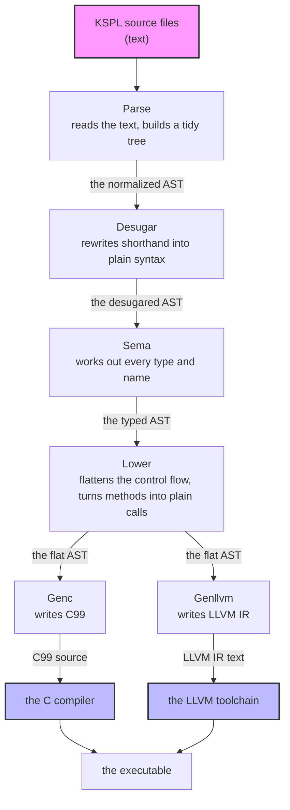
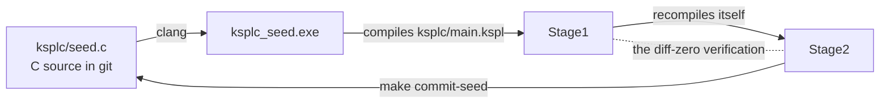
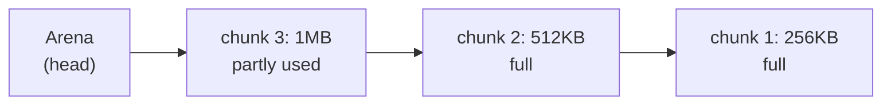

# The KSPL compiler's internal design

## About this document

**Who it is for**: a developer changing `ksplc/`, the compiler itself. It explains how the compiler works inside, not how to use KSPL.

**Where the other documents are**: "Further reading" in [`ksplc/README.md`](../README.md#further-reading) lists each of `ksplc/`'s documents with what it holds.

**How to read it**: this document holds the map of the whole compiler and the rules every part shares. Each layer has a document of its own. The table lists them in the order the program's data takes through the compiler.

| chapters | what they hold | read them when |
| :-- | :-- | :-- |
| "The compiler as a whole" and "The Development Principles" | the map of the compiler, and the values behind its design | first, always |
| [`DESIGN-parse.md`](DESIGN-parse.md) | the Parse layer, with Desugar: from text to an AST | you change that layer |
| [`DESIGN-sema.md`](DESIGN-sema.md) | the Sema layer: types, names and generics | you change that layer |
| [`DESIGN-lower.md`](DESIGN-lower.md) | the Lower layer, and the rules for implementing ARC (automatic reference counting) | you change that layer |
| [`DESIGN-backends.md`](DESIGN-backends.md) | the backends (Genc / Genllvm) and the runtime ABI, with the backends' own rules | you change that layer |
| "The rules for handling an AST, shared by every layer" to "The development conventions" | the conventions every layer shares: handling the tree, memory management, coding | you write any compiler code |

The compiler's terms (ICE, MIR, monomorphization and the rest) are in [the glossary](#the-glossary), the last chapter. The words every package shares (FQN, ABI, ARC and the rest) are in "Words used throughout" in [`../../docs/DESIGN-principles.md`](../../docs/DESIGN-principles.md#words-used-throughout).

## The compiler as a whole

`ksplc` reads KSPL source text and writes out C (or LLVM IR). An ordinary C compiler (or the LLVM tools) then turns that into the executable. Inside `ksplc`, the program passes through a fixed row of layers, each of which reshapes one tree.

### From source code to a binary

**The compiler is a pipeline with a strictly one-way data flow.** A *pipeline* here means a row of steps where each step's output is the next step's input. The first step, Parse, turns the text into a tree: an *AST* (abstract syntax tree, [the glossary](#the-glossary)). Each node of the tree is one piece of the program (a function, a statement, an expression). Every node has the same general-purpose type, `Ast_node`. Each later stage reshapes that same tree in place, until Genc or Genllvm write it out as text. This is the most important picture of the compiler.

The diagram shows each layer, and what passes from one to the next.

*C99* is the 1999 standard of the C language. *LLVM IR* is the text form of the LLVM compiler tools' own low-level language. Each layer in one line, with the sections that hold how it reshapes the tree:

| layer | takes in | hands on | what it does | knows the types | knows where the output goes | see |
| :-- | :-- | :-- | :-- | :-- | :-- | :-- |
| **Parse** | source text | the normalized AST | turns text into a general-purpose AST and tidies its shape | no | no | These sections of [`DESIGN-parse.md`](DESIGN-parse.md). "The internal flow: KSPEG tree, AST conversion, normalizing, verification". "The normalized AST's invariants: no crash, no differing output". "The normalized AST's nodes: the shape Parse hands downstream". "Synthesizing an `enum`'s `variant_name`". |
| **Desugar** | the normalized AST | the desugared AST | expands the *sugar* (a shorthand notation) that the AST's shape alone can rewrite | no | no | "Desugar: expanding the syntactic sugar that needs no types" in [`DESIGN-parse.md`](DESIGN-parse.md) |
| **Sema** | the desugared AST | the typed AST | infers types, resolves names, instantiates generics (makes one copy of a generic per type it is used with: *monomorphization*, [the glossary](#the-glossary)) | yes | no | "The internal flow: registration, type inference, then generic instantiation", "The nodes Sema creates: its contract with Lower and Genc" in [`DESIGN-sema.md`](DESIGN-sema.md) |
| **Lower** | the typed AST | the flat AST | levels complex control flow and method calls into a simple shape | yes | not yet | "The internal flow: flatten, add vtables, mangle, prune, verify" in [`DESIGN-lower.md`](DESIGN-lower.md) |
| **Genc / Genllvm** | the flat AST | C99 or LLVM IR text | writes the levelled AST out in the target language, reshaping nothing | yes | yes | "What they answer for" in [`DESIGN-backends.md`](DESIGN-backends.md) |

**Why there are four layers.** Two questions sort them: "does this layer know the types?" and "does it know where the output goes?". The two answers turn to "yes" one layer at a time (`no, no` → `yes, no` → `yes, yes`), so there are four layers, plus Desugar. A layer that reads what it does not know yet breaks the one-way flow, and a change then reaches across every layer. **Flowing backwards (an earlier layer importing a later layer's file) is strictly forbidden.**

**Where the order is written.** `main.run_compiler` drives the whole order through three methods of `pipeline.Compiler`: `Compiler.parse_file` → `run_semantic_analysis` (Desugar, Scan, Infer) → `run_lower_and_codegen` (Lower, Genc/Genllvm). Scan is Sema's pass over the declarations (`sema_decl_collect.run`, "The internal flow: registration, type inference, then generic instantiation" in [`DESIGN-sema.md`](DESIGN-sema.md)), and Infer its walk over the bodies.

"A worked example: one expression through each layer" in [`DESIGN-sema.md`](DESIGN-sema.md) follows one expression, `p.distance()`, through every layer.

### The bootstrap, and keeping the seed in step

The compiler is written in KSPL, so you need a KSPL compiler to build it. A C file checked into git, the *seed*, is that first compiler. Whenever the compiler changes, the seed must be re-taken with `make commit-seed`, or it keeps doing the old thing.

The compiler is *self-hosting*: it is written in the language it compiles. So building it needs a compiler. A two-stage *bootstrap* solves that chicken-and-egg problem. The diagram shows the loop: the seed builds Stage1, Stage1 builds Stage2, and Stage2 becomes the next seed.

| step | what it is |
| :-- | :-- |
| 1. **the seed** (`ksplc/seed.c`) | committed C source: the compiler at one moment, translated to C and frozen. `clang` builds it into `ksplc_seed.exe` |
| 2. **Stage1** | the current `ksplc/` tree (`ksplc/main.kspl` and everything it depends on), compiled by `ksplc_seed.exe` |
| 3. **Stage2** | the same tree compiled again, this time by Stage1 |
| 4. **the diff-zero verification** (`make self-host` / `make`) | Stage1's and Stage2's outputs must agree completely. This proves that the compiler reproduces itself stably |
| 5. **updating the seed** (`make commit-seed`) | Stage2's output, with its `#line`s dropped, overwrites `ksplc/seed.c` |

About step 4:

* The steps belong to this folder ([`ksplc/Makefile`](../Makefile): translate, build, compare, verdict). The repository's `make` runs them from its root with the seed. A copy of this folder runs them with `make self-host` and any `ksplc`, and `make test-extract` has a copy do so on every change. A build takes its link flags from the compiler that made the code (`info exe-flags` / `info link-libs`), so the steps name no platform.
* Whoever builds the seed names its libraries, because that link is made before any `ksplc` exists to name them.

About step 5: the seed is then a snapshot of the latest source, but not Stage2's output itself. A `#line` is a C directive that tells the C compiler and the debugger which `.kspl` line a C line came from. The `#line`s go because one added `.kspl` line shifts every later one, which would make git's history several times larger than the real change. The seed still generates the same C without them, since they serve only the seed's own debug information. A debugger follows Stage1 / Stage2.

**The seed is a snapshot of the `ksplc/` source at some past moment.** So anything the seed carries inside itself stays old until it is re-taken:

* **A change under `ksplc/` reaches the seed only through `make commit-seed`.** Until a new `ksplc_seed.exe` is built, the seed does not have it.
  * The repository's suites run on the seed, so a fix to what ksplc emits reaches them only once the seed is re-taken. A difference that matters on one target only (a generated C identifier clobbered by a `#define` in a Windows header, say) shows nothing on Linux.
* **The grammar is embedded.** `ksplc/main.kspl` embeds it at compile time (`embed "ksplc/kspl.kspeg" as kspl_grammar;`, "Keeping the grammar and the AST node kinds in step"). After a grammar change the seed still reads only the old grammar, so tools that run the seed directly, such as `make fmt`, fail until `make commit-seed` has run.
* **So is the C runtime preamble**: the C support code ksplc writes into every generated `.c`. "Embedding the runtime, and what a library keeps to itself" in [`DESIGN-backends.md`](DESIGN-backends.md) describes it. `ksplc/gen/runtime/{core,hosted,freestanding}.{h,c}` and `hosted_*.c` are embedded into ksplc ("What the two generators share: the decisions, not the spelling" in [`DESIGN-backends.md`](DESIGN-backends.md)), so editing only them leaves the old preamble in `ksplc/seed.c`. Do not skip `make commit-seed` because no `ksplc/*.kspl` changed. The diff-zero verification of `make ci` / `make self-host` checks only that the current tree reproduces itself; it cannot see that the seed's copy is old.
* **So the seed carries a record of what it was taken from.** `make commit-seed` writes `ksplc/seed.sum`: one SHA-256 over every file ksplc reads under `ksplc/`, with line ends read as `\n`. The runtime and the grammar are included. The tests and `SPEC-diagnostics.md` are left out, since neither needs a re-bake. `make test-seed-sum`, a gate on every platform, fails while the tree holds other source than the record names. A change that alters only a comment still asks for the re-bake: the record cannot tell it from one that alters what the seed does.
* **Adding a function to the C runtime takes two seed updates.** The preamble of `out/gen/ksplc_stage1.c` is the runtime the seed carries. So once `std/` calls the new function, Stage1 fails to link (an undefined reference), and `make commit-seed` needs Stage1. The way round is that Stage1 embeds the source tree's runtime:
  1. Temporarily change `std/` so it does not call the new symbol. The declaration can stay: with no reference, nothing needs linking.
  2. `make stage1` → `make commit-seed`. This seed holds the new runtime, because Stage2's preamble is the source tree's, which Stage1 embedded.
  3. Restore `std/`, then `make stage1` → `make commit-seed` again.
     * **A changed signature cannot go this way.** One run always pairs a declaration and a body that disagree, and the C compiler rejects it with `conflicting types`. Add the function under a new name and delete the old one afterwards.

Caution: **Confirm diff-zero with `make self-host` (or `make ci`) before `make commit-seed`.** `make commit-seed` depends on Stage2's output, not on the diff-zero verdict. So it runs even when self-hosting is broken, and burns a broken compiler's output into the seed.

**A change to how ksplc generates code (how it makes temporary names, say) needs the seed updated first.** The seed makes Stage1 and Stage1 makes Stage2, so `make self-host` then always shows a difference. That cannot answer "can I go on": it compares the old seed's output with the new seed's. So:

1. Run `make commit-seed` to burn the seed.
2. Run `make self-host` again. The burned seed's Stage1 is exactly the pre-burn Stage2's output, so green means the new compiler reproduces itself.
3. On red, `git checkout ksplc/seed.c` puts the seed back.

`make ci` runs this check too, so a seed left behind shows in the next run. No third stage (translating once more with the compiler Stage2 built) is needed. The self-host after burning already answers "does the burned seed reproduce itself", and a third stage would be a second means to one property (Principle 6).

**`make install` checks what it installs, and changes no file in the tree**: it runs `self-host` and `self-host-ship`, then installs the shipped executable and the language server. It neither formats the tree nor re-bakes the seed. Each rewrites files. Re-baking on every install would grow the history by the seed's size each time. So `make commit-seed` re-bakes the seed when the rules above call for it. `make lint` depends on Stage1 and builds it itself, so it is the fast first check before the heavy `make ci`.

### Keeping the grammar and the AST node kinds in step

Every rule in the grammar file needs a matching entry in a hand-written list of node kinds. Forget it, and the compiler stops at start-up with "Grammar sync error".

The *grammar* (`ksplc/kspl.kspeg`) is the file of rules that says what KSPL text can look like. The parser reads it. Each node in the tree records its *kind* (which rule made it) as a number.

**Once a rule is added to the grammar (`ksplc/kspl.kspeg`), add its enum value to `ksplc/base/ast_kinds.kspl` by hand**; nothing generates it. `builtin_name` gives the value's own name past `k_`, so only a rule the grammar spells otherwise (its capitalised token rules, such as `Format_spec`) needs a case there too. Here is why a miss is caught:

1. At start-up, `Global_pools.init()` interns `builtin_name(i)` for `1` to `Ast_kind.k_max`, in order (*interning* gives each distinct string a number, "String interning").
2. When the parser makes a node for a rule (`"Format_spec"`, say), it interns the rule's name into the same pool.
3. A name not registered up front therefore grows the pool past `k_max`, and the run-time self-check in `ksplc/main.kspl` ("Grammar sync error") panics.

**There are three exceptions, and they are never added**: `Block_open` / `Block_close` / `Stmt_end`. Only the grammar has these names. They stand for the symbols that become a level and a newline in the indentation notation (`.kspl`, where indentation marks the blocks, as in Python). `rule_kind` in `ksplc/parse/load.kspl` turns them into `Literal` where they enter the tree. So the names never reach the pool, and the tree has the shape it would have without them.

Caution: **Do not make them kinds of their own.** Every stage that walks the tree would need three more cases in the decision that reads past a name (the place that skips `kind_id == .k_literal`). A stage that misses one does not crash; it reads a different meaning. For example, the `;` of `##lint(I0307 = off);` is counted as an argument, and is wrongly rejected with "an expression cannot be written". The grammar states the role; the tree keeps the name.

`kspl.kspeg`'s header lists which rule plays which role, and `make test-notation` recounts it from the grammar and checks the list.

### The parts that are not in the pipeline: `base` / `lsp` / `fmt` / `tools`

Four folders of `ksplc/` are not steps of "From source code to a binary"'s pipeline. No data passes through them on its way to the output.

| folder | where it stands | what that means |
| :-- | :-- | :-- |
| `base/` | below the pipeline | it holds the primitives every layer depends on, and has no place on "From source code to a binary"'s two questions |
| `lsp/` | outside, driving the pipeline | The language server (what an editor talks to) runs the pipeline afresh on each editor request. It is a client, not a stage. [`DESIGN-tools.md`](DESIGN-tools.md) explains it in two sections. "The arena is rewound after each request (a worked example)". "The language server runs as two processes: watcher and analyser". |
| `fmt/` | beside it | the formatter: it turns the Parse layer's AST back into formatted source text |
| `tools/` | beside it | commands built on what the pipeline produces, and the tools that inspect the compiler's own parts |

"What is here" in [`ksplc/README.md`](../README.md) says what each folder holds.

### String interning

Instead of comparing strings again and again, the compiler stores each distinct string once and uses its number.

To avoid comparing strings, the compiler *interns* them: each distinct string becomes an integer ID (`String_pool` in `ksplc/base/core.kspl`). Comparing two IDs is one integer comparison, however long the strings are. `Global_pools` keeps three pools apart by use.

| pool | what it interns | the layer most involved |
| :-- | :-- | :-- |
| `pools.ast_kinds` (`intern_kind`) | The AST kind names (`decl_fn`, `expr_postfix` …), with the built-in ones registered at start-up ("Keeping the grammar and the AST node kinds in step"). `Ast_node.new` / `set_kind` (`base/ast.kspl`) use it to turn each node's kind string into its `kind_id`. | **Parse**: every path that makes a node, and "Keeping the grammar and the AST node kinds in step"'s drift check |
| `pools.source_files` (`intern_file` / `get_file_str`) | the sources' logical names, the counterpart of `Loc` (`base/ast.kspl`): a node holds this number, not the name | **Parse**: building a node and restoring one from the disk cache |
| `pools.symbol_names` (`intern_name`, `name_text`) | The symbol names in a scope (`sema/type/scope.kspl`) and the instance names monomorphization makes (`Vec_I32`; `sema/decl/mono.kspl`). So lookup and duplicate detection compare integers. It also holds the one copy of each name built from parts (an FQN, a path's segments joined), which `name_text` hands out. | **Sema**: name resolution, and monomorphization making no instance twice |

**`source_files` exists to shrink the tree's nodes** ("A tree node's size is fixed by rule and guarded"), not to replace string comparison. A name held per node costs 16 bytes (a pointer and a length), where one per file would do.

**The pools are shared across the layers.** There is one global, `pools` (`base/core.kspl`), made by `Global_pools.init()` when compilation begins and released at the end. With every layer on the same pools, the same string is always the same ID. Two things depend on that. One is dispatching on `kind_id`, the first rule of the chapter "The rules for handling an AST, shared by every layer". The other is fast identity checks on the symbol table.

### A tree node's size is fixed by rule and guarded

**The size in bytes of one tree node (`Ast_node`) and of its run of children (`std/ds`'s `List`) is a fixed number. A guard holds it to the byte: if someone makes a node bigger, the guard fails.** A self-host builds so many nodes that 8 bytes more or less per node changes the whole tree by tens of MB. `ksplc/pipeline.kspl` prints `AST Node bytes` and `AST Kids bytes` under `--stats`. `perf_guard` compares them with `want_node_bytes` / `want_kids_bytes` in `tests/tools/perf_guard.kspl`.

**A guard on the total cannot catch that growth.** `AST bytes` ("Arena's implementation: a linked list of chunks and bump allocation") is a ratio to a baseline. So one more pointer per node stays under the ceiling, while the cold usage (a run with no cache) grows measurably.

Caution: **Do not compare the sizes as a ratio.** They are fixed by rule, not measured, so any difference means somebody touched a type. Where a node is to grow by decision, change `perf_guard`'s numbers and give the grounds; re-taking the baseline does not change them.

### Measuring the compiler: `--stats` and the performance guard

**`ksplc --stats` prints what one translation cost in time and memory, stage by stage.** It prints on standard error, since the report is about the run ("A line about the run goes to standard error" in [`DESIGN-diagnostics.md`](DESIGN-diagnostics.md)). `make perf-log` keeps the same report for CI's performance guard, which fails the build if the memory grows. The option's contract is `--stats` in [`SPEC-tools.md` §2.3](SPEC-tools.md#23-the-other-compiler-options). This section holds how the report is laid out and what reads it.

**The report's blocks, in order:**

| block | what it shows | where it is explained |
| :-- | :-- | :-- |
| `[KSPEG Rule]` | how often the parser tries each grammar rule, and how each try ends | "What each rule takes (`--stats`'s `[KSPEG Rule]`)" |
| `[Sema Body / by self time]` | the declarations Sema spent the most time on | "Profiling where Sema's time goes" in [`DESIGN-sema.md`](DESIGN-sema.md) |
| `[Sema Body / by instantiations]` | the declarations instantiated most often | "Profiling where Sema's time goes" in [`DESIGN-sema.md`](DESIGN-sema.md) |
| `[Layer]` | time and memory per stage | below |
| `[Overall]` | the summary | below |

Each block is followed by a blank line. **`[AST Cache]` shows the disk cache's hits and misses** ("The normalized AST's disk cache (`ksplc/parse/ast_cache.kspl`)" in [`DESIGN-parse.md`](DESIGN-parse.md)). Without it, a cache that stops hitting goes unnoticed, since things only get slower.

**One place lays them out: `print_stats_report` in `pipeline.kspl`.** Printed per layer on the spot, the detail tables would break up the stages' numbers. So everything goes to a holding place (`base/stats.kspl`) and comes out once at the end. The summary (`[Overall]`) goes last, since a terminal shows the last screen, and `make perf-log` passes it through `cat` too.

**A profiler reset builds a fresh value, so every counter starts at zero together.** The parser keeps the capacity of its heap-backed entry list while clearing its contents. Sema recreates both collections on the request arena, since keeping their old buffers across an editor rewind would leave them pointing at freed memory.

**Each `[Layer]` row gives the time and the arena bytes side by side** (`Parse: N ms, M bytes`). An *arena* is one large region of memory from which the compiler takes small pieces (the tree's nodes) and which it frees all at once. The time alone is not enough. The stage that slowed and the stage that grew the memory can differ. The log alone must say which stage grew it. The bytes are printed even on a target with no clock, since the amount taken does not depend on the environment.

**`[Layer]` prints the remainder as `Other`.** For time, it is the stages' total against `Compile time`. For bytes, it is the total against `AST Arena usage`. The remainder is start-up and the CLI parse, plus what is taken after the stages. Dropped silently, an unmeasured stage could grow while nobody notices that the sum does not add up.

**CI's performance guard judges memory, not time.** `make perf-log` makes the log, and `tests/tools/perf_guard.kspl` reads it; its opening comment holds the reasons. Its verdicts:

| verdict | how it behaves |
| :-- | :-- |
| the peak memory | moves a whole chunk at a time |
| the AST arena's usage against a baseline ("Arena's implementation: a linked list of chunks and bump allocation") | moves continuously, so only it catches growth within a chunk; both memory figures are needed |
| the two node sizes ("A tree node's size is fixed by rule and guarded") | fixed by rule |
| (the compile time) | recorded beside them, decides nothing: it measures the machine and its load as much as the work |

Caution: **Keep the characters of every line another program reads.** The guard finds its lines by the patterns at its head (`time_pattern` in `tests/tools/perf_guard.kspl` and the ones beside it). `stats_head` in `ksplc/tests/suite/ast_cache_test.kspl` finds `[AST Cache]`. A line spelt differently is not found.

#### What each rule takes (`--stats`'s `[KSPEG Rule]`)

For each grammar rule, `--stats` counts how often the parser tried it and how each try ended. The counts show where a grammar change would make parsing faster.

The parser, KSPEG, is a *PEG* parser: for each rule it tries the alternatives in order and takes the first that matches. It also *memoizes* (a *packrat* parser): it remembers the result of each rule at each position. So a second try at the same place is a lookup, a *memo hit*.

`--stats` prints four numbers per rule: **calls / memo hits / read and succeeded / read and failed** (`Rule_prof` in `kspeg/engine.kspl`). They are counts, not times. The same input and grammar give the same values under any environment or load, so a grammar change can be compared before and after.

**"Read and failed" is derived, not counted.** Every reference ends in exactly one of a memo hit, a success or a failure, so it is `calls - memo hits - succeeded`. If it were counted, a dropped increment would give a lie that adds up in every column. `kspeg/tests/engine_test.kspl` matches all four as actual numbers on a small grammar with a known answer. The identity alone always holds, and a missed count only shows as more failures.

**There are two ways to read it.**

| what you see | what it means |
| :-- | :-- |
| a rule whose memo hits do not grow | it visited each position once, so packrat has nothing to save there |
| a rule with few successes and many failures | it is speculating and missing. Of those, only the ones where a miss is costly repay a grammar change |

**Many failures are not waste in themselves.** In `ksplc/kspl.kspeg` most alternatives fail on a one- or two-character comparison (`expr_fn_lit` is one `'fn'`, `label` is `Identifier ":"`, `type_args` is `"<|"`). Lookahead (peeking at the next characters before trying a rule) would only pay the same cost. A miss is costly only where the rule reads another rule whole before missing. `expr_cast` (`type_expr "::" expr_unary`) and `expr_compound` (`( type_expr &"::{" )? …`) both read `type_expr` before looking at `::` / `::{`. This is mainly where the memoization pays. The two ask for `type_expr` at the same position in turn, so the second hits the memo; without it the type parse runs twice per primary.

Caution: **Do not avoid it by moving `expr_cast` behind `expr_postfix`.** The reason is written above that rule in `ksplc/kspl.kspeg`.

**Two of kspeg's devices pay off on this grammar** (both in [`../../kspeg/docs/DESIGN-engine.md`](../../kspeg/docs/DESIGN-engine.md)):

* **Folding a run of keywords into one lookup** takes `Primitive_type`'s thirteen names, which a cold compile of `ksplc/main.kspl` would otherwise try millions of times.
* **Skipping a rule that cannot begin with the next byte** catches most of the failures above before they are entered. Without it, the parse throws away nine in ten of the nodes it builds.

**Together they remove about two fifths of the parse's work.** The way to retake the figure is callgrind on that cold compile.

## The Development Principles

The eight principles that hold for all of Kanso are "Development Principles" in [`../../docs/DESIGN-principles.md`](../../docs/DESIGN-principles.md), and "Principle N" in this document points there. The two below hold only for the compiler, because both assume the pipeline (Parse → Sema → Lower → Gen*). One is to stop at once on an impossible state. The other is to let a backend write its output directly.

### Failing fast through an exception or an ICE

**Do not cover an impossible state, a missing AST structure or an unexpected `null` with a stopgap such as `if (node == null) return;`.** Stop at once, so a bug is found near its source.

| situation | use |
| :-- | :-- |
| recovery is possible | a `throw` |
| it is not | `ice_assert` / `ice_panic` (`base/diag.kspl`; where a position can be given, the methods of the same names in `base/ast.kspl`) |

An *ICE* (internal compiler error) is a stop that says "ksplc itself got something wrong", not "your code is wrong" ([the glossary](#the-glossary)).

Caution: **If such a state is ignored, the diagnostic comes not from ksplc but from downstream.** A shape Sema let through breaks first inside the generated C. The user then gets a `clang` error, far from the KSPL source in both position and cause, instead of a KSPL diagnostic. On meeting a shape that cannot be dropped, stop there.

### A backend writes straight out rather than assembling

**An `emit` function writes straight to the context's output stream instead of returning a `Builder`.** A `Builder` is a string that grows in memory. Writing directly removes needless allocation and leaks from code generation.

## The rules for handling an AST, shared by every layer

The AST (the tree the compiler works on) is handled by five rules that hold in every stage. Besides the per-layer rules of [`DESIGN-parse.md`](DESIGN-parse.md), [`DESIGN-sema.md`](DESIGN-sema.md), [`DESIGN-lower.md`](DESIGN-lower.md) and [`DESIGN-backends.md`](DESIGN-backends.md), these hold **in every layer**:

| Rule | What it forbids | What goes wrong without it |
| :-- | :-- | :-- |
| 1. Safe accessors only | reaching a child by a number, `node.get_child(1)` | a grammar change crashes the compiler or makes wrong code |
| 2. One node, one place | putting one node in two places in the tree ("The normalized AST's invariants: no crash, no differing output" in [`DESIGN-parse.md`](DESIGN-parse.md)) | Sema keys types on a node's address, so the types collide and it crashes |
| 3. Positions (`loc`) propagate intact | losing where a node came from ("The normalized AST's invariants: no crash, no differing output" in [`DESIGN-parse.md`](DESIGN-parse.md)) | a compile error cannot report the exact position |
| 4. A kind is an `Ast_kind`, not a string | naming a node's kind by a string such as `"stmt_bock"` | a typo makes a node no check ever matches |
| 5. A local the compiler adds is named by `made_name` | spelling such a name in the identifiers' own space (`_e`, `_for_coll1`) | the source's `_e` reads the error a `catch` declares, and a local `_for_coll1` refuses the next `for … in` |

Rules 2 and 3 are explained in "The normalized AST's invariants: no crash, no differing output" in [`DESIGN-parse.md`](DESIGN-parse.md). Rules 1, 4 and 5 in detail:

* Rule 1. **Safe accessors only.** The AST is one general-purpose node, `Ast_node`, but no layer reaches a child by a magic index such as `node.get_child(1)`. When the KSPEG grammar changes a node's element count or order, such code crashes the compiler in a chain (SEGV) or silently generates wrong code. Normalization ("The internal flow: KSPEG tree, AST conversion, normalizing, verification" in [`DESIGN-parse.md`](DESIGN-parse.md)) fixes every node's layout. Knowledge of the indices lives only in `base/ast_ext` (the safe accessors: `get_var_decl_id()`, `get_loop_cond()`, …), `base/ast_place` (whether a node can be used as a place) and `base/ast_spell` (assembling a name's string).
* Rule 4. **A kind is passed as an `Ast_kind`, not a string**: `Ast_node.new` / `set_kind` / `morph` take the enum in `base/ast_kinds`.
  * Caution: **Do not add a way to pass a kind as a string.** `String_pool.intern` issues a new number for a string it does not know (`base/core.kspl`). So a typo such as `"stmt_bock"` makes a node whose kind_id exceeds `k_max`. It matches no comparison and flows to the end without a single diagnostic. An enum stops the typo where it is written.
  * The one conversion from a string to a kind is `Ast_node.peek_kind_id`. `parse/load.kspl` uses it for KSPEG's rule names, which come from the grammar file as strings. Everything else reads `kind_id == .k_xxx`.
* Rule 5. **A local the compiler adds is named by `made_name` in `base/c_name.kspl`.** Such locals are a `catch`'s unnamed error, Lower's temporaries, the collection and the index of a `for … in`, and a closure's environment value. The name opens with `_%`, and no identifier can hold `%`, so no name in the source equals it, whatever the source declares. Each backend spells it in a space of its own:
  * C spells it `__kspl_<stem>` (`c_safe_name_to`). A source's name reaches that space only with `_kw` after it.
  * LLVM spells it `%v_.<stem>`. No source name holds a `.`.
  * The `_` keeps a made name among the names nobody need read, so every unused-name check leaves it alone, as it leaves the source's `_x`.
  * **Synthesized source text cannot hold one**: it is parsed again, and the lexer refuses `%`. A closure's `call` receiver, its environment type (`_anon_env_N`) and its constructor are written that way. They keep names in the identifiers' space. A jump label is outside that space, since C labels and LLVM blocks hold no source name.

## Memory management: the arena model

ksplc has no garbage collector. Most of what it allocates lives until the compile ends. So it puts that data in one big region and frees the region at the end, instead of freeing each piece.

### Why an arena

An *arena* is a memory region you allocate from piece by piece and free all at once. The compiler has no GC, but AST nodes and type-environment entries live until the compilation ends and are referenced from many places. Tracking an owner for each, as with C's `malloc`/`free`, means knowing everywhere who holds the last reference. That breeds dangling pointers (pointers to freed memory) and leaks. So **data that can all be discarded together at the end** goes into one region (an arena) and is never freed individually.

### Arena's implementation: a linked list of chunks and bump allocation

An arena is a chain of large blocks ("chunks"); allocating just moves a counter forward inside the newest block. The implementation is `Arena` in `std/mem.kspl`. The compiler shares one instance, `base_core.arena`, the global `arena` in `base/core.kspl`.

The diagram shows an arena after it has grown twice: new chunks go at the head, each twice the size of the one before.

* **Bump allocation**: `Arena` holds a linked list of `Arena_chunk` (`{ next, cap, used }`). `alloc(size)` looks at the head chunk's remaining room (`cap - used`). If the request fits, it advances `used` (rounded up to 8 bytes): one pointer bump, the cheapest allocation there is.
* **Geometric growth**: only when the request does not fit is a new chunk taken from the raw heap (`alloc`) and put at the head. It holds 256KB the first time and twice the previous chunk after that. It grows up to the chunk size the arena was made with (`Arena.new`'s `chunk_size`). That is little for a small compilation or a short-lived LSP worker, and soon large for a self-compilation. A single allocation too big for the chunk gets a chunk of its own size.
* **Freeing all at once**: `free()` walks the chunks from the head and `dealloc`s each once (each is one allocation); `base_setup.fin()` calls it when the compilation ends.
* **A static buffer (`from_buffer`)**: a fixed buffer the caller prepares (a global array, a stack region) serves as the only chunk. No `malloc` is called, so the same code runs on a microcontroller without one (`ksai` on bare metal, for one). The arena cannot grow: when the buffer runs out, `alloc()` panics deterministically.
* **Save and restore (`save` / `restore`)**: `save` cheaply snapshots the head chunk and its `used` position. `restore` frees any chunks added since and winds back to that position. It does not free a part: it makes everything allocated after the snapshot as if it never existed. The LSP's use is "The arena is rewound after each request (a worked example)" in [`DESIGN-tools.md`](DESIGN-tools.md).
* **Usage**: `get_total_used()` / `get_total_allocated()` sum every chunk's `used` / `cap`. `--stats` prints them as `AST Arena usage : X / Y bytes`. The performance guard holds the usage against a baseline (`AST bytes`), beside the peak memory ("Measuring the compiler: `--stats` and the performance guard").

### The three-tier allocation strategy

**There are three ways to get memory inside the compiler (three tiers, split by purpose), and each is freed at a different moment. Do not mix the tiers up.** Above all, passing a pointer from the arena to `dealloc` is a fatal violation.

**The base session owns the diagnostics and the ranges excluded by `#cfg`.** Its shared arena being present says the session is active; those collections need no initialization flags of their own. Empty heap containers allocate lazily. Clearing them before an editor rewind discards references into the arena while retaining list capacity; ending the session frees their heap storage before the arena.

| Tier | Freed when | Used for |
| :-- | :-- | :-- |
| A. the shared arena (`base_core.arena`) | all at once, when the compilation completes | AST nodes, type and symbol tables, names, diagnostic messages |
| B. reference counting (`Rc<\|T\|>` / `Arc<\|T\|>`) | when the last owner leaves scope | dynamic memory shared by several owners |
| C. raw memory (`alloc` / `dealloc`) | explicitly, by the code that allocated it | bytes whose whole life is in one place |

* **A. The shared arena (`base_core.arena`), freed all at once when the compilation completes** (`base_setup.fin`). It holds these:
  * AST nodes (`Ast_node.new`);
  * type-environment entries (`Entry` and the like in `sema/type/env.kspl`);
  * symbol-table scopes (`sema/type/scope.kspl`);
  * monomorphized names, and the type-ID map's string keys;
  * diagnostic message strings (after `dup_str`).

  The test: can references to the data spread through the AST or the symbol table, or does it naturally live until the compilation ends? If so, it goes on the arena, with no individual freeing.
  * **Collections keep references**: `Map` and the other internal collections do not deep-copy a key, so a slice passed to them must point at arena memory.
  * **The standard idiom is scratch → `dup_str`.** Build a string in a `Str_builder`, whose buffer grows and shrinks on tier C's raw heap. Then copy only the finished string to the arena with `base_core.arena.dup_str(...)`, keeping scratch space and permanent data apart.
  * Caution: **A name built from parts goes to `base_core.pools.name_text`, not to `dup_str`** (an FQN from `build_mod_fqn`, `join_dotted_name`, a path's segments joined). Such a name is built again on every read of it. A copy per read would fill the arena with duplicates (about 10 MB of a cold self-host's `AST bytes`). `name_text` keeps one copy of each distinct name, on tier C, until the pools are freed.
* **B. Reference counting (`Rc<|T|>` / `Arc<|T|>` in `std/mem`), freed when the last owner leaves scope**, for dynamic memory shared by several owners. The types conform to `Ref_counted`, and the compiler inserts `retain` on a copy and `release` at scope exit (`lower/arc.kspl`), so nothing is freed by hand. `Rc<|T|>` is for one thread, `Arc<|T|>` (atomic) for sharing between threads; `Weak_rc<|T|>` / `Weak_arc<|T|>` cut reference cycles. An aggregate that owns an ARC-managed value is managed along with it, through one helper function per type. The chapter "The rules for implementing ARC" in [`DESIGN-lower.md`](DESIGN-lower.md) says what counts as an owning position. It also says how to keep it in step with where the operations are emitted.
* **C. Raw memory (`alloc` / `dealloc`), freed explicitly by the code that allocated it.** It holds bytes for data whose whole life is completed in one place. One is `String_pool`'s internal buffer (interning identifiers and AST kind names, and the names `name_text` keeps). Another is `Str_builder`'s scratch buffer. The pools are never wound back, so a name from `name_text` outlives every arena that holds it as a key.

Caution: **The shared arena is wound back, so nothing that lives as long as the process can go on it.** The LSP discards each request's allocations with `base_core.arena.save()` / `restore()` ("The arena is rewound after each request (a worked example)" in [`DESIGN-tools.md`](DESIGN-tools.md)). Some global tables are made once and used ever after. Taken from the shared arena, such a table is left pointing at freed memory. Examples are `ksplc.cfg`'s per-directory cache (`base/config_file.kspl`) and the level settings from the CLI (`base/lint_codes.kspl`). That runs harmlessly until a later large allocation overwrites it. The symptom, every query returning null after the server has run a while, is far from the cause. Take what lives across requests from `base_core.perm_arena`, which is never wound back.

### Naming conventions for lifecycle functions and global variables

Making and discarding things uses the same few names everywhere. So a reader (and the compiler's checks) can tell what a call does by its name. Allocation and freeing, initialization and finalization, take one name **per role**, with no dialects such as `create` / `deinit` / `finalize` / `delete`:

| Role | Make / initialize | Discard / free | Shape |
| :-- | :-- | :-- | :-- |
| **An object (a value, owned)** | `new` | `free` | `Type.new()` returns a value or an `@`, paired with `defer x.free()`. The arena to allocate in is the last parameter, never defaulted (`List.new(arena)`; `List.new(null)` for the global heap) |
| **Global and file state** | `init()` | `fin()` | the global lifecycle, with no receiver |
| **Raw memory (`std/mem` only)** | `alloc` | `dealloc` | tier C's byte allocation and freeing |

**`free` and `dealloc` are the only names that carry an effect.** Sema's use-after-free and double-free tracking recognizes a freeing by these names alone ("Measuring what suppression costs" in [`DESIGN-diagnostics.md`](DESIGN-diagnostics.md)). The rule is "8.4 The memory management model: `defer` / ARC / arenas" in [`../../docs/SPEC-language.md`](../../docs/SPEC-language.md). Under any other name the check silently stops.

* **`Arena.create<|T|>` copies an existing value onto an arena** and returns a permanent `T@` (`base_core.arena.create(Foo::{...})`). It is a typed `alloc`, apart from `new`, which constructs. It lets an ad-hoc struct with no arena-taking `new` go on the arena too.
* **One `init()` / `fin()` pair per layer**, in the layer's entry file, gathers its globals, and `main` calls only those pairs. `base_setup`'s covers the shared arena, the pools, the AST's shared state and the diagnostics; `parse_load`'s covers the Profiler and the kspeg arena. Do not init or fin a single global directly from `main`.
* **`g_` marks only a non-public global.** A public global is recognizable by its namespace qualification (`base_core.config`, `base_core.arena`), so it takes no `g_`. A `priv` global, referenced bare within its file, keeps `g_` as its only mark.

## The development conventions (the rules for writing KSPL source)

### The order of imports, and their paths

Every `import` in ksplc's own code names a full path, so a reader can see at a glance which layer a name comes from. `ksplc/`'s own imports follow two rules, to keep the dependencies visible:

| Rule | Example |
| :-- | :-- |
| 1. **Order**: by name. `ksplc fmt` sorts them ("The formatter reorders the `import`s as text, before the printer" in [`DESIGN-tools.md`](DESIGN-tools.md)), so nobody orders them by hand | — |
| 2. **Full paths**: the standard library from `std/`, the compiler's own files from `ksplc/` | `import "std/io"` |

**[`../../docs/DESIGN-notation.md`](../../docs/DESIGN-notation.md) decides which names come in without a namespace (a selective import).** The section is "Prefix a name only when it cannot state its origin". What is specific to `ksplc/` is how its condition 3 applies: whether the origin is information that belongs to the design.

* **A reference across the pipeline's stages (`parse` / `sema` / `lower` / `gen`) keeps its prefix.** `sema_types.Env` written inside `gen/c/` shows which layer it depends on. Without the namespace, the crossing disappears from the source.
* **`ksplc/base/` and `std/` are exempt.** Every layer rests on them, so the reader knows the origin. Where conditions 1 and 2 hold (it is known by the name; it is unique), no namespace is fine.

### A file using an extension method imports its defining file

To call an extension method (a method added to a type from another file), a file must import the file where that method is written. The rule is in ["9. Files and import" in `../../docs/SPEC-language.md`](../../docs/SPEC-language.md#9-files-and-import), including that a built-in type counts as `std/lang`'s. This section holds only where it is enforced.

The compiler analyses every file in one space, so **without the import ledger the files' independence disappears**. It is enforced at the one point of method resolution, in `sema/body/dot.kspl`, which asks `is_file_imported` whether the file that wrote the name imports the method's file.

Caution: **Ask the ledger (`sema/session/import_table.kspl`) and nothing else.** Asking instead whether the symbol resolves lets through a file that happens to be in the same compilation unit.

**A built-in type's owner is `std/lang`** (`lang_file_path` in `sema/session/import_table.kspl`), used where no declaration names the receiver's type (`is_declared_type` in `sema/body/dot.kspl`). The method's file is then checked like any type's: the ledger is asked, and a hit marks the import used. Suppose the call were accepted because its file is somewhere in the program. Then whether it holds would depend on what the rest of the program imports. [I0401] would then call the import that makes it hold unused.

**A format spec's method is reported at the item written** (`reject_unimported_spec`), and its import is checked before the type is judged. A file that does not import `fmt_method_file` (`base/core.kspl`) has not necessarily loaded the methods, and every type would then seem to accept nothing.

**During a generic's instantiation the error is withheld, but the ledger is still asked.** [`DESIGN-diagnostics.md`](DESIGN-diagnostics.md) explains why, in "No diagnostic that depends on a generic's type argument".

## The glossary

The terms of the compiler this document assumes, grouped by the part of the compiler they belong to, each group in pipeline order. Each one's section has the full account. **A term that C, LLVM or compiler textbooks define in the same sense is not entered here.** Examples are C99, undefined behaviour, a translation unit and GEP. A second definition would only drift from the standard one. A term stays where ksplc gives it a meaning of its own.

* "Words used throughout" in [`../../docs/DESIGN-principles.md`](../../docs/DESIGN-principles.md#words-used-throughout) holds the words every package shares. Examples are generic, trait, vtable, ARC, arena, FQN, ABI, hosted and freestanding, libc, the C runtime and the seed.
* "Terms of art" in [`../../docs/SPEC-documents.md`](../../docs/SPEC-documents.md) holds the words with one fixed meaning in every document. Examples are gate, fire, reject and pass silently.

**The compiler as a whole**

| Term | What it means | Where |
| :-- | :-- | :-- |
| **Pipeline** | the fixed order of stages a program goes through: Parse → Desugar → Sema → Lower → a backend | "From source code to a binary" |
| **Stage1 / Stage2** | Stage1 is the current source built by the seed; Stage2 is the same source built by Stage1. The two outputs must be identical | "The bootstrap, and keeping the seed in step" |
| **Self-hosting** | a compiler compiling its own source to a byte-identical result | "The bootstrap, and keeping the seed in step"; "Self-hosting does not test a feature ksplc does not use" in [`DESIGN-backends.md`](DESIGN-backends.md) |
| **ICE** (internal compiler error) | a stop on a state ksplc itself got wrong. `ice_assert` / `ice_panic` raise it instead of a diagnostic about the user's code | "Failing fast through an exception or an ICE" |
| **Interning** | storing each distinct string once, and comparing by an integer ID after that (`String_pool`; used for the AST kind names and the symbol names) | "String interning" |

**Parse and Desugar**

| Term | What it means | Where |
| :-- | :-- | :-- |
| **PEG / KSPEG** | a PEG (parsing expression grammar) tries the alternatives of each rule in order and takes the first that matches. KSPEG is KSPL's own PEG engine, and `kspl.kspeg` is the grammar | "The internal flow: KSPEG tree, AST conversion, normalizing, verification" in [`DESIGN-parse.md`](DESIGN-parse.md); "Only the editor's parse recovers from a syntax error" in [`DESIGN-tools.md`](DESIGN-tools.md) |
| **CST / AST** | the CST (concrete syntax tree) is the parser's raw output, `kspeg.Node`. The AST (abstract syntax tree) is that tree stripped of brackets, symbols and intermediate rules, and levelled by the Parse layer into the fixed shape `Ast_node` | "The internal flow: KSPEG tree, AST conversion, normalizing, verification" in [`DESIGN-parse.md`](DESIGN-parse.md) |
| **Normalization** | the Parse layer's reshaping of the raw tree into the AST, where every node kind has a fixed layout | "The internal flow: KSPEG tree, AST conversion, normalizing, verification", "The normalized AST's invariants: no crash, no differing output" in [`DESIGN-parse.md`](DESIGN-parse.md) |
| **Elision** | replacing a node that holds only one child and qualifies nothing with that child (`elide_node`) | "The internal flow: KSPEG tree, AST conversion, normalizing, verification" in [`DESIGN-parse.md`](DESIGN-parse.md) |
| **Desugaring** (the stage) | the shared word *desugar*, narrowed to what can be rewritten from the AST's shape alone, without the types. A sugar that needs the types is finished in Sema | "Desugar: expanding the syntactic sugar that needs no types" in [`DESIGN-parse.md`](DESIGN-parse.md) |
| **A seam** | the one name that both halves of a sugar split across two layers agree on, such as the mark Desugar leaves for Sema | "Measuring where the desugaring goes" in [`DESIGN-parse.md`](DESIGN-parse.md) |
| **The one notation** | KSPL source is written in the indentation notation (`.kspl`), read once, where a source enters, into the braces the parser reads | "Every place a source enters reads it the same way" in [`DESIGN-parse.md`](DESIGN-parse.md) |

**Sema: types and names**

| Term | What it means | Where |
| :-- | :-- | :-- |
| **Sema** (semantic analysis) | the stage that knows the types: it resolves every name, infers every type and reports type errors | "The Sema layer: it knows the types" in [`DESIGN-sema.md`](DESIGN-sema.md) |
| **`type_id`** | the number Sema gives each distinct type; a node's `type_id` is the type of its value | "The internal flow: registration, type inference, then generic instantiation" in [`DESIGN-sema.md`](DESIGN-sema.md) |
| **Symbol table** | the table from a name to what it declares (`Sema_symbol`) | "How sema is split into folders, and their dependencies" in [`DESIGN-sema.md`](DESIGN-sema.md) |
| **A mass** | a set of files that can all reach one another through imports (a strongly connected component) that cannot be split into folders any further | "The whole picture of the dependencies" in [`DESIGN-sema.md`](DESIGN-sema.md) |
| **Template** | a generic's written body, before any type argument is put in | "Generics are instantiated through deferred work" in [`DESIGN-sema.md`](DESIGN-sema.md) |
| **Monomorphization** | ksplc's name for instantiating a generic: one separate implementation per concrete type argument used (`sema/decl/mono.kspl`). `Vec<\|T\|>` with `T=I32` becomes `Vec_I32` | "The internal flow: registration, type inference, then generic instantiation" in [`DESIGN-sema.md`](DESIGN-sema.md) |
| **Upcast** | turning a concrete value into a trait value | "An upcast, not conformance, decides what gets a vtable" in [`DESIGN-lower.md`](DESIGN-lower.md) |
| **Folding** | computing an expression's value at compile time (`eval_constexpr`) | "The static-initializer check is applied to both `var` and `const`" in [`DESIGN-diagnostics.md`](DESIGN-diagnostics.md) |
| **A place expression** | an expression that names existing memory: an identifier, a field or element chain rooted in one, or a dereference. A read from one is a copy | "A retain goes wherever a copy happens" in [`DESIGN-lower.md`](DESIGN-lower.md) |
| **`Move_only`** | a mark on a type that must never be copied (an open file, a lock); after a hand-over the old name cannot be used | "A check of one kind lives in one place" in [`DESIGN-diagnostics.md`](DESIGN-diagnostics.md); the chapter "The rules for implementing ARC" in [`DESIGN-lower.md`](DESIGN-lower.md) |

**Lower**

| Term | What it means | Where |
| :-- | :-- | :-- |
| **Lowering** | rearranging nested control structure (`defer`, the short-circuiting `&&`/`\|\|`, `!`, a labelled `break`) into a shallow combination of `if` and `goto`: the Lower layer's job | "The Lower layer: a flat tree independent of backends" in [`DESIGN-lower.md`](DESIGN-lower.md) |
| **MIR** (mid-level intermediate representation) | the flat, backend-neutral tree that Lower's first walk leaves. ksplc keeps it in the same `Ast_node`s, not in a type of its own | "The internal flow: flatten, add vtables, mangle, prune, verify" in [`DESIGN-lower.md`](DESIGN-lower.md) |
| **Name mangling** | transforming a symbol name by a regular rule to avoid collisions. A `priv` symbol becomes `kspl_priv_{file name}_{original name}` | "The internal flow: flatten, add vtables, mangle, prune, verify" in [`DESIGN-lower.md`](DESIGN-lower.md) |
| **Drop glue** | the helper generated once per aggregate type that retains or releases every ARC value it owns | "The chaining is gathered into a per-type drop-glue function" in [`DESIGN-lower.md`](DESIGN-lower.md) |

**The backends and C**

| Term | What it means | Where |
| :-- | :-- | :-- |
| **Backend** | the stage that writes code for a target: Genc writes C99, Genllvm writes LLVM IR | "The backends (Genc / Genllvm) and the runtime ABI" in [`DESIGN-backends.md`](DESIGN-backends.md) |
| **Preamble** | the C runtime as written into each generated `.c` | "Embedding the runtime, and what a library keeps to itself" in [`DESIGN-backends.md`](DESIGN-backends.md) |
| **Aggregate** | a value made of several parts: a struct, an array, a slice, an enum with a payload (a Result among them), a trait value | "Passing an aggregate is an explicit internal ABI" in [`DESIGN-backends.md`](DESIGN-backends.md) |
| **SSA** (static single assignment) | the IR form in which each register is assigned once. genllvm numbers its registers per function and keys a local on its declaring node | "The limits on building an AST, and linking `def_node`" in [`DESIGN-lower.md`](DESIGN-lower.md); "Genllvm (LLVM IR): why the structure differs, and managing SSA" in [`DESIGN-backends.md`](DESIGN-backends.md) |
| **sret** | LLVM's mark for a hidden pointer through which a function returns an aggregate. genllvm passes such a pointer without the mark | "Passing an aggregate is an explicit internal ABI" in [`DESIGN-backends.md`](DESIGN-backends.md) |

**Memory**

| Term | What it means | Where |
| :-- | :-- | :-- |
| **Weak reference** | a handle (`Weak_rc` / `Weak_arc`) that watches a value without owning it, used to break reference cycles | "The three-tier allocation strategy" |

**The tools**

| Term | What it means | Where |
| :-- | :-- | :-- |
| **Supervisor / worker** | the language server's two processes: the supervisor talks to the editor, the worker does the analysis and can crash | "The language server runs as two processes: watcher and analyser" in [`DESIGN-tools.md`](DESIGN-tools.md) |
| **URI / logical name** | the editor names a file by a URI (`file:///…`); inside the compiler a file is named by its logical name, a path from the project root (`std/lang`) | "A URI is converted to the logical name and back" in [`DESIGN-tools.md`](DESIGN-tools.md) |
| **Broken node** | the node a lenient parse makes for text it could not read; it holds that text and nothing else | "What a broken node holds" in [`DESIGN-tools.md`](DESIGN-tools.md) |
| **Fixed point** | a text that formatting leaves exactly as it is | "The formatter's time, and the record of formatted texts" in [`DESIGN-tools.md`](DESIGN-tools.md) |
| **Slot** | the cache folder `ksplc run` keeps for one script | "`ksplc run` builds under a lock and runs outside it" in [`DESIGN-tools.md`](DESIGN-tools.md) |
