# The KSPL compiler's internal design

## About this document

**Who it is for**: a developer changing `ksplc/`, the compiler itself. It explains how the compiler works inside, not how to use KSPL.

**Where the other documents are**:

| you want | read |
| :-- | :-- |
| what each folder of `ksplc/` holds, and where to start in it | "What is here" in [`ksplc/README.md`](../README.md) |
| what the tools (`ksplc`, the formatter, the language server) promise | [`SPEC-tools.md`](SPEC-tools.md) |
| the language itself, and why it is designed as it is | `docs/`, with [`../../docs/README.md`](../../docs/README.md) as the index |
| the design, the data flow and the coding conventions inside the compiler | this document |
| the rules for adding a check or a diagnostic | [`DESIGN-diagnostics.md`](DESIGN-diagnostics.md) |
| how the language server, the formatter and `ksplc run` work inside, and how the tool settings are read | [`DESIGN-tools.md`](DESIGN-tools.md) |

**How to read it**: the chapters follow the order the program's data takes through the compiler, then turn to the rules every part shares.

| chapters | what they hold | read them when |
| :-- | :-- | :-- |
| "The compiler as a whole" and "The Development Principles" | the map of the compiler, and the values behind its design | first, always |
| "The Parse layer" to "The backends (Genc / Genllvm) and the runtime ABI" | each layer in the order the data flows: Parse with Desugar → Sema → Lower with ARC (automatic reference counting) → Genc/Genllvm, with the backends' own rules | you change that layer |
| "The rules for handling an AST, shared by every layer" to "The development conventions" | the conventions every layer shares: handling the tree, memory management, coding | you write any compiler code |

The compiler's terms (ICE, MIR, monomorphization and the rest) are in [the glossary](#the-glossary), the last chapter. The words every package shares (FQN, ABI, ARC and the rest) are in "Words used throughout" in [`../../docs/DESIGN-principles.md`](../../docs/DESIGN-principles.md#words-used-throughout).

## The compiler as a whole

`ksplc` reads KSPL source text and writes out C (or LLVM IR). An ordinary C compiler (or the LLVM tools) then turns that into the executable. Inside `ksplc`, the program passes through a fixed row of layers, each of which reshapes one tree.

### From source code to a binary

**The compiler is a pipeline with a strictly one-way data flow.** A *pipeline* here means a row of steps where each step's output is the next step's input. The first step, Parse, turns the text into a tree: an *AST* (abstract syntax tree, [the glossary](#the-glossary)), where each node is one piece of the program (a function, a statement, an expression). Every node has the same general-purpose type, `Ast_node`. Each later stage reshapes that same tree in place, until Genc or Genllvm write it out as text. This is the most important picture of the compiler.

The diagram shows each layer, and what passes from one to the next.

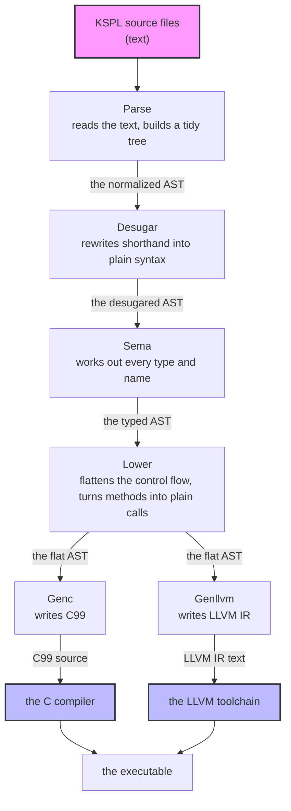

*C99* is the 1999 standard of the C language. *LLVM IR* is the text form of the LLVM compiler tools' own low-level language. Each layer in one line, with the sections that hold how it reshapes the tree:

| layer | takes in | hands on | what it does | knows the types | knows where the output goes | see |
| :-- | :-- | :-- | :-- | :-- | :-- | :-- |
| **Parse** | source text | the normalized AST | turns text into a general-purpose AST and tidies its shape | no | no | "The internal flow: the raw KSPEG tree → the AST conversion → normalizing → verification", "The invariants of the normalized AST (so nothing crashes and no output differs)", "The list of the normalized AST's nodes (the shape the Parse layer hands downstream)", "Synthesizing an `enum`'s `variant_name`" |
| **Desugar** | the normalized AST | the desugared AST | expands the *sugar* (a shorthand notation) that the AST's shape alone can rewrite | no | no | "Desugar: expanding the syntactic sugar that does not know the types" |
| **Sema** | the desugared AST | the typed AST | infers types, resolves names, instantiates generics (makes one copy of a generic per type it is used with: *monomorphization*, [the glossary](#the-glossary)) | yes | no | "The internal flow: registering every file up front → the main type-inference walk → draining the work list of generic instantiations", "The AST nodes the Sema layer creates (its contract with Lower and Genc)" |
| **Lower** | the typed AST | the flat AST | levels complex control flow and method calls into a simple shape | yes | not yet | "The internal flow: one MIR-flattening walk → generating thunks and vtables → the ABI mangling → dead-code elimination → verification" |
| **Genc / Genllvm** | the flat AST | C99 or LLVM IR text | writes the levelled AST out in the target language, reshaping nothing | yes | yes | "What they answer for" |

**Why there are four layers.** Two questions sort them: "does this layer know the types?" and "does it know where the output goes?". The two answers turn to "yes" one layer at a time (`no, no` → `yes, no` → `yes, yes`), so there are four layers, plus Desugar. A layer that reads what it does not know yet breaks the one-way flow, and a change then reaches across every layer. **Flowing backwards (an earlier layer importing a later layer's file) is strictly forbidden.**

**Where the order is written.** `main.run_compiler` drives the whole order through three methods of `pipeline.Compiler`: `Compiler.parse_file` → `run_semantic_analysis` (Desugar, Scan, Infer) → `run_lower_and_codegen` (Lower, Genc/Genllvm). Scan is Sema's pass over the declarations (`sema_decl_collect.run`, "The internal flow: registering every file up front → the main type-inference walk → draining the work list of generic instantiations"), and Infer its walk over the bodies.

"A worked example: how one expression is reshaped in each layer" follows one expression, `p.distance()`, through every layer.

### The bootstrap, and keeping the seed in step

The compiler is written in KSPL, so you need a KSPL compiler to build it. A C file checked into git, the *seed*, is that first compiler. Whenever the compiler changes, the seed must be re-taken with `make commit-seed`, or it keeps doing the old thing.

The compiler is *self-hosting*: it is written in the language it compiles. So building it needs a compiler. A two-stage *bootstrap* solves that chicken-and-egg problem. The diagram shows the loop: the seed builds Stage1, Stage1 builds Stage2, and Stage2 becomes the next seed.

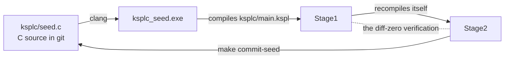

| step | what it is |
| :-- | :-- |
| 1. **the seed** (`ksplc/seed.c`) | committed C source: the compiler at one moment, translated to C and frozen. `clang` builds it into `ksplc_seed.exe` |
| 2. **Stage1** | the current `ksplc/` tree (`ksplc/main.kspl` and everything it depends on), compiled by `ksplc_seed.exe` |
| 3. **Stage2** | the same tree compiled again, this time by Stage1 |
| 4. **the diff-zero verification** (`make self-host` / `make`) | Stage1's and Stage2's outputs must agree completely. This proves that the compiler reproduces itself stably |
| 5. **updating the seed** (`make commit-seed`) | Stage2's output, with its `#line`s dropped, overwrites `ksplc/seed.c` |

About step 4:

* The steps belong to this folder ([`ksplc/Makefile`](../Makefile): translate, build, compare, verdict). The repository's `make` runs them from its root with the seed. A copy of this folder runs them with `make self-host` and any `ksplc`, and `make test-extract` has a copy do so on every change. A build takes its link flags from the compiler that made the code (`info exe-flags` / `info link-libs`), so the steps name no platform.
* Whoever builds the seed names its libraries, because that link is made before any `ksplc` exists to name them.

About step 5: the seed is then a snapshot of the latest source, but not Stage2's output itself. A `#line` is a C directive that tells the C compiler and the debugger which `.kspl` line a C line came from. The `#line`s go because one added `.kspl` line shifts every later one, which would make git's history several times larger than the real change. The seed still generates the same C without them, since they serve only the seed's own debug information. A debugger follows Stage1 / Stage2.

**The seed is a snapshot of the `ksplc/` source at some past moment.** So anything the seed carries inside itself stays old until it is re-taken:

* **A change under `ksplc/` reaches the seed only through `make commit-seed`.** Until a new `ksplc_seed.exe` is built, the seed does not have it.
  * The repository's suites run on the seed, so a fix to what ksplc emits reaches them only once the seed is re-taken. `make ci` can still pass: a difference that matters on one target only (a generated C identifier clobbered by a `#define` in a Windows header, say) shows nothing on Linux.
* **The grammar is embedded.** `ksplc/main.kspl` embeds it at compile time (`embed "ksplc/kspl.kspeg" as kspl_grammar;`, "Keeping the grammar and the AST node kinds in step"). After a grammar change the seed still reads only the old grammar, so tools that run the seed directly, such as `make fmt`, fail until `make commit-seed` has run.
* **So is the C runtime preamble** ("Embedding the runtime, and what a library keeps to itself"): the C support code ksplc writes into every generated `.c`. `ksplc/gen/runtime/{core,hosted,freestanding}.{h,c}` and `hosted_*.c` are embedded into ksplc ("What the two generators share: the decisions, not the spelling"), so editing only them leaves the old preamble in `ksplc/seed.c`. Do not skip `make commit-seed` because no `ksplc/*.kspl` changed. The diff-zero verification of `make ci` / `make self-host` checks only that the current tree reproduces itself; it cannot see that the seed's copy is old.
* **Adding a function to the C runtime takes two seed updates.** The preamble of `out/gen/ksplc_stage1.c` is the runtime the seed carries. So once `std/` calls the new function, Stage1 fails to link (an undefined reference), and `make commit-seed` needs Stage1. The way round is that Stage1 embeds the source tree's runtime:
  1. Temporarily change `std/` so it does not call the new symbol. The declaration may stay: with no reference, nothing needs linking.
  2. `make stage1` → `make commit-seed`. This seed holds the new runtime, because Stage2's preamble is the source tree's, which Stage1 embedded.
  3. Restore `std/`, then `make stage1` → `make commit-seed` again.
     * **A changed signature cannot go this way.** One run always pairs a declaration and a body that disagree, and the C compiler rejects it with `conflicting types`. Add the function under a new name and delete the old one afterwards.

Caution: **Confirm diff-zero with `make self-host` (or `make ci`) before `make commit-seed`.** `make commit-seed` depends on Stage2's output, not on the diff-zero verdict. So it runs even when self-hosting is broken, and burns a broken compiler's output into the seed.

**A change to how ksplc generates code (how it makes temporary names, say) needs the seed updated first.** The seed makes Stage1 and Stage1 makes Stage2, so `make self-host` then always shows a difference. That cannot answer "may I go on": it compares the old seed's output with the new seed's. So:

1. Run `make commit-seed` to burn the seed.
2. Run `make self-host` again. The burned seed's Stage1 is exactly the pre-burn Stage2's output, so green means the new compiler reproduces itself.
3. On red, `git checkout ksplc/seed.c` puts the seed back.

`make ci` runs this check too, so a seed left behind shows in the next run. No third stage (translating once more with the compiler Stage2 built) is needed. The self-host after burning already answers "does the burned seed reproduce itself", and a third stage would be a second means to one property (Principle 6).

**`make install` checks what it installs, and changes no file in the tree**: it runs `self-host` and `self-host-ship`, then installs the shipped executable and the language server. It neither formats the tree nor re-bakes the seed. Each rewrites files, and re-baking on every install would grow the history by the seed's size each time, so the seed is re-baked by `make commit-seed` when the rules above call for it. `make lint` depends on Stage1 and builds it itself, so it is the fast first check before the heavy `make ci`.

### Keeping the grammar and the AST node kinds in step

Every rule in the grammar file needs a matching entry in a hand-written list of node kinds. Forget it, and the compiler stops at start-up with "Grammar sync error".

The *grammar* (`ksplc/kspl.kspeg`) is the file of rules that says what KSPL text may look like; the parser reads it. Each node in the tree records its *kind* (which rule made it) as a number.

**Once a rule is added to the grammar (`ksplc/kspl.kspeg`), add its enum value to `ksplc/base/ast_kinds.kspl` by hand**; nothing generates it. `builtin_name` gives the value's own name past `k_`, so only a rule the grammar spells otherwise (its capitalised token rules, such as `Format_spec`) needs a case there too. Here is why a miss is caught:

1. At start-up, `Global_pools.init()` interns `builtin_name(i)` for `1` to `Ast_kind.k_max`, in order (*interning* gives each distinct string a number, "String interning").
2. When the parser makes a node for a rule (`"Format_spec"`, say), it interns the rule's name into the same pool.
3. A name not registered up front therefore grows the pool past `k_max`, and the run-time self-check in `ksplc/main.kspl` ("Grammar sync error") panics.

**There are three exceptions, and they are never added**: `Block_open` / `Block_close` / `Stmt_end`. Only the grammar has these names. They stand for the symbols that become a level and a newline in the indentation notation (`.kspl`, where indentation marks the blocks, as in Python). `rule_kind` in `ksplc/parse/load.kspl` turns them into `Literal` where they enter the tree. So the names never reach the pool, and the tree has the shape it would have without them.

Caution: **Do not make them kinds of their own.** Every stage that walks the tree would need three more cases in the decision that reads past a name (the place that skips `kind_id == .k_literal`). A stage that misses one does not crash; it reads a different meaning. For example, the `;` of `##lint(I0307 = off);` is counted as an argument, and is wrongly rejected with "an expression cannot be written". The grammar states the role; the tree keeps the name.

`kspl.kspeg`'s header lists which rule plays which role, and `make test-kspls` recounts it from the grammar and checks the list.

### The parts that are not in the pipeline: `base` / `lsp` / `fmt` / `tools`

Four folders of `ksplc/` are not steps of "From source code to a binary"'s pipeline. No data passes through them on its way to the output.

| folder | where it stands | what that means |
| :-- | :-- | :-- |
| `base/` | below the pipeline | it holds the primitives every layer depends on, and has no place on "From source code to a binary"'s two questions |
| `lsp/` | outside, driving the pipeline | the language server (what an editor talks to) runs the pipeline afresh on each editor request; it is a client, not a stage ("The arena is rewound after each request (a worked example)" in [`DESIGN-tools.md`](DESIGN-tools.md), "The language server is split into two processes: the watcher and the analyser" in [`DESIGN-tools.md`](DESIGN-tools.md)) |
| `fmt/` | beside it | the formatter: it turns the Parse layer's AST back into formatted source text |
| `tools/` | beside it | commands built on what the pipeline produces, and the tools that inspect the compiler's own parts |

"What is here" in [`ksplc/README.md`](../README.md) says what each folder holds.

### String interning

Instead of comparing strings again and again, the compiler stores each distinct string once and uses its number.

To avoid comparing strings, the compiler *interns* them: each distinct string becomes an integer ID (`String_pool` in `ksplc/base/core.kspl`). Comparing two IDs is one integer comparison, however long the strings are. `Global_pools` keeps three pools apart by use.

| pool | what it interns | the layer most involved |
| :-- | :-- | :-- |
| `pools.ast_kinds` (`intern_kind`) | the AST kind names (`decl_fn`, `expr_postfix` …), the built-in ones registered at start-up ("Keeping the grammar and the AST node kinds in step"); `Ast_node.new` / `set_kind` (`base/ast.kspl`) use it to turn each node's kind string into its `kind_id` | **Parse**: every path that makes a node, and "Keeping the grammar and the AST node kinds in step"'s drift check |
| `pools.source_files` (`intern_file` / `get_file_str`) | the sources' logical names, the counterpart of `Loc` (`base/ast.kspl`): a node holds this number, not the name | **Parse**: building a node and restoring one from the disk cache |
| `pools.symbol_names` (`intern_name`, `name_text`) | the symbol names in a scope (`sema/type/scope.kspl`) and the instance names monomorphization makes (`Vec_I32`; `sema/decl/mono.kspl`), so lookup and duplicate detection compare integers; and the one copy of each name built from parts (an FQN, a path's segments joined), which `name_text` hands out | **Sema**: name resolution, and monomorphization making no instance twice |

**`source_files` exists to shrink the tree's nodes** ("A tree node's size is fixed by rule and guarded"), not to replace string comparison. A name held per node costs 16 bytes (a pointer and a length), where one per file would do.

**The pools are shared across the layers.** There is one global, `pools` (`base/core.kspl`), made by `Global_pools.init()` when compilation begins and released at the end. With every layer on the same pools, the same string is always the same ID. Dispatching on `kind_id` (the chapter "The rules for handling an AST, shared by every layer"'s first rule) and fast identity checks on the symbol table depend on that.

### A tree node's size is fixed by rule and guarded

**The size in bytes of one tree node (`Ast_node`) and of its run of children (`std/ds`'s `List`) is a fixed number that a guard holds to the byte: if someone makes a node bigger, the guard fails.** A self-host builds so many nodes that 8 bytes more or less per node changes the whole tree by tens of MB. `ksplc/pipeline.kspl` prints `AST Node bytes` and `AST Kids bytes` under `--stats`. `perf_guard` compares them with `want_node_bytes` / `want_kids_bytes` in `tests/tools/perf_guard.kspl`.

**A guard on the total cannot catch that growth.** `AST bytes` ("Arena's implementation: a linked list of chunks and bump allocation") is a ratio to a baseline. So one more pointer per node stays under the ceiling, while the cold usage (a run with no cache) grows measurably.

Caution: **Do not compare the sizes as a ratio.** They are fixed by rule, not measured, so any difference means somebody touched a type. Where a node is to grow by decision, change `perf_guard`'s numbers and give the grounds; re-taking the baseline does not change them.

### Measuring the compiler: `--stats` and the performance guard

**`ksplc --stats` prints what one translation cost in time and memory, stage by stage**, on standard error, since it is about the run ("A line about the run goes to standard error" in [`DESIGN-diagnostics.md`](DESIGN-diagnostics.md)). `make perf-log` keeps the same report for CI's performance guard, which fails the build if the memory grows. The option's contract is `--stats` in [`SPEC-tools.md` §2.3](SPEC-tools.md#23-the-other-compiler-options). This section holds how the report is laid out and what reads it.

**The report's blocks, in order:**

| block | what it shows | where it is explained |
| :-- | :-- | :-- |
| `[KSPEG Rule]` | how often the parser tries each grammar rule, and how each try ends | "What each rule takes (`--stats`'s `[KSPEG Rule]`)" |
| `[Sema Body / by self time]` | the declarations Sema spent the most time on | "Profiling where Sema's time goes" |
| `[Sema Body / by instantiations]` | the declarations instantiated most often | "Profiling where Sema's time goes" |
| `[Layer]` | time and memory per stage | below |
| `[Overall]` | the summary | below |

Each block is followed by a blank line. **`[AST Cache]` shows the disk cache's hits and misses** ("The normalized AST's disk cache (`ksplc/parse/ast_cache.kspl`)"). Without it, a cache that stops hitting goes unnoticed, since things only get slower.

**One place lays them out: `print_stats_report` in `pipeline.kspl`.** Printed per layer on the spot, the detail tables would break up the stages' numbers. So everything goes to a holding place (`base/stats.kspl`) and comes out once at the end. The summary (`[Overall]`) goes last, since a terminal shows the last screen, and `make perf-log` passes it through `cat` too.

**A profiler reset builds a fresh value, so every counter starts at zero together.** The parser keeps the capacity of its heap-backed entry list while clearing its contents. Sema recreates both collections on the request arena, since keeping their old buffers across an editor rewind would leave them pointing at freed memory.

**Each `[Layer]` row gives the time and the arena bytes side by side** (`Parse: N ms, M bytes`). An *arena* is one large region of memory from which the compiler takes small pieces (the tree's nodes) and which it frees all at once. The time alone is not enough: the stage that slowed and the stage that grew the memory can differ, and the log alone must say which stage grew it. The bytes are printed even on a target with no clock, since the amount taken does not depend on the environment.

**`[Layer]` prints the remainder as `Other`**: the stages' total against `Compile time` for time, and against `AST Arena usage` for bytes (start-up and the CLI parse, plus what is taken after the stages). Dropped silently, an unmeasured stage could grow while nobody notices that the sum does not add up.

**CI's performance guard judges memory, not time.** `make perf-log` makes the log, and `tests/tools/perf_guard.kspl` reads it; its opening comment holds the reasons. Its verdicts:

| verdict | how it behaves |
| :-- | :-- |
| the peak memory | moves a whole chunk at a time |
| the AST arena's usage against a baseline ("Arena's implementation: a linked list of chunks and bump allocation") | moves continuously, so only it catches growth within a chunk; both memory figures are needed |
| the two node sizes ("A tree node's size is fixed by rule and guarded") | fixed by rule |
| (the compile time) | recorded beside them, decides nothing: it measures the machine and its load as much as the work |

Caution: **Keep the characters of every line another program reads.** The guard finds its lines by the patterns at its head (`time_pattern` in `tests/tools/perf_guard.kspl` and the ones beside it). `stats_head` in `ksplc/tests/suite/ast_cache_test.kspl` finds `[AST Cache]`. A line spelt differently is not found.

#### What each rule takes (`--stats`'s `[KSPEG Rule]`)

For each grammar rule, `--stats` counts how often the parser tried it and how each try ended. The counts show where a grammar change would make parsing faster.

The parser, KSPEG, is a *PEG* parser: for each rule it tries the alternatives in order and takes the first that matches. It also *memoizes* (a *packrat* parser): it remembers the result of each rule at each position, so a second try at the same place is a lookup, a *memo hit*.

`--stats` prints four numbers per rule: **calls / memo hits / read and succeeded / read and failed** (`Rule_prof` in `kspeg/engine.kspl`). They are counts, not times. The same input and grammar give the same values under any environment or load, so a grammar change can be compared before and after.

**"Read and failed" is derived, not counted.** Every reference ends in exactly one of a memo hit, a success or a failure, so it is `calls - memo hits - succeeded`. If it were counted, a dropped increment would give a lie that adds up in every column. `kspeg/tests/engine_test.kspl` matches all four as actual numbers on a small grammar with a known answer. The identity alone always holds, and a missed count only shows as more failures.

**There are two ways to read it.**

| what you see | what it means |
| :-- | :-- |
| a rule whose memo hits do not grow | it visited each position once, so packrat has nothing to save there |
| a rule with few successes and many failures | it is speculating and missing. Of those, only the ones where a miss is costly repay a grammar change |

**Many failures are not waste in themselves.** In `ksplc/kspl.kspeg` most alternatives fail on a one- or two-character comparison (`expr_fn_lit` is one `'fn'`, `label` is `Identifier ":"`, `type_args` is `"<|"`). Lookahead (peeking at the next characters before trying a rule) would only pay the same cost. A miss is costly only where the rule reads another rule whole before missing. `expr_cast` (`type_expr "::" expr_unary`) and `expr_compound` (`( type_expr &"::{" )? …`) both read `type_expr` before looking at `::` / `::{`. This is mainly where the memoization pays. The two ask for `type_expr` at the same position in turn, so the second hits the memo; without it the type parse runs twice per primary.

Caution: **Do not avoid it by moving `expr_cast` behind `expr_postfix`.** The reason is written above that rule in `ksplc/kspl.kspeg`.

**Two of kspeg's devices pay off on this grammar** (both in [`../../kspeg/docs/DESIGN-engine.md`](../../kspeg/docs/DESIGN-engine.md)):

* **Folding a run of keywords into one lookup** takes `Primitive_type`'s thirteen names, which a cold compile of `ksplc/main.kspl` would otherwise try some 2.8 million times.
* **Skipping a rule that cannot begin with the next byte** catches most of the failures above before they are entered: without it, nine in ten of the nodes a parse builds are thrown away.

Under callgrind on that compile, the two take the parse from 6.5G instructions to 3.9G, and the engine's share at `-O2` from about 1.2 s to 0.7 s.

## The Development Principles

The eight principles for all of Kanso live in `docs/DESIGN-principles.md`. Two more hold only inside the compiler: stop at once on an impossible state, and let a backend write its output directly.

The eight principles that hold for all of Kanso are "Development Principles" in [`../../docs/DESIGN-principles.md`](../../docs/DESIGN-principles.md), and "Principle N" in this document points there. The two below hold only for the compiler, because both assume the pipeline (Parse → Sema → Lower → Gen*).

### Failing fast through an exception or an ICE

**Do not cover an impossible state, a missing AST structure or an unexpected `null` with a stopgap such as `if (node == null) return;`.** Stop at once, so a bug is found near its source.

| situation | use |
| :-- | :-- |
| recovery is possible | a `throw` |
| it is not | `ice_assert` / `ice_panic` (`base/diag.kspl`; where a position can be given, the methods of the same names in `base/ast.kspl`) |

An *ICE* (internal compiler error) is a stop that says "ksplc itself got something wrong", not "your code is wrong" ([the glossary](#the-glossary)).

Caution: **If such a state is ignored, the diagnostic comes not from ksplc but from downstream.** A shape Sema let through breaks first inside the generated C. The user then gets a `clang` error, far from the KSPL source in both position and cause, instead of a KSPL diagnostic. On meeting a shape that cannot be dropped, stop there.

### A backend writes straight out rather than assembling

**An `emit` function writes straight to the context's output stream instead of returning a `Builder`.** A `Builder` is a string that grows in memory. Writing directly removes needless allocation and leaks from code generation.

## The Parse layer: from text to an AST (Desugar included)

Parse reads the source text and builds the tree (the AST). It then tidies the tree so that every node of one kind has the same shape. Desugar, a step inside this layer, rewrites shorthand notations into plain ones. Neither knows any types.

### What it answers for

It reads the source text, builds a general-purpose abstract syntax tree (AST), and *normalizes* it: it reshapes the tree into one fixed shape per kind of node. **It ignores types and meaning.** Its one aim is an AST that is regular everywhere, so every later layer can read it through safe accessors alone (the chapter "The rules for handling an AST, shared by every layer"'s first rule).

### The internal flow: the raw KSPEG tree → the AST conversion → normalizing → verification

Each file goes through four steps in a fixed order, and then the files it imports go through the same steps.

`load_and_parse_file` in `parse/load.kspl` is the one orchestrator. The diagram shows what it does with one file.

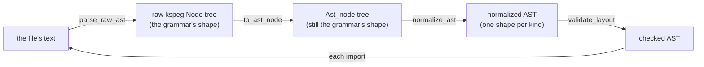

For each file it runs, **in this order**:

1. **The raw KSPEG parse**: `parse_raw_ast` drives the grammar rule `"program"` and gets a `kspeg.Node` tree in the grammar's own shape.
2. **The AST conversion**: `to_ast_node` (`parse/load.kspl`) rebuilds it recursively as `Ast_node`s, dropping `null` children. The shape is still the grammar's.
3. **Normalizing**: `normalize_ast` (`impl Ast_node` in `parse/normalize.kspl`) makes one recursion from the children to the parent (*post-order*: a node is handled after all its children).
   * At each node it applies `elide_node`, then `normalize_by_kind` (a dispatch table on `kind_id`).
   * `elide_node` does the single-child pass-through, strips brackets, reassembles `expr_cast` and so on, all inside `normalize.kspl`.
   * `normalize_by_kind` delegates many kinds to per-kind normalizing functions in `parse/normalize_decl.kspl` / `parse/normalize_stmt.kspl` (`normalize_if_stmt`, `normalize_loop`, `normalize_switch_stmt`, `normalize_impl_decl`, `normalize_enum_variant`, say).
   * Calls go only from `normalize.kspl` to `normalize_decl.kspl` / `normalize_stmt.kspl`: those are helpers called from one dispatch table, not passes of their own.
4. **Verification**: `validate_layout` (`base/ast.kspl`) checks the finished tree recursively, in one separate walk after the whole file is normalized.

**`load_and_parse_file` follows the imports by its own recursion.** After normalizing a file, it calls itself on the resolved path of each `.k_decl_import`. It attaches every file's top-level nodes straight to one shared `root_file`. Two records keep it from going round in circles:

| record | what it holds | what it does |
| :-- | :-- | :-- |
| `import_stack` | the current DFS path: the chain of files being loaded, each importing the next (DFS is depth-first search) | each call checks it first. If the same path is already on it from a different directory, the call throws `circular_import`. From the same directory, it counts as resolved and returns silently, because a cycle within one folder is allowed |
| `loaded_files` | a memo of every file already loaded | keeps a file reached by two paths from being analysed twice |

### The invariants of the normalized AST (so nothing crashes and no output differs)

These are the promises every normalized tree keeps. Later layers rely on them without checking, so the Parse layer must keep them whenever it builds an AST.

An *invariant* is a rule that always holds. Breaking one causes SEGVs (crashes from reading bad memory) or differences between Stage1's and Stage2's output.

| the rule | what it says | why |
| :-- | :-- | :-- |
| **The absolute rule of fixed length versus variable length** | **A context-dependent structure has a fixed length**: syntax with an optional modifier or `label` (`decl_var`, `stmt_for`, `stmt_switch`) always has the same element count (a Fixed Layout). An `empty` node fills a missing part. **A homogeneous list has a variable length**: a run of one kind (`stmt_block`'s statements, `expr_args` and the like) stays variable | the most important guard against out-of-bounds access: downstream reads a part by its index in one step (O(1)), never by searching |
| **An AST node's pointer is unique (No Node Sharing)** | never reuse an instance, not even a dummy `empty` node filling a slot; allocate each with `Ast_node.new` | Sema keys the type environment on a node's address. A shared node makes the type information collide and causes a SEGV |
| **Normalizing the string (text)** | a leaf's `text` (`Identifier`, `Keyword`, `Primitive_type`) keeps no surrounding whitespace at all, and symbol nodes (`()`, `,`, `;`, `{}`) vanish entirely from the AST | a leaf (a node with no children) holds exactly its word |
| **A string literal is zero-copy, with symmetric escapes** | the KSPEG engine keeps a slice of the source rather than unescaping. An ordinary string is written out as that slice, escapes and all. A raw string (`"""`) is escaped to C's rules on output (an actual newline → `\n` …) | nothing is copied, and an escape comes out as it went in |
| **Fixing the type expressions** | the raw pointer `@`, a slice/array `[]` and an exception union `!` each parse as a separate `type_postfix` node. The postfix mutability marker `$` (`docs/SPEC-language.md` §3.2) stays at the head of the `text` of the `type_postfix` it was written on (`"$@"` / `"$[]"`) | which level a `$` belongs to stays known (the caution below) |
| **Attributes and visibility go at the head** | always first among the target node's children (in a fixed-length node, as an `attribute_list` node at `[0]`) | anywhere else, Sema loses track of what `pub` and the like apply to |
| **The position information (Source_loc) propagates exactly** | when `elide_node` discards a needless parent and lifts its child up, the child's own `loc` must never be overwritten | a compile error then reports the exact position |

Caution: **Normalizing must not strip the marker and move it up to the head.** Which postfix it belonged to would be lost. `U8[]$@` (a mutable pointer to a slice of immutable elements) and `U8$[]@` (an immutable pointer to a slice of mutable elements) would merge into one AST before the type is made. A marker stays on its level, and `apply_type_postfixes` in `sema/decl/resolve.kspl` applies `Env.make_const` per level (a level with no marker is made immutable).

One more rule needs more room than a cell. **A cfg drop empties the wrapper too.** `#cfg(...)` keeps or drops a declaration depending on build flags (like C's `#ifdef`). It can sit on a declaration's direct child (in `decl_var` / `decl_const`, on the child `decl_var_item`; see "The top-level declarations"). Emptying that child via `should_drop_by_cfg` does not drop the parent. So `elide_node` must also empty any `decl_var` / `decl_const` left with no children after `flatten_inline_nodes`. Otherwise the empty wrapper becomes a nameless declaration under `push_or_default`'s fallback name (`"unknown"`), and wrongly fires W0206. Check for the same gap when adding a node kind whose attributes are nested.

### The list of the normalized AST's nodes (the shape the Parse layer hands downstream)

The tables below say, for each kind of node, which child sits at which index. This is the shape every later layer reads.

A normalized AST holds the strict layout below, read only through `base/ast_ext`'s O(1) accessors (the chapter "The rules for handling an AST, shared by every layer"'s first rule). An *accessor* is a small function that returns one named child (`get_import_path()`), so no reader counts indexes itself. **Spelling a type or a name from the tree is `base/ast_spell`'s job.** It builds a string, so it has its own limit on depth.

**`validate_layout` checks the count of the fixed slots and the kinds at a few key places, and nothing else.** Only some kinds below have a branch; the rest go to the default branch (`validate_layout_impl` in `base/ast.kspl`). Most kinds written in these tables are the accessors' promise, not checked. The count alone still matters, because a fixed-length node slipping out of position quietly breaks O(1) access downstream ("The absolute rule of fixed length versus variable length" in "The invariants of the normalized AST (so nothing crashes and no output differs)").

Caution: When adding an accessor, confirm that the kind really comes at that index.

**The notation**: `[0]` an index, `?` optional (`empty` where missing, or packed away), `...` variable length. The pure syntactic symbol nodes are gone by this point ("The invariants of the normalized AST (so nothing crashes and no output differs)").

**These tables and "The AST nodes the Sema layer creates (its contract with Lower and Genc)"'s do not overlap.**

| table | holds the kinds that | examples |
| :-- | :-- | :-- |
| these ("The top-level declarations" to "The expressions and the types") | come from `kspl.kspeg`'s grammar rules and remain after normalizing | `decl_fn`, `stmt_if`, `expr_postfix` |
| "The AST nodes the Sema layer creates (its contract with Lower and Genc)"'s | no grammar rule makes, and Sema's analysis creates | `method_access`, `enum_init` |

**Some kinds the grammar defines vanish.** Normalizing erases the nodes that the grammar needs but that mean nothing. The main cases:

* **The rules that exist only for precedence**: `expr_or`, `expr_and`, `expr_cmp`, `expr_add`, `expr_mul`. *Precedence* is which operator binds tighter (`*` before `+`). Each rule is one precedence step, shaped `(the operator, the higher rule)*`.
  * With no operator and one child, `elide_node` (`parse/normalize.kspl`) replaces the node with its child. The raw tree's reader (`to_ast_node` in `parse/load.kspl`) checks the same list (`is_expr_wrapper_kind`) and does not make such a node.
  * With operators, `treeify_expr` (`parse/normalize_stmt.kspl`) folds them into a left-associative binary tree of the general-purpose `expr` kind ("The expressions and the types"): `a - b - c` becomes `(a - b) - c`.
  * Either way, none of the five names remains in the final AST.
* **The visibility wrapper**: the `k_visibility` node passes the `Keyword` inside it (`pub` …) up to its parent and vanishes.
* **Pure syntactic symbols**: a node of symbols alone (`(`, `)`, `,`, `;`, `{`, `}` and the like) vanishes under "The invariants of the normalized AST (so nothing crashes and no output differs)"'s rule.

`expr`, `expr_ternary` and `expr_catch_chain` also vanish when they hold a single child. Where the syntax is used, they stay, so they are in "The expressions and the types"'s table. **Only a node that adds nothing vanishes; a syntax with meaning survives.**

#### The top-level declarations

| `kind` | `children`, in order | notes |
| :--- | :--- | :--- |
| **`program`** | `[0...]`: the top-level elements (`decl_top` and the like) | the file's root |
| **`decl_import`** | `[0]: Keyword("import")`<br>`[1]: String`<br>`[2]?: Identifier` or `decl_import_selector_list` | `[2]` is either an alias for the whole file (`Identifier`) or a selective import list, never both. The alias form's `as` is removed. Accessors: `get_import_path()` / `get_decl_import_selector_list()` and the like |
| **`decl_import_selector_list`** | `[0...]: decl_import_selector` | the inside of the `{ }` in `import "path" { A, B as C }`; one or more |
| **`decl_import_selector`** | `[0]: Identifier` (the original name in the imported file)<br>`[1]?: Identifier` (the alias used with no namespace; omitted, the same name as `[0]`) | the `as` is removed. Accessors: `get_selector_name()` / `get_selector_alias()` |
| **`decl_embed`** | `[0]: Keyword("embed")`<br>`[1]: String`<br>`[2]: Identifier` (the bound name) |  |
| **`decl_extern_block`** | `[0]: Keyword("extern")`<br>`[1...]: decl_extern`, `decl_fn_proto`, `decl_var`, `decl_extern_struct` | kept in the AST as an external-linkage block, never flattened |
| **`decl_extern`** | `[0...]: decl_fn_proto` or `decl_var` or `decl_extern_struct` | a child of `decl_extern_block`; `pub` is removed, since Sema handles it |
| **`decl_extern_struct`** | `[0]: Keyword("struct")`<br>`[1]: Identifier` | an opaque struct, allowed only inside an `extern "C"` block |
| **`decl_const`**<br>**`decl_var`** | `[0]`: `attribute_list` or `empty` (the attributes and the visibility)<br>`[1]`: `Keyword` (`"var"` / `"let"` / `"const"`; `var` and `let` are not the language's keywords but marks `parse/normalize_decl.kspl` synthesizes from whether a `$` is there, in neither the grammar (`kspl.kspeg`) nor `ksplc info keywords`)<br>`[2]`: `Identifier` (the variable's name)<br>`[3]`: `type_expr` or `empty` (the type annotation)<br>`[4]`: `expr` or `empty` (the initializing expression) | a declaration synthesized later has the same five slots (`build_inferred_var_decl` in `base/ast.kspl`), so a reader of the tree never asks where it came from |
| **`decl_fn`** | `Keyword("fn")`, `Identifier`, `type_fn_sig`, `stmt_block` (read out in no particular order) | may include `type_gen_params`; the attributes and `pub` come first |
| **`decl_struct`** | `[0]: Keyword("struct")`<br>`[1]: Identifier`<br>`[2]?: type_gen_params`<br>`[3...]: struct_field` |  |
| **`struct_field`** | `[0]: Identifier`<br>`[1]: type_expr` | the attributes and the visibility (`pub`) come first |
| **`decl_enum`** | `[0]: Keyword("enum")`<br>`[1]: Identifier`<br>`[2]?: type_expr`<br>`[3...]: enum_variant` |  |
| **`enum_variant`** | `[0]: Identifier`<br>`[1]?: enum_payload`<br>`[last]?: expr` | `enum_field` is a tagged union's payload; `expr` is an explicit tag value |
| **`enum_payload`** | `[0...]: enum_field` | wraps the `enum_field`s |
| **`enum_field`** | `[0]: Identifier`<br>`[1]: type_expr` | a tagged union's payload field |
| **`decl_trait`** | `[0]: Keyword("trait")`<br>`[1]: Identifier`<br>`[2]?: type_gen_params`<br>`[3...]: decl_fn_proto` (each method signature) | where polymorphism starts: generating a vtable or thunk and the conformance check (`docs/SPEC-language.md` §5.3) read it. `apply_modifiers_to_targets` moves the `visibility` before a method to the head of its `decl_fn_proto`, so none remains directly under `decl_trait` |
| **`decl_impl`** | `[0]: Keyword("impl")`<br>`[1]?: type_gen_params`<br>`[2]: type_expr` (the target)<br>`[3]?: type_path` (the trait named)<br>`[4...]: decl_fn` | with a trait named (`: TraitName`), its `type_path` comes right after the target `type_expr` |
| **`decl_typedef`** | `[0]?: visibility`<br>`[1]: Keyword("typedef")`<br>`[2]: Identifier` (the new type name)<br>`[3]: type_expr` (the type it names) | becomes a typedef in Genc. Where `[3]` holds a `type_fn_sig`, C's own syntax has to resolve it, so the structure must not be broken |

#### The control flow and the statements

| `kind` | `children`, in order | notes |
| :--- | :--- | :--- |
| **`stmt_block`** | `[0...]: stmt` | the `{` and `}` are removed |
| **`stmt_labeled_block`** | `[0]`: `label`<br>`[1]`: `stmt_block` | Lower flattens it into an ordinary block plus a `stmt_label` |
| **`stmt_if`** | `[0]`: `label` or `empty`<br>`[1]`: `expr` (the condition)<br>`[2]`: `stmt_block` (the then block)<br>`[3]`: `stmt_block`, `stmt_if`, or `empty` (the else block) | |
| **`stmt_for`** | `[0]`: `label` or `empty`<br>`[1]`: `for_init` or `empty`<br>`[2]`: `expr` or `empty` (the condition)<br>`[3]`: `for_step` or `empty`<br>`[4]`: `stmt_block` or `empty` (the loop's body) | always five elements, whether C-style, while or endless |
| **`stmt_switch`** | `[0]`: `label` or `empty`<br>`[1]`: `expr` (the condition)<br>`[2...]`: `case_pattern` or `stmt_block` or `Keyword("case"/"default")` | |
| **`stmt_return`**<br>**`stmt_break`**<br>**`stmt_continue`** | `[0]`: `Keyword`<br>`[1]`: `expr` or `Identifier` (optional) | |
| **`stmt_fallback`** | `[0]`: `Keyword`<br>`[1]`: `expr` | |
| **`stmt_defer`** | `[0]`: `Keyword("defer")`<br>`[1]: stmt_block` | the body is always a `stmt_block`: `normalize_defer_stmt` in `parse/normalize_stmt.kspl` gives a one-statement `defer` (`defer buf.free()`) that shape. It holds no capture list (`docs/SPEC-language.md` §8.4.1; the grounds are docs/DESIGN-language.md "Why `defer` has no capture list") |
| **`stmt_expr`** | `[0]`: `expr` (the left-hand side)<br>`[1]?: assign_op` (the assignment operator)<br>`[2]?: expr` (the right-hand side) | |

#### The expressions and the types

| `kind` | `children`, in order | notes |
| :--- | :--- | :--- |
| **`expr`** | `[0]`: `expr` (the left-hand side)<br>`[1]`: `Literal` (the operator)<br>`[2]`: `expr` (the right-hand side) | the precedence rules, folded: the grammar's five precedence rules always end as this three-element general-purpose `expr` ("The list of the normalized AST's nodes (the shape the Parse layer hands downstream)") |
| **`expr_unary`** | `[0]`: `Literal` (`!`, `-`, `~` and so on)<br>`[1]`: `expr` (the target expression) | |
| **`expr_offsetof`** | `[0]`: `Keyword("offsetof")`<br>`[1]`: `type_expr`<br>`[2]`: `Identifier` (the field's name) | renamed from `expr_unary` by `set_kind` (`parse/normalize.kspl`). The `k_expr_unary` branch in `parse/normalize_stmt.kspl` drops the separating symbols, not `is_trivia_node` in `parse/normalize.kspl` (`expr_unary` is not in `is_flatten_target`, so that path is never taken). The same branch drops the round brackets, so `expr_sizeof` can read `[1]` as its target, and it drops the comma between `offsetof`'s two children |
| **`expr_ternary`** | `[0]`: `expr` (the condition)<br>`[1]`: `expr` (the value where true)<br>`[2]`: `expr` (the value where false) | the `value if condition else value` syntax. Without a condition it normalizes into the value itself |
| **`expr_catch_chain`** | `[0]`: `expr` (the left-hand side)<br>`[1]`: `expr_catch` | a run such as `a catch b catch c` is piled into left-associative two-element nodes by `treeify_expr` (`parse/normalize_stmt.kspl`); with no `catch` it vanishes |
| **`expr_postfix`** | `[0]`: `expr_primary` (the receiver)<br>`[1]`: `Literal` or `Keyword` (`.`, `[`, `(`, `@`, `::`, `!`)<br>`[2...]`: the elements accessed | |
| **`expr_implicit_dot`** | `[0]`: `Identifier` (a method or variant name)<br>`[1]?: expr_args` | a dot access with the receiver omitted (`.ok` or `.free()`), used by Desugar's method-chain expansion and by Sema's implicit resolution of an enum |
| **`expr_catch`** | `[0]`: `Keyword("catch")`<br>`[1]?: Identifier` (the error variable)<br>`[2]: stmt_block / expr` | one `catch`, as `expr_catch_chain`'s right-hand element |
| **`struct_literal`** | `[0]?: type_path / type_expr`<br>`[1...]: expr_field_init` | a compound literal, renamed from `expr_compound` by normalizing |
| **`expr_field_init`** | `[0]?: Identifier / . / [` (the prefix)<br>`[1]: Identifier / expr` (the key's name / the index)<br>`[2]?: Literal("=")`<br>`[3]: expr` (the initializing expression) | |
| **`type_expr`** | `0` (Terminal) | stringified: the last step of normalizing joins every child's text into a finished type string such as `const I32[]` in `self.text`, and discards the subtree to save memory |

### Desugar: expanding the syntactic sugar that does not know the types

*syntactic sugar* is a shorter way to write something the language could also say in plain syntax. Desugar rewrites such shorthand into the plain form, using only the shape of the tree. String interpolation (`"n = \{n\}"`) becomes a chain of method calls, and an anonymous function becomes a named function plus a struct. Later layers then check the result like any code the user wrote.

Desugar walks the normalized AST in one post-order recursion through `desugar_node`. It expands the syntactic sugar that the AST's shape alone can rewrite; [3.5.2](#which-sugar-belongs-to-which-layer-the-list)'s table lists what it rewrites, and where. The later layers type-check the result like ordinary syntax.

**It is a file of its own (`parse/desugar.kspl`) but one step of the Parse layer, not a layer.** On "From source code to a binary"'s two questions it knows exactly what Parse knows; only when it runs differs, so "From source code to a binary"'s table gives it a row.

**Little work fits this layer.** Most candidate sugars (a new pattern-matching notation, another method-chain shorthand) need *symbol resolution*: finding out what a name refers to, to tell a variable from a type name or an enum variant. So they belong to Sema.

`parse/format_spec.kspl` holds only the grammar of a format specifier's SPEC `\{value:SPEC\}`, and no diagnostics. It reads the format and makes the argument nodes of `fmt_spec` / `fmt_prec` / `fmt_hex`; the desugaring code, holding the position and the ctx, reports.

**Why it is called at a separate timing rather than from `parse_file`**: it runs once over the whole of `root_file`, at the head of `Compiler.run_semantic_analysis` (`pipeline.kspl`).

* It is not there to run once per file. The `loaded_files` guard in `load_and_parse_file` already ensures that.
* There is no cross-file dependency either: a lifted closure is `priv`, made unique per file by `write_priv_prefix_to` in `lower/abi.kspl`.
* **The reason is the diagnostics.** Desugar reports a mis-written format specifier or a failed closure synthesis. Run per file, the report would sit inside the disk cache (`parse/ast_cache.kspl`), so a run that hits the cache would print nothing.

Caution: **To move it, first make sure that a file which emitted a diagnostic is not cached.** In the other order, a mistake shows red on the first run alone. [3.5.4](#measuring-where-the-desugaring-goes) measures what moving would gain.

**`for item in collection` is split between two layers** (its seam is in [3.5.4](#measuring-where-the-desugaring-goes)):

| layer | its half | why there |
| :-- | :-- | :-- |
| Desugar | moves the collection expression into a temporary, so an expression with a side effect is not evaluated on every iteration | only this layer can insert that declaration into the enclosing block |
| Sema | expands the `for` itself ([4.3.10](DESIGN-compiler.md#for-x-in-is-expanded-in-sema-because-its-shape-depends-on-the-types)) | the subject's type decides its shape |

#### Synthesizing a closure makes a KSPL source string and puts it through the same parser

To turn a closure into plain code, Desugar writes the needed declarations as KSPL text and parses that text, rather than building tree nodes by hand.

A *closure* is a function value that keeps the local variables it uses (its *captures*). C has no closures, so each one becomes three things the language already has:

| synthesized | what it is |
| :-- | :-- |
| the environment struct | a struct holding the captured variables |
| its constructor | the function that fills the struct in |
| the impls for `Callable` | the methods that make the struct callable like a function |

**The synthesized declarations (the environment struct, its constructor, the impls for `Callable`) are written as KSPL source and parsed.** They go through `parse_synth_decls` in `parse/load.kspl`, the one entry point for every synthesis ("Measuring where the desugaring goes"). A hand-built AST hides its mistakes until the generated C, and must follow every change to a declaration's shape. A string keeps the grammar (`ksplc/kspl.kspeg`) the one source. Only the body is transplanted from the original AST, since source text cannot restore it.

**The enclosing type arguments that the signature touches are copied across** to the synthesized declarations. A *type argument* is the `T` of a generic (`List<|T|>`). The synthesized declarations sit at the top level, outside the enclosure's scope (`forwarded_gen_params` in `parse/desugar_closure.kspl`, which says why no more are copied).

* Match each as one whole identifier, since as a substring `T` matches `Total`.
* Put them on the constructor call as `type_args` children. Otherwise `replace_type_vars` in `sema/decl/subst.kspl` cannot reach them, and the result fails as "the type `_anon_env_1_T` does not conform to `Callable1<|I32, …|>`".
* Write them out rather than leave them to inference. Inference has no clue with zero captures, and through an immutable binding's `n@` it binds `T` to `I32 const`, an instantiation other than the synthesized impl's.

**A closure's signature cannot omit its types, because this layer has no types.** The parameter, return and capture types are copied into the synthesized source as written, so an omitted one leaves nothing to copy. **A folded slice or optional is copied as its sugar** (`spell_as_written` in `parse/desugar_slice.kspl`): the folded text reads `Slice<|U8|>`, which is refused as a type. Filling them from the expected type (the actual argument of `Callable1<|A, Ret|>`) would move the synthesis to Sema. Sema would then register and analyse a new struct and impl partway through body analysis, after all the declarations are gathered. It would also insert a temporary variable's declaration into the enclosing block.

Caution: **Do not move half of it.** Parse and Sema would each have an entry point that synthesizes, and one thing would have two sources.

Of the three kinds of type, one could be left out while the synthesis stays here, and two could not.

**The captures' types alone could be omitted while staying in this layer.** Make them type arguments of the synthesized declarations, and take them as `C@` in the parameters of the function that makes the environment. `C` is then bound from `env_new(lo@)`'s actual argument; the type argument appears in a parameter, so inference from the existing positions is enough. This does not conflict with writing the type arguments out (above). That rule is for the enclosing type arguments carried over, and the captures' types do not come from there.

**The same shape does not work for the parameter and return types.** As type arguments they would appear only in the impl for `Callable`, never in the environment function's parameters, so no argument supplies them. Inference by position then breaks, with the leading type argument taking its neighbour's binding. Pass `env_new(lo@)` to `Env<|P, C|>` and it becomes `Env_I32_Const_C`: `P` binds `I32 Const` from `lo@`, and `C` stays unbound and does not conform to `Callable1<|I32, Bool|>`. Filling them needs a way back from the expected type at the use site to the value's type arguments. That is the reverse of monomorphization's direction (instantiating a template with a concrete type), the same trap for which this document rejects a blanket impl ("Impls of generic types").

**The body is not the obstacle.** A generic's body is checked per instantiation ("`for x in` is expanded in Sema, because its shape depends on the types"). So a parameter type replaced by a type argument does not make the body fail at the template; an instantiation that does not meet the constraints is rejected, naming that type.

**The tools it would need are generic instantiation's** ([4.3.6](DESIGN-compiler.md#where-the-instantiation-queue-is-drained)): queue the work with a copy of the bindings, and drain it at a stage's boundary. That boundary must be as fine as between statements, or a call inside a body is not served in time. Synthesis needs the same grain, since a closure can be called in the statement after it is made.

#### Which sugar belongs to which layer (the list)

**When adding a sugar, first decide its row in this table.** Decide on three questions and no more:

1. Does it need types?
2. Can the instantiation multiplier be paid? (Lower's tree holds a copy of each generic body per type it is used with, so work done there repeats that many times; [3.5.3](#moving-type-dependent-sugar-to-lower-the-costs-and-the-conclusion).)
3. Do typing rules grow in Sema?

The grounds are in [3.5.3](#moving-type-dependent-sugar-to-lower-the-costs-and-the-conclusion). Then write it in that layer's section too: this table is a map, and each layer holds the detailed reasons.

Caution: **Name the entry point's symbol, not the file alone.** With a file name alone, nobody notices when a row points at another transformation's file. With the symbol, `make test-docref`'s "a named symbol is in that file" checks it every time.

**This is a map of the layers, not a count of the walks** ([3.5.4](#measuring-where-the-desugaring-goes)). Every Desugar row runs inside one walk with three ordering constraints:

* the slice of a run of elements is expanded before `T[]` is rewritten;
* a block walks its own children;
* the enclosing type arguments are pushed down.

Read their reasons at `desugar_node` in `parse/desugar.kspl` before adding a Desugar row.

| layer | the sugar | the place (the entry point's symbol) |
| :-- | :-- | :-- |
| **Parse / normalizing** | removing wrappers, moving modifiers, folding the type postfixes (`@` `$@` `[]`), dropping by `#cfg` | `normalize_ast` in `parse/normalize.kspl` |
| | splitting `$a: T, b: T` into one node per name | `flatten_var_decl_lists` in `parse/normalize_decl.kspl` (called by `normalize_by_kind` in `parse/normalize.kspl`) |
| **Parse / loading** | synthesizing an `enum`'s `variant_name()` | `append_enum_variant_names` in `parse/load.kspl` ([3.6](#synthesizing-an-enums-variant_name)) |
| **Desugar** | string interpolation → a method chain | `desugar_string_call` in `parse/desugar.kspl` |
| | a format specifier's SPEC `\{v:SPEC\}` → the arguments of `fmt_spec` / `fmt_prec` / `fmt_hex` | `build_call` in `parse/format_spec.kspl` |
| | `for x in`'s **collection expression** moved aside into a temporary variable | `desugar_for_in_loop` in `parse/desugar.kspl` |
| | an anonymous function or closure → `_anon_fn_N` plus an environment struct plus impls for `Callable` | `desugar_fn_lit` in `parse/desugar_closure.kspl` ([3.5.1](#synthesizing-a-closure-makes-a-kspl-source-string-and-puts-it-through-the-same-parser)) |
| | `if v: = X { }` → a `switch` shape (**the rejection is Sema's**) | `desugar_if_bind` in `parse/desugar.kspl` |
| | a **written** `T[]` / `T$[]` → `Slice<\|T\|>` / `Slice<\|$T\|>`, and `T?` → `Option<\|T\|>` | `fold_sugar_postfixes` in `parse/desugar_slice.kspl` |
| **Sema** | `for x in`'s shape (an index or `next()`, decided by the subject's type) | `expand_for_in` in `sema/body/for_in.kspl` ([4.3.10](DESIGN-compiler.md#for-x-in-is-expanded-in-sema-because-its-shape-depends-on-the-types)) |
| | the rejection that holds `if v: =` to an `Option` | `infer_switch_stmt` in `sema/body/switch.kspl` |
| | an implicit conversion, an upcast, a `Result` wrap → `expr_postfix ::` / `expr_upcast` / `result_wrap` | `apply_type_coercion` in `sema/body/coerce.kspl` |
| | interpolation's `\{e\}` to `e.variant_name()` where it is an enum | `try_rewrite_enum_fmt` in `sema/body/dot.kspl` |
| | filling in default arguments (an operator's desugaring has its own entry point) | `fill_default_args` / `fill_operator_defaults` in `sema/body/call_defaults.kspl` |
| | instantiating a generic | `instantiate_struct` / `instantiate_fn` in `sema/decl/mono.kspl` |
| | a general-purpose access → a dedicated node (`method_access` / `enum_init`) | `infer_dot_access` / `infer_namespace_access` in `sema/body/dot.kspl` |
| | a **synthesized** slice (a string literal's type, the reflection table) | `slice_type_of` in `sema/decl/mono.kspl` |
| **Lower** | hoisting short-circuit evaluation `&&` / `\|\|`, `!` (`result_unwrap`), and `catch` / `fallback` | `lower_logical_op` / `lower_try_op` / `lower_expr_catch_chain` in `lower/expr.kspl` |
| | operator overloading `a + b` / `a[i]` → a method-call node (**Sema decides which method, Lower builds the call**) | `lower_user_operator` in `lower/expr.kspl` |
| | moving an index aside (a slice's `at` needs the receiver's address) | `lower_postfix_index_operator` in `lower/expr.kspl` |
| | `defer`'s cleanup, a labelled `break` / `continue` | `inject_cleanups` / `lower_loop_jump` in `lower/defer.kspl` |
| | inserting ARC's retain / release | `lower_arc_var_decl` / `emit_managed_op` in `lower/arc.kspl` |
| | generating thunks and vtables | `generate_trait_thunks` in `lower/vtable.kspl` ([5.2](DESIGN-compiler.md#the-internal-flow-one-mir-flattening-walk--generating-thunks-and-vtables--the-abi-mangling--dead-code-elimination--verification)) |
| | a method call → a function call (the receiver becomes the first argument), the mangling of `priv` | `run` in `lower/abi.kspl` |
| **Genc / Genllvm** | none (output alone) | — |

#### Moving type-dependent sugar to Lower: the costs and the conclusion

A sugar that needs types could move to Lower, which knows them. That makes Sema bigger and repeats the work per instantiation, so each sugar is decided on its own.

[3.5.1](#synthesizing-a-closure-makes-a-kspl-source-string-and-puts-it-through-the-same-parser) weighs moving the synthesis to Sema. Moving sugar to **Lower** instead changes the conditions:

| point | what it means |
| :-- | :-- |
| **Lower has types, at the price of the instantiation multiplier** | templates (the generic declarations before they are copied per type) do not reach Lower ([5.2](DESIGN-compiler.md#the-internal-flow-one-mir-flattening-walk--generating-thunks-and-vtables--the-abi-mangling--dead-code-elimination--verification)). Its tree holds several times as many function bodies as the source declares functions (thunks, ARC helpers and lifted closures included). So desugaring in Lower runs that many times more |
| **Inserting a statement is no obstacle** | `lower/expr.kspl` already hoists for short-circuit evaluation and `catch`. So the insertion that "Synthesizing a closure makes a KSPL source string and puts it through the same parser" names as the Sema proposal's main obstacle already exists in Lower |
| **Sema pays the cost** | desugaring runs before Sema, so Sema sees only the desugared shape. Move a sugar to Lower, and Sema has to type the sugar itself, gaining rules for each sugar moved. This is the greatest price: Lower does not shrink; Sema grows |

**The conclusion: do not move them all at once.** Decide each sugar on "Which sugar belongs to which layer (the list)"'s three questions.

#### Measuring where the desugaring goes

**Speed does not decide where Desugar lives, since it costs about 1% of a compile; what matters is that it stays in one place, and that a sugar split across two layers joins at one agreed name.** When the C backend translates the whole of `ksplc/main.kspl`, Desugar takes that 1% of the time, cold or warm (tens of milliseconds against seconds); `make perf-log` re-takes the measurement. Folding it into the normalizing walk or into the disk cache could recover no more than that.

**The parse layer's desugaring is not scattered.** It has one entry point, `parse_desugar.run`, and one post-order walk through `desugar_node`. `desugar_slice` / `format_spec` / `desugar_closure` are called from there and nowhere else. The four files split it by transformation; they are not four steps. A transformation of one short function stays in `desugar.kspl` itself (`desugar_if_bind`), because a file of its own would add an import and a name for nothing.

**What is counted instead is the seams.** A *seam* is where one sugar spans two layers: both halves agree on one name ([the glossary](DESIGN-compiler.md#the-glossary)).

| the sugar | the first half | the second half | the seam's name |
| :-- | :-- | :-- | :-- |
| `for x in` | parse: moving the collection expression aside | sema: choosing the shape | the bare `Identifier` left at the init position |
| `if v: =` | parse: assembling the `switch` | sema: the rejection that holds it to an `Option` | `if_bind_mark` (`base/ast_ext.kspl`) |
| operator overloading | sema: which method | lower: assembling the call | the node carrying the resolution |

Each exists because the second half needs types, so no seam can be erased.

Caution: **When adding a seam, put its name in `base/`, in exactly one place** (`base/ast_ext.kspl` for an AST mark, `base/core.kspl` for the name desugared to). Written in each of two layers, it passes silently the day only one is fixed (the same problem as the caution in `synthesized_option_spelling`).

**Three places are held to one means each (Principle 6 in `docs/DESIGN-principles.md`).**

1. **The temporary names' serial numbers start again per body, in both halves of `for x in`**: `for_in_counter` in `parse/desugar.kspl` and `enter_fn_serial` in `sema/body/for_in.kspl`. With a running number, one added `for x in` shifts every later number. The generated C's diff then grows to several times the actual change, and `ksplc/seed.c` is in git.
   * On Sema's side the count restarts at each body's entry, and the replaced count comes back at the exit (`enter_fn_serial` / `leave_fn_serial`). Bodies are inferred one after another ("Profiling where Sema's time goes"), so no body restarts the count of another still in progress.

   **The closures' serial numbers run per file** (the reason is at `next_anon_serial` in `parse/desugar.kspl`). A change to how the names are made needs the seed updated first ("The bootstrap, and keeping the seed in step").
2. **Every synthesis goes through one entry point, `parse_synth_decls` in `parse/load.kspl`.** Synthesizing a closure (desugar, "Synthesizing a closure makes a KSPL source string and puts it through the same parser") strips a sugar. Synthesizing `variant_name` (load, [3.6](#synthesizing-an-enums-variant_name)) adds a method the source does not show. Both turn an assembled source string into top-level declarations by one path: parse → normalize → `set_kind(.k_file)` → `validate_layout` → `unwrap_top_level`. A hand-built AST would hide its mistakes until the generated C, and would have to follow every change to a declaration's shape.
   * **They still run at different stages** (`variant_name` inside the cache, the closures outside). Lining them up waits on the caution under "Why it is called at a separate timing rather than from `parse_file`" above.
3. **Only `build_call` in `parse/format_spec.kspl` maps a format to a method name.** The desugaring code places the returned name and arguments as they are. The names are `fmt_method_char` and others in `base/core.kspl`, in the base layer like `slice_fqn`. That is because the parse code that assembles the call and the sema code that words "there is no such method" in the format specifier's terms match on one spelling.
   * Adding an argument to `fmt_spec` and folding them into one method does not work (the reason is in `parse/format_spec.kspl`).

**No seam can be removed by compromising on the specification:**

| compromise | what it would erase | what it would cost |
| :-- | :-- | :-- |
| allow `for x in` on `Iter` alone | Sema's expansion and the seam | an `Option` per element in iterating an array or a slice |
| reject `for x in` on an `Iter` | it would keep it inside the parse layer | a trait it declares could not be used |
| widen `if v: =` to two-variant enums in general | Sema's rejection | a branch that passes silently the day a variant is added (`desugar_if_bind` in `parse/desugar.kspl`) |

**The first two are already rejected** ("Make the index side the default" in `sema/body/for_in.kspl`, and Principle 5 in `docs/DESIGN-principles.md`). For all three, what is lost is large against the one seam erased.

**Where the other compilers put it.** rustc gathers desugaring into one AST→HIR stage, and javac into `Lower` after typing. rustc's shape works because its name resolution stands alone before lowering, while KSPL's Sema holds resolution. Gathering it costs in the diagnostics. Even with a dedicated `DesugaringKind` tracking each expansion's source, rustc shows synthesized names to the user (`async fn`'s `__arg`). KSPL closes that hole in advance with `is_anon_fn_name` and `append_anon_fn_capture_note` (`sema/session/ctx.kspl`) and "do not put a synthesized name out" in `sema/body/stmt_escape.kspl`. That is another reason to leave it split.

### Synthesizing an `enum`'s `variant_name`

**The compiler adds a method `variant_name()` to every `enum`, returning the variant's name as a string, since only the compiler knows that name as a string.** Without the synthesis, whoever needs the name printed writes a `switch` over every variant, every time. ksplc's own diagnostics (`report_and_exit` in `main.kspl`) are the main user. Once a file has been read to the end, `append_enum_variant_names` in `parse/load.kspl` adds this shape for each `enum` in it:

```kspl
impl E
    pub fn variant_name(r: E): U8[]
        switch r
        case .alpha
            return "alpha"
        case .beta
            return "beta"
```

**Like a closure's declarations, it is made as a KSPL source string.** It goes through the one entry point every synthesis uses (`parse_synth_decls`, "Measuring where the desugaring goes"); skip it and a layout fault reaches downstream.

**It is not synthesized** in two cases:

| case | why |
| :-- | :-- |
| the user has written `variant_name` | it would be defined twice |
| an `enum` carrying a const generic | the type arguments' names are not restored |

**It is placed at the `enum`'s name, and is marked as made by the compiler.** Parsed from a string, its positions are the string's. Read in the file, they land on whatever the file's first lines hold. Unplaced, the editor would colour the `Mode` of `impl Mode` over the path in an `import` line, and a hover or a jump there would answer the `enum`.

* `place_as_made` in `base/ast_ext.kspl` places every node at the name, so a diagnostic, and the jump from a written `e.variant_name()`, land on what it was made for.
* It also marks the `impl` and its method. The language server's walks by position skip what `made_by_compiler` answers (`lsp/semtok.kspl`, `lsp/outline.kspl`, `lsp/position.kspl`, `lsp/uses.kspl`).
* The mark lives in `ival`, which the AST cache keeps.

Swift's synthesized conformances take the same two steps (an implicit declaration, placed at the type), as rustc marks what a derive expands (`Span::from_expansion`).

**The return value is held to `U8[]`, and no `Writer` is used.** `U8[]` is a byte string; a `Writer` is the stream that formatted output is written to. Synthesizing `fmt` directly would give every `enum` a `Formattable` vtable (a table of function pointers, "The internal flow: one MIR-flattening walk → generating thunks and vtables → the ABI mangling → dead-code elimination → verification"). Its initializer names the thunk as data, so `--gc-sections` (the linker's removal of unused code) cannot drop it, even from a program that never writes an interpolation. That matters under freestanding (bare metal, with no OS). For string interpolation `\{e\}`, `try_rewrite_enum_fmt` in `sema/body/dot.kspl` rewrites `put(w, e)` into `w.s(e.variant_name())` instead. That keeps what touches the `Writer` in one place.

Caution: **`try_rewrite_enum_fmt` must not infer the value.** Inferring to decide would infer most `put(w, X)`s that are not an `enum` (`\{a string\}` and the like) twice, and break their method resolution. It reads only a name's declared type, so it covers only a value written as a name.

**Nor may it decide on the name `put` alone.** A user's own `put` passed an `enum` would have its body ignored, and be replaced by writing the name out. It matches only a `put` whose body is `std/lang`'s.

**The price**: the generated C grows slightly. `--gc-sections` drops an unused synthesized method, so a freestanding artifact's size does not change.

### The normalized AST's disk cache (`ksplc/parse/ast_cache.kspl`)

**Parsing is most of the time of each start of ksplc, so the tidy (normalized) tree of each file is kept on disk**: next time, if the file and ksplc have not changed, the tree is read back and the KSPEG parse is skipped (`make perf-log` measures the gain). Within one build each file is parsed only once; what repeats is every new start parsing again.

The diagram shows what happens to one file.

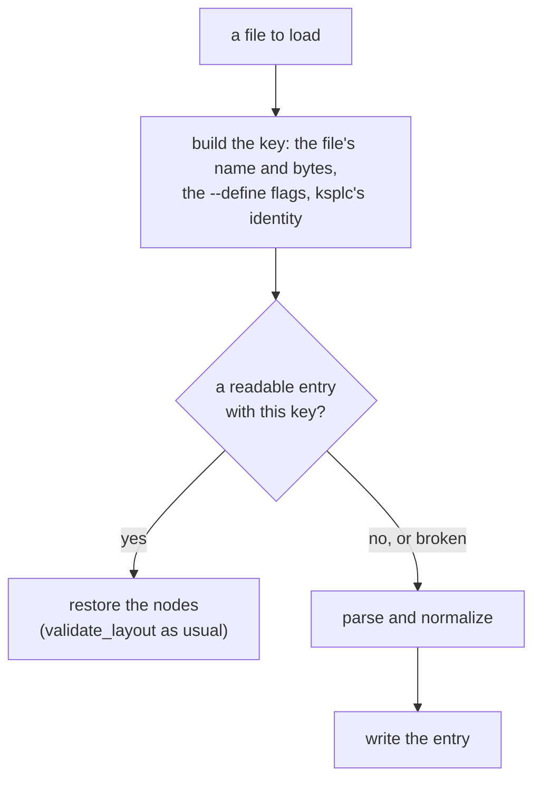

**The unit is one file.** The top-level declarations a file adds to `root_file`, including the `variant_name`s `append_enum_variant_names` synthesizes, depend only on that file's source and on ksplc. They do not depend on which program imported it, so an entry is shared across programs.

**An entry carries everything normalizing produced that a later stage reads**: the declarations, and the ranges a `#cfg()` dropped. Those ranges are the editor's only clue that nothing stands there because the flag is not raised (`base/cfg_inactive.record_cfg_inactive`). Leave something out, and whether a hit reports it depends on whether the file was compiled before; nothing in the source shows that difference. `make test-ast-cache` compares the cold and warm answers to catch it (the same trap Desugar's single whole-file run avoids; "Desugar: expanding the syntactic sugar that does not know the types").

Caution: **Always mix ksplc's own identity into the key** (`base/cache.append_self_identity`). The grammar and the normalizing rules both live inside ksplc. Without it, a new compiler takes an old AST as its own result. Where the identity cannot be told (`argv[0]` cannot be stat'd), the cache is skipped.

**A broken or old-format file is silently discarded, and the file is parsed.** The cache is for speed alone, so an unreadable entry is no reason to fail. The checks (the magic, the format's version, the key, the length, the range of `kind_id`) run before reading. Restored nodes pass the same `validate_layout()` as parsed ones.

**A buffer being edited is not cached** (the reason is in [`SPEC-tools.md` §2.7](SPEC-tools.md#27-the-cache-of-the-parse-result)); a saved file's bytes are cached as usual.

**Split the directories per generation (ksplc's identity), and sweep old generations.** A *generation* is the set of entries one build of ksplc wrote. Otherwise every rebuild of ksplc strands a generation's entries, and the cache grows without bound.

* Keep enough alive: self-hosting runs different ksplcs in turn (seed / stage1 / stage2, and the LLVM version). With too few, they erase each other and reparse every time, unnoticed, since it only slows.
* A generation in use is not spared the sweep, unlike `ksplc run`'s slots (`run_slot_spare_secs` in `tools/run.kspl`). Every write into a generation is a rename that is allowed to fail. So a run whose generation is swept only misses, while a slot swept mid-build fails that build.

`--stats`'s `[AST Cache]` line shows whether the cache hits ("Measuring the compiler: `--stats` and the performance guard").

**Digest text is a fixed-size value, not a growable buffer.** `base/cache.Hash_hex` names its 64 hexadecimal bytes, and `hash_hex` returns them without allocating. File and object keys return this value or an I/O error, so their callers keep no digest builder beside a success flag. Cache paths and the runtime ABI symbol take the bytes they need from the value.

### What a syntax error names

When the text does not fit the grammar, the error lists what could come next, in words the user can type, with the most likely fix first. It also points at an unclosed bracket or a missing comma.

This section covers the compiler's one diagnostic for a syntax error; "Only the editor's parse recovers from a syntax error" in [`DESIGN-tools.md`](DESIGN-tools.md) covers how the editor's parse continues past one.

The list of expectations (`expected …`) holds **only words the user can type, with the fix first**. Four rules hold. `track_fail` in `kspeg/engine.kspl` implements what is suppressed, and `track_token_fail` / `order_expected` in `kspeg/expected.kspl` build the list.

1. **Nothing inside a suppression is collected.**
   * A failure inside a lookahead (`!_Keyword`) is not what the user fixes.
   * One inside a lexical token or a transparent rule (`_Name`) is the grammar's internal wording, which would list `character class` or spellings not allowed there. (A *lexical token* is one word of the text: a name, a number, a string.)
2. **A lexical token is named by its own name** (`Identifier` → `an identifier`), never expanded into spellings. `Primitive_type`'s `I8` `I16` … alone reach the limit, and cut the list off before the name or the brackets. A rule whose body is one spelling (`Stmt_end = ";"`) shows that spelling.
3. **The position is where the spelling ran out, not the token's head** (`Fail_track.deepest_try`). At the head, an unclosed string would read "an expression expected at the opening quotation mark". A token that has begun names itself instead of passing the failure outwards. Otherwise the `String` inside a `Literal` becomes "a literal" and cannot say what is unclosed.
4. **The expectations that stopped the parse come first** (`Expected.is_optional`). Expectations at one position pile up from the inside outwards. Unsorted, the ways to continue what was just written come first: after `a: I32 = 1`, every binary operator precedes `';'`. A miss at the head of an option (`?`) or a repetition (`*`) did not stop the parse. A miss after reading began (after the `=` of `( "=" expr )?`) points at the fix.
   * **Move them to the front without dropping the rest**, which can still be written there (after `f(`, both a parameter and `)`). With the rest dropped, the list reads as "this is all that can be written".
   * **Where another branch read the input, take the missed branch off the stopping side** (`demote_expected_since`). Otherwise `2 - 3;`'s list begins with `a float` (a number is `Float | Integer`).

**Keep no table of wordings in ksplc.** `append_expected` in `parse/syntax_msg.kspl` only turns `_` into a space and lowercases. Keeping the names readable is the grammar's duty (the caution under "the lexical tokens" in `ksplc/kspl.kspeg`).

**In the indentation notation the list names the notation's own marks.** The parser reads the text with the braces and `;` the indentation stands for put in, so its list names `';'` and `'}'`, which the writer never types there. `';'` becomes "the end of the line", and a `'}'` closing a block the indentation opened becomes "the end of the block". A `}` a value or a one-line block needs is written in this notation too, so only the `{` the reader put in (`opened_by_layout`) changes the word.

**A character outside ASCII where the parse stops is named.** Python, Rust, Swift, Java and C++ all take a name in another script, so the list alone does not say why `かんそ` is refused; the Note names the ASCII rule and the character (`append_non_ascii_hint`).

**An unclosed bracket is named where it opened.** The lines after an open bracket read as its contents; the indentation notation joins them up to a line starting at column 0. So the failure lands where the closer was expected, a line or more below the mistake. The Note gives the bracket's line and column, counted as the diagnostic's heading counts (`append_unclosed_bracket_hint` in `parse/syntax_msg.kspl`). A closer of the wrong kind at the failure names the one that fits instead.

* **Whether it is never closed is decided over the rest of the text**, as Python 3.10 does. A bracket closed further on means the mistake is inside it (a missing `,`). Naming the bracket there would send the writer to the wrong place (the case `laid_comma_missing_in_closed_call` in `tests/negative/laid.kspl`).
* **A `{` is left out.** Written, it may open a block, and the one still open at the end is the outermost, not the one missing its `}` (clang's note names that outermost one). rustc guesses the missing one from the indentation. Where the indentation misleads, the guess names the wrong lines, so ksplc does not guess.

**A string left open to the end of the text is named where it opened.** An ordinary string may hold a line end, so the parser reads the rest of the file as the string's text and fails only where the text runs out, below every line the writer meant as code. The error stands on the opening quote and says the string is never closed, with no list of expectations, which could only name the end of the text (`parse_error_at` in `parse/syntax_msg.kspl`). A string that a later quote closes is text the parser did read, so its mistake shows where that text ends.

**A missing `,` between two items is named.** Two items side by side inside a list's brackets get "a ',' may be missing before 'X'" (`append_missing_comma_hint` in `parse/syntax_msg.kspl`).

* The brackets are a call's or a signature's `(` after a name or a closing bracket, and a value's `::{`.
* Grouping parentheses hold one value, so a `,` there would be as wrong as the gap, and nothing is said (the case `laid_group_holds_one_value` in `tests/negative/laid.kspl`).
* The Note says "may", because two values side by side can need an operator instead. Naming only the `)` would send the writer to add a bracket that is already there.

### Every place a source enters reads it the same way

**Source text reaches ksplc from the disk and from the editor, and each place runs the reader of the indentation notation (which turns indentation into blocks) exactly once, so the compiler and the editor always see the same program.** The two places are `parse/load.kspl`, which reads the disk, and `lsp/worker.kspl`, which receives from the editor. A second pass would count the `{` the first inserted as a bracket, and the notation would break.

**Both places pool what the reader found, and neither prints it.** They are peers. Pooling in one alone would make the feedback depend on how the file was looked at: `ksplc` would warn about a column slip while the editor says nothing about the same file. `make test-lsp` holds it (a column slip in the indentation notation reaches the editor).

**Do not print the reader's diagnostic before parsing.** Sema takes the count, and the lint gate reads that summary's text, so an earlier print would appear on screen yet pass the gate. The reader returns what it found as a value (`Note` in `parse/layout.kspl`). `pipeline.kspl` emits it through `Sema_ctx.report_diagnostic_at` once sema is set up. That shares one core with the path that emits from a node, so level resolution, duplication, counting and printing exist once.

**Every place a source enters goes through one step**: `settle` in `parse/source_fix.kspl`, which handles the BOM (an invisible marker some editors put at a file's start) and the line terminator together. The places:

| place | note |
| :-- | :-- |
| the disk (`parse/load.kspl`) | what a compile reads |
| standard input (`read_supplied` in `main.kspl`) | a program with no file: a compile's input `-`, which `ksplc run -` and `--eval=` hand their child |
| the formatter | |
| the language server (`lsp/worker.kspl`) | it takes an editor's buffer, and also reads the disk for workspace-wide answers |

Fixed at one place only, the others answer about a different program from the one a compile sees. Written once per place, one gets skipped. A language server reading the disk raw takes a Windows checkout's `\r\n` files for another program when it renames across them.

**A comment notation is removed from two places.** `kanso_space_skipper` in `parse/load.kspl` is a KSPL-side hook plugged into the engine. It skips whitespace and comments in place of the grammar's `_Space`. Remove a notation from only one, and a form the grammar does not accept passes silently. `make test-negative` holds both notations the grammar refuses this way: block comments, and `T!` with its error type left out.

### A literal's escapes are decided in one place

**What each backslash escape in a string means (`\n`, `\uXXXX`) is decided in one place, and every other place asks it**: `is_known_escape` in `base/literal.kspl` rejects an unknown one. Beside it, `literal_escape_byte` decides the byte, and `literal_fault` gives `\uXXXX`'s three rejections one answer (too few digits, a surrogate, too wide for a character literal).

**`\uXXXX` is not one byte.** It names a Unicode character, which UTF-8 stores in one to four bytes. So the place it is counted (`byte_len` in `literal_span` of `base/literal.kspl`) and the two places it is emitted (`gen/c/literal.kspl` and `gen/llvm/ctx.kspl`) must agree on its length. One pair holds the mapping to UTF-8: `codepoint_len` / `codepoint_byte` in `std/chars`, the counterpart of the reader's `next_codepoint`.

**A character literal's bytes are counted in one place**, `byte_len` in `literal_span`, so `char_literal_byte` never sees more than one.

## The Sema layer: it knows the types

Sema (semantic analysis) works out what the program means. It decides the type of every expression, finds what every name refers to, makes one copy of each generic per type it is used with, and reports the errors and warnings about the user's code.

### What it answers for

It walks the AST for:

* *type inference*: working out each expression's type, also where the user did not write it;
* *symbol resolution*: finding the declaration each name refers to;
* *scope management*: which names are visible where.

It also instantiates the generics (monomorphization, [the glossary](DESIGN-compiler.md#the-glossary)), and runs the compiler's own lints and static analysis (checks that read the code without running it). **It knows nothing of where the output goes**; it works purely in KSPL's types.

### How sema is split into folders, and the direction of the dependencies

Sema's code sits in five folders, stacked like floors. A folder may use the folders below it, never the ones above.

**Each of the five folders answers one question**, named with its files in "sema/ — the Sema layer" in [`ksplc/README.md`](../README.md). This section holds why the folders are cut where they are, and which way each may import.

#### The whole picture of the dependencies

The direction is one way, from the bottom: `type` → `session` → `{decl, flow}` → `body`, and `decl` / `flow` / `body` also query `type` directly. In the diagram, an arrow points from a folder to the folder it imports.

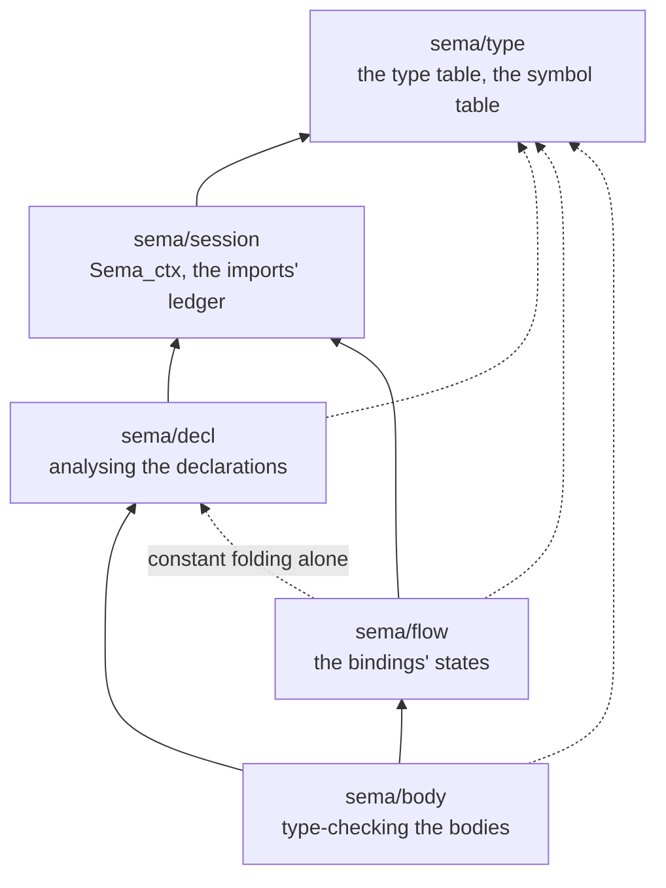

**Nothing points the other way**: parse rejects it as "a circular import across directories" (`ksplc/parse/load.kspl`). The one way round is a single function pointer for `sizeof(<an expression>)` (below).

**The language guards only cycles**, so an edge between `decl` and `flow`, on one tier, passes parse. There is exactly one: `flow/stmt` borrows `try_eval_constexpr` from `decl/eval` to count the branches of a constant-folded condition (`if sizeof(T) == 4`). *Constant folding* is computing an expression's value at compile time. More such edges would merge the two questions back into one mass, so `make test-conventions` allows this one and no other.

**`sizeof(<an expression>)` is the only call from decl into body.** It needs the operand's type, and only `sema/body` types an expression. The declarations' constant folding (an array's length, an enum tag, `#align`) runs before inference. The path is the function pointer `Sema_ctx.infer_expr_fn`, set once at start-up by `ksplc/pipeline.kspl`. `make test-conventions` watches the count, since each hook added leaves "above" and "below" a name and nothing more.

Inside the one package `ksplc/`, calling `body` from `decl` needs no `pub`. Only a symbol leaving `ksplc/` gets one, since it becomes a contract with the outside that the artifact exports.

**A mass** is a set of files that can all reach each other (a strongly connected component), the unit that cannot be split into folders any further. The masses in each folder (files with no path either way to one are left out):

| folder | the mass (the strongly connected component) | below / above the mass |
| :-- | :-- | :-- |
| `sema/type` | `def`, `env`, `query` | below: `scope` / above: `arc`, `display` |
| `sema/session` | `c_boundary`, `ctx`, `import_table` | below: `state` / above: `imports`, `pointer` |
| `sema/decl` | `access`, `eval`, `layout`, `mono`, `mono_name`, `mono_queue`, `mono_target`, `name`, `registry`, `resolve`, `trait_check`, `trait_default` | below: `declare`, `subst` / above: `attrs`, `collect`, `reflect`, `type_check` |
| `sema/flow` | `report`, `stmt`, `track` | below: `release` |
| `sema/body` | `binary`, `call`, `call_args`, `dot`, `expr`, `for_in`, `postfix`, `stmt`, `stmt_escape`, `struct_literal`, `switch`, `write_perm` | below: `analyze`, `call_defaults`, `coerce`, `generic_infer`, `lint_stmt`, `literal`, `resolve_path` / above: `infer` |

**To find the edge that breaks a mass, compute the strongly connected components.** Counting the edges against one chosen import direction fails, because the count changes with the order chosen. An import with `_` (importing an extension method) is an edge too: even with no function called, it widens the mass.

From outside sema, `lower` / `genc` / `genllvm` / `lsp` / `pipeline` use almost only `type/env`, `type/scope`, `type/query` and `session/ctx`. **Keep what they use from `decl` / `body` to the files already used** (their imports show which). Each one more makes a rearrangement inside sema felt outside.

What each folder holds, and what it must not do:

**`sema/type` is the foundation all four stand on**: how a type and a name are expressed, and the queries on that, and nothing else. It does not know how a declaration is analysed.

Caution: Do not import the other four from `type`.

**`sema/session` holds the `Sema_ctx` that `decl`, `flow` and `body` carry.** It spans one whole analysis, not a node's or a function's context: where a diagnostic goes, and what is visible from a file (the imports' ledger). Do not import `decl` / `flow` / `body` from it. All three use it, so joining even one merges the three into one mass.

**Keep the ledger apart from the checks against it.** Every stage of the analysis only reads `import_table`, while the checks in `imports` (unused, existence) run once at the end. Mixed, the layer that is only read looks as though it depended on the checking layer.

**Whose method a function is decides whether it can leave a mass.** A `Sema_ctx` method on `resolve`'s side makes `session` import `resolve`, pulling the large foundation into the mass. So put `Sema_ctx`'s methods on `session`'s side.

Caution: **Do not put a helper that does not touch `Sema_ctx`'s state into `sema/session`**, even one taking `Sema_ctx` first: comparing visibilities for breadth, checking a name's spelling, assembling a diagnostic's sentence. Piled up here, a function for one file depends on that large foundation. Put it in the file that uses it (`narrower_vis` in `decl/access`, `declare_symbol_with_fqn` in `decl/declare`, and so on).

**Group the state by the code that touches it.** Otherwise state belonging to nobody piles up in `Sema_ctx`, which travels through all of sema.

| state | where it lives |
| :-- | :-- |
| each concern's own state | its part in `sema/session/state.kspl` |
| a body walk's flags at the current position | `Fn_ctx` |
| what every part reads (the current file and its source, the symbol table, the environment), the analysis's switches, and the one path into body | loose on `Sema_ctx` |

The parts are plain records. Every method keeps its one receiver `c`, and the concern's own file holds the methods that keep its part (`decl/layout` for `Layout_state`). clang gives `Sema` per-feature parts (`SemaOpenMP`, `SemaCUDA`) with their own methods and a reference back, so a call grows a step (`Actions.OpenMP().ActOn…`). rustc keeps a function's inference state (`FnCtxt`) apart from the shared `TyCtxt`. KSPL takes the grouping and the per-function part; with the methods on `Sema_ctx`, no reference back is needed.

**Only `decl/mono` and `decl/mono_queue` touch `Mono_state`**; other code asks through their methods (`put_off_constraint`, `build_entrusted_tables`). Inside one package, visibility cannot enforce this, so convention holds it.

**`decl` cannot be split further: the centre of declaration analysis is one strongly connected component** (the `sema/decl` mass). Resolving needs instantiating, instantiating needs the conformance check, and checking needs constant evaluation; there is no one-way order.

Caution: **Put `collect` outside the mass, above it.** `collect.run` drives the whole declaration analysis, and a call back from below makes the driving order unreadable. Boilerplate the mass needs goes below both, as `declare` does. A tree walk that resolves types, such as `resolve_all_types`, belongs in `resolve`, not `collect`. Its subject is resolving, even though it serves the driver.

**Instantiation (`mono`) belongs in `decl`, not with inference.** It happens partway through inference (`infer` piles each encounter onto `c.generics.pending`), but what it makes is the declaration itself (the type, the methods).

**`lint_stmt` stays in `body`, not in a `sema/lint`, because the lints are not gathered there.** It holds about a quarter of the diagnostic codes. The rest sit with the checks that hold the context to detect them (`expr` / `stmt` / `analyze` / `postfix` / `flow/track` and a dozen or so others). A folder would read as "the lints are here" while most stay outside. `lint_stmt` is a hook called from `infer` / `match` / `stmt`, not a pass, so it sits with its callers.

**Do not repeat the folder's name in the file's name.** `type/env` and `flow/track` are enough; `type/types` or `flow/dataflow` says the same word twice in the path.

### The internal flow: registering every file up front → the main type-inference walk → draining the work list of generic instantiations

Sema works in three steps. First it records every declaration of every file (names, types, signatures) without looking inside any function. Then it walks each function body and works out its types. Last, it checks the bodies of the generic copies it made on the way.

The diagram shows the three steps and the work list between them.

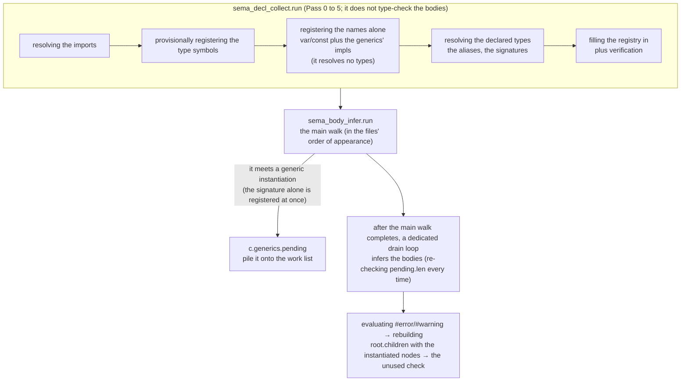

**`collect.kspl` type-checks no function body.** It walks the top-level declarations of the whole file in passes. Each pass is an independent loop over `r.children`, numbered as the `// --- Pass` comments in `sema/decl/collect.kspl` number them:

* **Pass 0**: resolving the imports, gathering the `##lint`s, and detecting the attributes.
* **Pass 1**: provisionally registering the type symbols (empty `Struct_def` / `Enum_def` / `Trait_def` placeholders, and the aliases). 1b copies a trait declaration's default values to the implementing type, before an instantiation copies a template's tree.
* **Pass 2**: registering the value symbols and resolving the aliases, in two runs.
  * **2a registers without resolving a single type.** 2b resolves the declared type nodes, which can cause an instantiation, so two things must be registered first:
    * The names of the top-level `var`s / `const`s (`declare_var_syms`), which folding an array's length (`U8[n]`) reads. The folding reads only the declaration's initializer, not `type_id`, so unresolved types do not stop it.
    * The `impl` blocks that monomorphization builds the method tables from (`impl_needs_early_collect`: the generics' impls, and impls covering one instantiation). `instantiate_generic_methods` / `register_generic_trait_impls` in `sema/decl/mono.kspl` need all of `generics.impls` for the method tables and the trait conformance ([4.3.5](#generics-are-instantiated-through-deferred-work)).
  * 2a can come first because it resolves no type: a method registers only its template name, and its signature is resolved at instantiation. In one run, neither could use a declaration behind itself, and both would depend on the order within the file (Principle 5).
  * Between the two runs, 2a' synthesizes the table and `fields()` for `impl X: reflect.Reflectable {}` (`synthesize_reflect_impls` in `sema/decl/reflect.kspl`). *Reflection* means a program reading its own types' fields at run time. **It must run after the generics' impls are all in (after 2a) and before the values' names are handed out (before 2b).**
    * Resolving the fields' types instantiates generics. Run before 2a, an instantiated `List<|T|>` gets no methods (`push` becomes "there is no such method").
    * 2a has already handed out the `const` names, so `collect` hands out the synthesized ones itself. What it makes is registered as hand-written declarations are.
    * The kind comes from the resolved type, because the name would mistake a `typedef`. A `List<|T|>` is recognised by resolving the written generic base to an FQN (fully qualified name, such as `std.ds.List`); the rules below hold the rest.
* **Pass 3**: filling the registry itself in (the fields, the variants, the method signatures), and `validate_all_type_exprs`.
* **Pass 4**: checking a `const` declaration's body (`check_const_decl_storage`; it needs the field list, so it follows 3).
* **Pass 5**: checking that no member's visibility is wider than its enclosing declaration's; it matches type ids, so it follows 2b and 3.

The rules for the reflection tables Pass 2a' makes:

* **Pass 2a' emits a nested table into the file that wrote the `impl`**, because another file's table is `priv` and cannot be pointed at. The same type nested from two outer types still folds to one table per file (`ensure_nested_table` in `sema/decl/reflect.kspl`).
* **It matches the trait by FQN**, as for the other compiler-known traits. Matching the tail would synthesize for a file's own `trait Reflectable`, with only a confusing diagnostic to show.

Caution: **Build an `offsetof` node for the offset; do not fold it to a number.** The generated C passes it to C's own `offsetof`, so the offset ksplc measured cannot differ from the one C laid out. A baked-in number loses that.

**Take both tags from the declaration**; never hard-code "the variant with a value is 0". Only an enum payload's position cannot be asked with `offsetof`, since in C it sits in an anonymous union KSPL cannot name. It comes from ksplc's single layout, trusted as `sizeof` is.

**Lowering only the shapes reflection needs is not done.** A container of containers needs a kind whose contents point at itself, and `--to=llvm` cannot lower one. A global's type is named, so its initializer must be that type, and no layer lowers a payload into the bits after the tag (`emit_llvm_const_init` in `gen/llvm/decl.kspl`). A special case for reflection's shapes would let only some types' payloads through.

Caution: **Take the element type from the instantiated `List`'s `ptr`, and strip exactly one level of pointer.** Stripping them all makes the element of `List<|I64$@|>` look like `I64`, and a container of pointers silently round-trips as an array of integers.

**Collect always runs to the end before `infer.kspl` starts.** `infer_fn` can refer across files to an `impl` method or a struct field behind it in file order, while `infer.kspl` goes once through the files in order. A forward reference resolves only because every file's signatures are already in the global type environment.

#### A layout is computed when it is first asked for

A struct's size is worked out the first time someone asks for it, even if that is before all the fields are recorded.

A *layout* is a type's size and where each field sits in memory. `sizeof` can be written anywhere, but the field list is complete only at Pass 3 above. Yet some things **need a size before Pass 3**: the types resolved at 2b (a top-level `var`'s / `const`'s declared type, a function's return type, an alias), and a field in Pass 3 pointing at a declaration behind itself. So `Struct_def` / `Enum_def` keep their declaration node in `pending_decl`. `ensure_type_registry` in `sema/decl/layout.kspl` fills a registry in on the spot where it is still unfilled, and `eval_sizeof` always calls it before measuring.

Caution: **Do not add a path that bypasses it.** Such a path returns a size of 0. `U8[sizeof(S)]` then fails with "array size must be a positive constant expression", depending on where it is written and on the order of the declarations (Principle 5).

* **`pending_decl` is cleared when filling starts** (`sema/decl/registry.kspl`). The same declaration's size can be asked for while one of its field types is being resolved. Cleared later, it is filled in twice, and the fields line up in pairs.
* **"Being filled in" is told apart from "filled in"** (`Resolving_state.registries`). Otherwise `struct A { f: U8[sizeof(B)] }` and `struct B { g: U8[sizeof(A)] }` see each other as size 0, and pass as one-byte structs with no diagnostic.
* **A cycle's report is held and emitted once, at the end of `collect.run`** (`Resolving_state.registry_cycle_at` → `report_registry_cycle`). An array length is evaluated under `eval_constexpr_quiet`, which discards diagnostics and restores the count, so an `err` where the cycle is found would vanish.
* **It does not walk past a pointer or a slice.** The pointee does not affect the pointer's size, and walking it would never stop on a self-referring type (a linked list).

**A machine's widths come from one table**: `machines` in `base/target.kspl`, one row per machine ksplc knows (a pointer's width, a function pointer's, `Sz`'s, the alignment of `I64` / `U64` / `F64` in a struct, and the LLVM triple). `calc_type_layout` in `sema/decl/layout.kspl` and `Sz`'s width (`get_primitive_bit_size` in `sema/type/query.kspl`) read the row `current` resolves: `--machine`'s, else the one ksplc runs on, which `kspl_host_machine` in `gen/runtime/hosted.c` names from the C compiler's own macros. Everything else is laid out from those widths, so a slice is a pointer and an `Sz`, a trait value two pointers.

* **Every subcommand that lays values out asks for the machine before it starts** (`machine_refusal_to` in `usage.kspl`, the subcommands in `machine_faces`). On a host the table lacks, each says so, naming the triple `kspl_host_machine` built, rather than reaching `current` and stopping with an internal error. **The language server refuses too, on standard error, rather than take a machine from a setting**: every machine the tree is built on has a row, a guessed machine would show a static `if` the compile then decides otherwise, and a machine named in `ksplc.cfg` beside `--machine` would be a second way to name it (Principle 6).
* `get_portable_bit_size` stays apart from the table. It answers what holds on every machine (`Sz` at 32 bits), for the checks on a constant expression, which must not depend on the machine named.
* Caution: **Do not write a width as a number anywhere else.** A second copy answers for one machine only, and the folds built on it are wrong on every other with nothing reporting it.

**A folded layout number is checked by the C compiler.** ksplc's layout is a copy of the C compiler's, and the copy is tied to it by a check (Principle 4). Every reader whose number reaches the output as a number calls `record_folded` in `sema/decl/layout.kspl`: `eval_sizeof` / `eval_offsetof` in `sema/decl/eval.kspl` (an array's length, a constant chain, a static `if`, `##error`, a `case` label), reflection's payload offset (`sema/decl/reflect.kspl`) and a slice cast that stands on two equal element sizes (`check_slice_elem_size` in `sema/body/postfix.kspl`). The record holds the type, what was measured, the number and the node that asked. `emit_layout_checks` in `gen/c/root.kspl` writes one `typedef char kspl_folded_for_<machine>_<n>[(sizeof(T) == 40) ? 1 : -1];` per record, under a `#line` of the node that asked, so the C compiler's refusal names the source line and the machine.

* **They go at the end of each unit**, where every type is complete, and each unit writes those recorded since the last. A fold genc makes itself (`emit_const_ref_inline`) is then checked too, in whichever unit made it.
* **A recorded type is kept by `prune_unreachable_types`** (`lower/prune.kspl`), or the check would name a type the C never declares.
* Caution: **A new reader of a layout whose number reaches the output must call `record_folded`.** Without it, that number is laid out for the machine named and nothing compares it with the C compiler's.
* `sizeof` / `offsetof` written in a function body or a global's initializer stay C's own (`emit_sizeof` in `gen/c/expr.kspl`); only a number ksplc decides needs the check.

#### The main walk's order, and where the helper files stand

**One walk (`run` in `sema/body/infer.kspl`) takes the top-level declarations in the files' order and checks each function body as it meets it**; the other files in `sema/body` are helpers that walk calls, not separate passes.

| it meets | it calls |
| :-- | :-- |
| a function | `infer_fn` |
| an `impl` | `infer_impl_decl` (`infer_fn` for each method) |
| a top-level `const` / `var` | `infer_expr` |

`infer_fn` resolves the signature, infers the body (`infer_stmts` in `sema/body/stmt.kspl`), and at once runs `analyze_function_body` (`sema/body/analyze.kspl`) on that function. That is a per-function step, not a global pass after every function is gathered.

`infer_stmts` and `infer_expr` (`sema/body/expr.kspl`) are both `kind_id` dispatches: each picks a branch by the node's kind. **Whatever the kind, every `infer_expr` ends in `apply_type_coercion` (`sema/body/coerce.kspl`).** The other files are libraries called where they are needed, not passes of their own:

| file | where it is called from |
| :-- | :-- |
| `resolve.kspl` / `resolve_path.kspl` | wherever a type or a name is resolved: `expr.kspl`'s identifier and path branches, `collect`, `postfix`, `call` and more |
| `postfix.kspl` | `expr.kspl`'s postfix / `method_access` / `generic_method` branches alone; it passes the call operator `(` on to `call.kspl` |
| `switch.kspl` | the `k_stmt_switch` branch in `stmt.kspl` alone |
| `eval.kspl` | translation-time constants (an array's size, an enum tag, `#align`), from all over `collect` / `infer` / `expr` / `stmt` / `postfix` / `resolve` |
| `analyze.kspl` | right after each function's `infer_stmts`. The walk it calls (defined variables and use-after-free, following one body's paths as a CFG would) is an independent engine, run once per function. `check_unused_imports` / `check_unused_symbols` are the one global final check, at the end of `infer.run` |
| `lint_stmt.kspl` / `literal.kspl` | the statement-level lints (`if`, `for`, an accumulating overflow and so on), fired inline during the dispatch in `stmt.kspl` / `infer.kspl` / `switch.kspl`, not gathered in `analyze.kspl` |

(A *CFG*, control-flow graph, is the map of every path execution can take through a function.)

#### How immutability marks are expressed in a type, and the API that asks about them

Inside Sema, "this cannot be written" is a wrapper around a type, placed at exactly the level it applies to. Several functions ask about it, and each looks at a different depth, so picking the wrong one gives a wrong answer without any error.

In KSPL, a `$` written in a type makes that level writable, and a level without `$` is read-only (the language specification, `docs/SPEC-language.md` §3.2). **A type is interned as a canonical string** (`sema/type/env.kspl`): one fixed spelling per type, stored once and compared by number. An immutability mark is a structural node, `Info.const_of(base_id)`, written as `base_core.immut_mark()` (`" immut"`) right after what it marks.

| type | canonical string | `Info` |
| :-- | :-- | :-- |
| `const(U8)` | `U8 immut` | `const_of(U8)` |
| `U8[]` (a slice of immutable elements) | `U8 immut[]` | `slice(const_of(U8))` |
| what `U8$[]@` points at (an immutable slice descriptor) | `U8[] immut` | `const_of(slice(U8))` |
| `U8[]$@` | `U8 immut[]@` | `ptr(slice(const_of(U8)))` |
| `U8$[]@` | `U8[] immut@` | `ptr(const_of(slice(U8)))` |

**The marker is postfix because `@` and `[]` are.** A prefix marker would commute with them on the string (`"immut " + "U8[]"` and `"immut U8" + "[]"` are both `"immut U8[]"`), merging the table's second and third rows into one type id. As a postfix, it simply joins `get_or_add`'s chain of end tests (`!` → the marker → `@` → `[]` → `[N]`). A type name holds no space, so it conflicts with no other end test.

**The APIs that ask about a mark differ in the tier they look at**, and a wrong pick silently decides wrongly. A *tier* is one level of a type: in `U8[]@`, the pointer, the slice and the `U8` are three tiers. This is the one correspondence table:

| API | the range it looks at | when it is used |
| :-- | :-- | :-- |
| `is_const(id)` | this type's own outermost node alone | "is this place itself read-only". For the element or the pointee, strip first (`is_const(strip_slice(id))`) |
| `strip_const(id)` | one tier: the outermost mark | the type one tier in, with the mark removed |
| `strip_const_deep(id)` / `has_const_deep(id)` | every nested tier | the type with every tier's mark dropped. It does not resolve an alias: a method attached to an alias (`impl Meters { ... }`) is found only by that name, so matching a method uses this |
| `same_shape_ignoring_const(a, b)` | every tier for the marks; only the outermost for an alias | "the same type, ignoring immutability" (unifying the ternary operator's types, an implicit conversion to immutable). **Use this for that comparison**: comparing `strip_const_deep` results makes `typedef P = I32@;` differ from `I32$@`, and the implicit conversion fails wherever the alias is written. Do not resolve the inner aliases; an alias is transparent only at the tier it names. Resolved, `B[]` (`typedef B = U8`) equals `U8[]` in sema while genc emits two C types, `Const_B_Slice` and `kspl_U8_Slice`, and fails (a type's mangled name keeps the alias's name) |
| `is_const_compatible(act, exp)` | tier by tier | whether a safe downgrade to immutable is allowed (only a conversion weakening no tier's immutability passes) |
| `receiver_base_id(id)` / `base_type_name(id)` | all the outermost pointers, marks and aliases, alternately | the base type a value is looked up on: `.`/`[]`'s receiver, a vtable's conforming type, and what is looked up by name (a struct definition, a method's FQN) |

Four rules follow from the table:

1. **Only `Env.receiver_base_id` strips the pointer from `.` / `[]`'s receiver.** Everything after it (a built-in member, a struct field, matching a method name, probing an operator trait, a built-in index) takes the stripped `recv_id`.
   * Caution: Stripping per branch leaves some branches behind whenever a new shape of type is added. "No method on `U8[]@`", "no `.len`" and "`ps[1]` fails" become separate holes, and one operator disagrees with itself (`[]` works on a user type but not on a built-in slice). The backends' paired points, which `.` and `[]` share too, are genc's `emit_ptr_adjusted_receiver` and genllvm's `emit_recv_base_ptr`. A diagnostic shows the type from before the stripping, with `display_str` (the name the user wrote).
2. **The view types' tests and strippers (`is_slice` / `is_pointer` / `is_array` / `is_result` / `strip_*`) see through an outer immutability mark.** A *view type* is one that points at memory held elsewhere: a pointer or a slice. An immutable slice is still a slice, so `is_slice` must hold for `const_of(slice(U8))`. Otherwise an element write through `U8$[]@` is judged "not a slice", and rejected as `Index_mut` unimplemented. Whether the mark is there is `is_const`'s question, so the two axes stay independent. Every member of the family must see through it (`is_pointer` / `is_slice` / `is_array` / `is_result` / `is_fn_ptr` / the `is_numeric` family / `strip_ptr` / `strip_slice` / `strip_array` / `strip_result` / `get_result_err_id`). Otherwise one type gets contradictory answers ("`is_result` is true yet `strip_result` strips nothing").
   * **The flip side: `strip_X(t) != t` does not test "is `t` an X".** Seeing through drops the mark too, so `strip_ptr(t) != t` holds for an immutable non-pointer such as `U8 immut`. Ask `is_X`. With the other test, `a[i].m()` on a `const` array element is judged "it crossed a pointer" and skips the permission check.
3. **Resolving an alias and stripping a mark alternate** (`get_clean_real_type`). `get_real_type` resolves only the outermost alias, so doing one of each leaves `const_of(alias B)` as `B`. Every site that peels both goes through it, including sema's type comparison (`same_shape_ignoring_const`) and genllvm's type output (`t_impl` in `gen/llvm/types.kspl`). Where pointers are peeled too, the entry point is `receiver_base_id`.
   * Broken on genllvm's side, the IR loads a `%..._B` with no type definition and fails with `loading unsized types is not allowed`, with no KSPL diagnostic.
4. **The C mangling places the mark by position.** *Mangling* is turning a KSPL type or name into a C identifier ([the glossary](DESIGN-compiler.md#the-glossary)). A mark on the element (`slice(const_of(U8))`) becomes `Const_U8_Slice`, because `mangle_type_id_to_impl` recurses and emits `Const_` first from the inside. This cannot change, because the C runtime preamble hard-codes `kspl_Const_U8_Slice`. Under the same rule, a mark on the view descriptor itself (`const_of(slice(U8))`) would collide with that name. So on a view type alone, the mark becomes the suffix `_Const`. `const_of` pushes nothing to `complex_types`, so it gets no typedef of its own. `genc` writes it inline as `const <the base>` (as `T * const` on a pointer, to match C's syntax).

**Judge a slice descriptor literal's shape on its type before one slice level is stripped.** A literal such as `U8$[]::{ .ptr = …, .len = … }` is checked field by field. The type with one slice level stripped (the one that looks up the struct name) gives the wrong answer:

| Literal | Its type | One level stripped | Judged after stripping |
| :-- | :-- | :-- | :-- |
| `::{ 'a','b','c','d' }` | `U8[4]` | `U8[4]` | Correct |
| `U8$[]::{ .ptr, .len }` | `U8[]` | `U8` | **Unchecked**: the scalar matches no branch |
| `U8[]$[]::{ .ptr, .len }` | `U8 immut[][]` | `U8 immut[]` | A wrong diagnostic, one level too shallow |

The regression is in `ksplc/tests/lang_types_test.kspl`.

**The immutable version and the mutable version are one struct in C.** The C name drops the immutability at the declared position (`variance_stripped` in `sema/type/env.kspl`). Otherwise the C compiler would reject the one tier of weakening that KSPL allows, as an incompatible separate struct.

**An implicit permission conversion changes the node's type without adding a cast.** `apply_type_coercion` in `sema/body/coerce.kspl` handles value-copy immutability and the weakening of a view or a type argument whose declaration permits it in one branch. The shape comparison comes first; the compatibility query runs only where copying the value's outer qualifier does not suffice. An incompatible conversion is reported once by the common mismatch path.

#### Where immutability's two axes are enforced

**KSPL asks two separate questions about a write: may this name get a new value, and may the thing it points at be changed?** One function, `enforce_mutability` in `sema/body/write_perm.kspl`, answers both, and picks the question by whether the write goes through a pointer. The language specification (`docs/SPEC-language.md` §4.2) keeps the two axes orthogonal (independent of each other):

| axis | written as | the question | checked on |
| :-- | :-- | :-- | :-- |
| the binding | `$p` | may the name be given a new value | the binding's `sym.flags.is_mut` |
| what it points at | `T$@` / `T$[]` | may the target be written | the pointee's `is_const` |

`infer_assign_stmt` calls it on the left-hand side. It picks the axis by whether the path to the target crossed a pointer: if not, the binding; if so, the pointee.

Caution: Mixing the two axes breaks one of two ways. It rejects `p.f = v` through an immutable binding's mutable pointer (on the binding axis), or it lets a write through an immutable pointer pass while an element write on an immutable slice is rejected. Regression tests: the case `const_ptr_field_write` in `tests/negative/const.kspl`, `case_const_ptr_deref_write` in the case `readonly_write` in `tests/negative/pointer.kspl`, and `test_immutability_axes_are_independent` in `ksplc/tests/lang_test.kspl`.

The pointee test asks only whether the pointee's own outermost node is an immutability mark. `U8[]$@` (pointing at a slice) allows swapping the descriptor with `p$ = other`, and `U8$[]@` (pointing at a mark node) rejects it. If the two were merged in the type expression, the only safe course left would be a blanket exemption: "a write through a pointer at a view type is allowed". A mark per tier makes it unnecessary (the regression test: the case `const_slice_descriptor_write` in `tests/negative/const.kspl`).

**A pointer partway along the path is checked too (`write_target_type`).** Where the path crosses a pointer held in a field (`s.p$ = v`, `s.p.n = v`), that tier's immutability must be enforced as well. Two things stand in the way:

* The receiver `s.p` is not a plain variable reference, so its type cannot be queried.
* The check must not stop at the first pointer crossing (`s`) on "it crossed a pointer, so the binding axis is not asked".

The type cannot be queried because `infer_expr` is destructive (it morphs nodes; "The AST nodes the Sema layer creates (its contract with Lower and Genc)"'s Sema-Lower contract), and this check runs before the inference proper. Run early on a receiver holding a method call (`node.get_child(0).def_node = v`), it leaves the later inference a broken node. So the check walks the types alone, never touching the AST:

1. Along a chain of `.` field accesses it runs `infer_expr` on the root (the path or identifier) alone.
2. It then takes each field's declared type from the struct definition with `Env.field_type_of`.
3. On a shape the types alone cannot follow (a method call, an index), it returns `unknown` and gives up the check, so it can only add detections.

Missed, such a write passes sema and fails only on the generated C's `const`. Regression tests: the case `const_ptr_in_struct_field_write` in `tests/negative/const.kspl` and `case_const_ptr_in_struct_field_member_write` in the case `readonly_write` in `tests/negative/pointer.kspl`.

**Two places walk the path to a write's root** (`place_denies_write`, and `enforce_mutability` in `sema/body/write_perm.kspl`), and both stop at a pointer type the same way. Stopping in only one lets an assignment pass while `xs[0]@` is rejected.

**Keep the choice of `at` or `get` / `set` for an index in one place** (`index_route` in `sema/decl/access.kspl`). If the reader (`sema/body/postfix.kspl`) and the assignment (`sema/body/stmt.kspl`) decided separately, they would diverge. `xs[0] = 5` would then produce broken C calling a two-argument `get` with three arguments, with zero diagnostics.

**The assignment's permission check is written by hand.** `sema/body/stmt.kspl` assembles the `set` call directly, bypassing the receiver-permission check of an ordinary method call (`infer_call_args` in `sema/body/call.kspl`). The regression is in `make test-negative`, which also confirms that reads pass.

#### Generics are instantiated through deferred work

When Sema meets `List<|I32|>` for the first time, it makes the `I32` copy's signature at once, but only puts its body on a to-do list. The list is worked through after the main walk.

A *generic* is a declaration with type parameters (`List<|T|>`); its *template* is the declaration as written, and an *instantiation* is one copy with the parameters filled in (`List<|I32|>`). The values filled in are the *type-argument bindings* (`T` = `I32`).

**Monomorphization (`mono.kspl`) fires the moment** `call.kspl` (a function call) or `resolve.kspl` (a generic struct or type) meets an instantiation during the main walk.

* The signature is cloned and registered at once.
* The body's inference only joins the work list `c.generics.pending`, which a dedicated loop drains right after `infer.kspl`'s top-level walk.
* The loop re-reads `pending.len` every round, so the same loop handles generics nested in during the drain (breadth-first, not depth-first recursion).
* `instantiated_nodes` caches each instantiated function or struct, so none is made twice.
* The method tables and the conformances have a queue of their own ("Where the instantiation queue is drained"), and so do the type-argument constraints ("Type-argument constraints are checked where the queue drains").

Caution: **Attach a copy of that moment's type-argument bindings to all work put off.** The list drains after the bindings are undone, so work without a copy runs not knowing what `T` was. Without the copy on a template body (`Pending_inst`), the visibility check's exemption loop does not fire. Instantiating the template on a type private to the user's file then makes the template fail with `cannot access symbol 'X'` (`Cell` in `List<|Cell|>` being file-private in `ksplc/tests/lang_types_test.kspl` makes `std/ds.kspl` fail). The code that queues takes the copy (`snapshot_generic_args` is the one place that takes one). The code that drains pushes it back and always restores the original length. For the same reason, `drain_pending_instances`' bindings must cover the same range as the instantiation proper (`prepare_inst_node`), as far as instantiating the methods.

**An instance is a record, and its names are derived from it.** `Instance` in `sema/type/env.kspl` holds the template's FQN and the type ids it binds, in the declaration's order, and `Env.instances` maps the instance's type id to it. Its mangled name (`instance_c_name_to`) and its registration key (`instance_key_to`, `std.ds.List<|I32|>`) are written from the record; what an instance is made of is asked of the record (`instance_of`, `instance_base`, `instance_args`), never read back from either name. A function's instance is a record of the same kind, `Fn_instance` in `sema/decl/mono.kspl` (the template's key, the instance a method is reached through, its own type ids), named by `fn_instance_names`. A written name gives the record its template and the instance it is reached through (`read_written_name`, "A written value's or function's name is read once, from its tree" in [`DESIGN-diagnostics.md`](DESIGN-diagnostics.md)); the call or the specialization adds the type ids.

Caution: **Name an instance through those functions only.** A second spelling of the rule makes two names for one instance, and C fails with `redefinition of ...` or `unknown type name`.

**A type's name in the generated code is spelled in one place, and from Lower on only once.** `Env.mangle_type_id_to` in `sema/type/naming.kspl` spells it, and every name of a type in the output comes from there: the declaration's (`transform_decl_name` in `lower/abi.kspl`), each use's, and the tags a `switch` names. Spelled a second way, from the type's canonical string, the name drifts on an instance whose immutability is dropped (`variance_stripped`): a `switch` on `Pick<|I32|>` of an `enum Pick<|$T|>` named tags C never declared. Code generation asks for the same few thousand names tens of thousands of times, and spelling one walks it a character at a time. So from Lower on, each type's name is kept on its entry (`Entry.c_name`) the first time it is spelled, and later requests copy it. **Not earlier**: until sema has recorded every instance, an instance whose immutability is dropped can still answer with the name its record will replace, and a kept name would give one type two names. `lower_root.run` turns the keeping on (`Env.c_names_final`), where it turns on the ARC answers' memo for the same reason. The cost is one slice on each type's entry and one copy of each name the output uses.

**An instantiation's name is decided by the definition's position alone, not by how a reference spells it** (unqualified from within the same file, say): the record holds the template's FQN. Two spellings of one type would make two bodies for the same type: `std.ds.Map_entry<|Sz, I32|>$@`, and `Map_entry<|Sz, I32|>$@` unqualified inside `std/ds.kspl`. The generated C then refers to an element type it never defines (`error: unknown type name 'Map_entry_Sz_I32'`). `generics.templates` keys a template by its FQN alone ("Name resolution with no namespace goes through one function" in [`DESIGN-diagnostics.md`](DESIGN-diagnostics.md)). Normalize to the FQN before making the record:

1. A caller of `instantiate_struct` / `instantiate_fn` in `sema/decl/mono.kspl` passes the template's FQN, never a short name.
2. `impl_target_rejects` in `sema/decl/mono_target.kspl` compares an impl target's type arguments, as the source spells them, with an instance's. It rewrites them to the canonical form with `canonicalize_one_type_arg` (`sema/decl/mono_name.kspl`) first.
   * Caution: **That function does not merely look a name up; it instantiates a generic argument as a side effect.** Compared unnormalized, `Plain` and `c_mod.Plain` are two types, and the impl attaches to neither.
3. `try_prepare_instance` keys its cache on the spelling `Base<|args|>`, which another spelling misses. So the normalizing alone only turns the fault into "two struct definitions of the same name" (`redefinition of ...`). **Key it on the mangled name too.** `register_inst_node` registers under both, and pushes to `instantiated_nodes_list` exactly once, since genc/genllvm emit the definitions from that list.

The `end_idx` of `find_generic_bounds`, which `canonicalize_one_type_arg` uses, is the position of the `>` of the closing `|>`, not the one after it. Forget the `+ 1`, and a postfix mark pulls the `>` in (`">$@"`), making the nonexistent type name `..._Ptr>$$@`. `ksplc`'s own source has the shape (`Map.entries`), and `std/tests/seq_test.kspl` watches it.

**What happens after the work list is consumed.** `sema_body_infer.run` goes on:

1. It evaluates the `##error` / `##warning` directives.
2. It rebuilds `root.children`, removing the generics' templates and swapping the instantiated nodes in.
3. Then come the LSP-only extra resolution pass, and `check_unused_imports` / `check_unused_symbols`.

**The rebuilding drops only the templates that have a body to swap in.** One never instantiated survives, such as `Arena.alloc_as<|T|>` / `Arena.create<|T|>` in `std/mem`, whose callers use the free function `mem.alloc_as<|T|>()`. Lower's `lower_prune` drops it as a function unreachable from the root. All of this happens inside `sema_body_infer.run`; the calls into `lower/*` come from a separate method (`Compiler.run_lower_and_codegen`).

#### Where the instantiation queue is drained

Making an instantiation's method table is also put off. It happens at fixed safe points, the *boundaries*, and for most types only when one of its methods is first looked up.

A *method table* is the list of an instantiated type's methods; the *trait conformance* records that the type implements a trait (KSPL's interface: a named set of methods). An instantiation only queues; the method table and the trait conformance are built at a boundary (`queue_instance_methods` and `drain_pending_instances` in `sema/decl/mono_queue.kspl`). Each item runs these steps in order, **under one binding of the type arguments**:

1. set the bindings with `bind_generic_args`
2. build the method table with `instantiate_generic_methods`
3. register the conformance with `register_generic_trait_impls`, and verify it

Caution: **Do not change the bindings between 2 and 3.** They are passed through `Generic_state.args`, which is state of the moment. If it changes in between, the trait's type arguments break (`get` on a `List<|U8[]|>` demands a `U8` instead of a `U8[]`).

**The queue (`Mono_state.pending_methods`) is there for nesting, not for order.** New instantiations are born during the drain (A's method instantiates B), and the one outer loop picks them up. The list grows meanwhile, so loop by index on the raw `len` every round; `for x in list` copies `len` at the head and misses them. A drain started during a drain returns at once, with `draining_methods` as the sentinel, and leaves what was queued to the outer loop. A nested drain would overwrite the type-argument bindings the outer one holds. The regression test is `test_instantiation_before_generic_impl` in `ksplc/tests/lang_test.kspl` (a type instantiated before its impl block).

**There are two kinds of boundary.**

| boundary | where |
| :-- | :-- |
| **Where the bindings are empty** | before, after and at the end of collect's Pass 3, and between declarations and between statements in the body's analysis |
| **Just before a lookup** | `sema/body/dot.kspl` calls `ensure_instance_methods`. Breaks between statements are not enough, because a receiver's type can be instantiated within the same expression (`deepen(s).tag()`) |

Caution: **Drain only while that receiver's item is still queued.** Draining on every lookup builds unrelated instances too, partway through the enclosing body's analysis.

**The boundaries are cheap**, so they may be placed finely. Moving them changes no instance count in the generated C and costs Sema a few percent at most, and an empty queue returns without even a copy.

**Empty `generics.args` before draining; restoring its length is not enough.** An item's bindings are set afresh from the copy taken when it was queued, so the outer bindings must not be visible. Queuing the `T` of a `List<|T|>` with the outer `T` still bound lists the same name twice, and breaks as above. `backup_mono_state` saves only the length, so the drain stores the bindings away itself.

**An instantiation's method table assumes every entry of `generics.impls` is registered** (Pass 2a, [4.3](#the-internal-flow-registering-every-file-up-front--the-main-type-inference-walk--draining-the-work-list-of-generic-instantiations)), and a miss appears at the use site. Take a std function that returns a concrete generic type (`str.split` returning a `List<|U8$[]|>`). An external program using that API alone fails with `type 'std_ds_List_U8_Slice' has no field or method named 'push'`, pointing inside `std/str.kspl`. The repository's own programs use std broadly and instantiate the same type in other ways, so CI never meets it. `tests/suite/thin_use_test.kspl` covers the blind spot with the smallest program using exactly one std API. Add one there for each new std function returning a concrete generic type.

**Only registering the names can come first.** The trait conformance check (`verify_trait_implementation`) must not. The methods it checks are defined inside `impl<|T|> List<|T|>: Index<...>`, so checked before they are instantiated, it gives `does not implement required method 'get'`. It runs in exactly two places, both after collect's Pass 2a: infer (`sema/body/infer.kspl`), and where a method table is built (`register_generic_trait_impls`, below).

**Do not add state meaning "the registering is done" and branch on it**; keep one place that makes the table, and no condition. Nor make the table on the spot and redo the failures afterwards. With two ways to make it, the result depends on the way taken (Principle 6), and a defect in one way never shows in what came through the other.

**Queue an instantiated body for inference exactly once** (`queue_fn_body`). The call (`instantiate_fn`) and the method-table builder (`instantiate_generic_methods`) both queue it, in no fixed order. Queued twice, a node the first inference reshaped (into a `result_wrap`, say) goes round again, and an `auto` with no return type reaches the generated C.

**Every instance's method table waits until a method is looked up.** The diagram shows the states one instance's table goes through.

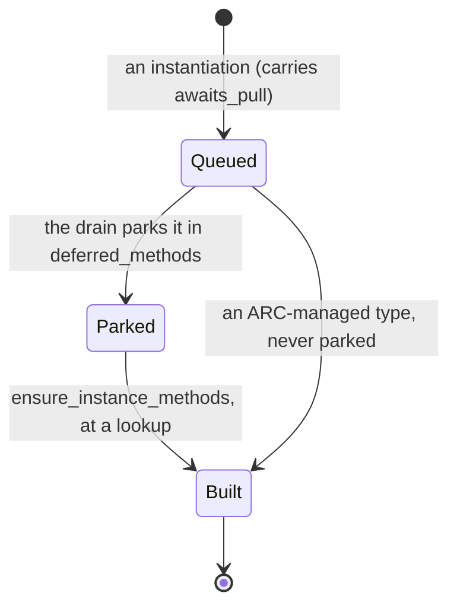

* A queued instantiation carries `Pending_methods.awaits_pull`. The drain parks it unbuilt in `Mono_state.deferred_methods`, and `ensure_instance_methods` in `sema/decl/mono_queue.kspl` builds it at the lookup.
* Deferring only the types born of a signature is not enough. Building at once the table of a type the body names makes a `Chain<|S|>` body build a `Chain<|Box2<|S|>|>`. That table's body builds itself one level deeper again (a *polymorphic recursion*: a generic that uses itself with a bigger type argument each time). So it builds levels nothing calls, and never returns, with no diagnostic (the `Nest` in `ksplc/tests/generic_queue_test.kspl`).
* C++ too instantiates a class template's members when used, and Rust monomorphizes only the instances it reaches.

**Every entry point that looks up a table goes through `ensure_instance_methods`** (its callers are the list). A parked table is built nowhere else, so an entry point that bypasses it finds none, again with no diagnostic. Watch for entry points with nothing on the way to build it. One is a static member's resolution (`resolve_type_method_fqn` in `sema/decl/resolve.kspl`) reached through a name standing for an instance (`typedef Nums = List<|I32|>`).

**A method with its own type arguments stays out of the method table**, since the receiver's type arguments alone cannot instantiate it. `instantiate_generic_methods` in `sema/decl/mono.kspl` skips it. `instantiate_fn` instantiates it at the call site, keyed on the instantiated receiver's notation plus the method's own actual arguments.

Caution: **Look it up through `lookup_method_template` in `sema/decl/mono_name.kspl`.** The receiver is an instance, while the template table is keyed by the template's FQN, which the instance's record names. Without that lookup, the call finds "no such method". That lookup must return only methods carrying their own type arguments. Returning ordinary ones too (`Slice<|T|>.sub_from`) would infer `T` from the actual argument, not the receiver, turning `U8[]` into `Sz[]`.

**Do not look up on a field reference.** An instance's fields exist from the moment it is made. Looking up on a field would make a body that builds itself one level deeper and reads its field keep building that level's table and body.

**A lookup first drains what is still queued, then builds what is parked.** An instance born in the same expression (the `Box_of<|Bool|>` of `b.moved(true).get()`) is looked up while still queued. A drain that only parks it leaves no table: "there is no such method".

**Clear the mark when re-queuing a parked item.** Left on, the drain parks it again, and the table is never built even when looked up.

**ARC-managed types (those conforming to `Ref_counted`) are never parked.** ARC (automatic reference counting) frees a value when the last reference to it goes. Lower synthesizes their retain / release calls (`synth_arc_stmt` in `lower/arc.kspl`), so no lookup for them appears in the source. One that reaches lower still parked silently loses the calls and leaks.

**Only the table is parked, not the conformance's registration** (`with_table` in `register_generic_trait_impls`). `add_implemented_trait` needs no table and runs at instantiation. The subscript (`index_route`), the upcast and the type-argument constraints consult the conformance table. Delayed, it sends `a[i]` down the bare array subscript to an ICE in `emit_postfix_array`. Only verification (`verify_trait_implementation`) and recording the thunk (`record_trait_inst`) need the table, and they run when it is built.

**Register after binding the type arguments.** Before it, the registration carries the trait's unbound `T`, and the generated C says `unknown type name 'T'`.

**This lets a method return itself one level deeper** (`Seq<|S|>.f(): Seq<|Wh<|S|>|>`), and a body build one and read its field. A level advances only when its method is looked up (two levels for `x.deeper().deeper()`). So a declaration alone builds nothing, and the same holds for a type that names a trait; an iterator chain (`xs.filter(p).map(f)`) has this shape. A body that calls the method of itself one level deeper is a real polymorphic recursion, which no monomorphizing compiler can stop. It reaches the level limit and is rejected ("Each depth limit is set by what breaks first" in [`DESIGN-diagnostics.md`](DESIGN-diagnostics.md)).

**Count the levels once, across the body and the table** (`Generic_state.inst_chain_depth`).

* Building the table sets it from `Pending_methods.depth`, and analysing the body from `Pending_inst.depth`. So a body the table queues stands at the table's level, and an instance the body makes at the next.
* Do not count them separately, or start a body the table queued at level 0. Where the table of an instance the body made queues another body, both keep cycling at level 1, the limit never applies, and compilation never returns.
* Call depth cannot replace the count, since a generic function's body is analysed from the queue. `fn f<|T|>(x: T) { y: T[1]; f(y); }` gets a new mangled name each time, so it never hits the instantiation cache either. The struct code (`instantiate_struct`) recurses by call, so call depth suffices there.

**No instance is made from a type argument that names an unknown type** (`names_unknown_type` in `sema/decl/resolve.kspl`). `resolve_type` registers a name it cannot find as a type of that name. So resolving `Chain<|Box2<|t|>|>` (a typo for `S`) as written makes an instance `Box2_t`, whose table, body and return-value match all become derived errors. An argument beginning with a name is therefore first checked with `is_type_name`. One that is no type becomes `Unknown`, and the instantiation is rejected. The name's own error is already reported at the declaration (`validate_all_type_exprs` in `sema/decl/type_check.kspl`).

Caution: **`instantiate_generic_methods` silently skips a method it cannot find** (the `continue` on `m_sym_res == null`), so a missing table causes no diagnostic. When changing this code, compare the generated C's counts of `typedef`s and functions before and after.

#### Type-argument constraints are checked where the queue drains

A constraint such as "`K` must implement `Hashable`" is not decided on the spot. It is written down with the bindings of the moment and decided at the next boundary, so the check runs on every path and reports once, at the user's line.

A *constraint* (`<|K: some.Trait|>`) limits which types may fill a type parameter. **A constraint check that ran during a suppression is done again outside it.**

* `bind_generic_args` checks a type-argument constraint only at the type's first instantiation.
* That can happen inside a speculative inference, one that raises `suppress_errors`, such as an attempt to constant-fold an `if`. `report_diagnostic` discards the diagnostic there, later inference hits the instantiation cache, and the check never runs again.
* So `m: Map<|Point, I32|> = …;` (a type annotation) catches the violation, while `m: = Map<|Point, I32|>.new(null);` (a static generic method call with an inferred declaration) passes silently. A check that holds on some paths alone leaves a hole for whoever trusts it (Principle 5).

**So `check_type_constraint` in `sema/decl/resolve.kspl` records and returns without deciding** (`Pending_constraint`, recorded by `put_off_constraint` in `sema/decl/mono_queue.kspl`). `drain_pending_constraints` decides them at the same boundary as the instantiation queue ("Where the instantiation queue is drained"). The check consults `env.implements_trait`, which step 3 of the drain fills. Deferring only one of the two judges against an empty conformance table, and rejects a correct type ("`Slice<|U8 const|>` does not implement `Hashable`"). For the same reason, ahead of an instantiation only its own share is decided (`drain_pending_constraints_for`). Deciding the share of an instantiation not yet made rejects a correct type while its table is still empty.

**The record is the constraint node plus a copy of that moment's bindings, not the trait's resolution**, and neither alone suffices.

| record only | why it fails |
| :-- | :-- |
| the trait's resolution | during the suppression, the constraint's own resolution (instantiating `Hashable<\|K\|>`) can fail too, so it cannot be relied on |
| the spelling | re-checked after `K`'s binding is gone, it resolves to the unresolved `Hashable_K`, and rejects even a correct implementation |

At the re-check, push the bindings back and restore the length, as for the work put off ("Generics are instantiated through deferred work"). Instantiations nest, and bindings left extended on the way out corrupt the outer resolution.

Caution: **Do not re-check a type-argument constraint where the bindings are only set again** (`bind_generic_args`' third argument, `check_constraints`, switches it). The check goes through `resolve_type`, which caches its result in the node's `type_id`. The first instantiation sees an already-cloned constraint node (the type variables replaced with concrete types), and is right. Run later on the template's shared node, the check burns the first instantiation's type in, and matches every later instantiation against it. `Map<|I32, I32|>` then demands an implementation of `Hashable<|U8[]|>`. It is called from `pipeline.kspl` because `mono` cannot be imported from `collect.kspl` (`mono` already imports `collect`).

**While the queue is being decided, a check decides at once instead of queueing again** (`put_off_constraint` returns false under `draining_constraints`). Queued again, it would keep the queue from ever shrinking.

**Do not decide while suppressed.** There, `check_type_constraint` queues each constraint again undecided, so the queue never shrinks, and the loop runs until the memory is gone. The LSP's workspace analysis runs entirely under `suppress_errors`, so the worker dies of OOM (out of memory). The supervisor sees only the worker's EOF, and the editor shows nothing but a Call Hierarchy that stays empty. Nothing is judged during a suppression, so discard what was queued and return (`drain_pending_constraints_for` in `sema/decl/mono_queue.kspl`; the regression test: `make test-lsp-tree`, whose workspace queries read the constraint violations in `tests/negative/`).

**An instantiation that violated a constraint gets no body check.** Checked after the violation is known, it emits dozens of derived errors inside the template, in the standard library (`std/ds.kspl: has no field or method named 'hash'`). They line up behind the diagnostic that matters ("this trait is not implemented", at the user's position), and the reader cannot tell which is the cause. `bind_generic_args` records the violation in `generics.constraint_failed` (keyed on the instantiation's mangled name), and three places skip on it:

1. `drain_pending_instances`' call to `instantiate_generic_methods` (no method bodies are made)
2. the same function's conformance registration (`register_generic_trait_impls`, which also checks the condition at its head). Conformance checked on methods never made gives another derived error, `does not implement required method 'set'`
3. `infer.kspl`'s template-body work list (the entries in `generics.pending` whose `impl_name` is a failed instantiation)

Caution: **For 3, call `drain_pending_constraints` before each body is checked** (at the head of `infer.kspl`'s body loop), not once outside the loop. The violation of an instantiation made inside a body is known only after that instantiation's method bodies are checked. So the derived errors would come before the one that matters (the regression test: the case `generic_constraint_in_template_body` in `tests/negative/generic.kspl`). It returns at once on an empty queue, so it may be called every round. The drain in `pipeline.kspl` handles what the last body queued.

With this, `m: = Map<|Point, I32|>.new(null);` gets **one diagnostic, at the user's line**. The case `generic_constraint_via_static_call` in `tests/negative/generic.kspl` also checks that no derived errors appear, with `EXPECT-NOT`.

#### Impls of generic types

You may add methods to one instantiation (`impl Checked<|I32|>`) or to a slice type. You may not write one impl for "every type that implements X" (a *blanket impl*); that is decided against on purpose.

An `impl` block adds methods to a type. **An impl covering one instantiation of a generic type** (`impl Checked<|I32|> { ... }`) is accepted. It is recognized by having no generic arguments of its own while a `<|` appears in its target. It is handled exactly as a generic's impl is. Its methods are registered under the template name (`collect_impl_decl`'s `inst_target` branch) and queued onto `generics.impls`. `impl_target_rejects` in `sema/decl/mono_target.kspl` decides which body they attach to, matching the target's type arguments position by position on two things:

| matched on | the rule |
| :-- | :-- |
| **The name** | where the target's position is the impl's own type argument, it binds anything; where it is a concrete type, it must agree with the body's same position |
| **The mutability** | a position written with a `$` takes only a mutable body. A position with no mark attaches to the immutable version and, by one tier of weakening, reaches the mutable one too |

Caution: **Register it at Pass 2a** (`impl_needs_early_collect`). At 2b, resolving a type causes an instantiation first and closes the method table, and this impl's methods enter no body.

**`collect_impl_decl` rejects the impl shapes it would otherwise silently discard.** Discarded, they surface far away as "the method I implemented is not there" (Principle 5):

| shape | example | why it is rejected | regression test |
| :-- | :-- | :-- | :-- |
| **An impl covering a type argument itself** (a blanket impl), detected with `is_own_param` | `impl<\|T: Trait\|> T: Other { ... }` | monomorphization makes a body per concrete type, so with a type argument as the target, where to make the body is undecided | the case `impl_blanket_over_type_param` in `tests/negative/trait.kspl` |
| **A type argument written on a non-generic type** | | queued onto the templates' row, a misspelling would pass too, and the impl would attach nowhere | the case `impl_inst_not_generic` in `tests/negative/trait.kspl` |
| **Two impls defining the same method name** | | the templates' table overwrites by name, so only the one collected later would survive | the case `impl_inst_duplicate_method` in `tests/negative/trait.kspl` |

**Blanket impls are not adopted.** Read this before reconsidering it:

| point | what it says |
| :-- | :-- |
| gain | less duplication in std/, the same one-line impl per type (`checked_int`'s operator impls, `str`'s `fmt_spec`, `strnum`'s `Formattable`). But that is only a small fraction of std/: `io` / `str` split their bodies four ways and would need a marker trait per group as well |
| cost | monomorphization's starting point reversed, from "instantiate a template with a concrete type" to "when a concrete type is generated, find and instantiate the constrained impls it satisfies". That is the design of the withdrawn slice version of a generic's impl, with its trap. Instantiated for every type ahead of time, a body is limited to the operations valid for every type, and the constraints only check instead of narrowing |
| judgement | that complexity for cutting mechanical one-line impls goes against subtraction (Principle 1). **The duplication stays.** Whoever comes to fold it "because it is duplication" leaves it for the same reason |

**A generic's impl covering a slice type (`T[]`) is accepted.** Desugaring turns `impl<|T|> T$[] { ... }` into `impl<|T|> Slice<|$T|>`, which is handled as a generic's impl for `List<|T|>` is (the regression test: `ksplc/tests/slice_test.kspl`).

Caution: **Do not add a test rejecting it.** Monomorphization has one starting point, `instantiate_struct`, so there is nothing to reject (the reason is "A slice is a std struct, and the rules for generics apply to it unchanged" in [`../../docs/DESIGN-language.md`](../../docs/DESIGN-language.md)).

#### Instantiation's two axes, and which of them to change

**Two independent choices shape generics: how often a generic body is type-checked (the unit of checking), and which parts of it are copied (the range of instantiation).** Mixed up, "is KSPL the same as C++ or different" has no answer. KSPL checks each copy, and copies every method of a type it uses; both stay as they are, for the reasons below. Only KSPL's side is written here.

| axis | KSPL | its relation to the wasted work measured in "Profiling where Sema's time goes" |
| :-- | :-- | :-- |
| **A. The unit of checking** | per instantiation | unrelated |
| **B. The range of instantiation** | per type, on demand (a method table is built when one of its methods is first looked up, "Where the instantiation queue is drained"); within a type, every method, each body checked | the whole cause |

**Axis A is not moved to "once, against the constraints":**

* **What is gained**: type-checking the bodies drops from the count of instantiations to the count of declarations. At most, nearly all of Infer's time is in scope.
* **The other stages get neither lighter nor heavier.** KSPL holds no type information at run time, so code generation needs a body per instantiation. Monomorphization remains even with the checking done once, so Lower and Genc are neutral. Axis B's wasted work would still need fixing separately: this is a trade within Sema alone.
* **The language bears the loss, not a layer.** Declaring the constraints in full becomes the writer's burden. On top of that come the same trap as rejecting a blanket impl ("Impls of generic types"), and losing the features whose shape is decided per instantiation ([4.3.10](#for-x-in-is-expanded-in-sema-because-its-shape-depends-on-the-types)).
* **Moving it does not remove the errors at instantiation time** (Rust's post-monomorphization errors), so there would be two checking regimes.

**This does not mean "C++'s scheme is better on the whole".** Only on axis B does C++ differ usefully: it instantiates a class template's member only when that member is used. On axis A, C++ pays the price of diagnostics reported inside the instantiated body, and C++20 added concepts to check against declared constraints. KSPL took C++'s side of axis A deliberately and inherits the same price, so a diagnostic must name the instantiated type.

**Axis B is the one that could move, to checking only the methods used. It is not moved, because the gain is small until Sema knows what is reachable from the root.** Moved, the gain would reach both Sema and Lower, and the checking model would stay as it is. The price is the one C++ pays: an unused method goes unchecked on that type. But dead-code elimination's drop rate does not measure wasted work. Judged by what drops, a good part of Infer ("Profiling where Sema's time goes") looks wasted, while instantiating on demand puts off only a small fraction. The two kinds of "unused" differ:

| kind | the question | its reach |
| :-- | :-- | :-- |
| **Sema's `is_used`** | was it referred to from anywhere | a local mark |
| **Dead-code elimination's reachability** | can it be reached from the root | where A calls B and both are referred to, both drop if A cannot be reached from the root |

Most of what drops is such transitively dead code, "referred to" as far as Sema can tell. **Catching the rest needs reachability from the root inside Sema, but the root is known only after all the analysis is done** (the order is reversed).

**What the gain would cost**: draining only the bodies whose `is_used` mark is raised type-checks measurably fewer bodies in measurably less time. The peak memory is unchanged, since the nodes are made and only the bodies are not inferred. For that small a gain, four pieces of machinery would grow: the holding place, the entry point that moves it, sorting the tree, and the exception for the compiler-known traits. That is not worth the simplicity lost.

**The traps on that path are kept here**, for whoever builds it:

1. An instantiation node enters the tree inferred or not, so the sorting belongs to the code that puts it into the tree.
2. The "used" mark is raised in eight scattered places, so hooking the entry points on the user's side misses some. Pick the raised marks up afterwards instead.
3. The copy of the type-argument bindings must be taken at the moment of recording; picked up afterwards, there is nothing left to copy.
4. `drain_pending_instances` is the method table's queue, not the bodies'. Confuse them, and bodies are left with the mark raised but never inferred. The one place that drains the bodies is the queue loop in `sema/body/infer.kspl`.
5. **The impls of the traits the compiler knows by name (`Ref_counted` / `Owned` / `Move_only`) cannot be put off.** Lower synthesizes the code calling `retain` / `release` / `free`, and the callee is decided after Sema is done, so no use mark is raised.

**The premise is in place: resolving an instantiation's signature is separate from inferring its body.** `resolve_fn_signature_types` in `sema/decl/resolve.kspl` is called where the instantiation happens. So the signature's completeness is not a side effect of inferring the body, a coupling independent of 1 to 5 above.

Caution: **Raise `Self`'s counterpart (`fn_ctx.impl_name`) before calling it**, or `Self` is copied into `type_id` as it stands, and the body's inference reads that copy.

#### `for x in` is expanded in Sema, because its shape depends on the types

`for item in collection` becomes either a counting loop over indexes or a loop calling `next()`. Which one depends on the collection's type, so Sema, which knows the types, makes the choice.

`for item in collection` expands into one of two shapes:

| shape | for a collection that |
| :-- | :-- |
| turns on an index (the default) | holds `.len` and `[]` |
| turns on `next()` | declares `std/lang`'s `Iter<\|T\|>` |

The collection's type decides, so `expand_for_in` in `sema/body/for_in.kspl` (at the head of `infer_loop_stmt`) expands it, acting only where Desugar left its mark ("Desugar: expanding the syntactic sugar that does not know the types").

Caution: **Look at `Iter` first.** Choosing the index on a type satisfying both quietly disables the `Iter` the writer declared explicitly (Principle 5). The index is the default only for a collection that declares nothing, and `.len` and `[]` stay usable by writing them directly.

**The shape is decided per instantiation, not by the template.** A `for v in c` in a generic's body takes one shape for a `List` and another for an `Iter`. The expansion runs inside the body's inference, so each body cloned per instantiation gets its own (the regression test: `test_loop_in_inside_generic` in `ksplc/tests/trait_test.kspl`).

The `next()` shape folds into the same `switch` as `if item: = coll.next()` (`build_option_switch` in `base/ast_ext.kspl`). **Give the synthesized `switch` a mark per source**, so the diagnostic rejecting a value that is not an `Option` names what the user wrote. With one mark for both, it says `if <name>: = <expr>` on the `for x in` line (`synthesized_option_spelling` in `base/ast_ext.kspl`).

### The AST nodes the Sema layer creates (its contract with Lower and Genc)

Once Sema knows what an access means, it changes the general node into a specific one (for example "this `.` is a method call"). Lower and the backends rely on exactly the node kinds in the table below.

Sema's analysis (type inference, name resolution) reshapes in place (*morphs*) the general-purpose access nodes that Parse/Desugar emit (`expr_path`, `expr_postfix`). They become dedicated nodes with particular semantics, under **a strict contract with Lower and Genc**. An access to a static method or a namespace gets no dedicated node: `infer_namespace_access` in `sema/body/dot.kspl` folds it into an `expr_path` (or an `enum_init` for a variant).

Caution: **Do not list here a kind that nothing makes.** It only adds reading branches, which readers take as real. 4.4.1 says how to tell them apart.

| `kind` | `children`'s order and the elements expected | notes |
| :--- | :--- | :--- |
| **`method_access`** | `[0]: expr` (the receiver)<br>`[1]: Identifier` (the method's name) | the `.` operator resolved as a dynamic method call on an instance. Lower expands it into a flat function call with the receiver as the first argument (the ABI conversion). |
| **`enum_init`** | `[0]: type_expr / Identifier` (the resolved type name)<br>`[1]: Identifier` (the variant's name) | makes an enum value carrying no accompanying data. |
| **`enum_init_call`** | `[0]: type_expr / Identifier`<br>`[1]: Identifier` (the variant's name)<br>`[2]: expr_args` | initializes a tagged union carrying accompanying data. |
| **`generic_path`** | `[0...]: Identifier` | the resolved flat name of an instantiated generic function or struct. |
| **`generic_method`** | `[0...]: Identifier` | an instantiated generic method. |
| **`expr_upcast`** | `[0]: expr` (the original value) | raises a concrete type's value to a trait (a fat pointer). Sema makes it on an assignment or argument pass to a trait; Genc expands it into building a fat pointer with a vtable. |
| **`result_wrap`** | `[0]: expr` (the value inside) | wraps a plain success value into the success case of a Result type (`T!E`). Sema makes it where a non-Result value reaches a context returning a Result. |

A *fat pointer* is a pair of pointers: one to the value, one to its vtable ("The internal flow: one MIR-flattening walk → generating thunks and vtables → the ABI mangling → dead-code elimination → verification"). A *tagged union* is an enum whose variants carry data, plus a number (the tag) saying which variant it holds.

**Sema resolves a field's index up front, so a backend reaches it in O(1).** Once it resolves a member access (`Identifier`), it stores the target field's index in the node's general-purpose integer field `ival` (for the special fields, `.len` is 1 and `.ptr` is 0, and so on). A backend such as LLVM then generates `getelementptr` (LLVM's instruction for a field's address) from `ival` alone, searching no strings.

**A safety device for type inference**: the notation that omits the type (`.ok` and the like) may meet no clear expected type in the top-down inference, inside a comparison, say. Sema then abandons the inference and reports "type inference failed" rather than let the compiler crash.

#### How to tell which kinds are unused

**A reading branch does not mean the kind is made.** An unreachable branch misleads whoever reads it, so a kind nothing makes is erased, branches and all. When you suspect one:

1. **Count the places that make it**, at the entry points the chapter "The rules for handling an AST, shared by every layer"'s rule 4 names. KSPEG's rule names come in through `peek_kind_id`, so check whether the grammar (`ksplc/kspl.kspeg`) holds a rule of that name.
   * Caution: **Look at the places that pass a kind in a variable too.** `map_keyword_to_decl_kind` in `parse/normalize.kspl` is the only one, and it returns declaration and statement kinds alone.
2. **Do not stop at a static count.** Place a temporary `ice_assert` at the generating choke points (`Ast_node.new` and `set_kind`) and run `make test-suites`. ksplc's own translation is the largest input, so a kind that never fires there is dead. Erase the check before committing.
3. **Erasing a kind renumbers the enum.** The number is the kind's position in `Ast_kind`, interned up front ("Keeping the grammar and the AST node kinds in step"). The disk cache stores kinds as numbers, but ksplc's identity in its key ("The normalized AST's disk cache (`ksplc/parse/ast_cache.kspl`)") keeps an old entry from being read under a new number.
4. **Erase its `builtin_name` case with it, where it has one.** Left behind, the name alone lives on, and the next reader takes it as "it is there".

### The extra rules concerning the type system

A few more rules about generics, type aliases and `Self` in traits. Each one stops a mistake that would otherwise reach the C compiler with no KSPL diagnostic.

* **A generic's definition and its call are kept strictly apart**, since both are easily confused with an argument list and break the type environment. The definition (a struct or a function) uses `type_gen_params` (children: `type_gen_param`). The call (instantiating) uses `type_args` (children: `type_expr` or `expr`).
* **The semantic analysis of an alias (`decl_typedef`), and cycle detection**: an alias (`typedef`, another name for a type) can carry a forward reference, several tiers, generics and a cycle, so `sema/decl/resolve.kspl` resolves it strictly:
  1. **Recursive deferred resolution (a multi-tier alias)**: where the symbol referred to is another `decl_typedef` still unresolved (`type_id == 0`), the current resolution waits while the target alias is inferred first, recursively.
  2. **Stopping an endless loop (a cycle)**: `Resolving_state.aliases` in `sema/session/state.kspl` is the stack of alias names being resolved. A resolution `push`es its name as it begins. A name already there raises a `Semantic Error` at once, and ends the recursion with the type ID `Unknown`.
  3. **Instantiating a generic at once**: where an alias's right-hand side names type arguments (`type_args`), Sema calls monomorphization synchronously and issues a concrete `type_id`.
* **`Self` cannot be written in a trait method's parameters, except the receiver.** `Self` means "the type that implements this trait".
  * The *thunk* behind a call through a trait (a small adapter function, "The internal flow: one MIR-flattening walk → generating thunks and vtables → the ABI mangling → dead-code elimination → verification") passes the trait's fat pointer straight to the implementation's concrete-type parameter. Unless stopped, the C compiler fails on a type mismatch (`passing 'Hashable' to parameter of incompatible type 'Key'`) with no KSPL diagnostic. `add_trait_method` in `sema/decl/trait_check.kspl` stops it at the definition (the regression test: the case `trait_self_in_parameter` in `tests/negative/trait.kspl`).
  * A `Self` return is legitimate: `std/io`'s `Writer` chains with `fn s(r: Self, val: U8[]): Self;`, and the thunk rightly returns the value as a fat pointer.
  * For a parameter, take a type argument instead, as `std/lang`'s `Add` / `Eq` do (`trait Eq<|Other|> { fn eq(r: Self, other: Other): Bool; }`).
* **Where a trait method returns `Self`, the implementation must return a pointer** (`check_trait_method_ret` in `sema/decl/trait_check.kspl` rejects a return by value). The thunk repacks the return value into the trait's fat pointer, which needs the target's address. From a return by value, genc emits `&` of a temporary, and a raw C compiler error reaches the user with no KSPL diagnostic. It is the exception to the rule that a return value may differ between value and pointer (the regression test: `case_trait_self_return_by_value` in the case `trait_shape` in `tests/negative/trait.kspl`).
* **A return type putting `Self` in a type-argument position (`Keep<|Self, T|>`) cannot be a trait method, even with a default body.** The slot problem is solved. A method with a default body holds no vtable slot (`has_vtable_slot` in `base/ast_ext.kspl`), so `trait_check.kspl`'s two return-value checks could be limited to the methods with a slot. What remains is the `Self` inside the copied body.
  1. **The bindings table cannot solve it.** `generics.args` holds a name's string. A short name for `Self` (`Leaf`) reaches the generated C still short, and fails with `unknown type name`. With the FQN, the `.` is read as an import alias. Swapping the whole tree instead (cloning the impl's target type node into the `Self` inside `type_args`) makes the concrete types' implementations compile.
  2. **A generic's implementation still does not compile.** On a generic's impl holding a copied body, the constraint check at instantiation receives the trait's id under the short name. It then emits `type 'X' does not explicitly implement interface 'Chain'`. A generic's impl with no default body compiles, so only the copied-body path fails.
     * **`std/seq`'s `where` / `select` wait on 2**: solve it before folding them into a trait (why they stay per stage is "Why the chain's stages cannot be folded" in [`../../std/docs/DESIGN-core.md`](../../std/docs/DESIGN-core.md)).

### A worked example: how one expression is reshaped in each layer

This section follows one method call through Parse → Sema → Lower → Genc, so the node tables of "The list of the normalized AST's nodes (the shape the Parse layer hands downstream)" and 4.4 become concrete.

```kspl
d: F64 = p.distance() // p: Point; distance is impl Point { fn distance(r: Self@): F64 }
```

| layer | what the node is after it | what changed |
| :-- | :-- | :-- |
| **Parse (the chapter "The Parse layer: from text to an AST (Desugar included)")** | `k_expr_postfix` { the receiver: `p` (Identifier), the operator: `.`, the member: `distance`, the argument list: `()` } | a general-purpose node that cannot yet tell a value access from a method call |
| **Sema (the chapter "The Sema layer: it knows the types")** | "The AST nodes the Sema layer creates (its contract with Lower and Genc)"'s `method_access` { [0]: the receiver expression `p`, [1]: the method name `distance` }, whose own `type_id` holds the return type `F64` | name resolution (`postfix.kspl`) identifies `distance` as an instance method of `impl Point`, and morphs the node |
| **Lower (the chapter "The Lower layer: a flat tree that depends on no backend")** | a flat call with the receiver as the first argument (conceptually `Point_distance(p@)`) | the ABI conversion; "The internal flow: one MIR-flattening walk → generating thunks and vtables → the ABI mangling → dead-code elimination → verification" has the actual desugaring and mangling rules |
| **Genc / Genllvm (the chapter "The backends (Genc / Genllvm) and the runtime ABI")** | `kspl_Point_distance(&p)` in C99, or the matching `call` instruction in LLVM IR | they receive a plain function call, knowing nothing of its having been a method call |

### Profiling where Sema's time goes

With `--stats`, ksplc lists the declarations Sema spent the most time on, and how many copies of each generic it checked.

`sema/session/prof.kspl` breaks Sema's time down, and only under `--stats`.

Note: **It sets no pass/fail verdict**; what the performance guard judges is "Measuring the compiler: `--stats` and the performance guard".

**The stages' totals alone are not enough**, since knowing which stage is heavy does not say which declaration to fix. Other compilers report these axes:

| product | the axis it reports |
| :-- | :-- |
| clang `-ftime-report` | the stages' totals: the stage is known, not what to fix |
| clang `-ftime-trace` | per function, header and template (a Chrome trace) |
| Swift `-debug-time-function-bodies` | one function body at a time, with a per-expression `-debug-time-expression-type-checking` beside it |
| rustc `-Zself-profile` | per query: **the kind of work** rather than the source's position |

**KSPL reports both the stages' totals and each single declaration** (as clang and Swift do), plus an axis of its own: the count of instantiations. A generic's body is checked per instantiation ([4.3.5](#generics-are-instantiated-through-deferred-work)). So what grows is "the same template instantiated dozens of times" rather than "one heavy body", and none of the three reports that axis directly.

Caution: **Group the rows by the position the declaration was written at, not by name.** Grouped by name, same-named methods on different types (`new` / `free` / `variant_name` and the like) merge into one row. The count column then means "the declarations of that name" rather than "the count of instantiations". By position, instantiations (copies of one body) fold into one row, and different declarations stay apart.

**A body's time includes no other body's.** Template bodies wait on `c.generics.pending`, and are inferred one after another in a loop after the main walk (`run` in `sema/body/infer.kspl`). The drain between statements builds method tables and queues bodies, and infers none ([4.3.5](#generics-are-instantiated-through-deferred-work)). So no body's time counts twice, and "a body that called a heavy body" cannot reach the top.

When the C backend translates `ksplc/main.kspl` (warm), Infer takes several times as long as Collect, over several times as many bodies as there are separate declarations. Deciding the deferred constraints and the layouts takes a few milliseconds.

**Infer's top is nearly all generic instantiation.** The same few generics recur at the top by name (`List<|U8[]|>`'s methods, `U8[]?`, `Arena.create`), each with matching counts across its methods. That shows the instantiation happens all together, not for the used methods alone. There are two places that queue a body (`queue_fn_body` in `sema/decl/mono_queue.kspl`). The call site queues on demand, while the method-table builder queues them all at once.

Note: **Dead-code elimination (`lower/prune.kspl`) drops about half of the function declarations it sees**, each body already type-checked per instantiation. [4.3.9](#instantiations-two-axes-and-which-of-them-to-change) says why that is not the wasted work it looks like.

**What was cheapened without changing the model**, measured under callgrind on a cold compile of `ksplc/main.kspl` (2.66G instructions before, 1.86G after):

* `List.at` is inlined since std's `bounds_panic` stays out of line ("Indexing costs one comparison, and the stop is called out of line" in [`../../std/docs/DESIGN-core.md`](../../std/docs/DESIGN-core.md)), which is a fifth on its own.
* `is_file_imported` looks up an index (`build_import_reach` in `sema/session/import_table.kspl`) instead of walking every file's import lines.
* W0601, off by default, asks its level (`Sema_ctx.is_code_off`) before walking each local's type.

**Sema is not the only one paying.** Dead-code elimination runs after `lower_root.run` and `lower_abi.run` (the reason is in "A function or type nothing calls is not emitted"), so what drops has been through Lower's walk and the ABI conversion too.

## The Lower layer: a flat tree that depends on no backend

Lower rewrites the typed tree into a simpler one that C could almost write directly: no `defer`, no `&&` that skips its right side, no method calls, only plain `if`, `goto` and function calls. Both backends then only have to print it.

### What it answers for

Between Sema and the Genc/Genllvm layer, it flattens (*hoists*: moves a piece of an expression out into its own statement ahead of it) complex control flow into a plain `if` or `goto`: `defer`, short-circuit `&&`, `try(?)`, the labelled outermost exit `break label;` and so on. To keep the backends as pure emitters as possible, it also completes the complex transformations as an AST: desugaring a method call, dynamic dispatch, the ABI mangling.

### The internal flow: one MIR-flattening walk → generating thunks and vtables → the ABI mangling → dead-code elimination → verification

Lower runs a few steps in a fixed order: flatten the tree, add the tables that let a trait call find its method, rename and rewrite calls for C, drop what nothing uses, and finally check the types it wrote.

`Compiler.run_lower_and_codegen` in `pipeline.kspl` makes these calls **in this order**. Do not write their count here: it changes the day a stage is added, and the order's source is `pipeline.kspl`.

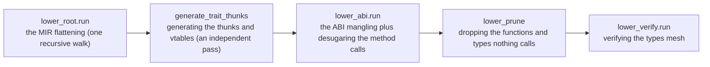

*MIR* (mid-level intermediate representation, [the glossary](DESIGN-compiler.md#the-glossary)) is the flat tree the first walk leaves; ksplc keeps it in the same `Ast_node`s.

**A vtable and a thunk** build the *dynamic dispatch* C lacks: choosing at run time which type's method to call. With them, a `trait` method can be called whatever the concrete type:

* **A vtable (a virtual function table)**: per type implementing a `trait`, a constant table of function pointers to its methods. A `trait` value (a fat pointer, "The runtime memory layout and the ABI specification") is a pair of pointers, to the object and to that vtable.
* **A thunk**: the small adapter a vtable holds in place of each method, matching the signatures. The caller does not know the concrete type, so it passes the receiver through the `trait` as a `Void@` (an untyped pointer). The thunk casts it back to the concrete type and calls the real method.

The diagram follows one call `obj.trait_method()` where `obj` is a trait value.

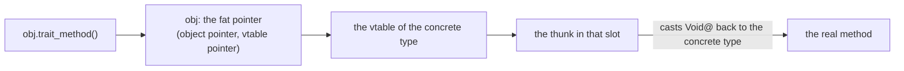

So `obj.trait_method()` takes the thunk from the vtable and calls it. With this indirection, Genc/Genllvm know nothing of dynamic dispatch, and emit the thunks and vtables as ordinary functions and constants.

The steps, one by one:

* **`lower_root.run` (`lower/root.kspl`) is one recursive tree walk.** Three files extend it, and are not passes of their own:

  | file | what it handles |
  | :-- | :-- |
  | `lower/expr.kspl` | hoisting short-circuit evaluation, `!`, `catch` / `fallback` |
  | `lower/order.kspl` | fixing the order of a call's, an operator's and a compound literal's operands |
  | `lower/defer.kspl` | flattening `defer`, cleaning up after a labelled `break` / `continue` |

  They are methods extending the same `impl Ast_node` (`lower_expr_postfix`, `lower_cleanup_stmt`, `lower_loop_jump` and so on). The `Ast_node.lower` dispatch in `lower/root.kspl` calls them, and they recurse back through `r.lower(lctx)`. So the expression hoisting and the defer flattening mix in one walk, node by node; the tree is not walked twice.
* **`generate_trait_thunks` in `lower/vtable.kspl` is a truly independent second pass**, run after `lower_root.run`. One flat loop over `root.children` (no recursion into nested scopes) finds each `.k_decl_impl`. It gathers into a side list the thunk functions (`decl_fn`) that bridge the dynamic dispatch, and the vtables (`decl_const`, as constant structs). After the loop, it `add_child`s them as direct children of the root (`root_file`), where the backend emits them as plain functions and constants. It has two inputs ([5.2.1](#an-upcast-not-conformance-decides-what-gets-a-vtable)).
* **The ABI mangling (`lower/abi.kspl`) is the last independent pass.** The *ABI* is the agreement on how values sit in memory and how calls pass them; *mangling* turns a name into one that cannot collide ([the glossary](DESIGN-compiler.md#the-glossary)). It runs after the thunk generation, so its recursive walk (children to parent, `apply_abi_recursive`) covers the new thunk and vtable nodes too. Take a top-level function, variable or constant marked `priv` and registered in `File_env` as `file_private`. The pass rewrites the node's `text` into `kspl_priv_{the file's base name}_{the original identifier}`. This prevents name collisions in the single-file C output (a unity build: the whole program in one `.c`); Sema itself does no string rewriting.
* **Desugaring a method call (`obj.method(arg)` → `Struct_method(&obj, arg)`) is done in `lower_abi.run`, the third pass, not in the main walk** (the pruning and the type check follow it). `transform_postfix_call` fires on each postfix call Sema resolved into `.k_method_access` / `.k_generic_method`. The neighbouring code in `lower/expr.kspl` differs. It only assembles the operator-overloading sugar (`a + b`, `a[i]` and so on) into a synthesized method-call node with `build_linked_method_call`. `lower_abi.run` applies the transformation itself (the receiver flattened to the first argument, the mangled name swapped in), to a `.method()` call the user wrote and to a synthesized node alike.
* **C leaves the order of a call's arguments, an operator's two sides and a compound literal's fields open, so Lower fixes it** (`Operand_order` in `lower/order.kspl`). gcc takes a call's arguments from the right and clang from the left, while the language evaluates left to right (`docs/SPEC-language.md` §6.5.1).
  * An operand moves into a temporary (`gen_tmp_name` in `lower/ctx.kspl`) ahead of the statement when C could run it on the wrong side of another. That is when it is not `fixed` (a literal, a constant, an immutable binding, a fixed address) and a later operand acts (calls, can stop the program, or is hoisted itself), or when it acts and a later one is not `fixed`.
  * A place its consumer reaches by address (a method receiver taking `Self@`) fixes only its address, so the callee still sees the writes the later arguments make.
  * Caution: **Count everything Lower hoists as acting** (`&&`, a conditional, `catch`, `!`, a user operator). Hoisted, it runs ahead of the expression around it, so an earlier operand that only reads must move too.
  * **Only inside a function body.** A top-level initializer runs nothing at run time, and a temporary moved out of it would land at file scope.
  * `tests/suite/equiv_test.kspl` builds `tests/prog/equiv.kspl`'s C under gcc as well as clang, since only the two together show an order C left open.
* **Verifying the types (`lower/verify.kspl`)** ends the order. One pass over the tree confirms that `x$`'s and `x@`'s types agree in pointer depth (`x@` takes `x`'s address, `x$` reads through a pointer), and a mismatch stops with an ICE.
  * **It is needed because lower sets types by hand.** Over twenty places write a synthesized node's `type_id` themselves with `env`'s type operations (`make_ptr` / `strip_ptr` and so on). Otherwise a mistake surfaces only as a generated-C warning or in LLVM IR's signature check, both after the generation. The Linux/macOS run-time tests miss it, because it breaks only on Win64 ([6.6.1](DESIGN-compiler.md#both-a-store-and-an-actual-argument-are-emitted-at-the-receivers-type)).
  * Caution: **Keep it at the end of the order.** Placed at the end of `lower_root.run`, it does not see the types the later stages (vtable / abi) write. The very thing most worth confirming then escapes the check. With one `make_ptr` line dropped from `lower/abi.kspl`, it stays silent there and fires at the end.
  * **Where a generic's template arrives, stop; do not skip it.** `lower_prune` drops every template that was not instantiated, so none arrives here. Skipping would silently stop the check from holding, so an arrival is announced with an ICE. The ICE also shows the check is misplaced: placed at the end of `lower_root.run`, it meets templates, and this ICE fires first.
  * Types are compared normalized (aliases resolved, const marks dropped) to a fixed point, since the marks nest (`const_of(alias Meters)`) and one pass of each is not enough.
  * Its cost is lost in the measurement's jitter: one pass over the tree is invisible beside the code generation.

#### An upcast, not conformance, decides what gets a vtable

A type gets a vtable for a trait only if the program actually turns one of its values into that trait somewhere. Merely implementing the trait is not enough.

An *upcast* turns a concrete value into a trait value (the `expr_upcast` node, "The AST nodes the Sema layer creates (its contract with Lower and Genc)"). **Only the pairs for which the tree holds an upcast naming `kspl_vtable_impl_<the conforming type>_<the trait>` get a vtable constant and thunks** (`collect_upcast_keys` in `lower/vtable.kspl`). Only two places name one, `emit_upcast_expr` in `gen/c/expr_postfix.kspl` and `gen/llvm/expr_agg.kspl`. Both start from `k_expr_upcast`, so the demand is confined to that node.

Caution: **Do not make it "everything that conforms".** A conformance such as `impl<|T|> List<|T|>: Index<|Sz, T|>` grows with each instantiation, while `m[k]` becomes a direct call and makes no upcast. With conformance as the bar, constants and thunks nobody refers to pile up (several hundred in ksplc itself).

**There are two inputs**:

| input | why it is needed |
| :-- | :-- |
| the tree's `decl_impl`s | the impls written |
| the list of instantiated generics' impls (`Trait_inst` in `sema/session/ctx.kspl`) | a generic's impl is instantiated as individual `decl_fn`s, and no `decl_impl` remains in the tree (`instantiate_generic_methods` in `sema/decl/mono.kspl`) |

Read only one, and the input not read becomes C referring to a symbol with no definition, with no diagnostic. The regression is `gentrait=` in `tests/prog/equiv.kspl`.

A thunk's body makes an `expr_upcast` too (`build_thunk_body`, for a trait method returning `Self`, as in `Writer`'s chaining), but that pair is the very pair being made, so no new pair appears after the gathering.

#### A function or type nothing calls is not emitted

After Lower, ksplc deletes every function and generic type that cannot be reached from the program's starting points. This keeps the generated C small, so the C compiler has less to read.

A generic's impl makes every method for each instantiation (`instantiate_generic_methods` in `sema/decl/mono.kspl`), as name resolution needs. Kept in the output, one use brings the whole set onto every `List` instantiation (all the collection operations `std/seq` adds to `List<|T|>`). In a program of a few lines, over half the generated C is then functions nobody calls.

**`prune_unreachable_fns` in `lower/prune.kspl` removes the `decl_fn`s unreachable from the root from the tree.** There are three kinds of starting point, and losing any one erases everything beyond it:

| starting point | why the tree shows no call to it |
| :-- | :-- |
| `main` | the C runtime calls it (it is found with `find_main_symbol`) |
| the `#export` functions | their callers are on C's side, invisible from the tree |
| references from the initializer of a non-function top-level declaration (`const` / `var`) | a trait's vtable naming a thunk as data is one, and it does not look like a call |

Caution: **Walk the edges by `def_node`, never by name.** `def_node` is the link from a use to the node that declares it ("The limits on building an AST, and `def_node`'s strict duty to link"). The backend decides a call target's name (`emit_generic_path` in `gen/c/expr.kspl` makes it from the `type_id`, not the identifier). Walking by name would copy that rule here, and the day one copy changes, the C calls a symbol with no definition. Walking by node identity needs no naming rule; this walk depends on "The limits on building an AST, and `def_node`'s strict duty to link"'s duty to link.

**Call it after all the synthesizing is done** (after `lower_abi.run` in `pipeline.kspl`). Lower makes the thunks and ARC's retain/release, and dropping before they are made erases them.

**Neither dropping too little nor too much gives a diagnostic.** Too much shows at C's link, as an undefined reference. Too little shows nothing: the generated C stays several times too large, and only clang's time grows. `tests/suite/thin_use_test.kspl` watches the latter (the generated C's line count for a small program).

The linker's removal of unreferenced sections also shrinks the executable (`CFLAGS` in the `Makefile`, and `ksplc/tools/run.kspl`). But it does not cut the generated C, so it does nothing for clang's time, while pruning cuts the lines clang reads. Their aims differ, so both are kept.

**Type declarations are dropped likewise** (`prune_unreachable_types`). A generic's signature makes its return and parameter types even where it is never called. Instantiate one `List<|X|>`, and `std/seq`'s `where` / `select` bring in `List_seq<|X|>` / `Keep<|…|>` / `X?` / `Callable1<|X, Bool|>`.

Caution: **Call it after the functions have been dropped.** A type named only in a signature stops being named only once that function drops; called first, it drops nothing.

**Only the instantiated types are dropped** (`Env.instantiated_nodes` holds their identity). A `struct` the user wrote is one definition however often it is used, so dropping it saves little; the instantiations multiply with the type arguments.

**Key it by the type ID passed through `Env.c_repr_type_id`.** Bodies differing only in the immutability at the declared position fold into one struct in C ("How immutability marks are expressed in a type, and the API that asks about them"). Counting on the plain ID drops the other one when only one is reached, and C stops with `unknown type name` (the typedef for `Job.argv`, a `U8[][]`, vanishes).

**What is walked is `Env`'s declarations, not the tree.** The field types the generated C emits come from `Struct_def` / `Enum_def`, so a field's node in the tree may carry no type.

**A composite type naming a dropped instance is dropped with it.** Sema registers every array, `T!E` and function type it meets (`Env.complex_types`), and C declares each ahead of its use. One that only a dropped function used, and that names a dropped instance (`fn(Box_I32*)`, `Cell_I64[2]`), names a struct C never sees. So `drop_orphan_complex_types` removes every composite naming one at any depth, a pointer included, folded as the walk folds. It also removes a `T!E` nothing live names, to keep the C small; an array or function type naming only live types stays, as it is correct C.

**Here a mistake is never silent.** Dropping too little leaves a typedef nobody uses, which is still correct C; dropping too much stops the C compiler with `unknown type name`.

### The limits on building an AST, and `def_node`'s strict duty to link

**Lower makes a new node or an expanded control flow only through the builder functions in `base/ast.kspl`** (`build_var_decl`, `build_if_stmt` and so on). Assembling a raw node by hand invites a structural inconsistency, and is forbidden. Every variable reference Lower makes must point back to the node that declares the variable, or the LLVM backend stops.

**The reference-linking convention for the LLVM backend.** The C backend can resolve scopes on a variable's name (a string) alone. But `genllvm` keys each local's unique ID (`%v_r_1`, say) on the AST variable's pointer address (`def_node`), for its SSA (static single assignment: each register is assigned once) registers. So wherever Lower generates an `Identifier` (a variable reference) or an `expr_path` and inserts it into the AST, **it must link `def_node` to the declaring node (a `decl_var`, an `fn_param` and so on)**.

**No single gate or ICE assertion in `lower/*` enforces this.** The builders in `base/ast.kspl` do not set `def_node`, so each call site where Lower synthesizes an identifier must link it by hand. If one is missed, it is caught not in Lower but downstream. The local-variable ID map in `gen/llvm/ctx.kspl` treats `def_node == null` as "no stable ID", and panics (an ICE) with "an undefined register (opaque)" while emitting LLVM IR.

### An annotation belongs to the phase that decides it

**The tree carries resolved decisions so later phases need not resolve them again.** Its semantic annotations have distinct producers and consumers; they are not interchangeable caches.

| Annotation | Producer | Consumer and lifetime |
| :-- | :-- | :-- |
| `type_id` | Sema resolves source types; Lower assigns types to synthesized nodes | Lower, both backends and editor queries; IDs belong to the command's semantic environment |
| `def_node` | Sema links uses to declarations; Lower links synthesized references | Lower, pruning, LLVM local identity and editor navigation; valid while the command's AST arena lives |
| `sym_ptr` | Sema attaches a declaration's symbol | Semantic resolution and later declaration queries; type-erased because base cannot import Sema; valid in the same command |
| `ival` | Parse records parentheses; normalization and Sema mark synthesized forms; Sema resolves member slots; Lower marks propagated throws | Read according to node kind by lint, Lower or a backend; the parse cache preserves the parse-stage payload only |

**`ival` keeps kind-specific facts in one existing word.** A member slot avoids repeating field-name lookup in LLVM; a propagated throw tells both outputs to extend the error trace instead of starting it. The latter mark is named once in `base/ast_ext.kspl`. Rejected Result field accesses and array lengths folded into literals need no surviving member-slot annotation. Adding a separate field for every such mark would charge every node for facts only a few kinds need.

**Copying a node copies its complete value.** Deep cloning then replaces the child list and clones each child, while a snapshot beneath an implicit conversion keeps the original child list and adjusts the source type. This preserves semantic links and kind-specific payload without a second, manually maintained list of annotations. The wrapper supplies its own kind and links; the snapshot owns the original expression's meaning.

**A syntactic question belongs below Sema.** `has_side_effect` walks node kinds and children only, so it lives with the base expression predicates in `base/ast_place.kspl`. Both Sema and Lower ask it there; Lower needs no import of the semantic statement analyzer to decide whether an expression needs a temporary. C/LLVM execution checks and self-host equality exercise the resulting shared tree.

## The rules for implementing ARC

*ARC* (automatic reference counting) keeps a count of how many owners a value has. The compiler inserts a `retain` (count +1) where a value is copied and a `release` (count −1) where an owner goes away; at 0 the value is freed. This chapter holds the rules that keep those inserted calls correct.

```kspl
import "std/refcount"

fn main(): I32
    a: = refcount.Rc<|I32|>.new(7) // count 1
    $b: = a // a copy: retain, count 2
    return b.get()$ - 7 // leaving: b and a released, count 0, freed
```

ARC asks two questions that can go wrong independently:

1. **Is the type managed?** (`type_has_arc_content` / `type_is_managed` in `sema/type/arc.kspl`)
2. **Where do retain and release go?** (`emit_managed_op` in `lower/arc.kspl`)

Both recurse over the set of positions that own an ARC value by value. **If the two sets drift apart, one of two failures always follows:**

| The drift | What happens |
| :-- | :-- |
| the verdict wider than the operations | judged managed, yet no operation is emitted → **a leak** |
| the verdict narrower than the operations | the insertion path is never entered → **a silent leak** |

Caution: **The second is the easy one to fall into.** If both look only at a struct's fields, no retain or release is inserted at all for an enum's payloads or an array's elements, and they leak entirely.

**There are four owning positions**: a struct's fields, the active enum variant's payload, an array's elements, and a Result's success payload.

| Position | Owns? | Why |
| :-- | :-- | :-- |
| a struct's fields | yes | |
| the active enum variant's payload | yes | |
| an array's elements | yes | |
| a Result's success payload | yes | |
| a Result's error side | no | only an error enum's variant can be thrown, and an ARC-managed type cannot be put on one |
| what a pointer or a slice points at | no | it is a borrow; following it would release someone else's memory |

**Move_only's structural derivation reads the same four positions** (`owned_parts` in `sema/type/arc.kspl`). A position only one of the two knows would be released without its copy being refused, or refused without being released.

### A retain goes wherever a copy happens

Every place where a counted value is copied and the copy can outlive the original must add one to the count. A `retain` goes into **every position where a value is copied and the copy can outlive the place it was read from**.

Caution: A variable declaration, an argument and a `return` are not enough. Struct-literal fields, array-literal elements, enum payloads and assignment into an existing binding slip through. At each, the count is one short, so a value that should still be alive is freed.

**The verdict lives in one place, `Arc_take` in `lower/arc.kspl`.** Every taker decides with it before lowering (a place is retained at its own type, a read only the lowered form names is retained once lowered, a new value brings its own count) and places the retain with it after lowering. Copying its conditions out per position makes the same omission recur at the next.

A managed read is classified as an ordinary place copy before asking whether only its lowered form can name the memory. Both `Arc_take.decide` and the freshness check make that distinction first, then ask `arc_read_once_lowered` for the remaining reads. This keeps the managed-type and place checks at the decision boundary, with no second scan inside the helper.

**The retain goes where the copy is made, never earlier.** Emitted when the taker is first looked at, ahead of its operands, `two(a, mk(k)!)` retained `a` before `mk(k)!` could leave, and the exit never gave that count back. The operands of a call, a compound literal and an enum's payload go through `Operand_order` (`lower/order.kspl`), which knows which operand is taken (`add_value`):

| The taken operand | Where its count comes in | If a later operand acts (can leave) |
| :-- | :-- | :-- |
| moved into a temporary (it reads what a later operand could change) | retained at the move | held with a flag until `finish` (`arc_hold_until_taken`), released by any exit before |
| a new value | when it runs | moved and held, even where its own class is `fixed` |
| not moved (`fixed`, or nothing after it acts) | retained in `finish`, after every operand | nothing can leave after it, or nothing can change it |

Caution: **Call `Operand_order.finish` after lowering the consumer.** Without it a taken operand's retain is never placed; `free` stops the compiler with an ICE where one was dropped.

**An assignment also releases**: `dst = x;` needs, besides `retain(x)`, a release of the value being overwritten. **The release waits until the right side is lowered and held in a temporary** (`tmp = x; retain; release(dst); dst = tmp`, the order Swift uses). The right side's own retains are inserted while it lowers, so a release emitted before them freed `head` in `head = Rc.new(Node::{ .next = head })` before retaining it, and the new node, landing at the freed address, pointed at itself. Held in a temporary, the right side is also read before the old value goes, so `head = head.get().next` does not read a node already freed.

**It targets reads from a place expression**, one that points at existing memory: an identifier or a path, a chain of `.` and `[` rooted in one, or a dereference `<expression>$`. An expression with a call inside (`f().x`) must not be a place expression. It reads part of a temporary that is already +1'd, so another retain doubles it.

| Expression | A place expression? | Retained when copied? |
| :-- | :-- | :-- |
| `x`, `a.b`, `xs[i]`, `p$`, `(p + i)$` | yes | yes |
| `f().x`, `f()[i]` (a part of a fresh value) | no clone can be made, but once lowered it reads the temporary holding `f()` | yes, once lowered, where something takes it |
| `b.get().v`, `f()$` (through a pointer a call returns) | no clone can be made, but it reads existing memory | yes, once lowered |

**A read through a pointer a call returns is a copy of existing memory, not a fresh value** (`arc_read_once_lowered`). `get()` hands back a pointer into the box, not a counted result, so taken as fresh, `x: = b.get().v` got no retain, and `x`'s release freed a value the box still held. The retain's receiver cannot be a clone, which would run the call twice, so lowering first moves the pointer into a temporary (`arc_needs_pointer_hoist` in `lower_expr_postfix`), after `Operand_order` has fixed the operands' order, and the retain clones the lowered read (`arc_retain_lowered`).

**A Result built around a place, or unwrapped from one by `!`, reads that place.** `return e.value` in a `V!E` function wraps `e.value`, and `r!` takes `r`'s payload while `r` still owns it. The verdict looks through the wrap and the `!` to the place and retains it at its own type. Missed, the place and the copy are both released, and the value is freed under the copy.

**Each way a branching value can go hands over a count of its own** (`lower_into_block`, `lower_expr_catch_chain`, `lower_fallback_stmt` in `lower/expr.kspl`). A ternary's branch, a catch's substitute and a `fallback` retain a place they read inside the branch, and a catch's success retains a payload a binding still owns (`r catch …`). So a ternary and a catch are fresh values whatever they read, and the verdict does not look through a catch. Looked through, only the success path was counted: `return a if c else b` and `x: = f() catch a` released `a` twice.

**A `switch` arm's binding holds a count of its own** (`register_arc_arm_bindings`): a retain is put at the arm's start, and the release waits in `arc_scope_pending` for the arm's block, which releases it on every way out. Read without one, an arm that reassigned its subject (`s = .none`) freed the payload under the binding. Why the language counts it rather than borrows it is "Why a binding a `switch` arm takes out of a value holds a count of its own" in [`../../docs/DESIGN-language.md`](../../docs/DESIGN-language.md).

**A dereference does not demand a place expression of its receiver**, because a pointer leads to existing memory however it was computed. Demanding it lets `(p + i)$` (pointer arithmetic, then a dereference) slip through. A container's element reads and writes then get no retain/release. A `List`'s `get` steals the stored count (a use after free), and its `set` leaks the value it overwrites. The verdict asks only whether cloning is safe, so for the receiver it looks only for a call (`arc_has_call`).

Caution: **Do not make a `return`'s retain depend on there being a cleanup.** In a function returning a local binding, it balances the cleanup's release and looks right. But in a function with no cleanup, such as `return p.field;`, it comes one short, and the caller's release frees memory still in use. Returning a place expression needs the +1 either way.

**An assignment whose left side is not a place expression is an error.** For `rc.get().f = x;`, building a receiver for the release runs the call twice, and not building one leaks the overwritten value. Neither is visible to the writer, so the error asks for `p: = rc.get(); p.f = x;` instead (the case `arc_assign_through_call` in `tests/negative/pointer.kspl`).

**Liveness is checked with `Weak_rc.upgrade()`, not by reading the value.** Freed memory can still hold the old value, so a check that reads it passes. Linux's allocator hides the fault; only one that does not leave a freed region behind, such as macOS's, exposes it.

#### A value no binding takes is owned by a temporary

A counted value that nobody stores, such as the result of a call used as a statement, is held by a hidden temporary and released, so it does not leak. A call's result, a literal, and a field read off one arrive counted once, and whoever takes the value (a binding, an argument, a field of a literal, a `return`) takes that count. **Where nothing takes it, the count is held by nobody and the value leaks**: a call made a statement, a field read off a call, a method's `Self@` receiver built in place, a `switch` subject built in place, a success a statement's `catch` throws away.

* **Decide "nothing owns it yet" before lowering** (`is_arc_fresh`). Lowered, a catch or a `!` becomes a temporary's name, and a name looks like a place. A binding and a `return` decide there too, or the same `return f()!` gets a retain it does not need.
* **A value that is only read lives to the end of its block** (`arc_hoist_owned`), as `x: = f();` written there would, so a view read off it stays valid that long. A statement throwing it away releases it at once (`arc_release_now`). A statement's `catch` releases the Result after the branch, which frees the success alone.
* **A field or an element read off such a temporary is a place in it** (`lower_arc_part_of_fresh`, for `.` and an array's built-in `[`). A taker retains it once lowered; a read alone borrows it. Retained on every read, `mk().rc.get()` left the field one count too many.
* Caution: **A temporary hoisted where the statements move into a block of their own** (a ternary's branch, `&&`'s right side, a loop's condition, an `else if`'s condition, a catch's substitute) **is declared at the statement's own level with a flag** (`stmt_decls`, `relocating`). Declared inside, it would be out of scope where the block's cleanups run. Released unflagged, a branch not taken would release garbage, and a loop's condition would overwrite the previous turn's value without releasing it.
* A cleanup is lowered as a block of its own (`lower_and_wrap_cleanup`), so a temporary it hoists ends inside it rather than in the scope being closed.

### The chaining is gathered into a per-type drop-glue function

**For a struct that holds counted values, the compiler generates one helper per type that retains or releases all of them, and calls it with one statement**: the drop glue of Rust and Swift. Expanding the chain at each call site repeats the walk per copy position and per cleanup injection point. A cleanup is injected per exit path (a normal exit, a `return`, a `break`, a `continue`), so one binding would multiply several times over.

* **Always make the parameter a pointer.** Passed by value, lowering the cleanup's subtree again would treat it as a managed value parameter and insert a `retain` on the argument, counting twice. A pointer type has `type_is_managed` false, so it stays off that path (it is treated as a borrow).
* **An array takes a pointer to its element.** In KSPL, `@` on an array gives a pointer to the first element. A `T[N]$@` parameter would disagree with the call, since no expression has that type.
* **The pointer is read-only, and there is one helper per type whatever its immutability.** `retain` and `release` take `Self@`, so the helper writes nothing. A writable parameter discarded C's `const` where `for x in` copies a read-only array (`-Wdiscarded-qualifiers`, against Warning Zero).
* **Register the helper before building its body.** The body's walk recurses into the owning positions' types, so registering afterwards turns a type that comes back round to itself into an infinite recursion.

**An enum must read its tag at run time.** Each variant has its own payload layout and only one is active, so a `switch` is synthesized that operates on the active payload only. A variant without a payload gets no `case`, and a `default {}` is always added; without it, a tag that matches no `case` has nowhere to go. A Result's tag reads as a virtual field, so `if !p.is_err` serves instead of a `switch`.

Caution: **A synthesized node must fill in for itself what Sema would have filled in.** A node synthesized in Lower never passes through Sema, and with its `type_id` left at 0 genllvm emits invalid IR. Keep the virtual fields' indices in step with the convention in `sema/body/dot.kspl` too. A drift is no compile error, and silently touches another field.

## The backends (Genc / Genllvm) and the runtime ABI

A *backend* is the last stage of the compiler: it turns the finished tree into code for a target. ksplc has two. **Genc** writes C99 source, and every shipped program is built through it. **Genllvm** writes LLVM IR, the text form that the LLVM toolchain (clang's back half) compiles; it exists to check the stages above it and is not shipped.

The diagram shows both routes from the tree Lower hands over to a running program.

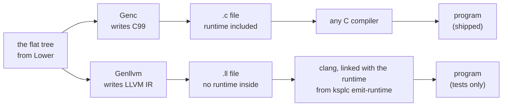

**Why two are held**: C99 is the default output, and every shipped artifact is built through it. A C compiler exists on nearly every platform, bare-metal ARM included (clang builds for `thumbv7m`; *bare metal* means a chip with no operating system). So nothing beats generated C for portability. The LLVM IR backend (`--to=llvm` / `make LLVM=1`) has two roles:

1. **It proves that the layers above the backends (parse / sema / lower) are neutral.** When two outputs from the same AST behave alike (`make test-equiv` / `make test-llvm-abi`), no backend dependency has leaked upstream, which bears on the C output's quality.
2. **It keeps an option open**, so a target with no C compiler does not start from zero.

**The LLVM backend is a mirror, not an exit.** Shipping uses C99 alone, so no second exit is held (Principle 6).

**Only the C runtime holds the bodies of `kspl_*` symbols.** The *runtime* is the C code every program needs besides its own: files, directories, sockets, processes, threads, secure random numbers and the clock. It has one implementation, in `gen/runtime/`, and genllvm does not reimplement it. The IR only emits `declare`s (LLVM's "this function exists elsewhere") from `std/`'s `extern "C"` declarations. It is then linked with the C runtime that `ksplc emit-runtime` writes (`STAGE1_RT` under `make LLVM=1`; `tests/support/harness_build.kspl` for the tests). A symbol the IR's `main` calls stops a runtime of another version from linking ("The runtime written alone, and its version symbol"). So both artifacts can do the same things. The IR's own share is only the `main` entry point and what is `static inline` on the C side: the bounds, division and shift checks. `make test-conventions`'s "there is no `kspl_*` body on LLVM's side" holds this. Both backends spell the entry point's work from `gen/entry.kspl` ("What the two generators share: the decisions, not the spelling").

**An LLVM artifact is not shipped.** It carries no debug information ("Genllvm (LLVM IR): why the structure itself differs, and managing SSA"), so a fault in a shipped build could not be traced to a `.kspl` line. `ksplc run` / `--split` / `--library` / `commit-seed` refuse `--to=llvm` as well. Shipping one needs debug information first.

| | Genc (C99) | Genllvm (LLVM IR) |
| :-- | :-- | :-- |
| Role | the output that ships | a mirror that checks the layers above |
| Runtime | written into every `.c` | linked in from `ksplc emit-runtime` |
| Debug information | `#line` before every statement | none |
| `ksplc run`, `--split`, `--library`, `commit-seed` | yes | refused |
| Machines | every row of `machines` in `base/target.kspl` | those with 8-byte pointers, by their `target triple`; refused otherwise |

**genllvm lays out only 8-byte pointers and `Sz`** (a slice is `{ ptr, i64 }`, "The runtime memory layout and the ABI specification"), so `check_machine` in `main.kspl` refuses `--to=llvm` for a machine whose row has no LLVM triple, before any IR is written. The IR names the row's `target triple` and no `target datalayout`: LLVM derives the layout from the triple, and clang replaces a module's own layout with its target's without a word, so a copy would state what nothing reads.

### What they answer for

The backends only translate; every decision has been made before them. They are the first stage that knows the target. They receive a normalized, plain AST: semantic analysis, desugaring, mangling and thunk generation are all done. They are **pure emitters** writing the target language ("A backend writes straight out rather than assembling"), with no logic for type inference, control flow or method resolution. Both start from the same `switch target` in `pipeline.kspl` on the same flattened `root_file`. Only their internal stages differ ("Genc (C99): the topological output order", "Genllvm (LLVM IR): why the structure itself differs, and managing SSA").

### What the two generators share: the decisions, not the spelling

**What the two outputs must agree on is written once, in a shared file directly under `gen/`, and each backend writes it out in its own language.** Neither backend imports the other.

| What is shared | The file | What it holds |
| :-- | :-- | :-- |
| the C runtime that completes either output | `gen/runtime.kspl` | the embedded `gen/runtime/` files in order, and the version symbol that stops a runtime of another version from linking ("The runtime written alone, and its version symbol") |
| what the generated `main` does around `kspl_main` | `gen/entry.kspl` | the startup calls and their order, how the return value becomes an exit code, and the words printed on failure |
| reading the file an `embed` names | `gen/embed.kspl` | finding it the way an import is found, and refusing one that cannot be read |

**A decision written twice drifts with no warning until someone runs the other backend.** A `main` written per backend can lack a call in one of them. For example, without the call that puts standard output into binary mode, a program built with `--to=llvm` writes `\r\n` on Windows where the C one writes `\n` ("Standard output carries the bytes a program writes" in [`../../docs/DESIGN-language.md`](../../docs/DESIGN-language.md)). And a symbol that one backend owns, such as the runtime's version symbol, would make the other import it.

**An `embed` with no path in the tree stops with an ICE** (an internal compiler error, see [the glossary](DESIGN-compiler.md#the-glossary)). The parser always gives an `embed` its path as a string literal, so a missing one is a broken invariant. Returning silently would be the stopgap "Failing fast through an exception or an ICE" forbids.

**Where the spelling differs, the table belongs to the backend.** The functions the LLVM preamble declares or defines itself form one table, `preamble_fns` in `gen/llvm/ctx.kspl`. It drives both the `declare`s and the skipping of `std`'s own declarations, so the two cannot disagree. `make test-conventions` holds its hand-defined entries against the `define`s in `gen/llvm/module.kspl`.

**The emission itself is not shared**: the bodies of genc and genllvm overlap in only a few short windows, a small fraction of the whole.

| The overlap | How it is handled |
| :-- | :-- |
| the composite types' de-duplication (10 lines × 3 places) | **gathered** in `Mangle_seen` in `ksplc/sema/type/naming.kspl` (the key is the output name, so it sits with its spelling) |
| `clear_scratch` / `take_scratch` (6 lines × 2 places) | not gathered: each is one statement, and a shared function would need as many lines at each caller |

**There is no trait for the output destination.** The shared files touch the source map, the type table and plain values, never the output buffer, so plain functions are enough. Do not add a trait that binds `Genc_ctx` and `Genllvm_ctx` together.

### The runtime memory layout and the ABI specification

Every KSPL value has one fixed layout in memory, and both backends follow it, so C output and LLVM output can call each other. This agreement is the *ABI* (application binary interface, see "Words used throughout" in [`../../docs/DESIGN-principles.md`](../../docs/DESIGN-principles.md#words-used-throughout)). Sema fixes it, and it keeps C and LLVM output binary-compatible.

| KSPL value | Its layout | Note |
| :-- | :-- | :-- |
| a pointer | LLVM's untyped `ptr` (opaque pointers, LLVM 15+) | Sema alone answers for pointer type safety, so the backend needs no casts |
| a slice `T[]` | `{ ptr, i64 }` | the elements and their count |
| a trait value | a fat pointer `{ ptr obj, ptr vtable }` | the object and its vtable (the table of its methods) |
| a Result `Result<T, E>` | `{ i8 is_err, E error_code, T val }` | `val` is left out when it is `Void`; more below |
| an enum with a payload | a tagged union: a tag, then a buffer | more below |
| an enum without a payload | its base type | as in genc's `typedef` of it |
| a struct | `{ <the fields> }` | more below |

The three longer rows:

* **Results**: a Result's alignment is its fields' own, as C's struct has it (`U8!U8` is 3 bytes). **One holding a laid value is laid as a struct is** (see Structs below): its fields sit at sema's offsets (`result_err_offset` / `result_val_offset` in `sema/decl/layout.kspl`).
* **Enums**: an enum with a payload is a *tagged union*: a tag that says which variant is active, then room for the largest payload. The tag has the enum's base type (`I32` where none is written; genc's `tag` field is that type too, not a C `enum`). The buffer is sized from the type layout. On LLVM it is `{ <tag>, [N x iW] }`, the words `W` bytes wide for the alignment (8 at most), so the type has sema's size. **A payload field is reached by its byte offset** from the value's start (`enum_payload_offset` plus `payload_field_offset`; `payload_field_ptr` in `gen/llvm/types.kspl`). It is never reached through a struct of the payload's types, which LLVM would lay out by its own alignments.
* **Structs**: on LLVM a struct is `{ <the fields> }`, laid out by LLVM's own alignments, which agree with C's. **One that is, or holds, an `#align(N)` struct, or a tagged union aligned past 8, is laid instead** (`is_laid` in `gen/llvm/types.kspl`). No LLVM type carries such an alignment, so the struct is written *packed* (no automatic gaps). Each field sits at sema's offset, with `i8` padding bytes between and after. A field's element index is counted past the padding (`field_index`), and every alloca and global of it is told the alignment (`get_struct_align`). Unlaid, a field after it would sit elsewhere than C and `offsetof` say.

#### A field of a `#packed` struct is reached byte-wise

**A field of a `#packed` struct sits at any byte, so each load and store of it is made at the alignment it keeps, and nothing makes a pointer to it.** One function answers what that alignment is: `packed_place_align` in `sema/decl/layout.kspl`. It walks the place's path (`.` and an array's `[]`; a step through a pointer starts afresh at the type's own alignment) and gives the alignment where it is below the type's own, else 0. Each reader asks it:

| Who | What it does with the answer |
| :-- | :-- |
| sema | Refuses whatever would take the address (`refuse_packed_address` / `refuse_packed_receiver`), and an ARC-managed field, whose helpers take it (`check_packed_managed_fields`); why is "Why a field `#packed` leaves under-aligned has no address" in [`../../docs/DESIGN-language.md`](../../docs/DESIGN-language.md) |
| genc | Leaves the access to C, which knows the packing from the member path. Only the target an assignment fixes first (`_kspl_dst_N` in `emit_assign_stmt`, `gen/c/stmt.kspl`) is held through a pointer to a one-field packed struct, never a `T*` |
| genllvm | Writes `, align N` on the load or store (`op_load_place` / `op_store_place` in `gen/llvm/types.kspl`), and on a struct literal's field store (`packed_field_align`) |
| lower | Fixing an operand's address early (`hoist_address` in `lower/order.kspl`) fixes the struct holding the field instead (`hoist_packed_holder`) |
| lower's exit check | An `@` of such a field is an ICE (`lower/verify.kspl`): sema refuses every form a writer can write, so one there was made by lower |

Caution: **An LLVM load or store with no `align` takes its type's own, and a C `T*` promises `T`'s.** Both are wrong for such a field, and x86 hides it. `make test-equiv` builds its program's C with C's alignment trap and reads the IR's `align` (`check_traps` / `check_packed_ir` in `tests/suite/equiv_test.kspl`).

**What is given up**: an index between the holding struct and the field, in an operand fixed early (`p[f()].grid[j][g()] += 1`), moves into a temporary by value. So its bounds check runs where the field is used, after the operands that follow it.

### Embedding the runtime, and what a library keeps to itself

**ksplc carries the C runtime (`gen/runtime/`) inside itself and writes it into every generated `.c` as a preamble, so the output builds with nothing else installed.** The runtime has three parts:

| Part | Used | What it holds |
| :-- | :-- | :-- |
| `core.*` | always | primitive type aliases, the linkage and export marks, the error-route trace, signed division and the atomic operations |
| `hosted.*` | where there is an OS | files, sockets, threads and the rest of what needs libc and the OS API |
| `freestanding.*` | under `--freestanding` (bare metal) | nothing OS-dependent; a breached run-time check stops in an endless loop, and the like |

Here the arena model ("Memory management: the arena model") and the ABI ("The runtime memory layout and the ABI specification") become C.

The runtime sources `ksplc/gen/runtime/{core,hosted,freestanding}.{h,c}` are built into ksplc with `embed` (as in "Keeping the grammar and the AST node kinds in step"). genc writes the hosted or the freestanding set, by the target it starts with, into every generated `.c`, unconditionally. **So their reachability differs from an ordinary KSPL file's.** A `pub fn` in an ordinary file (`std/mem.kspl`, say) reaches the output only if the entry file imports its file, directly or not. An imported file whose symbols are never called can be dropped whole. `runtime/*.c` is emitted every time, whatever the import graph.

That matters for the calls clang inserts where the KSPL source shows none: passing a struct by value, zero initialization, a bounds check (`__aeabi_memclr4`, `kspl_bounds_check` and the other AAPCS and runtime helpers; AAPCS is ARM's calling convention). Written as a KSPL `pub fn`, such a helper vanishes whenever its file is unreachable from the compilation unit, and `#export` cannot save a file that is not emitted. So the helpers that do not, and must not, appear in KSPL's call graph live in `runtime/*.c` (`kspl_atomic_add` / `kspl_atomic_cas`, the AAPCS memclr/memcpy family, `kspl_get_sp` and so on).

**Each target is split into a declaration half (`.h`) and a body half (`.c`).**

| Half | What it holds | Where it goes |
| :-- | :-- | :-- |
| declaration half (`.h`) | macros, typedefs, `extern` declarations, `static inline` functions | every generated *translation unit* (one `.c` the C compiler reads) |
| body half (`.c`) | functions with external linkage, globals with initializers | exactly one translation unit, or `--split` ("Split compilation: emitting one program as several translation units (`--split`)") meets duplicate definitions at link time |

The head of each file says which goes where. The declaration half copies only what the generated body calls directly. genc emits the prototypes of functions KSPL declares with `extern fn kspl_...`, so a copy would be a second place to maintain. hosted's body half is split by subject into files attached in a fixed order (`write_impl` in `ksplc/gen/runtime.kspl`). Its declaration half stays one file, `hosted.h`. The split files are not translation units of their own.

The diagram shows the order of one generated `.c`, top to bottom.

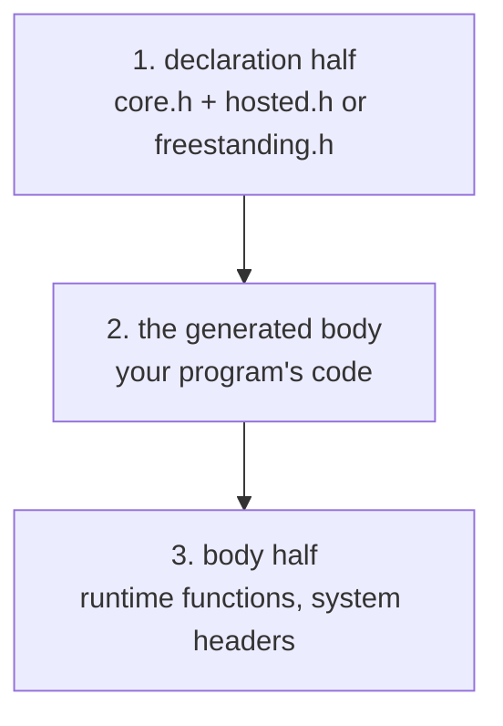

**The declaration half comes first and the body half last**: the generated C runs declaration half → generated body → body half (`run` in `ksplc/gen/c/root.kspl`). The body reaches the body half through the declaration half's `extern` declarations, so the body half can come last.

Caution: **Do not put the body half before the generated body.** It includes everything from `<fcntl.h>` to `<netinet/in.h>`, and the names those headers `#define` clobber names in the generated body. The user sees not a KSPL diagnostic but the C compiler's `expected member name` (Principle 5).

**Do not grow the escaping list (`is_preamble_macro` in `ksplc/base/c_name.kspl`) to cover them.** With the body half in front, hundreds of names clash on Linux alone (`st_mtime` / `O_RDONLY` / `AF_INET` / `SEEK_SET` …), and the set differs per platform. A hand-kept list cannot keep up; the order removes most of them. Two gates hold this: `tests/suite/emit_runtime_test.kspl` checks the order, and `ksplc/tests/c_keyword_names.kspl` checks the names themselves (`st_mtime` and so on).

**A small remainder comes from the declaration half's own includes, and trimming them cannot remove it.** `<stdint.h>` (needed by the `I8` to `U64` typedefs in `gen/runtime/core.h`), `<signal.h>`, `<time.h>`, `<math.h>` and `<stdio.h>` cannot move to the body half. "The names a declaration-only header `#define`s" gives the reason and how each name they define is covered.

#### The names a declaration-only header `#define`s

Some C headers define macros with ordinary-looking names, and a KSPL name that happens to match one would be silently rewritten by the C preprocessor. This section says how each such name is kept safe.

The generated C's declaration half includes `<stdio.h>` / `<math.h>` / `<signal.h>` and the like, which cannot move to the body half. `std/` calls libc directly from the generated body, and genc emits no `extern "C"` prototypes for it (`write_decls` in `gen/runtime.kspl`; a build with `-Werror=implicit-function-declaration` confirms it). **Their object-form macros collide with the same names written in KSPL** where those come out as plain C names: a local, a parameter, a struct field, an enum's payload, a trait's method, a closure's capture. (An object-form macro is a `#define NAME …` with no parameter list, so every later `NAME` is replaced.) The user gets a C compiler error far from the cause (`member reference base type 'int' is not a structure`) instead of a KSPL diagnostic.

**Each such name gets exactly one of three covers.**

| the cover | what it covers | where |
| :-- | :-- | :-- |
| erased with `#undef` | names neither the runtime nor the generated C reads (POSIX's `si_*` / `sa_*` / `sigev_*` / `L_tmpnam` / `math_errhandling`; the Windows CRT's `environ` / `popen` / `strcasecmp` / `sys_errlist`) | `write_decls` in `gen/runtime.kspl` |
| given a suffix by the escaping list | names that cannot be erased (`typedef bool Bool;` uses `bool`; the runtime uses `NULL` / `EOF` / `errno` / `stdin` / `stdout` / `stderr`) | `is_preamble_macro` in `base/c_name.kspl` |
| turned away by the naming check | names that are not snake_case (`SIGINT` / `L_ctermid`): written at a plain-name position, [I0502] always reports them | `sema`'s naming check |

**Try `#undef` first**: a suffix hides the original name from whoever reads the generated C. An `#undef` of an undefined macro is valid C, so the names of POSIX and Windows share one run and pass on either target.

**The same name expands differently per target.** glibc's `#define stdin stdin` expands to itself, so the plain name survives; the Windows CRT expands to a function call: `#define stderr (__acrt_iob_func(2))`. Checking only on the target where it passes misses the names that need escaping.

Caution: **Do not keep the list by hand**: which names collide changes with the libc version. `tests/suite/decl_macros_test.kspl` collects them from the target's headers and checks that every remaining name is under one of the three covers. An `#undef`'d name vanishes from `-dM -E`'s output, so what it collects is exactly the names left unerased. The check at every position is `ksplc/tests/c_keyword_names.kspl`.

#### How linkage is chosen: one artifact is one program, or one library

*Linkage* decides whether a C name can be seen from other files at link time (external) or only inside its own file (`static`). A program keeps its names visible to its own pieces; a library hides everything but what it exports.

**The runtime's body half and std's definitions go into every artifact** ("Embedding the runtime, and what a library keeps to itself"). They are embedded for two reasons:

* The bootstrap: `ksplc/seed.c` must build in one C compiler run ("The bootstrap, and keeping the seed in step").
* The targets: whatever builds the generated C builds the runtime with it, so ksplc carries no prebuilt runtime per target (`thumbv6m`, `wasm32` and the like).

**A program's symbols take the linkage their visibility gives**: `priv` is `static` and the rest external, so `--split`'s units reach each other (`has_file_local_c_symbol` in `gen/c/decl.kspl`). The runtime's `kspl_*` are external, since one program holds one runtime.

**A library's are all `static` but its `#export`s** (`--library`; what can be relied on is [`SPEC-tools.md` §2.10.1](SPEC-tools.md#2101-building-a-library---library)). Why a private copy, and why `static` rather than a hidden visibility or an export list, is "A library built from KSPL crosses as C, holding its own runtime" in [`../../docs/DESIGN-language.md`](../../docs/DESIGN-language.md). This section holds how the generated C and the runtime make it so.

| What | How it becomes `static` |
| :-- | :-- |
| genc's functions | `has_file_local_c_symbol` answers yes for everything but an `#export` |
| genc's variables, constants and embeds | `global_word` in `gen/c/ctx.kspl`; the forward declaration is a `static` tentative definition, written once the types are complete (C refuses an incomplete type there) |
| the runtime's functions and data | `KSPL_LINK` on each declaration and definition in `gen/runtime/`, which is `static` where the generated C defined `KSPL_LIBRARY` before the preamble (`run` in `gen/c/root.kspl`) |
| std's `extern "C"` declarations of them | `KSPL_LINK` too (`extern_word` in `gen/c/decl.kspl`): C refuses a `static` definition after an `extern` declaration |

Caution: **Put `KSPL_LINK` on every runtime definition with external linkage.** One left out stays visible. Two libraries then collide on it, or in shared libraries bind to each other's copy without a word. `tests/suite/ship_test.kspl` lists what a library's object leaves visible. The object holds every runtime function, used or not, so a gap shows without a list of names.

**A library runs none of a program's start-up**: it has no generated `main`. Under `KSPL_LIBRARY` the runtime also leaves out what would set up the process before or around it (`hosted.c`'s SIGPIPE constructor, the re-raise after a write that found no reader, and the crash handler). What each means for the program linking the library is in SPEC-tools.md §2.10.1.

**Size is not part of the price**: `-ffunction-sections` and `--gc-sections` drop the unused runtime, and the C compiler drops a `static` nobody calls, so bare-metal Flash does not grow.

**Functions the generated `main` calls directly as raw C belong in the declaration half** (the head of `hosted.h`). The body half comes after the generated body, so without a declaration the call is an implicit declaration.

#### The runtime written alone, and its version symbol

**The LLVM route needs the runtime as a separate C file: `ksplc emit-runtime` writes it as one translation unit** for `--to=llvm`, whose IR holds none ("The backends (Genc / Genllvm) and the runtime ABI"). It gives out source, not a prebuilt `.a` library. A prebuilt one would make ksplc carry every combination of targets, while the user's own tools build source.

**A runtime of another version must not link silently.** The IR only declares the `kspl_*` it calls, and a runtime whose bodies changed defines the same names. So `write_unit` in `gen/runtime.kspl` ends the runtime with an empty function named after a hash of the runtime's whole source (`append_abi_symbol`). The IR's `main` calls it first. A runtime of another version lacks the name, and the link stops on an undefined symbol.

Caution: **Keep the reference a call.** A `declare` alone, or one listed in `@llvm.used`, is dropped before the linker resolves it, and the mismatched link passes. Only code the program runs keeps its reference on every object format. `tests/suite/emit_runtime_test.kspl` links an IR file with a runtime whose symbol is renamed, and checks that the link fails.

### Genc (C99): the topological output order

**A value return omits C's outer `const`, including one hidden inside a fixed-array typedef.** Such a return spells the alias's unqualified target: C ignores the qualifier on a returned value, and GCC warns if it stays. Pointee qualifiers and qualifiers on stored values keep their meaning and stay in place.

C needs a name declared before it is used. Genc therefore writes everything in an order where each item comes after what it needs (a *topological* order), so the C compiler never meets an unknown name. The C compiler's forward-reference errors (undeclared identifier, incomplete type) are ruled out by construction: `emit_file_node` emits in a strict topological order.

1. **Forward declarations** (`emit_forward_declarations`) of structs, enums, compound types, aliases and externs.
2. **Bodies in dependency order** (`collect_pending_nodes` → `resolve_pending_queues`): struct, enum and trait bodies, and the compound-type structs (slice, array, Result), pass through a dependency queue (`dep_queue`) and come out topologically sorted. A true cycle falls back to forced output.
   * **A function type's typedef goes on the same queue** (`emit_single_complex_type`). C cannot name a function-pointer type without one, and a generic's field, a return type or an inferred local writes the type by name. A typedef has no forward form, so whatever names one, even through a pointer, waits for it (`fn_typedef_named_by` in `ksplc/gen/c/root.kspl`). The typedef itself waits only for other function types, since a declarator may name an incomplete struct.
3. **All function prototypes** (`emit_function_prototypes`), always before the variables and constants, so a generated vtable constant can name a thunk in its initializer.
4. **Global variables and vtable constants** (`emit_top_level_vars`), also in dependency order, not source order. A C static initializer may only name what is defined above it. So `const m: Sz = n * 3;` with `n` declared later fails with "initializer element is not a compile-time constant". Step 2's work-list scheme emits a variable once its initializer names nothing unemitted, and emits a cycle as it stands (sema's `check_static_initializer` reports it). Type annotations are not examined: sema has folded array lengths to numbers.
5. **Function and method bodies**, and the stmt_blocks (`emit_functions_and_impls`).
6. **`main`** (`emit_main_function`).

**The call chain** dispatches on `kind_id` in three tiers (`file` / `stmt` / `expr`) and returns to `Ast_node.emit` (`ksplc/gen/c/root.kspl`) between them: `emit_functions_and_impls` → `emit_fn_def` (`gen/c/decl.kspl`) → `emit_stmt` (`gen/c/stmt.kspl`, reached through `Ast_node.emit`'s default branch) → `emit_expr` (`gen/c/expr.kspl`). The emitters of declaration bodies (`emit_struct_decl` / `emit_enum_decl` / `emit_trait_decl` / `emit_impl_decl`) live in `gen/c/types.kspl`, not `gen/c/decl.kspl`. Type strings are formatted in `gen/c/ctx.kspl` (`t()` / `map_c_type_to`).

**A `#line` goes before every statement, not only where the line changes** (`emit_stmt` in `gen/c/stmt.kspl`). A `#line` directive tells the C compiler and the debugger which `.kspl` line the following C came from. C counts each line it reads past a directive as one more source line, and Lower expands one line into several statements: `x: = f()!` becomes a temporary, an `if` and a `throw`. Written only on a change, the `throw`'s `KSPL_RECORD_TRACE()` read two lines past the `!`, and a loop's `for` sat three lines past the loop after its init; so does the debugger's position. A loop's `for` gets one of its own after its init for the same reason. **The route a `!` records is genllvm's too**: it calls the same runtime functions with the line `sema.line_of` gives and the file `recorded_name_to` writes (`base/locate.kspl`), so the printed route agrees between the backends.

**The generated C is kept free of warnings.** Nobody reads it, so warnings left alone pile up until a new one goes unnoticed. `make test-c-warnings` (`tests/suite/c_warnings_test.kspl`) compiles the generated C of ksplc, of `make debug`'s executable and of `--freestanding` with `-Wall -Wextra -O2 -fsyntax-only` on every C compiler found. It fails on a single warning.

Caution: **Do not drop `--freestanding`, `-Wextra` or `-O2`.** Each catches cases that produce a wrong answer at run time:

| Flag | What only it catches |
| :-- | :-- |
| `--freestanding` | under hosted the system headers' declarations apply, so the `extern` declarations genc writes itself are seen only under freestanding. A mismatch between such a declaration and a call shows only there |
| `-Wextra` | `-Wsign-compare` is not in `-Wall`. C's usual arithmetic conversions go to unsigned, so a comparison involving a negative `Sz` inverts KSPL's meaning |
| `-O2` | `-Wstrict-aliasing` works only with optimization raised. Reinterpreting a type through a pointer garbles the value only in an optimized build |

Only `-Wmissing-field-initializers` is left out: the `{0}` / `{{0}}` genc writes is correct C (the standard zero-initializes the remaining members), and the complaint is one of style.

**Correct meaning is not enough**; Genc avoids two sources of warnings:

* **Parentheses** (`needs_warning_silencing_parens` in `ksplc/gen/c/expr.kspl`): C's precedence makes some optional, but compilers warn on pairs that "look confusing".
  * Caution: **Do not test on clang alone.** gcc also warns where clang stays quiet: an addition, subtraction or comparison as an operand of a bitwise operator.
* **Braces in a zero initializer** (`emit_zero_init` in `ksplc/gen/c/ctx.kspl`): C's `{0}` means "0 into the first element". When that element is an aggregate (a struct or an array), the braces must nest once per level. Too few gives `-Wmissing-braces`, too many `-Wbraced-scalar-init`. An array is not a plain C array but a `{ T data[N]; }` struct, so one array makes two levels.

**Aliases become C `typedef`s.** Their forward declarations (`emit_fwd_aliases`) come before the array and compound-type definitions (`Infer_fn[512]` and the like), or C reports an unknown type. Among themselves they go in dependency order, not source order. `typedef A = B;` with `B` declared later gives `unknown type name`, so the work-list scheme of `emit_top_level_vars` emits the referenced aliases first. Dependencies are compared by type id, since `emit_resolved_type` builds the name from the `type_id`, not the node's `text` (`type_mentions_waiting` sees through pointers, slices, arrays, Results, immutability marks and aliases). A function-pointer right-hand side (`fn(I32): I32`) puts the alias's name in the middle of the C declaration (`typedef void (*Name)(int32_t);`). So `emit_c_decl` detects a `type_fn_sig` and uses its own walk and format.

#### The output order of genc's type definitions is decided after the immutability marks are stripped

**When genc decides which type definition must be written first (by whether an element type is still in the pending set), it looks at the types with their immutability (read-only) marks stripped.** The element type of a `Row[2]` is `const_of(Row)`, not `Row`. Unstripped, it matches nothing pending and is taken to have no dependency. The wrapper struct then comes before the element's definition, and C fails with `array has incomplete element type`. There is no KSPL diagnostic, and the failure is asymmetric: a `Row[2]` that is not `const` (no `const_of` in between) is unaffected.

**An immutable slice's `ptr` is not `const` in the generated C.** genc writes `U8@` as `const U8 *`. But an immutable slice's C type is the alias `Const_U8_Slice = U8_Slice`, whose `ptr` is non-const. An `impl`'s target is always declared on the mutable side, and without one struct and ABI in C a method call through an immutable value would fail on a type mismatch. The asymmetry needs two rules:

* **Do not emit an implicit `::` cast to restore the immutability.** The representations are identical in C and in LLVM, so restoring the type is enough. A cast would give `.ptr = (const U8 *)buf`, a discarded-qualifier warning against the non-const target.
* **Where the value really is a `const T *` (from KSPL's `T@`), cast explicitly to non-const.** This is emitted only for the `.ptr` of an immutable slice's descriptor literal (`gen/c/expr.kspl`; the same convention as `emit_slice_cast_prefix` for array-to-slice).

#### A switch reaches the backends with a plain name for its subject

**The value a `switch` tests (its subject) must arrive at genc as a plain name, an identifier or a one-segment path (`is_plain_name` in `base/ast_ext.kspl`), because genc's `switch` and a case's payload binding write it more than once. Lower makes it one, and only Lower**: `lower_stmt_switch` binds any other subject to a `let` temporary. A subject that reaches genc as anything else is an ICE. Spelled as a name, it would silently emit broken C, such as `switch (.tag)`.

Caution: **A `switch` built after Lower's walk binds its subject itself**, since nothing lowers it. The chained release ARC synthesizes for an enum (`emit_managed_enum_op` in `lower/arc.kspl`) binds its `p$` with `build_let_decl` before switching on it.

#### How the generated code makes overflow wrap around

In KSPL an integer that grows past its type's range wraps around (for `U8`, 255 + 1 is 0). C does not promise this, so the generated C computes in a type where it does. The specification defines overflow as `mod 2^N`, signed or unsigned ("6.8 Integer arithmetic: folding, overflow, division, shifts" in [`../../docs/SPEC-language.md`](../../docs/SPEC-language.md)). C gives neither directly, so **the generated code names the wrapping type explicitly**, for a different reason per signedness.

| KSPL type | What C does by itself | What the generated C does |
| :-- | :-- | :-- |
| narrower than 32 bits (`U8` / `U16` / `I8` / `I16`) | promotes to the signed `int`: the excess bits stay, and `U16::65535 * U16::65535` overflows `int`, which is *undefined behaviour* | computes in `unsigned` and converts the result back to the type |
| signed `I32` / `I64` / `Sz` | overflow is undefined behaviour: the optimizer may assume it never happens | computes in the unsigned type of the same width |
| `U32` and wider unsigned | wraps at its own width | nothing extra |

**C computes the types narrower than 32 bits after promotion to the signed `int`.** The excess stays, so a following `/`, `%`, `>>` or magnitude comparison sees the value before the wrap; the result is converted back to the type. A 16-bit product can pass `int`'s range (65535 × 65535), so the operands are converted to `unsigned` first, where the excess wraps instead of being undefined. `unsigned` is at least 32 bits on every target ksplc knows, so the excess never reaches its own wrap.

Caution: **For the signed types, C makes overflow undefined.** The optimizer relies on that, so emitted plainly, the answer changes with the optimization level. Once it assumes `i *= 2` never overflows, `i > 0` becomes always true and the loop never ends. So the operands are converted to the unsigned type of the same width and computed there.

* The conversion back (unsigned → outside the signed range) is implementation-defined in C99, not undefined. clang, gcc and MSVC all define it as a two's-complement wrap, out of the optimizer's reach.
* **Use the unsigned type of the same width.** All in `U64` would be 64-bit arithmetic on a 32-bit target, and `Sz`, whose width varies with the target, maps to C's `size_t`. Division and remainder cannot be moved, since an unsigned division gives a different answer. Their only overflow is the type's minimum divided by `-1`, answered by the dividend itself (remainder `0`). Branching on it reads the divisor twice, so they go to a run-time entry point taking both operands (`kspl_sdiv` / `kspl_smod`). That entry point checks for 0 as well, so the divisor-only entry point (`kspl_div_check`) serves only the unsigned types.

* Note: **The fast path remains.** A divisor that is a translation-time constant other than `0` and `-1` cannot overflow, so a plain `/` or `%` is emitted (the verdict is `divisor_cannot_overflow` in `sema/body/binary.kspl`). So `/ 2` does not become a call.
* **The check's width is `int64_t` / `i64`**, the same in both backends. As `ptrdiff_t`, a `U64` or `I64` divisor is truncated on a 32-bit target, and a non-zero value can look like `0` (or the reverse).

**A plain assignment does not show it**: `d: U8 = u8x + u8y;` adds, then narrows. Reading after the wrap shows it: `(u8x + u8y) / 2U8` gives 150 instead of 22, `(a + b) == U8::0` is false where it should be true, and `I32::(a + b)` gives 256 instead of 0.

The verdict is two functions in `gen/c/expr.kspl`, used by both `emit_binary_expr` and `emit_unary_expr`: `can_exceed_width` (only `+` `-` `*` `<<`) and `wrap_twin` (the type the operands move to). `narrow_unsigned` serves `~` alone, whose result needs only the conversion back.

* **A compound assignment counts too.** `i += 1`, `-=`, `*=` and `<<=` are emitted as `i = (I32)((U32)(i) + (U32)(1))` (`emit_wrapped_compound` in `gen/c/stmt.kspl`). Left as C's `+=`, a signed overflow is undefined, and at `-O2` a loop on `i > 0` with `i *= 2` never ends; a `U16`'s `*=` overflows `int`. `make test-property` runs both forms at `-O0` and `-O2`.
* **The unary operators count too.** For the unsigned types both `~` and unary minus exceed the width; for the signed types only unary minus does (negating the type's minimum). `!` yields a `Bool` and is out. Wrapping only the binary ones leaves `(~u8x) / 2U8` wrong.
* **Parenthesize a converted operand.** C's cast binds only to the next unary expression, so `(U32)x * y` is `((U32)x) * y`. Where the operand is a binary expression, the type it computes in changes.
* With `&` `|` `^` `/` `%` `>>`, operands that fit the width give a result that fits. C computes the unsigned types of `U32` and wider at their own width, so they need no conversion back.
* **genllvm is right from the start**: `add i8` and `add i32` both wrap at their width. Left unfixed, genc would make the answer depend on the backend. The folding (`fit_result`) produces `mod 2^N` too.
* Caution: **Self-hosting cannot notice it.** ksplc itself hardly ever reads after a wrap, and for the narrow unsigned types its output barely changes; on the signed side the answer changes only at higher optimization.
* Two regression assets cover it. `ksplc/tests/const_fold_width_test.kspl` checks fixed shapes: a global `const` through the folding, and a local through the generated code. `tests/suite/property_test.kspl` checks random expressions over the eight integer types. **Do not rely on the shape that only assigns back into the same width**: it passes even when the conversion back is forgotten.
* **A check at `-O0` does not catch a signed wrap.** Plain C wraps too at `-O0`, so both value-checking assets pass. Property 3 in `tests/suite/property_test.kspl` checks that `-O0` and `-O2` give the same answer, because the failure is not a wrong value but a loop that never ends. `make test-equiv` also builds its program's C with C's signed-overflow trap (`trap_cflags` in `tests/suite/equiv_test.kspl`), which stops on an overflow the answer hides.

#### A reference to a constant in a top-level initializer is written as its value

**When a global constant is built from another constant, genc writes the other constant's value, not its name, in top-level `const` initializers alone, because strict C compilers refuse the name there.** C99 requires a constant expression in a file-scope initializer, and the name of an object is not one, `const` or not. gcc and clang fold such a name as an extension; other C compilers refuse it with "initializer element is not constant". So `const B = f(A);` would build on some toolchains only.

This is `emit_const_ref_inline` in `ksplc/gen/c/expr.kspl`. `const_init_expr` in `sema/decl/eval.kspl` resolves the constant, as for folding, and that path's record cuts a cycle.

**The value is folded, not expanded as an expression.** An expansion carries the whole initializer of the constant it names. So a chain `const A1 = A0 + 1;` n deep would nest n deep and hit C's limit on parenthesis depth (256 in clang). The language guarantees chains to the depth in `tests/suite/limits_test.kspl`. Only what cannot be folded (a string, `::{}`) is emitted as an expression.

**A referenced constant that carries a `sizeof` is folded with ksplc's layout model**, laid out for the machine named, and the folded size is checked by the C compiler ("A layout is computed when it is first asked for"). A `sizeof` written in the initializer itself stays C's `sizeof`: only references to constants are replaced.

### Genllvm (LLVM IR): why the structure itself differs, and managing SSA

**Genllvm is shorter than Genc because LLVM IR lets a name be used before it is defined, so no ordering work is needed (below). It also emits no debug information** (no `DIFile` / `DISubprogram` / `DILocation`, no `!dbg`), so a program built through it cannot be stepped through by `.kspl` line. Debugging by `.kspl` line is the C backend's alone, since Genc always writes `#line`s into the generated C ("Genc (C99): the topological output order"). An LLVM build's DWARF (the standard debug-information format) names no `.kspl`. Stepping through a `--to=llvm` build (`make LLVM=1 debug`'s binary among them) shows no source line: an unimplemented feature, not a fault. GNU ld says nothing about it, and only macOS's `ld64` warns (`warning: no debug symbols in executable`). For the same reason `tests/suite/debug_line_test.kspl` checks the C side only.

`gen_llvm_module.run` differs from Genc in structure, not only in its number of stages. LLVM IR allows forward references to `%struct` types and `@function` symbols, so **there is no forward-declaration phase and no dependency-order work list**. Its stages run in this order:

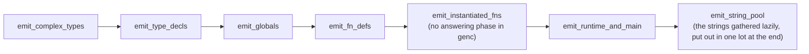

The call chain mirrors Genc's: `emit_llvm_fn_def` (`ksplc/gen/llvm/decl.kspl`) → `block.emit_llvm_stmt` (`ksplc/gen/llvm/stmt.kspl`) → `node.emit_llvm_expr` / `emit_llvm_lvalue` (`ksplc/gen/llvm/expr.kspl`). SSA registers and alloca hoisting sit on top. In *SSA* form every value gets a fresh numbered register (`%1`, `%2`, …) that is assigned once; an *alloca* reserves a stack slot for a local variable.

* `next_reg()` / `next_label()` in `ksplc/gen/llvm/ctx.kspl` are plain increasing counters, reset per function (`reset_fn_state()`).
* There is no `op_alloca`: `emit_alloca` writes the whole `<slot> = alloca <type>` line. `op_load` / `op_store` / `op_gep` and the like are thin builder wrappers (extension methods on the context) that keep the direct translation from the AST safe and clean.
* **Allocas are hoisted with two buffers**, `Emit_state{alloca_out, body_out, target}`. `emit_alloca` switches `target` to `alloca_out` and straight back. Once the body is done, `emit_llvm_fn_def` joins `alloca_out` before `body_out`. That gives the textbook frontend's shape, with every alloca at the head of the entry block, by ordering string buffers rather than basic blocks.

**How the expression files split the work**: `emit_llvm_expr` in `gen/llvm/expr.kspl` dispatches. It passes the aggregate values (`enum_init`, `enum_init_call`, `expr_upcast`, `struct_literal`, `result_wrap`) to `gen/llvm/expr_agg.kspl`. A call goes one level deeper. `emit_llvm_postfix`, reached from `.k_expr_postfix`, sees the `(` and passes the call to `emit_llvm_call` in `gen/llvm/expr_call.kspl`. That function also covers the built-in functions and dynamic dispatch through a trait or vtable, and calls back into `gen/llvm/expr.kspl` for its own arguments and receiver. So the three files are mutually recursive, not layered.

#### Both a store and an actual argument are emitted at 'the receiver's type'

When genllvm writes a value into a field or passes it to a function, it first converts the value to the type the field or parameter expects. Without this, a 4-byte number can land in an 8-byte slot and leave 4 bytes of garbage.

**Stores**: a compound literal's field initialization stores at the field's type. KSPL's integer literals default to `I32`. Stored at the value's type, `store i32 2` would go into an `i64` field: it writes 4 of the 8 bytes, and the rest relies on the `store zeroinitializer` just before it. The C backend has no such hole, since C converts on assignment.

**Arguments**: the same rule applies. Emitted at the argument expression's type, an `i32` is passed to an `Sz` parameter. Worse than the store, the destination is not zero-filled.

```llvm
define void @..._load_raw(ptr %sret, ptr %src, i64 %in_dim, i64 %out_dim, i64 %rank, ptr %arena)
call   void @..._load_raw(ptr %tmp,  ptr %flash,  i32 4,      i32 6,       i32 2,     ptr %sa)
```

**Why the verifier accepts it**: with opaque pointers, `@f` is a plain `ptr`, and a call takes its signature from the call instruction's own text, not from the definition.

**Why it differs between platforms**: an argument in a register comes out right by luck, through a 32-bit operation's zero extension. An argument on the stack breaks: `movl` writes 4 bytes, and the upper 4 keep their old value.

| Platform ABI | Integer argument registers | The call above |
| :-- | :-- | :-- |
| Win64 | 4 | the fifth argument (of six, the `sret` included) goes on the stack, so it breaks |
| SysV (Linux / macOS) | 6 | no stack argument, so it works by luck |

The IR is identical on all three platforms, yet only Windows breaks. Identical IR says nothing about correct IR, since the ABI alone decides whether a self-contradiction shows.

**Why the literal stays `I32`**: on a generic call, sema leaves the arguments' expected types unknown ("A generic call's arguments are checked against the parameter types after instantiation" in [`DESIGN-diagnostics.md`](DESIGN-diagnostics.md)). So the literal takes the default `I32`, and the mismatch gathers at calls of monomorphized generic functions.

**The countermeasure**: look up the callee's parameter type, and convert a numeric scalar to it before passing. Aggregates are passed by pointer, so width matters only for numbers. Taking the parameter's type for an aggregate instead gives a "same structure under another name" mismatch, which LLVM rejects.

**The gate checks the IR**: Linux and macOS run-time tests cannot see this mismatch (no argument goes on the stack), and LLVM's verifier ignores it. `tests/tools/llvm_ir_abi_check.kspl` compares every direct call's argument types with its `define`'s parameter types (and the `ret`'s type too). It runs over both `ksplc/main.kspl` and `tests/debug/main.kspl` (for the reason in "Self-hosting does not test a feature ksplc itself does not use").

**A diagnostic prints a value that identifies the caller**, such as `arena_used`, not only the broken value.

#### Correctness is not entrusted to zero filling

genllvm does not rely on "the memory is already zeroed" to make a value right. A `store zeroinitializer` at the head of a compound literal tells the backend "the upper bytes are already 0", which makes it legal to narrow a following store. Even with every value emitted correctly, correctness then rests on the zero fill surviving.

**So where a compound literal fills every byte of its memory, the leading zero fill is left out.** That holds only for a fixed-length array whose element type has no internal padding, filled element by element with no index given. Do not include structs: even with every field written, the padding between fields stays uninitialized, and a `memcmp` or a raw-byte persistence reads an indeterminate value.

#### Runtime checks share their failure reports

Bounds, division, shift and enum-tag checks keep their comparisons in C's inline helpers and LLVM's IR so each optimizer can remove checks it proves unnecessary. On hosted targets, a failed check calls the C runtime's corresponding `kspl_*_fail` function. That function owns the message and uses one reporter to flush stdout, write and flush stderr, then abort. The backend passes the original operands and source position; unsigned shift amounts retain their unsigned spelling. Freestanding checks retain their target's failure policy.

#### Passing an aggregate is an explicit internal ABI

genllvm passes every struct-like value through a pointer, on every platform, instead of letting LLVM choose registers. LLVM IR can put a multi-field first-class aggregate straight into a `ret` or an argument. **But no ABI lays down which registers or memory it is assigned to.** clang does not use this shape for a C function: it classifies per target by the C ABI and lowers explicitly before emitting IR. Written this way on Win64, a 24-byte `Arena` rides in three registers. Yet the Win64 ABI passes any aggregate over 16 bytes through a hidden pointer and has no three-register return.

So genllvm passes every aggregate (a slice, an array, a Result, an enum with a payload, a struct, a trait value) as a bare `ptr`, as a return value and as an argument. One place decides it: `ret_needs_sret` / `is_llvm_aggregate`.

**The `sret(%T)` / `byval(%T)` attributes are not used.** An attribute returns to the backend the choice of how the aggregate is passed (and `byval` is realized differently per target), which is what this avoids. So it is lowered to a plain pointer on every target. What `byval` guarantees, that the callee sees its own copy, a dedicated temporary slot per call provides.

* The caller allocates the destination among the allocas at the function's head. Placed in a loop's body, it would grow the stack on every iteration.
* Every `ret` goes through `Genllvm_ctx.emit_ret_value`. A path that writes a `ret` directly mixes a value-returning `ret` into an sret function and breaks the IR.
* `is_llvm_aggregate`'s branches must match the type-string output one to one. Kept as two tables, the ABI would drift silently ("the type is i64, yet it is treated as an aggregate").

**It stops at the C boundary.** An internal ABI can be set alone only where both ends are one's own. With `#export` the C compiler at the other end classifies, and genllvm cannot match it. So the LLVM backend cannot pass a struct across the C boundary by value, not even a plain POD one (docs/DESIGN-language.md "The FFI boundary check looks inside the type"). (POD, "plain old data", is a struct of plain fields only.)

**Do not give one option two meanings**: the thunks, vtable constants and ARC drop glue that `lower` synthesizes already carry their final names.

Caution: Do not borrow `is_export` to prevent a double prefix. `is_export` also means "pass by the C ABI", so under the internal ABI the thunks alone would use the C ABI and caller and callee would disagree. The symptom is far from the cause: "`io.out().s(...)` prints nothing". The meanings are split into `is_premangled` (emit the name as it is) and `is_export` / `is_ext` (pass by the C ABI). **An option set as a redundant safeguard breaks silently the day its meanings multiply.**

#### A huge aggregate is not handled as a first-class value

A large array is never loaded as one value in LLVM IR, because LLVM then expands it element by element and can crash. LLVM IR can treat a struct or an array of any size as a first-class value. **But at `-O0`, SelectionDAG (LLVM's instruction selector) expands it into as many instructions as there are elements.**

Suppose a compound literal is always built in a temporary and then loaded as a value. A single `Sz$[4096] = ::{}` then takes about three times the stack frame of carrying it by pointer, and the generated assembly grows in proportion. With more elements, clang itself crashes with SIGSEGV (`Sz$[65536] = ::{}`), with no KSPL diagnostic.

There are two countermeasures:

1. Build directly into the declared memory, with no temporary and no load.
2. Zero-fill a large aggregate with `llvm.memset` from 256B up. Freestanding cannot resolve memset, so there it is still expanded.

**Being legal IR and being handled by the backend at a practical scale are different things.** Past the limit, the failure takes the least legible form there is: a compiler crash.

#### genllvm rebuilds a global initializer as an LLVM constant

**A global's starting value must be a constant that LLVM understands, so genllvm rebuilds it as an LLVM constant expression itself.** genc can pass `T x = <expression>;` to C as it is, since C's static initializer takes a constant expression.

**A failure to lower it becomes 0 with no warning.** A mutable global loses its initializer, and even under `const` a string literal becomes an empty slice. The C backend runs it correctly, so switching backends changes what the same source does.

Caution: If the FQN constants in `sema/type/arc.kspl` are hit, every ARC-related verdict silently compares unequal.

There are three requirements:

1. Handle an initializer the same way for `const` and `$var`.
2. Put a string literal in the string pool, emitted as `{ ptr, len }` for a slice type and as an address for a pointer type.
3. Reorder a compound literal into declaration order (LLVM requires every element, in order).

**A shape that cannot be lowered is an ICE.**

**A float is folded by genllvm itself** (`fold_float` in `gen/llvm/decl.kspl`), since sema folds integers only and LLVM has no float constant expressions to hand it to. It takes what C's static initializer takes: a literal, a constant's name, `-`, `+ - * /` and a cast from a number, an `F32` rounded at each step, and a float cast to an integer truncated toward zero. Without it, `const h: F64 = pi * 2.0` and `I32::2.9` built on C and were refused on LLVM.

**A value holding a tagged union is written as packed bytes** (`emit_llvm_laid_const` in `gen/llvm/decl.kspl`). A tagged union's LLVM type is an `i32` tag and raw words ("The runtime memory layout and the ABI specification"), which no constant can fill field by field. Each variant needs bytes of its own, so an array of them cannot be an LLVM array either. Such a global gets a packed struct type of its own. Every piece sits at ksplc's layout offset (`field_offset_of`, `enum_payload_offset`, `payload_field_offset`), with `i8` padding between and the type's alignment on the global. The code reads it at the same offsets: a field through a named type's GEP (LLVM's "address of a field" instruction), a payload field by its byte offset (`payload_field_ptr` in `gen/llvm/types.kspl`).

Caution: Do not let an initializer that cannot be evaluated silently fall back to `zeroinitializer`. **A backend that generates nothing is safer than one that changes the meaning of what it generates.**

**A test holds the backends equivalent**: `tests/prog/equiv.kspl` builds one program with both C and LLVM and compares the standard output. Only this catches a bug where one backend alone breaks.

### A function pointer breaks in a different place in each backend

**A function pointer is a kind of its own inside the compiler, outside the composite classification (`.pointer` / `.slice` / `.array` / `.result`) (`is_fn_ptr` in `sema/type/query.kspl`), so every branch on "is it a pointer" lets it slip past**, and it chokes in a different place in each backend, so each handles it separately.

**genc: the `const` cannot go before the type name.** `const I32 (*p)(I32)` is a pointer to a function returning a const I32, not an immutable binding, and assigning a function's address to it fails in C with a type mismatch. The `const` belongs inside the declarator (`I32 (* const p)(I32)`). (A C *declarator* is the part of a declaration around the name, such as `(* const p)(I32)`.)

Caution: **Decide the position on the same grounds as the code that emits the declarator decides its shape.** Whether `emit_c_decl` emits a function-pointer declarator (`is_type_fn_ptr`) depends on the type node written in the declaration, which can disagree with the resolved type ID. A declaration written with `typedef Op = fn(a: I32): I32` is a function pointer by type ID, but C gets the typedef name, so the `const` goes before it. Judged by type ID, the `const` is routed into a declarator that does not exist and silently vanishes. C compiles, the program behaves the same, and nobody notices it has left `.rodata` (the read-only data section). The verdict is `const_goes_before_type` / `const_goes_in_declarator` in `gen/c/decl.kspl`. Both places emitting a declaration share it: the forward declaration (`gen/c/decl.kspl`) and the body (`gen/c/stmt.kspl`).

A raw pointer leaves out the leading `const` for another reason: its type name already emits `const T*`, so another would qualify it twice (`emits_c_const` / `type_name_carries_const` in `gen/c/ctx.kspl`).

**genllvm: a function's address does not go through integer constant folding.** Rebuilding a global initializer as a static constant (`emit_llvm_const_init`) defaults to that folding, which rejects a function name as "not a constant expression". Build the name by the path a run-time reference takes (`emit_llvm_lvalue`). Adding the `@` yourself lets a doubled `kspl_` or an `#export` name slip through. It then breaks by pointing at a different symbol, not as a link error (the verdict is `is_kspl_prefixed_or_ext` in `gen/llvm/ctx.kspl`).

The regression test is `tests/prog/equiv.kspl`. It stores a `const`, a mutable and a `null` in globals and reassigns the mutable one before the call, so folding to its initial value would show. **For the `const` it covers both a signature through an alias and one written directly.** C's position for the `const` differs between them, so with only one the mismatch above passes.

### An attribute is either interpreted in both backends, or refused outright in one

**An attribute such as `#inline` must work under both backends, or be an error under the one that cannot do it; it is never quietly ignored, so never let only one backend read `has_attribute`.** If genc alone reads them, `#inline` / `#noreturn` / `#naked` / `#section(...)` and `#align(N)` on a function are silently dropped under `--to=llvm`. `#inline` sits on `List.push/get/set/at` in `std/ds.kspl` and on `Str_builder.s/c` in `std/str.kspl`, so losing it costs performance. Whoever wrote the attribute believes it takes effect, so this is Principle 5 itself, and there are only two ways:

1. **Implement it in both backends.** A function attribute nearly always maps to one LLVM IR word: `#inline`→`inlinehint`, `#noreturn`→`noreturn`, `#naked`→`naked`, `#section("s")`→`section "s"`. `emit_llvm_fn_attributes` in `gen/llvm/decl.kspl` emits them in the attribute position of `define ... ) <attributes> {`; a global variable's `section` adds `, section "s"` after the initializer.
   * Follow LangRef's order (LLVM's language reference: fn attrs → section → align). Reversed, `llvm-as` reports a syntax error.
   * Do not map `#inline` to `alwaysinline`: that forces inlining even at `-O0`, so debugging behaves differently from genc's output even though the meaning is the same.
2. **Declare it single-backend and make it a compile error**, only where there is no portable counterpart. `#interrupt` is a per-machine calling convention with no LLVM IR form. An `#align(N)` placed directly on a function or a variable reaches C as an expression genc copies, so no constant exists to pass to LLVM, which demands a number. On a struct, sema folds it into `Struct_def.align_attr`, and it works on both backends. `attr_rule` in `sema/decl/attrs.kspl` marks these two C-only, which makes them an error under `--to=llvm`.

**"Silently ignored on LLVM" is not a choice**: every new attribute takes one of the two ways. `#cfg` and `#link` are read before either backend, so the backends cannot differ on them. Normalization drops the declaration, and the libraries a kept `extern` block names are written from the tree (`write_libs_file` in `tools/libs.kspl`). The canonical source for the decision is the "Backends supported" column of the attribute table in `docs/SPEC-language.md`. The regression tests are the cases `attr_interrupt_llvm_backend` and `attr_fn_align_llvm_backend` in `tests/negative/attr.kspl` (both with `// ARGS: --to=llvm`).

**The LLVM backend's missing debug information ("Genllvm (LLVM IR): why the structure itself differs, and managing SSA") is a gap of the same kind.** It stays open because `-g` is a build flag, not an attribute: there is nothing to refuse.

**`#section("name")` passes the string through unchanged** to `KSPL_SECTION("name")` (`__attribute__((section("name")))`). No leading dot is added, only the segment. Mach-O (macOS's object format) accepts only `segment,section` and does not even compile an ELF-style name. So `KSPL_SECTION` in `gen/runtime/core.h` prefixes `__DATA,` under `__APPLE__` alone. Matching the name against a linker script stays an ELF matter. A custom section the linker script names `.name` (the GNU/ELF convention for one answering to `.bss` / `.data`) must be written `#section(".name")`, dot included. Otherwise the linker places it by its default heuristics as an orphan (an input section no output rule matches). `(NOLOAD)` and the like then stop applying (keeping it out of the start-up zeroing, say). The build and the link still succeed, so nothing shows until real harm does.

### A sanitizer reaches LLVM IR through the marks ksplc writes

**clang's `-fsanitize=address`, `thread` and `memory` instrument only a function marked for them** (`sanitize_address`, `sanitize_thread`, `sanitize_memory`), and the mark is written by clang's own front end as it reads C. The C backend's output passes through that front end; `--to=llvm`'s IR passes through none. So without a mark, a sanitized build of the IR watches only the runtime's C, and a read past an allocation in the program's own code runs unseen. `--sanitize=<names>` is ksplc doing the front end's share: `emit_sanitize_attrs` in `gen/llvm/ctx.kspl` writes the marks on **every** `define`, the hand-written ones too (`emit_by_hand` in `gen/llvm/module.kspl` for the run-time checks, and `main`). A naked function is marked as well, as clang marks a C one; the sanitizer itself passes over a body that is assembly alone.

**Asked for, not written always.** A mark is not free where no sanitizer runs: LLVM then declines to read memory earlier or wider than the program does, since that read could fault or race under the sanitizer. Marking every build would slow every program to serve the sanitized ones.

**One way to ask, on the subcommand that needs it** (Principles 5 and 6):

* A compile that writes C has nothing to mark: its C compiler marks the C it reads. `--sanitize` there would change nothing, so it is refused, naming `-fsanitize=` for the C compiler instead.
* `ksplc build` runs the C compiler itself, so `--sanitize` hands it `-fsanitize=<names>`. The same word in `--cflags` would be a second way to ask, and is refused (`check_sanitize` in `main.kspl`). The packages' fuzz builds ask this way.
* `ksplc run` does not take it: it caches one program a script, which a sanitized build would have to be kept apart from, and `ksplc build` already makes one.

**A compile with `--to=llvm` cannot check that the C compiler is told the same.** The link is the user's, as with `--machine`: the marks alone change nothing, and `-fsanitize=` alone watches only the runtime. The specification says to name both.

**`undefined` is refused for IR.** The undefined-behaviour sanitizer has no mark: clang's front end writes each of its checks into the code, knowing C's types, which IR has lost. KSPL keeps its own checks for what it defines as a stop (an index, a shift, a divisor, a cast to an enum), in both backends, and defines integer overflow as wrapping, so there is no signed overflow to watch. What stays unwatched through LLVM is what `docs/SPEC-language.md` leaves undefined beyond those: a misaligned access through a pointer cast, and a floating-point value cast to an integer it does not fit. A C build with `undefined` watches them. Writing such checks into the IR would be a second implementation of clang's, kept apart from it; it is not done.

**Bare metal and other machines.** `--freestanding` is refused: a sanitizer's runtime maps its shadow memory and writes its reports through the OS. Which hosted machine has which sanitizer is not copied into ksplc: clang refuses `-fsanitize=thread` for Windows and `-fsanitize=memory` for macOS, naming the target, and a copy would drift from the C compiler that decides.

**The regression tests**: `tests/suite/sanitize_test.kspl` reads past a heap allocation through a raw pointer, which no bounds check sees. Built through LLVM with the marks, the address sanitizer must report it; built without them, nothing may. ksplc's own tests are built through LLVM with the marks and must report nothing. `ksplc/tests/support/cli_sanitize.kspl` checks that every `define` is marked and each refusal.

### Split compilation: emitting one program as several translation units (`--split`)

`--split=N` cuts the generated C into several `.c` files so that the C compiler can work on them in parallel. With `--split=N` (N > 1), Genc walks the same `root_file` N+1 times and writes one shared header plus N unit `.c` files (`pipeline.Compiler.emit_c_units`). **Only code generation and C compilation are split**; Parse, Sema and Lower are untouched.

The diagram shows what `--split=3` writes and how the files meet.

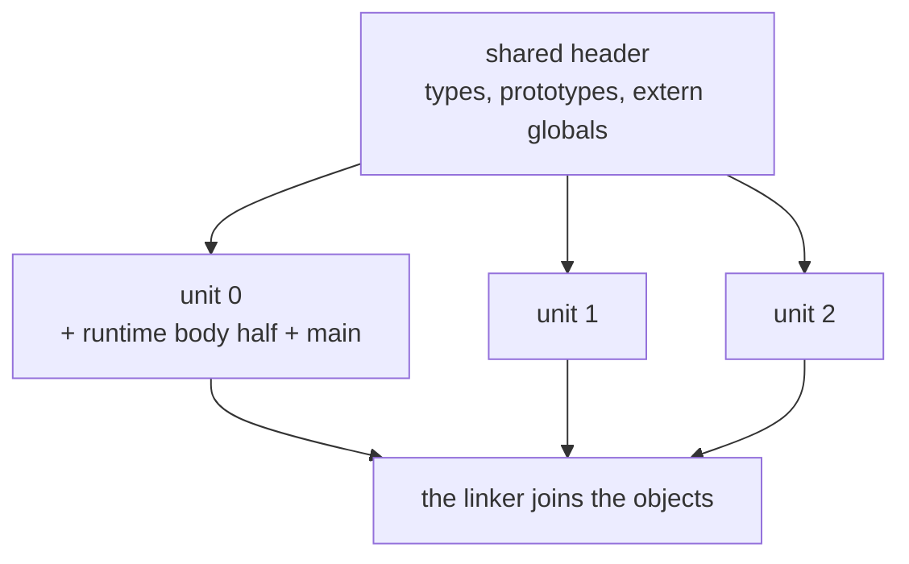

| Walk | `gen_c_ctx.Emit_part` | Output |
| :-- | :-- | :-- |
| 1st | `shared_decls` | system headers, the runtime's declaration half, forward declarations, type bodies, non-`static` prototypes, `extern` declarations of globals |
| 2nd onward | `unit` (by `unit_index`) | `#include` of the shared header, then its own share's `static` prototypes, global bodies and function bodies |

`--split=1` (the default) is `whole`: declarations and bodies in one file.

**A definition's unit is decided by its file path's hash alone** (`gen_c_ctx.unit_for`). Balancing by size, or dealing out in order of appearance, would let an unrelated edit move definitions between units and invalidate every cached object. A monomorphized body carries the template's file in `loc.file` (`propagate_loc_file` in `sema/decl/mono.kspl`). So it goes to the unit of the file that defines the generic, not of the one that instantiates it.

**`priv` does not decide what becomes `static`.** A `priv` is not always referenced from its own file alone. ARC's `retain` / `release` are `priv fn`s in `std/refcount`, but Lower synthesizes their calls (`synth_arc_stmt` in `lower/arc.kspl`) in the user's file. Only a name unique within its own file may be made `static` (`Sema_symbol.has_program_unique_c_name` in `sema/type/scope.kspl`, `Ast_node.has_file_local_c_symbol` in `gen/c/decl.kspl`). A method (unique program-wide by its type's FQN) and a generic instance (unique by its type arguments) never are.

Caution: **Keep this answer the same as whether the mangling adds a file prefix (`is_private_symbol` in `lower/abi.kspl`).** If one changes alone, a name without the prefix becomes `static`, and the link breaks only when the split count changes (the grounds are "Visibility and linkage are separate axes" in [`../../docs/DESIGN-language.md`](../../docs/DESIGN-language.md)).

**Emit the prototype and the body to the same unit** (`proto_belongs_here` in `gen/c/decl.kspl`). An impl's methods are placed by the impl's `loc`, not their own, and a mismatch leaves a unit holding a `static` declaration with no definition.

**Unit 0 alone** takes the runtime's body half ("Embedding the runtime, and what a library keeps to itself") and the `main` wrapper (`Genc_ctx.owns_singleton`).

**Splitting pays only when the units compile in parallel.** Every unit rereads the shared header (the type definitions and every prototype), so splitting increases the total C clang reads. The gain is running the N units at once, so set the split count near the core count: units beyond it carry the fixed cost with nothing gained.

Caution: **Do not write a figure here.** It depends on the core count, `CFLAGS` and the size of the generated C, so any number rots. To measure, time C compilation plus link, serially and in parallel, with and without `--split`, and keep the result with its conditions.

**For small generated C, splitting by the core count is a loss, and that is accepted (a decision).** A script whose `import` closure is a dozen files puts nearly everything into unit 0 (which also takes the definitions of unknown origin and the runtime's body half). It pays the fixed cost N times with nothing to run in parallel. The only symptom is slowness, so no gate fails. `ksplc run` chooses `--split=N` before generation (`pick_unit_count` in `ksplc/tools/run.kspl`), so it does not know the size. The loss on a small program is small and the gain on a large one orders of magnitude larger, so one rule serves both (Principle 6).

**The self-host build does not split.** `$(STAGE1_OUT)` / `$(STAGE2_OUT)` in the `Makefile` are single files. The self-host check compares the generated C file by file, byte for byte, and N+1 files would change the comparison.

**Only the C backend splits.** genllvm has no forward-declaration phase ("Genllvm (LLVM IR): why the structure itself differs, and managing SSA") and writes the string pool in one piece at the end, so its output cannot be split into translation units.

### Self-hosting does not test a feature ksplc itself does not use

**Self-hosting (the compiler compiling itself to a byte-identical result) is a strong check, but it proves only the features ksplc's own source uses: a feature it never uses can be broken while that check stays green.**

Caution: A defect in such a feature stays hidden while self-hosting stays green, and `make LLVM=1 debug` (the run-time tests through LLVM) fails on it at once. **After adding a backend, do not stop at "it can compile itself": run the whole run-time suite on that backend too.**

LLVM IR has no const. The immutability qualifier does not affect layout, so genllvm's type mapping applies `strip_const` before judging. A path that bypasses it produces IR naming a type that is never declared, and clang fails with no KSPL diagnostic. genc handles type names as strings and does not fall into the same hole. **Each backend breaks differently, so one passing proves nothing.**

## The rules for handling an AST, shared by every layer

The AST (the tree the compiler works on) is handled by five rules that hold in every stage. Besides the per-layer rules of the chapters "The Parse layer: from text to an AST (Desugar included)" to 6, these hold **in every layer**:

| Rule | What it forbids | What goes wrong without it |
| :-- | :-- | :-- |
| 1. Safe accessors only | reaching a child by a number, `node.get_child(1)` | a grammar change crashes the compiler or makes wrong code |
| 2. One node, one place | putting one node in two places in the tree ("The invariants of the normalized AST (so nothing crashes and no output differs)") | Sema keys types on a node's address, so the types collide and it crashes |
| 3. Positions (`loc`) propagate intact | losing where a node came from ("The invariants of the normalized AST (so nothing crashes and no output differs)") | a compile error cannot report the exact position |
| 4. A kind is an `Ast_kind`, not a string | naming a node's kind by a string such as `"stmt_bock"` | a typo makes a node no check ever matches |
| 5. A local the compiler adds is named by `made_name` | spelling such a name in the identifiers' own space (`_e`, `_for_coll1`) | the source's `_e` reads the error a `catch` declares, and a local `_for_coll1` refuses the next `for … in` |

Rules 2 and 3 are explained in "The invariants of the normalized AST (so nothing crashes and no output differs)". Rules 1, 4 and 5 in detail:

* Rule 1. **Safe accessors only.** The AST is one general-purpose node, `Ast_node`, but no layer reaches a child by a magic index such as `node.get_child(1)`. When the KSPEG grammar changes a node's element count or order, such code crashes the compiler in a chain (SEGV) or silently generates wrong code. Normalization ("The internal flow: the raw KSPEG tree → the AST conversion → normalizing → verification") fixes every node's layout. Knowledge of the indices lives only in `base/ast_ext` (the safe accessors: `get_var_decl_id()`, `get_loop_cond()`, …), `base/ast_place` (whether a node can be used as a place) and `base/ast_spell` (assembling a name's string).
* Rule 4. **A kind is passed as an `Ast_kind`, not a string**: `Ast_node.new` / `set_kind` / `morph` take the enum in `base/ast_kinds`.
  * Caution: **Do not add a way to pass a kind as a string.** `String_pool.intern` issues a new number for a string it does not know (`base/core.kspl`). So a typo such as `"stmt_bock"` makes a node whose kind_id exceeds `k_max`. It matches no comparison and flows to the end without a single diagnostic. An enum stops the typo where it is written.
  * The one conversion from a string to a kind is `Ast_node.peek_kind_id`. `parse/load.kspl` uses it for KSPEG's rule names, which come from the grammar file as strings. Everything else reads `kind_id == .k_xxx`.
* Rule 5. **A local the compiler adds is named by `made_name` in `base/c_name.kspl`**: a `catch`'s unnamed error, Lower's temporaries, the collection and the index of a `for … in`, a closure's environment value. The name opens with `_%`, and no identifier can hold `%`, so no name in the source equals it, whatever the source declares. Each backend spells it in a space of its own: C as `__kspl_<stem>` (`c_safe_name_to`), where a source's name reaches only with `_kw` after it; LLVM as `%v_.<stem>`, a `.` no source name holds.
  * The `_` keeps a made name among the names nobody need read, so every unused-name check leaves it alone, as it leaves the source's `_x`.
  * **Synthesized source text cannot hold one**: it is parsed again, and the lexer refuses `%`. A closure's `call` receiver and its environment type (`_anon_env_N`) and constructor are written that way and keep names in the identifiers' space; a jump label is outside it, since C labels and LLVM blocks hold no source name.

## Memory management: the arena model

ksplc has no garbage collector. Most of what it allocates lives until the compile ends, so it puts that data in one big region and frees the region at the end, instead of freeing each piece.

### Why an arena

An *arena* is a memory region you allocate from piece by piece and free all at once. The compiler has no GC, but AST nodes and type-environment entries live until the compilation ends and are referenced from many places. Tracking an owner for each, as with C's `malloc`/`free`, means knowing everywhere who holds the last reference. That breeds dangling pointers (pointers to freed memory) and leaks. So **data that can all be discarded together at the end** goes into one region (an arena) and is never freed individually.

### Arena's implementation: a linked list of chunks and bump allocation

An arena is a chain of large blocks ("chunks"); allocating just moves a counter forward inside the newest block. The implementation is `Arena` in `std/mem.kspl`. The compiler shares one instance, `base_core.arena`, the global `arena` in `base/core.kspl`.

The diagram shows an arena after it has grown twice: new chunks go at the head, each twice the size of the one before.

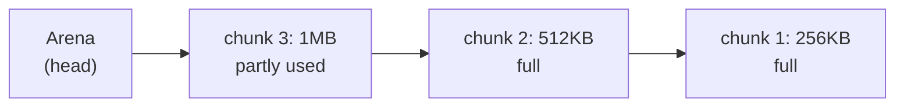

* **Bump allocation**: `Arena` holds a linked list of `Arena_chunk` (`{ next, cap, used }`). `alloc(size)` looks at the head chunk's remaining room (`cap - used`). If the request fits, it advances `used` (rounded up to 8 bytes): one pointer bump, the cheapest allocation there is.
* **Geometric growth**: only when the request does not fit is a new chunk taken from the raw heap (`alloc`) and put at the head. It holds 256KB the first time and twice the previous chunk after that, up to the chunk size the arena was made with (`Arena.new`'s `chunk_size`): little for a small compilation or a short-lived LSP worker, soon large for a self-compilation. A single allocation too big for the chunk gets a chunk of its own size.
* **Freeing all at once**: `free()` walks the chunks from the head and `dealloc`s each once (each is one allocation); `base_setup.fin()` calls it when the compilation ends.
* **A static buffer (`from_buffer`)**: a fixed buffer the caller prepares (a global array, a stack region) serves as the only chunk. No `malloc` is called, so the same code runs on a microcontroller without one (`ksai` on bare metal, for one). The arena cannot grow: when the buffer runs out, `alloc()` panics deterministically.
* **Save and restore (`save` / `restore`)**: `save` cheaply snapshots the head chunk and its `used` position. `restore` frees any chunks added since and winds back to that position. It does not free a part: it makes everything allocated after the snapshot as if it never existed (the LSP's use is "The arena is rewound after each request (a worked example)" in [`DESIGN-tools.md`](DESIGN-tools.md)).
* **Usage**: `get_total_used()` / `get_total_allocated()` sum every chunk's `used` / `cap`. `--stats` prints them as `AST Arena usage : X / Y bytes`. The performance guard holds the usage against a baseline (`AST bytes`), beside the peak memory ("Measuring the compiler: `--stats` and the performance guard").

### The three-tier allocation strategy

**There are three ways to get memory inside the compiler (three tiers, split by purpose), and each is freed at a different moment. Do not mix the tiers up.** Above all, passing a pointer from the arena to `dealloc` is a fatal violation.

**The base session owns the diagnostics and the ranges excluded by `#cfg`.** Its shared arena being present says the session is active; those collections need no initialization flags of their own. Empty heap containers allocate lazily. Clearing them before an editor rewind discards references into the arena while retaining list capacity; ending the session frees their heap storage before the arena.

| Tier | Freed when | Used for |
| :-- | :-- | :-- |
| A. the shared arena (`base_core.arena`) | all at once, when the compilation completes | AST nodes, type and symbol tables, names, diagnostic messages |
| B. reference counting (`Rc<\|T\|>` / `Arc<\|T\|>`) | when the last owner leaves scope | dynamic memory shared by several owners |
| C. raw memory (`alloc` / `dealloc`) | explicitly, by the code that allocated it | bytes whose whole life is in one place |

* **A. The shared arena (`base_core.arena`), freed all at once when the compilation completes** (`base_setup.fin`): AST nodes (`Ast_node.new`), type-environment entries (`Entry` and the like in `sema/type/env.kspl`), symbol-table scopes (`sema/type/scope.kspl`), monomorphized names, the type-ID map's string keys, diagnostic message strings (after `dup_str`). The test: can references to the data spread through the AST or the symbol table, or does it naturally live until the compilation ends? If so, it goes on the arena, with no individual freeing.
  * **Collections keep references**: `Map` and the other internal collections do not deep-copy a key, so a slice passed to them must point at arena memory.
  * **The standard idiom is scratch → `dup_str`.** Build a string in a `Str_builder`, whose buffer grows and shrinks on tier C's raw heap. Then copy only the finished string to the arena with `base_core.arena.dup_str(...)`, keeping scratch space and permanent data apart.
  * Caution: **A name built from parts goes to `base_core.pools.name_text`, not to `dup_str`** (an FQN from `build_mod_fqn`, `join_dotted_name`, a path's segments joined). Such a name is built again on every read of it, so a copy per read would fill the arena with duplicates (about 10 MB of a cold self-host's `AST bytes`). `name_text` keeps one copy of each distinct name, on tier C, until the pools are freed.
* **B. Reference counting (`Rc<|T|>` / `Arc<|T|>` in `std/mem`), freed when the last owner leaves scope**, for dynamic memory shared by several owners. The types conform to `Ref_counted`, and the compiler inserts `retain` on a copy and `release` at scope exit (`lower/arc.kspl`), so nothing is freed by hand. `Rc<|T|>` is for one thread, `Arc<|T|>` (atomic) for sharing between threads; `Weak_rc<|T|>` / `Weak_arc<|T|>` cut reference cycles. An aggregate that owns an ARC-managed value is managed along with it, through one helper function per type. the chapter "The rules for implementing ARC" says what counts as an owning position, and how to keep it in step with where the operations are emitted.
* **C. Raw memory (`alloc` / `dealloc`), freed explicitly by the code that allocated it.** Bytes, for data whose whole life is completed in one place: `String_pool`'s internal buffer (interning identifiers and AST kind names, and the names `name_text` keeps), or `Str_builder`'s scratch buffer. The pools are never wound back, so a name from `name_text` outlives every arena that holds it as a key.

Caution: **The shared arena is wound back, so nothing that lives as long as the process may go on it.** The LSP discards each request's allocations with `base_core.arena.save()` / `restore()` ("The arena is rewound after each request (a worked example)" in [`DESIGN-tools.md`](DESIGN-tools.md)). A global table made once and used ever after, if taken from it, is left pointing at freed memory: `ksplc.cfg`'s per-directory cache (`base/config_file.kspl`), the level settings from the CLI (`base/lint_codes.kspl`). That runs harmlessly until a later large allocation overwrites it. The symptom, every query returning null after the server has run a while, is far from the cause. Take what lives across requests from `base_core.perm_arena`, which is never wound back.

### The naming conventions for the lifecycle functions and the global variables

Making and discarding things uses the same few names everywhere, so a reader (and the compiler's checks) can tell what a call does by its name. Allocation and freeing, initialization and finalization, take one name **per role**, with no dialects such as `create` / `deinit` / `finalize` / `delete`:

| Role | Make / initialize | Discard / free | Shape |
| :-- | :-- | :-- | :-- |
| **An object (a value, owned)** | `new` | `free` | `Type.new()` returns a value or an `@`, paired with `defer x.free()`. The arena to allocate in is the last parameter, never defaulted (`List.new(arena)`; `List.new(null)` for the global heap) |
| **Global and file state** | `init()` | `fin()` | the global lifecycle, with no receiver |
| **Raw memory (`std/mem` only)** | `alloc` | `dealloc` | tier C's byte allocation and freeing |

**`free` and `dealloc` are the only names that carry an effect.** Sema's use-after-free and double-free tracking recognizes a freeing by these names alone ("Measuring what suppression costs" in [`DESIGN-diagnostics.md`](DESIGN-diagnostics.md); the rule is "8.4 The memory management model: `defer` / ARC / arenas" in [`../../docs/SPEC-language.md`](../../docs/SPEC-language.md)). Under any other name the check silently stops.

* **`Arena.create<|T|>` copies an existing value onto an arena** and returns a permanent `T@` (`base_core.arena.create(Foo::{...})`). It is a typed `alloc`, apart from `new`, which constructs. It lets an ad-hoc struct with no arena-taking `new` go on the arena too.
* **One `init()` / `fin()` pair per layer**, in the layer's entry file, gathers its globals, and `main` calls only those pairs. `base_setup`'s covers the shared arena, the pools, the AST's shared state and the diagnostics; `parse_load`'s covers the Profiler and the kspeg arena. Do not init or fin a single global directly from `main`.
* **`g_` marks only a non-public global.** A public global is recognizable by its namespace qualification (`base_core.config`, `base_core.arena`), so it takes no `g_`. A `priv` global, referenced bare within its file, keeps `g_` as its only mark.

## The development conventions (the rules for writing KSPL source)

### The order of imports, and their paths

Every `import` in ksplc's own code names a full path, so a reader can see at a glance which layer a name comes from. `ksplc/`'s own imports follow two rules, to keep the dependencies visible:

| Rule | Example |
| :-- | :-- |
| 1. **Order**: by name. `ksplc fmt` sorts them ("The formatter reorders the `import`s as text, before the printer" in [`DESIGN-tools.md`](DESIGN-tools.md)), so nobody orders them by hand | — |
| 2. **Full paths**: the standard library from `std/`, the compiler's own files from `ksplc/` | `import "std/io"` |

**"A name's prefix is added only when the name cannot state its own origin" in [`../../docs/DESIGN-language.md`](../../docs/DESIGN-language.md) decides which names come in without a namespace (a selective import).** What is specific to `ksplc/` is how its condition 3 applies: whether the origin is information that belongs to the design.

* **A reference across the pipeline's stages (`parse` / `sema` / `lower` / `gen`) keeps its prefix.** `sema_types.Env` written inside `gen/c/` shows which layer it depends on. Without the namespace, the crossing disappears from the source.
* **`ksplc/base/` and `std/` are exempt.** Every layer rests on them, so the reader knows the origin. Where conditions 1 and 2 hold (it is known by the name; it is unique), no namespace is fine.

### A file using an extension method imports the file that defines it

To call an extension method (a method added to a type from another file), a file must import the file where that method is written. The rule is in ["9. Files and import" in `../../docs/SPEC-language.md`](../../docs/SPEC-language.md#9-files-and-import), including that a built-in type counts as `std/lang`'s. This section holds only where it is enforced.

The compiler analyses every file in one space, so **without the import ledger the files' independence disappears**. It is enforced at the one point of method resolution, in `sema/body/dot.kspl`, which asks `is_file_imported` whether the file that wrote the name imports the method's file.

Caution: **Ask the ledger (`sema/session/import_table.kspl`) and nothing else.** Asking instead whether the symbol resolves lets through a file that happens to be in the same compilation unit.

**A built-in type's owner is `std/lang`** (`lang_file_path` in `sema/session/import_table.kspl`), used where no declaration names the receiver's type (`is_declared_type` in `sema/body/dot.kspl`). The method's file is then checked like any type's: the ledger is asked, and a hit marks the import used. If the call were accepted because its file is somewhere in the program, it would hold or not by what the rest of the program imports. [I0401] would then call the import that makes it hold unused.

**A format spec's method is reported at the item written** (`reject_unimported_spec`), and its import is checked before the type is judged. A file that does not import `fmt_method_file` (`base/core.kspl`) may not have loaded the methods, and every type would then seem to accept nothing.

**During a generic's instantiation the error is withheld, but the ledger is still asked** ("While a generic is being instantiated, a diagnostic that depends on a type argument is not emitted" in [`DESIGN-diagnostics.md`](DESIGN-diagnostics.md)).

## The glossary

The terms of the compiler this document assumes, grouped by the part of the compiler they belong to, each group in pipeline order. Each one's section has the full account. The words every package shares (generic, trait, vtable, ARC, arena, FQN, ABI, hosted and freestanding, libc, the C runtime, the seed and the rest) are in "Words used throughout" in [`../../docs/DESIGN-principles.md`](../../docs/DESIGN-principles.md#words-used-throughout). The words this repository uses with one fixed meaning in every document (gate, fire, reject, pass silently and the rest) are in "Terms of art" in [`../../docs/SPEC-documents.md`](../../docs/SPEC-documents.md).

**The compiler as a whole**

| Term | What it means | Where |
| :-- | :-- | :-- |
| **Pipeline** | the fixed order of stages a program goes through: Parse → Desugar → Sema → Lower → a backend | "From source code to a binary" |
| **Stage1 / Stage2** | Stage1 is the current source built by the seed; Stage2 is the same source built by Stage1. The two outputs must be identical | "The bootstrap, and keeping the seed in step" |
| **Self-hosting** | a compiler compiling its own source to a byte-identical result | "The bootstrap, and keeping the seed in step", "Self-hosting does not test a feature ksplc itself does not use" |
| **ICE** (internal compiler error) | a stop on a state ksplc itself got wrong. `ice_assert` / `ice_panic` raise it instead of a diagnostic about the user's code | "Failing fast through an exception or an ICE" |
| **Interning** | storing each distinct string once, and comparing by an integer ID after that (`String_pool`; used for the AST kind names and the symbol names) | "String interning" |

**Parse and Desugar**

| Term | What it means | Where |
| :-- | :-- | :-- |
| **PEG / KSPEG** | a PEG (parsing expression grammar) tries the alternatives of each rule in order and takes the first that matches. KSPEG is KSPL's own PEG engine, and `kspl.kspeg` is the grammar | "The internal flow: the raw KSPEG tree → the AST conversion → normalizing → verification", "Only the editor's parse recovers from a syntax error" in [`DESIGN-tools.md`](DESIGN-tools.md) |
| **CST / AST** | the CST (concrete syntax tree) is the parser's raw output, `kspeg.Node`. The AST (abstract syntax tree) is that tree stripped of brackets, symbols and intermediate rules, and levelled by the Parse layer into the fixed shape `Ast_node` | "The internal flow: the raw KSPEG tree → the AST conversion → normalizing → verification" |
| **Normalization** | the Parse layer's reshaping of the raw tree into the AST, where every node kind has a fixed layout | "The internal flow: the raw KSPEG tree → the AST conversion → normalizing → verification", "The invariants of the normalized AST (so nothing crashes and no output differs)" |
| **Elision** | replacing a node that holds only one child and qualifies nothing with that child (`elide_node`) | "The internal flow: the raw KSPEG tree → the AST conversion → normalizing → verification" |
| **Desugaring** (the stage) | the shared word *desugar*, narrowed to what can be rewritten from the AST's shape alone, without the types. A sugar that needs the types is finished in Sema | "Desugar: expanding the syntactic sugar that does not know the types" |
| **A seam** | the one name that both halves of a sugar split across two layers agree on, such as the mark Desugar leaves for Sema | "Measuring where the desugaring goes" |
| **The one notation** | KSPL source is written in the indentation notation (`.kspl`), read once, where a source enters, into the braces the parser reads | "Every place a source enters reads it the same way" |

**Sema: types and names**

| Term | What it means | Where |
| :-- | :-- | :-- |
| **Sema** (semantic analysis) | the stage that knows the types: it resolves every name, infers every type and reports type errors | "The Sema layer: it knows the types" |
| **`type_id`** | the number Sema gives each distinct type; a node's `type_id` is the type of its value | "The internal flow: registering every file up front → the main type-inference walk → draining the work list of generic instantiations" |
| **Symbol table** | the table from a name to what it declares (`Sema_symbol`) | "How sema is split into folders, and the direction of the dependencies" |
| **A mass** | a set of files that can all reach one another through imports (a strongly connected component) that cannot be split into folders any further | "The whole picture of the dependencies" |
| **Template** | a generic's written body, before any type argument is put in | "Generics are instantiated through deferred work" |
| **Monomorphization** | ksplc's name for instantiating a generic: one separate implementation per concrete type argument used (`sema/decl/mono.kspl`). `Vec<\|T\|>` with `T=I32` becomes `Vec_I32` | "The internal flow: registering every file up front → the main type-inference walk → draining the work list of generic instantiations" |
| **Upcast** | turning a concrete value into a trait value | "An upcast, not conformance, decides what gets a vtable" |
| **Folding** | computing an expression's value at compile time (`eval_constexpr`) | "The static-initializer check is applied to both `var` and `const`" in [`DESIGN-diagnostics.md`](DESIGN-diagnostics.md) |
| **A place expression** | an expression that names existing memory: an identifier, a field or element chain rooted in one, or a dereference. A read from one is a copy | "A retain goes wherever a copy happens" |
| **`Move_only`** | a mark on a type that must never be copied (an open file, a lock); after a hand-over the old name cannot be used | "A check of the same nature is not copied into two places" in [`DESIGN-diagnostics.md`](DESIGN-compiler.md), "The rules for implementing ARC" |

**Lower**

| Term | What it means | Where |
| :-- | :-- | :-- |
| **Lowering** | rearranging nested control structure (`defer`, the short-circuiting `&&`/`\|\|`, `!`, a labelled `break`) into a shallow combination of `if` and `goto`: the Lower layer's job | "The Lower layer: a flat tree that depends on no backend" |
| **MIR** (mid-level intermediate representation) | the flat, backend-neutral tree that Lower's first walk leaves. ksplc keeps it in the same `Ast_node`s, not in a type of its own | "The internal flow: one MIR-flattening walk → generating thunks and vtables → the ABI mangling → dead-code elimination → verification" |
| **Name mangling** | transforming a symbol name by a regular rule to avoid collisions. A `priv` symbol becomes `kspl_priv_{file name}_{original name}` | "The internal flow: one MIR-flattening walk → generating thunks and vtables → the ABI mangling → dead-code elimination → verification" |
| **Drop glue** | the helper generated once per aggregate type that retains or releases every ARC value it owns | "The chaining is gathered into a per-type drop-glue function" |

**The backends and C**

| Term | What it means | Where |
| :-- | :-- | :-- |
| **Backend** | the stage that writes code for a target: Genc writes C99, Genllvm writes LLVM IR | "The backends (Genc / Genllvm) and the runtime ABI" |
| **C99** | the 1999 edition of the C language standard, which nearly every C compiler accepts | "The backends (Genc / Genllvm) and the runtime ABI" |
| **LLVM IR** | the text form of the code that LLVM (the toolkit behind clang) compiles to machine code | "Genllvm (LLVM IR): why the structure itself differs, and managing SSA" |
| **Preamble** | the C runtime as written into each generated `.c` | "Embedding the runtime, and what a library keeps to itself" |
| **Translation unit** | one `.c` file and everything it includes, as the C compiler reads it | "Embedding the runtime, and what a library keeps to itself", "Split compilation: emitting one program as several translation units (`--split`)" |
| **Declaration / definition / prototype** | a declaration says a name exists; a definition gives its body or storage; a prototype is a function's declaration | "Embedding the runtime, and what a library keeps to itself" |
| **Linkage (external / `static`)** | whether a C name is visible to other translation units at link time (external) or only inside its own (`static`) | "How linkage is chosen: one artifact is one program, or one library" |
| **Calling convention (SysV / Win64 / AAPCS)** | the part of an ABI that says which registers and stack slots carry a call's arguments. SysV is Linux's and macOS's on x86-64, Win64 is Windows', AAPCS is ARM's | "Both a store and an actual argument are emitted at 'the receiver's type'" |
| **Aggregate** | a value made of several parts: a struct, an array, a slice, a Result, an enum with a payload, a trait value | "Passing an aggregate is an explicit internal ABI" |
| **Alignment / padding / packed** | a type's alignment is the address multiple it must start at; padding is the unused bytes inserted to keep fields aligned; a *packed* struct has no automatic padding | "The runtime memory layout and the ABI specification" |
| **Tagged union** | an enum with payloads stored as a tag (which variant is active) plus room for the largest payload | "The runtime memory layout and the ABI specification" |
| **Opaque pointer** | LLVM's single pointer type `ptr`, which does not say what it points at | "The runtime memory layout and the ABI specification" |
| **Undefined behaviour** | what C leaves without any answer, such as signed overflow; the optimizer may assume it never happens | "How the generated code makes overflow wrap around" |
| **Integer promotion** | C's rule that `U8` and `U16` values are widened to `int` before arithmetic | "How the generated code makes overflow wrap around" |
| **Two's complement** | the usual way a signed integer is stored, in which overflow wraps around | "How the generated code makes overflow wrap around" |
| **`#line` / DWARF / debug information** | a `#line` directive tells the C compiler which `.kspl` line the next C came from. DWARF is the standard format for debug information, which lets a debugger show source lines | "Genc (C99): the topological output order", "Genllvm (LLVM IR): why the structure itself differs, and managing SSA" |
| **Declarator** | the part of a C declaration around the name, such as `(* const p)(I32)` | "A function pointer breaks in a different place in each backend" |
| **SSA** (static single assignment) | the IR form in which each register is assigned once. genllvm numbers its registers per function and keys a local on its declaring node | "The limits on building an AST, and `def_node`'s strict duty to link", "Genllvm (LLVM IR): why the structure itself differs, and managing SSA" |
| **Alloca / GEP** | LLVM instructions: `alloca` reserves a stack slot; `getelementptr` (GEP) computes the address of a field or an element | "Genllvm (LLVM IR): why the structure itself differs, and managing SSA" |
| **sret** | LLVM's mark for a hidden pointer through which a function returns an aggregate. genllvm passes such a pointer without the mark | "Passing an aggregate is an explicit internal ABI" |
| **SelectionDAG** | the part of LLVM that turns IR into machine instructions | "A huge aggregate is not handled as a first-class value" |
| **POD** (plain old data) | a struct of plain fields only, with nothing to construct or release | "Passing an aggregate is an explicit internal ABI" |

**Memory**

| Term | What it means | Where |
| :-- | :-- | :-- |
| **GC** (garbage collector) | a runtime that finds and frees memory no one can reach. KSPL has none | "Why an arena" |
| **Bump allocation** | allocating by moving a counter forward inside a block, the cheapest allocation there is | "Arena's implementation: a linked list of chunks and bump allocation" |
| **Weak reference** | a handle (`Weak_rc` / `Weak_arc`) that watches a value without owning it, used to break reference cycles | "The three-tier allocation strategy" |
| **Dangling pointer / use after free / double free / leak** | a pointer to freed memory; reading or writing through one; freeing the same memory twice; memory never freed | "Why an arena", "Measuring what suppression costs" in [`DESIGN-diagnostics.md`](DESIGN-diagnostics.md) |

**The tools**

| Term | What it means | Where |
| :-- | :-- | :-- |
| **LSP / language server** | the Language Server Protocol, by which an editor asks a separate program (the language server) for hover text, definitions, completions and diagnostics | "The tools' internal implementation: the language server, the formatter and `ksplc run`" |
| **JSON-RPC** | the message format the LSP uses: a `Content-Length` header, then a JSON body | "The language server is split into two processes: the watcher and the analyser" in [`DESIGN-tools.md`](DESIGN-tools.md) |
| **Supervisor / worker** | the language server's two processes: the supervisor talks to the editor, the worker does the analysis and may crash | "The language server is split into two processes: the watcher and the analyser" in [`DESIGN-tools.md`](DESIGN-tools.md) |
| **URI / logical name** | the editor names a file by a URI (`file:///…`); inside the compiler a file is named by its logical name, a path from the project root (`std/lang`) | "A document URI is converted to the logical name on the way in, and back to the editor's spelling on the way out" in [`DESIGN-tools.md`](DESIGN-tools.md) |
| **Broken node** | the node a lenient parse makes for text it could not read; it holds that text and nothing else | "What a broken node holds" in [`DESIGN-tools.md`](DESIGN-tools.md) |
| **Fixed point** | a text that formatting leaves exactly as it is | "Where the formatter's time goes, and the record of formatted texts" in [`DESIGN-tools.md`](DESIGN-tools.md) |
| **Slot** | the cache folder `ksplc run` keeps for one script | "`ksplc run` builds a script one run at a time, and runs it outside the lock" in [`DESIGN-tools.md`](DESIGN-tools.md) |
| **INI** | a plain settings format of `[section]` headings and `key = value` lines; `ksplc.cfg` is written in it | "The settings file is `ksplc.cfg` (the use does not go in the name)" in [`DESIGN-tools.md`](DESIGN-tools.md) |
