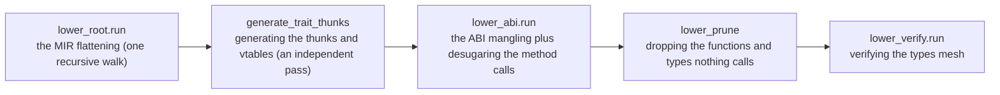
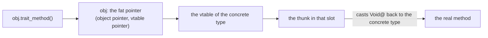

# ksplc's Lower layer and ARC

**This document holds the design of ksplc's third layer, Lower, and the rules for the reference counting it inserts.** It says how Lower flattens the typed tree into one that depends on no backend. It also says how the `retain` and `release` calls of ARC (automatic reference counting) are kept correct.

It is one chapter of the compiler's internal design. [`DESIGN-compiler.md`](DESIGN-compiler.md) holds the rest:

* the map of the whole compiler and the Development Principles;
* the rules for handling an AST that every layer shares;
* the arena, the conventions and the glossary.

Read "The compiler as a whole" in [`DESIGN-compiler.md`](DESIGN-compiler.md) first.

## The Lower layer: a flat tree independent of backends

Lower rewrites the typed tree into a simpler one that C could almost write directly. The new tree has no `defer`, no `&&` that skips its right side and no method calls. It has only plain `if`, `goto` and function calls. Both backends then only have to print it.

### What it answers for

Lower stands between Sema and the Genc/Genllvm layer. It flattens complex control flow into a plain `if` or `goto`. Examples are `defer`, short-circuit `&&`, `try(?)` and the labelled outermost exit `break label;`. To flatten, it *hoists*: it moves a piece of an expression out into its own statement ahead of it.

Lower keeps the backends as close to pure emitters as it can. So it also completes the complex transformations as an AST: desugaring a method call, dynamic dispatch, the ABI mangling.

### The internal flow: flatten, add vtables, mangle, prune, verify

Lower runs a few steps in a fixed order:

1. It flattens the tree.
2. It adds the tables that let a trait call find its method.
3. It renames and rewrites calls for C.
4. It drops what nothing uses.
5. It checks the types it wrote.

`Compiler.run_lower_and_codegen` in `pipeline.kspl` makes these calls **in this order**. Do not write their count here: it changes the day a stage is added, and the order's source is `pipeline.kspl`.



*MIR* (mid-level intermediate representation, [the glossary](DESIGN-compiler.md#the-glossary)) is the flat tree the first walk leaves; ksplc keeps it in the same `Ast_node`s.

**A vtable and a thunk** build the *dynamic dispatch* C lacks: choosing at run time which type's method to call. With them, a `trait` method can be called whatever the concrete type:

* **A vtable (a virtual function table)**: per type implementing a `trait`, a constant table of function pointers to its methods. A `trait` value is a fat pointer: a pair of pointers, to the object and to that vtable. Its layout is "The runtime memory layout and the ABI specification" in [`DESIGN-backends.md`](DESIGN-backends.md).
* **A thunk**: the small adapter a vtable holds in place of each method, matching the signatures. The caller does not know the concrete type, so it passes the receiver through the `trait` as a `Void@` (an untyped pointer). The thunk casts it back to the concrete type and calls the real method.

The diagram follows one call `obj.trait_method()` where `obj` is a trait value.



So `obj.trait_method()` takes the thunk from the vtable and calls it. With this indirection, Genc/Genllvm know nothing of dynamic dispatch, and emit the thunks and vtables as ordinary functions and constants.

The steps, one by one:

* **`lower_root.run` (`lower/root.kspl`) is one recursive tree walk.** Three files extend it, and are not passes of their own:

  | file | what it handles |
  | :-- | :-- |
  | `lower/expr.kspl` | hoisting short-circuit evaluation, `!`, `catch` / `fallback` |
  | `lower/order.kspl` | fixing the order of a call's, an operator's and a compound literal's operands |
  | `lower/defer.kspl` | flattening `defer`, cleaning up after a labelled `break` / `continue` |

  They are methods extending the same `impl Ast_node` (`lower_expr_postfix`, `lower_cleanup_stmt`, `lower_loop_jump` and so on). The `Ast_node.lower` dispatch in `lower/root.kspl` calls them, and they recurse back through `r.lower(lctx)`. So the expression hoisting and the defer flattening mix in one walk, node by node; the tree is not walked twice.
* **`generate_trait_thunks` in `lower/vtable.kspl` is a truly independent second pass**, run after `lower_root.run`. One flat loop over `root.children` (no recursion into nested scopes) finds each `.k_decl_impl`. It gathers into a side list the thunk functions (`decl_fn`) that bridge the dynamic dispatch, and the vtables (`decl_const`, as constant structs). After the loop, it `add_child`s them as direct children of the root (`root_file`), where the backend emits them as plain functions and constants. It has two inputs (["An upcast, not conformance, decides what gets a vtable"](#an-upcast-not-conformance-decides-what-gets-a-vtable)).
* **The ABI mangling (`lower/abi.kspl`) is the last independent pass.** The *ABI* is the agreement on how values sit in memory and how calls pass them. *Mangling* turns a name into one that cannot collide ([the glossary](DESIGN-compiler.md#the-glossary)). It runs after the thunk generation, so its recursive walk (children to parent, `apply_abi_recursive`) covers the new thunk and vtable nodes too. Take a top-level function, variable or constant marked `priv` and registered in `File_env` as `file_private`. The pass rewrites the node's `text` into `kspl_priv_{the file's base name}_{the original identifier}`. This prevents name collisions in the single-file C output (a unity build: the whole program in one `.c`); Sema itself does no string rewriting.
  * **A local that hides another of its name takes a made name** (`name_hiding_local`, spelled by `hiding_local_name` in `base/c_name.kspl`), at its declaration and at every reference. C sees a declaration from its own declarator on, so `I32 x = x + 1;` reads the new `x`. In C, a body's local named like a parameter is also a redefinition. In KSPL, the initializer reads the outer one. Sema owns the scopes, so Sema counts how many names a local hides (`Sema_symbol.hidden_count`, set by `define_symbol`). The made name comes from that count. So the nested ones differ, and a node Lower cloned takes the same name.
* **Desugaring a method call (`obj.method(arg)` → `Struct_method(&obj, arg)`) is done in `lower_abi.run`, the third pass, not in the main walk** (the pruning and the type check follow it). `transform_postfix_call` fires on each postfix call Sema resolved into `.k_method_access` / `.k_generic_method`. The neighbouring code in `lower/expr.kspl` differs. It only assembles the operator-overloading sugar (`a + b`, `a[i]` and so on) into a synthesized method-call node with `build_linked_method_call`. `lower_abi.run` applies the transformation itself: it flattens the receiver to the first argument and swaps in the mangled name. It does so to a `.method()` call the user wrote and to a synthesized node alike.
* **C leaves the order of a call's arguments, an operator's two sides and a compound literal's fields open, so Lower fixes it** (`Operand_order` in `lower/order.kspl`). gcc takes a call's arguments from the right and clang from the left, while the language evaluates left to right (`docs/SPEC-language.md` §6.5.1).
  * An operand moves into a temporary (`gen_tmp_name` in `lower/ctx.kspl`) ahead of the statement when C could run it on the wrong side of another. That happens in two cases:
    * It is not `fixed`, and a later operand acts. `fixed` means a literal, a constant, an immutable binding or a fixed address. An operand *acts* when it calls, can stop the program, or is hoisted itself.
    * It acts, and a later operand is not `fixed`.
  * A place its consumer reaches by address (a method receiver taking `Self@`) fixes only its address. So the callee still sees the writes that the later arguments make.
  * Caution: **Count everything Lower hoists as acting** (`&&`, a conditional, `catch`, `!`, a user operator). Hoisted, it runs ahead of the expression around it, so an earlier operand that only reads must move too.
  * **Only inside a function body.** A top-level initializer runs nothing at run time, and a temporary moved out of it would land at file scope.
  * `tests/suite/equiv_test.kspl` builds `tests/prog/equiv.kspl`'s C under gcc as well as clang, since only the two together show an order C left open.
* **Verifying the types (`lower/verify.kspl`)** ends the order. One pass over the tree confirms that `x$`'s and `x@`'s types agree in pointer depth. (`x@` takes `x`'s address, and `x$` reads through a pointer.) A mismatch stops with an ICE.
  * **It is needed because lower sets types by hand.** Over twenty places write a synthesized node's `type_id` themselves with `env`'s type operations (`make_ptr` / `strip_ptr` and so on). Otherwise a mistake surfaces only as a generated-C warning or in LLVM IR's signature check, both after the generation. The Linux/macOS run-time tests miss it, because it breaks only on Win64 (["Stores and arguments are emitted at 'the receiver's type'"](DESIGN-backends.md#stores-and-arguments-are-emitted-at-the-receivers-type)).
  * Caution: **Keep it at the end of the order.** Placed at the end of `lower_root.run`, it does not see the types the later stages (vtable / abi) write. The very thing most worth confirming then escapes the check. With one `make_ptr` line dropped from `lower/abi.kspl`, it stays silent there and fires at the end.
  * **Where a generic's template arrives, stop; do not skip it.** `lower_prune` drops every template that was not instantiated, so none arrives here. Skipping would silently stop the check from holding, so an arrival is announced with an ICE. The ICE also shows the check is misplaced: placed at the end of `lower_root.run`, it meets templates, and this ICE fires first.
  * Types are compared normalized (aliases resolved, const marks dropped) to a fixed point, since the marks nest (`const_of(alias Meters)`) and one pass of each is not enough.
  * Its cost is lost in the measurement's jitter: one pass over the tree is invisible beside the code generation.

#### An upcast, not conformance, decides what gets a vtable

A type gets a vtable for a trait only if the program actually turns one of its values into that trait somewhere. Merely implementing the trait is not enough.

An *upcast* turns a concrete value into a trait value (the `expr_upcast` node, "The nodes Sema creates: its contract with Lower and Genc" in [`DESIGN-sema.md`](DESIGN-sema.md)). **Only the pairs for which the tree holds an upcast naming `kspl_vtable_impl_<the conforming type>_<the trait>` get a vtable constant and thunks** (`collect_upcast_keys` in `lower/vtable.kspl`). Only two places name one, `emit_upcast_expr` in `gen/c/expr_postfix.kspl` and `gen/llvm/expr_agg.kspl`. Both start from `k_expr_upcast`, so the demand is confined to that node.

Caution: **Do not make it "everything that conforms".** A conformance such as `impl<|T|> List<|T|>: Index<|Sz, T|>` grows with each instantiation, while `m[k]` becomes a direct call and makes no upcast. With conformance as the bar, constants and thunks nobody refers to pile up (several hundred in ksplc itself).

**There are two inputs**:

| input | why it is needed |
| :-- | :-- |
| the tree's `decl_impl`s | the impls written |
| the list of instantiated generics' impls (`Trait_inst` in `sema/session/ctx.kspl`) | a generic's impl is instantiated as individual `decl_fn`s, and no `decl_impl` remains in the tree (`instantiate_generic_methods` in `sema/decl/mono.kspl`) |

Read only one, and the input not read becomes C referring to a symbol with no definition, with no diagnostic. The regression is `gentrait=` in `tests/prog/equiv.kspl`.

A thunk's body makes an `expr_upcast` too (`build_thunk_body`, for a trait method returning `Self`, as in `Writer`'s chaining). But that pair is the very pair being made. So no new pair appears after the gathering.

#### A function or type nothing calls is not emitted

After Lower, ksplc deletes every function and generic type that cannot be reached from the program's starting points. This keeps the generated C small, so the C compiler has less to read.

A generic's impl makes every method for each instantiation (`instantiate_generic_methods` in `sema/decl/mono.kspl`), as name resolution needs. Kept in the output, one use brings the whole set onto every `List` instantiation (all the collection operations `std/seq` adds to `List<|T|>`). In a program of a few lines, over half the generated C is then functions nobody calls.

**`prune_unreachable_fns` in `lower/prune.kspl` removes the `decl_fn`s unreachable from the root from the tree.** There are three kinds of starting point, and losing any one erases everything beyond it:

| starting point | why the tree shows no call to it |
| :-- | :-- |
| `main` | the C runtime calls it (it is found with `find_main_symbol`) |
| the `#export` functions | their callers are on C's side, invisible from the tree |
| references from the initializer of a non-function top-level declaration (`const` / `var`) | a trait's vtable naming a thunk as data is one, and it does not look like a call |

Caution: **Walk the edges by `def_node`, never by name.** `def_node` is the link from a use to the node that declares it ("The limits on building an AST, and linking `def_node`"). The backend decides a call target's name (`emit_generic_path` in `gen/c/expr.kspl` makes it from the `type_id`, not the identifier). Walking by name would copy that rule here, and the day one copy changes, the C calls a symbol with no definition. Walking by node identity needs no naming rule; this walk depends on "The limits on building an AST, and linking `def_node`"'s duty to link.

**Call it after all the synthesizing is done** (after `lower_abi.run` in `pipeline.kspl`). Lower makes the thunks and ARC's retain/release, and dropping before they are made erases them.

**Neither dropping too little nor too much gives a diagnostic.** Too much shows at C's link, as an undefined reference. Too little shows nothing: the generated C stays several times too large, and only clang's time grows. `tests/suite/thin_use_test.kspl` watches the latter (the generated C's line count for a small program).

The linker's removal of unreferenced sections also shrinks the executable (`CFLAGS` in the `Makefile`, and `ksplc/tools/run.kspl`). But it does not cut the generated C, so it does nothing for clang's time, while pruning cuts the lines clang reads. Their aims differ, so both are kept.

**Type declarations are dropped likewise** (`prune_unreachable_types`). A generic's signature makes its return and parameter types even where it is never called. Instantiate one `List<|X|>`, and `std/seq`'s `where` / `select` bring in `List_seq<|X|>` / `Keep<|…|>` / `X?` / `Callable1<|X, Bool|>`.

Caution: **Call it after the functions have been dropped.** A type named only in a signature stops being named only once that function drops; called first, it drops nothing.

**Only the instantiated types are dropped** (`Env.instantiated_nodes` holds their identity). A `struct` the user wrote is one definition however often it is used, so dropping it saves little; the instantiations multiply with the type arguments.

**Key it by the type ID passed through `Env.c_repr_type_id`.** In C, bodies that differ only in the immutability at the declared position fold into one struct. "Immutability marks in a type, and the API that asks" in [`DESIGN-sema.md`](DESIGN-sema.md) explains this. Counting on the plain ID drops the other one when only one is reached, and C stops with `unknown type name` (the typedef for `Job.argv`, a `U8[][]`, vanishes).

**What is walked is `Env`'s declarations, not the tree.** The field types the generated C emits come from `Struct_def` / `Enum_def`, so a field's node in the tree can carry no type.

**A composite type naming a dropped instance is dropped with it.** Sema registers every array and function type it meets (`Env.complex_types`), and C declares each ahead of its use. One that only a dropped function used, and that names a dropped instance (`fn(Box_I32*)`, `Cell_I64[2]`), names a struct C never sees. So `drop_orphan_complex_types` removes every composite naming one at any depth, a pointer included, folded as the walk folds. An array or function type naming only live types stays, as it is correct C. A `T!E` is an instance of `Result`, and goes with the instances.

**Here a mistake is never silent.** Dropping too little leaves a typedef nobody uses, which is still correct C; dropping too much stops the C compiler with `unknown type name`.

### The limits on building an AST, and linking `def_node`

**Lower makes a new node or an expanded control flow only through the builder functions in `base/ast.kspl`** (`build_var_decl`, `build_if_stmt` and so on). Assembling a raw node by hand invites a structural inconsistency, and is forbidden. Every variable reference Lower makes must point back to the node that declares the variable, or the LLVM backend stops.

**The reference-linking convention for the LLVM backend.** The C backend can resolve scopes on a variable's name (a string) alone. But `genllvm` keys each local's unique ID (`%v_r_1`, say) on the AST variable's pointer address (`def_node`), for its SSA (static single assignment: each register is assigned once) registers. Lower can generate an `Identifier` (a variable reference) or an `expr_path` and insert it into the AST. Wherever it does, **it must link `def_node` to the declaring node** (a `decl_var`, an `fn_param` and so on).

**No single gate or ICE assertion in `lower/*` enforces this.** The builders in `base/ast.kspl` do not set `def_node`, so each call site where Lower synthesizes an identifier must link it by hand. If one is missed, it is caught not in Lower but downstream. The local-variable ID map in `gen/llvm/ctx.kspl` treats `def_node == null` as "no stable ID", and panics (an ICE) with "an undefined register (opaque)" while emitting LLVM IR.

### An annotation belongs to the phase that decides it

**The tree carries resolved decisions so later phases need not resolve them again.** Its semantic annotations have distinct producers and consumers; they are not interchangeable caches.

| Annotation | Producer | Consumer and lifetime |
| :-- | :-- | :-- |
| `type_id` | Sema resolves source types; Lower assigns types to synthesized nodes | Lower, both backends and editor queries; IDs belong to the command's semantic environment |
| `def_node` | Sema links uses to declarations; Lower links synthesized references | Lower, pruning, LLVM local identity and editor navigation; valid while the command's AST arena lives |
| `sym_ptr` | Sema attaches a declaration's symbol | Semantic resolution and later declaration queries; type-erased because base cannot import Sema; valid in the same command |
| `ival` | Parse records parentheses; normalization and Sema mark synthesized forms; Sema resolves member slots; Lower marks propagated throws | Read according to node kind by lint, Lower or a backend; the parse cache preserves the parse-stage payload only |

**`ival` keeps kind-specific facts in one existing word.** A member slot avoids repeating field-name lookup in LLVM; a propagated throw tells both outputs to extend the error trace instead of starting it. The latter mark is named once in `base/ast_ext.kspl`. Array lengths folded into literals need no surviving member-slot annotation. Adding a separate field for every such mark would charge every node for facts only a few kinds need.

**Copying a node copies its complete value.** Deep cloning then replaces the child list and clones each child. A snapshot beneath an implicit conversion keeps the original child list and adjusts the source type. This preserves semantic links and kind-specific payload without a second, manually maintained list of annotations. The wrapper supplies its own kind and links; the snapshot owns the original expression's meaning.

**A syntactic question belongs below Sema.** `has_side_effect` walks node kinds and children only, so it lives with the base expression predicates in `base/ast_place.kspl`. Both Sema and Lower ask it there; Lower needs no import of the semantic statement analyzer to decide whether an expression needs a temporary. C/LLVM execution checks and self-host equality exercise the resulting shared tree.

## The rules for implementing ARC

*ARC* (automatic reference counting) keeps a count of how many owners a value has. The compiler inserts a `retain` (count +1) where a value is copied and a `release` (count −1) where an owner goes away; at 0 the value is freed. This chapter holds the rules that keep those inserted calls correct.

```kspl
import "std/refcount"

fn main(): I32
    a: = refcount.Rc<|I32|>.new(7) // count 1
    $b: = a // a copy: retain, count 2
    return b.get()$ - 7 // leaving: b and a released, count 0, freed
```

ARC asks two questions that can go wrong independently:

1. **Is the type managed?** (`type_has_arc_content` / `type_is_managed` in `sema/type/arc.kspl`)
2. **Where do retain and release go?** (`emit_managed_op` in `lower/arc.kspl`)

Both recurse over the set of positions that own an ARC value by value. **If the two sets drift apart, one of two failures always follows:**

| The drift | What happens |
| :-- | :-- |
| the verdict wider than the operations | judged managed, yet no operation is emitted → **a leak** |
| the verdict narrower than the operations | the insertion path is never entered → **a silent leak** |

Caution: **The second is the easy one to fall into.** Suppose both look only at a struct's fields. Then Lower inserts no retain or release at all for an enum's payloads or an array's elements, and they leak entirely.

**There are three owning positions**: a struct's fields, the active enum variant's payload, and an array's elements. A Result is an enum, so the value or the error it holds is its active payload.

| Position | Owns? | Why |
| :-- | :-- | :-- |
| a struct's fields | yes | |
| the active enum variant's payload | yes | |
| an array's elements | yes | |
| what a pointer or a slice points at | no | it is a borrow; following it would release someone else's memory |

**Move_only's structural derivation reads the same three positions** (`owned_parts` in `sema/type/arc.kspl`). A position only one of the two knows would be released without its copy being refused, or refused without being released.

### A retain goes wherever a copy happens

Every place where a counted value is copied and the copy can outlive the original must add one to the count. A `retain` goes into **every position where a value is copied and the copy can outlive the place it was read from**.

Caution: A variable declaration, an argument and a `return` are not enough. Struct-literal fields, array-literal elements, enum payloads and assignment into an existing binding slip through. At each, the count is one short, so a value still in use is freed.

**A receiver passed by value is an argument too** (`arc_receiver_takes`). The callee releases every managed parameter it takes by value, `r: Self` included. So `key.hash()` on a struct holding an `Rc` gives up a count the caller never handed over. A `Map` whose key holds one then frees the key's value as it stores the key. A receiver taken by pointer (`Self$@`, `Self@`) takes nothing, as a pointer argument does.

**The verdict lives in one place, `Arc_take` in `lower/arc.kspl`.** Every taker decides with it before lowering, and places the retain with it after lowering. The verdict says:
* A place is retained at its own type.
* A read that only the lowered form names is retained once lowered.
* A new value brings its own count.

Copying its conditions out per position makes the same omission recur at the next.

A managed read is classified as an ordinary place copy before asking whether only its lowered form can name the memory. Both `Arc_take.decide` and the freshness check make that distinction first, then ask `arc_read_once_lowered` for the remaining reads. This keeps the managed-type and place checks at the decision boundary, with no second scan inside the helper.

**The retain goes where the copy is made, never earlier.** Emitted when the taker is first looked at, ahead of its operands, `two(a, mk(k)!)` retained `a` before `mk(k)!` could leave, and the exit never gave that count back. The operands of a call, a compound literal and an enum's payload go through `Operand_order` (`lower/order.kspl`), which knows which operand is taken (`add_value`):

| The taken operand | Where its count comes in | If a later operand acts (can leave) |
| :-- | :-- | :-- |
| moved into a temporary (it reads what a later operand could change) | retained at the move | held with a flag until `finish` (`arc_hold_until_taken`), released by any exit before |
| a new value | when it runs | moved and held, even where its own class is `fixed` |
| not moved (`fixed`, or nothing after it acts) | retained in `finish`, after every operand | nothing can leave after it, or nothing can change it |

Caution: **Call `Operand_order.finish` after lowering the consumer.** Without it a taken operand's retain is never placed; `free` stops the compiler with an ICE where one was dropped.

**An assignment also releases**: `dst = x;` needs, besides `retain(x)`, a release of the value being overwritten. **The release waits until the right side is lowered and held in a temporary** (`tmp = x; retain; release(dst); dst = tmp`, the order Swift uses). The right side's own retains are inserted while it lowers. A release emitted before them freed `head` in `head = Rc.new(Node::{ .next = head })` before retaining it. The new node then landed at the freed address and pointed at itself. Held in a temporary, the right side is also read before the old value goes, so `head = head.get().next` does not read a node already freed.

**It targets reads from a place expression**, one that points at existing memory. A place expression is one of these:
* an identifier or a path;
* a chain of `.` and `[` rooted in one;
* a dereference `<expression>$`.

An expression with a call inside (`f().x`) must not be a place expression. It reads part of a temporary that is already +1'd, so another retain doubles it.

| Expression | A place expression? | Retained when copied? |
| :-- | :-- | :-- |
| `x`, `a.b`, `xs[i]`, `p$`, `(p + i)$` | yes | yes |
| `f().x`, `f()[i]` (a part of a fresh value) | no clone can be made, but once lowered it reads the temporary holding `f()` | yes, once lowered, where something takes it |
| `b.get().v`, `f()$` (through a pointer a call returns) | no clone can be made, but it reads existing memory | yes, once lowered |

**A read through a pointer a call returns is a copy of existing memory, not a fresh value** (`arc_read_once_lowered`). `get()` hands back a pointer into the box, not a counted result. Taken as fresh, `x: = b.get().v` got no retain, and `x`'s release freed a value the box still held. The retain's receiver cannot be a clone, because a clone would run the call twice. So the steps are these:
1. `Operand_order` fixes the operands' order.
2. Lowering moves the pointer into a temporary (`arc_needs_pointer_hoist` in `lower_expr_postfix`).
3. The retain clones the lowered read (`arc_retain_lowered`).

**A Result built around a place, or unwrapped from one by `!`, reads that place.** `return e.value` in a `V!E` function wraps `e.value`, and `r!` takes `r`'s payload while `r` still owns it. The verdict looks through the wrap and the `!` to the place and retains it at its own type. Missed, the place and the copy are both released, and the value is freed under the copy.

**Each way a branching value can go hands over a count of its own** (`lower_into_block`, `lower_expr_catch_chain`, `lower_fallback_stmt` in `lower/expr.kspl`). A ternary's branch, a catch's substitute and a `fallback` retain a place they read inside the branch. A catch's success retains a payload that a binding still owns (`r catch …`). So a ternary and a catch are fresh values whatever they read, and the verdict does not look through a catch. Looked through, only the success path was counted: `return a if c else b` and `x: = f() catch a` released `a` twice.

**A `switch` arm's binding holds a count of its own** (`register_arc_arm_bindings`). A retain goes at the arm's start. The release waits in `arc_scope_pending` for the arm's block, which releases it on every way out. Read without one, an arm that reassigned its subject (`s = .none`) freed the payload under the binding. [`../../docs/DESIGN-language.md`](../../docs/DESIGN-language.md) says why the language counts it rather than borrows it. The section is "Why a `switch` arm's binding holds its own count".

**A dereference does not demand a place expression of its receiver**, because a pointer leads to existing memory however it was computed. Demanding it lets `(p + i)$` (pointer arithmetic, then a dereference) slip through. A container's element reads and writes then get no retain/release. A `List`'s `get` steals the stored count (a use after free), and its `set` leaks the value it overwrites. The verdict asks only whether cloning is safe, so for the receiver it looks only for a call (`arc_has_call`).

Caution: **Do not make a `return`'s retain depend on there being a cleanup.** In a function returning a local binding, it balances the cleanup's release and looks right. But in a function with no cleanup, such as `return p.field;`, it comes one short, and the caller's release frees memory still in use. Returning a place expression needs the +1 either way.

**An assignment whose left side is not a place expression is an error.** For `rc.get().f = x;`, building a receiver for the release runs the call twice, and not building one leaks the overwritten value. Neither is visible to the writer, so the error asks for `p: = rc.get(); p.f = x;` instead (the case `arc_assign_through_call` in `tests/negative/pointer.kspl`).

**Liveness is checked with `Weak_rc.upgrade()`, not by reading the value.** Freed memory can still hold the old value, so a check that reads it passes. Linux's allocator hides the fault; only one that does not leave a freed region behind, such as macOS's, exposes it.

#### A value no binding takes is owned by a temporary

Some counted values have no one to store them, such as the result of a call used as a statement. A hidden temporary holds such a value and releases it, so it does not leak.

A call's result, a literal, and a field read off one arrive counted once. Whoever takes the value takes that count: a binding, an argument, a field of a literal, a `return`. **Where nothing takes it, nobody holds the count and the value leaks.** These cases take nothing:
* a call made a statement;
* a field read off a call;
* a method's `Self@` receiver built in place;
* a `switch` subject built in place;
* a success that a statement's `catch` throws away.

* **Decide "nothing owns it yet" before lowering** (`is_arc_fresh`). Lowered, a catch or a `!` becomes a temporary's name, and a name looks like a place. A binding and a `return` decide there too, or the same `return f()!` gets a retain it does not need.
* **A value that is only read lives to the end of its block** (`arc_hoist_owned`), as `x: = f();` written there would. So a view read off it stays valid that long. A statement throwing it away releases it at once (`arc_release_now`). A statement's `catch` releases the Result after the branch, which frees the success alone.
* **A field or an element read off such a temporary is a place in it** (`lower_arc_part_of_fresh`, for `.` and an array's built-in `[`). A taker retains it once lowered; a read alone borrows it. Retained on every read, `mk().rc.get()` left the field one count too many.
* Caution: **Some temporaries are hoisted where the statements move into a block of their own. Declare each at the statement's own level with a flag** (`stmt_decls`, `relocating`). Those blocks are a ternary's branch, `&&`'s right side, a loop's condition, an `else if`'s condition and a catch's substitute. Declared inside, it would be out of scope where the block's cleanups run. Released unflagged, a branch not taken would release garbage, and a loop's condition would overwrite the previous turn's value without releasing it.
* A cleanup is lowered as a block of its own (`lower_and_wrap_cleanup`), so a temporary it hoists ends inside it rather than in the scope being closed.

### The chaining is gathered into a per-type drop-glue function

**For a struct that holds counted values, the compiler generates one helper per type. The helper retains or releases all of them, and one statement calls it.** Rust and Swift call this the drop glue. Expanding the chain at each call site repeats the walk per copy position and per cleanup injection point. A cleanup is injected per exit path (a normal exit, a `return`, a `break`, a `continue`), so one binding would multiply several times over.

* **Always make the parameter a pointer.** Passed by value, lowering the cleanup's subtree again would treat it as a managed value parameter and insert a `retain` on the argument, counting twice. A pointer type has `type_is_managed` false, so it stays off that path (it is treated as a borrow).
* **An array takes a pointer to its element.** In KSPL, `@` on an array gives a pointer to the first element. A `T[N]$@` parameter would disagree with the call, since no expression has that type.
* **The pointer is read-only, and there is one helper per type whatever its immutability.** `retain` and `release` take `Self@`, so the helper writes nothing. A writable parameter discarded C's `const` where `for x in` copies a read-only array (`-Wdiscarded-qualifiers`, against Warning Zero).
* **Register the helper before building its body.** The body's walk recurses into the owning positions' types, so registering afterwards turns a type that comes back round to itself into an infinite recursion.

**An enum must read its tag at run time.** Each variant has its own payload layout and only one is active, so a `switch` is synthesized that operates on the active payload only. A variant without a payload gets no `case`, and a `default {}` is always added; without it, a tag that matches no `case` has nowhere to go. A Result is such an enum, and goes the same way.

Caution: **A synthesized node must fill in for itself what Sema would have filled in.** A node synthesized in Lower never passes through Sema, and with its `type_id` left at 0 genllvm emits invalid IR. Keep the virtual fields' indices in step with the convention in `sema/body/dot.kspl` too. A drift is no compile error, and silently touches another field.

**`!` and `catch` read a Result through three accessors only Lower writes** (`build_result_access` in `base/ast.kspl`): whether it holds the error, the error, and the value. Each backend reads them off the enum's tag and payload (`emit_postfix_dot` in `gen/c/expr_postfix.kspl`; `result_is_err` and `payload_field_ptr` in `gen/llvm/types.kspl`). The Result has no fields, so no source can name them. Lower keeps an `if` rather than a synthesized `switch`. A `break` or `continue` in a catch's block must leave the loop around it. Inside a C `switch`, a `break` would leave the `switch`.
