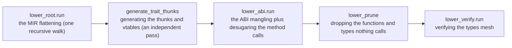
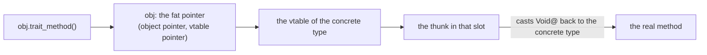

# ksplc's Lower layer and ARC

**This document holds the design of ksplc's third layer, Lower, and the rules for the reference counting it inserts.** It says how Lower flattens the typed tree into one that depends on no backend, and how ARC's `retain` and `release` calls are kept correct.

It is one chapter of the compiler's internal design; [`DESIGN-compiler.md`](DESIGN-compiler.md) holds the rest. Read "The compiler as a whole" in [`DESIGN-compiler.md`](DESIGN-compiler.md) first.

## The Lower layer: a flat tree independent of backends

### What it answers for

Lower flattens complex control flow (`defer`, short-circuit `&&`, `try(?)`, `break label;`) into a plain `if` or `goto`. To flatten, it *hoists* a piece of an expression into its own statement ahead of it. It also desugars method calls, builds dynamic dispatch and mangles names, so the backends stay pure emitters.

### ARC values share the cleanup stack with `defer`

**Type analysis and release emission walk the same owning positions**: fields, active enum payloads and fixed-length arrays. Pointers and slices borrow their targets. A `defer` and an ARC release are registered on one cleanup stack, so both run on every way out.

`std.mem.Raw_value` is private storage used by the memory helpers. It suppresses the release of bytes whose ownership is being transferred, and reading its value transfers ownership without a retain. Changing either classification requires changing `sema/type/arc.kspl` and `lower/arc.kspl` together.

### The internal flow: flatten, add vtables, mangle, prune, verify

`Compiler.run_lower_and_codegen` in `pipeline.kspl` runs the steps **in this order**; it is the order's source.



*MIR* ([the glossary](DESIGN-compiler.md#the-glossary)) is the flat tree the first walk leaves; ksplc keeps it in the same `Ast_node`s.

**A vtable and a thunk** build the *dynamic dispatch* C lacks. A trait value is a fat pointer to the object and to its type's vtable of thunks. A thunk casts the `Void@` receiver back to the concrete type and calls the real method. The layout is "The runtime memory layout and the ABI specification" in [`DESIGN-backends.md`](DESIGN-backends.md).



The steps, one by one:

* **`lower_root.run` (`lower/root.kspl`) is one recursive tree walk.** Three files extend it, and are not passes of their own:

  | file | what it handles |
  | :-- | :-- |
  | `lower/expr.kspl` | hoisting short-circuit evaluation, `!`, `catch` / `fallback` |
  | `lower/order.kspl` | fixing the order of a call's, an operator's, a compound literal's and an assignment's operands |
  | `lower/defer.kspl` | flattening `defer`, cleaning up after a labelled `break` / `continue` |

  They extend the same `impl Ast_node` (`lower_expr_postfix`, `lower_cleanup_stmt`, `lower_loop_jump` and so on). The `Ast_node.lower` dispatch in `lower/root.kspl` calls them, and they recurse back through `r.lower(lctx)`. So the tree is walked once.
* **`generate_trait_thunks` in `lower/vtable.kspl` is an independent second pass.** One flat loop over `root.children` finds each `.k_decl_impl`. It gathers the thunk functions (`decl_fn`) and the vtables (`decl_const`) into a side list. It then `add_child`s them to the root (`root_file`), where the backend emits them as plain functions and constants. It has two inputs (["An upcast, not conformance, decides what gets a vtable"](#an-upcast-not-conformance-decides-what-gets-a-vtable)).
* **The ABI mangling (`lower/abi.kspl`) is the last independent pass.** *Mangling* turns a name into one that cannot collide ([the glossary](DESIGN-compiler.md#the-glossary)). It runs after the thunk generation, so its walk (`apply_abi_recursive`) covers the new nodes too. Sema itself does no string rewriting.
  * **It gives every declaration its final C name, and both backends write that name as it stands** (`transform_decl_name`). Neither backend adds a prefix or recognizes `main`.

    | declaration | its C name |
    | :-- | :-- |
    | a top-level function, variable or constant | `kspl_` and its file's path, then its name; `main` becomes `kspl_main` |
    | one marked `priv` (`file_private` in `File_env`) | `kspl_priv_{the file's base name}_{the name}`, so the single `.c` file of a unity build has no collision |
    | a method in an `impl` | `kspl_`, the mangled name of the `impl`'s type, then `_` and the method's name |
    | a generic function's or method's instance | `kspl_` and the instance's mangled name |
    | a type | the type's mangled name (`mangle_type_id_to`), which every use of the type also writes |
    | an `extern` item, an `#export`, or what Lower synthesized | its name as written: it is already the C name (`uses_verbatim_c_name`) |
  * A reference takes the same name from its declaration's symbol (`get_c_identifier_for_sym_to`).
  * **A local that hides another of its name takes a made name** (`name_hiding_local`, spelled by `hiding_local_name` in `base/c_name.kspl`). In C, `I32 x = x + 1;` reads the new `x`, and a local named like a parameter is a redefinition. In KSPL, the initializer reads the outer one. Sema counts how many names a local hides (`Sema_symbol.hidden_count`, set by `define_symbol`), and the made name comes from that count. So a node Lower cloned takes the same name.
  * **A local spelled as a global's C name takes a made name the same way** (`global_c_names` in `lower/abi.kspl`). A local `Slice_U8` would hide the core slice type of `std/lang`, and the C compiler would refuse the next use. The set holds every type's C name and the names written as they stand. Every other global's C name opens with `kspl_`, so that prefix is tested by spelling.
* **Desugaring a method call (`obj.method(arg)` → `Struct_method(&obj, arg)`) is done in `lower_abi.run`, the third pass.** `transform_postfix_call` fires on each postfix call Sema resolved into `.k_method_access` / `.k_generic_method`. It flattens the receiver to the first argument and swaps in the mangled name. `lower/expr.kspl` only assembles the operator-overloading sugar (`a + b`, `a[i]`) into a method-call node with `build_linked_method_call`.
* **C leaves the order of an expression's operands open, so Lower fixes it** (`Operand_order` in `lower/order.kspl`). That covers a call's arguments, an operator's two sides, a compound literal's fields and an assignment's two sides. gcc and clang take a call's arguments in opposite orders, while the language evaluates left to right (`docs/SPEC-programming-language.md` §6.5.1).
  * **An assignment adds its value first, then its place** (`lower_stmt_expr` in `lower/expr.kspl`). A plain `=` adds its place with `add_target`: the place is only written, so a name or a field of one is `fixed`. A compound assignment's place is read too, so it is added as a value.
  * An operand moves into a temporary (`gen_tmp_name` in `lower/ctx.kspl`) ahead of the statement in two cases:
    * It is not `fixed`, and a later operand acts. `fixed` means a literal, a constant, an immutable binding or a fixed address. An operand *acts* when it calls, can stop the program, or is hoisted itself.
    * It acts, and a later operand is not `fixed`.
  * A place its consumer reaches by address (a receiver taking `Self@`) fixes only its address. So the callee still sees the writes that the later arguments make.
  * Caution: **Count everything Lower hoists as acting** (`&&`, a conditional, `catch`, `!`, a user operator). Hoisted, it runs ahead of the expression around it.
  * **Only inside a function body.** A temporary moved out of a top-level initializer would land at file scope.
  * `tests/suite/equiv_test.kspl` builds `tests/prog/equiv.kspl`'s C under gcc as well as clang, since only the two together show an order C left open.
* **Verifying the types (`lower/verify.kspl`)** ends the order. One pass confirms that `x$`'s and `x@`'s types agree in pointer depth (`x@` takes an address, `x$` reads through a pointer). A mismatch stops with an ICE.
  * **It is needed because lower sets types by hand** (`make_ptr` / `strip_ptr` and so on, in over twenty places). A mistake would otherwise break only on Win64 (["Stores and arguments are emitted at 'the receiver's type'"](DESIGN-backends.md#stores-and-arguments-are-emitted-at-the-receivers-type)).
  * Caution: **Keep it at the end of the order.** At the end of `lower_root.run` it would miss the types vtable and abi write. With one `make_ptr` line dropped from `lower/abi.kspl`, only the end catches it.
  * **Where a generic's template arrives, stop; do not skip it.** `lower_prune` drops every uninstantiated template, so an arrival is announced with an ICE. It also shows the check is misplaced.
  * Types are compared normalized (aliases resolved, const marks dropped) to a fixed point, since the marks nest (`const_of(alias Meters)`).

#### An upcast, not conformance, decides what gets a vtable

An *upcast* turns a concrete value into a trait value (the `expr_upcast` node, "The nodes Sema creates: its contract with Lower and Genc" in [`DESIGN-sema.md`](DESIGN-sema.md)). **Only the pairs for which the tree holds an upcast naming `kspl_vtable_impl_<the conforming type>_<the trait>` get a vtable constant and thunks** (`collect_upcast_keys` in `lower/vtable.kspl`). Only two places name one, `emit_upcast_expr` in `gen/c/expr_postfix.kspl` and `gen/llvm/expr_agg.kspl`, both from `k_expr_upcast`.

Caution: **Do not make it "everything that conforms".** A conformance such as `impl<|T|> List<|T|>: Index<|Sz, T|>` grows with each instantiation, while `m[k]` makes no upcast. Several hundred unused constants and thunks would pile up in ksplc itself.

**There are two inputs**:

| input | why it is needed |
| :-- | :-- |
| the tree's `decl_impl`s | the impls written |
| the list of instantiated generics' impls (`Trait_inst` in `sema/session/ctx.kspl`) | a generic's impl is instantiated as individual `decl_fn`s, and no `decl_impl` remains in the tree (`instantiate_generic_methods` in `sema/decl/mono.kspl`) |

Read only one, and the other becomes C referring to an undefined symbol (`gentrait=` in `tests/prog/equiv.kspl`). A thunk's own `expr_upcast` (`build_thunk_body`) names the pair being made, so no new pair appears after the gathering.

#### A function or type nothing calls is not emitted

**After Lower, ksplc deletes every function and generic type that the program's starting points cannot reach.** A generic's impl makes every method for each instantiation (`instantiate_generic_methods` in `sema/decl/mono.kspl`). Kept, one `List` use brings every operation `std/seq` adds, and over half of a small program's C is never called.

**`prune_unreachable_fns` in `lower/prune.kspl` removes the unreachable `decl_fn`s.** There are three kinds of starting point, and losing one erases everything beyond it:

| starting point | why the tree shows no call to it |
| :-- | :-- |
| `main` | the C runtime calls it (it is found with `find_main_symbol`) |
| the `#export` functions | their callers are on C's side, invisible from the tree |
| references from the initializer of a non-function top-level declaration (`const` / `var`) | a trait's vtable naming a thunk as data is one, and it does not look like a call |

Caution: **Walk the edges by `def_node`, never by name** ("The limits on building an AST, and linking `def_node`"). The backend decides a call target's name (`emit_generic_path` in `gen/c/expr.kspl`, from the `type_id`). Walking by name would copy that rule here, and the copies would drift.

**Call it after all the synthesizing is done** (after `lower_abi.run` in `pipeline.kspl`), or it erases the thunks and ARC helpers.

**Neither dropping too little nor too much gives a diagnostic.** Too much shows at C's link as an undefined reference. Too little only grows clang's time; `tests/suite/thin_use_test.kspl` watches the generated C's line count. The linker's removal of unused sections shrinks only the executable, so both are kept.

**Type declarations are dropped likewise** (`prune_unreachable_types`). A generic's signature makes its types even where it is never called. One `List<|X|>` brings in `List_seq<|X|>`, `Keep<|…|>`, `X?` and `Callable1<|X, Bool|>`.

Caution: **Call it after the functions have been dropped.** A type named only in a signature stops being named once that function drops.

**Only the instantiated types are dropped** (`Env.instantiated_nodes` holds their identity). A written `struct` is one definition however often it is used.

**Key it by the type ID passed through `Env.c_repr_type_id`.** In C, bodies that differ only in immutability fold into one struct ("Immutability marks in a type, and the API that asks" in [`DESIGN-sema.md`](DESIGN-sema.md)). Keyed on the plain ID, the other is dropped, and C stops with `unknown type name`.

**What is walked is `Env`'s declarations, not the tree.** The field types the C emits come from `Struct_def` / `Enum_def`.

**A composite type naming a dropped instance is dropped with it.** C declares every array and function type Sema met (`Env.complex_types`) ahead of its use. One naming a dropped instance (`fn(Box_I32*)`, `Cell_I64[2]`) names a struct C never sees. So `drop_orphan_complex_types` removes every composite naming one at any depth. A `T!E` is an instance of `Result`, and goes with the instances.

**Here a mistake is never silent.** Too little leaves an unused typedef, still correct C; too much stops the C compiler with `unknown type name`.

### The limits on building an AST, and linking `def_node`

**Lower makes a new node or an expanded control flow only through the builder functions in `base/ast.kspl`** (`build_var_decl`, `build_if_stmt` and so on). Assembling a raw node by hand invites a structural inconsistency, and is forbidden.

**Every reference Lower makes must link `def_node` to the declaring node** (a `decl_var`, an `fn_param` and so on). The C backend resolves a variable by its name. But `genllvm` keys each local's SSA register (`%v_r_1`, say) on the declaring node's address. So wherever Lower inserts an `Identifier` or an `expr_path`, it links `def_node`.

**No single gate in `lower/*` enforces this.** The builders do not set `def_node`, so each call site links it by hand. A miss is caught downstream: the ID map in `gen/llvm/ctx.kspl` panics (an ICE) with "an undefined register (opaque)".

### An annotation belongs to the phase that decides it

**The tree carries resolved decisions so later phases need not resolve them again.** Its semantic annotations have distinct producers and consumers; they are not interchangeable caches.

| Annotation | Producer | Consumer and lifetime |
| :-- | :-- | :-- |
| `type_id` | Sema resolves source types; Lower assigns types to synthesized nodes | Lower, both backends and editor queries; IDs belong to the command's semantic environment |
| `def_node` | Sema links uses to declarations; Lower links synthesized references | Lower, pruning, LLVM local identity and editor navigation; valid while the command's AST arena lives |
| `sym_ptr` | Sema attaches a declaration's symbol | Semantic resolution and later declaration queries; type-erased because base cannot import Sema; valid in the same command |
| `ival` | Parse records parentheses. Normalization and Sema mark synthesized forms. Sema resolves member slots and the field each struct-literal initializer writes. Lower marks propagated throws and the variant a `switch` label or a payload read names | Read according to node kind by lint, Lower or a backend; the parse cache preserves the parse-stage payload only |
| a declaration's identifier `text` | Lower's ABI pass writes the final C name | Both backends write it as it stands |

**`ival` keeps kind-specific facts in one existing word**, so a fact only a few kinds need costs no node a field. A member slot and a struct-literal field index save LLVM a second lookup by name. A propagated throw tells both outputs to extend the error trace; that mark is named once in `base/ast_ext.kspl`.

**A `switch` reaches the backends resolved.** Lower groups each arm and records the variant each label names. It declares the payload bindings as ordinary locals ("A switch reaches the backends grouped, its subject named" in [`DESIGN-backends.md`](DESIGN-backends.md)).

**Copying a node copies its complete value.** Deep cloning then replaces the child list and clones each child. A snapshot beneath an implicit conversion keeps the original children and adjusts the source type. So no hand-kept list of annotations is needed.

**A syntactic question belongs below Sema.** `has_side_effect` walks node kinds and children only, so it lives in `base/ast_place.kspl`, where Sema and Lower both ask it.

## The rules for implementing ARC

*ARC* (automatic reference counting) counts a value's owners. The compiler inserts a `retain` (+1) where a value is copied and a `release` (−1) where an owner goes away; at 0 the value is freed.

```kspl
import "std/refcount"

fn main(): I32
    a: = refcount.Rc<|I32|>(7) // count 1
    $b: = a // a copy: retain, count 2
    return b.get()$ - 7 // leaving: b and a released, count 0, freed
```

ARC asks two questions that can go wrong independently:

1. **Is the type managed?** (`type_has_arc_content` / `type_is_managed` in `sema/type/arc.kspl`)
2. **Where do retain and release go?** (`emit_managed_op` in `lower/arc.kspl`)

Both recurse over the positions that own an ARC value by value. **If the two sets drift apart, a leak always follows:**

| The drift | What happens |
| :-- | :-- |
| the verdict wider than the operations | judged managed, yet no operation is emitted → **a leak** |
| the verdict narrower than the operations | the insertion path is never entered → **a silent leak** |

Caution: **The second is the easy one to fall into.** If both look only at a struct's fields, an enum's payloads and an array's elements leak entirely.

**There are three owning positions**: a struct's fields, the active enum variant's payload, and an array's elements. A Result is an enum, so the value or the error it holds is its active payload.

| Position | Owns? | Why |
| :-- | :-- | :-- |
| a struct's fields | yes | |
| the active enum variant's payload | yes | |
| an array's elements | yes | |
| what a pointer or a slice points at | no | it is a borrow; following it would release someone else's memory |

**Move_only's structural derivation reads the same three positions** (`owned_parts` in `sema/type/arc.kspl`). Otherwise a position would be released without its copy being refused, or the reverse.

### A retain goes wherever a copy happens

A `retain` goes into **every position where a value is copied and the copy can outlive the place it was read from**.

Caution: A variable declaration, an argument and a `return` are not enough. Struct-literal fields, array-literal elements, enum payloads and assignment into an existing binding count too. At each, a missed retain frees a value still in use.

**A receiver passed by value is an argument too** (`arc_receiver_takes`). The callee releases every managed parameter it takes by value, `r: Self` included. So `key.hash()` on a struct holding an `Rc` gives up a count the caller never handed over. A receiver taken by pointer (`Self$@`, `Self@`) takes nothing.

**The verdict lives in one place, `Arc_take` in `lower/arc.kspl`.** Every taker decides with it before lowering, and places the retain with it after lowering:
* A place is retained at its own type.
* A read that only the lowered form names is retained once lowered.
* A new value brings its own count.

A managed read is classified as an ordinary place copy first. Only then do `Arc_take.decide` and the freshness check ask `arc_read_once_lowered` about the remaining reads.

**The retain goes where the copy is made, never earlier.** Emitted ahead of its operands, `two(a, mk(k)!)` retained `a` before `mk(k)!` could leave, and the exit never gave that count back. The operands of a call, a compound literal, an enum's payload and an assignment go through `Operand_order` (`lower/order.kspl`), which knows which operand is taken (`add_value`):

| The taken operand | Where its count comes in | If a later operand acts (can leave) |
| :-- | :-- | :-- |
| moved into a temporary (it reads what a later operand could change) | retained at the move | held with a flag until `finish` (`arc_hold_until_taken`), released by any exit before |
| a new value | when it runs | moved and held, even where its own class is `fixed` |
| not moved (`fixed`, or nothing after it acts) | retained in `finish`, after every operand | nothing can leave after it, or nothing can change it |

Caution: **Call `Operand_order.finish` after lowering the consumer.** Without it a taken operand's retain is never placed; `free` stops the compiler with an ICE.

**An assignment also releases the value it overwrites.** **The release waits until the right side is lowered, retained and held in a temporary** (`retain; tmp = x; release(dst); dst = tmp`). `finish_arc_assign` places the release. An earlier release freed `head` in `head = Rc(Node::{ .next = head })` before retaining it. The temporary also lets `head = head.get().next` read before the old value goes.

**It targets reads from a place expression**, one that points at existing memory:
* an identifier or a path;
* a chain of `.` and `[` rooted in one;
* a dereference `<expression>$`.

An expression with a call inside (`f().x`) must not be a place expression: it reads part of a temporary already counted.

| Expression | A place expression? | Retained when copied? |
| :-- | :-- | :-- |
| `x`, `a.b`, `xs[i]`, `p$`, `(p + i)$` | yes | yes |
| `f().x`, `f()[i]` (a part of a fresh value) | no clone can be made, but once lowered it reads the temporary holding `f()` | yes, once lowered, where something takes it |
| `b.get().v`, `f()$` (through a pointer a call returns) | no clone can be made, but it reads existing memory | yes, once lowered |

**A read through a pointer a call returns is a copy of existing memory, not a fresh value** (`arc_read_once_lowered`). Taken as fresh, `x: = b.get().v` got no retain, and `x`'s release freed a value the box still held. A clone would run the call twice, so:
1. `Operand_order` fixes the operands' order.
2. Lowering moves the pointer into a temporary (`arc_needs_pointer_hoist` in `lower_expr_postfix`).
3. The retain clones the lowered read (`arc_retain_lowered`).

**A Result built around a place, or unwrapped from one by `!`, reads that place.** `return e.value` in a `V!E` function wraps `e.value`, and `r!` takes `r`'s payload while `r` still owns it. The verdict looks through the wrap and the `!` and retains the place.

**Each way a branching value can go hands over a count of its own** (`lower_into_block`, `lower_expr_catch_chain`, `lower_fallback_stmt` in `lower/expr.kspl`). A ternary's branch, a catch's substitute and a `fallback` retain a place they read. A catch's success retains a payload a binding still owns (`r catch …`). So a ternary and a catch are fresh values, and the verdict does not look through a catch. Otherwise `return a if c else b` released `a` twice.

**A `switch` arm's binding holds a count of its own** (`register_arc_arm_bindings`). A retain goes at the arm's start, and the release waits in `arc_scope_pending` for the arm's block. Without it, an arm that reassigned its subject (`s = .none`) freed the payload under the binding. Why the language counts it is "Why a `switch` arm's binding holds its own count" in [`../../docs/DESIGN-programming-language.md`](../../docs/DESIGN-programming-language.md).

**A dereference does not demand a place expression of its receiver**, since a pointer leads to existing memory however it was computed. Demanding it lets `(p + i)$` slip through: a `List`'s `get` steals the stored count, and its `set` leaks. For the receiver the verdict looks only for a call (`arc_has_call`).

Caution: **Do not make a `return`'s retain depend on there being a cleanup.** With no cleanup, `return p.field;` comes one short, and the caller's release frees memory still in use.

**An assignment whose left side is not a place expression is an error.** For `rc.get().f = x;`, the release would run the call twice or leak. The error asks for `p: = rc.get(); p.f = x;` (the case `arc_assign_through_call` in `tests/negative/pointer.kspl`).

**Liveness is checked with `Weak_rc.upgrade()`, not by reading the value**, which freed memory can still hold.

#### A value no binding takes is owned by a temporary

A call's result, a literal, and a field read off one arrive counted once. Whoever takes the value takes that count: a binding, an argument, a field of a literal, a `return`. **Where nothing takes it, a hidden temporary holds the count and releases it.** These cases take nothing:
* a call made a statement;
* a field read off a call;
* a method's `Self@` receiver built in place;
* a `switch` subject built in place;
* a success that a statement's `catch` throws away.

* **Decide "nothing owns it yet" before lowering** (`is_arc_fresh`). Lowered, a catch or a `!` becomes a temporary's name, which looks like a place.
* **A value that is only read lives to the end of its block** (`arc_hoist_owned`), so a view read off it stays valid that long. A statement throwing it away releases it at once (`arc_release_now`). A statement's `catch` releases the Result after the branch.
* **A field or an element read off such a temporary is a place in it** (`lower_arc_part_of_fresh`). A taker retains it once lowered; a read alone borrows it.
* Caution: **Some temporaries are hoisted where the statements move into a block of their own. Declare each at the statement's own level with a flag** (`stmt_decls`, `relocating`). Those blocks are a ternary's branch, `&&`'s right side, a loop's condition, an `else if`'s condition and a catch's substitute. Declared inside, it is out of scope where the cleanups run. Unflagged, a branch not taken releases garbage, and a loop's condition leaks the previous turn's value.
* A cleanup is lowered as a block of its own (`lower_and_wrap_cleanup`), so a temporary it hoists ends inside it.

### The chaining is gathered into a per-type drop-glue function

**For a struct that holds counted values, the compiler generates one helper per type that retains or releases all of them.** Expanded at each call site, the walk would repeat per copy position and per exit path.

* **Always make the parameter a pointer.** Passed by value, the cleanup's lowering would insert a `retain` on the argument. A pointer type has `type_is_managed` false.
* **An array takes a pointer to its element.** `@` on an array gives a pointer to the first element, and no expression has type `T[N]$@`.
* **The pointer is read-only, and there is one helper per type whatever its immutability.** `retain` and `release` take `Self@`. A writable parameter discarded C's `const` where `for x in` copies a read-only array (`-Wdiscarded-qualifiers`).
* **Register the helper before building its body**, or a type that comes back round to itself recurses forever.

**An enum must read its tag at run time.** A `switch` is synthesized over the active payload. A variant without a payload gets no `case`, and a `default {}` is always added for a tag no `case` matches. A Result goes the same way.

Caution: **A synthesized node must fill in for itself what Sema would have filled in.** With its `type_id` left at 0, genllvm emits invalid IR. Keep the virtual fields' indices in step with `sema/body/dot.kspl` too: a drift silently touches another field.

**`!` and `catch` read a Result through three accessors only Lower writes** (`build_result_access` in `base/ast.kspl`): whether it holds the error, the error, and the value. A `catch` on an Option reads it the same way: the test asks for `none`, and the value is `some`'s. `caught_variant` in `sema/type/query.kspl` names the variant for both backends. Each backend reads them off the enum's tag and payload (`emit_postfix_dot` in `gen/c/expr_postfix.kspl`; `holds_variant` and `payload_field_ptr` in `gen/llvm/types.kspl`). Lower keeps an `if` rather than a `switch`, since a `break` in a catch's block must leave the loop around it.
