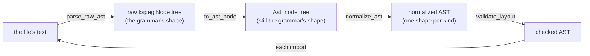
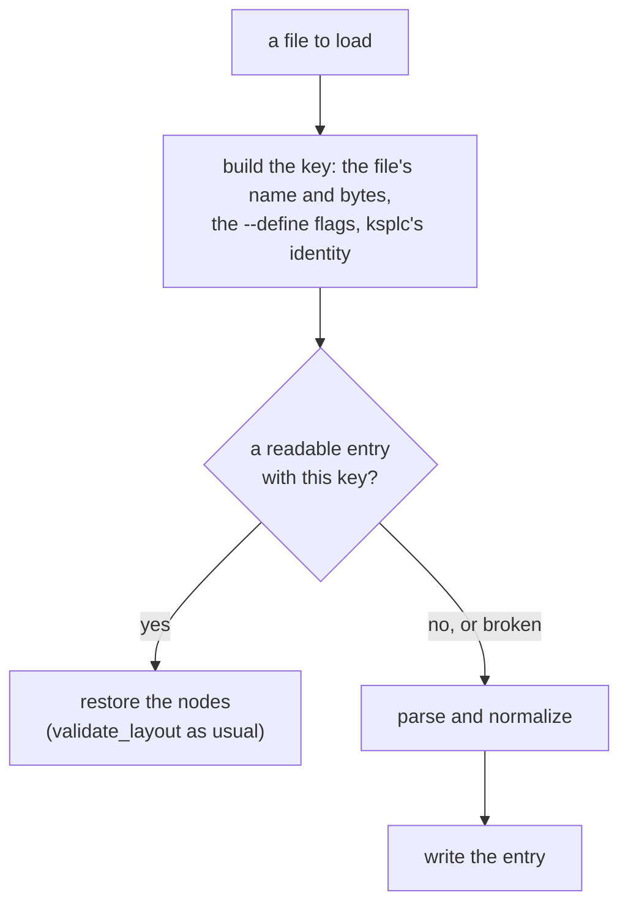

# ksplc's Parse layer: from text to an AST

**This document holds the design of ksplc's first layer, Parse.** It says how the source text becomes a tree (the AST), and how the tree is tidied to one shape per kind of node. It also says how Desugar rewrites shorthand into plain notation.

It is one chapter of the compiler's internal design; [`DESIGN-compiler.md`](DESIGN-compiler.md) holds the rest. Read "The compiler as a whole" in [`DESIGN-compiler.md`](DESIGN-compiler.md) first.

## The Parse layer: from text to an AST (Desugar included)

### What it answers for

It reads the source text and builds a general-purpose abstract syntax tree (AST). Then it *normalizes* the tree: it reshapes it into one fixed shape per kind of node. **It ignores types and meaning.** Its one aim is an AST that is regular everywhere, so every later layer can read it through safe accessors alone. That is the first rule of the chapter "The rules for handling an AST, shared by every layer" in [`DESIGN-compiler.md`](DESIGN-compiler.md).

### The internal flow: KSPEG tree, AST conversion, normalizing, verification

`load_and_parse_file` in `parse/load.kspl` is the one orchestrator. The diagram shows what it does with one file.



For each file it runs, **in this order**:

1. **The raw KSPEG parse**: `parse_raw_ast` drives the grammar rule `"program"` and gets a `kspeg.Node` tree in the grammar's own shape.
2. **The AST conversion**: `to_ast_node` (`parse/load.kspl`) rebuilds it recursively as `Ast_node`s, dropping `null` children.
3. **Normalizing**: `normalize_ast` (`impl Ast_node` in `parse/normalize.kspl`) makes one *post-order* recursion (a node is handled after all its children).
   * At each node it applies `elide_node`, then `normalize_by_kind` (a dispatch table on `kind_id`).
   * `elide_node` does the single-child pass-through, strips brackets, reassembles `expr_cast` and so on.
   * `normalize_by_kind` delegates many kinds to helpers in `parse/normalize_decl.kspl` / `parse/normalize_stmt.kspl` (`normalize_if_stmt`, `normalize_switch_stmt`, say). They are helpers called from one table, not passes of their own.
4. **Verification**: `validate_layout` (`base/ast.kspl`) checks the finished tree, in one separate walk after the whole file is normalized.

**`load_and_parse_file` follows the imports by its own recursion**, calling itself on each `.k_decl_import`'s resolved path. Every file's top-level nodes go to one shared `root_file`. Two records stop it going round in circles:

| record | what it holds | what it does |
| :-- | :-- | :-- |
| `import_stack` | the chain of files being loaded, each importing the next | a path already on it from a different directory throws `circular_import`. From the same directory it counts as resolved, because a cycle within one folder is allowed |
| `loaded_files` | a memo of every file already loaded | keeps a file reached by two paths from being analysed twice |

### The normalized AST's invariants: no crash, no differing output

Later layers rely on these without checking. Breaking one causes SEGVs or differences between Stage1's and Stage2's output.

| the rule | what it says | why |
| :-- | :-- | :-- |
| **The absolute rule of fixed length versus variable length** | **A context-dependent structure has a fixed length**: syntax with an optional modifier or `label` (`decl_var`, `stmt_for`, `stmt_switch`) always has the same element count (a Fixed Layout). An `empty` node fills a missing part. **A homogeneous list has a variable length**: a run of one kind (`stmt_block`'s statements, `expr_args` and the like) stays variable | the most important guard against out-of-bounds access: downstream reads a part by its index in one step (O(1)), never by searching |
| **An AST node's pointer is unique (No Node Sharing)** | never reuse an instance, not even a dummy `empty` node filling a slot; allocate each with `Ast_node.new` | Sema keys the type environment on a node's address. A shared node makes the type information collide and causes a SEGV |
| **Normalizing the string (text)** | a leaf's `text` (`Identifier`, `Keyword`, `Primitive_type`) keeps no surrounding whitespace, and symbol nodes (`()`, `,`, `;`, `{}`) vanish from the AST | a leaf holds exactly its word |
| **A string literal is zero-copy, with symmetric escapes** | the KSPEG engine keeps a slice of the source rather than unescaping. An ordinary string is written out as that slice, escapes and all. A raw string (`"""`) is escaped to C's rules on output (an actual newline → `\n` …) | nothing is copied, and an escape comes out as it went in |
| **Fixing the type expressions** | the raw pointer `@`, a slice/array `[]` and an exception union `!` each parse as a separate `type_postfix` node. The postfix mutability marker `$` (`docs/SPEC-programming-language.md` §3.2) stays at the head of the `text` of the `type_postfix` it was written on (`"$@"` / `"$[]"`) | which level a `$` belongs to stays known (the caution below) |
| **Attributes and visibility go at the head** | always first among the target node's children (in a fixed-length node, as an `attribute_list` node at `[0]`) | anywhere else, Sema loses track of what `pub` and the like apply to |
| **The position information (Source_loc) propagates exactly** | when `elide_node` discards a needless parent and lifts its child up, the child's own `loc` must never be overwritten | a compile error then reports the exact position |

Caution: **Normalizing must not strip the marker and move it up to the head.** `U8[]$@` (a mutable pointer to a slice of immutable elements) and `U8$[]@` would merge into one AST. A marker stays on its level, and `apply_type_postfixes` in `sema/decl/resolve.kspl` applies `Env.make_const` per level.

**A cfg drop empties the wrapper too.** `#cfg(...)` can sit on a declaration's direct child (in `decl_var` / `decl_const`, on the child `decl_var_item`; see "The top-level declarations"). Emptying that child via `should_drop_by_cfg` does not drop the parent. So `elide_node` also empties any `decl_var` / `decl_const` left with no children after `flatten_inline_nodes`. Otherwise the wrapper becomes a nameless declaration named `"unknown"` by `push_or_default`, and wrongly fires W0206. Check for the same gap when adding a node kind whose attributes are nested.

### The normalized AST's nodes: the shape Parse hands downstream

The tables below say, for each kind of node, which child sits at which index. Only `base/ast_ext`'s O(1) accessors read this layout (an *accessor* returns one named child, such as `get_import_path()`). **Spelling a type or a name from the tree is `base/ast_spell`'s job**, with its own limit on depth.

**`validate_layout` checks only the count of the fixed slots, and the kinds at a few key places** (`validate_layout_impl` in `base/ast.kspl`). Most kinds in these tables are the accessors' promise, not checked.

Caution: When adding an accessor, confirm that the kind really comes at that index.

**The notation**: `[0]` an index, `?` optional (`empty` where missing, or packed away), `...` variable length.

**These tables hold the kinds that come from `kspl.kspeg`'s grammar rules and remain after normalizing** (`decl_fn`, `stmt_if`, `expr_postfix`). The kinds Sema creates (`method_access`, `enum_init`) are in "The nodes Sema creates: its contract with Lower and Genc" in [`DESIGN-sema.md`](DESIGN-sema.md).

**Some kinds the grammar defines vanish.** Normalizing erases the nodes that the grammar needs but that mean nothing:

* **The rules that exist only for precedence**: `expr_or`, `expr_and`, `expr_cmp`, `expr_add`, `expr_mul`. Each is one precedence step, shaped `(the operator, the higher rule)*`.
  * With no operator and one child, `elide_node` (`parse/normalize.kspl`) replaces the node with its child. `to_ast_node` in `parse/load.kspl` checks the same list (`is_expr_wrapper_kind`) and does not make such a node.
  * With operators, `treeify_expr` (`parse/normalize_stmt.kspl`) folds them into a left-associative tree of the general-purpose `expr` kind: `a - b - c` becomes `(a - b) - c`.
* **The visibility wrapper**: the `k_visibility` node passes the `Keyword` inside it (`pub` …) up to its parent and vanishes.
* **Pure syntactic symbols**: a node of symbols alone (`(`, `)`, `,`, `;`, `{`, `}` and the like).

`expr`, `expr_ternary` and `expr_catch_chain` vanish only when they hold a single child, so they are in "The expressions and the types"'s table.

#### The top-level declarations

| `kind` | `children`, in order | notes |
| :--- | :--- | :--- |
| **`program`** | `[0...]`: the top-level elements (`decl_top` and the like) | the file's root |
| **`decl_import`** | `[0]: Keyword("import")`<br>`[1]: String`<br>`[2]?: Identifier` or `decl_import_selector_list` | `[2]` is either an alias for the whole file (`Identifier`) or a selective import list, never both. The alias form's `as` is removed. Accessors: `get_import_path()` / `get_decl_import_selector_list()` and the like |
| **`decl_import_selector_list`** | `[0...]: decl_import_selector` | the inside of the `{ }` in `import "path" { A, B }`; one or more |
| **`decl_import_selector`** | `[0]: Identifier` (the name in the imported file, used with no namespace) | Accessor: `get_selector_name()` |
| **`decl_embed`** | `[0]: Keyword("embed")`<br>`[1]: String`<br>`[2]: Identifier` (the bound name) |  |
| **`decl_extern_block`** | `[0]: Keyword("extern")`<br>`[1...]: decl_extern`, `decl_fn_proto`, `decl_var`, `decl_extern_struct` | kept in the AST as an external-linkage block, never flattened |
| **`decl_extern`** | `[0...]: decl_fn_proto` or `decl_var` or `decl_extern_struct` | a child of `decl_extern_block`; `pub` is removed, since Sema handles it |
| **`decl_extern_struct`** | `[0]: Keyword("struct")`<br>`[1]: Identifier` | an opaque struct, allowed only inside an `extern "C"` block |
| **`decl_const`**<br>**`decl_var`** | `[0]`: `attribute_list` or `empty` (the attributes and the visibility)<br>`[1]`: `Keyword` (`"var"` / `"let"` / `"const"`). `var` and `let` are no keywords: `parse/normalize_decl.kspl` makes them from whether a `$` is there.<br>`[2]`: `Identifier` (the variable's name)<br>`[3]`: `type_expr` or `empty` (the type annotation)<br>`[4]`: `expr` or `empty` (the initializing expression) | a declaration synthesized later has the same five slots (`build_inferred_var_decl` in `base/ast.kspl`) |
| **`decl_fn`** | `Keyword("fn")`, `Identifier`, `type_fn_sig`, `stmt_block` (read out in no particular order) | can include `type_gen_params`; the attributes and `pub` come first |
| **`decl_struct`** | `[0]: Keyword("struct")`<br>`[1]: Identifier`<br>`[2]?: type_gen_params`<br>`[3...]: struct_field` |  |
| **`struct_field`** | `[0]: Identifier`<br>`[1]: type_expr` | the attributes and the visibility (`pub`) come first |
| **`decl_enum`** | `[0]: Keyword("enum")`<br>`[1]: Identifier`<br>`[2]?: type_expr`<br>`[3...]: enum_variant` |  |
| **`enum_variant`** | `[0]: Identifier`<br>`[1]?: enum_payload`<br>`[last]?: expr` | `enum_field` is a tagged union's payload; `expr` is an explicit tag value |
| **`enum_payload`** | `[0...]: enum_field` | wraps the `enum_field`s |
| **`enum_field`** | `[0]: Identifier`<br>`[1]: type_expr` | a tagged union's payload field |
| **`decl_trait`** | `[0]: Keyword("trait")`<br>`[1]: Identifier`<br>`[2]?: type_gen_params`<br>`[3...]: decl_fn_proto` (each method signature) | `apply_modifiers_to_targets` moves the `visibility` before a method to the head of its `decl_fn_proto` (`docs/SPEC-programming-language.md` §5.3) |
| **`decl_impl`** | `[0]: Keyword("impl")`<br>`[1]?: type_gen_params`<br>`[2]: type_expr` (the target)<br>`[3]?: type_path` (the trait named)<br>`[4...]: decl_fn` | with a trait named (`: TraitName`), its `type_path` comes right after the target `type_expr` |
| **`decl_typedef`** | `[0]?: visibility`<br>`[1]: Keyword("typedef")`<br>`[2]: Identifier` (the new type name)<br>`[3]: type_expr` (the type it names) | becomes a typedef in Genc. Where `[3]` holds a `type_fn_sig`, C's own syntax has to resolve it, so the structure must not be broken |

#### The control flow and the statements

| `kind` | `children`, in order | notes |
| :--- | :--- | :--- |
| **`stmt_block`** | `[0...]: stmt` | the `{` and `}` are removed |
| **`stmt_labeled_block`** | `[0]`: `label`<br>`[1]`: `stmt_block` | Lower flattens it into an ordinary block plus a `stmt_label` |
| **`stmt_if`** | `[0]`: `label` or `empty`<br>`[1]`: `expr` (the condition)<br>`[2]`: `stmt_block` (the then block)<br>`[3]`: `stmt_block`, `stmt_if`, or `empty` (the else block) | |
| **`stmt_for`** | `[0]`: `label` or `empty`<br>`[1]`: `decl_var`, `stmt_expr`, the bare `Identifier` of a `for x in` (until Desugar), or `empty` (the init)<br>`[2]`: `expr` or `empty` (the condition)<br>`[3]`: `stmt_expr` or `empty` (the step)<br>`[4]`: `stmt_block` or `empty` (the loop's body) | always five elements, whether C-style, while or endless |
| **`stmt_switch`** | `[0]`: `label` or `empty`<br>`[1]`: `expr` (the condition)<br>`[2...]`: `case_pattern` or `stmt_block` or `Keyword("case"/"default")` | |
| **`stmt_return`**<br>**`stmt_break`**<br>**`stmt_continue`** | `[0]`: `Keyword`<br>`[1]`: `expr` or `Identifier` (optional) | |
| **`stmt_fallback`** | `[0]`: `Keyword`<br>`[1]`: `expr` | |
| **`stmt_defer`** | `[0]`: `Keyword("defer")`<br>`[1]: stmt_block`, or a `decl_var` before the desugaring | `normalize_defer_stmt` in `parse/normalize_stmt.kspl` gives a one-statement `defer` (`defer buf.free()`) a `stmt_block`. A declaration (`defer $b: = X`) stays one `decl_var` child until the desugaring splits it. It holds no capture list (`docs/SPEC-programming-language.md` §8.4.1; the grounds are docs/DESIGN-programming-language.md "Why `defer` has no capture list") |
| **`stmt_expr`** | `[0]`: `expr` (the left-hand side)<br>`[1]?: assign_op` (the assignment operator)<br>`[2]?: expr` (the right-hand side) | |

#### The expressions and the types

| `kind` | `children`, in order | notes |
| :--- | :--- | :--- |
| **`expr`** | `[0]`: `expr` (the left-hand side)<br>`[1]`: `Literal` (the operator)<br>`[2]`: `expr` (the right-hand side) | the grammar's five precedence rules always end as this three-element general-purpose `expr` |
| **`expr_unary`** | `[0]`: `Literal` (`!`, `-`, `~` and so on)<br>`[1]`: `expr` (the target expression) | |
| **`expr_offsetof`** | `[0]`: `Keyword("offsetof")`<br>`[1]`: `type_expr`<br>`[2]`: `Identifier` (the field's name) | renamed from `expr_unary` by `set_kind` (`parse/normalize.kspl`). The `k_expr_unary` branch in `parse/normalize_stmt.kspl` drops its symbols and round brackets, so `expr_sizeof` can read `[1]` as its target |
| **`expr_ternary`** | `[0]`: `expr` (the condition)<br>`[1]`: `expr` (the value where true)<br>`[2]`: `expr` (the value where false) | the `value if condition else value` syntax. Without a condition it normalizes into the value itself |
| **`expr_catch_chain`** | `[0]`: `expr` (the left-hand side)<br>`[1]`: `expr_catch` | a run such as `a catch b catch c` is piled into left-associative two-element nodes by `treeify_expr` (`parse/normalize_stmt.kspl`); with no `catch` it vanishes |
| **`expr_postfix`** | `[0]`: `expr_primary` (the receiver)<br>`[1]`: `Literal` or `Keyword` (`.`, `[`, `(`, `@`, `::`, `!`)<br>`[2...]`: the elements accessed | |
| **`expr_implicit_dot`** | `[0]`: `Identifier` (a method or variant name)<br>`[1]?: expr_args` | a dot access with the receiver omitted (`.ok` or `.free()`), used by Desugar's method-chain expansion and by Sema's implicit resolution of an enum |
| **`expr_catch`** | `[0]`: `Keyword("catch")`<br>`[1]?: Identifier` (the error variable)<br>`[2]: stmt_block / expr` | one `catch`, as `expr_catch_chain`'s right-hand element |
| **`struct_literal`** | `[0]?: type_path / type_expr`<br>`[1...]: expr_field_init` | a compound literal, renamed from `expr_compound` by normalizing |
| **`expr_field_init`** | `[0]?: Identifier / . / [` (the prefix)<br>`[1]: Identifier / expr` (the key's name / the index)<br>`[2]?: Literal("=")`<br>`[3]: expr` (the initializing expression) | |
| **`type_expr`** | `0` (Terminal) | stringified: normalizing joins every child's text into a type string such as `const I32[]` in `self.text`, and discards the subtree |

### Desugar: expanding the syntactic sugar that needs no types

*Syntactic sugar* is a shorter way to write something the language could also say in plain syntax. Desugar walks the normalized AST in one post-order recursion through `desugar_node`. It rewrites the sugar that the tree's shape alone can rewrite, and later layers check the result like any code. ["Which sugar belongs to which layer (the list)"](#which-sugar-belongs-to-which-layer-the-list) lists what it rewrites.

**It is a file of its own (`parse/desugar.kspl`) but a step of the Parse layer**, knowing what Parse knows ("From source code to a binary" in [`DESIGN-compiler.md`](DESIGN-compiler.md)).

**Little work fits this layer**: most candidate sugars need to know what a name refers to, so they belong to Sema.

`parse/format_spec.kspl` holds only the grammar of a format specifier's SPEC `\{value:SPEC\}`; the desugaring code reports.

**Why it is called at a separate timing rather than from `parse_file`**: it runs once over the whole of `root_file`, at the head of `Compiler.run_semantic_analysis` (`pipeline.kspl`). **The reason is the diagnostics.** Desugar reports a mis-written format specifier or a failed closure synthesis. Run per file, the report would sit inside the disk cache (`parse/ast_cache.kspl`), and a cache hit would print nothing. (The `loaded_files` guard already runs each file once, and a lifted closure is `priv`, made unique per file by `write_priv_prefix_to` in `lower/abi.kspl`.)

Caution: **To move it, first make sure that a file which emitted a diagnostic is not cached.** Otherwise a mistake shows red on the first run alone.

**`for item in collection` is split between two layers** (its seam is in ["Measuring where the desugaring goes"](#measuring-where-the-desugaring-goes)):

| layer | its half | why there |
| :-- | :-- | :-- |
| Desugar | declares a temporary for the collection expression, so an expression with a side effect is not evaluated on every iteration | only this layer can insert that declaration into the enclosing block |
| Sema | expands the `for` itself, and decides whether the temporary copies the collection or points at it (["`for x in` is expanded in Sema, since its shape needs types"](DESIGN-sema.md#for-x-in-is-expanded-in-sema-since-its-shape-needs-types)) | the subject's type decides both |

#### A closure is synthesized as source for the same parser

A *closure* is a function value that keeps the local variables it uses (its *captures*). C has no closures, so each becomes three things the language has: an environment struct holding the captures, its constructor, and the impls for `Callable`.

**The synthesized declarations are written as KSPL source and parsed** through `parse_synth_decls` in `parse/load.kspl`, the one entry point for every synthesis. A hand-built AST hides its mistakes until the generated C, and must follow every change to a declaration's shape. A string keeps the grammar (`ksplc/kspl.kspeg`) the one source. Only the body is transplanted from the original AST.

**The enclosing type arguments that the signature touches are copied across** to the synthesized declarations. Those sit at the top level, outside the enclosure's scope (`forwarded_gen_params` in `parse/desugar_closure.kspl`, which says why no more are copied).

* Match each as one whole identifier, since as a substring `T` matches `Total`.
* Put them on the constructor call as `type_args` children. Otherwise `replace_type_vars` in `sema/decl/subst.kspl` cannot reach them, and the environment fails to conform to `Callable1<|I32, …|>`.
* Write them out rather than leave them to inference. Inference has no clue with zero captures, and through an immutable binding's `n@` it binds `T` to `I32 const`.

**A closure's signature cannot omit its types, because this layer has no types.** The parameter, return and capture types are copied into the source as written. **A folded slice or optional is copied as its sugar** (`spell_as_written` in `parse/desugar_slice.kspl`), since the folded `Slice<|U8|>` is refused as a type. Filling the types from the expected type would move the synthesis to Sema. Sema would then register a new struct and impl after all the declarations are gathered, and insert a declaration into the enclosing block.

Caution: **Do not move half of it.** Parse and Sema would each have an entry point that synthesizes, and one thing would have two sources.

**The captures' types alone could be omitted while staying in this layer.** Make them type arguments of the synthesized declarations, taken as `C@` by the function that makes the environment. `C` is then bound from `env_new(lo@)`'s actual argument. This does not conflict with writing out the enclosing type arguments above.

**The same shape does not work for the parameter and return types.** They would appear only in the impl for `Callable`, so no argument supplies them, and inference by position breaks. `env_new(lo@)` for `Env<|P, C|>` gives `Env_I32_Const_C`, with `C` unbound. Filling them needs a way back from the expected type to the value's type arguments, the reverse of monomorphization. The Sema layer rejects a blanket impl for the same reason ("Impls of generic types" in [`DESIGN-sema.md`](DESIGN-sema.md)).

**The body is not the obstacle**, since a generic's body is checked per instantiation. **The tools it would need are generic instantiation's** (["Where the instantiation queue is drained"](DESIGN-sema.md#where-the-instantiation-queue-is-drained)). They would have to drain between statements.

#### Which sugar belongs to which layer (the list)

**When adding a sugar, first decide its row in this table**, on three questions:

1. Does it need types?
2. Can the instantiation multiplier be paid? Work in Lower repeats once per generic instantiation (["Moving type-dependent sugar to Lower: the costs and the conclusion"](#moving-type-dependent-sugar-to-lower-the-costs-and-the-conclusion)).
3. Do typing rules grow in Sema?

Then write it in that layer's section too, which holds the detailed reasons.

Caution: **Name the entry point's symbol, not the file alone**, so `make test-docref` checks that the symbol is in that file.

**Every Desugar row runs inside one walk** with three ordering constraints:

* the slice of a run of elements is expanded before `T[]` is rewritten;
* a block walks its own children;
* the enclosing type arguments are pushed down.

Read their reasons at `desugar_node` in `parse/desugar.kspl` before adding a Desugar row.

| layer | the sugar | the place (the entry point's symbol) |
| :-- | :-- | :-- |
| **Parse / normalizing** | removing wrappers, moving modifiers, folding the type postfixes (`@` `$@` `[]`), dropping by `#cfg` | `normalize_ast` in `parse/normalize.kspl` |
| | giving each `name: T = v` the shape later stages read (a `var` or `let` keyword, the name, the type, the value) | `flatten_var_decl_lists` in `parse/normalize_decl.kspl` (called by `normalize_by_kind` in `parse/normalize.kspl`) |
| **Parse / loading** | synthesizing an `enum`'s `variant_name()`, `variants()` and `from_variant_name()` | `append_enum_members` in `parse/load.kspl` (["Synthesizing an `enum`'s members"](#synthesizing-an-enums-members)) |
| **Desugar** | string interpolation → a method chain | `desugar_string_call` in `parse/desugar.kspl` |
| | a format specifier's SPEC `\{v:SPEC\}` → the arguments of `fmt_spec` / `fmt_prec` / `fmt_hex` | `build_call` in `parse/format_spec.kspl` |
| | `for x in`'s **collection expression** moved aside into a temporary variable | `desugar_for_in_loop` in `parse/desugar.kspl` |
| | an anonymous function or closure → `_anon_fn_N` plus an environment struct plus impls for `Callable` | `desugar_fn_lit` in `parse/desugar_closure.kspl` (["A closure is synthesized as source for the same parser"](#a-closure-is-synthesized-as-source-for-the-same-parser)) |
| | `if v: = X { }` → a `switch` shape (**the rejection is Sema's**) | `desugar_if_bind` in `parse/desugar.kspl` |
| | `defer $b: = X` → the declaration plus a `defer b.free()` marked as made by the compiler (**the check that `b`'s type conforms to `Manual_free` is Sema's**) | `build_deferred_free` in `parse/desugar.kspl` |
| | a **written** `T[]` / `T$[]` → `Slice<\|T\|>` / `Slice<\|$T\|>`, and `T?` → `Option<\|T\|>` | `fold_sugar_postfixes` in `parse/desugar_slice.kspl` |
| **Sema** | `for x in`'s shape (an index or `next()`, decided by the subject's type) | `expand_for_in` in `sema/body/for_in.kspl` (["`for x in` is expanded in Sema, since its shape needs types"](DESIGN-sema.md#for-x-in-is-expanded-in-sema-since-its-shape-needs-types)) |
| | the rejection that holds `if v: =` to an `Option` | `infer_switch_stmt` in `sema/body/switch.kspl` |
| | an implicit conversion, an upcast, a `Result` wrap → `expr_postfix ::` / `expr_upcast` / `result_wrap` | `apply_type_coercion` in `sema/body/coerce.kspl` |
| | interpolation's `\{e\}` to `e.variant_name()` where it is an enum | `name_enum_put_value` in `sema/body/call.kspl` |
| | filling in default arguments (an operator's desugaring has its own entry point) | `fill_default_args` / `fill_operator_defaults` in `sema/body/call_defaults.kspl` |
| | instantiating a generic | `instantiate_struct` / `instantiate_fn` in `sema/decl/mono.kspl` |
| | a general-purpose access → a dedicated node (`method_access` / `enum_init`) | `infer_dot_access` / `infer_namespace_access` in `sema/body/dot.kspl` |
| | a **synthesized** slice (a string literal's type, the reflection table) | `slice_type_of` in `sema/decl/mono.kspl` |
| **Lower** | hoisting short-circuit evaluation `&&` / `\|\|`, `!` (`result_unwrap`), and `catch` / `fallback` | `lower_logical_op` / `lower_try_op` / `lower_expr_catch_chain` in `lower/expr.kspl` |
| | operator overloading `a + b` / `a[i]` → a method-call node (**Sema decides which method, Lower builds the call**) | `lower_user_operator` in `lower/expr.kspl` |
| | moving an index aside (a slice's `at` needs the receiver's address) | `lower_postfix_index_operator` in `lower/expr.kspl` |
| | `defer`'s cleanup, a labelled `break` / `continue` | `inject_cleanups` / `lower_loop_jump` in `lower/defer.kspl` |
| | inserting ARC's retain / release | `lower_arc_var_decl` / `emit_managed_op` in `lower/arc.kspl` |
| | generating thunks and vtables | `generate_trait_thunks` in `lower/vtable.kspl` (["The internal flow: flatten, add vtables, mangle, prune, verify"](DESIGN-lower.md#the-internal-flow-flatten-add-vtables-mangle-prune-verify)) |
| | a method call → a function call (the receiver becomes the first argument), the mangling of `priv` | `run` in `lower/abi.kspl` |
| **Genc / Genllvm** | none (output alone) | — |

#### Moving type-dependent sugar to Lower: the costs and the conclusion

A sugar that needs types could move to Lower, which knows them. ["A closure is synthesized as source for the same parser"](#a-closure-is-synthesized-as-source-for-the-same-parser) weighs moving it to Sema instead. For **Lower**:

| point | what it means |
| :-- | :-- |
| **Lower has types, at the price of the instantiation multiplier** | templates do not reach Lower (["The internal flow: flatten, add vtables, mangle, prune, verify"](DESIGN-lower.md#the-internal-flow-flatten-add-vtables-mangle-prune-verify)). Its tree holds several times as many function bodies as the source declares. So desugaring in Lower runs that many times more |
| **Inserting a statement is no obstacle** | `lower/expr.kspl` already hoists for short-circuit evaluation and `catch` |
| **Sema pays the cost** | Sema sees only the desugared shape. Move a sugar to Lower, and Sema gains typing rules for the sugar itself. Lower does not shrink; Sema grows |

**The conclusion: do not move them all at once.** Decide each sugar on "Which sugar belongs to which layer (the list)"'s three questions.

#### Measuring where the desugaring goes

**Speed does not decide where Desugar lives, since it costs about 1% of a compile** (`make perf-log` re-takes it). What matters is that it stays in one place, and that a sugar split across two layers joins at one agreed name.

**The parse layer's desugaring is not scattered.** It has one entry point, `parse_desugar.run`, and one post-order walk through `desugar_node`. `desugar_slice` / `format_spec` / `desugar_closure` are called from there alone; the four files split it by transformation. A transformation of one short function (`desugar_if_bind`) stays in `desugar.kspl`.

**What is counted instead is the seams.** A *seam* is where one sugar spans two layers: both halves agree on one name ([the glossary](DESIGN-compiler.md#the-glossary)).

| the sugar | the first half | the second half | the seam's name |
| :-- | :-- | :-- | :-- |
| `for x in` | parse: moving the collection expression aside | sema: choosing the shape | the bare `Identifier` left at the init position |
| `if v: =` | parse: assembling the `switch` | sema: the rejection that holds it to an `Option` | `IF_BIND_MARK` (`base/ast_ext.kspl`) |
| operator overloading | sema: which method | lower: assembling the call | the node carrying the resolution |

Each exists because the second half needs types, so no seam can be erased.

Caution: **When adding a seam, put its name in `base/`, in exactly one place** (`base/ast_ext.kspl` for an AST mark, `base/core.kspl` for the name desugared to). Written in two layers, it passes silently the day only one is fixed.

**Three places are held to one means each (Principle 6 in `docs/DESIGN-principles.md`).**

1. **The temporary names' serial numbers start again per body, in both halves of `for x in`**: `for_in_counter` in `parse/desugar.kspl` and `enter_fn_serial` / `leave_fn_serial` in `sema/body/for_in.kspl`. With a running number, one added `for x in` shifts every later number, and the diff of `ksplc/seed.c` grows.

   **The closures' serial numbers run per file** (the reason is at `next_anon_serial` in `parse/desugar.kspl`). A change to how the names are made needs the seed updated first ("The bootstrap, and keeping the seed in step" in [`DESIGN-compiler.md`](DESIGN-compiler.md)).
2. **Every synthesis goes through one entry point, `parse_synth_decls` in `parse/load.kspl`.** A closure (desugar) and an `enum`'s members (load, ["Synthesizing an `enum`'s members"](#synthesizing-an-enums-members)) take one path to declarations: parse → normalize → `set_kind(.k_file)` → `validate_layout` → `unwrap_top_level`.
   * **They still run at different stages** (`variant_name` inside the cache, the closures outside). Lining them up waits on the caution under "Why it is called at a separate timing rather than from `parse_file`" above.
3. **Only `build_call` in `parse/format_spec.kspl` maps a format to a method name** (`FMT_METHOD_CHAR` and others in `base/core.kspl`). The sema code words "there is no such method" in the format specifier's terms.
   * Adding an argument to `fmt_spec` and folding them into one method does not work (the reason is in `parse/format_spec.kspl`).

**No seam can be removed by compromising on the specification:**

| compromise | what it would erase | what it would cost |
| :-- | :-- | :-- |
| allow `for x in` on `Iter` alone | Sema's expansion and the seam | an `Option` per element in iterating an array or a slice |
| reject `for x in` on an `Iter` | it would keep it inside the parse layer | a trait it declares could not be used |
| widen `if v: =` to two-variant enums in general | Sema's rejection | a branch that passes silently the day a variant is added (`desugar_if_bind` in `parse/desugar.kspl`) |

**The first two are already rejected** ("Make the index side the default" in `sema/body/for_in.kspl`, and Principle 5 in `docs/DESIGN-principles.md`).

**Gathering the desugaring into one stage would cost in the diagnostics**, which then show synthesized names. KSPL keeps them out with `is_anon_fn_name` and `append_anon_fn_capture_note` (`sema/session/ctx.kspl`) and "do not put a synthesized name out" in `sema/body/stmt_escape.kspl`.

### Synthesizing an `enum`'s members

**The compiler adds a method `variant_name()` to every `enum`, returning the variant's name as a string.** Only the compiler knows that name as a string (ksplc's own `report_and_exit` in `main.kspl` is the main user). Once a file has been read, `append_enum_members` in `parse/load.kspl` adds this for each `enum`:

```kspl
impl E
    pub fn variant_name(r: E): U8[]
        switch r
        case .alpha
            return "alpha"
        case .beta
            return "beta"
```

**An `enum` with no type parameters whose variants carry no payload also gets `variants()` and `from_variant_name(name)`.** The reasons are "An enum lists its variants and reads one back" in [`docs/DESIGN-programming-language.md`](../../docs/DESIGN-programming-language.md). They go into the same `impl`, after a constant array that lists the variants:

```kspl
priv const _variants_of_E: E[2] = ::{ .alpha, .beta }

impl E
    pub fn variants(): E[]
        return E[]::_variants_of_E
    pub fn from_variant_name(name: U8[]): E?
        for _v in _variants_of_E
            ... // compare _v.variant_name() with name, byte for byte
```

* **The array is a top-level `const`**, so the returned slice does not point at a frame already gone.
* **Its name and the lookup's locals open with `_`**, so no check reports what the user did not write.
* **The lookup compares bytes itself**, since the `enum`'s file need not import `std/str`.

**It is not synthesized** in these cases:

| case | why |
| :-- | :-- |
| the user has written a method of that name | it would be defined twice |
| a variant has that name (`variants()` and `from_variant_name()` only) | `E.x` reads the variant first, so the method could not be called |
| an `enum` carrying a const generic | the type arguments' names are not restored |
| `variants()` and `from_variant_name()` on an `enum` with a type parameter or a payload variant | a top-level constant cannot hold a generic type, and a variant with a payload is no value without its data. Sema reports a use of either by name (`refuse_variant_list` in `sema/body/dot.kspl`) |

**What it makes is placed at the `enum`'s name, and is marked as made by the compiler.** Parsed from a string, its positions would land on whatever the file's first lines hold, such as an `import` line.

* `place_as_made` in `base/ast_ext.kspl` places every node at the name, so a diagnostic, and the jump from a written `e.variant_name()`, land on what it was made for.
* It also marks the `impl`, its methods and the constant. The language server's walks by position skip what `made_by_compiler` answers (`lsp/outline.kspl`, `lsp/position.kspl`, `lsp/uses.kspl`).
* The mark lives in `ival`, which the AST cache keeps.

**The return value is held to `U8[]`, and no `Writer` is used.** Synthesizing `fmt` directly would give every `enum` a `Formattable` vtable ("The internal flow: flatten, add vtables, mangle, prune, verify" in [`DESIGN-lower.md`](DESIGN-lower.md)). Its initializer names the thunk as data, so `--gc-sections` cannot drop it, which matters under freestanding. For `\{e\}`, `name_enum_put_value` in `sema/body/call.kspl` rewrites `put(w, e)` into `put(w, e.variant_name())` instead, once the arguments are typed and before the instance is made.

Caution: **Infer only the new argument.** The writer is a chain already inferred (`arena.text().s(…)`), and inferred a second time it is refused as a temporary. A variant written out (`Color.red`) holds no type name once typed. So it is replaced by its name as text, not inferred again. One built with its payload is refused, since the payload may do work.

**It must not decide on the name `put` alone either.** A user's own `put` would have its body ignored. It matches only a `put` whose body is `std/lang`'s.

**The price**: the generated C grows slightly. `--gc-sections` drops an unused synthesized method and array, so a freestanding artifact's size does not change.

### The normalized AST's disk cache (`ksplc/parse/ast_cache.kspl`)

**Parsing is most of each start's time, so ksplc keeps each file's normalized tree on disk.** If the file and ksplc have not changed, the tree is read back and the parse skipped.



**The unit is one file.** What a file adds to `root_file`, including the members `append_enum_members` synthesizes, depends only on its source and on ksplc. So an entry is shared across programs.

**An entry carries everything normalizing produced that a later stage reads**: the declarations, and the ranges a `#cfg()` dropped (`base/cfg_inactive.record_cfg_inactive`). Otherwise a hit would answer otherwise than a cold run; `make test-ast-cache` compares the two.

Caution: **Always mix ksplc's own identity into the key** (`base/cache.append_self_identity`). The grammar and the normalizing rules live inside ksplc, so otherwise a new compiler takes an old AST as its own. Where the identity cannot be told (`argv[0]` cannot be stat'd), the cache is skipped.

**A broken or old-format file is silently discarded, and the file is parsed.** The cache is for speed alone. The checks (the magic, the format's version, the key, the length, the range of `kind_id`) run before reading, and restored nodes pass the same `validate_layout()`.

**A buffer being edited is not cached** (the reason is in [`SPEC-tools.md` §2.7](SPEC-tools.md#27-the-cache-of-the-parse-result)); a saved file's bytes are cached as usual.

**Split the directories per generation (ksplc's identity), and sweep old generations**, or every rebuild of ksplc strands its entries and the cache grows without bound.

* Keep enough alive for self-hosting's ksplcs (seed / stage1 / stage2, and the LLVM version), or they erase each other unnoticed.
* A generation in use is not spared the sweep, unlike `ksplc run`'s slots (`RUN_SLOT_SPARE_SECS` in `tools/run.kspl`). Every write into a generation is a rename that is allowed to fail, so a swept run only misses.

`--stats`'s `[AST Cache]` line shows whether the cache hits ("Measuring the compiler: `--stats` and the performance guard" in [`DESIGN-compiler.md`](DESIGN-compiler.md)).

**Digest text is a fixed-size value**: `base/cache.Hash_hex` holds its 64 hexadecimal bytes, and `hash_hex` returns them without allocating.

### What a syntax error names

This section covers the compiler's one diagnostic for a syntax error. "Only the editor's parse recovers from a syntax error" in [`DESIGN-tools.md`](DESIGN-tools.md) covers how the editor's parse continues past one.

The list of expectations (`expected …`) holds **only words the user can type, with the fix first**. `track_fail` in `kspeg/engine.kspl` implements what is suppressed, and `track_token_fail` / `order_expected` in `kspeg/expected.kspl` build the list. Four rules hold:

1. **Nothing inside a suppression is collected.**
   * A failure inside a lookahead (`!_Keyword`) is not what the user fixes.
   * One inside a lexical token (one word of the text: a name, a number, a string) or a transparent rule (`_Name`) is the grammar's internal wording.
2. **A lexical token is named by its own name** (`Identifier` → `an identifier`), never expanded into spellings. `Primitive_type`'s names alone would reach the limit. A rule whose body is one spelling (`Stmt_end = ";"`) shows that spelling.
3. **The position is where the spelling ran out, not the token's head** (`Fail_track.deepest_try`). Otherwise an unclosed string would read "an expression expected at the opening quotation mark". A token that has begun names itself instead of passing the failure outwards.
4. **The expectations that stopped the parse come first** (`Expected.is_optional`). Unsorted, after `a: I32 = 1` every binary operator precedes `';'`. A miss at the head of an option (`?`) or a repetition (`*`) did not stop the parse; a miss after reading began did.
   * **Move them to the front without dropping the rest**, which can still be written there (after `f(`, both a parameter and `)`).
   * **Where another branch read the input, take the missed branch off the stopping side** (`demote_expected_since`). Otherwise `2 - 3;`'s list begins with `a float`.

**Keep no table of wordings in ksplc.** `append_expected` in `parse/syntax_msg.kspl` only turns `_` into a space and lowercases; readable names are the grammar's duty (`ksplc/kspl.kspeg`).

**In the indentation notation the list names the notation's own marks.** The parser reads the text with braces and `;` put in, which the writer never types. So `';'` becomes "the end of the line", and a `'}'` closing a block the indentation opened becomes "the end of the block". Only the `{` the reader put in (`opened_by_layout`) changes the word.

**A character outside ASCII where the parse stops is named.** Python, Rust, Swift, Java and C++ all take a name in another script, so the list alone does not say why `かんそ` is refused. The Note names the ASCII rule and the character (`append_non_ascii_hint`).

**An unclosed bracket is named where it opened.** The lines after an open bracket read as its contents, so the failure lands a line or more below the mistake. The Note gives the bracket's line and column (`append_unclosed_bracket_hint` in `parse/syntax_msg.kspl`). A closer of the wrong kind at the failure names the one that fits instead.

* **Whether it is never closed is decided over the rest of the text.** A bracket closed further on means the mistake is inside it (the case `laid_comma_missing_in_closed_call` in `tests/negative/laid.kspl`).
* **A `{` is left out.** The one still open at the end is the outermost, not the one missing its `}`, and ksplc does not guess from the indentation.

**A string left open to the end of the text is named where it opened.** An ordinary string can hold a line end, so the parser fails only where the text runs out. The error stands on the opening quote and gives no list of expectations (`parse_error_at` in `parse/syntax_msg.kspl`). A string that a later quote closes shows its mistake where that text ends.

**A missing `,` between two items is named.** Two items side by side inside a list's brackets get "a ',' may be missing before 'X'" (`append_missing_comma_hint` in `parse/syntax_msg.kspl`).

* The brackets are a call's or a signature's `(` after a name or a closing bracket, and a value's `::{`.
* Grouping parentheses hold one value, so nothing is said there (the case `laid_group_holds_one_value` in `tests/negative/laid.kspl`).
* The Note says "may", because two values side by side can need an operator instead.

### Every place a source enters reads it the same way

**Source text reaches ksplc from the disk and from the editor. Each place runs the reader of the indentation notation exactly once, so the compiler and the editor see the same program.** The places are `parse/load.kspl` for the disk and `lsp/worker.kspl` for the editor. A second pass would count the `{` the first inserted as a bracket.

**Both places pool what the reader found, and neither prints it**, so `ksplc` and the editor report the same column slips (`make test-lsp`). The reader returns its findings as a value (`Note` in `parse/layout.kspl`). **Do not print them before parsing**: the lint gate counts only what Sema reports. `pipeline.kspl` emits them through `Sema_ctx.report_diagnostic_at` once sema is set up.

**Every place a source enters goes through one step**: `settle` in `parse/source_fix.kspl`. It handles the BOM (an invisible marker some editors put at a file's start) and the line terminator together. The places:

| place | note |
| :-- | :-- |
| the disk (`parse/load.kspl`) | what a compile reads |
| standard input (`read_supplied` in `main.kspl`) | a program with no file: a compile's input `-`, which `ksplc run -` and `--eval=` hand their child |
| the formatter | |
| the language server (`lsp/worker.kspl`) | it takes an editor's buffer, and also reads the disk for workspace-wide answers |

Fixed at one place only, the others answer about a different program. A language server reading the disk raw would take a Windows checkout's `\r\n` files for another program when it renames across them.

**A comment notation is removed from two places**: the grammar, and `kanso_space_skipper` in `parse/load.kspl`. That hook skips whitespace and comments in place of the grammar's `_Space`. Removed from one alone, a refused form passes silently. `make test-negative` holds both notations the grammar refuses: block comments, and `T!` with its error type left out.

### A literal's escapes are decided in one place

**What each backslash escape in a string means (`\n`, `\uXXXX`) is decided in one place, and every other place asks it**: `is_known_escape` in `base/literal.kspl` rejects an unknown one. Beside it, `literal_escape_byte` decides the byte, and `literal_fault` gives `\uXXXX`'s three rejections one answer (too few digits, a surrogate, too wide for a character literal).

**`\uXXXX` is not one byte**: UTF-8 stores a character in one to four bytes. So the place it is counted (`byte_len` in `literal_span` of `base/literal.kspl`) and the two places it is emitted (`gen/c/literal.kspl` and `gen/llvm/ctx.kspl`) must agree. One pair holds the mapping to UTF-8: `codepoint_len` / `codepoint_byte` in `std/chars`, the counterpart of the reader's `next_codepoint`.

**A character literal's bytes are counted in one place**, `byte_len` in `literal_span`, so `char_literal_byte` never sees more than one.
