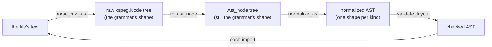
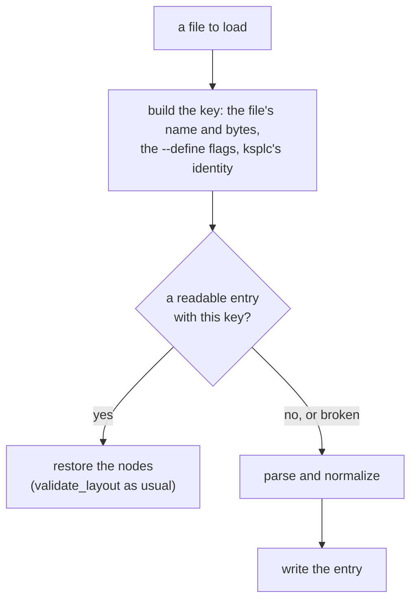

# ksplc's Parse layer: from text to an AST

**This document holds the design of ksplc's first layer, Parse.** It says three things:

* how the source text becomes a tree (the AST);
* how that tree is tidied so that every node of one kind has one shape;
* how Desugar rewrites shorthand into plain notation.

It is one chapter of the compiler's internal design. [`DESIGN-compiler.md`](DESIGN-compiler.md) holds the rest:

* the map of the whole compiler and the Development Principles;
* the rules for handling an AST that every layer shares;
* the arena, the conventions and the glossary.

Read "The compiler as a whole" in [`DESIGN-compiler.md`](DESIGN-compiler.md) first.

## The Parse layer: from text to an AST (Desugar included)

Parse reads the source text and builds the tree (the AST). It then tidies the tree so that every node of one kind has the same shape. Desugar, a step inside this layer, rewrites shorthand notations into plain ones. Neither knows any types.

### What it answers for

It reads the source text and builds a general-purpose abstract syntax tree (AST). Then it *normalizes* the tree: it reshapes it into one fixed shape per kind of node. **It ignores types and meaning.** Its one aim is an AST that is regular everywhere. Every later layer can then read it through safe accessors alone. That is the first rule of the chapter "The rules for handling an AST, shared by every layer" in [`DESIGN-compiler.md`](DESIGN-compiler.md).

### The internal flow: KSPEG tree, AST conversion, normalizing, verification

Each file goes through four steps in a fixed order, and then the files it imports go through the same steps.

`load_and_parse_file` in `parse/load.kspl` is the one orchestrator. The diagram shows what it does with one file.



For each file it runs, **in this order**:

1. **The raw KSPEG parse**: `parse_raw_ast` drives the grammar rule `"program"` and gets a `kspeg.Node` tree in the grammar's own shape.
2. **The AST conversion**: `to_ast_node` (`parse/load.kspl`) rebuilds it recursively as `Ast_node`s, dropping `null` children. The shape is still the grammar's.
3. **Normalizing**: `normalize_ast` (`impl Ast_node` in `parse/normalize.kspl`) makes one recursion from the children to the parent (*post-order*: a node is handled after all its children).
   * At each node it applies `elide_node`, then `normalize_by_kind` (a dispatch table on `kind_id`).
   * `elide_node` does the single-child pass-through, strips brackets, reassembles `expr_cast` and so on, all inside `normalize.kspl`.
   * `normalize_by_kind` delegates many kinds to per-kind normalizing functions in `parse/normalize_decl.kspl` / `parse/normalize_stmt.kspl` (`normalize_if_stmt`, `normalize_loop`, `normalize_switch_stmt`, `normalize_impl_decl`, `normalize_enum_variant`, say).
   * Calls go only from `normalize.kspl` to `normalize_decl.kspl` / `normalize_stmt.kspl`: those are helpers called from one dispatch table, not passes of their own.
4. **Verification**: `validate_layout` (`base/ast.kspl`) checks the finished tree recursively, in one separate walk after the whole file is normalized.

**`load_and_parse_file` follows the imports by its own recursion.** After normalizing a file, it calls itself on the resolved path of each `.k_decl_import`. It attaches every file's top-level nodes straight to one shared `root_file`. Two records keep it from going round in circles:

| record | what it holds | what it does |
| :-- | :-- | :-- |
| `import_stack` | the current DFS path: the chain of files being loaded, each importing the next (DFS is depth-first search) | each call checks it first. If the same path is already on it from a different directory, the call throws `circular_import`. From the same directory, it counts as resolved and returns silently, because a cycle within one folder is allowed |
| `loaded_files` | a memo of every file already loaded | keeps a file reached by two paths from being analysed twice |

### The normalized AST's invariants: no crash, no differing output

These are the promises every normalized tree keeps. Later layers rely on them without checking, so the Parse layer must keep them whenever it builds an AST.

An *invariant* is a rule that always holds. Breaking one causes SEGVs (crashes from reading bad memory) or differences between Stage1's and Stage2's output.

| the rule | what it says | why |
| :-- | :-- | :-- |
| **The absolute rule of fixed length versus variable length** | **A context-dependent structure has a fixed length**: syntax with an optional modifier or `label` (`decl_var`, `stmt_for`, `stmt_switch`) always has the same element count (a Fixed Layout). An `empty` node fills a missing part. **A homogeneous list has a variable length**: a run of one kind (`stmt_block`'s statements, `expr_args` and the like) stays variable | the most important guard against out-of-bounds access: downstream reads a part by its index in one step (O(1)), never by searching |
| **An AST node's pointer is unique (No Node Sharing)** | never reuse an instance, not even a dummy `empty` node filling a slot; allocate each with `Ast_node.new` | Sema keys the type environment on a node's address. A shared node makes the type information collide and causes a SEGV |
| **Normalizing the string (text)** | a leaf's `text` (`Identifier`, `Keyword`, `Primitive_type`) keeps no surrounding whitespace at all, and symbol nodes (`()`, `,`, `;`, `{}`) vanish entirely from the AST | a leaf (a node with no children) holds exactly its word |
| **A string literal is zero-copy, with symmetric escapes** | the KSPEG engine keeps a slice of the source rather than unescaping. An ordinary string is written out as that slice, escapes and all. A raw string (`"""`) is escaped to C's rules on output (an actual newline → `\n` …) | nothing is copied, and an escape comes out as it went in |
| **Fixing the type expressions** | the raw pointer `@`, a slice/array `[]` and an exception union `!` each parse as a separate `type_postfix` node. The postfix mutability marker `$` (`docs/SPEC-programming-language.md` §3.2) stays at the head of the `text` of the `type_postfix` it was written on (`"$@"` / `"$[]"`) | which level a `$` belongs to stays known (the caution below) |
| **Attributes and visibility go at the head** | always first among the target node's children (in a fixed-length node, as an `attribute_list` node at `[0]`) | anywhere else, Sema loses track of what `pub` and the like apply to |
| **The position information (Source_loc) propagates exactly** | when `elide_node` discards a needless parent and lifts its child up, the child's own `loc` must never be overwritten | a compile error then reports the exact position |

Caution: **Normalizing must not strip the marker and move it up to the head.** Which postfix it belonged to would be lost. Take `U8[]$@` (a mutable pointer to a slice of immutable elements) and `U8$[]@` (an immutable pointer to a slice of mutable elements). They would merge into one AST before the type is made. A marker stays on its level, and `apply_type_postfixes` in `sema/decl/resolve.kspl` applies `Env.make_const` per level (a level with no marker is made immutable).

One more rule needs more room than a cell. **A cfg drop empties the wrapper too.** `#cfg(...)` keeps or drops a declaration depending on build flags (like C's `#ifdef`). It can sit on a declaration's direct child (in `decl_var` / `decl_const`, on the child `decl_var_item`; see "The top-level declarations"). Emptying that child via `should_drop_by_cfg` does not drop the parent. So `elide_node` must also empty any `decl_var` / `decl_const` left with no children after `flatten_inline_nodes`. Otherwise the empty wrapper becomes a nameless declaration under `push_or_default`'s fallback name (`"unknown"`), and wrongly fires W0206. Check for the same gap when adding a node kind whose attributes are nested.

### The normalized AST's nodes: the shape Parse hands downstream

The tables below say, for each kind of node, which child sits at which index. This is the shape every later layer reads.

A normalized AST holds the strict layout below. Only `base/ast_ext`'s O(1) accessors read it. That is the first rule of the chapter "The rules for handling an AST, shared by every layer" in [`DESIGN-compiler.md`](DESIGN-compiler.md). An *accessor* is a small function that returns one named child (`get_import_path()`), so no reader counts indexes itself. **Spelling a type or a name from the tree is `base/ast_spell`'s job.** It builds a string, so it has its own limit on depth.

**`validate_layout` checks the count of the fixed slots and the kinds at a few key places, and nothing else.** Only some kinds below have a branch; the rest go to the default branch (`validate_layout_impl` in `base/ast.kspl`). Most kinds written in these tables are the accessors' promise, not checked. The count alone still matters. A fixed-length node that slips out of position quietly breaks O(1) access downstream. The rule is "The absolute rule of fixed length versus variable length" in "The normalized AST's invariants: no crash, no differing output".

Caution: When adding an accessor, confirm that the kind really comes at that index.

**The notation**: `[0]` an index, `?` optional (`empty` where missing, or packed away), `...` variable length. The pure syntactic symbol nodes are gone by this point ("The normalized AST's invariants: no crash, no differing output").

**These tables and those of "The nodes Sema creates: its contract with Lower and Genc" in [`DESIGN-sema.md`](DESIGN-sema.md) do not overlap.**

| table | holds the kinds that | examples |
| :-- | :-- | :-- |
| these ("The top-level declarations" to "The expressions and the types") | come from `kspl.kspeg`'s grammar rules and remain after normalizing | `decl_fn`, `stmt_if`, `expr_postfix` |
| those of "The nodes Sema creates: its contract with Lower and Genc" in [`DESIGN-sema.md`](DESIGN-sema.md) | no grammar rule makes, and Sema's analysis creates | `method_access`, `enum_init` |

**Some kinds the grammar defines vanish.** Normalizing erases the nodes that the grammar needs but that mean nothing. The main cases:

* **The rules that exist only for precedence**: `expr_or`, `expr_and`, `expr_cmp`, `expr_add`, `expr_mul`. *Precedence* is which operator binds tighter (`*` before `+`). Each rule is one precedence step, shaped `(the operator, the higher rule)*`.
  * With no operator and one child, `elide_node` (`parse/normalize.kspl`) replaces the node with its child. The raw tree's reader (`to_ast_node` in `parse/load.kspl`) checks the same list (`is_expr_wrapper_kind`) and does not make such a node.
  * With operators, `treeify_expr` (`parse/normalize_stmt.kspl`) folds them into a left-associative binary tree of the general-purpose `expr` kind ("The expressions and the types"): `a - b - c` becomes `(a - b) - c`.
  * Either way, none of the five names remains in the final AST.
* **The visibility wrapper**: the `k_visibility` node passes the `Keyword` inside it (`pub` …) up to its parent and vanishes.
* **Pure syntactic symbols**: a node of symbols alone (`(`, `)`, `,`, `;`, `{`, `}` and the like) vanishes under "The normalized AST's invariants: no crash, no differing output"'s rule.

`expr`, `expr_ternary` and `expr_catch_chain` also vanish when they hold a single child. Where the syntax is used, they stay, so they are in "The expressions and the types"'s table. **Only a node that adds nothing vanishes; a syntax with meaning survives.**

#### The top-level declarations

| `kind` | `children`, in order | notes |
| :--- | :--- | :--- |
| **`program`** | `[0...]`: the top-level elements (`decl_top` and the like) | the file's root |
| **`decl_import`** | `[0]: Keyword("import")`<br>`[1]: String`<br>`[2]?: Identifier` or `decl_import_selector_list` | `[2]` is either an alias for the whole file (`Identifier`) or a selective import list, never both. The alias form's `as` is removed. Accessors: `get_import_path()` / `get_decl_import_selector_list()` and the like |
| **`decl_import_selector_list`** | `[0...]: decl_import_selector` | the inside of the `{ }` in `import "path" { A, B }`; one or more |
| **`decl_import_selector`** | `[0]: Identifier` (the name in the imported file, used with no namespace) | Accessor: `get_selector_name()` |
| **`decl_embed`** | `[0]: Keyword("embed")`<br>`[1]: String`<br>`[2]: Identifier` (the bound name) |  |
| **`decl_extern_block`** | `[0]: Keyword("extern")`<br>`[1...]: decl_extern`, `decl_fn_proto`, `decl_var`, `decl_extern_struct` | kept in the AST as an external-linkage block, never flattened |
| **`decl_extern`** | `[0...]: decl_fn_proto` or `decl_var` or `decl_extern_struct` | a child of `decl_extern_block`; `pub` is removed, since Sema handles it |
| **`decl_extern_struct`** | `[0]: Keyword("struct")`<br>`[1]: Identifier` | an opaque struct, allowed only inside an `extern "C"` block |
| **`decl_const`**<br>**`decl_var`** | `[0]`: `attribute_list` or `empty` (the attributes and the visibility)<br>`[1]`: `Keyword` (`"var"` / `"let"` / `"const"`). `var` and `let` are not the language's keywords. They are marks that `parse/normalize_decl.kspl` synthesizes from whether a `$` is there. They are in neither the grammar (`kspl.kspeg`) nor `ksplc info keywords`.<br>`[2]`: `Identifier` (the variable's name)<br>`[3]`: `type_expr` or `empty` (the type annotation)<br>`[4]`: `expr` or `empty` (the initializing expression) | a declaration synthesized later has the same five slots (`build_inferred_var_decl` in `base/ast.kspl`), so a reader of the tree never asks where it came from |
| **`decl_fn`** | `Keyword("fn")`, `Identifier`, `type_fn_sig`, `stmt_block` (read out in no particular order) | can include `type_gen_params`; the attributes and `pub` come first |
| **`decl_struct`** | `[0]: Keyword("struct")`<br>`[1]: Identifier`<br>`[2]?: type_gen_params`<br>`[3...]: struct_field` |  |
| **`struct_field`** | `[0]: Identifier`<br>`[1]: type_expr` | the attributes and the visibility (`pub`) come first |
| **`decl_enum`** | `[0]: Keyword("enum")`<br>`[1]: Identifier`<br>`[2]?: type_expr`<br>`[3...]: enum_variant` |  |
| **`enum_variant`** | `[0]: Identifier`<br>`[1]?: enum_payload`<br>`[last]?: expr` | `enum_field` is a tagged union's payload; `expr` is an explicit tag value |
| **`enum_payload`** | `[0...]: enum_field` | wraps the `enum_field`s |
| **`enum_field`** | `[0]: Identifier`<br>`[1]: type_expr` | a tagged union's payload field |
| **`decl_trait`** | `[0]: Keyword("trait")`<br>`[1]: Identifier`<br>`[2]?: type_gen_params`<br>`[3...]: decl_fn_proto` (each method signature) | where polymorphism starts: generating a vtable or thunk and the conformance check (`docs/SPEC-programming-language.md` §5.3) read it. `apply_modifiers_to_targets` moves the `visibility` before a method to the head of its `decl_fn_proto`, so none remains directly under `decl_trait` |
| **`decl_impl`** | `[0]: Keyword("impl")`<br>`[1]?: type_gen_params`<br>`[2]: type_expr` (the target)<br>`[3]?: type_path` (the trait named)<br>`[4...]: decl_fn` | with a trait named (`: TraitName`), its `type_path` comes right after the target `type_expr` |
| **`decl_typedef`** | `[0]?: visibility`<br>`[1]: Keyword("typedef")`<br>`[2]: Identifier` (the new type name)<br>`[3]: type_expr` (the type it names) | becomes a typedef in Genc. Where `[3]` holds a `type_fn_sig`, C's own syntax has to resolve it, so the structure must not be broken |

#### The control flow and the statements

| `kind` | `children`, in order | notes |
| :--- | :--- | :--- |
| **`stmt_block`** | `[0...]: stmt` | the `{` and `}` are removed |
| **`stmt_labeled_block`** | `[0]`: `label`<br>`[1]`: `stmt_block` | Lower flattens it into an ordinary block plus a `stmt_label` |
| **`stmt_if`** | `[0]`: `label` or `empty`<br>`[1]`: `expr` (the condition)<br>`[2]`: `stmt_block` (the then block)<br>`[3]`: `stmt_block`, `stmt_if`, or `empty` (the else block) | |
| **`stmt_for`** | `[0]`: `label` or `empty`<br>`[1]`: `decl_var`, `stmt_expr`, the bare `Identifier` of a `for x in` (until Desugar), or `empty` (the init)<br>`[2]`: `expr` or `empty` (the condition)<br>`[3]`: `stmt_expr` or `empty` (the step)<br>`[4]`: `stmt_block` or `empty` (the loop's body) | always five elements, whether C-style, while or endless |
| **`stmt_switch`** | `[0]`: `label` or `empty`<br>`[1]`: `expr` (the condition)<br>`[2...]`: `case_pattern` or `stmt_block` or `Keyword("case"/"default")` | |
| **`stmt_return`**<br>**`stmt_break`**<br>**`stmt_continue`** | `[0]`: `Keyword`<br>`[1]`: `expr` or `Identifier` (optional) | |
| **`stmt_fallback`** | `[0]`: `Keyword`<br>`[1]`: `expr` | |
| **`stmt_defer`** | `[0]`: `Keyword("defer")`<br>`[1]: stmt_block`, or a `decl_var` before the desugaring | the body is a `stmt_block`: `normalize_defer_stmt` in `parse/normalize_stmt.kspl` gives a one-statement `defer` (`defer buf.free()`) that shape. A declaration (`defer $b: = X`) stays one `decl_var` child until the desugaring splits it. It holds no capture list (`docs/SPEC-programming-language.md` §8.4.1; the grounds are docs/DESIGN-programming-language.md "Why `defer` has no capture list") |
| **`stmt_expr`** | `[0]`: `expr` (the left-hand side)<br>`[1]?: assign_op` (the assignment operator)<br>`[2]?: expr` (the right-hand side) | |

#### The expressions and the types

| `kind` | `children`, in order | notes |
| :--- | :--- | :--- |
| **`expr`** | `[0]`: `expr` (the left-hand side)<br>`[1]`: `Literal` (the operator)<br>`[2]`: `expr` (the right-hand side) | the precedence rules, folded: the grammar's five precedence rules always end as this three-element general-purpose `expr` ("The normalized AST's nodes: the shape Parse hands downstream") |
| **`expr_unary`** | `[0]`: `Literal` (`!`, `-`, `~` and so on)<br>`[1]`: `expr` (the target expression) | |
| **`expr_offsetof`** | `[0]`: `Keyword("offsetof")`<br>`[1]`: `type_expr`<br>`[2]`: `Identifier` (the field's name) | renamed from `expr_unary` by `set_kind` (`parse/normalize.kspl`). The `k_expr_unary` branch in `parse/normalize_stmt.kspl` drops the separating symbols, not `is_trivia_node` in `parse/normalize.kspl` (`expr_unary` is not in `is_flatten_target`, so that path is never taken). The same branch drops the round brackets, so `expr_sizeof` can read `[1]` as its target, and it drops the comma between `offsetof`'s two children |
| **`expr_ternary`** | `[0]`: `expr` (the condition)<br>`[1]`: `expr` (the value where true)<br>`[2]`: `expr` (the value where false) | the `value if condition else value` syntax. Without a condition it normalizes into the value itself |
| **`expr_catch_chain`** | `[0]`: `expr` (the left-hand side)<br>`[1]`: `expr_catch` | a run such as `a catch b catch c` is piled into left-associative two-element nodes by `treeify_expr` (`parse/normalize_stmt.kspl`); with no `catch` it vanishes |
| **`expr_postfix`** | `[0]`: `expr_primary` (the receiver)<br>`[1]`: `Literal` or `Keyword` (`.`, `[`, `(`, `@`, `::`, `!`)<br>`[2...]`: the elements accessed | |
| **`expr_implicit_dot`** | `[0]`: `Identifier` (a method or variant name)<br>`[1]?: expr_args` | a dot access with the receiver omitted (`.ok` or `.free()`), used by Desugar's method-chain expansion and by Sema's implicit resolution of an enum |
| **`expr_catch`** | `[0]`: `Keyword("catch")`<br>`[1]?: Identifier` (the error variable)<br>`[2]: stmt_block / expr` | one `catch`, as `expr_catch_chain`'s right-hand element |
| **`struct_literal`** | `[0]?: type_path / type_expr`<br>`[1...]: expr_field_init` | a compound literal, renamed from `expr_compound` by normalizing |
| **`expr_field_init`** | `[0]?: Identifier / . / [` (the prefix)<br>`[1]: Identifier / expr` (the key's name / the index)<br>`[2]?: Literal("=")`<br>`[3]: expr` (the initializing expression) | |
| **`type_expr`** | `0` (Terminal) | stringified: the last step of normalizing joins every child's text into a finished type string such as `const I32[]` in `self.text`, and discards the subtree to save memory |

### Desugar: expanding the syntactic sugar that needs no types

*syntactic sugar* is a shorter way to write something the language could also say in plain syntax. Desugar rewrites such shorthand into the plain form, using only the shape of the tree. String interpolation (`"n = \{n\}"`) becomes a chain of method calls, and an anonymous function becomes a named function plus a struct. Later layers then check the result like any code the user wrote.

Desugar walks the normalized AST in one post-order recursion through `desugar_node`. It expands the syntactic sugar that the AST's shape alone can rewrite. The table of ["Which sugar belongs to which layer (the list)"](#which-sugar-belongs-to-which-layer-the-list) lists what it rewrites, and where. The later layers type-check the result like ordinary syntax.

**It is a file of its own (`parse/desugar.kspl`) but one step of the Parse layer, not a layer.** On the two questions of "From source code to a binary" in [`DESIGN-compiler.md`](DESIGN-compiler.md), it knows exactly what Parse knows. Only when it runs differs. So the table of "From source code to a binary" in [`DESIGN-compiler.md`](DESIGN-compiler.md) gives it a row.

**Little work fits this layer.** Most candidate sugars (a new pattern-matching notation, another method-chain shorthand) need *symbol resolution*. Symbol resolution finds out what a name refers to: a variable, a type name or an enum variant. So they belong to Sema.

`parse/format_spec.kspl` holds only the grammar of a format specifier's SPEC `\{value:SPEC\}`, and no diagnostics. It reads the format and makes the argument nodes of `fmt_spec` / `fmt_prec` / `fmt_hex`; the desugaring code, holding the position and the ctx, reports.

**Why it is called at a separate timing rather than from `parse_file`**: it runs once over the whole of `root_file`, at the head of `Compiler.run_semantic_analysis` (`pipeline.kspl`).

* It is not there to run once per file. The `loaded_files` guard in `load_and_parse_file` already ensures that.
* There is no cross-file dependency either: a lifted closure is `priv`, made unique per file by `write_priv_prefix_to` in `lower/abi.kspl`.
* **The reason is the diagnostics.** Desugar reports a mis-written format specifier or a failed closure synthesis. Run per file, the report would sit inside the disk cache (`parse/ast_cache.kspl`), so a run that hits the cache would print nothing.

Caution: **To move it, first make sure that a file which emitted a diagnostic is not cached.** In the other order, a mistake shows red on the first run alone. ["Measuring where the desugaring goes"](#measuring-where-the-desugaring-goes) measures what moving would gain.

**`for item in collection` is split between two layers** (its seam is in ["Measuring where the desugaring goes"](#measuring-where-the-desugaring-goes)):

| layer | its half | why there |
| :-- | :-- | :-- |
| Desugar | declares a temporary for the collection expression, so an expression with a side effect is not evaluated on every iteration | only this layer can insert that declaration into the enclosing block |
| Sema | expands the `for` itself, and decides whether the temporary copies the collection or points at it (["`for x in` is expanded in Sema, since its shape needs types"](DESIGN-sema.md#for-x-in-is-expanded-in-sema-since-its-shape-needs-types)) | the subject's type decides both |

#### A closure is synthesized as source for the same parser

To turn a closure into plain code, Desugar writes the needed declarations as KSPL text. Then it parses that text, rather than building tree nodes by hand.

A *closure* is a function value that keeps the local variables it uses (its *captures*). C has no closures, so each one becomes three things the language already has:

| synthesized | what it is |
| :-- | :-- |
| the environment struct | a struct holding the captured variables |
| its constructor | the function that fills the struct in |
| the impls for `Callable` | the methods that make the struct callable like a function |

**The synthesized declarations (the environment struct, its constructor, the impls for `Callable`) are written as KSPL source and parsed.** They go through `parse_synth_decls` in `parse/load.kspl`, the one entry point for every synthesis ("Measuring where the desugaring goes"). A hand-built AST hides its mistakes until the generated C, and must follow every change to a declaration's shape. A string keeps the grammar (`ksplc/kspl.kspeg`) the one source. Only the body is transplanted from the original AST, since source text cannot restore it.

**The enclosing type arguments that the signature touches are copied across** to the synthesized declarations. A *type argument* is the `T` of a generic (`List<|T|>`). The synthesized declarations sit at the top level, outside the enclosure's scope (`forwarded_gen_params` in `parse/desugar_closure.kspl`, which says why no more are copied).

* Match each as one whole identifier, since as a substring `T` matches `Total`.
* Put them on the constructor call as `type_args` children. Otherwise `replace_type_vars` in `sema/decl/subst.kspl` cannot reach them, and the result fails as "the type `_anon_env_1_T` does not conform to `Callable1<|I32, …|>`".
* Write them out rather than leave them to inference. Inference has no clue with zero captures, and through an immutable binding's `n@` it binds `T` to `I32 const`, an instantiation other than the synthesized impl's.

**A closure's signature cannot omit its types, because this layer has no types.** The parameter, return and capture types are copied into the synthesized source as written, so an omitted one leaves nothing to copy. **A folded slice or optional is copied as its sugar** (`spell_as_written` in `parse/desugar_slice.kspl`): the folded text reads `Slice<|U8|>`, which is refused as a type. Filling them from the expected type (the actual argument of `Callable1<|A, Ret|>`) would move the synthesis to Sema. Sema would then register and analyse a new struct and impl partway through body analysis, after all the declarations are gathered. It would also insert a temporary variable's declaration into the enclosing block.

Caution: **Do not move half of it.** Parse and Sema would each have an entry point that synthesizes, and one thing would have two sources.

Of the three kinds of type, one could be left out while the synthesis stays here, and two could not.

**The captures' types alone could be omitted while staying in this layer.** Make them type arguments of the synthesized declarations, and take them as `C@` in the parameters of the function that makes the environment. `C` is then bound from `env_new(lo@)`'s actual argument; the type argument appears in a parameter, so inference from the existing positions is enough. This does not conflict with writing the type arguments out (above). That rule is for the enclosing type arguments carried over, and the captures' types do not come from there.

**The same shape does not work for the parameter and return types.** As type arguments they would appear only in the impl for `Callable`, never in the environment function's parameters, so no argument supplies them. Inference by position then breaks, with the leading type argument taking its neighbour's binding. Pass `env_new(lo@)` to `Env<|P, C|>` and it becomes `Env_I32_Const_C`: `P` binds `I32 Const` from `lo@`, and `C` stays unbound and does not conform to `Callable1<|I32, Bool|>`. Filling them needs a way back from the expected type at the use site to the value's type arguments. That is the reverse of monomorphization's direction (instantiating a template with a concrete type). It is the same trap for which the Sema layer rejects a blanket impl ("Impls of generic types" in [`DESIGN-sema.md`](DESIGN-sema.md)).

**The body is not the obstacle.** A generic's body is checked per instantiation ("`for x in` is expanded in Sema, since its shape needs types" in [`DESIGN-sema.md`](DESIGN-sema.md)). So a parameter type replaced by a type argument does not make the body fail at the template. An instantiation that does not meet the constraints is rejected, naming that type.

**The tools it would need are generic instantiation's** (["Where the instantiation queue is drained"](DESIGN-sema.md#where-the-instantiation-queue-is-drained)). They queue the work with a copy of the bindings, and drain it at a stage's boundary. That boundary must be as fine as between statements, or a call inside a body is not served in time. Synthesis needs the same grain, since a closure can be called in the statement after it is made.

#### Which sugar belongs to which layer (the list)

**When adding a sugar, first decide its row in this table.** Decide on three questions and no more:

1. Does it need types?
2. Can the instantiation multiplier be paid? Lower's tree holds a copy of each generic body per type it is used with. So work done there repeats that many times (["Moving type-dependent sugar to Lower: the costs and the conclusion"](#moving-type-dependent-sugar-to-lower-the-costs-and-the-conclusion)).
3. Do typing rules grow in Sema?

The grounds are in ["Moving type-dependent sugar to Lower: the costs and the conclusion"](#moving-type-dependent-sugar-to-lower-the-costs-and-the-conclusion). Then write it in that layer's section too: this table is a map, and each layer holds the detailed reasons.

Caution: **Name the entry point's symbol, not the file alone.** With a file name alone, nobody notices when a row points at another transformation's file. With the symbol, `make test-docref`'s "a named symbol is in that file" checks it every time.

**This is a map of the layers, not a count of the walks** (["Measuring where the desugaring goes"](#measuring-where-the-desugaring-goes)). Every Desugar row runs inside one walk with three ordering constraints:

* the slice of a run of elements is expanded before `T[]` is rewritten;
* a block walks its own children;
* the enclosing type arguments are pushed down.

Read their reasons at `desugar_node` in `parse/desugar.kspl` before adding a Desugar row.

| layer | the sugar | the place (the entry point's symbol) |
| :-- | :-- | :-- |
| **Parse / normalizing** | removing wrappers, moving modifiers, folding the type postfixes (`@` `$@` `[]`), dropping by `#cfg` | `normalize_ast` in `parse/normalize.kspl` |
| | giving each `name: T = v` the shape later stages read (a `var` or `let` keyword, the name, the type, the value) | `flatten_var_decl_lists` in `parse/normalize_decl.kspl` (called by `normalize_by_kind` in `parse/normalize.kspl`) |
| **Parse / loading** | synthesizing an `enum`'s `variant_name()`, `variants()` and `from_variant_name()` | `append_enum_members` in `parse/load.kspl` (["Synthesizing an `enum`'s members"](#synthesizing-an-enums-members)) |
| **Desugar** | string interpolation → a method chain | `desugar_string_call` in `parse/desugar.kspl` |
| | a format specifier's SPEC `\{v:SPEC\}` → the arguments of `fmt_spec` / `fmt_prec` / `fmt_hex` | `build_call` in `parse/format_spec.kspl` |
| | `for x in`'s **collection expression** moved aside into a temporary variable | `desugar_for_in_loop` in `parse/desugar.kspl` |
| | an anonymous function or closure → `_anon_fn_N` plus an environment struct plus impls for `Callable` | `desugar_fn_lit` in `parse/desugar_closure.kspl` (["A closure is synthesized as source for the same parser"](#a-closure-is-synthesized-as-source-for-the-same-parser)) |
| | `if v: = X { }` → a `switch` shape (**the rejection is Sema's**) | `desugar_if_bind` in `parse/desugar.kspl` |
| | `defer $b: = X` → the declaration plus a `defer b.free()` marked as made by the compiler (**the check that `b`'s type conforms to `Manual_free` is Sema's**) | `build_deferred_free` in `parse/desugar.kspl` |
| | a **written** `T[]` / `T$[]` → `Slice<\|T\|>` / `Slice<\|$T\|>`, and `T?` → `Option<\|T\|>` | `fold_sugar_postfixes` in `parse/desugar_slice.kspl` |
| **Sema** | `for x in`'s shape (an index or `next()`, decided by the subject's type) | `expand_for_in` in `sema/body/for_in.kspl` (["`for x in` is expanded in Sema, since its shape needs types"](DESIGN-sema.md#for-x-in-is-expanded-in-sema-since-its-shape-needs-types)) |
| | the rejection that holds `if v: =` to an `Option` | `infer_switch_stmt` in `sema/body/switch.kspl` |
| | an implicit conversion, an upcast, a `Result` wrap → `expr_postfix ::` / `expr_upcast` / `result_wrap` | `apply_type_coercion` in `sema/body/coerce.kspl` |
| | interpolation's `\{e\}` to `e.variant_name()` where it is an enum | `try_rewrite_enum_fmt` in `sema/body/dot.kspl` |
| | filling in default arguments (an operator's desugaring has its own entry point) | `fill_default_args` / `fill_operator_defaults` in `sema/body/call_defaults.kspl` |
| | instantiating a generic | `instantiate_struct` / `instantiate_fn` in `sema/decl/mono.kspl` |
| | a general-purpose access → a dedicated node (`method_access` / `enum_init`) | `infer_dot_access` / `infer_namespace_access` in `sema/body/dot.kspl` |
| | a **synthesized** slice (a string literal's type, the reflection table) | `slice_type_of` in `sema/decl/mono.kspl` |
| **Lower** | hoisting short-circuit evaluation `&&` / `\|\|`, `!` (`result_unwrap`), and `catch` / `fallback` | `lower_logical_op` / `lower_try_op` / `lower_expr_catch_chain` in `lower/expr.kspl` |
| | operator overloading `a + b` / `a[i]` → a method-call node (**Sema decides which method, Lower builds the call**) | `lower_user_operator` in `lower/expr.kspl` |
| | moving an index aside (a slice's `at` needs the receiver's address) | `lower_postfix_index_operator` in `lower/expr.kspl` |
| | `defer`'s cleanup, a labelled `break` / `continue` | `inject_cleanups` / `lower_loop_jump` in `lower/defer.kspl` |
| | inserting ARC's retain / release | `lower_arc_var_decl` / `emit_managed_op` in `lower/arc.kspl` |
| | generating thunks and vtables | `generate_trait_thunks` in `lower/vtable.kspl` (["The internal flow: flatten, add vtables, mangle, prune, verify"](DESIGN-lower.md#the-internal-flow-flatten-add-vtables-mangle-prune-verify)) |
| | a method call → a function call (the receiver becomes the first argument), the mangling of `priv` | `run` in `lower/abi.kspl` |
| **Genc / Genllvm** | none (output alone) | — |

#### Moving type-dependent sugar to Lower: the costs and the conclusion

A sugar that needs types could move to Lower, which knows them. That makes Sema bigger and repeats the work per instantiation, so each sugar is decided on its own.

["A closure is synthesized as source for the same parser"](#a-closure-is-synthesized-as-source-for-the-same-parser) weighs moving the synthesis to Sema. Moving sugar to **Lower** instead changes the conditions:

| point | what it means |
| :-- | :-- |
| **Lower has types, at the price of the instantiation multiplier** | templates (the generic declarations before they are copied per type) do not reach Lower (["The internal flow: flatten, add vtables, mangle, prune, verify"](DESIGN-lower.md#the-internal-flow-flatten-add-vtables-mangle-prune-verify)). Its tree holds several times as many function bodies as the source declares functions (thunks, ARC helpers and lifted closures included). So desugaring in Lower runs that many times more |
| **Inserting a statement is no obstacle** | `lower/expr.kspl` already hoists for short-circuit evaluation and `catch`. So the insertion that "A closure is synthesized as source for the same parser" names as the Sema proposal's main obstacle already exists in Lower |
| **Sema pays the cost** | desugaring runs before Sema, so Sema sees only the desugared shape. Move a sugar to Lower, and Sema has to type the sugar itself, gaining rules for each sugar moved. This is the greatest price: Lower does not shrink; Sema grows |

**The conclusion: do not move them all at once.** Decide each sugar on "Which sugar belongs to which layer (the list)"'s three questions.

#### Measuring where the desugaring goes

**Speed does not decide where Desugar lives, since it costs about 1% of a compile.** What matters is that it stays in one place. A sugar split across two layers must also join at one agreed name. When the C backend translates the whole of `ksplc/main.kspl`, Desugar takes that 1% of the time, cold or warm (tens of milliseconds against seconds); `make perf-log` re-takes the measurement. Folding it into the normalizing walk or into the disk cache could recover no more than that.

**The parse layer's desugaring is not scattered.** It has one entry point, `parse_desugar.run`, and one post-order walk through `desugar_node`. `desugar_slice` / `format_spec` / `desugar_closure` are called from there and nowhere else. The four files split it by transformation; they are not four steps. A transformation of one short function stays in `desugar.kspl` itself (`desugar_if_bind`), because a file of its own would add an import and a name for nothing.

**What is counted instead is the seams.** A *seam* is where one sugar spans two layers: both halves agree on one name ([the glossary](DESIGN-compiler.md#the-glossary)).

| the sugar | the first half | the second half | the seam's name |
| :-- | :-- | :-- | :-- |
| `for x in` | parse: moving the collection expression aside | sema: choosing the shape | the bare `Identifier` left at the init position |
| `if v: =` | parse: assembling the `switch` | sema: the rejection that holds it to an `Option` | `IF_BIND_MARK` (`base/ast_ext.kspl`) |
| operator overloading | sema: which method | lower: assembling the call | the node carrying the resolution |

Each exists because the second half needs types, so no seam can be erased.

Caution: **When adding a seam, put its name in `base/`, in exactly one place** (`base/ast_ext.kspl` for an AST mark, `base/core.kspl` for the name desugared to). Written in each of two layers, it passes silently the day only one is fixed (the same problem as the caution in `synthesized_option_spelling`).

**Three places are held to one means each (Principle 6 in `docs/DESIGN-principles.md`).**

1. **The temporary names' serial numbers start again per body, in both halves of `for x in`**: `for_in_counter` in `parse/desugar.kspl` and `enter_fn_serial` in `sema/body/for_in.kspl`. With a running number, one added `for x in` shifts every later number. The generated C's diff then grows to several times the actual change, and `ksplc/seed.c` is in git.
   * On Sema's side the count restarts at each body's entry, and the replaced count comes back at the exit (`enter_fn_serial` / `leave_fn_serial`). Bodies are inferred one after another ("Profiling where Sema's time goes" in [`DESIGN-sema.md`](DESIGN-sema.md)), so no body restarts the count of another still in progress.

   **The closures' serial numbers run per file** (the reason is at `next_anon_serial` in `parse/desugar.kspl`). A change to how the names are made needs the seed updated first ("The bootstrap, and keeping the seed in step" in [`DESIGN-compiler.md`](DESIGN-compiler.md)).
2. **Every synthesis goes through one entry point, `parse_synth_decls` in `parse/load.kspl`.** Synthesizing a closure (desugar, "A closure is synthesized as source for the same parser") strips a sugar. Synthesizing an `enum`'s members (load, ["Synthesizing an `enum`'s members"](#synthesizing-an-enums-members)) adds methods the source does not show. Both turn an assembled source string into top-level declarations by one path: parse → normalize → `set_kind(.k_file)` → `validate_layout` → `unwrap_top_level`. A hand-built AST would hide its mistakes until the generated C, and would have to follow every change to a declaration's shape.
   * **They still run at different stages** (`variant_name` inside the cache, the closures outside). Lining them up waits on the caution under "Why it is called at a separate timing rather than from `parse_file`" above.
3. **Only `build_call` in `parse/format_spec.kspl` maps a format to a method name.** The desugaring code places the returned name and arguments as they are. The names are `FMT_METHOD_CHAR` and others in `base/core.kspl`, in the base layer like `SLICE_FQN`. Two pieces of code match on one spelling. The parse code assembles the call. The sema code words "there is no such method" in the format specifier's terms.
   * Adding an argument to `fmt_spec` and folding them into one method does not work (the reason is in `parse/format_spec.kspl`).

**No seam can be removed by compromising on the specification:**

| compromise | what it would erase | what it would cost |
| :-- | :-- | :-- |
| allow `for x in` on `Iter` alone | Sema's expansion and the seam | an `Option` per element in iterating an array or a slice |
| reject `for x in` on an `Iter` | it would keep it inside the parse layer | a trait it declares could not be used |
| widen `if v: =` to two-variant enums in general | Sema's rejection | a branch that passes silently the day a variant is added (`desugar_if_bind` in `parse/desugar.kspl`) |

**The first two are already rejected** ("Make the index side the default" in `sema/body/for_in.kspl`, and Principle 5 in `docs/DESIGN-principles.md`). For all three, what is lost is large against the one seam erased.

**Where the other compilers put it.** rustc gathers desugaring into one AST→HIR stage, and javac into `Lower` after typing. rustc's shape works because its name resolution stands alone before lowering, while KSPL's Sema holds resolution. Gathering it costs in the diagnostics. Even with a dedicated `DesugaringKind` tracking each expansion's source, rustc shows synthesized names to the user (`async fn`'s `__arg`). KSPL closes that hole in advance with `is_anon_fn_name` and `append_anon_fn_capture_note` (`sema/session/ctx.kspl`) and "do not put a synthesized name out" in `sema/body/stmt_escape.kspl`. That is another reason to leave it split.

### Synthesizing an `enum`'s members

**The compiler adds a method `variant_name()` to every `enum`, returning the variant's name as a string, since only the compiler knows that name as a string.** Without the synthesis, whoever needs the name printed writes a `switch` over every variant, every time. ksplc's own diagnostics (`report_and_exit` in `main.kspl`) are the main user. Once a file has been read to the end, `append_enum_members` in `parse/load.kspl` adds this shape for each `enum` in it:

```kspl
impl E
    pub fn variant_name(r: E): U8[]
        switch r
        case .alpha
            return "alpha"
        case .beta
            return "beta"
```

**An `enum` with no type parameters whose variants carry no payload also gets `variants()` and `from_variant_name(name)`.** The reasons are "An enum lists its variants and reads one back" in [`docs/DESIGN-programming-language.md`](../../docs/DESIGN-programming-language.md). They go into the same `impl`, after a constant array that lists the variants:

```kspl
priv const _variants_of_E: E[2] = ::{ .alpha, .beta }

impl E
    pub fn variants(): E[]
        return E[]::_variants_of_E
    pub fn from_variant_name(name: U8[]): E?
        for _v in _variants_of_E
            ... // compare _v.variant_name() with name, byte for byte
```

* **The array is a top-level `const`**, so it sits in memory that cannot be written and outlives every call. A `const` inside the function would sit on the stack, and the slice returned would point at a frame already gone.
* **Its name and the lookup's locals open with `_`.** Three checks pass over such a name: the unused-name check, the naming check, and the check for a local that hides an imported module. So nothing the user did not write is reported.
* **The lookup compares bytes itself.** `equals` lives in `std/str`, which the `enum`'s file need not import.

**It is not synthesized** in these cases:

| case | why |
| :-- | :-- |
| the user has written a method of that name | it would be defined twice |
| a variant has that name (`variants()` and `from_variant_name()` only) | `E.x` reads the variant first, so the method could not be called |
| an `enum` carrying a const generic | the type arguments' names are not restored |
| `variants()` and `from_variant_name()` on an `enum` with a type parameter or a payload variant | a top-level constant cannot hold a generic type, and a variant with a payload is no value without its data. Sema reports a use of either by name (`refuse_variant_list` in `sema/body/dot.kspl`) |

**What it makes is placed at the `enum`'s name, and is marked as made by the compiler.** Parsed from a string, its positions are the string's. Read in the file, they land on whatever the file's first lines hold. Unplaced, a hover or a jump on the path in an `import` line would answer the `enum`.

* `place_as_made` in `base/ast_ext.kspl` places every node at the name, so a diagnostic, and the jump from a written `e.variant_name()`, land on what it was made for.
* It also marks the `impl`, its methods and the constant. The language server's walks by position skip what `made_by_compiler` answers (`lsp/outline.kspl`, `lsp/position.kspl`, `lsp/uses.kspl`).
* The mark lives in `ival`, which the AST cache keeps.

Swift's synthesized conformances take the same two steps (an implicit declaration, placed at the type), as rustc marks what a derive expands (`Span::from_expansion`).

**The return value is held to `U8[]`, and no `Writer` is used.** `U8[]` is a byte string; a `Writer` is the stream that formatted output is written to. Synthesizing `fmt` directly would give every `enum` a `Formattable` vtable (a table of function pointers, "The internal flow: flatten, add vtables, mangle, prune, verify" in [`DESIGN-lower.md`](DESIGN-lower.md)). Its initializer names the thunk as data. So `--gc-sections` (the linker's removal of unused code) cannot drop it, even from a program that never writes an interpolation. That matters under freestanding (bare metal, with no OS). For string interpolation `\{e\}`, `try_rewrite_enum_fmt` in `sema/body/dot.kspl` rewrites `put(w, e)` into `w.s(e.variant_name())` instead. That keeps what touches the `Writer` in one place.

Caution: **`try_rewrite_enum_fmt` must not infer the value.** Inferring to decide would infer most `put(w, X)`s that are not an `enum` (`\{a string\}` and the like) twice, and break their method resolution. It reads only a name's declared type, so it covers only a value written as a name.

**It must not decide on the name `put` alone either.** A user's own `put` passed an `enum` would have its body ignored, and be replaced by writing the name out. It matches only a `put` whose body is `std/lang`'s.

**The price**: the generated C grows slightly. `--gc-sections` drops an unused synthesized method and an unused array, so a freestanding artifact's size does not change.

### The normalized AST's disk cache (`ksplc/parse/ast_cache.kspl`)

**Parsing is most of the time of each start of ksplc, so ksplc keeps the tidy (normalized) tree of each file on disk.** Next time, if the file and ksplc have not changed, ksplc reads the tree back and skips the KSPEG parse. `make perf-log` measures the gain. Within one build each file is parsed only once; what repeats is every new start parsing again.

The diagram shows what happens to one file.



**The unit is one file.** The top-level declarations a file adds to `root_file`, including the members `append_enum_members` synthesizes for each `enum`, depend only on that file's source and on ksplc. They do not depend on which program imported it, so an entry is shared across programs.

**An entry carries everything normalizing produced that a later stage reads**: the declarations, and the ranges a `#cfg()` dropped. Those ranges are the editor's only clue that nothing stands there because the flag is not raised (`base/cfg_inactive.record_cfg_inactive`). Leave something out, and whether a hit reports it depends on whether the file was compiled before; nothing in the source shows that difference. `make test-ast-cache` compares the cold and warm answers to catch it. Desugar's single whole-file run avoids the same trap ("Desugar: expanding the syntactic sugar that needs no types").

Caution: **Always mix ksplc's own identity into the key** (`base/cache.append_self_identity`). The grammar and the normalizing rules both live inside ksplc. Without it, a new compiler takes an old AST as its own result. Where the identity cannot be told (`argv[0]` cannot be stat'd), the cache is skipped.

**A broken or old-format file is silently discarded, and the file is parsed.** The cache is for speed alone, so an unreadable entry is no reason to fail. The checks (the magic, the format's version, the key, the length, the range of `kind_id`) run before reading. Restored nodes pass the same `validate_layout()` as parsed ones.

**A buffer being edited is not cached** (the reason is in [`SPEC-tools.md` §2.7](SPEC-tools.md#27-the-cache-of-the-parse-result)); a saved file's bytes are cached as usual.

**Split the directories per generation (ksplc's identity), and sweep old generations.** A *generation* is the set of entries one build of ksplc wrote. Otherwise every rebuild of ksplc strands a generation's entries, and the cache grows without bound.

* Keep enough alive: self-hosting runs different ksplcs in turn (seed / stage1 / stage2, and the LLVM version). With too few, they erase each other and reparse every time, unnoticed, since it only slows.
* A generation in use is not spared the sweep, unlike `ksplc run`'s slots (`RUN_SLOT_SPARE_SECS` in `tools/run.kspl`). Every write into a generation is a rename that is allowed to fail. So a run whose generation is swept only misses, while a slot swept mid-build fails that build.

`--stats`'s `[AST Cache]` line shows whether the cache hits ("Measuring the compiler: `--stats` and the performance guard" in [`DESIGN-compiler.md`](DESIGN-compiler.md)).

**Digest text is a fixed-size value, not a growable buffer.** `base/cache.Hash_hex` names its 64 hexadecimal bytes, and `hash_hex` returns them without allocating. File and object keys return this value or an I/O error, so their callers keep no digest builder beside a success flag. Cache paths and the runtime ABI symbol take the bytes they need from the value.

### What a syntax error names

When the text does not fit the grammar, the error lists what could come next. It uses words the user can type, with the most likely fix first. It also points at an unclosed bracket or a missing comma.

This section covers the compiler's one diagnostic for a syntax error. "Only the editor's parse recovers from a syntax error" in [`DESIGN-tools.md`](DESIGN-tools.md) covers how the editor's parse continues past one.

The list of expectations (`expected …`) holds **only words the user can type, with the fix first**. Four rules hold. `track_fail` in `kspeg/engine.kspl` implements what is suppressed, and `track_token_fail` / `order_expected` in `kspeg/expected.kspl` build the list.

1. **Nothing inside a suppression is collected.**
   * A failure inside a lookahead (`!_Keyword`) is not what the user fixes.
   * One inside a lexical token or a transparent rule (`_Name`) is the grammar's internal wording, which would list `character class` or spellings not allowed there. (A *lexical token* is one word of the text: a name, a number, a string.)
2. **A lexical token is named by its own name** (`Identifier` → `an identifier`), never expanded into spellings. `Primitive_type`'s `I8` `I16` … alone reach the limit, and cut the list off before the name or the brackets. A rule whose body is one spelling (`Stmt_end = ";"`) shows that spelling.
3. **The position is where the spelling ran out, not the token's head** (`Fail_track.deepest_try`). At the head, an unclosed string would read "an expression expected at the opening quotation mark". A token that has begun names itself instead of passing the failure outwards. Otherwise the `String` inside a `Literal` becomes "a literal" and cannot say what is unclosed.
4. **The expectations that stopped the parse come first** (`Expected.is_optional`). Expectations at one position pile up from the inside outwards. Unsorted, the ways to continue what was just written come first: after `a: I32 = 1`, every binary operator precedes `';'`. A miss at the head of an option (`?`) or a repetition (`*`) did not stop the parse. A miss after reading began (after the `=` of `( "=" expr )?`) points at the fix.
   * **Move them to the front without dropping the rest**, which can still be written there (after `f(`, both a parameter and `)`). With the rest dropped, the list reads as "this is all that can be written".
   * **Where another branch read the input, take the missed branch off the stopping side** (`demote_expected_since`). Otherwise `2 - 3;`'s list begins with `a float` (a number is `Float | Integer`).

**Keep no table of wordings in ksplc.** `append_expected` in `parse/syntax_msg.kspl` only turns `_` into a space and lowercases. Keeping the names readable is the grammar's duty (the caution under "the lexical tokens" in `ksplc/kspl.kspeg`).

**In the indentation notation the list names the notation's own marks.** The parser reads the text with the braces and `;` put in where the indentation stands for them. So its list names `';'` and `'}'`, which the writer never types there. `';'` becomes "the end of the line", and a `'}'` closing a block the indentation opened becomes "the end of the block". A `}` a value or a one-line block needs is written in this notation too, so only the `{` the reader put in (`opened_by_layout`) changes the word.

**A character outside ASCII where the parse stops is named.** Python, Rust, Swift, Java and C++ all take a name in another script. So the list alone does not say why `かんそ` is refused. The Note names the ASCII rule and the character (`append_non_ascii_hint`).

**An unclosed bracket is named where it opened.** The lines after an open bracket read as its contents; the indentation notation joins them up to a line starting at column 0. So the failure lands where the closer was expected, a line or more below the mistake. The Note gives the bracket's line and column, counted as the diagnostic's heading counts (`append_unclosed_bracket_hint` in `parse/syntax_msg.kspl`). A closer of the wrong kind at the failure names the one that fits instead.

* **Whether it is never closed is decided over the rest of the text**, as Python 3.10 does. A bracket closed further on means the mistake is inside it (a missing `,`). Naming the bracket there would send the writer to the wrong place (the case `laid_comma_missing_in_closed_call` in `tests/negative/laid.kspl`).
* **A `{` is left out.** Written, it can open a block. The one still open at the end is the outermost, not the one missing its `}` (clang's note names that outermost one). rustc guesses the missing one from the indentation. Where the indentation misleads, the guess names the wrong lines, so ksplc does not guess.

**A string left open to the end of the text is named where it opened.** An ordinary string can hold a line end. So the parser reads the rest of the file as the string's text. It fails only where the text runs out, below every line the writer meant as code. The error stands on the opening quote and says the string is never closed. It gives no list of expectations, which could only name the end of the text (`parse_error_at` in `parse/syntax_msg.kspl`). A string that a later quote closes is text the parser did read, so its mistake shows where that text ends.

**A missing `,` between two items is named.** Two items side by side inside a list's brackets get "a ',' may be missing before 'X'" (`append_missing_comma_hint` in `parse/syntax_msg.kspl`).

* The brackets are a call's or a signature's `(` after a name or a closing bracket, and a value's `::{`.
* Grouping parentheses hold one value, so a `,` there would be as wrong as the gap, and nothing is said (the case `laid_group_holds_one_value` in `tests/negative/laid.kspl`).
* The Note says "may", because two values side by side can need an operator instead. Naming only the `)` would send the writer to add a bracket that is already there.

### Every place a source enters reads it the same way

**Source text reaches ksplc from the disk and from the editor. Each place runs the reader of the indentation notation exactly once, so the compiler and the editor always see the same program.** That reader turns indentation into blocks. The two places are `parse/load.kspl`, which reads the disk, and `lsp/worker.kspl`, which receives from the editor. A second pass would count the `{` the first inserted as a bracket, and the notation would break.

**Both places pool what the reader found, and neither prints it.** They are peers. Pooling in one alone would make the feedback depend on how the file was looked at. `ksplc` would warn about a column slip while the editor says nothing about the same file. `make test-lsp` holds it (a column slip in the indentation notation reaches the editor).

**Do not print the reader's diagnostic before parsing.** Sema takes the count, and the lint gate reads that summary's text, so an earlier print would appear on screen yet pass the gate. The reader returns what it found as a value (`Note` in `parse/layout.kspl`). `pipeline.kspl` emits it through `Sema_ctx.report_diagnostic_at` once sema is set up. That shares one core with the path that emits from a node, so level resolution, duplication, counting and printing exist once.

**Every place a source enters goes through one step**: `settle` in `parse/source_fix.kspl`. It handles the BOM and the line terminator together. (The BOM is an invisible marker some editors put at a file's start.) The places:

| place | note |
| :-- | :-- |
| the disk (`parse/load.kspl`) | what a compile reads |
| standard input (`read_supplied` in `main.kspl`) | a program with no file: a compile's input `-`, which `ksplc run -` and `--eval=` hand their child |
| the formatter | |
| the language server (`lsp/worker.kspl`) | it takes an editor's buffer, and also reads the disk for workspace-wide answers |

Fixed at one place only, the others answer about a different program from the one a compile sees. Written once per place, one gets skipped. A language server reading the disk raw takes a Windows checkout's `\r\n` files for another program when it renames across them.

**A comment notation is removed from two places.** `kanso_space_skipper` in `parse/load.kspl` is a KSPL-side hook plugged into the engine. It skips whitespace and comments in place of the grammar's `_Space`. Remove a notation from only one, and a form the grammar does not accept passes silently. `make test-negative` holds both notations the grammar refuses this way: block comments, and `T!` with its error type left out.

### A literal's escapes are decided in one place

**What each backslash escape in a string means (`\n`, `\uXXXX`) is decided in one place, and every other place asks it**: `is_known_escape` in `base/literal.kspl` rejects an unknown one. Beside it, `literal_escape_byte` decides the byte, and `literal_fault` gives `\uXXXX`'s three rejections one answer (too few digits, a surrogate, too wide for a character literal).

**`\uXXXX` is not one byte.** It names a Unicode character, which UTF-8 stores in one to four bytes. So the place it is counted (`byte_len` in `literal_span` of `base/literal.kspl`) and the two places it is emitted (`gen/c/literal.kspl` and `gen/llvm/ctx.kspl`) must agree on its length. One pair holds the mapping to UTF-8: `codepoint_len` / `codepoint_byte` in `std/chars`, the counterpart of the reader's `next_codepoint`.

**A character literal's bytes are counted in one place**, `byte_len` in `literal_span`, so `char_literal_byte` never sees more than one.
