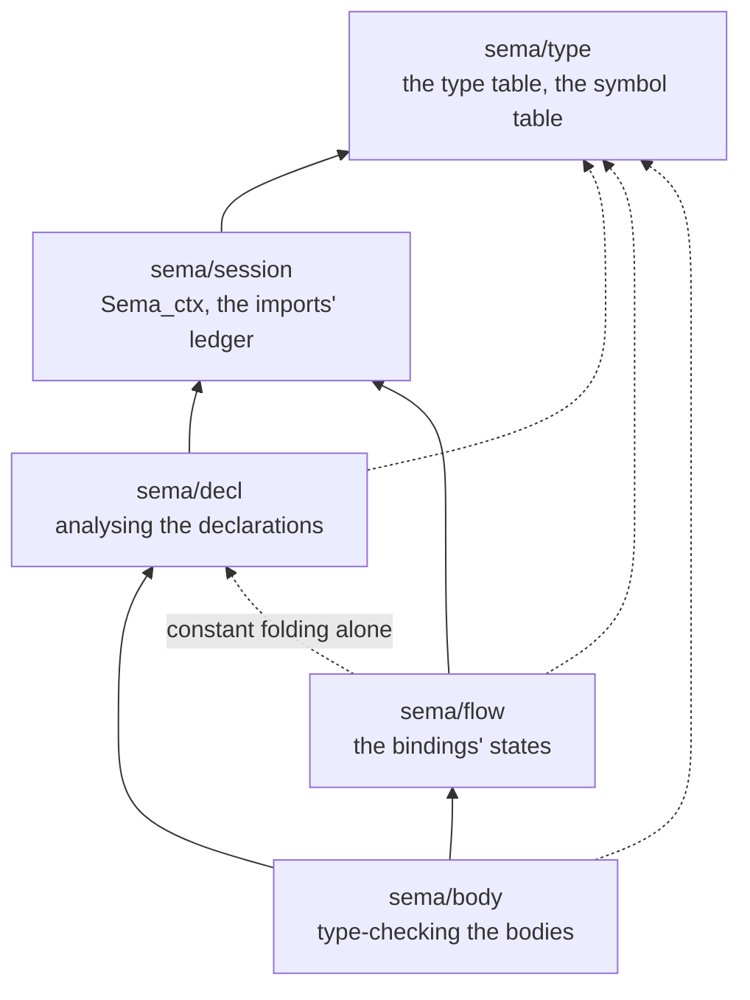
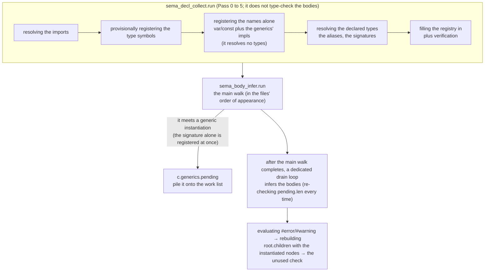
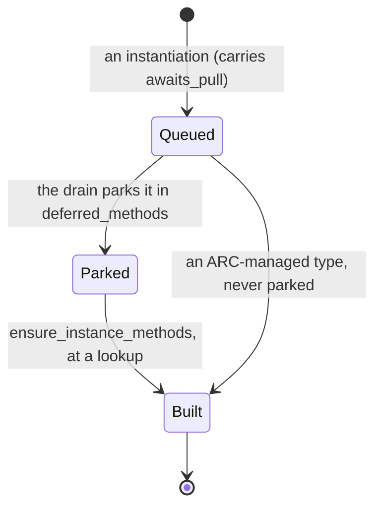

# ksplc's Sema layer: the types and the names

**This document holds the design of ksplc's second layer, Sema.** It is one chapter of the compiler's internal design. [`DESIGN-compiler.md`](DESIGN-compiler.md) holds the rest: the map of the whole compiler, the AST rules every layer shares, the arena, the conventions and the glossary. Read "The compiler as a whole" in [`DESIGN-compiler.md`](DESIGN-compiler.md) first.

## The Sema layer: it knows the types

Sema (semantic analysis) works out what the program means, and reports the errors and warnings about the user's code.

### What it answers for

It walks the AST for *type inference*, *symbol resolution* (finding the declaration each name refers to) and *scope management*. It also instantiates the generics (monomorphization, [the glossary](DESIGN-compiler.md#the-glossary)), and runs the compiler's own lints and static analysis. **It knows nothing of where the output goes**; it works purely in KSPL's types.

### How sema is split into folders, and their dependencies

Sema's code sits in five folders, stacked like floors. A folder can use the folders below it, never the ones above. **Each folder answers one question**, named with its files in "sema/ — the Sema layer" in [`ksplc/README.md`](../README.md). This section holds why the folders are cut where they are, and which way each can import.

#### The whole picture of the dependencies

The direction is one way, from the bottom: `type` → `session` → `{decl, flow}` → `body`, and `decl` / `flow` / `body` also query `type` directly. An arrow points from a folder to the folder it imports.



**Nothing points the other way**: parse rejects it as "a circular import across directories" (`ksplc/parse/load.kspl`). The one way round is a single function pointer for `sizeof(<an expression>)` (below).

**The language guards only cycles**, so an edge between `decl` and `flow`, on one tier, passes parse. There is exactly one: `flow/stmt` borrows `try_eval_constexpr` from `decl/eval` to count the branches of a constant-folded condition (`if sizeof(T) == 4`). *Constant folding* is computing an expression's value at compile time. More such edges would merge the two questions back into one mass, so `make test-conventions` allows this one and no other.

**`sizeof(<an expression>)` is the only call from decl into body.** It needs the operand's type, and only `sema/body` types an expression. The declarations' constant folding (an array's length, an enum tag, `#align`) runs before inference. The path is the function pointer `Sema_ctx.infer_expr_fn`, set once at start-up by `ksplc/pipeline.kspl`. `make test-conventions` watches the count, since each hook added leaves "above" and "below" a name and nothing more.

**A mass** is a set of files that can all reach each other (a strongly connected component). It is the unit that cannot be split into folders any further. The masses in each folder (files with no path either way to one are left out):

| folder | the mass (the strongly connected component) | below / above the mass |
| :-- | :-- | :-- |
| `sema/type` | `def`, `env`, `query` | below: `scope` / above: `arc`, `display` |
| `sema/session` | `c_boundary`, `ctx`, `import_table` | below: `state` / above: `imports`, `pointer` |
| `sema/decl` | `access`, `eval`, `layout`, `mono`, `mono_name`, `mono_queue`, `mono_target`, `name`, `registry`, `resolve`, `trait_check`, `trait_default` | below: `declare`, `subst` / above: `attrs`, `collect`, `reflect`, `type_check` |
| `sema/flow` | `field`, `report`, `stmt`, `track` | below: `release` |
| `sema/body` | `binary`, `call`, `call_args`, `dot`, `expr`, `for_in`, `postfix`, `stmt`, `stmt_escape`, `struct_literal`, `switch`, `write_perm` | below: `analyze`, `call_defaults`, `coerce`, `generic_infer`, `lint_stmt`, `lint_written`, `literal`, `resolve_path` / above: `infer` |

**To find the edge that breaks a mass, compute the strongly connected components**, not a count of edges against one chosen direction. An import with `_` (importing an extension method) is an edge too.

From outside sema, `lower` / `genc` / `genllvm` / `lsp` / `pipeline` use almost only `type/env`, `type/scope`, `type/query` and `session/ctx`. **Keep what they use from `decl` / `body` to the files already used** (their imports show which). Each one more makes a rearrangement inside sema felt outside.

What each folder holds, and what it must not do:

**`sema/type` is the foundation all four stand on**: how a type and a name are expressed, and the queries on that. Do not import the other four from it.

**`sema/session` holds the `Sema_ctx` that `decl`, `flow` and `body` carry.** It spans one whole analysis. It holds where a diagnostic goes, and what is visible from a file (the imports' ledger). Do not import `decl` / `flow` / `body` from it: all three use it, so joining even one merges the three into one mass.

**Keep the ledger apart from the checks against it.** Every stage only reads `import_table`, while the checks in `imports` (unused, existence) run once at the end.

**Whose method a function is decides whether it can leave a mass.** A `Sema_ctx` method on `resolve`'s side makes `session` import `resolve`, pulling the large foundation into the mass. So put `Sema_ctx`'s methods on `session`'s side.

Caution: **Do not put a helper that does not touch `Sema_ctx`'s state into `sema/session`**, even one taking `Sema_ctx` first. Examples are comparing visibilities, checking a name's spelling and assembling a diagnostic's sentence. Put it in the file that uses it (`narrower_vis` in `decl/access`, `declare_symbol_with_fqn` in `decl/declare`, and so on).

**Group the state by the code that touches it.** Otherwise state belonging to nobody piles up in `Sema_ctx`, which travels through all of sema.

| state | where it lives |
| :-- | :-- |
| each concern's own state | its part in `sema/session/state.kspl` |
| a body walk's flags at the current position | `Fn_ctx` |
| what every part reads (the current file and its source, the symbol table, the environment), the analysis's switches, and the one path into body | loose on `Sema_ctx` |

The parts are plain records. Every method keeps its one receiver `c`, and the concern's own file holds the methods that keep its part (`decl/layout` for `Layout_state`).

**Only `decl/mono` and `decl/mono_queue` touch `Mono_state`**; other code asks through their methods (`put_off_constraint`, `build_entrusted_tables`), by convention.

**`decl` cannot be split further.** Resolving needs instantiating, instantiating needs the conformance check, and checking needs constant evaluation; there is no one-way order.

Caution: **Put `collect` outside the mass, above it.** `collect.run` drives the whole declaration analysis, and a call back from below makes the driving order unreadable. Boilerplate the mass needs goes below both, as `declare` does. A tree walk that resolves types, such as `resolve_all_types`, belongs in `resolve`, not `collect`.

**Instantiation (`mono`) belongs in `decl`, not with inference**: it happens partway through inference, but what it makes is a declaration.

**`lint_stmt` stays in `body`, not in a `sema/lint`, because the lints are not gathered there.** It holds about a quarter of the diagnostic codes; the rest sit with the checks that hold the context to detect them. `lint_stmt` is a hook called from `infer` / `match` / `stmt`, not a pass.

**Do not repeat the folder's name in the file's name** (`type/env`, not `type/types`).

### The internal flow: registration, type inference, then generic instantiation

Sema records every declaration of every file without looking inside any function. Then it walks each function body. Last, it checks the bodies of the generic copies it made on the way.



**`collect.kspl` type-checks no function body.** It walks the top-level declarations of the whole file in passes. Each pass is an independent loop over `r.children`, numbered as the `// --- Pass` comments in `sema/decl/collect.kspl` number them:

* **Pass 0**: resolving the imports, gathering the `##lint`s, and detecting the attributes.
* **Pass 1**: provisionally registering the type symbols (empty `Struct_def` / `Enum_def` / `Trait_def` placeholders, and the aliases). 1b first refuses a trait's method that the type writes outside the block that names the trait. It then copies the trait declaration's default values to the implementing type, before an instantiation copies a template's tree.
* **Pass 2**: registering the value symbols and resolving the aliases, in two runs.
  * **2a registers without resolving a single type.** 2b resolves the declared type nodes, which can cause an instantiation, so two things must be registered first:
    * The names of the top-level `var`s / `const`s (`declare_var_syms`), which folding an array's length (`U8[n]`) reads. The folding reads only the declaration's initializer, not `type_id`, so unresolved types do not stop it.
    * The `impl` blocks that monomorphization builds the method tables from (`impl_needs_early_collect`: the generics' impls, and impls covering one instantiation). `instantiate_generic_methods` / `register_generic_trait_impls` in `sema/decl/mono.kspl` need all of `generics.impls` (["Generics are instantiated through deferred work"](#generics-are-instantiated-through-deferred-work)).
  * 2a can come first because it resolves no type: a method registers only its template name, and its signature is resolved at instantiation. In one run, both would depend on the order within the file (Principle 5).
  * Between the two runs, 2a' synthesizes the table and `fields()` for `impl X: reflect.Reflectable {}` (`synthesize_reflect_impls` in `sema/decl/reflect.kspl`). *Reflection* means a program reading its own types' fields at run time. **It must run after the generics' impls are all in (after 2a) and before the values' names are handed out (before 2b).**
    * Resolving the fields' types instantiates generics. Run before 2a, an instantiated `List<|T|>` gets no methods.
    * 2a has already handed out the `const` names, so `collect` hands out the synthesized ones itself.
    * The kind comes from the resolved type, because the name would mistake a `typedef`. A `List<|T|>` is recognised by resolving the written generic base to an FQN (fully qualified name, such as `std.ds.List`).
  * After 2a', 2a'' writes the `run` of each `impl S: suite.Suite` (`synthesize_suite_runs` in `sema/decl/suite.kspl`). It must come before 2b for the same reason as 2a'. **It writes `run` as source and parses it** (`parse_synth_decls` in `parse/load.kspl`), then moves the method onto the `impl`, at the `impl`'s position (`place_as_made`). Every test is checked before any source is written. So a refusal (a parameter with no field, a `priv` test in another file) is reported at the test. The order it calls the tests in is "8.5 Tests: functions named `test_`, run by a suite" in [`../../docs/SPEC-programming-language.md`](../../docs/SPEC-programming-language.md).
* **Pass 3**: filling the registry itself in (the fields, the variants, the method signatures), and `validate_all_type_exprs`.
* **Pass 4**: checking a `const` declaration's body (`check_const_decl_storage`; it needs the field list, so it follows 3).
* **Pass 5**: checking that no member's visibility is wider than its enclosing declaration's; it matches type ids, so it follows 2b and 3.

The rules for the reflection tables Pass 2a' makes:

* **Pass 2a' emits a nested table into the file that wrote the `impl`**, because another file's table is `priv` and cannot be pointed at. The same type nested from two outer types still folds to one table per file (`ensure_nested_table` in `sema/decl/reflect.kspl`).
* **It matches the trait by FQN**, as for the other compiler-known traits, not by the name's tail.
* Caution: **Build an `offsetof` node for the offset; do not fold it to a number.** The generated C passes it to C's own `offsetof`, so the offset ksplc measured cannot differ from the one C laid out.
* **Take both tags from the declaration**; never hard-code "the variant with a value is 0". Only an enum payload's position cannot be asked with `offsetof`, since in C it sits in an anonymous union KSPL cannot name. It comes from ksplc's single layout, trusted as `sizeof` is.
* **A container of containers is not described.** It needs a payload on `Field_kind` that std does not declare; neither backend stands in the way.
* Caution: **Take the element type from the instantiated `List`'s `ptr`, and strip exactly one level of pointer.** Stripping them all makes the element of `List<|I64$@|>` look like `I64`, and a container of pointers silently round-trips as an array of integers.

**Collect always runs to the end before `infer.kspl` starts**, so a forward reference across files resolves.

#### A layout is computed when it is first asked for

A *layout* is a type's size and where each field sits in memory. `sizeof` can be written anywhere, but the field list is complete only at Pass 3. Yet two things **need a size before Pass 3**. One is the types resolved at 2b: a top-level `var`'s / `const`'s declared type, a function's return type, an alias. The other is a field in Pass 3 pointing at a declaration behind itself.

So `Struct_def` / `Enum_def` keep their declaration node in `pending_decl`. `ensure_type_registry` in `sema/decl/layout.kspl` fills a registry in on the spot where it is still unfilled, and `eval_sizeof` always calls it before measuring.

Caution: **Do not add a path that bypasses it.** Such a path returns a size of 0. `U8[sizeof(S)]` then fails with "array size must be a positive constant expression", depending on the order of the declarations (Principle 5).

* **`pending_decl` is cleared when filling starts** (`sema/decl/registry.kspl`). The same declaration's size can be asked for while one of its field types is being resolved. Cleared later, it is filled in twice, and the fields line up in pairs.
* **"Being filled in" is told apart from "filled in"** (`Resolving_state.registries`). Otherwise `struct A { f: U8[sizeof(B)] }` and `struct B { g: U8[sizeof(A)] }` see each other as size 0, and pass as one-byte structs with no diagnostic.
* **A cycle's report is held and emitted once, at the end of `collect.run`** (`Resolving_state.registry_cycle_at` → `report_registry_cycle`). An array length is evaluated under `eval_constexpr_quiet`, which discards diagnostics.
* **It does not walk past a pointer or a slice.** The pointee does not affect the pointer's size, and walking it would never stop on a self-referring type.

**A machine's widths come from one table**: `MACHINES` in `base/target.kspl`, one row per machine ksplc knows. A row holds a pointer's width, a function pointer's and `Sz`'s, the alignment of `I64` / `U64` / `F64` in a struct, and the LLVM triple. `calc_type_layout` in `sema/decl/layout.kspl` and `Sz`'s width (`get_primitive_bit_size` in `sema/type/query.kspl`) read the row `current` resolves: `--machine`'s, else the one ksplc runs on, which `kspl_host_machine` in `gen/runtime/hosted.c` names from the C compiler's own macros. Everything else is laid out from those widths.

* **Every subcommand that lays values out asks for the machine before it starts** (`machine_refusal_to` in `cli.kspl`, for each row of `FACES` marked `lays_out`). **The language server refuses too, rather than take a machine from a setting.** A guessed machine would show a static `if` that the compile decides otherwise, and a setting would be a second way to name it (Principle 6).
* `get_portable_bit_size` stays apart from the table. It answers what holds on every machine (`Sz` at 32 bits), for the checks on a constant expression, which must not depend on the machine named.
* Caution: **Do not write a width as a number anywhere else.** A second copy answers for one machine only, and the folds built on it are wrong on every other with nothing reporting it.

**A folded layout number is checked by the C compiler.** ksplc's layout is a copy of the C compiler's, tied to it by a check (Principle 4). Every reader whose number reaches the output as a number calls `record_folded` in `sema/decl/layout.kspl`:
* `eval_sizeof` / `eval_offsetof` in `sema/decl/eval.kspl` (an array's length, a constant chain, a static `if`, `##error`, a `case` label);
* reflection's payload offset (`sema/decl/reflect.kspl`);
* a slice cast that stands on two equal element sizes (`check_slice_elem_size` in `sema/body/postfix.kspl`).

The record holds the type, what was measured, the number and the node that asked. `emit_layout_checks` in `gen/c/root.kspl` writes one `typedef char kspl_folded_for_<machine>_<n>[(sizeof(T) == 40) ? 1 : -1];` per record, under a `#line` of the node that asked, so the C compiler's refusal names the source line and the machine.

* **They go at the end of each unit**, where every type is complete, so a fold genc makes itself (`emit_const_ref_inline`) is checked too.
* **A recorded type is kept by `prune_unreachable_types`** (`lower/prune.kspl`), or the check would name a type the C never declares.
* Caution: **A new reader of a layout whose number reaches the output must call `record_folded`.** Without it, nothing compares that number with the C compiler's.
* `sizeof` / `offsetof` written in a function body stay C's own (`emit_sizeof` in `gen/c/expr.kspl`). A global's initializer holds the number sema folded, so its `sizeof` is recorded and checked too.

#### The main walk's order, and where the helper files stand

**One walk (`run` in `sema/body/infer.kspl`) takes the top-level declarations in the files' order, and checks each function body as it meets it.**

| it meets | it calls |
| :-- | :-- |
| a function | `infer_fn` |
| an `impl` | `infer_impl_decl` (`infer_fn` for each method) |
| a top-level `const` / `var` | `infer_expr` |

**Once every top-level initializer is typed, a second loop checks each one** (`check_static_initializer` in `sema/body/static_init.kspl`). A fold reads the operands' types, so it waits for all of them. Lower and both backends follow the decision it records ("The static-initializer check is applied to both `var` and `const`" in [`DESIGN-diagnostics.md`](DESIGN-diagnostics.md)).

`infer_fn` resolves the signature, infers the body (`infer_stmts` in `sema/body/stmt.kspl`), and at once runs `analyze_function_body` (`sema/body/analyze.kspl`) on that function.

`infer_stmts` and `infer_expr` (`sema/body/expr.kspl`) each pick a branch by `kind_id`. **Every `infer_expr` ends in `apply_type_coercion` (`sema/body/coerce.kspl`).** The other files are helpers, not passes:

| file | where it is called from |
| :-- | :-- |
| `resolve.kspl` / `resolve_path.kspl` | wherever a type or a name is resolved: `expr.kspl`'s identifier and path branches, `collect`, `postfix`, `call` and more |
| `postfix.kspl` | `expr.kspl`'s postfix / `method_access` / `generic_method` branches alone; it passes the call operator `(` on to `call.kspl` |
| `switch.kspl` | the `k_stmt_switch` branch in `stmt.kspl` alone |
| `eval.kspl` | translation-time constants (an array's size, an enum tag, `#align`), from all over |
| `analyze.kspl` | right after each function's `infer_stmts`. It follows one body's paths as a control-flow graph would (defined variables, use-after-free), once per function. `check_unused_imports` / `check_unused_symbols` are the one global final check, at the end of `infer.run` |
| `lint_stmt.kspl` / `literal.kspl` | the statement-level lints (`if`, `for`, an accumulating overflow and so on), fired inline during the dispatch in `stmt.kspl` / `infer.kspl` / `switch.kspl` |
| `lint_written.kspl` | the lints on how declarations are written (`lang.`, a function of one enum, an arena's default). `infer.run` walks the written tree once, before a template's body is dropped |

#### Immutability marks in a type, and the API that asks

In KSPL, a `$` written in a type makes that level writable, and a level without `$` is read-only (the language specification, `docs/SPEC-programming-language.md` §3.2). **A type is interned as a canonical string** (`sema/type/env.kspl`): one fixed spelling per type, stored once and compared by number. An immutability mark is a structural node, `Info.const_of(base_id)`, written as `base_core.immut_mark()` (`" immut"`) right after what it marks.

| type | canonical string | `Info` |
| :-- | :-- | :-- |
| `const(U8)` | `U8 immut` | `const_of(U8)` |
| `U8[]` (a slice of immutable elements) | `U8 immut[]` | `slice(const_of(U8))` |
| what `U8$[]@` points at (an immutable slice descriptor) | `U8[] immut` | `const_of(slice(U8))` |
| `U8[]$@` | `U8 immut[]@` | `ptr(slice(const_of(U8)))` |
| `U8$[]@` | `U8[] immut@` | `ptr(const_of(slice(U8)))` |

**The marker is postfix because `@` and `[]` are.** A prefix marker would commute with them on the string (`"immut " + "U8[]"` and `"immut U8" + "[]"` are both `"immut U8[]"`), merging the table's second and third rows. As a postfix, it joins `get_or_add`'s chain of end tests (`!` → the marker → `@` → `[]` → `[N]`).

**The APIs that ask about a mark differ in the tier they look at**, and a wrong pick silently decides wrongly. A *tier* is one level of a type: in `U8[]@`, the pointer, the slice and the `U8` are three tiers.

| API | the range it looks at | when it is used |
| :-- | :-- | :-- |
| `is_const(id)` | this type's own outermost node alone | "is this place itself read-only". For the element or the pointee, strip first (`is_const(strip_slice(id))`) |
| `strip_const(id)` | one tier: the outermost mark | the type one tier in, with the mark removed |
| `strip_const_deep(id)` / `has_const_deep(id)` | every nested tier | the type with every tier's mark dropped. It does not resolve an alias: a method attached to an alias (`impl Meters { ... }`) is found only by that name, so matching a method uses this |
| `same_shape_ignoring_const(a, b)` | every tier for the marks; only the outermost for an alias | "the same type, ignoring immutability" (unifying the ternary operator's types, an implicit conversion to immutable). **Use this for that comparison**: comparing `strip_const_deep` results makes `typedef P = I32@;` differ from `I32$@`. Do not resolve the inner aliases: resolved, `B[]` (`typedef B = U8`) equals `U8[]` in sema while genc emits two C types, `Const_B_Slice` and `kspl_U8_Slice`, and fails |
| `is_const_compatible(act, exp)` | tier by tier | whether a safe downgrade to immutable is allowed (only a conversion weakening no tier's immutability passes) |
| `receiver_base_id(id)` / `base_type_name(id)` | all the outermost pointers, marks and aliases, alternately | the base type a value is looked up on: `.`/`[]`'s receiver, a vtable's conforming type. Also what is looked up by name (a struct definition, a method's FQN) |

Four rules follow from the table:

1. **Only `Env.receiver_base_id` strips the pointer from `.` / `[]`'s receiver.** Everything after it (a built-in member, a struct field, matching a method name, probing an operator trait, a built-in index) takes the stripped `recv_id`.
   * Caution: Stripping per branch leaves some branches behind whenever a new shape of type is added. "No method on `U8[]@`", "no `.len`" and "`ps[1]` fails" become separate holes. `[]` then works on a user type but not on a built-in slice. The backends' paired points are genc's `emit_ptr_adjusted_receiver` and genllvm's `emit_recv_base_ptr`. A diagnostic shows the type from before the stripping, with `display_str`.
2. **The view types' tests and strippers see through an outer immutability mark.** A *view type* points at memory held elsewhere: a pointer or a slice. An immutable slice is still a slice, so `is_slice` must hold for `const_of(slice(U8))`; otherwise an element write through `U8$[]@` is rejected as `Index_mut` unimplemented. Whether the mark is there is `is_const`'s question. Every member of the family (`is_pointer`, `is_result`, the `is_numeric` family, `strip_ptr`, `get_result_err_id` and the rest) must see through it, or one type gets contradictory answers.
   * **The flip side: `strip_X(t) != t` does not test "is `t` an X".** Seeing through drops the mark too, so `strip_ptr(t) != t` holds for `U8 immut`. Ask `is_X`. With the other test, `a[i].m()` on a `const` array element is judged "it crossed a pointer" and skips the permission check.
3. **Resolving an alias and stripping a mark alternate** (`get_clean_real_type`). `get_real_type` resolves only the outermost alias, so doing one of each leaves `const_of(alias B)` as `B`. Every site that peels both goes through it, including `same_shape_ignoring_const` and genllvm's type output (`t_impl` in `gen/llvm/types.kspl`). Where pointers are peeled too, the entry point is `receiver_base_id`.
4. **The C mangling places the mark by position.** *Mangling* is turning a KSPL type or name into a C identifier. A mark on the element (`slice(const_of(U8))`) becomes `Const_U8_Slice`, because `mangle_type_id_to_impl` recurses and emits `Const_` first from the inside. The C runtime preamble hard-codes `kspl_Const_U8_Slice`, so on a view type alone (`const_of(slice(U8))`) the mark becomes the suffix `_Const`. `const_of` gets no typedef of its own; `genc` writes it inline as `const <the base>` (`T * const` on a pointer).

**Judge a slice descriptor literal's shape on its type before one slice level is stripped.** A literal such as `U8$[]::{ .ptr = …, .len = … }` is checked field by field, and the stripped type gives the wrong answer:

| Literal | Its type | One level stripped | Judged after stripping |
| :-- | :-- | :-- | :-- |
| `::{ 'a','b','c','d' }` | `U8[4]` | `U8[4]` | Correct |
| `U8$[]::{ .ptr, .len }` | `U8[]` | `U8` | **Unchecked**: the scalar matches no branch |
| `U8[]$[]::{ .ptr, .len }` | `U8 immut[][]` | `U8 immut[]` | A wrong diagnostic, one level too shallow |

The regression is in `ksplc/tests/lang_types_test.kspl`.

**The immutable version and the mutable version are one struct in C** (`variance_stripped` in `sema/type/env.kspl`), or C would reject the one tier of weakening KSPL allows.

**An implicit permission conversion changes the node's type without adding a cast** (`apply_type_coercion` in `sema/body/coerce.kspl`, one branch). The shape comparison comes first; the compatibility query runs only where copying the value's outer qualifier does not suffice. An incompatible conversion is reported once by the common mismatch path.

#### Where immutability's two axes are enforced

**KSPL asks two separate questions about a write: can this name get a new value, and can the thing it points at be changed?** One function, `enforce_mutability` in `sema/body/write_perm.kspl`, answers both. The language specification (`docs/SPEC-programming-language.md` §4.2) keeps the two axes independent:

| axis | written as | the question | checked on |
| :-- | :-- | :-- | :-- |
| the binding | `$p` | can the name be given a new value | the binding's `sym.flags.is_mut` |
| what it points at | `T$@` / `T$[]` | can the target be written | the pointee's `is_const` |

`infer_assign_stmt` calls it on the left-hand side. It picks the axis by whether the path to the target crossed a pointer: if not, the binding; if so, the pointee.

Caution: Mixing the two axes breaks one of two ways. It rejects `p.f = v` through an immutable binding's mutable pointer. Or it lets a write through an immutable pointer pass, while an element write on an immutable slice is rejected. Regression tests: the case `const_ptr_field_write` in `tests/negative/const.kspl`, `case_const_ptr_deref_write` in the case `readonly_write` in `tests/negative/pointer.kspl`, and `test_immutability_axes_are_independent` in `ksplc/tests/lang_test.kspl`.

The pointee test asks only whether the pointee's own outermost node is an immutability mark. `U8[]$@` allows swapping the descriptor with `p$ = other`, and `U8$[]@` rejects it (the case `const_slice_descriptor_write` in `tests/negative/const.kspl`).

**A pointer partway along the path is checked too (`write_target_type`).** Where the path crosses a pointer held in a field (`s.p$ = v`, `s.p.n = v`), that tier's immutability must be enforced as well. The check runs before the inference proper, and `infer_expr` morphs nodes, so it must not infer the receiver `s.p`. It walks the types alone, never touching the AST:

1. Along a chain of `.` field accesses it runs `infer_expr` on the root (the path or identifier) alone.
2. It then takes each field's declared type from the struct definition with `Env.field_type_of`.
3. On a shape the types alone cannot follow (a method call, an index), it returns `unknown` and gives up the check. So it can only add detections.

Regression tests: the case `const_ptr_in_struct_field_write` in `tests/negative/const.kspl` and `case_const_ptr_in_struct_field_member_write` in the case `readonly_write` in `tests/negative/pointer.kspl`.

**Two places walk the path to a write's root** (`place_denies_write`, and `enforce_mutability` in `sema/body/write_perm.kspl`), and both stop at a pointer type the same way. Stopping in only one lets an assignment pass while `xs[0]@` is rejected.

**Keep the choice of `at` or `get` / `set` for an index in one place** (`index_route` in `sema/decl/access.kspl`). If the reader (`sema/body/postfix.kspl`) and the assignment (`sema/body/stmt.kspl`) decided separately, `xs[0] = 5` could produce broken C calling a two-argument `get` with three arguments, with zero diagnostics.

**The assignment's permission check is written by hand**, since `sema/body/stmt.kspl` assembles the `set` call directly, bypassing `infer_call_args` in `sema/body/call.kspl`. `make test-negative` holds it.

#### Generics are instantiated through deferred work

A *generic* is a declaration with type parameters (`List<|T|>`). Its *template* is the declaration as written. An *instantiation* is one copy with the parameters filled in (`List<|I32|>`). The values filled in are the *type-argument bindings* (`T` = `I32`).

**Monomorphization (`mono.kspl`) fires the moment** `call.kspl` (a function call) or `resolve.kspl` (a generic struct or type) meets an instantiation during the main walk.

* The signature is cloned and registered at once.
* The body's inference only joins the work list `c.generics.pending`, which a dedicated loop drains right after `infer.kspl`'s top-level walk.
* The loop re-reads `pending.len` every round, so it also handles generics nested in during the drain (breadth-first, not recursion).
* `instantiated_nodes` caches each instantiated function or struct, so none is made twice.
* The method tables, the conformances and the type-argument constraints have queues of their own (below).

Caution: **Attach a copy of that moment's type-argument bindings to all work put off.** The list drains after the bindings are undone. Without the copy on a template body (`Pending_inst`), the visibility check's exemption loop does not fire, and a file-private `Cell` in `List<|Cell|>` makes `std/ds.kspl` fail. `snapshot_generic_args` is the one place that takes the copy. The code that drains pushes it back and always restores the original length. `drain_pending_instances`' bindings must cover the same range as the instantiation proper (`prepare_inst_node`), as far as instantiating the methods.

**An instance is a record, and its names are derived from it.** `Instance` in `sema/type/env.kspl` holds the template's FQN and the type ids it binds, in the declaration's order, and `Env.instances` maps the instance's type id to it. Its mangled name (`instance_c_name_to`) and its registration key (`instance_key_to`, `std.ds.List<|I32|>`) are written from the record. What an instance is made of is asked of the record (`instance_of`, `instance_base`, `instance_args`), never read back from either name.

A function's instance is a record of the same kind: `Fn_instance` in `sema/decl/mono.kspl`, named by `fn_instance_names`. It holds the template's key, the instance a method is reached through, and its own type ids. A written name gives the first two (`read_written_name`; "Value and function names are read once, from their tree" in [`DESIGN-diagnostics.md`](DESIGN-diagnostics.md)).

Caution: **Name an instance through those functions only.** A second spelling of the rule makes two names for one instance, and C fails with `redefinition of ...` or `unknown type name`.

**A type's name in the generated code is spelled in one place, and from Lower on only once.** `Env.mangle_type_id_to` in `sema/type/naming.kspl` spells it, for the declaration (`transform_decl_name` in `lower/abi.kspl`), each use, and a `switch`'s tags. Spelled from the canonical string, the name would drift on an instance whose immutability is dropped (`variance_stripped`). Code generation asks for the same names many times, so from Lower on each type's name is kept on its entry (`Entry.c_name`) once spelled. **Not earlier**: until sema has recorded every instance, such an instance can still answer with the name its record will replace. One type would then have two names. `lower_root.run` turns the keeping on (`Env.c_names_final`), where it turns on the ARC answers' memo for the same reason.

**The core types of `std/lang` are named in C without their module**: `Slice_U8`, `Option_I32`, `Writer`, not `std_lang_Slice_U8`. The module took about 5% of the generated C and cluttered a debugger's type column. `mangle_c_type_name_to` in `base/mangle.kspl` leaves `std.lang.` out wherever a type's name opens with it, inside the arguments too. A function keeps its module (`kspl_std_lang_panic`). A local that spells such a name takes a made one (`global_c_names` in `lower/abi.kspl`).

**Two names that C would spell alike are refused, not renamed.** The C names stay readable, so `a_b/c.Foo` meets `a/b_c.Foo`. Two checks refuse a meeting, naming both sides. `try_prepare_instance` refuses an instance whose C name another instance holds (`Env.instance_c_owners`); reusing that one would run `f<|3|>`'s body for `f<|-3|>`. `C_names.claim` in `lower/abi.kspl` refuses a global declaration whose C name another declaration holds. A length-prefixed scheme would make C names unreadable, and renaming one side silently would make a name depend on which other names exist. A minus sign before a number is spelled `Neg`, so `f<|-3|>` is `f_Neg3`.

**An instantiation's name is decided by the definition's position alone, not by how a reference spells it.** Two spellings of one type (`std.ds.Map_entry<|Sz, I32|>`, and `Map_entry<|Sz, I32|>` inside `std/ds.kspl`) would make two bodies, and C an `unknown type name`. `generics.templates` keys a template by its FQN alone ("Name resolution with no namespace goes through one function" in [`DESIGN-diagnostics.md`](DESIGN-diagnostics.md)). Normalize to the FQN before making the record:

1. A caller of `instantiate_struct` / `instantiate_fn` in `sema/decl/mono.kspl` passes the template's FQN, never a short name.
2. `impl_target_rejects` in `sema/decl/mono_target.kspl` compares an impl target's type arguments, as the source spells them, with an instance's. It rewrites them to the canonical form with `canonicalize_one_type_arg` (`sema/decl/mono_name.kspl`) first; unnormalized, `Plain` and `c_mod.Plain` are two types, and the impl attaches to neither.
   * Caution: **That function does not merely look a name up; it instantiates a generic argument as a side effect.**
3. `try_prepare_instance` keys its cache on the spelling `Base<|args|>`, which another spelling misses, giving `redefinition of ...`. **Key it on the mangled name too.** `register_inst_node` registers under both, and pushes to `instantiated_nodes_list` exactly once, since genc/genllvm emit the definitions from that list.

The `end_idx` of `find_generic_bounds`, which `canonicalize_one_type_arg` uses, is the position of the `>` of the closing `|>`. Forget the `+ 1`, and a postfix mark pulls the `>` in (`..._Ptr>$$@`); `std/tests/seq_test.kspl` watches it.

**What happens after the work list is consumed.** `sema_body_infer.run` goes on:

1. It evaluates the `##error` directives.
2. It rebuilds `root.children`, removing the generics' templates and swapping the instantiated nodes in.
3. Then come the LSP-only extra resolution pass, and `check_unused_imports` / `check_unused_symbols`.

**The rebuilding drops only the templates that have a body to swap in.** One never instantiated (`Arena.create<|T|>` in `std/mem`) survives until Lower's `lower_prune` drops it as unreachable.

#### Where the instantiation queue is drained

A *method table* is the list of an instantiated type's methods. The *trait conformance* records that the type implements a trait (KSPL's interface: a named set of methods). An instantiation only queues. Both are built at fixed safe points, the *boundaries* (`queue_instance_methods` and `drain_pending_instances` in `sema/decl/mono_queue.kspl`). Each item runs these steps in order, **under one binding of the type arguments**:

1. set the bindings with `bind_generic_args`
2. build the method table with `instantiate_generic_methods`
3. register the conformance with `register_generic_trait_impls`, and verify it

Caution: **Do not change the bindings between 2 and 3.** They are passed through `Generic_state.args`, which is state of the moment. If it changes in between, the trait's type arguments break (`get` on a `List<|U8[]|>` demands a `U8` instead of a `U8[]`).

**The queue (`Mono_state.pending_methods`) is there for nesting, not for order.** New instantiations are born during the drain, so loop by index on the raw `len` every round; `for x in list` copies `len` at the head and misses them. A drain started during a drain returns at once, with `draining_methods` as the sentinel, since a nested drain would overwrite the outer one's bindings. The regression test is `test_instantiation_before_generic_impl` in `ksplc/tests/lang_test.kspl` (a type instantiated before its impl block).

**There are two kinds of boundary.**

| boundary | where |
| :-- | :-- |
| **Where the bindings are empty** | before, after and at the end of collect's Pass 3, and between declarations and between statements in the body's analysis |
| **Just before a lookup** | `sema/body/dot.kspl` calls `ensure_instance_methods`. Breaks between statements are not enough, because a receiver's type can be instantiated within the same expression (`deepen(s).tag()`) |

Caution: **Drain only while that receiver's item is still queued.** Draining on every lookup builds unrelated instances too, partway through the enclosing body's analysis.

**The boundaries are cheap**: an empty queue returns without even a copy.

**Empty `generics.args` before draining; restoring its length is not enough.** An item's bindings are set afresh from the copy taken when it was queued, so the outer bindings must not be visible. Queuing the `T` of a `List<|T|>` with the outer `T` still bound lists the same name twice. `backup_mono_state` saves only the length, so the drain stores the bindings away itself.

**An instantiation's method table assumes every entry of `generics.impls` is registered** (Pass 2a, ["The internal flow: registration, type inference, then generic instantiation"](#the-internal-flow-registration-type-inference-then-generic-instantiation)). A miss shows only in a program using one std API alone, such as `str.split` returning a `List<|U8$[]|>`: `push` is then missing. `tests/suite/thin_use_test.kspl` covers that blind spot. Add a case there for each new std function returning a concrete generic type.

**Only registering the names can come first.** The trait conformance check (`verify_trait_implementation`) must not: checked before the methods of `impl<|T|> List<|T|>: Index<...>` are instantiated, it gives `does not implement required method 'get'`. It runs in exactly two places, both after collect's Pass 2a: infer (`sema/body/infer.kspl`), and `register_generic_trait_impls`.

**Keep one place that makes the table, and no condition**: no state meaning "the registering is done", and no redoing failures afterwards (Principle 6).

**Queue an instantiated body for inference exactly once** (`queue_fn_body`). The call (`instantiate_fn`) and the method-table builder (`instantiate_generic_methods`) both queue it, in no fixed order. Queued twice, a node the first inference reshaped (into a `result_wrap`, say) goes round again, and an `auto` with no return type reaches the generated C.

**Every instance's method table waits until a method is looked up.** The states one instance's table goes through:



* A queued instantiation carries `Pending_methods.awaits_pull`. The drain parks it unbuilt in `Mono_state.deferred_methods`, and `ensure_instance_methods` in `sema/decl/mono_queue.kspl` builds it at the lookup.
* Deferring only the types born of a signature is not enough. Building at once the table of a type the body names makes a `Chain<|S|>` body build a `Chain<|Box2<|S|>|>`. That body builds itself one level deeper again (a *polymorphic recursion*). So it builds levels nothing calls, and never returns, with no diagnostic (the `Nest` in `ksplc/tests/generic_queue_test.kspl`).

**Every entry point that looks up a table goes through `ensure_instance_methods`** (its callers are the list). One that bypasses it finds no table, with no diagnostic. A static member's resolution (`resolve_type_method_fqn` in `sema/decl/resolve.kspl`) through `typedef Nums = List<|I32|>` is one such entry point.

**A method with its own type arguments stays out of the method table**, since the receiver's type arguments alone cannot instantiate it. `instantiate_generic_methods` in `sema/decl/mono.kspl` skips it. `instantiate_fn` instantiates it at the call site, keyed on the instantiated receiver's notation plus the method's own actual arguments.

Caution: **Look it up through `lookup_method_template` in `sema/decl/mono_name.kspl`.** The template table is keyed by the template's FQN, which the instance's record names; without that lookup, the call finds "no such method". It must return only methods carrying their own type arguments. Returning ordinary ones too (`Slice<|T|>.sub_from`) would infer `T` from the actual argument, not the receiver, turning `U8[]` into `Sz[]`.

**Do not look up on a field reference**, which would keep building deeper levels.

**A lookup first drains what is still queued, then builds what is parked.** An instance born in the same expression (the `Box_of<|Bool|>` of `b.moved(true).get()`) is looked up while still queued. A drain that only parks it leaves no table.

**Clear the mark when re-queuing a parked item.**

**ARC-managed types (those conforming to `Ref_counted`) are never parked.** ARC (automatic reference counting) frees a value when the last reference to it goes. Lower synthesizes their retain / release calls (`synth_arc_stmt` in `lower/arc.kspl`), so no lookup for them appears in the source. One that reaches lower still parked silently loses the calls and leaks.

**Only the table is parked, not the conformance's registration** (`with_table` in `register_generic_trait_impls`). `add_implemented_trait` needs no table and runs at instantiation. The subscript (`index_route`), the upcast and the type-argument constraints consult the conformance table; delayed, it sends `a[i]` down the bare array subscript to an ICE in `emit_postfix_array`. Only verification (`verify_trait_implementation`) and recording the thunk (`record_trait_inst`) need the table, and they run when it is built.

**Register after binding the type arguments**, or the registration carries the trait's unbound `T`.

**This lets a method return itself one level deeper** (`Seq<|S|>.f(): Seq<|Wh<|S|>|>`), as an iterator chain (`xs.filter(p).map(f)`) does. A level advances only when its method is looked up. A body that calls the method of itself one level deeper is a real polymorphic recursion. It reaches the level limit and is rejected ("Each depth limit is set by what breaks first" in [`DESIGN-diagnostics.md`](DESIGN-diagnostics.md)).

**Count the levels once, across the body and the table** (`Generic_state.inst_chain_depth`).

* Building the table sets it from `Pending_methods.depth`, and analysing the body from `Pending_inst.depth`. So a body the table queues stands at the table's level, and an instance the body makes at the next.
* Do not count them separately, or start a body the table queued at level 0. Both would keep cycling at level 1, and compilation would never return.
* Call depth cannot replace the count, since a generic function's body is analysed from the queue (`fn f<|T|>(x: T) { y: T[1]; f(y); }`). `instantiate_struct` recurses by call, so call depth suffices there.

**No instance is made from a type argument that names an unknown type** (`names_unknown_type` in `sema/decl/resolve.kspl`). `resolve_type` registers a name it cannot find as a type, so a typo would make an instance whose every use is a derived error. An argument beginning with a name is first checked with `is_type_name`; one that is no type becomes `Unknown`, and the instantiation is rejected. The name's own error is reported at the declaration (`validate_all_type_exprs` in `sema/decl/type_check.kspl`).

Caution: **`instantiate_generic_methods` silently skips a method it cannot find** (the `continue` on `m_sym_res == null`), so a missing table causes no diagnostic. When changing this code, compare the generated C's counts of `typedef`s and functions before and after.

#### Type-argument constraints are checked where the queue drains

A *constraint* (`<|K: some.Trait|>`) limits which types can fill a type parameter. **It is written down with the bindings of the moment and decided at the next boundary.** So the check runs on every path and reports once, at the user's line.

* `bind_generic_args` checks a constraint only at the type's first instantiation.
* That can happen inside a speculative inference that raises `suppress_errors`, such as an attempt to constant-fold an `if`. `report_diagnostic` discards the diagnostic there, later inference hits the instantiation cache, and the check never runs again.
* So `m: = Map<|Point, I32|>(null);` would pass silently where `m: Map<|Point, I32|> = …;` is caught (Principle 5).

**So `check_type_constraint` in `sema/decl/resolve.kspl` records and returns without deciding** (`put_off_constraint` in `sema/decl/mono_queue.kspl`). `drain_pending_constraints` decides them at the same boundary as the instantiation queue, after step 3 of the drain fills `env.implements_trait`; deciding earlier rejects a correct type. For the same reason, ahead of an instantiation only its own share is decided (`drain_pending_constraints_for`).

**The record is the constraint node plus a copy of that moment's bindings, not the trait's resolution**, and neither alone suffices.

| record only | why it fails |
| :-- | :-- |
| the trait's resolution | during the suppression, the constraint's own resolution (instantiating `Hashable<\|K\|>`) can fail too, so it cannot be relied on |
| the spelling | re-checked after `K`'s binding is gone, it resolves to the unresolved `Hashable_K`, and rejects even a correct implementation |

At the re-check, push the bindings back and restore the length, as for the work put off, since instantiations nest.

Caution: **Do not re-check a type-argument constraint where the bindings are only set again** (`bind_generic_args`' third argument, `check_constraints`, switches it). The check goes through `resolve_type`, which caches its result in the node's `type_id`. Run on the template's shared node, the check burns the first instantiation's type in: `Map<|I32, I32|>` then demands an implementation of `Hashable<|U8[]|>`. It is called from `pipeline.kspl` because `mono` cannot be imported from `collect.kspl` (`mono` already imports `collect`).

**While the queue is being decided, a check decides at once instead of queueing again** (`put_off_constraint` returns false under `draining_constraints`).

**Do not decide while suppressed.** There, `check_type_constraint` queues each constraint again undecided, and the loop runs until the memory is gone; the LSP's workspace analysis runs entirely under `suppress_errors`. So discard what was queued and return (`drain_pending_constraints_for` in `sema/decl/mono_queue.kspl`; the regression test: `make test-lsp-tree`, whose workspace queries read the constraint violations in `tests/negative/`).

**An instantiation that violated a constraint gets no body check**, which would bury the cause under derived errors inside the standard library. `bind_generic_args` records the violation in `generics.constraint_failed` (keyed on the instantiation's mangled name), and three places skip on it:

1. `drain_pending_instances`' call to `instantiate_generic_methods` (no method bodies are made)
2. the same function's conformance registration (`register_generic_trait_impls`, which also checks the condition at its head), which would otherwise give `does not implement required method 'set'`
3. `infer.kspl`'s template-body work list (the entries in `generics.pending` whose `impl_name` is a failed instantiation)

Caution: **For 3, call `drain_pending_constraints` before each body is checked** (at the head of `infer.kspl`'s body loop), not once outside the loop. The violation of an instantiation made inside a body is known only after that instantiation's method bodies are checked (the regression test: the case `generic_constraint_in_template_body` in `tests/negative/generic.kspl`). It returns at once on an empty queue. The drain in `pipeline.kspl` handles what the last body queued.

So `m: = Map<|Point, I32|>(null);` gets **one diagnostic, at the user's line** (`generic_constraint_via_static_call` in `tests/negative/generic.kspl`, with `EXPECT-NOT`).

#### Impls of generic types

An `impl` block adds methods to a type. **An impl covering one instantiation of a generic type** (`impl Checked<|I32|> { ... }`) is accepted. It has no generic arguments of its own while a `<|` appears in its target. It is handled exactly as a generic's impl is. Its methods are registered under the template name (`collect_impl_decl`'s `inst_target` branch) and queued onto `generics.impls`. `impl_target_rejects` in `sema/decl/mono_target.kspl` decides which body they attach to, matching the target's type arguments position by position:

| matched on | the rule |
| :-- | :-- |
| **The name** | Where the target's position is the impl's own type argument, it binds anything. Where it is a concrete type, it must agree with the body's same position. |
| **The mutability** | a position written with a `$` takes only a mutable body. A position with no mark attaches to the immutable version and, by one tier of weakening, reaches the mutable one too |

Caution: **Register it at Pass 2a** (`impl_needs_early_collect`). At 2b, resolving a type causes an instantiation first and closes the method table, and this impl's methods enter no body.

**`collect_impl_decl` rejects the impl shapes it would otherwise silently discard**, which would surface far away as "the method I implemented is not there" (Principle 5):

| shape | example | why it is rejected | regression test |
| :-- | :-- | :-- | :-- |
| **An impl covering a type argument itself** (a blanket impl), detected with `is_own_param` | `impl<\|T: Trait\|> T: Other { ... }` | monomorphization makes a body per concrete type, so with a type argument as the target, where to make the body is undecided | the case `impl_blanket_over_type_param` in `tests/negative/trait.kspl` |
| **A type argument written on a non-generic type** | | queued onto the templates' row, a misspelling would pass too, and the impl would attach nowhere | the case `impl_inst_not_generic` in `tests/negative/trait.kspl` |
| **Two impls defining the same method name** | | the templates' table overwrites by name, so only the one collected later would survive | the case `impl_inst_duplicate_method` in `tests/negative/trait.kspl` |

**Blanket impls are not adopted.** They would cut only a small fraction of std/'s one-line impls (`checked_int`'s operators, `strnum`'s `Formattable`). The cost is reversing monomorphization's starting point: each new concrete type would have to find the constrained impls it satisfies. A body instantiated for every type is limited to the operations valid for every type. That complexity goes against subtraction (Principle 1), so **the duplication stays**.

**A generic's impl covering a slice type (`T[]`) is accepted.** Desugaring turns `impl<|T|> T$[] { ... }` into `impl<|T|> Slice<|$T|>`, which is handled as a generic's impl for `List<|T|>` is (the regression test: `ksplc/tests/slice_test.kspl`).

Caution: **Do not add a test rejecting it.** Monomorphization has one starting point, `instantiate_struct`, so there is nothing to reject. The reason is "A slice is a std struct, under generics' rules" in [`../../docs/DESIGN-programming-language.md`](../../docs/DESIGN-programming-language.md).

#### Instantiation's two axes

| Axis | KSPL's choice | What it permits |
| :-- | :-- | :-- |
| The unit of checking | Each concrete instantiation | Operations whose validity depends on the actual type arguments |
| The range of body checking | Referenced methods and required implicit hooks | A container of `Move_only` elements, even when unused copying methods cannot support them |

**The benefit is which programs can be written.** `List<|io.File_stream|>` can push and pop values without copying them, while its copying methods remain invalid when called.

`sema/body/infer.kspl` checks referenced bodies, each once, until no additional body is needed. Only checked function bodies enter the tree passed to Lower; signatures remain in their method tables.

**Implicit calls count as uses**: an upcast requires every slot of its trait table, and `Ref_counted` requires `retain` and `release`, which Lower synthesizes after semantic analysis ends.

A use mark records a reference from any body being checked, not reachability from the entry point; Lower removes unreachable code separately.

**Source identity survives instantiation.** `Env.fn_templates` records each instantiated function's canonical template. Cleanup-hook checks and raw-storage contracts read that record, rather than deriving a source name from a mangled C identifier.

An unused generic body still needs its imports, so its explicit names and written extension calls are recorded before templates are discarded.

Caution: **Raise `Self`'s counterpart (`fn_ctx.impl_name`) before resolving the signature.** Otherwise the unresolved `Self` enters the parameter types before the body is checked.

#### `for x in` is expanded in Sema, since its shape needs types

| shape | for a collection that |
| :-- | :-- |
| turns on an index (the default) | holds `.len` and `[]` |
| turns on `next()` | declares `std/lang`'s `Iter<\|T\|>` |

`for item in collection` takes one of these shapes by the collection's type, so `expand_for_in` in `sema/body/for_in.kspl` (at the head of `infer_loop_stmt`) expands it. It acts only where Desugar left its mark ("Desugar: expanding the syntactic sugar that needs no types" in [`DESIGN-parse.md`](DESIGN-parse.md)).

Caution: **Look at `Iter` first**, or a type satisfying both quietly loses the `Iter` the writer declared (Principle 5).

**The temporary that Desugar declares points at a place, rather than copying it.** `hold_for_in_subject` in `sema/body/for_in.kspl` decides this when `infer_var_decl` types the temporary, which Desugar marks (`mark_for_in_subject`). The rules a writer sees are in "7.2 Loops" in [`../../docs/SPEC-programming-language.md`](../../docs/SPEC-programming-language.md#72-loops).

* **A name or a `.field` chain of names becomes `x@`**, and a fixed-length array becomes a slice over it. The index shape then reads `.len` and `[i]` through the pointer at each step. The move check sees a borrow, so a move-only collection stays usable after the loop.
* **The pointer is read-only unless a read needs it writable** (`index_read_needs_writable`). The flow analysis then reads that `@` as a read, not a write (`df_decl_var` in `sema/flow/track.kspl`), so a spare `$` on the place is still reported.
* **An `Iter` stays a copy.** `next()` writes the position, and the subject must keep its own.

**The shape is decided per instantiation**, since the expansion runs inside each cloned body's inference (`test_loop_in_inside_generic` in `ksplc/tests/trait_test.kspl`).

The `next()` shape folds into the same `switch` as `if item: = coll.next()` (`build_option_switch` in `base/ast_ext.kspl`). **Give the synthesized `switch` a mark per source** (`synthesized_option_spelling` in `base/ast_ext.kspl`). Then the diagnostic rejecting a value that is not an `Option` names what the user wrote, not `if <name>: = <expr>`.

### The nodes Sema creates: its contract with Lower and Genc

Sema's analysis reshapes in place (*morphs*) the general-purpose access nodes that Parse/Desugar emit (`expr_path`, `expr_postfix`) into dedicated nodes, once it knows what an access means. Lower and the backends rely on exactly the node kinds in the table below. An access to a static method or a namespace gets no dedicated node: `infer_namespace_access` in `sema/body/dot.kspl` folds it into an `expr_path` (or an `enum_init` for a variant).

Caution: **Do not list here a kind that nothing makes.** It only adds reading branches, which readers take as real. "How to tell which kinds are unused" below says how to tell them apart.

| `kind` | `children`'s order and the elements expected | notes |
| :--- | :--- | :--- |
| **`method_access`** | `[0]: expr` (the receiver)<br>`[1]: Identifier` (the method's name) | the `.` operator resolved as a dynamic method call on an instance. Lower expands it into a flat function call with the receiver as the first argument (the ABI conversion). |
| **`enum_init`** | `[0]: type_expr / Identifier` (the resolved type name)<br>`[1]: Identifier` (the variant's name) | makes an enum value carrying no accompanying data. |
| **`enum_init_call`** | `[0]: type_expr / Identifier`<br>`[1]: Identifier` (the variant's name)<br>`[2]: expr_args` | initializes a tagged union carrying accompanying data. |
| **`generic_path`** | `[0...]: Identifier` | the resolved flat name of an instantiated generic function or struct. |
| **`generic_method`** | `[0...]: Identifier` | an instantiated generic method. |
| **`expr_upcast`** | `[0]: expr` (the original value) | raises a concrete type's value to a trait (a fat pointer). Sema makes it on an assignment or argument pass to a trait; Genc expands it into building a fat pointer with a vtable. |
| **`result_wrap`** | `[0]: expr` (the value inside) | wraps a plain success value into the success case of a Result type (`T!E`). Sema makes it where a non-Result value reaches a context returning a Result; Lower turns it into the Result's `.ok(value)` (`lower_result_wrap` in `lower/expr.kspl`), so no backend meets it. |

A *fat pointer* is a pair of pointers: one to the value, one to its vtable. "The internal flow: flatten, add vtables, mangle, prune, verify" in [`DESIGN-lower.md`](DESIGN-lower.md) describes it. A *tagged union* is an enum whose variants carry data, plus a number (the tag) saying which variant it holds.

**Sema stores a member access's field index in the node's `ival`** (`.len` is 1 and `.ptr` is 0), so a backend reaches the field with no string search.

**A safety device for type inference**: the notation that omits the type (`.ok` and the like) can meet no clear expected type, inside a comparison, say. Sema then reports "type inference failed" rather than let the compiler crash.

#### How to tell which kinds are unused

**A reading branch does not mean the kind is made.** A kind nothing makes is erased, branches and all. When you suspect one:

1. **Count the places that make it**, at the entry points of rule 4 of "The rules for handling an AST, shared by every layer" in [`DESIGN-compiler.md`](DESIGN-compiler.md). Check the grammar (`ksplc/kspl.kspeg`) too, since KSPEG's rule names come in through `peek_kind_id`.
   * Caution: **Look at the places that pass a kind in a variable too.** `map_keyword_to_decl_kind` in `parse/normalize.kspl` is the only one, and it returns declaration and statement kinds alone.
2. **Do not stop at a static count.** Place a temporary `ice_assert` at `Ast_node.new` and `set_kind` and run `make test-suites`; a kind that never fires there is dead.
3. **Erasing a kind renumbers the enum.** The number is the kind's position in `Ast_kind`, interned up front ("Keeping the grammar and the AST node kinds in step" in [`DESIGN-compiler.md`](DESIGN-compiler.md)). The disk cache stores kinds as numbers. But ksplc's identity in its key keeps an old entry from being read under a new number ("The normalized AST's disk cache (`ksplc/parse/ast_cache.kspl`)" in [`DESIGN-parse.md`](DESIGN-parse.md)).
4. **Erase its `builtin_name` case with it, where it has one.** Left behind, the name alone lives on, and the next reader takes it as "it is there".

### The extra rules concerning the type system

Each of these rules stops a mistake that would otherwise reach the C compiler with no KSPL diagnostic.

* **A generic's definition uses `type_gen_params` (children: `type_gen_param`); its call uses `type_args` (children: `type_expr` or `expr`).**
* **An alias (`decl_typedef`) can carry a forward reference, several tiers, generics and a cycle.** So `sema/decl/resolve.kspl` resolves it strictly:
  1. **A multi-tier alias**: where the symbol referred to is another `decl_typedef` still unresolved (`type_id == 0`), the target alias is inferred first, recursively.
  2. **A cycle**: `Resolving_state.aliases` in `sema/session/state.kspl` is the stack of alias names being resolved. A name already there raises a `Semantic Error` at once, and ends the recursion with the type ID `Unknown`.
  3. **A generic**: where an alias's right-hand side names type arguments (`type_args`), Sema calls monomorphization synchronously and issues a concrete `type_id`.
* **`Self` cannot be written in a trait method's parameters, except the receiver.**
  * The *thunk* behind a call through a trait is a small adapter function ("The internal flow: flatten, add vtables, mangle, prune, verify" in [`DESIGN-lower.md`](DESIGN-lower.md)). It passes the trait's fat pointer straight to the implementation's concrete-type parameter, and the C compiler fails on a type mismatch (`passing 'Hashable' to parameter of incompatible type 'Key'`). `add_trait_method` in `sema/decl/trait_check.kspl` stops it at the definition (the regression test: the case `trait_self_in_parameter` in `tests/negative/trait.kspl`).
  * A `Self` return is legitimate: `std/io`'s `Writer` chains with `fn s(r: Self, val: U8[]): Self;`, and the thunk rightly returns the value as a fat pointer.
  * For a parameter, take a type argument instead, as `std/lang`'s `Add` / `Eq` do (`trait Eq<|Other|> { fn eq(r: Self, other: Other): Bool; }`).
* **Where a trait method returns `Self`, the implementation must return a pointer** (`check_trait_method_ret` in `sema/decl/trait_check.kspl`). The thunk repacks the return value into the trait's fat pointer, which needs the target's address. From a return by value, genc emits `&` of a temporary, and a raw C compiler error reaches the user. It is the exception to the rule that a return value can differ between value and pointer (the regression test: `case_trait_self_return_by_value` in the case `trait_shape` in `tests/negative/trait.kspl`).
* **A return type putting `Self` in a type-argument position (`Keep<|Self, T|>`) cannot be a trait method, even with a default body.** A default body holds no vtable slot (`has_vtable_slot` in `base/ast_ext.kspl`); what fails is the `Self` inside the copied body.
  1. **The bindings table cannot solve it.** `generics.args` holds a name's string: a short name for `Self` fails in C with `unknown type name`, and with the FQN the `.` is read as an import alias. Cloning the impl's target type node into the `Self` makes the concrete types' implementations compile.
  2. **A generic's implementation still does not compile**: the constraint check at instantiation receives the trait's id under the short name (`does not explicitly implement interface 'Chain'`).
     * **`std/seq`'s `where` / `select` wait on 2**: solve it before folding them into a trait (why they stay per stage is "Why the chain's stages cannot be folded" in [`../../std/docs/DESIGN-core.md`](../../std/docs/DESIGN-core.md)).

### A worked example: one expression through each layer

This section follows one method call through Parse → Sema → Lower → Genc. It makes two node tables concrete: the one above, and "The normalized AST's nodes: the shape Parse hands downstream" in [`DESIGN-parse.md`](DESIGN-parse.md).

```kspl
d: F64 = p.distance() // p: Point; distance is impl Point { fn distance(r: Self@): F64 }
```

| layer | what the node is after it | what changed |
| :-- | :-- | :-- |
| **Parse (the chapter "The Parse layer: from text to an AST (Desugar included)" in [`DESIGN-parse.md`](DESIGN-parse.md))** | `k_expr_postfix` { the receiver: `p` (Identifier), the operator: `.`, the member: `distance`, the argument list: `()` } | a general-purpose node that cannot yet tell a value access from a method call |
| **Sema (the chapter "The Sema layer: it knows the types")** | `method_access` { [0]: the receiver expression `p`, [1]: the method name `distance` }, whose own `type_id` holds the return type `F64` | name resolution (`postfix.kspl`) identifies `distance` as an instance method of `impl Point`, and morphs the node |
| **Lower (the chapter "The Lower layer: a flat tree independent of backends" in [`DESIGN-lower.md`](DESIGN-lower.md))** | a flat call with the receiver as the first argument (conceptually `Point_distance(p@)`) | the ABI conversion; "The internal flow: flatten, add vtables, mangle, prune, verify" in [`DESIGN-lower.md`](DESIGN-lower.md) has the actual rules |
| **Genc / Genllvm (the chapter "The backends (Genc / Genllvm) and the runtime ABI" in [`DESIGN-backends.md`](DESIGN-backends.md))** | `kspl_Point_distance(&p)` in C99, or the matching `call` instruction in LLVM IR | they receive a plain function call, knowing nothing of its having been a method call |

### Profiling where Sema's time goes

`sema/session/prof.kspl` breaks Sema's time down, and only under `--stats`.

Note: **It sets no pass/fail verdict**; what the performance guard judges is "Measuring the compiler: `--stats` and the performance guard" in [`DESIGN-compiler.md`](DESIGN-compiler.md).

**KSPL reports both the stages' totals and each single declaration, plus the count of instantiations.** The stages' totals alone do not say which declaration to fix. A generic's body is checked per instantiation (["Generics are instantiated through deferred work"](#generics-are-instantiated-through-deferred-work)). So what grows is "the same template instantiated dozens of times", not "one heavy body".

Caution: **Group the rows by the position the declaration was written at, not by name.** By name, same-named methods on different types (`new`, `free`) would merge into one row. By position, copies of one body fold into one row.

**A body's time includes no other body's.** Template bodies are inferred one after another after the main walk, and the drain between statements infers none.

**Infer takes several times as long as Collect, and its top is nearly all generic instantiation** (`List<|U8[]|>`'s methods, `U8[]?`, `Arena.create`). The call site queues a body on demand, while the method-table builder queues them all at once (`queue_fn_body` in `sema/decl/mono_queue.kspl`).

Note: **Dead-code elimination (`lower/prune.kspl`) drops about half of the function declarations it sees**, each body already type-checked per instantiation. ["Instantiation's two axes"](#instantiations-two-axes) distinguishes references from reachability.

**Three choices keep Sema cheap without changing the model**, the largest first, as callgrind shows on a cold compile of `ksplc/main.kspl`:

* `List.at` is inlined, because std's `bounds_panic` stays out of line ("Indexing costs one comparison; the stop is out of line" in [`../../std/docs/DESIGN-core.md`](../../std/docs/DESIGN-core.md)).
* `is_file_imported` looks up an index (`build_import_reach` in `sema/session/import_table.kspl`) instead of walking every file's import lines.
* W0601, off by default, asks its level (`Sema_ctx.is_code_off`) before walking each local's type.

**Sema is not the only one paying**: what drops has been through Lower too. The reason is "A function or type nothing calls is not emitted" in [`DESIGN-lower.md`](DESIGN-lower.md).
