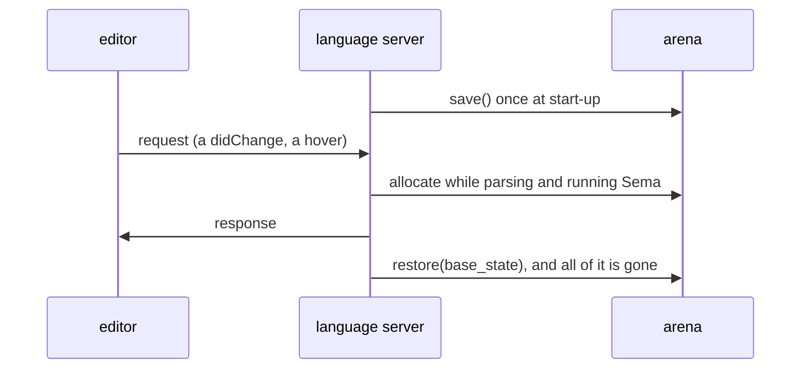
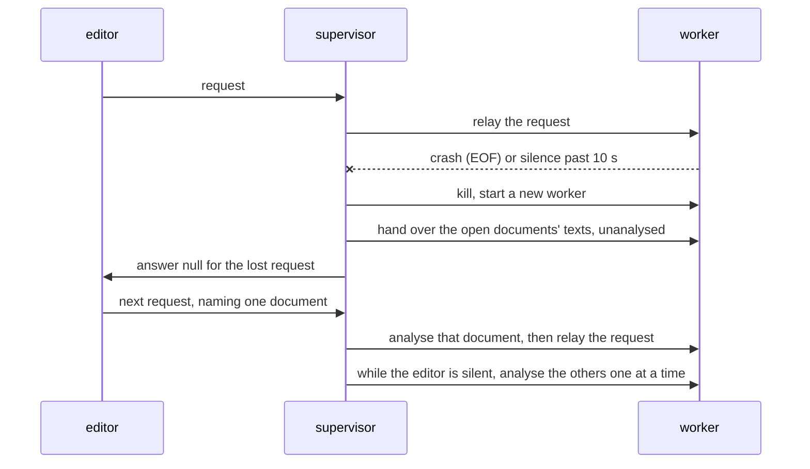
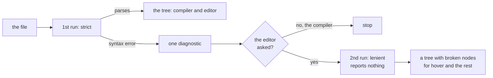
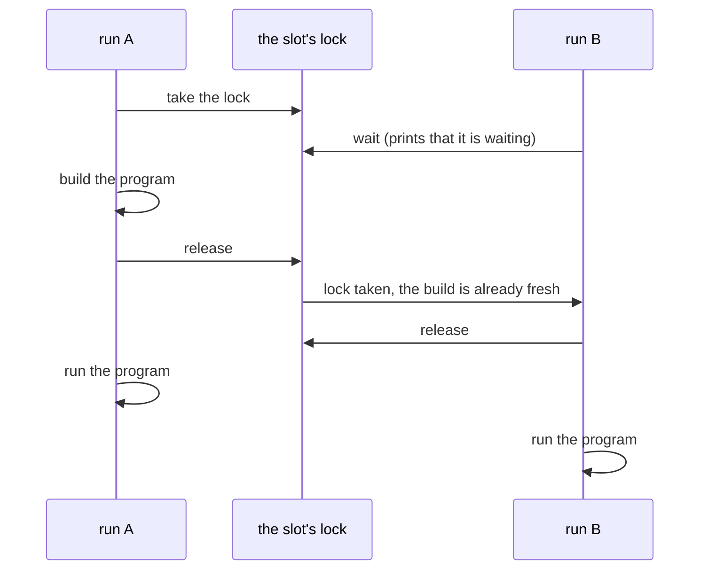

# ksplc's tools: the language server, the formatter, `ksplc run` and the settings

**How the tools built on the compiler work inside, and why.** It leans on the words of [`DESIGN-compiler.md`](DESIGN-compiler.md), the compiler's internal design: read its "The compiler as a whole" first.

The language server (`ksplc/lsp/`) and the formatter (`ksplc/fmt/`) stand outside the pipeline ("The parts that are not in the pipeline: `base` / `lsp` / `fmt` / `tools`" in [`DESIGN-compiler.md`](DESIGN-compiler.md)). [`SPEC-tools.md`](SPEC-tools.md) holds what the editor can rely on and what `ksplc fmt` and the settings accept. This document holds the internal decisions and their reasons.

## The arena is rewound after each request (a worked example)

The language server discards each request's analysis memory after answering. Interned names and document entries live across requests, under their own owners; the rewind does not promise constant process memory. A language server analyses on every keystroke, and without a GC a naive one leaks. `ksplc/lsp/state.kspl` uses **the arena's save and restore** ("Arena's implementation: a linked list of chunks and bump allocation" in [`DESIGN-compiler.md`](DESIGN-compiler.md)).

The diagram shows one request's life.



It saves the arena once at start-up. For each request it reruns the pipeline up to Sema, allocating at the arena's tail, and winds back with `restore(base_state)` once the response is sent. What must outlive a request is taken elsewhere (the caution in "The three-tier allocation strategy" in [`DESIGN-compiler.md`](DESIGN-compiler.md)).

**A load that returns immediately after publishing diagnostics frees the compiler's heap storage before returning an empty analysis.** Once semantic analysis has run, the document state owns the source map and semantic context until reset. The pipeline alone keeps the validity verdict; editor queries use the available tree and semantic context, including incomplete results.

**An empty open buffer is source, not an absent override.** The pipeline takes an optional override, and the loader uses source-map membership to decide whether bytes were supplied. The workspace reads an open buffer before trying the disk and copies that text once for its document state. Clearing a document therefore removes its declarations even while its saved file still holds them, and a restarted worker restores the same empty buffer.

## The language server runs as two processes: watcher and analyser

Editor support analyses half-written source without pause, so crashes (SEGV) and hangs on unexpected input cannot be ruled out. In one process, such a failure stops the whole server. So the server **separates a supervisor (`ksplc/lsp/server.kspl`) from an analysing worker (`ksplc/lsp/worker.kspl`)**, and a failure kills only the worker.



1. **Roles**: the supervisor owns the stdio with the editor, relays requests and manages the worker's life. It runs no analysis code.
2. **Detecting a failure**: the supervisor reads each response with a timeout (`worker_timeout_ms` = 10 s), and tells completion, timeout (a hang) and EOF (a crash) apart. The timeout is per read, so the worker also emits a liveness marker (`__KSPL_WORKER_ALIVE__`, NUL-separated like the completion marker) during long work. The supervisor strips it before relaying. A real hang stops the marker too.
   * Caution: **Keep every silence down to one file or one declaration.** `didOpen` reads and analyses hundreds of files from one entry point, and as one lump it can exceed the timeout on a slow machine. The hook is `progress_hook` (`report_progress`) in `base/core.kspl`. It is called while reading (`parse/load.kspl`), moving between files (`sema/session/ctx.kspl`), inferring (`sema/body/infer.kspl`) and walking the workspace (`lsp/worker.kspl`). `send_worker_alive` plugs into it when the worker starts. It throttles by elapsed time, not by count, since one iteration can weigh a thousand times another.
3. **Restart and restore**: on a failure the supervisor kills the worker and starts a new one. It hands the new worker the text of the open documents it holds (`Lsp_docs`), each as a `$/ksplRestore` the worker stores without analysing. **The first answer after a recovery waits for its own document's analysis, not for one per open document.** With twenty open, a hover after the crash would otherwise wait for twenty analyses.
   * **Each document handed over is analysed again later**, as a didOpen the supervisor sends. That happens before the first request naming it, or while the editor is silent, one at a time. The document a request names goes first, which also tells a crash in its analysis from one in answering.
   * **They are analysed again because the diagnostics on screen came from a worker that has just failed.** The document named by the message lost in the restart goes first while idle, since its diagnostics were never published for its current text.
   * **A message of its own, not a flag on didOpen.** `didOpen` always analyses and publishes; a field changing that would give one name two meanings in `dispatch`.
   * **To know the editor is silent, a thread of the supervisor reads standard input** and hands each message over (`Editor_reader`). Standard input has no "is anything waiting" that works on every OS and sees past the C library's buffer. The thread stops at `exit` or the end of input. A thread left blocked in the C library's read holds standard input's lock, and the C library's exit would wait for it.
4. **Quarantine**: a document whose analysis brings the worker down again is marked poison and excluded, so one document cannot cause an endless crash loop.
   * Caution: **After a quarantine, hand every document over again from the first, to the new worker.** Those already handed went down with the old one, and their requests would answer nothing.
5. **Degraded mode**: where processes cannot be created, the supervisor falls back to in-process analysis (`run_lsp_worker`).

**The supervisor is the last resort, not the plan.** Recovery loses the request in flight, and its `null` reads as "nothing found". So a failure the analysis can report must be reported, not turned into a dead process. `validate_layout` in `base/ast.kspl` returns its verdict on a tree nested past 2000 and fails that file alone. `clone_with` and `find_deep_child_impl` in the same file still end the run, since a file that deep is refused while loading and never reaches them.

Caution: **The editor must not keep a deadline of its own.** Liveness is judged here, counting *silence*, while the marker keeps a slow but healthy answer alive. A client timer counts elapsed time and cannot tell slow from hung, so it would throw away correct but slow answers. `.vscode/extensions/kspl/extension.js` holds none. A request ends with an answer, the process going away (both death paths empty the table), or the reader cancelling.

Process creation, IO and kill come from `Piped_child` in `std/subproc`, which hides POSIX `fork` and Windows `CreateProcess`. `tests/suite/lsp_test.kspl` checks the recovery on every CI run through the test hooks `$/ksplTestCrash` / `$/ksplTestHang`. It also uses a document named under the `kspl-test-poison:` scheme, whose analysis crashes every worker. `tests/support/lsp_recover.kspl` queues a hook and a hover together, then checks how many documents publish diagnostics before the answer. At most the requested document and one idle analysis may precede it. Time limits only bound a missing response. The `windows-ucrt64` job runs the same suite on Windows' process-separation path.

**The JSON-RPC frame's strings (`Content-Length`) are not held here.** Writing uses `frame_into` / `encode` in `std/jsonrpc` ("The frame is kept apart from the transport" in [`../../std/docs/DESIGN-system.md`](../../std/docs/DESIGN-system.md)). Only taking the header off stdin, one character at a time, is the server's own (`read_content_length` in `ksplc/lsp/msg.kspl`). It passes the whole header to `content_length` in `std/jsonrpc` with the server's own body ceiling. A missing, zero, conflicting or excessive length is `Lsp_error.format_error`.

## The server finds the workspace's files without asking the client

**The language server lists the project's source files itself by walking the folder tree from the root** (`ksplc/lsp/workspace.kspl`). Renaming and the call hierarchy must see callers not reachable through the open document's imports.

**Do not have the client send the list**: a page in a browser cannot walk folders, and every editor would write its own exclusions. KSPL has no manifest, so the server walks.

**What the walk reads, the walk mends.** `parse_file` takes a source as already in the brace notation, and the entry point in `ksplc/parse/load.kspl` mends only what it opened itself. So both paths where the server reads the disk itself use `mended_from_disk` in `ksplc/lsp/worker.kspl`: this walk, and a request for a file no editor has open. Skipped, workspace queries answer empty with no diagnostic. `tests/suite/lsp_test.kspl` lays out its workspace in the default notation to keep this path checked.

**The folders excluded are those `.gitignore` names**: a folder marked untracked is, by definition, not source.

Caution: **Do not list names to exclude in the source.** Each project names the place for built things differently.

**Only lines naming a folder are read**: a line ending in `/`, with none of `!`, `*`, `?` or `[`, and no `/` before the end. Resolving the whole syntax would add one more resolver that differs from git's in small ways. A folder beginning with a dot is never entered, `.git` included.

| `.gitignore` line | Read? | Why |
| :-- | :-- | :-- |
| `build/` | yes: that folder is skipped | a plain folder name |
| `*.exe` | no | names files; the walk keeps only `.kspl` anyway |
| `!keep/`, `out*/`, `a/b/` | no | needs git's full pattern syntax |

**The walk runs per request and holds no index**, so there is no wait for a first indexing.

### One bad file does not poison the workspace

The walk reaches files that cannot be built, such as the fixtures in `tests/negative`, hundreds written to be refused. **The analysis is one pass over all files joined together**, so if one desugaring failure ended it, every workspace query would answer nothing.

**A desugaring failure ends the run only where diagnostics are shown.** Stopping exists to keep a half-desugared tree from producing distant complaints, which a suppressed workspace pass never shows. What is refused stays refused on the entry point that shows diagnostics.

### The workspace walk reads through the AST cache

**The AST cache's exemption ("The normalized AST's disk cache (`ksplc/parse/ast_cache.kspl`)" in [`DESIGN-parse.md`](DESIGN-parse.md)) covers storing only, not reading.** The key holds the source's whole content, so a hit is the AST of exactly those bytes. Refusing to read as well would reparse every workspace file on every query.

**Files are narrowed by the whole identifier, not a substring** (`at` sits inside `that`). `mentions_ident` in `base/ast_spell.kspl` is the rule the rest of the compiler uses.

Caution: **Measure with the cache an ordinary session would have.** ksplc's own identity is in the key, so building the compiler empties the cache, and a full gate run right before fills it.

**Each file is read as it stands at the request: an open document from its buffer, every other file from the disk.** An open document's buffer is in `source_map` (`populate_source_map_from_store`); positions taken from the saved file would land on the wrong lines. A file not open can change on disk with no notification, so no copy from an earlier request stands in for it. `run_fresh` in `ksplc/tests/support/lsp_fresh.kspl` changes the files between requests and checks each edit against the bytes the editor applies it to.

**The caller says whether a source is the disk's bytes** (`src_is_disk`, passed down to `load_and_parse_file`). The walk claims the flag for a file it has just read from the disk; an open document's buffer never claims it. So unchanged files reuse their entries, and the document being typed into stores none.

**Do not memoize the analysis across requests either.** State kept across one request outlives the arena's wind-back ("The three-tier allocation strategy" in [`DESIGN-compiler.md`](DESIGN-compiler.md)). That is a change to the memory discipline, not an optimisation, and must be decided as one.

## References and renaming are one question, answered in one place

**"Find all references" and "rename" use one list of uses, so they can never disagree.** One walk of the tree makes it (`ksplc/lsp/uses.kspl`). It is rebuilt into `Location`s for `textDocument/references` and into `changes` for `textDocument/rename`. **Gathered in two places, the day only one is fixed, a use appears in the references that the renaming leaves unchanged.**

Caution: **Match on the definition, not the spelling**: the same spelling appears in comments, strings and other names.

**A name in a selective import's braces is a place of what it names.** In `import "lib" { helper }`, the `helper` is a use of `lib`'s `helper` (the analysis binds it, `check_import_symbols` in `ksplc/sema/decl/access.kspl`). Skipped, a rename would leave the import line naming a function `lib` no longer declares.

**The list is ordered by file name, then line, then column.** It is gathered in a `Map`, whose hash order would shuffle the same answer on screen.

**`context.includeDeclaration` is honoured exactly; where it is absent, the declaration is counted.**

Caution: **Do not ask the client for the narrowing's clue.** The server holds the position and the source, so receiving them from the client counts the same thing in two places. Only the call hierarchy's requests carry no position; there the clue is the `item.data` the server returned earlier.

## A rename is refused where the new name cannot stand

**A rename answers an error naming the reason, and writes nothing, where its edits would break the program or change what it means** (`ksplc/lsp/rename.kspl`). An edit applied across files is hard to take back by hand, and it lands in files nobody has open.

* **The new name is checked against the grammar itself** (`reads_whole` in `ksplc/parse/load.kspl`). A list of reserved words kept here would miss the next one.
* **A declaration outside the workspace is read only.** An edit to an installed standard library or a package read from `--pkg-src-dir` rewrites a copy other projects share. `holds` in `ksplc/lsp/workspace.kspl` asks the walk's own rules of each place. A repository that holds `std/` itself renames in it as in any other folder.
* **`prepareRename` asks the second question of the declaration alone**, from the document's own analysis. So the editor refuses before a name is typed, without the workspace's analysis. The capability is declared only to a client that says it sends the request.
* **A new name already declared where it would land is refused**, at each place the name is written bare. A method is also compared with the methods of the type's other `impl`s.
* **The search is conservative.** A declaration counts for its whole scope, before the place as well as after it, and a `switch` counts the bindings of all its arms together. A rename that could have gone through is sometimes refused, and the message names the declaration in the way. The opposite error, an edit that silently changes which declaration a name means, is what the check exists to stop.
* **What is declared is read from the compiler's own record** (each declaration's symbol, `sym_ptr`), not from the shapes of the tree. So a binding of any form (a `for`'s item, `if v: =`, a pattern's payload) is found. A field is no symbol, and is read from its declaration.

## The call hierarchy's FQN of a definition includes its file

The `CallHierarchyItem.data` that `callHierarchy/prepareCallHierarchy` returns is an **opaque identifier** the client sends back unchanged to `incomingCalls` / `outgoingCalls`. Keeping it unique is wholly the server's job.

Caution: **`Sema_symbol.name` is the bare name**; the FQN exists only as a key of `symtab.by_fqn`. As `data`, a common name such as `init` would fold every same-named function into one definition. So `compute_def_fqn` in `lsp/call_hier.kspl` prefixes the defining file (`ksos.drivers.ht16k33.init`). The name is assembled as `make_fqn` in `sema/session/ctx.kspl` assembles it, so `symtab.resolve_fqn`'s O(1) lookup hits it.

A method's `sym.name` already holds its owner's path, and the owner need not stand in the method's file (`impl pipeline.Compile_error` in `main.kspl`). So an already-qualified name gets no prefix (`write_full_name` in `lsp/nav.kspl`).

## The call hierarchy counts a function passed as a pointer

**The call hierarchy lists the place that hands a function over as a pointer as an edge, marked as a hand-over.** Passing a function pointer is not a call, but much code here is reachable only that way, such as ksos's task entry functions passed to `run_single_task`. Without the edge they show "no callers" and are mistaken for removable.

**It must not look like a call**: a pointer can be registered and never called. The LSP has no field for an edge's kind, so `CallHierarchyItem.detail` carries `(as fn pointer)`. A function can both call and register one target, so `has_call` / `has_ref` are held separately.

Two exclusions are indispensable:

1. A call's callee name also points at a function, so the callee positions are excluded first, or every call is listed twice.
2. A declaration's own name (the `f` of `fn f()`) has a `def_node` pointing at its own declaration, so unless excluded every function becomes its own caller.

**`make test-lsp-tree` holds both down**, on ksos's task entry functions. Everything needed is in `def_node`, as for the renaming walk.

## Completion re-analyses the text as if one name were missing

**To suggest completions while you type, the server analyses the text with the half-typed word replaced by one synthesized name.** Half-written text does not parse ("Only the editor's parse recovers from a syntax error"), so `latest_state` holds neither a tree nor a symbol table.

This is **a restatement of the question**: a completion request asks "which name goes here". That also sets its reach: text missing a closing bracket or the end of a statement cannot be saved, and the answer is empty.

Caution: **Do not reuse `latest_state`**, which is built from the half-typed text. Completion builds a state of its own and always discards it by winding back, or it would grow the arena on every keystroke.

**One entry point handles all three kinds of head**; what stands before the half-typed word decides the path.

| Head | Example | Where it looks |
| :-- | :-- | :-- |
| a receiver expression | `cup.` | the postfix node → the receiver's type → its fields and methods |
| a namespace alias or a type name | `io.` / `Cup.` | the path node → for an import's alias, the names in that namespace; otherwise, the type |
| none (a bare name) | `twi` | earlier declarations in the enclosing scope, the file's top level, the imports' aliases |

Caution: **A namespace alias or a type name is not a postfix node** (normalization folds `io.out` into one path node). Handling only one of the two silently empties the other.

**For a bare name, do not list everything in a namespace.** KSPL calls an imported name through its namespace, so only the three sources in the table can be listed unqualified. After a namespace too, list only what can be called from outside.

**A candidate carries what its declaration says of itself.** Each item's `documentation` is the declaration's description, read by the hover's own reader (`lsp/nav.declared_doc` → `base/ast_doc.kspl`) and sent as Markdown. The list is where a caller looks first; a description shown only on hover arrives after the choice. Every path in the table carries the declaration it came from.

**`detail` carries the shape: a function's signature, a field's type**, which a caller needs before choosing. What a signature holds (its parameters, a variadic's `...`, each default, the return) is decided once, in `write_sig` in `base/ast_spell.kspl`. The list and the hover both write through it. A default shows as written (`step: I32 = 1`); dropped, a reader takes the parameter for one every call must pass.

**A method's receiver is shown as the declaration writes it** (`fn s(r: Self$@, …)`), as the hover and the published record show it. A reader counting arguments must know the first is the receiver, which the call site does not write.

Caution: **Do not take a function's type from its symbol.** The symbol's `type_id` is the return type ("The declaration decides whether a call uses a function pointer" in [`DESIGN-diagnostics.md`](DESIGN-diagnostics.md)), so `fn f(): Sz` would read as an `Sz`.

**The server alone decides the order.** The LSP has no score field, and clients re-sort by fuzzy match over `sortText`. Make `sortText` a number with padded digits: the bare name lets the client's re-sort collapse the order.

**`triggerCharacters` is not declared**: only the client can decide when to offer completion.

## Only the editor's parse recovers from a syntax error

**When a file has a syntax error, the compiler stops at the first one. Where the editor is the reader, the file is read a second time with the recovering branches alive, and a tree is returned.** The grammar is a PEG (`kspl.kspeg`; a *PEG*, parsing expression grammar, tries each alternative in order). So half-written code (`p.`, say) still answers hover, jump to definition, references, renaming and the call hierarchy with one diagnostic, instead of five `null`s.

### Why signature help is not offered

**A type call's written name remains the type's name in the editor.** Hover and go-to show its type declaration, and renaming the type updates the call. The implicit `new` is not a written reference. Renaming that constructor is refused while type calls select it, since replacing the type's text with a function name would break the program. Write those calls as explicit member calls before renaming the function.

**The editor's "parameter hints while you type a call" panel (`textDocument/signatureHelp`) is not offered.** While a call is being written the file does not parse. The recovered tree holds the half-written call only as swallowed text ("What a broken node holds"), so the name before the bracket is not resolved. A fallback by name cannot tell one `new` from another. The parameter descriptions are on the hover instead, each on its own parameter's line (`format_fn_sig` in `lsp/spell.kspl`).

### Two runs: strict for everybody, lenient for the editor alone

Caution: **A grammar branch that takes "a broken statement", added plainly, makes the compiler pass broken code silently.** With one, an input containing `y: = p.` gets "the return value is not returned" instead of a syntax error. The branch swallows the broken statement and the `return` behind it.

So **the run is split in two, and the recovering branch lives in the editor's run alone.**



| Run | Used by | Recovering branch | Diagnostics |
| :-- | :-- | :-- | :-- |
| 1st (strict) | the compiler and the editor | **dead** | this run alone reports them |
| 2nd (lenient) | the editor alone, only where the 1st run failed | alive | **reports none** |

**The branches are told apart by the rule's kind, not by the name's spelling**, so a mistyped rule cannot pass as an ordinary one.

**The 2nd run reports nothing. Do not put a diagnostic out from a recovered result.** It sets off chains: one closing bracket lining up dozens of unrelated errors. The 1st run's one diagnostic is enough.

### What a broken node holds

A *broken node* is the piece of the recovered tree that stands for text that could not be parsed. **A broken node holds the swallowed text and nothing else.**

Caution: **Do not make up a declaration that is not there.** A synthesized name or declaration in the tree goes into the symbol table. Completion then offers a name that does not exist, and hover explains it. So an error is represented as an extra node, never as a missing node the server would have to invent.

**`is_valid` stays false.** A recovered tree is not correct, so it does not go on to generation. Sema passes a broken node straight through; analysed, the swallowed text would be read as an expression.

Caution: **Do not give a recovered tree `has_load_error`.** That flag means "the file did not load at all", and the code reading it returns before the analysis. A recovered tree needs only the suppression (`suppress_errors`), so the analysis still runs and only its findings are held back.

### One operator in kspeg: skip up to the stopping character (`~"…"`)

**Kspeg has one operator for the lenient run, "swallow text up to a stopping byte", and it doubles as the mark of the lenient run.** The notation has no negated character class, and `( !";" !"}" . )+` makes a node per byte. It is spelt `~"…"`, and the bytes between the quotes end the swallow (`kspeg/docs/SPEC-notation.md`).

Caution: **Do not split it into two.** A swallowing operator held apart from the mark that enables it allows a run where the mark alone is raised. As one, the operator is always off in the compiler's run, so the compiler's grammar is unchanged.

| Piece | File |
| :-- | :-- |
| the `Rule` kind, its engine arm, the lenient option and the notation | `kspeg/rule.kspl`, `kspeg/engine.kspl`, `kspeg/notation.kspl` |
| two branches, the last of `stmt` and of `top_level_item` | `ksplc/kspl.kspeg` |
| two node kinds | `ksplc/base/ast_kinds.kspl` |
| the 2nd run's entry point (**not the compiler's**) | `ksplc/parse/load.kspl` |
| its one user | `ksplc/lsp/worker.kspl` |

**The swallow stops at a line end as well** (`~";}\n"`). Stopping only at `;` and `}` eats the `return` on the line below, the very failure the two runs exist to avoid. Where a statement runs over several lines, the next broken node swallows the rest.

### The gates that keep the lenient parse in check

* **`make test-negative` is the linchpin**: if the lenient branch leaks into the compiler, an input that ought to be refused passes and that gate fails.
* The 1st run's diagnostics keep their positions and wording.
* In a file with one broken line, hover, jump to definition and references **answer** (`tests/support/lsp_recover.kspl`).
* A broken node puts no name into the symbol table.
* The lenient run is started from the editor's entry point and nowhere else (`tests/support/conventions_lsp.kspl`).

### A bracket left open

**A bracket opened but not yet closed must not take the rest of the file with it.** Two rules keep it, one on each side of the rewriting into braces.

**In the braces the parser reads, the top-level swallow stops at `;` and the line end, not at `}`.** No top-level item begins with a `}`, so the `}` left over by an unclosed block is swallowed like any other unreadable run.

**In the indentation reader, a line that begins something of its own caps the run.** Otherwise one `(` never closed joins every later line into one logical line. A line that closes what is open does not cap it, since a value written over several lines puts its `}` at column 0. `begins_anew` in `parse/layout.kspl` tells the two apart.

**What is inside an unclosed block stays inside it.** The editor does not invent the `}` the writer has not typed. What matters is that the file *above* still answers and the parse does not run away.

## A `didOpen` checks one document's bodies

**When you open a file, the server type-checks the function bodies of that file only, not of every file it imports.** Checking every reachable file's bodies would delay every answer, redone on every keystroke.

So the document view checks `main_file`'s bodies and no others (`Bodies.main_file`, the `bodies` on `Sema_ctx` that `run_semantic_analysis` is handed). Every file's declarations are still collected and every `const` initializer still inferred, since other files read those. Only other files' function and impl bodies go unchecked.

| View | Bodies checked | Serves |
| :-- | :-- | :-- |
| the document view (`build_document_state`) | the open file's only | hover, jump to definition, the outline, the panel while a call is typed, this document's diagnostics |
| the workspace view (`build_workspace_state`) | every file's that names the word, or a generic using it | references, renaming, the call hierarchy |

**Nothing shown depends on other files' bodies.** Diagnostics are filtered to the open file when sent (`is_same_file` in `lsp/msg.kspl`).

Caution: **The workspace view must keep every body that can hold a site.** A call site naming the word lives in a body that names it, or in an instance of a generic that does. So the workspace view (`Bodies.mentioning`) checks the bodies naming the word, or the name of a generic using it. The names grow through the generics until none is added (`wanted_names` in `sema/body/infer.kspl`). On the repository's own tree, a common name's callers come back in about half the time. The editor's final pass, which resolves the names in each declaration for references, is narrowed the same way. `tests/support/conventions_lsp.kspl` keeps `build_workspace_state`'s `mentioning` apart from `build_document_state`'s `main_file`.

**An instance made without naming its generic is not followed**: an operator, a subscript, `for in` or a trait value calls a method its body never names. The walk already reads only the files that name the word, so it stops at the same place. `ksplc/tests/suite/lsp_test.kspl` checks that a caller inside a generic still comes back, when the instance comes from a body not naming the word.

The narrowing also keeps one bad file from poisoning a good one. A failing body in another file would give this document a bare `Semantic Error` at 0:0.

## Typing names the document view does not analyse

**The document view leaves other files' bodies unanalysed. Where a name's type would come from that skipped analysis, the server works it out from the declarations instead**, held to what they say.

| The name | How the view types it |
| :-- | :-- |
| a method instantiated on its own | it is registered on its owner's table |
| a parameter of a declaration in another file | from the node's type id, then its name |
| a member access | by what the definition is, not the path's shape |
| a call in a generic body nothing instantiates | from the receiver's declaration |
| a chain of fields | one field at a time, from the struct declarations |
| a local set from a call | from the declared return type of what it names |
| a function's own name | it is the declaration itself, not a reference |

**A method instantiated on its own must be registered on its owner's table.** Instantiating a whole generic struct registers each method on the type entry (`instantiate_generic_methods`), and `instantiate_fn` must register the one method it reaches too. The narrowed view would otherwise show `std.ds.new` for `std.ds.List<|U8[]|>.new`.

**A declaration in another file has no types on its parameters, so its spelling is not taken from the node's text.** In the narrowed view, `type_id` stays 0 on the parameters and return of every declaration outside the open document, and the node's text is the post-desugaring text (`path: Slice<|U8|>`). That bypasses `display_str` ("A diagnostic points at 'the position the user wrote'" in [`DESIGN-diagnostics.md`](DESIGN-diagnostics.md)). Ask the node's own type id first, and the name only where there is none (`write_type_of` in `lsp/spell.kspl`; `check_hover_away` in `tests/support/lsp_spell.kspl`).

**A member access is not by itself a call.** What the definition is decides the label. Labelling every member access `(Function) ` (`walk_path_for_type`) slices a field's source over `get_span_length()`, which stops short on a desugared type (`j.argv` of `U8[][]` shows as `pub argv: U8`).

**A call in a generic's body that nothing instantiates is resolved from the receiver's declaration.** This view instantiates only what the open document reaches, so the receiver stays a one-part path (`xs` of `xs.get`) with no type. The view's last pass resolves its declaration's type node, though. Find the receiver's declaration the way a local is found (`resolve_fallback_parent_def` in `lsp/nav.kspl`). Take its type by the instance's registration key (`std.ds.List<|T|>`), with a `@` view unwrapped (`dot_receiver_of`).

**A receiver that is a chain of fields is typed one field at a time, from the declarations** (`r.wo.weights.sgd_step(dwo, lr)`). Take the head's declared type: for `Self`, and for an `r` written with no type, the enclosing impl's. Then take each field's type from its struct's own declaration (`type_name_of` and `field_of` in `lsp/nav.kspl`). A field reached so answers its own hover and jump the same way. It is exact, not a guess: a KSPL struct is declared once, and an `impl` for one instance adds methods, never fields. Nor can the walk go round, since each step takes one more name written in the chain.

**A call is followed to the declaration it names, and no further** (`$dq: = g.dq` after `g: = attn_backward_core(...)`). Following one makes the view decide what a call returns, a second copy of sema's decision (Principle 6 in `docs/DESIGN-principles.md`). The copy is held to three steps that read declarations and choose nothing:

* a local with no type written takes its initializer's;
* a call takes the declared return type of what it names (`call_type_name` in `lsp/nav.kspl`): `Self` as the receiver's type, and otherwise only a type sema resolved;
* `catch` passes on what succeeded.

There is no overloading and no inheritance, so a method's name on a known type stands for one declaration (`member_of`). The rest stays bare: an operator's result (`dxq + dxk`), a call named through a path (`lora.make`), and a return type sema left unresolved.

Caution: **Where sema changes what a call returns, these steps change with it**: nothing but this caution holds the copy to sema.

**Completion in such a body asks the same walk.** A lone name before the dot is kept as one path with the mark (`cc.<mark>`). Where the path's head names a value, the names before the mark are typed as above (`folded_receiver_type` in `lsp/nav.kspl`). A generic's fields are counted from its declaration (`struct_decl_of`), since a generic has no struct entry. A level's alias and a type's name (`io.`, `P.`) keep their own path.

**A function's own name is not a reference.** Looked up by its bare name, as `resolve_all_types` in `sema/decl/resolve.kspl` resolves identifiers, a method `put` would take the prelude's `std.lang.put`. So on a declaration's own name the definition is that declaration (`get_definition_node` in `lsp/nav.kspl`). The call hierarchy keeps no copy of that fallback of its own.

## A declaration shows as written, not as its last instantiation

**A template's nodes carry an instantiation's marks.** A monomorphized copy borrows the template's position ("A diagnostic points at 'the position the user wrote'" in [`DESIGN-diagnostics.md`](DESIGN-diagnostics.md)). Type ids are stamped along the way. Both mislead the editor, which is asked about the text on screen. Three rules follow, each shown on `std/lang.kspl`'s own declarations:

1. **`Self` is not shown as a concrete type.** The type node of `fn next(r: Self)` in `trait Iter<|T|>` carries the id of `Slice<|U8|>`, an instantiation that happens to exist. `Self` beats every type id (`write_type_of` in `lsp/spell.kspl`): it is a fixed spelling ("5.1 Traits (`trait`)" in `../../docs/SPEC-programming-language.md`). The test "is this `Self`" and its spelling (`self_type_spelling`) live in `base/ast_spell.kspl`, written with its `$`. The type's name drops the `$` (`extract_type_name`), and `r: Self$@` would read `r: Self@`.
2. **A trait's requirement keeps its owner** (not `std.lang.free` for `trait Manual_free`'s `free`). An impl's method carries its owner inside `sym.name`; a trait's does not, and a generic trait's requirement has no symbol. A method whose name is still bare takes its owner from the declaration it stands in, read off the tree (`find_owner_in_tree` in `lsp/hover.kspl`).
3. **The internal name does not reach the screen.** The copy and the source node of `pub fn at_ref` in the `Slice` impl cover the same offset, and the copy would read `std.lang.Slice.Slice_U8_Const_at_ref`. At an equal score the walk prefers the node whose text is the source's text at that position (`is_source_text` in `lsp/position.kspl`). This is a preference, not a filter, so a synthesized node still answers where it is the only one. It answers at its own position, not over the length of its text.

**The type arguments are the answer at a call, not on the declaration.** `List<|U8[]|>(arena)` calls one instantiation, so its hover names it. The declaration shows the generic's own name (`keep_args` in `find_owner_of_fn`).

**Rule 1 is the other face of the rule in "Typing names the document view does not analyse".** The type node's own id comes first for a declaration in another file, but not for a template. `check_hover_prelude` in `tests/support/lsp_spell.kspl` asks the editor's question of the prelude, since the suite's own probe documents carry no instantiations.

**A member is named by its owner's path, never by its file.** An `impl` can stand in any file, and sema names each method by the owner it resolved (`collect_impl_decl` in `sema/decl/collect.kspl`). Prefixing the file would give paths such as `std.str.U8[].equals`. Only a bare name takes the module of the file that declares it (`write_full_name` in `lsp/nav.kspl`), as the call hierarchy's identity does. An owner read off the tree is the declaration its header names (`owner_name_of` in `lsp/hover.kspl`). `check_hover_owner` in `tests/support/lsp_spell.kspl` holds one owner of each kind.

**A label is shown as a label, and a jump to it lands on it** (`is_label_name` in `lsp/hover.kspl`). Sema records the label a jump leaves on the jump's own name (`name_node` on `Jump_label` in `sema/session/ctx.kspl`), so the editor matches no name a second way.

**A position answers for the name it touches, and a mark names nothing.** The walk by position (`Pick_walk.visit` in `lsp/position.kspl`) counts a position at a name's end as on it, where the caret stands. A mark (a bracket, a comma, an operator) is no target. Answered from the node around it, the `)` of `words.free()` would read `fn )()`. Two kinds of node span marks besides their names, so each is held to its names:
* a path whose names are nodes of their own is not a target itself, or `List<|U8[]|>.new` answers on its `<|` and `|>`;
* a declaration reaches only to where its type or value begins (`declarator_span`).

A keyword answers only through what it stands for: the `const` of a declaration answers as that declaration, never as `type priv` (`walk_path_for_type` in `lsp/hover.kspl`). `check_hover_marks` in `tests/support/lsp_hover.kspl` asks at each kind of mark, then at the names beside them.

**A literal shows the type the analysis left on its node** (`send_literal_type` in `lsp/hover.kspl`), not a guess from the spelling, which would read every integer as `I32`.

**A name where it is bound reads as it does where it is used.** Every request asks the one question "which declaration does this name stand for" (`get_definition_node` in `lsp/nav.kspl`). Only the jump goes on to the declared type (`handle_definition`). **A binding the compiler builds keeps the name as written**, at its own position (the item of `for w in words`, the `v` of `if v: = opt`). Otherwise the hover and references find the `_for_coll` temporary instead. `check_hover_values` in `tests/support/lsp_hover.kspl` asks at each kind of literal and of binding.

## A URI is converted to the logical name and back

**The editor names files by URI (`file:///home/me/proj/std/lang.kspl`). Inside the compiler a file has one identity, its logical name relative to the project root (`std/lang`). So the server converts at the LSP's boundary, both ways** (`to_project_relative` in `base/locate.kspl`). Why the name is relative is "The standard library is found beside the compiler".

The diagram shows the conversion both ways.


**Without the inbound half**, `Pick_walk.visit` (in `lsp/position.kspl`) rejects every node of the open document, whose AST records `std/lang` while `mod_name_perm` reads `/home/me/proj/std/lang`. Every query then answers `null` for a client sending an absolute URI. Without the outbound half, a fixed `file://` in front gives `file://std/lang.kspl`, whose *host* reads `std`.

**An answer goes back in the spelling the request used.** `Uri_style` in `base/locate.kspl` holds the two bits a client shows: whether `file://` was written, and whether the path was written from the root. Both spellings are in use: an editor sends `file:///home/me/proj/std/lang.kspl`, while the VS Code extension sends the workspace-relative `std/lang.kspl`. Rendering one fixed way would break one of them.

**A document in std's folder is std's file both ways.** Inbound, a path under the folder std is read from becomes `std/…`, whatever the workspace (`name_entry` in `base/package.kspl`). Named by its path, an installed std would be taken in a second time and judged as a project's file. Outbound, a logical name is spelt as the file it is read from (`append_file_path` in `base/locate.kspl`). So a jump to `std/io` lands where std stands, and a package found under `--pkg-src-dir` lands where it was found.

Caution: **`base_locate.is_same_file` is not the pattern to copy.** It matches a URI against a logical name by tail-with-boundary, which keeps diagnostics working while all else is dark. A tolerant comparison downstream hides a boundary that is not converting.

**The gates ask in both spellings.** The heavy walk (references and renaming) uses the absolute URI an editor sends; `check_walk` uses the relative one the extension sends. `check_uri_spelling` (in `tests/support/lsp_spell.kspl`) asks one question both ways and holds each answer to the spelling asked. The suite's std stands outside its workspace. `check_hover_prelude` holds a std document opened by its path to the name `std.lang`, and `check_hover_away` holds a jump into std to std's place.

## The formatter reorders the `import`s as text, before the printer

**The formatter sorts the `import` lines first, in a stage before the printer** (`ksplc/fmt/import.kspl`). **It sorts the original text rather than the tree, and only then lays out the file.**

Caution: **Do not reorder nodes inside the printer.** `fmt_printer` advances monotonically through the original text's offsets, and `catch_up_trivia` does nothing when `target_offset <= last_offset`, so going backwards drops the comments. Rearrange the text first and analyse it again only where it changed.

**Find the region by walking the tree.** Some files hold an `import` line inside a test fixture (`"""…"""`), which a reorder by lines would rewrite.

**The order of the declarations in the generated C follows the imports' order**, so a change to the sorting rule rewrites much of `ksplc/seed.c`.

## The formatter folds nothing by default (`AllowShortBlocks` / `AllowShortFunctions`)

**By default the formatter never squeezes a short block or a short function onto one line.**

```ksplb
// with AllowShortBlocks: true
if n > 0 { count += 1; }

// the default
if n > 0 {
    count += 1;
}
```

* **A folded block cannot take a breakpoint inside.** The `if`'s condition and its body share the line, so the debugger cannot stop at the body alone.
* **The common formatters expand a one-statement block by default**, and the line count saved over the whole tree is small.

**Folding is kept for users' code.** A block with a comment inside its braces is not folded (`has_comment_in` in `fmt/source.kspl`), since only the comment's first line would ride onto the `{` line.

**`AllowShortFunctions` is `false` too, for another reason.** There is no debugger price, since the entry and the one statement share a position. But the lines saved do not pay: one-statement functions are many in the small files, so a file near the 1000-line cap drops almost nothing.

**The `fn` is what reads the setting** (`pass_allow_single` in `fmt/printer.kspl`). The `k_stmt_block` inside does not know whose body it is, so read there, an `if`'s body would get the same treatment.

## One level is four spaces (`IndentWidth`)

**By default `ksplc fmt` indents each level by four spaces.** In the indentation notation the column is the block structure itself: no `}` closes a level. Two spaces leave that step narrow enough to misread at a glance, worst where several levels end on one line. Python, the nearest case, also indents by four. The brace notation is formatted at the same width.

**The price is width.** A line four levels in starts eight columns further right, so more lines break at `ColumnLimit`, which stays 100.

**The width stays a setting** (`--style="IndentWidth: 2"`), since the reader accepts any width ("How a column is read" in [`../../docs/DESIGN-notation.md`](../../docs/DESIGN-notation.md)). The hover lays a signature's parameters out at the same level (`SIG_PARAM_INDENT` in [`../lsp/spell.kspl`](../lsp/spell.kspl)), held to the formatter's by `make test-conventions`.

## A line breaks only where the reader joins it back

**The printer asks the indentation reader's own question before it breaks a line** (`reader_joins` in `fmt/printer.kspl`, which asks `joins_next` in `parse/line_cont.kspl`). The rule is in §3.2 of [`SPEC-tools.md`](SPEC-tools.md).

* **Formatting must not change the meaning** (§3 of [`SPEC-tools.md`](SPEC-tools.md)), and a break the reader does not join ends a statement.
* **The notation does not grow a word-keyed join instead.** Letting a line end in `fn` or `switch` continue it is a word-keyed exception, which "How a column is read" in [`../../docs/DESIGN-notation.md`](../../docs/DESIGN-notation.md) turns down. A head too long for the line is rare.
* **A join the reader does make is honoured.** A `for` heading broken after an operator joins, so its later `;` stays the heading's (`scan_phys` in `parse/layout.kspl`).
* **`make test-fmt-tree` formats the tree narrow as well** (40, 50 and 60 columns, one per source in turn). It requires that the output reads back and that a second pass changes nothing.

## Blank lines and the line terminator

**What the formatter does with blank lines is "3.2 The formatting settings (`--style`)" in [`SPEC-tools.md`](SPEC-tools.md); this section holds why.**

* **A blank line after a `}` stays because it is a paragraph break the writer placed**, the last means of grouping left to the writer.
* **The blank lines at a block's two ends are dropped**: they separate nothing.
* **A file ends with exactly one newline because line-oriented tools assume one.** `wc -l` counts a file without a last newline a line short, and `diff` prints `\ No newline at end of file`.

**A file keeps its line terminator** for the reason in "The line terminator is the file's spelling, not the program's" in [`../../docs/DESIGN-notation.md`](../../docs/DESIGN-notation.md). Where terminators are mixed, the first line decides.

## The formatter's time, and the record of formatted texts

**Formatting a file is mostly parsing it, so the formatter remembers which files are already formatted and skips them.** In callgrind, the KSPEG parse and the conversion to the tree take about two thirds of a file's time. Starting the process is a small share, so the batches `mk/lint.mk` hands one process gain nothing from fewer starts.

So a text formatting leaves unchanged (a *fixed point*) is recorded, and not formatted again (`Fixed_points` in [`../fmt/file.kspl`](../fmt/file.kspl)). What a user sees is "3.3 Skipping what is already formatted" in [`SPEC-tools.md`](SPEC-tools.md). Over a formatted tree a run then does about a tenth of the work.

* **The key holds every input the output depends on**: the bytes, each style field (`Config.append_key` in [`../fmt/style.kspl`](../fmt/style.kspl)) and ksplc's identity. With an input missing, a record made under one option would answer for another. **The path is not in it**, since the formatter reads only the text.
* **Only a fixed point is recorded**, so a hit answers what formatting would. Recording a changed output would trust that formatting twice moves nothing, which the rounds of inserted parentheses do not promise.
* **The bytes, not the file's time**, which a checkout rewrites and a tool can keep across a change.
* **A hit's cost is the hash.** `std/sha256.kspl` writes its rotations' shift amounts as literals, since an amount passed in is checked on every shift and the seed is built `-O0`.

**Not taken: an optimized ksplc for the tree-wide runs.** `make fmt` runs the seed, which builds in seconds at `-O0 -g` ("The bootstrap, and keeping the seed in step" in [`DESIGN-compiler.md`](DESIGN-compiler.md)). An `-O2` build formats about three times faster, but takes several times longer to build than the runs it shortens. With the record in place, only a cold run would gain.

## `ksplc run` builds under a lock and runs outside it

The C compiler's target is queried once per process and kept as an optional `Target_kind` in `tools/run.kspl`. A present answer can have every flag false, as on Linux, so the answer itself cannot double as the mark that it is known. The link libraries and target-specific executable flags read the same answer.

**Runs of one script share its slot, and the build in it is one at a time** (the behaviour is §2.5 of [`SPEC-tools.md`](SPEC-tools.md)). The build writes working names that belong to the slot (`prog.new.c`, `prog.new.exe`, `deps.new`) and sweeps unused objects. Two builds at once would take each other's files away. `hold_slot` in `tools/run.kspl` takes the slot's lock before the freshness check, so a run that waited finds the build done and starts the program.

The diagram shows two runs of one script started at once.



* **The lock is the OS's** (`fs.File_lock`: `flock`, `LockFileEx`), which goes when its holder dies. A lock file made and removed by hand is left behind by a crash.
* **A waiting run says so**, since a silent wait looks like a hang.
* **The program runs outside the lock**, or a long-running script would stop every other run of it.
* **Not a fresh name per entry, renamed in.** Here the working names are fixed and the objects swept, so a lock around the build is the smaller change.
* **The executable is renamed over, never removed first**, so a run that starts it in between meets no gap. Windows refuses to replace a running program, so that one is renamed aside, and the next build removes it.

**A program with no file (`ksplc run -`, `--eval=`) reaches the child compile on its standard input**, under the input `-` (`subproc.spawn_feed` in `generate_c`). As an argument, it would meet the command line's limit (32,767 characters on Windows).

* **Its slot is keyed by its text** besides `-`'s path, which holds the current folder (`append_slot_key`).
* **Its deps file has no line for it** (`write_deps_file`): there is no file to take a digest of, and the key already holds the text. The lines for what it imports still decide whether the build is fresh.

## A comment line is cut only past the column limit

**The formatter cuts a comment line that crosses `ColumnLimit`** (`fmt/comment.kspl`, applied in `fmt/trivia.kspl`); the rule is §3.1 of [`SPEC-tools.md`](SPEC-tools.md). A line within the limit stays as written, so a rename rewraps only the comment it widened. `make test-fmt-tree` holds every comment to the width as it holds the code.

* **Not a full reflow.** Reflowing every paragraph would rejoin lines the writer broke on purpose, and turn each edit into a diff over the whole comment.
* **A line whose layout carries meaning is never cut, and carried words never join it.** These are where cutting does damage, such as a table row or a marker a gate reads a line at a time.
* **A `//<` too long behind its declaration moves below the mark instead** (`carries_summary_down`).
* **A summary is not cut** (`opens_summary` in `fmt/trivia.kspl`): the cut would move its end into the detail, and the hover would show half a sentence.
* **An empty `//<` right below a summary is not written** (`drops_after_summary` in `fmt/trivia.kspl`): the line boundary already ends the summary ("The documentation a declaration carries" in [`../../docs/DESIGN-notation.md`](../../docs/DESIGN-notation.md)).
* **What the cut cannot do stays a check**: a comment past Principle 7's line count needs rewording, which the linter counts (`[H0806]`).

## The design of the tool settings

### lint is set per diagnostic code, not per group

`ksplc lint`'s findings are switched by **a level per diagnostic code** (`off` / `on` / `error`). No name stands for a set of codes, a profile included ("There are no named combinations" in [`SPEC-tools.md` §5.3.3](SPEC-tools.md#533-the-codes-off-by-default)).

**A profile does not pay for itself.** What a profile (strict/relaxed and the like) can control is a tiny part of all the diagnostics. Per-code control covers the same choice, and the checking code shrinks.

**It rests on a canonical registry.** Without a list, a suppression with `I0301` mistyped as `I004` would fail to take effect unnoticed. `ksplc/base/lint_codes.kspl` is that registry, consulted by all three routes: `##lint`, `--lint` and `ksplc.cfg` (SPEC-tools.md §5.3.2).

**The naming convention secures the safety boundary.** Only diagnostics that carry a code can be configured, and no error-severity diagnostic has one. So a project setting cannot silence a real defect (a use after free, say). The price is a standing condition: never assign a code to an error.

**A level, not a pair of words**, because the operation has three values: suppress, enable and promote to an error. A name such as `#lint_allow` is avoided, since `allow` reads both ways.

**Promoting to `error` also runs the check.** Many advisory checks return early with `if !is_lint { return; }`, so on an ordinary build promotion alone would change nothing. So `run_lint_checks` (whether the checks run) is separate from `is_lint` (whether advice is shown), and is set wherever even one `error` setting exists.

Caution: **Set it from all three routes.** If the settings file's route does not set it, an `error` written there refuses nothing on a plain build. The pass that checks each source's settings file sets it (`validate_config_for_file` in `base/lint_codes.kspl`).

### The settings file is `ksplc.cfg`, with no use in the name

**Naming the file after its use multiplies files at the second setting.** With a name such as `ksplc.lint`, the formatter's column count would need a second file, and the search rules would be implemented twice. Separating uses by section (`[lint]`) multiplies only sections. **The name is the reader's**: `ksplc.cfg` holds "all the settings ksplc reads".

**The format is INI**, not a new language for settings alone, nor KSPL syntax, which would need semantic analysis just to read the settings.

**The nearest file applies whole** (SPEC-tools.md §6.2). So a folder where deliberately empty blocks are scattered, as under `ksos/`, needs one `ksplc.cfg` rather than `##lint(I0307 = off);` in every file.

**Files do not merge**, so one file tells which settings govern a source. The cost is repetition in a nested folder; if that becomes common, the answer is an explicit `extends`, not the merge.

**The settings live in a file the compiler reads, not in the build's arguments**, which the editor's worker and a run by hand never see.

**The more local, the stronger, with the CLI as the exception** (SPEC-tools.md §5.3.2). The instruction in the source is strongest because it states the most local intent: "this place is an exception".

**An invalid setting is validated on every source read, not when a diagnostic fires** (SPEC-tools.md §6.3). Level resolution runs only when a diagnostic is reported, so a lazy validation would let `I0307 = maybe` pass in any file where that diagnostic never fires.

### The standard library is found beside the compiler

**By default ksplc uses the standard library that came with it, found next to its own executable.** The order of the places is SPEC-tools.md §2.9.1.

**`std` is a reserved prefix.** Trying search paths in order would let a project's own `std/` folder silently hide the real one, or be hidden by it.

**It is found from the executable, so an unpacked zip and an installation need nothing set**, as clang's resource dir and rustc's sysroot are. Were only a variable to name it, a program outside the unpacked folder would fail on `std/lang.kspl` until it is set. A variable left from another release would pair one compiler with another's library. The two places are the two layouts that ship: the release zip and `make install`.

**The path is the executable's real file, not `argv[0]`.** Started through PATH, `argv[0]` holds the bare name, and through a link it names the link's folder. The OS gives the path with links resolved (`kspl_exe_path` in `gen/runtime/hosted_spawn.c`). The function lives in the C runtime, which a compiler built by either backend links ("The backends (Genc / Genllvm) and the runtime ABI" in [`DESIGN-backends.md`](DESIGN-backends.md)). **It stays a runtime function the compiler declares itself**, not a function of `std/sys`, which would promise it to every program.

**A folder counts only where it holds `lang.kspl`**, so a project's own folder merely called `std` is not taken for the library. **Two fixed places, not a climb up the parents**: a climb can reach a `lib/` far above that belongs to something else. `ksplc info std-dir` names the one taken.

**The variable and the option win, because whoever sets them chose that std on purpose.**

**The environment variable is the way that crosses process boundaries.** The LSP analyses in a separate process (`lsp-worker`) that no CLI argument reaches, and the editor extension cannot pass `--std-dir=` either. So `--std-dir=` is an error in LSP mode, rather than accepted and then ignored by the worker. `KSPLC_INTERNAL_TRACE` (SPEC-tools.md §2.4) is an environment variable for the same reason.

**It is not in `ksplc.cfg`**, because the standard library's place belongs to the machine or the installation, not to the project.

**Do not mix the logical name with the file's path.** A file's logical name (`std/io`) feeds name mangling. For `std` it is also what a diagnostic and the generated C's `#line` print. An absolute path there would make mangled names differ by machine and break `seed.c`'s byte match. Resolution only builds a path for reading.

**The bootstrap is cut off from the environment.** The Makefile passes `--std-dir=std` explicitly, so a `KSPLC_STD_DIR` already set, or a `std/` beside a compiler the build runs, cannot break the byte match.

Caution: **Pass it as a relative path.** `--std-dir=$(CURDIR)/std` breaks the Windows build. Make expands the variable unquoted inside a recipe, so the shell word-splits a path containing a space. MSYS2's `$(CURDIR)` is the POSIX form `/c/…`, which a native Windows binary cannot open.

**An unknown option and a wrong number of input files are errors**: silently using the first N would leave the rest writable but ineffective.

### A package other than `std` is located once per package

**`--pkg-src-dir=` and `KSPLC_PKG_SRC_DIR` tell ksplc one folder to find a package other than `std` in, and the whole package then comes from one place** (SPEC-tools.md §2.9.2). By default such an import resolves only from the current folder, so a package outside `std` would be unusable from outside the repository.

**It tells a place and nothing more.** The decision is "Outside parts are not fetched; only their location is stated" in [`../../docs/DESIGN-repository.md`](../../docs/DESIGN-repository.md).

**Fixing the place once per package keeps one package from coming half from one place and half from another**, which the writer could not see. Fixed once, the lookup costs one `stat` per package, and none when no place is named.

| | `std` | another package |
| :-- | :-- | :-- |
| the place an option or a variable names | wins over every other place | used where the current folder holds no copy |
| a folder of that name in the current folder | used only where nothing else is found (the default) | wins, since the writer put the copy there |

**A copy in the current folder wins because the writer named the package.** That is the reverse of `std`: every program consults `std` silently, so a same-named folder hiding it breaks everything.

**One place, not a list**, since with several tried in order nobody can read which won.

**The cache cannot match on contents alone.** A copy put in the current folder leaves the named place's files unchanged, so whether one now hides the package is checked separately (`shadowed_now` in `tools/run.kspl`). A removed copy shows in the contents match, because a named file disappears.

#### The option that tells it where a package is

**The option is `--pkg-src-dir`: it points at the folder of a package's source, so the name holds both the noun (`pkg`) and the form (`src`).**

* **`lib` is ruled out.** In compiler options `lib` names the built product (`-L`, `LIBRARY_PATH`), the opposite of what this points at.
* **The noun alone is not enough.** Once a thing can exist both as source and built, `pkg-dir` cannot say which it points at. So `pkg-dir` stays free for built packages, needing only an addition that day.
* **`--std-dir` does not follow this pattern.** It names one thing, `std`, which has no built form.

Note: **Inside, what is located is a package, so the name there stays `package_root`** ("Names for units" in [`../../docs/SPEC-documents.md`](../../docs/SPEC-documents.md)). "Unit" stays out of the name, since `ksplc` calls a translation unit a "unit" (`unit_for` in `gen/c/ctx.kspl`).

#### A package naming itself is read from its own folder

**A package whose `ksplc.cfg` declares its name (`[package]`) is read from its own folder, whatever the folder is called.** The rule is "A package that names itself (`[package]`)" in [`SPEC-tools.md`](SPEC-tools.md). The name comes from the package, not the folder.

**The entry file is named by the package it stands in, once.** `name_entry` in `base/package.kspl` walks up past the current folder. A file under a declared top becomes `<name>/<the path from the top>`. The name and the top go into core's table (`declare_package`), and `append_file_path` reads every `<name>/…` from that top. So mangling and default visibility do not move with the folder one stands in.

| Used for | Which name |
| :-- | :-- |
| name mangling, default visibility | the logical name (`mypkg/lib`) |
| a diagnostic's file, the `ksplc.cfg` lookup | where the file opens (`disk_name`) |
| the generated C's `#line` | where the file opens, relative to the current folder |
| `std`'s files everywhere | the logical name ("The standard library is found beside the compiler") |

**A diagnostic prints where the file opens** (`disk_name` in `base/locate.kspl`), and the settings are looked up by that path too. Looked up by the logical name, a package worked on from its own folder finds no `ksplc.cfg`, and its settings silently stop taking effect.

**So does the generated C's `#line`** (`emit_line_directive` in `gen/c/ctx.kspl`). A debugger joins it with the compilation directory, so a logical name there (`mypkg/lib.kspl`) leads to a file that does not exist. The path is relative to the current folder, which keeps the C the same on every machine run from the same place. Only a package whose top lies outside that folder gets its absolute path.

**A declared-folder lookup returns an optional path**: an empty path means the current folder, while no path means the package has not declared a top.

**A package's settings come from inside it** (SPEC-tools.md §6.2), but its top is found by a walk of its own (`package_top` in `base/config_file.kspl`). The nearest settings file can belong to a folder inside the package and name none.

**The `uses` check sits in the loader**, beside the resolving, so a refusal points at the `import` that caused it. The imported package's declaration is read on the way too, so a folder reached under one name that names itself another is refused.

**A settings file is an input like a source**, since `[package]` decides where sources are read from. The `ksplc.cfg` files read go into `ksplc run`'s list of inputs (`write_deps_file` in `tools/run.kspl`), and into `KSPL_SRCS` for the compiler's own build. The files looked for and not found join the list, marked absent, since one added later becomes the nearest.

**An embedded file is reached as an imported one is.** Both backends turn an `embed`'s path into a logical name with `resolve_embed_path` in `base/ast.kspl`. They open it where `embed_disk_path` in `base/locate.kspl` says, so a package's data opens from its own folder. Its `uses` check sits in the loader beside the imports' check. Each embedded file joins the list of inputs (`note_embedded`), since its bytes are in the output.

The language server names every document as the entry file is named (`doc_name` in `lsp/worker.kspl`, from `name_entry`). **The pipeline is given the path, never the name** (`doc_path` in `lsp/worker.kspl`). `Compiler.parse_file` and `run_semantic_analysis` would read a logical name as a path from the package's top. That doubles the package's name (`mypkg/mypkg/lib`), and the editor goes dark on the document.

Caution: **The seed must know the section before any file in the tree holds it.** Every source read is checked against the `ksplc.cfg` beside it, and an unknown section is refused. So a `[package]` placed before the seed is rebaked stops every suite the seed runs.
