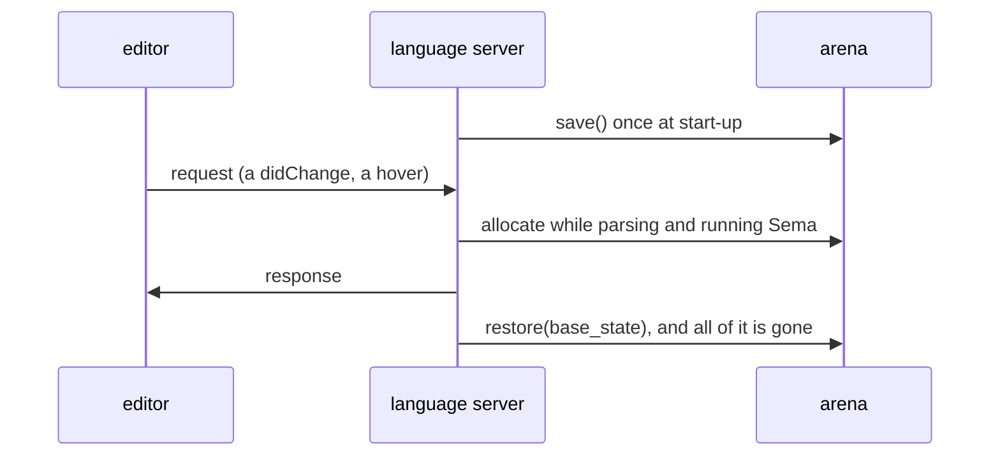
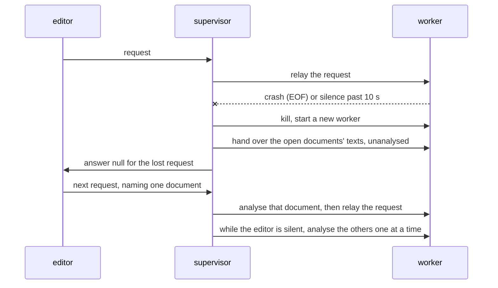
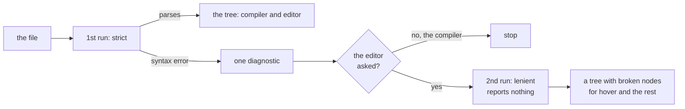
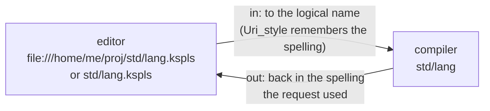
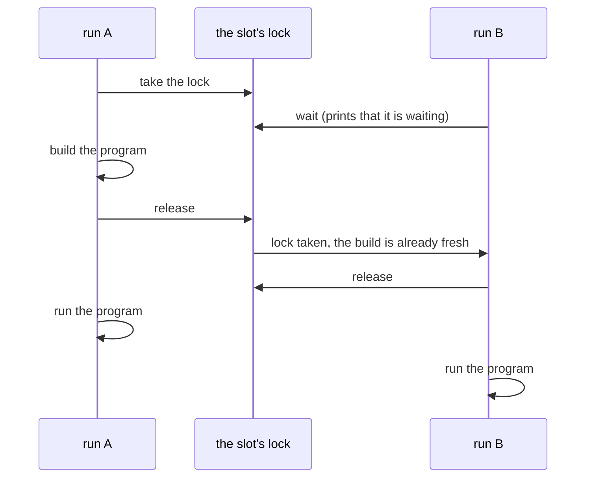

# ksplc's tools inside: the language server, the formatter and `ksplc run` (Design)

**How three tools built on the compiler work inside, and why.** It is split from [`DESIGN.md`](DESIGN.md), the compiler's internal design, for length: read that document's "The compiler as a whole" first, since this one leans on its words.


This chapter explains how three tools built on the compiler work inside. The language server (`ksplc/lsp/`) and the formatter (`ksplc/fmt/`) stand outside the pipeline ("The parts that are not in the pipeline: `base` / `lsp` / `fmt` / `tools`" in [`DESIGN.md`](DESIGN.md)). `SPEC-tools.md` holds what the editor may rely on and what `ksplc fmt` accepts; this chapter holds the internal decisions. **"The arena is rewound after each request (a worked example)" to "A document URI is converted to the logical name on the way in, and back to the editor's spelling on the way out" cover the language server, "The formatter reorders the `import`s as text, before the printer" to "Where the formatter's time goes, and the record of formatted texts" the formatter, and "`ksplc run` builds a script one run at a time, and runs it outside the lock" `ksplc run`.**

| Tool | What it does for you | Sections |
| :-- | :-- | :-- |
| the language server (`ksplc lsp`) | gives an editor hover, jump to definition, completion, renaming and the rest, through the *LSP* (Language Server Protocol) | "The arena is rewound after each request (a worked example)" to "A document URI is converted to the logical name on the way in, and back to the editor's spelling on the way out" |
| the formatter (`ksplc fmt`) | rewrites a file into the standard layout | "The formatter reorders the `import`s as text, before the printer" to "Where the formatter's time goes, and the record of formatted texts" |
| `ksplc run` | builds and runs a script in one step | "`ksplc run` builds a script one run at a time, and runs it outside the lock" |

## The arena is rewound after each request (a worked example)

The language server answers each editor request in fresh memory and then throws all of it away, so it never grows. A language server analyses on every keystroke, and without a GC a naive one leaks. `ksplc/lsp/state.kspls` uses **the arena's save and restore** ("Arena's implementation: a linked list of chunks and bump allocation" in [`DESIGN.md`](DESIGN.md)).

The diagram shows one request's life.



It saves the baseline once at start-up (`arena.save()`). For each request (a `didChange`, a hover) it reruns the pipeline up to Sema on the new source, allocating fresh at the arena's tail. Once the response is sent, it winds back with `restore(base_state)`. What must outlive a request is taken elsewhere (the caution in "The three-tier allocation strategy" in [`DESIGN.md`](DESIGN.md)).

## The language server is split into two processes: the watcher and the analyser

The language server runs its analysis in a child process, so a crash or hang in the analysis kills only the child, and the server starts a new one. Editor support analyses half-written source without pause. So crashes (SEGV) and hangs on input that the parser or type inference did not expect cannot be ruled out. In one process, such a failure stops the whole server, completion and diagnostics with it. So the server **separates a supervisor (`ksplc/lsp/server.kspls`) from an analysing worker (`ksplc/lsp/worker.kspls`)**.

The diagram shows a crash and the recovery.



1. **Roles**: the supervisor owns the stdio with the editor, relays requests and manages the worker's life. Parsing, semantic analysis and responses all happen in the worker (a child process). So the supervisor runs no analysis code and cannot fail on it.
2. **Detecting a failure**: the supervisor reads each response with a timeout (`worker_timeout_ms` = 10 s). It tells completion, timeout (a hang) and EOF (a crash) apart. The timeout is per read, so legitimate work that is silent for over 10 s would get a healthy worker killed. The worker therefore also emits a liveness marker (`__KSPL_WORKER_ALIVE__`, NUL-separated like the completion marker), which the supervisor strips before relaying. A real hang stops the marker too.
   * Caution: **Keep every silence down to one file or one declaration.** `didOpen` reads and analyses hundreds of files from one entry point, and as one lump it can exceed the timeout. It shows only on a slow machine or under heavy load, as a quarantined, dead document. The hook is `progress_hook` (`report_progress`) in `base/core.kspls`. It is called while reading (`parse/load.kspls`), moving between files (`sema/session/ctx.kspls`), inferring (`sema/body/infer.kspls`) and walking the workspace (`lsp/worker.kspls`). `send_worker_alive` plugs into it when the worker starts. It throttles by elapsed time, not by count. One iteration can weigh a thousand times another, so counting would let exactly the slow iterations overrun the window.
3. **Restart and restore**: on a failure the supervisor kills the worker, starts a new one, and hands it the text of the open documents it holds (`Lsp_docs`), each as a `$/ksplRestore` the worker stores without analysing. **The first answer after a recovery waits for its own document's analysis, not for one per open document.** Analysing them all first would make it wait about one analysis per open document: with 20 open, a hover would answer 2.8 s after the crash on an idle machine and 8.9 s under load, where its own document alone takes 0.19 s and 0.6 s.
   * **Each document handed over is analysed again later**, as a didOpen the supervisor sends: before the first request naming it, or while the editor is silent, one at a time. So a request waits for at most one analysis besides its own. The document a request names goes first, which also tells a crash in its analysis from one in answering.
   * **Why they are analysed again at all**: the diagnostics on screen came from a worker that has just failed, so each document's are worked out afresh. Until then the editor keeps showing the earlier ones; each document's are replaced when its analysis ends, and none is cleared without new ones. The document named by the message lost in the restart goes first while idle: its diagnostics were never published for its current text.
   * **A message of its own, not a flag on didOpen.** `didOpen` always analyses and publishes; a field no editor sends, changing that, would give one name two meanings in `dispatch`.
   * **To know the editor is silent, a thread of the supervisor reads standard input** and hands each message over (`Editor_reader`). Standard input has no "is anything waiting" that works on every OS and sees past the C library's buffer. The thread stops at `exit` or the end of input: a thread left blocked in the C library's read holds standard input's lock, and the C library's exit waits for that lock, so the process would not end.
   * The line logged on giving up names how many documents it restores, which is how many analyses follow the recovery.
4. **Quarantine**: a document whose analysis crashes or hangs the worker after a restart is marked poison and excluded, and the worker restarted. So one document cannot cause an endless crash loop. It is found when that analysis runs, which may be well after the restart; the other documents keep answering meanwhile.
   * Caution: **After a quarantine, hand every document over again from the first, to the new worker.** Those already handed went down with the old one; carried on from the poisoned document, the new worker would lack them, and their requests would answer nothing.
5. **Degraded mode**: where processes cannot be created, or creating one fails, the supervisor falls back to in-process analysis (`run_lsp_worker`).

**The supervisor is the last resort, not the plan.** Recovery loses the request in flight, and its `null` reads as "nothing found", which the reader acts on. So a failure the analysis can report must be reported, not turned into a dead process. `validate_layout` in `base/ast.kspls` returns its verdict on a tree nested past 2000 and fails that file alone. Ending the run instead would show as a call hierarchy answering nothing, with no way to tell why. Depth guards that end the run stay as they are. `clone_with` and `find_deep_child_impl` in the same file still end it, since a file that deep is refused while loading and never reaches them.

Caution: **The editor must not keep a deadline of its own.** Liveness is judged here, counting *silence*, while the marker keeps a slow but healthy answer alive. A client timer counts elapsed time and cannot tell slow from hung. Set below what a legitimate workspace call hierarchy takes, it throws away every correct but slow answer as "no results". `.vscode/extensions/kspl/extension.js` holds none. A request ends with an answer, the process going away (both death paths empty the table), or the reader cancelling.

Process creation, IO and kill come from `Piped_child` in `std/subproc`, over the OS primitives `kspl_proc_start` / `kspl_proc_read` / `kspl_proc_send` / `kspl_proc_kill`. They hide both POSIX `fork` and Windows `CreateProcess`. `tests/suite/lsp_test.kspls` checks the recovery on every CI run through the test hooks `$/ksplTestCrash` / `$/ksplTestHang`, and a document named under the `kspl-test-poison:` scheme, whose analysis crashes every worker (no editor names a document so). `tests/support/lsp_recover.kspls` holds the first answer after a recovery to a budget measured in the same run, and the `windows-ucrt64` job runs the same suite on Windows' process-separation path.

**The JSON-RPC frame's strings (`Content-Length`) are not held here.** (JSON-RPC is the message format the LSP uses: each message is a `Content-Length` header and a JSON body.) Writing uses `frame_into` / `encode` in `std/jsonrpc`. A sender writing its own frame fails as "nothing comes back at all" (the reason is "The frame is kept apart from the transport, and a broken frame is returned as a value too" in [`../../std/docs/DESIGN.md`](../../std/docs/DESIGN.md)). Only taking the header off stdin is the server's own (`read_content_length` in `ksplc/lsp/msg.kspls`), which must advance stdin one character at a time. It passes each header line to `content_length` in `std/jsonrpc` with the server's own ceiling. A header with no readable length within that ceiling is `Lsp_error.format_error`.

## The server finds the workspace's files without asking the client

**The language server lists the project's source files itself by walking the folder tree from the root** (`ksplc/lsp/workspace.kspls`). Renaming and the call hierarchy must see the callers, which are files not reachable through the open document's imports. So the server must know every source in the workspace, in either notation.

**Do not have the client send the list.** A page in a browser cannot walk folders, so a local server would need a tree-walking endpoint just for that. Besides, every editor would write its own exclusions, and hundreds of names would cross the stdio per request. Other language servers find the files themselves too, but from a manifest (rust-analyzer from `Cargo.toml`). KSPL has no manifest (an import resolves by a path from the root), so it walks.

**What the walk reads, the walk mends.** `parse_file` takes a source as already in the brace notation. The entry point in `ksplc/parse/load.kspls` mends only what it opened itself. So both paths where the server reads the disk itself use `mended_from_disk` in `ksplc/lsp/worker.kspls`: this walk, and a request for a file no editor has open. Skipped, references, renaming and the call hierarchy answer empty for the whole workspace with no diagnostic. `tests/suite/lsp_test.kspls` lays out its workspace in the default notation to keep this path checked.

**The folders excluded are those `.gitignore` names.** The project already says it there: a folder marked untracked is, by definition, not source.

Caution: **Do not list names to exclude in the source.** Each project names the place for built things differently, so a list only ever matches this repository.

**Only lines naming a folder are read**: a line ending in `/`, with none of `!`, `*`, `?` or `[`, and no `/` before the end. Resolving the whole syntax would add one more resolver that differs from git's in small ways. Lines naming files (`*.exe`) are dropped anyway by the narrowing to `.kspls`. A folder beginning with a dot is never entered. `.git`'s contents are not source, and it is not written in `.gitignore` either (git holds it itself).

| `.gitignore` line | Read? | Why |
| :-- | :-- | :-- |
| `build/` | yes: that folder is skipped | a plain folder name |
| `*.exe` | no | names files; the walk keeps only `.kspls` anyway |
| `!keep/`, `out*/`, `a/b/` | no | needs git's full pattern syntax |

**The walk runs per request and holds no index**, so a common complaint about servers that index is not brought in: no completion until the first indexing finishes. The narrowing decides how many files are read, and the walk's cost hides behind it.

### One bad file does not poison the workspace

A file that cannot be compiled does not stop the server from answering about all the other files. The walk reaches whatever is there, including files that cannot be built: fixtures written to be refused, of which `tests/negative` alone holds hundreds, many cases to a file. **The analysis is one pass over all files joined together**, so if one desugaring failure ended it, every workspace query would answer nothing.

**A desugaring failure ends the run only where diagnostics are shown.** Stopping exists because a half-desugared tree turns the fault into a distant complaint about a synthesized name. With diagnostics suppressed, as the workspace pass asks, that reason is absent and stopping buys nothing.

**This does not mean a broken file is analysed.** What is refused stays refused, and its diagnostics still appear on the entry point that shows them. Only the other files stop paying for it.

### The workspace walk reads through the AST cache

The walk reuses parsed trees saved on disk, so unchanged files are not parsed again on every query. **The AST cache's exemption ("The normalized AST's disk cache (`ksplc/parse/ast_cache.kspls`)" in [`DESIGN.md`](DESIGN.md)) covers storing only, not reading.** The key holds the source's whole content, so a hit is the AST of exactly those bytes, whoever passed them in. Refusing to read as well would reparse every workspace file on every query.

**Files are narrowed by the whole identifier, not a substring** (`at` sits inside `that`). `mentions_ident` in `base/ast_spell.kspls` is the rule the rest of the compiler uses, so it is asked rather than written again.

Caution: **Measure with the cache an ordinary session would have.** ksplc's own identity is in the key, so building the compiler empties the cache. Measuring right after a full gate run flatters the query, since the run has compiled almost every file in the tree.

**The walk must keep passing on the bytes it read.** An open document's buffer is in `source_map` (`populate_source_map_from_store`). For a file the walk only passes, it can be older than the disk (the editor may have written the file without a notification). Without the fresher bytes, positions come back on the wrong lines. The rename in `test-kspage-served` catches it.

**The caller says whether a source is the disk's bytes** (`src_is_disk`, passed down to `load_and_parse_file`). A source read out of `source_map` cannot tell. The walk claims the flag because it has just read the disk; the open document does not. So the cache does not swell: unchanged files reuse their entries, and the document being typed into stores none.

**What remains of the cost is body inference.** A call hierarchy needs it (the receiver's type decides which function a call lands on), so asking for less cannot remove it.

**Do not memoize the analysis across requests either.** The arena is wound back per request ("The arena is rewound after each request (a worked example)"), and state kept across one outlives the wind-back ("The three-tier allocation strategy" in [`DESIGN.md`](DESIGN.md)). That is a change to the memory discipline, not an optimisation, and must be decided as one.

## References and renaming are the same question, so they are gathered in one place

**"Find all references" and "rename" use one list of uses, so they can never disagree: one walk of the tree makes it, rebuilt into `Location`s for the references and into `changes` for the renaming** (`ksplc/lsp/uses.kspls`). "Where is this name used" (`textDocument/references`) and "where must it be rewritten" (`textDocument/rename`) are one question answered two ways. **Gathered in two places, the day only one is fixed, a use appears in the references that the renaming leaves unchanged.**

Caution: **Match on the definition, not the spelling**: the same spelling appears in comments, strings and other names.

**A name in a selective import's braces is a place of what it names; an `as` name is a name of its own.** In `import "lib" { helper as h }`, the `helper` is a use of `lib`'s `helper` (the analysis binds it, `bind_import_symbols` in `ksplc/sema/session/imports.kspls`), so it is listed and rewritten with that function's other places. `h` and its uses are `h`'s places alone. Counted with `helper`'s, a rename of `helper` would turn `h()` into a name that file does not bind, and the program would stop compiling. The narrowing also reads only the bodies that spell `helper`, so `h`'s uses would be found in some files and missed in others.

**The list is ordered by file name, then line, then column.** It is gathered in a `Map`, whose order follows the hash, and the LSP leaves the order open. A person reads the references, so an order that changes between requests makes the same answer shuffle on screen.

**`context.includeDeclaration` is honoured exactly; where it is absent, the declaration is counted.** The default is to return the declaration, and false comes only to leave it out. An implementation that ignores the option cannot answer "leave the declaration out and show only the uses", a common complaint.

**The server takes the clue for the narrowing from the position and the source.**

Caution: **Do not ask the client for it.** The server holds both, so receiving them from the client counts the same thing in two places (as with the workspace's file list, "The server finds the workspace's files without asking the client").

Only the call hierarchy's requests carry no position; there the clue is the `item.data` the server returned earlier.

## A rename is refused where the new name cannot stand

**A rename answers an error naming the reason, and writes nothing, where its edits would break the program or change what it means** (`ksplc/lsp/rename.kspls`). An edit applied across files is hard to take back by hand, and it lands in files nobody has open, so the refusal comes before it, not as diagnostics after it.

* **The new name is checked against the grammar itself**: it must read whole as `Identifier`, and a word `_Keyword` reads is named as a keyword (`reads_whole` in `ksplc/parse/load.kspls`). A list of reserved words kept here would miss the next one the grammar adds.
* **A declaration outside the workspace is read only.** The workspace is what the walk lists ("The server finds the workspace's files without asking the client"), and `holds` in `ksplc/lsp/workspace.kspls` asks the walk's own rules of one file. An installed standard library or a package read from `--pkg-src-dir` sits outside it, and an edit there rewrites a copy every other project shares. A repository that holds `std/` itself, as this one does, renames in it as in any other folder. Every place is asked, not only the declaration, so a use in such a file refuses the rename too.
* **`prepareRename` asks the second question of the declaration alone**, from the document's own analysis, so the editor refuses before a name is typed, without the workspace's analysis the rename itself needs. The capability is declared only to a client that says it sends the request, as the protocol allows.
* **A new name already declared where it would land is refused.** At each place the name is written bare, every scope around it is searched: the block, the blocks enclosing it, the function's parameters, the file's declarations and the names its imports bind. A declaration found there would be declared twice, hide the renamed one, or be hidden by it. A member (a field, a variant, a method) is reached after a `.`, so it is compared only with its type's members, a method also with the methods of the type's other `impl`s.
* **The search is conservative.** A declaration counts for its whole scope, before the place as well as after it, and a `switch` counts the bindings of all its arms together. A rename that could have gone through is sometimes refused, and the message names the declaration in the way, so the person can see why. The opposite error, an edit that silently changes which declaration a name means, is the one the check exists to stop.
* **What is declared is read from the compiler's own record** (each declaration's symbol, `sym_ptr`), not from the shapes of the tree, so a binding of any form (a `for`'s item, `if v: =`, a pattern's payload) is found. A field is no symbol, and is read from its declaration.

## The call hierarchy identifies a definition by an FQN that includes the file

The call hierarchy names each function by its full name including its file, so two functions called `init` in different files are never mixed up. The `CallHierarchyItem.data` that `callHierarchy/prepareCallHierarchy` returns is an **opaque identifier**. The client sends it back unchanged to `incomingCalls` / `outgoingCalls`, so the string in `data` is the definition's identity, and keeping it unique is wholly the server's job.

Caution: **`Sema_symbol.name` is the bare name**; the FQN exists only as a key of `symtab.by_fqn`. As `data`, a common name such as `init` folds every same-named function in other files into one definition, and lists callers from unrelated files. So `compute_def_fqn` in `lsp/call_hier.kspls` prefixes the defining file (`ksos.drivers.ht16k33.init`). The name is assembled as `make_fqn` in `sema/session/ctx.kspls` assembles it, so `symtab.resolve_fqn`'s O(1) lookup hits it as it is.

A method's `sym.name` already holds its owner's path, and the owner need not stand in the method's file (`impl pipeline.Compile_error` in `main.kspls`). So an already-qualified name gets no prefix (`write_full_name` in `lsp/nav.kspls`), which is also its key in `symtab.by_fqn`.

## The call hierarchy also counts passing a function as a pointer as an edge

**When a function is handed over as a pointer (for example as a task's entry function), the call hierarchy still lists the place that hands it over as an edge, marked as a hand-over.** `callHierarchy/incomingCalls` is a hierarchy of calls, and passing a function pointer is not a call. Neither clangd nor rust-analyzer makes an edge of it. This repository has a lot of code reachable only through function pointers, such as ksos's task entry functions, passed to `run_single_task`. Without the edge they show "no callers", look unused, and are mistaken for removable.

**It must not look like a call, though**: a pointer may be registered and never called. The LSP has no field for an edge's kind, so `CallHierarchyItem.detail` carries `(as fn pointer)`, meaning the edge is a hand-over only. A function may both call and register one target, so `has_call` / `has_ref` are held separately.

Two exclusions are indispensable:

1. A call's callee name also points at a function. So the callee positions of every call site are excluded first, or every call is listed twice.
2. A declaration's own name (the `f` of `fn f()`) has a `def_node` pointing at its own declaration, so unless excluded every function becomes its own caller.

**`make test-lsp-tree` holds both down**, on ksos's task entry functions.

Note: Everything needed is in `def_node`. The renaming walk ("References and renaming are the same question, so they are gathered in one place") picks up every identifier whose `def_node` matches, so a name in an argument position is followed and the call hierarchy needs nothing more.

## Completion re-analyses the text as if one name were missing

**To suggest completions while you type, the server analyses the text with the half-typed word replaced by one synthesized (placeholder) name.**

**Completion is needed while the text is half written**, when the syntax does not pass and the analysis stops at `parse/syntax_error` ("Only the editor's parse recovers from a syntax error"). So `latest_state` then holds neither a tree nor a symbol table.

This is not a trick but **a restatement of the question**. A completion request asks "which name goes here", so the analysis runs on the text with one name put in. That also sets its reach: only text whose missing piece is one name can be saved. Text missing a closing bracket or the end of a statement cannot, and the answer is empty.

Caution: **Do not reuse `latest_state`**, which is built from the half-typed text. Completion builds a state of its own and always discards it by winding back; kept, it would grow the arena on every keystroke (the same rule as "The arena is rewound after each request (a worked example)").

**One entry point handles all three kinds of head**; what stands before the half-typed word decides the path.

| Head | Example | Where it looks |
| :-- | :-- | :-- |
| a receiver expression | `cup.` | the postfix node → the receiver's type → its fields and methods |
| a namespace alias or a type name | `io.` / `Cup.` | the path node → for an import's alias, the names in that namespace; otherwise, the type |
| none (a bare name) | `twi` | earlier declarations in the enclosing scope, the file's top level, the imports' aliases |

Caution: **A namespace alias or a type name is not a postfix node** (normalization folds `io.out` into one path node). Handling only one of the two silently empties the other.

**For a bare name, do not list everything in a namespace.** KSPL calls an imported name through its namespace, so only the three sources in the table may be listed unqualified. Listing everything mixes in thousands of names that cannot be called. After a namespace too, list only what can be called from outside: C declarations or internals would make the chosen item an error.

What each completion item carries:

| Field | What it holds | Why |
| :-- | :-- | :-- |
| `documentation` | the declaration's own description, as Markdown | the list is where a caller looks first |
| `detail` | a function's signature, a field's type | a caller needs the shape before choosing |
| `sortText` | a number with padded digits | the server alone decides the order |

**A candidate carries what its declaration says of itself.** Each item's `documentation` is the declaration's description, read by the hover's own reader (`lsp/nav.declared_doc` → `base/ast_doc.kspls`) and sent as Markdown, the form descriptions are written in. The list is where a caller looks first; a description shown only on hover arrives after the choice, the opposite of its purpose. Every path in the table carries the declaration it came from, or the last one wired would be the one left without it.

**`detail` carries the shape: a function's signature, a field's type.** rust-analyzer, gopls and clangd put it there, and a caller needs it before choosing. What a signature holds (its parameters, a variadic's `...`, each default, the return) is decided once, in `write_sig` in `base/ast_spell.kspls`. The list and the hover both write through it, so the two never spell one declaration differently. Only how a type is spelt is each one's own. A default shows as written (`step: I32 = 1`). Dropped, a reader takes the parameter for one every call must pass.

**A struct, an enum, an interface or a level gets no `detail`.** `kind` already says what it is, shown as an icon beside the name, and repeating it fills the column with a word already read.

**A method's receiver is shown as the declaration writes it** (`fn s(r: Self$@, …)`), as the hover and the published record show it. A reader counting arguments from the column must know the first is the receiver, which the call site does not write.

**Each path passes on what it knows and nothing it does not**: a field's type comes from the field, not its node; a function's shape from its declaration.

Caution: **Do not take a function's type from its symbol.** The symbol's `type_id` is the return type ("Whether a call goes through a function pointer is decided by the declaration" in [`DESIGN.md`](DESIGN.md)), so `fn f(): Sz` would read as an `Sz`.

**The server alone decides the order.** The LSP has no score field, and clients re-sorting by fuzzy match over the order the server sent in `sortText` are a recurring complaint about other implementations. Make `sortText` a number with padded digits: the bare name lets the client's re-sort collapse the order.

**`triggerCharacters` is not declared.** Only the client watching the person type can decide when to offer completion. If the server names `.`, the client pops it up where nobody asked.

## Only the editor's parse recovers from a syntax error

**When a file has a syntax error, the compiler stops at the first one, but where the editor is the reader the file is read a second time, with the recovering (forgiving) branches alive, and a tree returned.** The grammar is a PEG (`kspl.kspeg`; a *PEG*, parsing expression grammar, tries each alternative in order) and stops at `parse/syntax_error` on the first error. So half-written code (`p.`, say) still answers hover, jump to definition, references, renaming and the call hierarchy with one diagnostic, instead of five `null`s. Completion is a different case, solved by one synthesized name ("Completion re-analyses the text as if one name were missing").

### Why signature help is not offered

**The editor's "parameter hints while you type a call" panel (`textDocument/signatureHelp`) is not offered.** While a call is being written the file does not parse. The recovered tree holds the half-written call only as swallowed text ("What a broken node holds"), so the name before the bracket is not resolved and the panel would answer `null`. A fallback by name cannot tell one `new` from another, and would describe the wrong function with confidence. The parameter descriptions are on the hover instead, each on its own parameter's line (`format_fn_sig` in `lsp/spell.kspls`).

### Two runs: the strict one for everybody, the lenient one for the editor alone

The forgiving grammar rules can only ever run in the editor's second parse, so they can never make the compiler accept broken code.

Caution: **A grammar branch that takes "a broken statement", added plainly, makes the compiler pass broken code silently.** With one, an input containing `y: = p.` stops producing a syntax error and gets another diagnostic, "the return value is not returned". The branch swallows the broken statement and the `return` behind it (the gate is "The gates that keep the lenient parse in check").

So the branch may exist only where the compiler's run can never reach it. **The run is split in two, and the recovering branch lives in the editor's run alone.**



| Run | Used by | Recovering branch | Diagnostics |
| :-- | :-- | :-- | :-- |
| 1st (strict) | the compiler and the editor | **dead** | this run alone reports them |
| 2nd (lenient) | the editor alone, only where the 1st run failed | alive | **reports none** |

CPython's PEG parser takes the same shape: its `invalid_` rules are unused in the 1st run and used in the 2nd, only after a failure. **Here the branches are told apart by the rule's kind, not by the name's spelling.** Under a spelling convention, a mistyped rule would pass as an ordinary one.

**The 2nd run reports nothing. Do not put a diagnostic out from a recovered result**: doing so sets off chains, and one closing bracket lining up dozens of unrelated errors is a long-standing complaint about compilers. The 1st run's one diagnostic, where it already points, is enough.

### What a broken node holds

A *broken node* is the piece of the recovered tree that stands for text that could not be parsed. **A broken node holds the swallowed text and nothing else.**

Caution: **Do not make up a declaration that is not there.** A synthesized name or declaration in the tree goes into the symbol table, and completion offers a name that does not exist, and hover explains it.

Swift represents an error as a missing node or an extra node. **Only the extra node is taken here.** Making a missing node means the server inventing a name or a symbol, the danger above.

**`is_valid` stays false.** Recovered or not, the tree is not correct, so it does not go on to the later stages (generation). Sema passes a broken node straight through; analysed, the swallowed text would be read as an expression.

Caution: **Do not give a recovered tree `has_load_error`.** That flag means "the file did not load at all", so the code reading it returns before the analysis, and every answer is lost with the tree. A recovered tree needs only the suppression (`suppress_errors`), so the analysis still runs and only its findings are held back.

### One operator in kspeg: skip up to the stopping character (`~"…"`)

**The grammar engine, Kspeg, has one special operator for the lenient run, "skip (swallow) text up to a stopping byte", and it doubles as the mark of the lenient run.** The notation has no negated character class, and `( !";" !"}" . )+` makes a node per byte, so swallowing needs an operator in the engine. It is spelt `~"…"`, and the bytes between the quotes are those that end the swallow (`kspeg/docs/SPEC-notation.md`).

Caution: **Do not split it into two.** A swallowing operator held apart from the mark that enables it allows a run where the mark alone is raised. As one, the operator is always off in the compiler's run, which is not lenient, so the compiler's grammar is unchanged.

Where the pieces live:

| Piece | File |
| :-- | :-- |
| the `Rule` kind, its engine arm, the lenient option and the notation | `kspeg/rule.kspls`, `kspeg/engine.kspls`, `kspeg/notation.kspls` |
| two branches, the last of `stmt` and of `top_level_item` | `ksplc/kspl.kspeg` |
| two node kinds | `ksplc/base/ast_kinds.kspls` |
| the 2nd run's entry point (**not the compiler's**) | `ksplc/parse/load.kspls` |
| its one user | `ksplc/lsp/worker.kspls` |

**The swallow stops at a line end as well** (`~";}\n"`). Stopping only at `;` and `}` eats the `return` on the line below and reproduces, another way, the very failure the two runs exist to avoid. Where a statement really does run over several lines, the next broken node swallows the rest.

### The gates that keep the lenient parse in check

These checks make sure the forgiving parse stays inside the editor and does what it should.

* **`make test-negative` is the linchpin**: if the lenient branch leaks into the compiler, an input that ought to be refused passes and that gate fails.
* The 1st run's diagnostics keep their positions and wording.
* In a file with one broken line, hover, jump to definition and references **answer** (`tests/support/lsp_recover.kspls`).
* A broken node puts no name into the symbol table.
* The lenient run is started from the editor's entry point and nowhere else (`tests/support/conventions_lsp.kspls`; starting it from a second place makes that gate fail).

### A bracket left open

**A bracket you have opened but not yet closed must not take the rest of the file with it.** The two notations lose it on different brackets, and neither fix needs a change to the language.

**In the brace notation, the top-level swallow stops at `;` and the line end, not at `}`.** No top-level item begins with a `}`. So the `}` left over when a declaration's block is not closed is swallowed like any other unreadable run, instead of stopping the swallow dead.

**In the indentation notation, a line that begins something of its own caps the run.** Otherwise one `(` never closed joins every later line into one logical line, and the rest of the file is read as that call's arguments. A line that closes what is open does not cap it. A value written over several lines puts its `}` at column 0, so capping on the column alone breaks sound source (the round trip over the whole tree catches that). `begins_anew` in `parse/layout.kspls` tells the two apart.

**What is inside an unclosed block stays inside it.** Where `fn f(): I32 {` is never closed, everything below it is that function's body as far as anyone can tell. The editor does not invent the `}` the writer has not typed. That shape needs the file *above* to still answer and the parse not to run away, and both hold.

**`semanticTokens` colours from the recovered tree too**: what parsed is coloured and the swallowed run is not, so "nothing is guessed" still holds.

## A `didOpen` checks one document's bodies

**When you open a file, the server type-checks the function bodies of that file only, not of every file it imports, so the first answer comes quickly.** A `didOpen` that checks the bodies of every file reachable from the document stands between the reader and every answer after it. For a file in the middle of the tree that is a great many files, thrown away and redone on every keystroke.

So the document view checks `main_file`'s bodies and no others (`Bodies.main_file`, the `bodies` on `Sema_ctx` that `run_semantic_analysis` is handed). Every file's declarations are still collected and every `const` initializer still inferred: those are facts about declarations that other files read. Only other files' function and impl bodies go unchecked.

| View | Bodies checked | Serves |
| :-- | :-- | :-- |
| the document view (`build_document_state`) | the open file's only | hover, jump to definition, colouring, the panel while a call is typed, this document's diagnostics |
| the workspace view (`build_workspace_state`) | every file's that names the word, or a generic using it | references, renaming, the call hierarchy |

**Nothing shown depends on other files' bodies.** None of what the document view serves looks inside another file's body. Diagnostics are filtered to the open file when sent (`is_same_file` in `lsp/msg.kspls`), so other files' findings would be computed only to be dropped.

Caution: **The workspace view must keep every body that can hold a site.** References, renaming and the call hierarchy ask about call sites, and a call site lives inside a body; narrowed past that, they answer empty. A site naming the word lives in a body that names it, or in an instance of a generic that does, and an instance is made by a body naming that generic. So the workspace view (`Bodies.mentioning`) checks the bodies naming the word, or the name of a generic using it, the names growing through the generics until none is added (`wanted_names` in `sema/body/infer.kspls`). A body naming none of them holds no site, and checking it only cost time: on the repository's own tree a common name's callers come back in about half the time. The editor's final pass, which resolves the names in each declaration for references, is narrowed the same way. `build_workspace_state` passes `mentioning` and `build_document_state` `main_file`, and `tests/support/conventions_lsp.kspls` keeps them apart.

**An instance made without naming its generic is not followed**: an operator, a subscript, `for in` or a trait value calls a method its body never names. The walk already reads only the files that name the word, so it stops at the same place; `ksplc/tests/suite/lsp_test.kspls` checks that a caller inside a generic, instanced from a body not naming the word, still comes back.

The narrowing also keeps one bad file from poisoning a good one. A failing body in another file would set `is_valid` false and give this document a bare `Semantic Error` at 0:0 with nothing to read: the shape "One bad file does not poison" ("One bad file does not poison the workspace") warns against.

## Typing names the document view does not analyse

**The document view leaves other files' bodies unanalysed ("A `didOpen` checks one document's bodies"), so when you hover a name whose type would normally come from that skipped analysis, the server works the type out from the declarations instead.** Each rule below is one such name and how the view reads it, held to what the declarations say.

| The name | How the view types it |
| :-- | :-- |
| a method instantiated on its own | it is registered on its owner's table |
| a parameter of a declaration in another file | from the node's type id, then its name |
| a member access | by what the definition is, not the path's shape |
| a call in a generic body nothing instantiates | from the receiver's declaration |
| a chain of fields | one field at a time, from the struct declarations |
| a local set from a call | from the declared return type of what it names |
| a function's own name | it is the declaration itself, not a reference |

**A method instantiated on its own must be registered on its owner's table.** Instantiating a whole generic struct registers each method on the type entry (`instantiate_generic_methods`). But a call can reach one method through `instantiate_fn`, which must register it too. Checking every file's bodies hides a gap there (another file has instantiated the whole struct already). The narrowed view shows it as a hover reading `std.ds.new` for `std.ds.List<|U8[]|>.new`.

**A declaration in another file has no types on its parameters, so its spelling is not taken from the node's text.** In the narrowed view, `type_id` stays 0 on the parameters and return of every declaration outside the open document. The type node's own text is the post-desugaring text. So the hover on `std.io.read_file` would read `path: Slice<|U8|>`, not the source's spelling, bypassing the one function that shows a type to a person (`display_str`, "A diagnostic points at 'the position the user wrote'" in [`DESIGN.md`](DESIGN.md)). Ask the node's own type id first, and the name only where there is none (`write_type_of` in `lsp/spell.kspls`). The name-only path stays for what holds no id (`check_hover_away` in `tests/support/lsp_spell.kspls`).

**A member access is not by itself a call.** What the definition is decides the label, not the shape of the path that reached it. Labelling every member access `(Function) ` (`walk_path_for_type`) sends a field down the path that shows a definition by slicing its source over `get_span_length()`. That span stops short on a desugared type (`j.argv` of `U8[][]` shows as `pub argv: U8`).

**A call in a generic's body that nothing instantiates is resolved from the receiver's declaration.** Sema analyses a template's body once per instantiation, and this view instantiates only what the open document reaches. There the receiver has no type and stays a one-part path (`xs` of `xs.get`) until sema analyses the body. The view's last pass, though, resolves its declaration's type node. Otherwise the hover on `q_lora.backward(...)` in `backward_lora` reads the bare word and a jump finds nothing; `backward_lora` is a method of `impl<|T|> nn.Self_attention<|T|>` in `ksai/attention_train.kspls`. Find the receiver's declaration the way a local is found (`resolve_fallback_parent_def` in `lsp/nav.kspls`). Take its type by the instance's registration key (`std.ds.List<|T|>`), not its internal name, with a `@` view unwrapped (`dot_receiver_of`).

**A receiver that is a chain of fields is typed one field at a time, from the declarations.** Without it, `backward`'s `r.wo.weights.sgd_step(dwo, lr)` in the same file reads the bare word. Its receiver `r.wo.weights` is no local, and typing an expression is sema's work, which that body never gets. Yet each step of the chain is a field, and a field's type is written in its struct's declaration. Take the head's declared type: for `Self`, and for an `r` written with no type, the enclosing impl's. Then take each field's type from its struct's own declaration, a generic's as it declares it (`type_name_of` and `field_of` in `lsp/nav.kspls`). A field reached so answers its own hover and jump the same way.

It is exact, not a guess. clangd walks such a chain too, but looks each name up in the primary template, to which a specialization may give other members. A KSPL struct is declared once, and an `impl` for one instance adds methods, never fields. Nor can the walk go round: each step takes one more name written in the chain. clangd's walk can recurse through a type defined by itself and needs a guard against that.

**A call is followed to the declaration it names, and no further.** A local set from a call reads the bare word even with the chain walked: `$dq: = g.dq` after `g: = attn_backward_core(...)` in `backward`. Following one makes the view decide what a call returns, a second copy of sema's decision (Principle 6 in `docs/DESIGN.md`). Take the copy, held to three steps that read declarations and choose nothing:

* a local with no type written takes its initializer's;
* a call takes the declared return type of what it names (`call_type_name` in `lsp/nav.kspls`): `Self` as the receiver's type, and otherwise only a type sema resolved;
* `catch` passes on what succeeded.

The name decides which function. With no overloading and no inheritance, a method's name on a known type (`member_of`, the lookup the hover names a member by) and a function's bare name each stand for one declaration. clangd instead has an overload set's return types to reconcile. The rest stays bare: an operator's result (`dxq + dxk`), a call named through a path (`lora.make`), and a name inside its own initializer (an outer one). So does a return type sema left unresolved, whose spelling is its own file's and is read in no scope here.

Caution: **Where sema changes what a call returns, these steps change with it**: nothing but this caution holds the copy to sema.

**Completion in such a body asks the same walk.** A lone name before the dot is kept there as one path with the mark (`cc.<mark>`), never the postfix the receiver is found by. Without this, the list would read `cc` as a type's name and give nothing. Since a generic has no struct entry, after a chain it would hold the methods alone. Where the path's head names a value (a parameter or a local), the names before the mark are typed as above (`folded_receiver_type` in `lsp/nav.kspls`). A generic's fields are counted from its declaration (`struct_decl_of`), the one the hover reads a field from. A level's alias and a type's name (`io.`, `P.`) keep their own path. A non-generic struct not found by name is left alone: it has its entry, so the name is what failed.

**A function's own name is not a reference.** Looked up by its bare name, as the view's last pass (`resolve_all_types` in `sema/decl/resolve.kspls`) resolves identifiers, a method `put` would take the prelude's `std.lang.put`. The hover would name that, and `std.lang.put`'s references would count the method. So a function's own name is not looked up, and on a declaration's own name the definition is that declaration (`get_definition_node` in `lsp/nav.kspls`). The call hierarchy keeps no copy of that fallback of its own.

## A declaration is shown as written, not as its last instantiation

Hovering a generic declaration shows it the way you wrote it (with `Self` and `T`), not the way one particular use filled it in. **A template's nodes carry an instantiation's marks.** A monomorphized copy borrows the template's position, so a diagnostic points at the code the user wrote ("A diagnostic points at 'the position the user wrote'" in [`DESIGN.md`](DESIGN.md)), and type ids are stamped along the way. Both are right for the compiler and mislead the editor, which is asked about the text on screen. Three rules follow, each shown on `std/lang.kspls`'s own declarations:

1. **`Self` is not shown as a concrete type.** The type node of `fn next(r: Self)` in `trait Iter<|T|>` carries the id of `Slice<|U8|>`, an instantiation that happens to exist, and would read `fn next(r: U8[])`. `Self` beats every type id (`write_type_of` in `lsp/spell.kspls`): it is a fixed spelling, not a type to resolve ("5.1 Traits (`trait`)" in `../../docs/SPEC-language.md`). The test "is this `Self`" and its spelling (`self_type_spelling`) live with the rest of the spelling in `base/ast_spell.kspls`, written with its `$`. The type's name drops the `$` (`extract_type_name`, so `impl U8$[]` is found as `impl U8[]`), and `r: Self$@` would read `r: Self@`, a receiver that cannot be written through.
2. **A trait's requirement keeps its owner** (not `std.lang.free` for `trait Owned`'s `free`). An impl's method carries its owner inside `sym.name` (`out.probe.Point.area`); a trait's does not, and a generic trait's requirement has no symbol. A method whose name is still bare takes its owner from the declaration it stands in (`find_owner_in_tree` in `lsp/hover.kspls`). It is read off the tree, not the type tables, where a generic trait nothing instantiated has no entry.
3. **The internal name does not reach the screen** ("A diagnostic points at 'the position the user wrote'" in [`DESIGN.md`](DESIGN.md) forbids it). The copy and the source node of `pub fn at_ref` in the `Slice` impl cover the same offset, and when the copy answers, the hover reads `std.lang.Slice.std_lang_Slice_U8_Const_at_ref`. At an equal score the walk prefers the node whose text is the source's text at that position (`is_source_text` in `lsp/position.kspls`). This is a preference, not a filter, so a synthesized node still answers where it is the only one: at its own position, not over the length of its text, which measures nothing on screen. Measured by its text, the `Slice` a `U8[]` is read as answered on the `]|>` after it.

**The type arguments are the answer at a call, not on the declaration.** `List<|U8[]|>.new(arena)` calls that one instantiation, so its hover names it. The declaration stands for every instantiation, so it shows the generic's own name (`keep_args` in `find_owner_of_fn`). Run the two together and one of them lies.

**Rule 1 is the other face of "Typing names the document view does not analyse"'s**: the type node's own id comes first for a declaration in another file but not for a template. A gate asking the editor's question of the prelude tells them apart (`check_hover_prelude` in `tests/support/lsp_spell.kspls`). The suite's own probe documents carry no instantiations, so none could catch it.

**A member is named by its owner's path, never by its file.** An `impl` may stand in any file, and sema names each method by the owner it resolved (`collect_impl_decl` in `sema/decl/collect.kspls`). Prefixing the method's file instead gives:

* `ksplc.main.ksplc.pipeline.Compile_error.report_and_exit` for a method of `main.kspls`'s `impl pipeline.Compile_error`;
* `std.str.U8[].equals` for a method on `U8[]`, a fictional path that `resolve_fqn_for_type` in `sema/decl/resolve.kspls` declines to make;
* the header's spelling through the import's alias for a generic impl nothing instantiated (`ksai.nn_grad.nn.Linear<|T|>`).

Only a bare name takes the module of the file that declares it (`write_full_name` in `lsp/nav.kspls`, which the call hierarchy's identity in "The call hierarchy identifies a definition by an FQN that includes the file" also uses). An owner read off the tree is the declaration its header names (`owner_name_of` in `lsp/hover.kspls`). A type with no path of its own is shown as its type reads. `check_hover_owner` in `tests/support/lsp_spell.kspls` holds one owner of each kind.

**A label is shown as a label, and a jump to it lands on it.** Classified like a value, `with_setup:` in `main.kspls` reads `with_setup: with_setup` (a variable typed by its own name), and a jump from `break outer` finds nothing. The hover says `label <name>` wherever a name stands in a label's place: where it is written, or where a `break` / `continue` names it (`is_label_name` in `lsp/hover.kspls`). The label a jump leaves is recorded by the one search that decides it, sema's, on the jump's own name (`name_node` on `Jump_label` in `sema/session/ctx.kspls`). So the editor matches no name a second way.

**A position answers for the name it touches, and a mark names nothing.** The walk by position (`Pick_walk.visit` in `lsp/position.kspls`) counts a position at a name's end as on it, since an editor asks at the caret just past a name. A mark (a bracket, a comma, an operator: the grammar's fixed spellings) is no target. Answered from the node around it, the `)` of `words.free()` would read `fn )()`, a function by that name, and the `,` after `words@` read `fn @()`. Two kinds of node span marks besides their names, so each is held to its names. A path whose names are nodes of their own is not a target itself, or `List<|U8[]|>.new` answers on its `<|` and `|>` with the whole path as the name. A declaration, the last resort for its dropped `:`, reaches only to where its type or value begins (`declarator_span`), not over the marks inside its value. A keyword answers only through what it stands for, the `const` of a declaration that declaration; the walk that borrows an enclosing node's type (`walk_path_for_type` in `lsp/hover.kspls`) would label that type with the keyword's spelling (`type priv`). A `)` answering for its call was weighed and not taken: the call's name a few characters to the left already answers it. `check_hover_marks` in `tests/support/lsp_hover.kspls` asks at each kind of mark, then at the names beside them.

**A literal shows the type it took, and nothing else.** `4` in `size: Sz = 4` is an `Sz`, passed to `Range.asc` it is an `Sz`, and in `Pair::{ .a = 1 }` it is the field's `I32`, so the hover reads the type the analysis left on that literal's node (`send_literal_type` in `lsp/hover.kspls`). Guessed from the spelling, every integer would read `I32`. And labelled like a declaration, the literal would read as one named after itself (`type 4`, `type "str"`, `type null`). The value is not repeated: it is the text under the caret. Where nothing was analysed (an array's length, an enum's tag value, an import's path) the hover is empty rather than guessed.

**A name where it is bound reads as it does where it is used.** `$words: = List<|U8[]|>.new(arena)` shows `words: std.ds.List<|U8[]|>` on both lines. Every request asks the one question "which declaration does this name stand for" (`get_definition_node` in `lsp/nav.kspls`), and on a declared name it answered with the declared type's declaration, which the jump wants ("4.1 The features supported" in [`SPEC-tools.md`](SPEC-tools.md)). The hover then showed the struct, and references and renaming listed and renamed `List`. That step now belongs to the jump alone (`handle_definition`). **A binding the compiler builds keeps the name as written**, at its own position: the item of `for w in words` and the `v` of `if v: = opt` were rebuilt at the statement's position, so the hover found the `_for_coll` copy instead, or nothing, and references, matched by position, took the copy's places for the item's. A pattern's binding carries its type on its node, as a `catch e` does, so the place it is written has one to show. `check_hover_values` in `tests/support/lsp_hover.kspls` asks at each kind of literal and of binding.

Definition resolution in `lsp/nav.kspls` needs the semantic context and the cursor's path, and returns an enum variant together with its enclosing enum. A fallback binding scan needs only that path and the name: it reads the enclosing declarations already on the path. The hover's fallback source snippet uses the standard slice and whitespace operations, so it shares their bounds and character rules rather than keeping another copy.

## A document URI is converted to the logical name on the way in, and back to the editor's spelling on the way out

**The editor names files by URI (`file:///home/me/proj/std/lang.kspls`), while inside the compiler a file has one identity, its short logical name relative to the project root (`std/lang`), so the server converts at the LSP's boundary, both ways** (`to_project_relative` in `base/locate.kspls`; why relative is "The standard library is found beside the compiler" in [`DESIGN.md`](DESIGN.md)).



**Without the inbound half**, `mod_name_perm` reads `/home/me/proj/std/lang` while the document's AST records `std/lang`. `Pick_walk.visit` (in `lsp/position.kspls`) rejects any node whose file does not `equals` the target, so every node of the open document is rejected. Hover, go-to-definition, references, renaming and completion then answer `null` for any client sending an absolute URI. Without the outbound half, a logical name goes back with no scheme, and a fixed `file://` in front gives `file://std/lang.kspls`, whose *host* reads `std`.

**The URI becomes the logical name once, on the way in, and an answer goes back in the spelling the request used.** `Uri_style` in `base/locate.kspls` holds the two bits a client shows: whether `file://` was written, and whether the path was written from the root.

**Rendering one fixed way is the same bug pointed elsewhere.** Both spellings are in use: an editor sends `file:///home/me/proj/std/lang.kspls`, while the VS Code extension and kspage's page send the workspace-relative `std/lang.kspls`. So always making the path absolute trades a broken editor for a broken extension and page. The boundary keeps what the client showed instead, as clangd's `URIForFile` does; others also convert once at the boundary.

**A document in std's folder is std's file both ways.** Inbound, a path under the folder std is read from becomes `std/…`, whatever the workspace (`name_entry` in `base/package.kspls`). An installed std stands outside every project. Named by its path, it would be taken in a second time beside the `std/lang` its imports read, and judged as a project's file. Every owner a hover shows would then carry the path (`.home.me.std.lang.Slice`). Outbound, a logical name is spelt as the file it is read from (`append_file_path` in `base/locate.kspls`). So a jump to `std/io` lands where std stands, not in a `std/` beside the workspace, and a package found under `--pkg-src-dir` lands where it was found. With the inbound half alone, every answer inside such a document would point at a file that is not there.

Caution: **`base_locate.is_same_file` is not the pattern to copy.** It matches a URI against a logical name by tail-with-boundary. That tolerance keeps diagnostics working while all else is dark, so the failure reads as "hover is broken" rather than "the boundary is broken". A tolerant comparison downstream hides a boundary that is not converting; it does not replace one.

**The gates ask in both spellings.** A fixture using only the workspace-relative one agrees with itself in a dialect that half the clients speak. The heavy walk (references and renaming) uses the absolute URI an editor sends; `check_walk` uses the relative one kspage's page sends. `check_uri_spelling` (in `tests/support/lsp_spell.kspls`) asks one question both ways and holds each answer to the spelling asked. Undoing either half, or rendering one fixed way, turns them red. The suite's std stands outside its workspace. So `check_hover_prelude` holds a std document opened by its path to the name `std.lang`, and `check_hover_away` holds a jump into std to std's place.

## The formatter reorders the `import`s as text, before the printer

**The formatter sorts the `import` lines first, in a stage before the printer, on the original text rather than the tree, and only then lays out the file** (`ksplc/fmt/import.kspls`).

Caution: **Do not reorder nodes inside the printer.** `fmt_printer` advances monotonically through the original text's offsets, and `catch_up_trivia` does nothing when `target_offset <= last_offset`, so going backwards drops the comments. Rearrange the text first and analyse it again only where it changed; imports already in order are left alone, so normally there is none.

**Find the region by walking the tree.** Some files hold an `import` line inside a test fixture (`"""…"""`), which a reorder by lines would rewrite.

**The order of the declarations in the generated C follows the imports' order**, so it changes with them. Apart from the `#line`s, the output is a permutation of the same lines and the program is the same. But a change to the sorting rule rewrites much of `ksplc/seed.c`.

**The sort has no `--style` switch.** rustfmt (`reorder_imports`, on by default) and goimports also sort imports by name.

## The formatter folds nothing by default (`AllowShortBlocks` / `AllowShortFunctions`)

**By default the formatter never squeezes a short block or a short function onto one line: even a block of one statement takes three lines** (`AllowShortBlocks` is `false`). Folding exists but is off, for two reasons.

```kspl
// with AllowShortBlocks: true
if n > 0 { count += 1; }

// the default
if n > 0 {
    count += 1;
}
```

* **A folded block cannot take a breakpoint inside.** The `if`'s condition and its body share the line, so the debugger cannot stop at the body alone: a tool losing effect in exchange for lines, not a matter of formatting taste.
* **rustfmt, black and every built-in clang-format style expand a one-statement block**, and none folds one by default. google-java-format keeps what was written, so two shapes stand in one tree.

**The line-count motive is thin.** Over the whole tree the drop is small, and it barely narrows the gap to a Python version of the same function.

**Folding is kept for users' code.** Removing it would only drop one row from `--style`'s table, and leave anyone who wants to fold no way to. A block with a comment inside its braces is not folded. Folded, only the comment's first line would ride onto the `{` line, and the rest would split across the brace (`has_comment_in` in `fmt/source.kspls`).

**`AllowShortFunctions` (folding an `fn` whose body is one statement onto one line) is `false` too, for another reason.** There is no debugger price, since the entry and the one statement share a position. It is not folded because the share of lines saved does not pay:

* **Over the whole tree the drop is a small fraction of the blocks'.** A file that has reached 1000 lines drops not one line. The harder the line cap bites, the fewer foldable functions there are, since one-statement functions are many in the small files.
* **rustfmt, swift-format and black expand a one-statement function**, and clang-format keeps one on a line only in its LLVM and Google styles. google-java-format and gofmt keep what was written, so two shapes remain in one tree.

**The `fn` is what reads the setting** (`pass_allow_single` in `fmt/printer.kspls`). The `k_stmt_block` inside does not know whose body it is, so read there, an `if`'s body would get the same treatment (that is `AllowShortBlocks`'s share).

## One level is four spaces (`IndentWidth`)

**By default `ksplc fmt` indents each level by four spaces, and it can be changed.** In the indentation notation the column is the block structure itself: no `}` closes a level, so where a body ends is read from how far the next line stands out. Two spaces leave that step narrow enough to misread at a glance, worst a few levels down, where several levels end on one line. Four make each level a step the eye takes without counting columns. The brace notation is formatted at the same width, so a file reads the same in both.

| Default | Who uses it |
| :-- | :-- |
| four spaces | PEP 8 and black, rustfmt, the Kotlin coding conventions; Java's original conventions, Xcode and Swift's own book |
| two spaces | clang-format's LLVM and Google styles, google-java-format, ktfmt, swift-format, Prettier, Ruby's style |
| a tab | gofmt, so the width is each editor's |

* **Python, Rust and Kotlin indent by four.** black's author turned down a two-space option because two spaces are not distinct enough. Python is the nearest case to KSPL's, a language whose levels are only indentation.
* **Two spaces is the choice where the width is felt most**: ktfmt names the reason, that four reaches the column limit quickly.

**The price is width.** A line four levels in starts eight columns further right, so more lines break at the column limit (`ColumnLimit`, which stays 100). A comment line that crosses it is cut by the formatter ("A comment line is cut only where it crosses the column limit").

**The width stays a setting** (`--style="IndentWidth: 2"`), since the reader accepts any width ("How a column is read" in [`../../docs/DESIGN.md`](../../docs/DESIGN.md)). The language server's hover lays a signature's parameters out at the same level (`sig_param_indent` in [`../lsp/spell.kspls`](../lsp/spell.kspls)), held to the formatter's by `make test-conventions`.

## Blank lines and the line terminator

**What the formatter does with blank lines is "3.2 The formatting settings (`--style`)" in [`SPEC-tools.md`](SPEC-tools.md); this section holds why.**

* **A blank line after a `}` stays because it is a paragraph break the writer placed.** With the indentation, the wrapping and the braces the formatter's, it is the last means of grouping left. rustfmt and clang-format keep it too.
* **The blank lines at a block's two ends are dropped**, as other formatters drop them. rustfmt drops both ends of a block unconditionally; clang-format drops the tail in every style, and the head in the Google style (`KeepEmptyLinesAtTheStartOfBlocks`).
* **A file ends with exactly one newline because line-oriented tools assume one.** `wc -l` counts the newlines, so a file without a last one counts a line short, and `diff` prints `\ No newline at end of file`.

**A file keeps its line terminator** for the reason in "The line terminator is the file's spelling, not the program's" in [`../../docs/DESIGN.md`](../../docs/DESIGN.md). clang-format's `LineEnding: DeriveLF` and rustfmt's `newline_style = Auto` read a file the same way: where terminators are mixed, the first line decides.

## Where the formatter's time goes, and the record of formatted texts

**Formatting a file is mostly parsing it, so the formatter remembers which files are already formatted and skips them.** The KSPEG parse and the conversion to the tree take about two thirds of a file's time, the printer about a quarter, and the mending of the indentation notation and the import sort the rest (valgrind's callgrind over one batch of `make fmt` shows the split). Starting the process and building the grammar are a small share, so the batches `mk/lint.mk` hands one process already take what fewer starts could give.

So a text formatting leaves unchanged is recorded, and not formatted again (`Fixed_points` in [`../fmt/file.kspls`](../fmt/file.kspls); what a user sees is "3.3 Skipping what is already formatted" in [`SPEC-tools.md`](SPEC-tools.md)). Over a formatted tree a run then reads and hashes each file and formats only the changed ones, about a tenth of the work. A *fixed point* is a text that formatting leaves exactly as it is.

* **The key holds every input the output depends on**: the bytes, the notation, each style field (`Config.append_key` in [`../fmt/style.kspls`](../fmt/style.kspls)) and ksplc's identity. A formatter cache fails where an input is missing from its key: a record made under one option answers for another, and the file stays unformatted while the check passes. **The path is not in it**, since the formatter reads only the text, so a copy formatted in a folder of its own (`make test-kspls-trip`'s) finds the same records.
* **Only a fixed point is recorded**, an output equal to its input, so a hit answers what formatting would. Recording the output of a run that changed the file would trust that formatting twice moves nothing, which the rounds of inserted parentheses do not promise.
* **The bytes, not the file's time.** A time-keyed record misses after a checkout rewrites every time, and hits where a tool changed the content and kept the time.
* **A change of notation (`--to`) is neither looked up nor recorded**: its output is never its input.
* **A hit's cost is the hash.** `std/sha256.kspls` writes its rotations' shift amounts as literals, since an amount passed in is checked on every shift and the seed is built `-O0`.

**Not taken: an optimized ksplc for the tree-wide runs.** `make fmt` runs the seed, which needs no Stage1 and builds in seconds at `-O0 -g` ("The bootstrap, and keeping the seed in step" in [`DESIGN.md`](DESIGN.md)). An `-O2` build formats about three times faster. But it takes several times longer to build than the runs it shortens, and is rebuilt with every seed change; with the record in place only a cold run would gain.

## `ksplc run` builds a script one run at a time, and runs it outside the lock

The C compiler's target is queried once per process and kept as an optional `Target_kind` in `tools/run.kspls`. Absence means it has not been queried; a present answer may have every flag false, as on Linux. The answer itself therefore cannot double as the mark that it is known. The link libraries and target-specific executable flags read the same answer.

**If you start the same script twice at once, the second run waits while the first builds it, then both run side by side: runs of one script share its slot, and the build in it is one at a time.** The build writes working names that belong to the slot (`prog.new.c`, `prog.new.exe`, `deps.new`) and sweeps the objects it does not use. So two builds at once would take each other's files away: a run would fail with "cannot update the cache", or find its program gone when it starts. `hold_slot` in `tools/run.kspls` takes the slot's lock before the freshness check, so a run that waited finds the build done and starts the program.



* **The lock is the OS's** (`fs.File_lock`: `flock`, `LockFileEx`), which goes when its holder dies, however it dies. A lock file made and removed by hand (git's `index.lock`) is left behind by a crash and stops every later run until someone removes it.
* **A waiting run says so** (`waiting for another run of this script to finish building it`), as Cargo does before waiting on its build folder's lock. A silent wait looks like a hang.
* **The program runs outside the lock.** Held for the run, the lock would let a long-running script, such as a language server under test, stop every other run of it.
* **Not Go's way**, where each entry is written under a fresh name and renamed in, so builds need no lock. Here the working names are fixed and the objects swept, so a lock around the build is the smaller change.
* **The executable is renamed over, never removed first**, so a run that starts it in between meets no gap. Windows refuses to replace a running program, so that one is renamed aside, which a running program allows, and the next build removes it.

---

## A comment line is cut only where it crosses the column limit

**The formatter cuts a comment line that crosses `ColumnLimit` at its last space that fits, and carries the words cut off to the start of the paragraph's next line** (`fmt/comment.kspls`, applied in `fmt/trivia.kspls`). Where no line of the same paragraph follows, they take a line of their own. A line within the limit stays as written, so a rename rewraps only the comment it widened, and `make test-kspls-trip` holds every comment to the width as it holds the code.

* **Not a full reflow.** Reflowing every paragraph would rejoin lines the writer broke on purpose and turn each edit into a diff over the whole comment; the formatters that do it by default draw that complaint.
* **A line whose layout carries meaning is never cut, and carried words never join it**: an aligned sub-line, a table row, a divider, a marker a gate reads a line at a time (`EXPECT:`), and a list item. A line opening with `Caution:` or `Note:` starts a paragraph of its own and takes no carried words. These are where cutting does damage, so they are left whole.
* **A trailing comment is not cut**, nor a `///` or `//!` line. A `//<` too long behind its declaration moves below the mark instead (`carries_summary_down`).
* **Widths are display columns**: CJK and `✅` take two, so a line is cut where a terminal shows the limit.
* **What the cut cannot do stays a check**: a comment past Principle 7's line count needs rewording, which is the writer's, and `make test-conventions` counts it.
