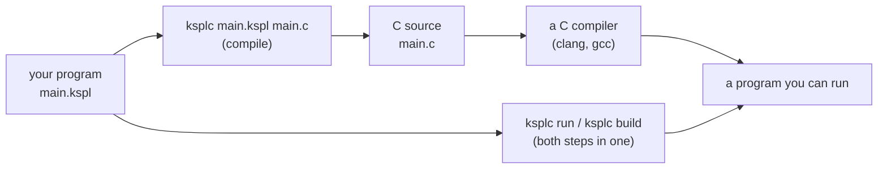
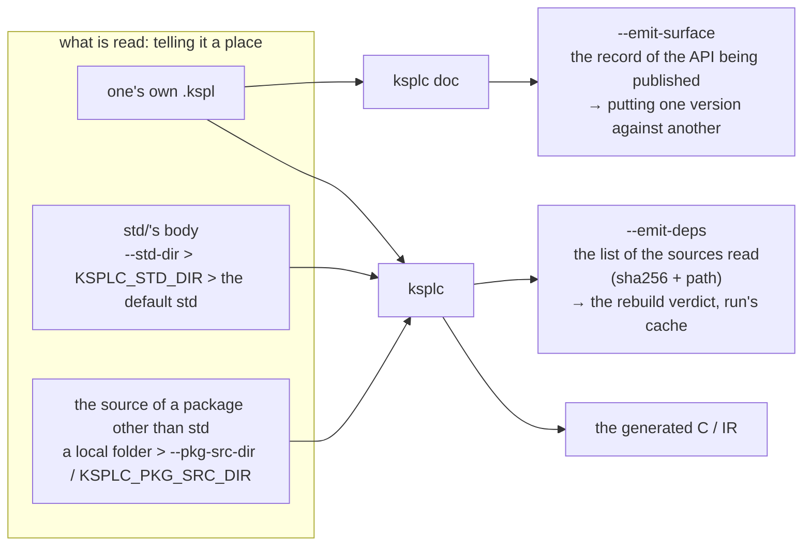

# The KSPL development tools specification

This document tells you how to use `ksplc`, the KSPL compiler, and the tools built into it. These are the formatter, the editor support and the checker for likely mistakes (the linter). **No other tool is needed**, so no two tools can disagree over how to read the grammar.

A term is explained where it first appears. Shared technical terms are defined in "Words used throughout" in [`../../docs/SPEC-documents.md`](../../docs/SPEC-documents.md).

---

## 1. Introduction: ksplc is one binary holding every subcommand

Every KSPL development tool is a subcommand of one executable, `ksplc`: you type `ksplc fmt`, `ksplc run` and so on. Only turning the generated C into a program needs a C compiler. `ksplc` translates KSPL into C, and a C compiler turns that C into a program; `ksplc run` and `ksplc build` take both steps for you.

The diagram shows the two steps from a source file to a running program; `ksplc run` and `ksplc build` take both at once.



| How it is called | What it does | See |
| :-- | :-- | :-- |
| `ksplc <input.kspl> <output.c>` | compiles (the default, with no subcommand) | [2. The compiler](#2-the-compiler-ksplc) |
| `ksplc run <script.kspl> [args...]` | builds and runs, caching the result | [2.5 Running as a script](#25-running-as-a-script-ksplc-run) |
| `ksplc build <input.kspl> <output.exe>` | builds one executable, through the C compiler | [2.12 Building one executable](#212-building-one-executable-ksplc-build) |
| `ksplc fmt <files...>` | formats the code | [3. The formatter](#3-the-formatter-ksplc-fmt) |
| `ksplc lsp` | the language server, normally started by the editor | [4. The language server](#4-the-language-server-ksplc-lsp) |
| `ksplc lint <input.kspl>` | static analysis (checking the code without running it): it stops after semantic analysis, before Lower, and prints only the diagnostics | [5. Static analysis and the linter](#5-static-analysis-and-the-linter-ksplc-lint) |
| `ksplc info <subject>` | prints one answer ksplc holds (where the standard library is, the link conditions, where the cache is, the reserved words) | [7. Querying and tidying up](#7-querying-and-tidying-up-ksplc-info--ksplc-clean) |
| `ksplc clean` | empties the disk cache ksplc made | [7. Querying and tidying up](#7-querying-and-tidying-up-ksplc-info--ksplc-clean) |
| `ksplc emit-runtime <output.c>` | writes only the C runtime's source, as one translation unit, for LLVM IR to link | [2.10.5 Writing the runtime for LLVM IR](#2105-writing-the-runtime-for-llvm-ir-ksplc-emit-runtime) |
| `ksplc explain [<code>]` | prints that code's section of the diagnostics specification: what it means and what to do. With no code it lists every code and its title. Any other word is refused | [`SPEC-diagnostics.md`](SPEC-diagnostics.md) |
| `ksplc doc <file>[.<name>]` | prints what a file, one entry or a folder publishes, rendered from the source | [7.5 ksplc doc](#75-ksplc-doc-what-a-file-publishes-as-a-reference) |

The words in the table: *semantic analysis* works out every type and name, and *Lower* prepares the code for output. A *diagnostic* is a message about your code: an error, a warning, an information or a hint ([§5.2](#52-the-diagnostics-four-weights)). A *translation unit* is one `.c` file as the C compiler reads it.

**The input is a `.kspl` file.** Indentation marks the blocks, as in Python, and the compiler turns it into braces right after reading it. **A file named `.ksplb` is refused**: braces are what the parser reads, not a notation a file is written in. **A file named `.kspls`, the extension's old name, is refused too**, and the line names the rename.

A name with no extension, as an `import` writes it, is opened as `.kspl`, and a diagnostic or a `#line` names it with `.kspl`. Diagnostics, jumps and the hover use the line numbers of the file as written.

`lsp-worker` is not a subcommand for a person to call. It is the analysis process that `ksplc lsp` starts for itself ([§4](#4-the-language-server-ksplc-lsp)).

**Each subcommand has its own options.** Giving a subcommand an option it does not act on is an error, and the message names the subcommands it does act on.

```
$ ksplc fmt --define=x a.kspl
ksplc fmt: '--define' does not take effect on this subcommand. It takes effect on: compile run build lint
```

**It is not silently ignored**, or you could not tell an ignored option from one that took effect. `ksplc --help` lists which options act on which subcommand, generated from the declarations.

---

## 2. The compiler (ksplc)

### 2.1 Basic use

Give `ksplc` an input file and an output file, and it compiles one to the other. With no subcommand it writes C99, the 1999 C standard, which nearly every C compiler accepts. When asked, it writes LLVM IR: the text form of code that LLVM, the toolkit behind clang, turns into machine code.

```sh
# transpile to C99
ksplc main.kspl main.c
clang main.c -o main

# transpile to LLVM IR
ksplc --to=llvm main.kspl main.ll
```

### 2.2 Choosing the language of the output (`--to`)

`--to` names the language of the output, and so the backend that writes it.

| `--to=` | It writes | Suited to |
| :-- | :-- | :-- |
| `c` (the default) | portable C99 (`.c`) | embedding in an existing C/C++ project, or deploying on a legacy OS or an embedded target |
| `llvm` | LLVM IR (`.ll`) | an LLVM toolchain such as Clang or LLC, which turns it into a native binary |

**The IR holds only the language's core.** The `kspl_*` functions that touch the OS are only declared in it. Their bodies come from linking the C runtime (the C code every program needs besides its own) that `ksplc emit-runtime` writes ([§2.10.5](#2105-writing-the-runtime-for-llvm-ir-ksplc-emit-runtime)):

```sh
ksplc --to=llvm main.kspl main.ll
ksplc emit-runtime kspl_runtime.c
clang main.ll kspl_runtime.c -o main
```

#### 2.2.1 Naming the machine the output is for (`--machine`)

`--machine=<triple>` names the machine the program will run on, by the triple its C compiler names that machine by (clang's `-target`). Without it, the output is for the machine ksplc itself runs on.

```sh
ksplc --freestanding --machine=thumbv7m-none-eabi app.kspl app.c
clang -target thumbv7m-none-eabi -ffreestanding -c app.c
```

**Name the same machine to both.** ksplc lays every value out by the machine's widths: a pointer's, `Sz`'s, a function pointer's, and where an `I64`, `U64` or `F64` sits in a struct. It writes some sizes and offsets into the C as numbers (an array's length, a static `if`, a `case` label, reflection's offsets and the like). Each such number comes with a compile-time check against the C compiler's own layout, at the source line that asked for it:

```
app.kspl:14:49: error: 'kspl_folded_for_x86_64_linux_gnu_3' declared as an array with a negative size
```

The name after `kspl_folded_for_` is the machine ksplc laid the number out for. So C compiled for another layout stops there, rather than building with wrong sizes.

| The case | What happens |
| :-- | :-- |
| A machine ksplc has no widths for | refused, with the machines it knows listed. They are the rows of `MACHINES` in [`../base/target.kspl`](../base/target.kspl) |
| No `--machine`, on a machine ksplc has no widths for | every subcommand that lays values out refuses at its start: a compile, `lint`, `lsp`, `run` and `build`. The message names the machine ksplc runs on, as the triple its C compiler's macros give. It lists the known ones, and asks for `--machine=<triple>` on a compile or a lint. `fmt`, `doc`, `explain`, `info`, `emit-runtime` and `clean` read no type, and run |
| `--to=llvm` for a machine with 4-byte pointers (Cortex-M, wasm32) | refused: the LLVM backend lays out only 8-byte pointers. Write C for it |
| `--to=llvm` for any other machine | the IR names the machine's `target triple`, so an LLVM tool builds for it |

**It takes effect on a compile and on `ksplc lint`**, so lint judges the same program the compile does. `ksplc run` and `ksplc build` refuse it: they build for the machine ksplc runs on. The parse cache ([§2.7](#27-the-cache-of-the-parse-result)) holds nothing a machine decides, and serves every machine.

#### 2.2.2 Watching a program with a sanitizer (`--sanitize`)

`--sanitize=<names>` builds the program with clang's sanitizers: checks the C compiler builds in, which stop the program at a fault and report where. The names are the C compiler's own (`-fsanitize=`), separated by commas:

| Name | What stops the program |
| :-- | :-- |
| `address` | an access outside an allocation, through a raw pointer too (`(p + n)$`), a use after free, and at exit a leak |
| `thread` | a data race |
| `memory` | a read of memory never written |
| `undefined` (`ksplc build` alone) | an operation C leaves undefined, such as a misaligned access |

Two subcommands take it, and each does what the C compiler cannot do by itself:

| Where | What it does |
| :-- | :-- |
| a compile with `--to=llvm` | **marks every function the IR defines** (`sanitize_address`, and so on), the program's and the ones ksplc writes by hand alike. clang's `-fsanitize=` instruments only a marked function; for C its front end marks them, and IR passes through none |
| `ksplc build` ([§2.12](#212-building-one-executable-ksplc-build)) | hands the C compiler `-fsanitize=<names>` |

```sh
# LLVM IR: ksplc marks it, and clang instruments and links it
ksplc --to=llvm --sanitize=address main.kspl main.ll
ksplc emit-runtime kspl_runtime.c
clang -fsanitize=address main.ll kspl_runtime.c -o main

# one step through C
ksplc build --sanitize=address,undefined main.kspl main.exe
```

**Name the same sanitizers to both** when building the IR yourself, as with `--machine` ([§2.2.1](#221-naming-the-machine-the-output-is-for---machine)): the marks alone change nothing.

**Not marked by default**: a mark keeps LLVM from some optimisations, so every program would run slower.

| Refused | Why |
| :-- | :-- |
| a compile that writes C | its C compiler marks the C it reads; give that compiler `-fsanitize=<names>` |
| `undefined` with `--to=llvm` | its checks are written into C by clang's front end, which LLVM IR does not pass through. KSPL's own checks stop an index, a shift, a divisor or an enum's tag out of range in either backend ("13. Conditions that stop execution at run time" in [`../../docs/SPEC-programming-language.md`](../../docs/SPEC-programming-language.md)); a misaligned access is watched only through C |
| `--freestanding` | a sanitizer's runtime maps its shadow memory and writes its reports through the OS, and none is built for bare metal |
| `ksplc build`'s `--cflags` holding `-fsanitize=` | `--sanitize` is the one way to ask there |
| `ksplc run` | it caches one program a script; `ksplc build` makes a sanitized one |

**Which machine has which sanitizer is the C compiler's to say** (clang refuses `-fsanitize=thread` for Windows). **A report through LLVM names the function, not the `.kspl` line**, since the IR carries no debug information.

### 2.3 The other compiler options

This table lists every option of a compile. Most have a section of their own, linked from their row.

| The option | Description |
| :-- | :-- |
| `--stats` | prints a report on standard error: grammar-rule attempts (`[KSPEG Rule]`), analysis costs (the two Sema Body tables), stage costs (`[Layer]`), cache hits and misses (`[AST Cache]`), and totals (`[Overall]`). |
| `--freestanding` | generates code for bare metal (a chip with no operating system), depending on neither an OS nor a standard library, and sets the `#cfg()` flag `freestanding`. |
| `--machine=<triple>` | the machine the output is for, whose widths every size is laid out by; the default is the machine ksplc runs on ([§2.2.1](#221-naming-the-machine-the-output-is-for---machine)). |
| `--sanitize=<names>` | marks `--to=llvm`'s IR for the sanitizers named, which the C compiler's `-fsanitize=` then instruments; refused on a compile that writes C ([§2.2.2](#222-watching-a-program-with-a-sanitizer---sanitize)). |
| `--define=<flag>` | defines a flag for `#cfg()` conditional compilation, which keeps or drops code by flag (`ksplc --define=debug main.kspl main.c`); it can be repeated. |
| `--std-dir=<DIR>` | where to look for the standard library (`import "std/..."`) ([§2.9.1](#291-locating-the-standard-library---std-dir)). |
| `--pkg-src-dir=<DIR>` | where to look for the **source** of a package other than `std` ([§2.9.2](#292-the-source-of-a-package-other-than-std---pkg-src-dir)). |
| `--split=<N>` | splits the generated C into N translation units to compile in parallel (the default 1 is no split) ([§2.6](#26-splitting-the-generated-c-into-several-translation-units---split)). |
| `--program` | says the output becomes a program, so an input with no `main` is refused with a diagnostic rather than left to the linker. `ksplc run` and `ksplc build` pass it to the compile they start. It cannot be combined with `--library`. |
| `--library=<FILE>` | builds a library, whose `#export` functions alone are visible outside it, and writes its interface to `<FILE>`; it can be repeated ([§2.10.1](#2101-building-a-library---library), [§2.10.2](#2102-writing-its-interfaces---libraryfile)). |
| `--emit-deps=<FILE>` | on success, writes the list of the sources read to `<FILE>` ([§2.9.3](#293-writing-out-the-list-of-sources-read---emit-deps)). |
| `--emit-libs=<FILE>` | on success, writes the libraries the program names with `#link` to `<FILE>` as one line of `-l<name>` words, a response file for the C compiler (`@<FILE>`) ([§2.10.4](#2104-writing-out-the-libraries-the-program-names---emit-libs)). |
| `--lint=<CODE>=<level>` | sets one diagnostic's level, `off`, `on` or `error`, on a compile as on `ksplc lint`; it can be repeated, and the later one wins ([§5.3](#53-enabling-disabling-or-promoting-a-diagnostic-to-an-error-lint----lint--ksplccfg)) |
| `--diagnostic-format=<text\|json>` | how the diagnostics are written to standard error: `text` (the default), for a person, or `json`, one object per line, for a program ([§2.11](#211-diagnostics-a-program-reads---diagnostic-format)). |
| `--help` | prints the usage on standard output and exits with 0. |

**An option's value is joined with `=`** (`--std-dir=std`), and `--std-dir std` is refused. An option has no short spelling, `--help` included. [`std/argparse`](../../std/README.md) parses them, and also refuses two subcommands at once (`ksplc fmt lint`).

**Standard output holds only what was asked for, and every line about the run goes to standard error.** What is asked for is a program's own output under `ksplc run`, `info`'s answer, `fmt`'s text, `doc`'s Markdown, `explain`'s text and `--help`'s usage. Everything else is about the run:

* a refused command line: the reason, then the usage, and exit code 1;
* a compile's diagnostics, its summary (`Finished with 1 error(s), 0 warning(s).`) and the line closing a compile that printed its diagnostics (`sema/analysis_failed: compilation terminated (see diagnostics above)`);
* an error with no diagnostic before it (a file that cannot be read);
* `--stats`'s report, and the folder `ksplc clean` emptied.

So `ksplc run script.kspl > out.txt` leaves in `out.txt` what the script printed and nothing else. A script reading an answer (`$(ksplc info std-dir)`) never takes a refusal for it.

**A wrong argument is an error**: an unknown option (an argument beginning with `-`), or the wrong number of input files (a compile takes `<input.kspl> <output.c>`, and `ksplc lint` one).

Caution: **Quote a path that a script or a Makefile passes from a variable.** Unquoted, a path holding a space (a folder such as `OneDrive - Kanso System`) is split by the shell, and the pieces arrive as file names.

`ksplc fmt`'s own options (`--in-place`, `--style`) are in [§3.1](#31-basic-use) and [§3.2](#32-the-formatting-settings---style), and `--lint`'s levels in [§5.3](#53-enabling-disabling-or-promoting-a-diagnostic-to-an-error-lint----lint--ksplccfg).

### 2.4 Compilation stops at 50 errors

One early mistake often causes many later errors (they *cascade*), and a long list would push the first cause off the screen. When the errors reach 50, the compiler prints "Too many errors (>= 50). Further errors are suppressed." as an error (itself one of the 50) and reports no more. A compile and `ksplc lint` both do this.

**A failed compile shows none of ksplc's insides**: only the diagnostic and one line of `<category>/<variant>`.

To chase an unexpected failure while developing ksplc, set the environment variable `KSPLC_INTERNAL_TRACE` to any non-empty value. The failing path is then added as `stack backtrace:`, in the language server's analysis process (`lsp-worker`) too. **An unexpected breakdown of ksplc itself is always reported**, with the tree as the analysis left it, whatever this setting.

### 2.5 Running as a script (ksplc run)

`ksplc run` builds a KSPL file and starts it in one command, as `python script.py` does. **The build is cached.**

```sh
ksplc run [ksplc's options] <script.kspl> [the script's arguments...]
```

What it rebuilds depends on what changed:

| The situation | What runs |
| :-- | :--- |
| the input (the script and every file it imports) is unchanged | nothing is rebuilt; the cached executable starts |
| the input changed but the generated C did not (a comment edited, say) | `ksplc` alone; compiling the C and linking are skipped |
| part of the generated C changed | `ksplc`, and **the C compiler on the changed translation units alone** |

**Reuse is decided by the contents of the files read** ([§2.9.3](#293-writing-out-the-list-of-sources-read---emit-deps)), and by these:
* `ksplc`'s own identity, the `--define` flags, and what `--std-dir` and `--pkg-src-dir` resolve to;
* the C compiler's name;
* whether a copy in the current folder now hides a package ([§2.9.2](#292-the-source-of-a-package-other-than-std---pkg-src-dir)).

**The generated C is split into translation units and compiled in parallel** ([§2.6](#26-splitting-the-generated-c-into-several-translation-units---split)). Each object file is kept under a name derived from its contents, so an unchanged one is not rebuilt.

**Arguments**: `ksplc`'s own options go **before** the script name. Everything after it goes to the script uninterpreted, even an option such as `--stats`; no `--` is needed.

**A program with no file**: in place of the script's path, `-` reads the program from standard input, and `--eval=<source>` takes it from the command line.

```sh
ksplc run --eval='import "std/io"; fn main() { io.out().s("hi\n") }'
printf 'import "std/io"\nfn main()\n    io.out().s("hi\\n")\n' | ksplc run -
```

* **It is read as a file named `-` in the current folder.** A relative import resolves from there, and a diagnostic names it `-` (`-:1:22: error: …`). `sys.script_path()` returns `-`.
* **Every argument after it goes to the program.** With `--eval=`, that is every argument after ksplc's own options. Put `--` before a first one that starts with `-`, which would otherwise be read as an option of ksplc's.
* **Its cache slot is keyed by its text** and the current folder, so running the same text again starts at once.
* **A compile refuses `--eval=`**; it reads a program from standard input with `-` as its input instead (`ksplc - out.c`).

**The shebang line**: with a `#!` first line and the execute permission set, the script starts as `./script.kspl`.

```kspl
#!/usr/bin/env -S ksplc run
import "std/io"

fn main()
    io.out().s("hello\n")
```

**Only a `#!` on the first line** is special. It is read as a line comment, so line numbers do not shift, and `ksplc fmt` keeps it; an editor's unsaved buffer reads it the same way.

Starting it this way needs two things:

* **`ksplc` on the PATH**, and an `env` that takes `-S` (GNU coreutils 8.30 and later, BSD's and macOS's).
* **A standard library `ksplc` finds with no option given**, since the shebang line passes none: any of the places after `--std-dir=` in [§2.9.1](#291-locating-the-standard-library---std-dir). An unpacked release or an installation finds its own; a `ksplc` built elsewhere needs `KSPLC_STD_DIR`.

Windows's native shell does not read a shebang; call `ksplc run <script.kspl>` there.

**The script's own path**: `sys.script_path()` returns the started script's path (Python's `__file__`), while index 0 of `sys.args()` is the cached executable's. In an executable not started by `ksplc run`, it returns `.none`.

It is passed in the environment variable `KSPL_SCRIPT` (`SCRIPT_ENV_NAME` in `std/sys`) as `<the started executable's path>\n<the script's path>`. **A grandchild process inherits the variable too, so `script_path()` checks it against its own `argv[0]` before answering.**

**The exit code** is the script's own. A script sets it by `main`'s return value, a failure path or `sys.exit()`; how each takes effect is the table in [`docs/SPEC-programming-language.md`](../../docs/SPEC-programming-language.md) §8.2.

**`ksplc run` takes no option that changes how it builds**, such as `--to` or `--machine` ([§1](#1-introduction-ksplc-is-one-binary-holding-every-subcommand)).

**The libraries linked** follow from the OS and the C compiler's target triple (`x86_64-linux-gnu`, say), as `ksplc info link-libs` answers. The libraries the program names (`#link` on an `extern` block) go before them, after the objects ([§2.10.4](#2104-writing-out-the-libraries-the-program-names---emit-libs)). Changing only those relinks without rebuilding any object.

**The executable's build options** are two: removing the unreferenced sections, and asking for a stack size on Windows. `ksplc info exe-flags` gives the same answer. Without the stack size, Windows's linker default of 1MB runs out before the depth that "12. Implementation limits" in [`../../docs/SPEC-programming-language.md`](../../docs/SPEC-programming-language.md) guarantees.

**Where the cache lives**: deleting the cache folder is always safe. Of the places below, the first that is set wins:

| Order | The cache folder |
| :-- | :-- |
| 1 | `KSPLC_CACHE_DIR` |
| 2 | `XDG_CACHE_HOME/ksplc` |
| 3 | `%LOCALAPPDATA%/ksplc/cache` (Windows) |
| 4 | `$HOME/.cache/ksplc` |

`ksplc info cache-dir` prints it and `ksplc clean` removes it.

**A cache folder another user (or group) could write is refused** on POSIX, since whoever could plant a file there could run code as you. `ksplc run` and `ksplc clean` stop and name the fix (`chmod go-w <folder>`, or `KSPLC_CACHE_DIR` set to a folder of your own). A compile says `not using the cache` once and goes on without it. A folder ksplc made itself never trips this.

**The size**: each script has one slot (the executable, the shared header, the objects), keyed by the script's path from the root and `ksplc`'s identity. Making a new slot keeps the 64 most recently used and every slot used within the last hour, and removes the rest.

**A failed build leaves the cache as it was**: the generated C, the executable and the list of inputs are replaced only together. The C the C compiler refused is left as `prog.new.c` for inspection.

**Runs of one script at once are safe.** One run builds while the others wait, printing `ksplc run: waiting for another run of this script to finish building it` on standard error. Then they start what it built, and the programs run side by side. A run that dies releases the lock. A program still running when a newer build replaces it keeps running.

### 2.6 Splitting the generated C into several translation units (`--split`)

`--split=<N>` (N > 1) writes **one shared header plus N unit `.c` files** instead of a single `.c`. Several copies of the C compiler can then work on them at once.

```sh
ksplc --split=4 main.kspl out/prog.c
# => out/prog.h  out/prog.0.c  out/prog.1.c  out/prog.2.c  out/prog.3.c
clang -c out/prog.0.c -o out/prog.0.o &   # the four can be compiled in parallel
...
clang out/prog.*.o -lm -o out/prog
```

The output path serves **only as the base for the names**, which are built from its `<stem>` (the path without its last extension).

| The file | The contents |
| :-- | :-- |
| `<stem>.h` | the declarations every unit `#include`s (the types, the prototypes, the `extern` declarations). **Not compiled on its own.** |
| `<stem>.0.c` … `<stem>.<N-1>.c` | the bodies. **All** N are linked. |

**The output path itself (`out/prog.c` above) is not written.**

Caution: **Keep the shared header in the same directory as the unit `.c` files**; they `#include` it by file name, not by path.

**The guide for N is the core count**. The cap of 256 stops a mistyped order of magnitude and is not a recommendation.

**It cannot be combined with `--to=llvm`** (an error): the LLVM backend cannot split translation units. Nor with `--library`, whose functions the units would need to reach in each other ([§2.10.1](#2101-building-a-library---library)).

### 2.7 The cache of the parse result

ksplc **stores each file's parse result on disk and skips parsing it next time**. (*Parsing* is reading the text into a tree the compiler works on.) There is nothing to configure, and no option.

```sh
ksplc hello.kspl hello.c     # the 1st time: it parses std
ksplc hello.kspl hello.c     # the 2nd time onward: it skips the parse (the smaller the input, the more it tells)
```

| Question | Answer |
| :-- | :-- |
| Where it lives | where `ksplc run`'s cache does ([§2.5](#25-running-as-a-script-ksplc-run)) |
| The unit | one file, so `std/io`'s entry, once made, serves other programs too |
| The key | the file's contents and `ksplc`'s identity, so rebuilding `ksplc` remakes it automatically |
| The size | the files read, per generation of `ksplc`. `--define` is in the key, so each new combination of flags adds to the generation. Making a new generation keeps the 8 newest by modification time and removes the rest |
| What is not cached | an editor's unsaved buffer, since the language server analyses it on every keystroke. Files read from disk (`std/` and the like) are, so the language server answers faster too |

`--stats`'s `[AST Cache] N hit / M miss / K stored` line shows whether the cache is working.

### 2.8 What crosses an artifact's boundary (a map)

An *artifact* is one thing a build makes: a program or a library. The rest of this chapter covers **what crosses an artifact's boundary**: code you take from elsewhere, and code you hand to others.

| | Source (a `.kspl`) | Binary (a `.a` / `.so` / `.dll` plus its interface) |
| :-- | :-- | :-- |
| **Receiver** | `--std-dir` / `--pkg-src-dir` (telling it a place, mainly through `KSPLC_STD_DIR` / `KSPLC_PKG_SRC_DIR`) | none: a C program includes the header, a KSPL program imports the `extern "C"` block |
| **Provider** | none (a folder is simply placed) | `--library=` (the library, its insides private, and its interfaces) |
| **Record** (neither side) | `--emit-deps` (the sources read → the rebuild verdict, `run`'s cache), `ksplc doc --emit-surface` (the published API → comparing versions) | `--emit-libs` (the libraries the program names → the link line) |

Note: `ksplc emit-runtime` stands apart from both: it writes the runtime that `--to=llvm`'s IR links ([§2.10.5](#2105-writing-the-runtime-for-llvm-ir-ksplc-emit-runtime)).

### 2.9 Source crossing the boundary: its place, and what is recorded

The diagram shows the three places source is read from, and the two records ksplc can write.



Options tell ksplc where to read source from, and records say what was read and what is published.

#### 2.9.1 Locating the standard library (`--std-dir=`)

**An import beginning with `std/` (`import "std/io"`) is read from the one folder that holds the standard library. ksplc never searches several**, so a project's own `std/` folder cannot hide the real one with no message, or the reverse. That folder is the first of these, strongest first:

| # | Where it comes from | The use assumed |
| :-- | :-- | :-- |
| 1 | `--std-dir=<DIR>` | a temporary override from CI or a build system, for that process alone. |
| 2 | the environment variable `KSPLC_STD_DIR` | a standard library kept apart from the compiler: one being worked on, or the language server's for a project elsewhere. It is inherited by child processes. |
| 3 | the `std/` beside the `ksplc` executable | **the usual way**: an unpacked release zip, which holds `ksplc` and `std/` side by side. |
| 4 | `../lib/kspl/std` from the executable's folder | an installation: `make install` puts `<prefix>/bin/ksplc` and `<prefix>/lib/kspl/std`. |
| 5 | the default value `std` | with none of the above, the `std/` directly under the current directory. |

**The executable is its real file**, links followed (on Linux and macOS). So a `ksplc` linked onto the PATH from an unpacked folder takes that folder's `std/`. **A folder counts in 3 and 4 only where it holds `lang.kspl`**, which every standard library has. **Where the folder taken holds no `lang.kspl`**, the compile stops. It names that folder and the row it was taken from, and each row above with the path it stands for on this machine.

```sh
# installed as /usr/local/bin/ksplc, with /usr/local/lib/kspl/std beside it
ksplc src/main.kspl out/main.c        # there is no need to place a std/ in the project
ksplc info std-dir                     # => /usr/local/lib/kspl/std

export KSPLC_STD_DIR=/home/me/kspl/std
ksplc info std-dir                     # => /home/me/kspl/std
```

**This setting does not go in `ksplc.cfg`, and `--std-dir=` is an error with the language server.** Set `KSPLC_STD_DIR` instead. The language server the VS Code extension carries has no `std/` beside it, so for a project with no `std/` of its own it reads the variable.

#### 2.9.2 The source of a package other than `std` (`--pkg-src-dir=`)

Any other import (`import "mylib/thing"`) is looked for **relative to the current folder**. `--pkg-src-dir=<DIR>` or the environment variable `KSPLC_PKG_SRC_DIR` adds **one more place** to look. The precedence is `--pkg-src-dir=` > `KSPLC_PKG_SRC_DIR` > empty (the current folder alone). The name says `src` because it points at a package's source, not at anything built.

```sh
export KSPLC_STD_DIR=/home/me/kspl/std
export KSPLC_PKG_SRC_DIR=/home/me/kspl        # the parent of ksdb/ ksai/ …
ksplc run main.kspl                        # one's own project can be placed anywhere
```

**The place is decided once per package, and a local copy wins.** Where the current folder holds a folder with the package's name (a vendored copy), every file of the package is read from there. Otherwise every file is read from the named place. So one package never comes half from one place and half from another.

**Putting a copy in place also remakes `ksplc run`'s cache entry.** The file at the named place is unchanged, so ksplc also checks whether a copy in the current folder now hides it ([§2.5](#25-running-as-a-script-ksplc-run)).

**This setting does not go in `ksplc.cfg` either**, since a place belongs to the environment and the way of installing. A package's name does go there. A package that names itself ([§6.4](#64-a-package-that-names-itself-package)) finds its own files in its own folder, not in either place above.

**Paths in diagnostics**: inside the standard library, a diagnostic names the file by its logical name (`std/io.kspl`), not its actual place. A file that was not found, in `std` or in a package, is named by the path ksplc actually tried to open.

#### 2.9.3 Writing out the list of sources read (`--emit-deps`)

On success, `--emit-deps=<FILE>` writes one line per source the compile read to `<FILE>`, as `<64 hex digits of sha256> <path>`. A build tool compares the list with the files on disk to decide whether to rebuild. The list holds:

* the files read from `std/` or the named place;
* every file an `embed` read (its bytes are in the output);
* every `ksplc.cfg` read, since a `[package]` decides where the sources are read from ([§6.4](#64-a-package-that-names-itself-package));
* **each `ksplc.cfg` looked for and not found**, with 64 `-` in place of the digest. One placed there later is read instead of the one further up ([§6.2](#62-the-search-and-the-range-it-applies-to)), so its appearing has to count as a change.

**It decides rebuilds**: `ksplc run` uses it to judge whether its cache still holds ([§2.5](#25-running-as-a-script-ksplc-run)), and the repository's `make test-deps` compares it with the dependencies the Makefile lists.

#### 2.9.4 Writing out the published API (`--emit-surface`)

`ksplc doc --emit-surface=<FILE> <file>` writes the declarations the file publishes to `<FILE>`, **one per line**, and prints nothing. Keep the file from one version and write it again for the next. Comparing the two lines up **what was added, changed and deleted**, by name.

```sh
ksplc doc --emit-surface=tensor.surface ksai/tensor
```

**The record needs the source alone**, as the rest of `ksplc doc` does ([§7.5](#75-ksplc-doc-what-a-file-publishes-as-a-reference)): no analysis, so it does not show that the file compiles. `<file>` is a file's logical name; an entry or a folder is refused, since a record covers one whole file.

```
ksai/tensor	Tensor<|T|>.matmul	pub fn matmul(r: Self$@, rhs: Tensor<|T|>): Tensor<|T|>!Tensor_error	the product of two matrices
```

The columns are separated by tabs, and the lines are sorted by key:

| Column | What it holds | Example above |
| :-- | :-- | :-- |
| 1. the file | the file's logical name, as an `import` writes it | `ksai/tensor` |
| 2. the key | the declaration's identity | `Tensor<\|T\|>.matmul` |
| 3. the spelling | the source, with its whitespace folded | `pub fn matmul(...)...` |
| 4. the documentation | what its `//<` says; left off where there is none | `the product of two matrices` |

* **The key is a declaration's identity**: `<the enclosing type>.<the name>`, or the name alone where nothing encloses it. An `impl`'s enclosing type is its target type as spelled (a `Box<|T|>` and a `Box<|I32|>` are different APIs), and a conformance to a trait is `<the target>:<the trait>`.
* **The attributes are part of the key**: `#cfg` is the only way to write one name twice.
* **A `pub` item of an `extern "C"` block is a row like any other.** Its key also carries the block's own attributes, as a method's carries its `impl`'s.
* **The spelling is the source with its whitespace folded**: each run of whitespace becomes one, and line comments are dropped. **The inside of a string is not folded** (a default argument's literal is part of the spelling).
* **The documentation holds the declaration's `//<` run**, its summary and the detail below it, joined by spaces. A parameter's `//<`, and the one on the return's line, each get a row of their own.
  * Note: **The column is here so that drift shows.** Change what a `pub` does and leave its description standing, and `make test-surface` shows the row as changed in the same round as the signature.

**A file's own description is a row too**, keyed by the mark alone (`~`). It is the `//<` run before the file's first line of code, with nothing but blank lines above it. It stands above the imports, since an `import` is code. A file that says nothing gets no row.

**A parameter and the return are keyed as parts of their declaration**: `<the key>~<its place>.<its name>` and `<the key>~~`. No name contains `~`, so a key holding one is always a part. The place is padded so that parameters sort in the order the signature writes them. A part that says nothing gets no row.

**A part does not always sort right after its declaration**: `~` sorts after `_`, so `sub`'s parts land after `sub_from`.

Note: **The parts' rows and the file's own row are for a reference to read, not for matching versions.** `make surface` leaves these rows out of `SURFACE.txt`, and `ksplc doc` shows them ([§7.5](#75-ksplc-doc-what-a-file-publishes-as-a-reference)).

**The scope decides which declarations are written** (`--surface-scope`, [§7.5](#75-ksplc-doc-what-a-file-publishes-as-a-reference)). The record that versions are matched by is made at `pub`; `all` serves an application, whose files reach one another with visibility unset. Any other name is refused.

**It is kept apart from a library's interface** (`--library=`), which writes one build's `#export` functions in C.

**Only `pub` declarations come out**: unset visibility (inside the package alone) and `priv` are not API. A `trait`'s required methods come out even when `priv`, since a conforming type has to provide them. Of a `struct`'s fields only the `pub` ones come out. Of an `enum`, every variant comes out with its tag value, since a `switch` can take them apart.

**The record holds every `#cfg` branch, not only the one this build keeps** (`sqrt` in `std/math.kspl` is two lines).

Note: How a package's records are joined into its `SURFACE.txt`, and the gate that holds it, are "The record of a published API" in [`docs/SPEC-gates.md`](../../docs/SPEC-gates.md).

### 2.10 Binaries crossing the boundary: a library behind its C interface

**You can hand someone a library built from KSPL without its source, as C libraries are handed over.** You hand over its object or shared library, plus its interface. Its callers reach it through its `#export` functions alone. KSPL's own types (a slice, a `Result`, a trait value, a generic, a method) do not cross a binary, and travel as source ([§2.9](#29-source-crossing-the-boundary-its-place-and-what-is-recorded)).

#### 2.10.1 Building a library (`--library`)

With `--library=`, **only the `#export` functions have external linkage** in the generated C: only they are visible to other files at link time. Every other definition is `static` (visible only inside its own file). That holds for the program's own, std's and the runtime's, data as well as functions. So any number of libraries built from KSPL link into one program, statically or as shared libraries, and none can see another's runtime or std.

**The C compiler guarantees it**, not the linker: a `static` symbol is private on every toolchain, MSVC's included, with no version script or export list.

| Under `--library=` | What happens | The reason |
| :-- | :-- | :-- |
| a `main` in the input | refused (a compile error) | the program that links the library has its own; the library is entered through its `#export` functions |
| an `#export` variable or `const` | refused (a compile error) | a DLL's data needs a mark on the caller's side that no one header can choose for every build; export a function returning it |
| no `#export` function at all | refused (a compile error) | the library would hold nothing a caller can reach |
| `--split` | refused | the units reach each other's functions, which a library makes `static` |
| `--to=llvm` | refused | the IR links its runtime from another file ([§2.10.5](#2105-writing-the-runtime-for-llvm-ir-ksplc-emit-runtime)), which cannot be one library's own |
| `--freestanding` | refused | the C compiler calls the bare-metal runtime's helpers (`__aeabi_memcpy` and the like) by name from any object. So they cannot be private; a bare-metal image is built from source |
| `ksplc run` | not accepted | it builds a program |

**A library runs none of the start-up a KSPL program's `main` makes**, since each step sets up the whole process:

| The step in a KSPL program | In a library |
| :-- | :-- |
| ignoring SIGPIPE, and ending quietly when standard output loses its reader | left to the program: a write to a pipe that finds no reader is a failed write, unless the program's own handling ends it. A write to a socket whose peer has gone is a failed write either way |
| a crash (a bad memory access, a stack run out) naming what happened in one line on standard error | left to the program: the fault ends it as the program's own handling says, with no line from the library |
| storing `argc` / `argv` (as UTF-8 on Windows) | `sys.args()` is empty |
| the Windows console's code page and attaching to a parent console | left to the program |
| binary mode on Windows's standard output | left to the program, so `\n` lands as the program's own output does |

The rest behaves as in a program:
* allocation;
* formatting numbers, which reads no C locale;
* writing to standard output: the C runtime's `stdout`, the program's own where both link one C runtime;
* a panic: standard output flushed, the message on standard error, then `abort`.

**On Windows an `#export` is marked `__declspec(dllexport)`** in a library, which every toolchain needs to export it from a DLL. Linked statically, the functions are exported from the program's executable too.

#### 2.10.2 Writing its interfaces (`--library=<FILE>`)

`--library=<FILE>` writes, on success, the library's interface to `<FILE>`: the file a caller needs in order to call the library. **The extension picks the form**, and any other is refused. **Repeat the option for the second form**: one compilation writes every interface it names, and a path named twice is refused. A library is always built with an interface.

| `<FILE>` | The form | Read by |
| :-- | :-- | :-- |
| `.h` | a C header: an include guard, `<stdbool.h>` / `<stddef.h>` / `<stdint.h>`, each `//<` summary as a `/** */` comment, and `extern "C"` for C++ | a C program (`#include`) |
| `.kspl` | a KSPL file: the types, then an `extern "C"` block carrying the library's own `#link` names | a KSPL program (`import`); its `--emit-libs` then names the libraries the library needs ([§2.10.4](#2104-writing-out-the-libraries-the-program-names---emit-libs)) |

**What it holds**: every `#export` function, in source order, and the types their signatures name. Each kind of type is written as C can take it:

| The type in KSPL | How the interface writes it |
| :-- | :-- |
| a `struct` passed by value | **with its fields**, under its own name; C needs its layout |
| a `struct` reached only through a pointer | **as a handle** (C's incomplete `struct`, KSPL's `struct` in the `extern` block), unless every field is `pub` and can cross to C |
| an `enum` with no payload | **its base type** (`int32_t` where none is written), with one constant per variant, `<Enum>_<variant>`. A C enumerator is an `int`, so an enum with a tag past `I32` names its constants as macros of its own type instead |
| a pointer to a type C cannot name (a slice, a generic's instance) | `void *` |

**Refused, naming the function**:
* a generic's instance or a `#packed` / `#align` struct passed by value (C99 cannot state its name or its layout);
* two declarations of one C name (C names a function, a type and a constant in one space). A type that cannot cross to C at all never reaches it: `#export`'s own check refuses it ("Types that cannot cross the C boundary" in [`../../docs/SPEC-programming-language.md`](../../docs/SPEC-programming-language.md)).

**A C header does not name the libraries the library needs**: C has no portable way to. The vendor ships that line, as `--emit-libs` writes it.

#### 2.10.3 Shipping a library and using it

Here a vendor, `greet`, ships a library built from KSPL, and a C program and a KSPL program use it. One compilation writes the library's C and both interfaces. The first block is the vendor's source, which is not shipped.

```kspl
// greet.kspl (the vendor's; not shipped)
import "std/str" { Str_builder }
pub struct Greet_point
    pub x: I32
    pub y: I32
#export
pub fn greet_hello(times: I32): I32 //< the length of the text `hello <i>` for each i below times
    defer $b: = Str_builder()
    for i in Range.asc(Sz::times)
        b.s("hello \{i\}\n")
    return I32::b.slice().len
```

The commands build the library and its two interfaces, then link each customer:

```sh
# the vendor: the library and its two interfaces, from one source
ksplc --library=greet.h --library=greet_api.kspl greet.kspl greet.c
clang -std=c99 -c greet.c -o greet.o && ar rcs libgreet.a greet.o
clang -std=c99 greet.c -fPIC -shared -o libgreet.so $(ksplc info link-libs)

# a C customer: the header and the library
clang -std=c99 main.c -L. -lgreet $(ksplc info link-libs) -o main

# a KSPL customer: the interface file and the library, without greet.kspl
ksplc --emit-libs=app.libs app.kspl app.c
clang -std=c99 app.c -L. -lgreet @app.libs $(ksplc info link-libs) -o app
```

The KSPL customer imports the interface file as if it were the library's source:

```kspl
// app.kspl (the KSPL customer; greet_api.kspl is beside it)
import "greet_api"
import "std/io"
fn main()
    io.out().s("\{greet_api.greet_hello(3)\}\n")
```

* **The libraries `ksplc info link-libs` answers go on every link line** that holds a library built from KSPL: its runtime needs them. A shared library takes them when it is linked.
* **On Windows a DLL comes with its import library, and holds the compiler's helpers itself**: `-shared -static-libgcc -o greet.dll -Wl,--out-implib,libgreet.dll.a`, and the program finds `greet.dll` beside it. Without `-static-libgcc` a DLL links MinGW's `libgcc_s_seh-1.dll` (the runtime's thread-local data calls into it), which a customer's machine without MinGW cannot load. An executable takes these helpers in by default.

#### 2.10.4 Writing out the libraries the program names (`--emit-libs`)

A program names the C library it needs with `#link` on an `extern` block ("11.5 Naming the library an `extern` block needs" in [`../../docs/SPEC-programming-language.md`](../../docs/SPEC-programming-language.md)). On success, `--emit-libs=<FILE>` writes the libraries of the blocks kept to `<FILE>` as **one line of `-l<name>` words**, the shape `ksplc info link-libs` answers in. Where the program names none, the line is empty.

```sh
ksplc --define=blas --emit-libs=prog.libs main.kspl prog.c
clang prog.c @prog.libs $(ksplc info link-libs) -o prog
```

* **Hand the file to the C compiler as a response file (`@prog.libs`)**. The compiler reads its words as if typed on its command line, with no shell between. So the same line works in a Makefile, PowerShell and a VS Code task. A shell reads it as words too (`$(cat prog.libs)`).
* **The program's libraries go before `info link-libs`'s**: a library the program names can itself need `-lm`, and GNU ld resolves only from the left.
* **The libraries every program needs are not in the file**: they follow the C compiler's target, which the compile never asks about; `ksplc info link-libs` answers them.
* **The order**: a file's libraries before those of the files it imports, and within a file as written. A library named twice is written once, at its first place; a block `#cfg` dropped names nothing.
* **A failed compile writes no file, and a file that cannot be written fails the compile.** A build reading a stale or missing one would link the wrong libraries.

`ksplc run` does the same internally ([§2.5](#25-running-as-a-script-ksplc-run)).

#### 2.10.5 Writing the runtime for LLVM IR (ksplc emit-runtime)

`ksplc emit-runtime` writes the C runtime that LLVM IR output needs beside it ([§2.2](#22-choosing-the-language-of-the-output---to)).

```sh
ksplc emit-runtime [--freestanding] <output.c>
```

It writes the C runtime's source to `<output.c>` as one translation unit and exits. **It analyses no source**, so it takes no `.kspl`. `--to=llvm`'s IR holds no runtime, and is linked beside this file.

**`--freestanding` changes the contents**, so emit it with the same setting as the IR it is linked with.

**Emit it with the `ksplc` that wrote the IR.** The runtime defines a symbol named after its whole source, and the IR's `main` calls it. So a runtime of another version stops the link with `undefined symbol`.

### 2.11 Diagnostics a program reads (`--diagnostic-format`)

`--diagnostic-format=json` makes the compiler's messages easy for another program (an editor, a script, an AI agent) to read. A compile and `ksplc lint` then write **each diagnostic as one JSON object on one line of standard error**, in the order they are found. Once the compile reaches its verdict, they write **a closing object as the last line**, in place of the text form's summary and closing line. The exit code is as in the text form.

```sh
$ ksplc lint --diagnostic-format=json main.kspl
{"severity":"warning","code":"W0207","kind":null,"message":"Nothing reads local variable or parameter 'v'. Prefix with '_' to ignore.","file":"main.kspl","line":5,"column":3,"end_column":4}
{"result":"succeeded","errors":0,"warnings":1,"informations":0,"hints":0}
```

A diagnostic's keys:

| Key | What it holds |
| :-- | :-- |
| `severity` | `error`, `warning`, `information` or `hint` ([§5.2](#52-the-diagnostics-four-weights)) |
| `code` | the diagnostic's code (`W0207`), which `ksplc explain` expands; `null` for an error, which has none |
| `kind` | `"syntax"` for a syntax error: the text could not be read, so nothing after it was analysed and the run reports nothing else. `null` for every other diagnostic. A syntax error is an error and has no code, so this key is what tells it apart |
| `message` | the text the text form prints after the severity, **without the `[CODE]` in front**; it can run over several lines |
| `file` | the file as the text form names it; `null` for an error placed in no file |
| `line` | the line, counted from 1; `null` where no place is known |
| `column`, `end_column` | where the underline starts and where it stops (not included), counted in characters from 1 on that line. This is **the place the text form's carets mark**, at least one character wide. `null` where only a line is known (a mistake in `ksplc.cfg`) or none |

The closing object's keys:

| Key | What it holds |
| :-- | :-- |
| `result` | `failed` where the compile or the lint failed (exit code 1), `succeeded` otherwise |
| `errors`, `warnings`, `informations`, `hints` | how many diagnostic objects of each severity came before it |

* **Each line is read on its own**, so a reader can act on the first diagnostic before the compile ends.
* **The closing object is told apart by its `result`**, a key no diagnostic has. It comes once, last, even for a clean compile.
* **No byte offset is given**: an offset would count the braces the indentation is turned into.
* **A run that stops before its verdict writes no closing object.** Its reason is a line of text: a refused command line, an input or output that cannot be read or written, a breakdown of `ksplc` itself.
* **`--stats` is refused beside it**: its report is text on standard error.

### 2.12 Building one executable (ksplc build)

```sh
ksplc build [--cflags="<words>"] [--sanitize=<names>] [--define=...] <input.kspl> <output.exe>
```

It does in one step what `ksplc <input> <output.c>`, `--emit-libs`, `info exe-flags` and `info link-libs` do in four. **There is no cache**: the caller (a Makefile, say) decides when to build, and `ksplc run` is the command that caches ([§2.5](#25-running-as-a-script-ksplc-run)).

| Where it comes from, in the order the C compiler sees it | What goes |
| :-- | :-- |
| ksplc: the C it writes is C99, and a program is built as it ships, `-g` included, without which no crash is located | `-std=c99 -O2 -g` |
| the caller's `--sanitize` ([§2.2.2](#222-watching-a-program-with-a-sanitizer---sanitize)), the one way to ask: `--cflags` does not take `-fsanitize=` | `-fsanitize=<names>` |
| the caller, split at spaces; **after ksplc's, so the last one wins** (`--cflags=-O0`) | the words of `--cflags` |
| the C just written | `<output's stem>.c` |
| `#link` on an `extern` block ([§2.10.4](#2104-writing-out-the-libraries-the-program-names---emit-libs)), then `info link-libs` | the libraries the program names, then the common ones |
| `info exe-flags` | the executable's build options |

**The C compiler is `CC`'s, or `clang`**, as `ksplc run`'s is. **The C and the libraries stay beside the executable** (`out/x.c` and `out/x.libs` for `out/x.exe`): the C is a failed compile's only clue. An output ending in `.c` or `.libs` would be overwritten by its own C, and is refused. The output's folder is made where it is missing.

**The exit code** is 0, or the failing step's own: ksplc's on an error in the program, the C compiler's on a failed compile.

---

## 3. The formatter (ksplc fmt)

`ksplc fmt` rewrites your source into the one agreed layout. **It parses the source fully and writes the tree back, rather than editing characters**, so formatting cannot change the meaning.

### 3.1 Basic use

```sh
# put the formatting result out to standard output
ksplc fmt src/main.kspl

# format the file in place
ksplc fmt --in-place src/main.kspl src/utils.kspl
```

Without `--in-place` the output goes to standard output.

**In-place formatting writes a temporary file before replacing the source**, keeping its permission bits, so a failed write leaves the original intact. Symbolic links are refused; format the target directly. Replacement changes only the named file, not other hard links to its old content.

**Standard output holds the formatted text alone. Every line about the run goes to standard error**: a file's diagnostics, the list of the files that failed and the closing `fmt/failed: …` line. The exit code says whether every file was formatted.

**A comment line past the column limit is cut at its last space that fits.** The words cut off go to the start of the paragraph's next line, or onto a line of their own. A line within the limit is not touched. These lines are never cut, and never joined by carried words:
* a trailing comment, a `///` or `//!` line;
* an aligned sub-line (two spaces after the mark), a table row (`|`), a divider (`---`, `===`);
* a marker (`EXPECT:`), a list item (`- `, `* `, `1. `);
* a line whose first word alone crosses the limit;
* the first line of a `//<` summary.

A summary is its run's first line, so it runs past the width instead of being cut. An empty `//<` right below a summary is removed. An empty `//<` further down, between two paragraphs of the detail, stays. A line opening with `Caution:` or `Note:` takes no carried words. Widths are display columns.

**`fmt` never meets a bare block**: a `{ … }` standing as a statement does not parse. A labelled block (`while_locked: { … }`) keeps its label, and an empty `{}` is written as it stands.

### 3.2 The formatting settings (`--style`)

`--style` changes the few layout choices that are open: the indent width, the line width, and whether short blocks and functions can sit on one line. Everything else in this section is fixed and has no switch.

`--style="..."` takes comma-separated settings (`ksplc fmt --in-place --style="IndentWidth: 2, ColumnLimit: 120" main.kspl`).

| The option's name | The default | Description |
| :-- | :-- | :-- |
| **`IndentWidth`** | `4` | the number of spaces per indentation level. |
| **`ColumnLimit`** | `100` | the maximum width of a line, in display columns (a CJK character or `✅` takes two). An argument list, a method chain and the like that exceed it are broken at a safe position. |
| **`AllowShortBlocks`** | `false` | `true` lets a short block go on one line (`if cond { break; }`; in `.kspl`, `if cond { break }` with no `;`), except one with a comment inside its braces, which is never folded (below). |
| **`AllowShortFunctions`** | `false` | `true` lets an `fn` whose body is a single statement go on one line (a method in an `impl` too; in `.kspl` without the statement's `;`). As with `AllowShortBlocks`, one with a comment inside, one too wide for the column limit, and one of two or more statements stay on three lines. |

**A key not in the table is an error**, so a typo such as `IndentWith` cannot succeed while the default stays in effect unnoticed. No setting switches the trailing comma: the formatter follows the source.

**A comment inside braces stays inside the block, at its level**, a comment right before the `}` included. A block holding a comment is never folded onto one line.

**A `//<` continuing a run is indented one step in from the line that opened the run**. (`//<` is KSPL's mark for documentation: it describes the thing on its own line.) Where that line ends in a `{`, that step is the contents' own level.

**A file keeps its line terminator** (`\n` on Unix, `\r\n` on Windows). The formatter works on lines ending `\n`; `to_lf` in `../../ksplc/parse/source_fix.kspl` does that on the way in, for the compiler and the formatter alike. It writes `\r\n` back where the file used it, as it does the BOM. A file with mixed terminators comes back with the one its first line used.

**A blank line separating nothing is dropped**: at a block's head (after the `{`), at a block's tail (before the `}`) and at the file's tail. A run of blank lines is folded into one.

* **A blank line *after* a `}` stays.**
* **A file ends with exactly one newline**, added where missing and folded where doubled.

**A description too long for its line moves below its mark, one step in.** `name //< a long description` becomes `name //<` with the description on the next line, whole even where it is still too long there (it is the summary, which is never cut). Three shapes stay as they are:

* **One that fits stays on its line**; the width alone decides.
* **One already below its mark is left alone**, so one pass of formatting reaches the final shape.
* **A mark after a return type, on the line where a wrapped head closes, is not touched.** It speaks for the return, and left bare it would read as the declaration's own run.

**A string literal too long for its line is continued on the next** with a `\` at the line's end. The `\` stands for no byte, so the text is the same however it is broken ("Escape sequences" in [`../../docs/SPEC-programming-language.md`](../../docs/SPEC-programming-language.md)). The literal is joined before it is broken, so formatting twice moves nothing. The continuation stands one step in from the line that opened it, as a `//<` run does; the mark swallows the indent. Four rules place the break:

| Where the break goes | Why |
| :-- | :-- |
| **after a space**, the one the writer typed | nothing is added or removed |
| **never inside a run of spaces**; it goes after the run's last space | the mark would swallow the rest of the run, and the literal would come back a space short |
| **never inside a `\{ … \}`** | its spaces belong to an expression the compiler reads as code, where a mark is no continuation |
| a word longer than the line **goes out whole**, and that line stands over the width | there is no space to break at |

**A line breaks only where the indentation notation joins it back.** That is inside a bracket, after a mark or word that continues a line, or before one that continues the line above. The cases are "2.5 Blocks and statement ends" in [`../../docs/SPEC-programming-language.md`](../../docs/SPEC-programming-language.md). Elsewhere the line runs past the width. Broken after `fn` or `switch`, the next line would read as a statement of its own.

**A line is never broken after a `catch`** either, although the word continues a line. After `catch` or `catch <name>`, only the next line's column tells a handler from a continued line, so the handler would be read as the block's first statement.

**Each arm of a `switch` starts a line at the `switch`'s column**, an empty one (`case .a {}`) included. The first goes below the `switch`, each later one after the arm before it. Where the breaks between statements are held back (a closure inside a call's brackets), the arms stay on the `switch`'s line.

**The `import`s are sorted by name**, with no `--style` switch:

* **Only the `import`s at the file's head** are sorted, up to the first other declaration.
* **A blank line separates groups**, and nothing moves across one; a comment at a group's head stays, as its heading.
* Each `import` moves **with the comments and attributes (`#cfg` and so on) directly above it and the comment ending its line**.
* Two lines importing the same path (an `as` and a `{ }` written together) stay adjacent in their written order (the sort is stable).
* **A file's heading does not move**: sorting starts at the first `import`, so nothing before it (the shebang, the heading's comments) is touched.

### 3.3 Skipping what is already formatted

**`ksplc fmt` records each file that formatting leaves unchanged, and the next `ksplc fmt` of the same bytes skips it.**

* **The record's key** is the file's bytes, every `--style` setting and `ksplc`'s identity, so rebuilding `ksplc` or changing the style formats everything again.
* **Only a text that came out unchanged is recorded.** A file that changed is formatted again next time.
* **It lives** where `ksplc run`'s cache does ([§2.5](#25-running-as-a-script-ksplc-run)), as one empty file per text, named by the key, under `fmt/`. Each rebuilt `ksplc` starts a generation of its own, and the 8 newest are kept. `ksplc clean` removes it ([§7.2](#72-ksplc-clean-removing-what-was-built)); where no cache folder can be used, every file is formatted.
* **`--stats` prints `[Fmt Cache] N hit / M miss / K stored`** on standard error.

---

## 4. The language server (ksplc lsp)

`ksplc lsp` gives your editor types on hover, jumps to definitions and red underlines for errors. It speaks the Language Server Protocol (LSP), a standard way for an editor and a language tool to talk. **A person does not start it**; the editor's extension does.

**The analysis runs in a separate process** (`lsp-worker`), watched by the front one. The front one restarts it after a crash or a hang, and restores the documents that were open. So a crash in the analysis does not take the editor's connection down. What the editor sees after such a recovery:

* **The request in flight answers nothing** (`null`).
* **The next answer waits for its own document only**, however many are open: that one is analysed again first.
* **The other documents' diagnostics stay on screen**, and are replaced one document at a time as each is analysed again, while the editor sends nothing.
* **A document whose analysis brings the analysis process down again is set aside.** It answers nothing until it is edited, and the server's log (its standard error) names it.


### 4.1 The features supported

* **Hover**: on a variable or a function, it shows the inferred type, the function's signature and a struct's fields. Below them it shows the declaration's own description: the `//<` on its line and the run below it.
  * **A name the description points at links to its declaration** (`` `Map.set` `` opens `std/ds.kspl` at that line), resolved as [W0211] resolves it. The completion list's descriptions carry the same links. A link is an absolute `file://` URI with the line after `#L`.
  * **On a literal it shows the literal's type**, the one it takes where it stands: `4` in `size: Sz = 4` shows `Sz`, `'a'` shows `U8`, `null` the pointer or `Option` it fills in. Where the compiler gives that literal no type (an array's length, an enum's tag value) the hover is empty.
  * **Where a name is bound it shows what a use of it shows**: `words: std.ds.List<|U8[]|>` on `$words: = List<|U8[]|>(arena)` as on a later `words`. The same holds for a parameter, a `for`'s item, `if v: = opt`, `catch e` and a pattern's payload.
  * **On a mark it answers nothing.** A bracket, a comma, an operator, `::`, `<|` and `|>`, and a keyword such as `priv` or `fn` name no declaration. A position at a name's end still answers that name: with the caret on the `(` of `free()`, it shows `free`.
* **Jump to definition**: from a use to its declaration, including a typedef or an enum variant in another file.
  * **Where the server finds nothing, nothing happens**; the VS Code extension does not search the text instead.
  * On a name where it is declared, it jumps to the definition of the variable's type.
* **Finding references**: every place in the project that uses the name. It matches on the declaration a name points at, not on its spelling. The results are ordered by file name, line, then column. `context.includeDeclaration` is followed exactly as asked, and the declaration counts where the option is absent.
* **Renaming**: renames a function or a variable across the project, without confusing it with a same-named declaration hidden further in. It changes the same places finding references returns. **A name a selective import brings in is renamed on the import line too** (`import "lib" { helper }`).
  * **It refuses, with a message, rather than write a program that no longer compiles or means something else.** It refuses:
    * a new name the grammar does not read as one identifier (`1bad name`), or a keyword (`return`, `I32`, `true`);
    * a name declared in a file outside the workspace: the standard library, or a package read from another folder. The workspace is the files under the folder the editor opened, outside the folders `.gitignore` names and those starting with a dot. Asked first (`textDocument/prepareRename`), the editor says so before a new name is typed;
    * a new name already declared in a scope around a place the name is written bare. The scope is the same block, an enclosing block, the function's parameters, or the file's own declarations and imports. A field, a variant or a method is compared with the other members of its type instead.
* **The call hierarchy**: a function's callers and callees across files, as a tree. It follows the operators and the methods to the plain calls the compiler rewrites them to. Passing a function as a function pointer is an edge too, marked `(as fn pointer)` in `detail`.
* **The outline**: it answers `textDocument/documentSymbol` with what the file declares, nested as written. It lists functions, types with their fields and variants, an `impl` and a trait with their functions, constants and global variables. An `impl` is named by its header as written (`impl Editor`, `impl Align: Formattable`). It is read from the syntax tree already kept for the document, so it parses nothing again and resolves no import. Nothing inside a body is listed. A document that does not parse lists the declarations parsed around the error.
* **Diagnostics**: the analysis runs as you type, and errors and warnings show as wavy underlines ([5. Static analysis and the linter](#5-static-analysis-and-the-linter-ksplc-lint)).

**Hover lays a signature out as the source does.** It stays on one line where it fits the formatter's width and no parameter has a description. Otherwise each parameter takes a line of its own, followed by its own `//<`, and the return type closes the last line:

```text
fn Row.put(
    r: Row@,
    at: Sz, //< which column it starts in
    times: Sz,
): Sz
```

A parameter whose name already says it has nothing after it. The width hover breaks at and the indent of a parameter's line are the formatter's own (`column_limit` and `indent_width` in [`fmt/style.kspl`](../fmt/style.kspl)), and `make test-conventions` holds each pair together.

**Past 16 parameters the middle ones are given as a count, and the last line still comes out**, since it holds the return type.

**The signature is a plain-ASCII block, not a Markdown list.** A list is drawn with the renderer's own bullet, which the server cannot change.

### 4.2 The settings in the VS Code extension

The `.vscode/extensions/kspl` extension provides these settings.

| The setting | What it does |
| :-- | :-- |
| `kspl.serverPath` | the executable to start as the LSP server; empty means the one bundled with the extension. It has `machine` scope, so a workspace's `.vscode/settings.json` cannot set it: opening a repository must not run any program |
| `kspl.trace.server` | how much of the traffic with the server to log in the "Kanso LSP" output panel (`off` by default, `messages`, `verbose`). The panel comes forward by itself only on an error and when this setting is turned up |
| `kspl.defines` | the `#cfg()` flags to raise during the analysis, as the compiler's `--define` does (for example `["blas"]`) |

**The editor colours the code by its spelling alone**, with the extension's TextMate grammar (`tmLanguage.json`). The language server sends no colours.

**A check holds the grammar's copy of the reserved words to its source.** `tmLanguage.json` cannot import ksplc, so it holds a copy of the words. The canonical source is `ksplc info keywords`'s output, and `make test-conventions` holds the copy to it, in both directions.

### 4.3 How code covered by `#cfg()` is handled

**Code under a `#cfg(flag)` the editor has not been told about is dropped before the analysis**, as in the compiler (`--define`, [§2.3](#23-the-other-compiler-options)). So hover, jumps and the call hierarchy find nothing there. To edit code under `#cfg(blas)`, add the flag to `kspl.defines`.

**Hover inside a dropped range gives the reason** (`#cfg(blas) is not satisfied, so this declaration is not analyzed`), naming the flag to raise.

Caution: A dropped declaration leaves nothing in the AST (the syntax tree), so a query at its position looks exactly like one where nothing stands. **An empty answer would make the editor's features look dead in that one file.** Jump to definition and the call hierarchy do stay empty; hover is where the reason is given.

The extension passes the list to the server in the environment variable `KSPLC_DEFINES`, separated by commas or whitespace, for the same reason as `KSPLC_STD_DIR` ([§2.9.1](#291-locating-the-standard-library---std-dir)). Set it when running `ksplc lsp` without an editor.

**Raising every flag is no answer.** Code that pairs `#cfg(x)` with `#cfg(!x)` (`std/math`'s freestanding version and the like) then drops the `!` side instead.

---

## 5. Static analysis and the linter (ksplc lint)

Besides errors, the compiler points out code that is legal but probably wrong, or departs from the agreed style. `ksplc lint` stops before code generation and prints only those diagnostics. Each code, and the errors that have none, is listed in [`SPEC-diagnostics.md`](SPEC-diagnostics.md).

### 5.1 Basic use

```sh
# analyse a single file (its dependencies are type-checked too, so every reachable file is in scope)
ksplc lint src/main.kspl

# enable a code that is off by default / raise a severity (§5.3)
ksplc lint --lint=W0601=on src/main.kspl
ksplc lint --lint=I0307=off --lint=W0105=error src/main.kspl
```

### 5.2 The diagnostics' four weights

Every diagnostic has one of four weights, from "it does not run" down to "it runs, but could be written better". The weight's first letter starts the diagnostic's code.

| Weight | What it tells you | Examples | Notes |
| :-- | :-- | :-- | :-- |
| **Error (E)** | it does not run: compilation stops | the types disagree, a name is missing | it carries no code (below) |
| **Warning (W)** | it runs, but an error is likely | unreachable code, an expression that does nothing | it carries a code, as do the two below |
| **Information (I)** | no direct bearing on running or safety, but it ought to be fixed | naming, a declaration shadowing an outer one of the same name, an unneeded `::` cast or `return;` | the name is LSP's `DiagnosticSeverity.Information`, and the language server passes that level on unchanged |
| **Hint (H)** | a better way of writing is proposed | unneeded brackets, an early exit | VS Code and similar editors dim the text. The editor offers no one-press fix for it; it is fixed by hand, which keeps the language server stable |

Only warnings, information and hints carry a code: a fixed number such as `W0201`, used to point at one or to narrow the output to it. **An error has no number**: with one, the mechanism of §5.3 could silence it.

**The four digits are a class and an item.** The top two give the class. The bottom two count that weight's items within the class, each weight from 01. So `W0106` is class 01's sixth warning, and `I0301` and `H0301` are both first in class 03. **The letter is part of the code**: `I0310` and a later `H0310` would name different findings.

| | The class | What the reader is being told |
| :-- | :-- | :-- |
| **01** | The answer changes | it compiles and runs, but does something other than what is written |
| **02** | It has no effect | code or a value that never does anything |
| **03** | The spelling says nothing | it works; deleting the notation changes nothing |
| **04** | What is reached from outside | imports, and what a `pub` exposes |
| **05** | Names | shadowing, conventions, a name colliding with a meaning |
| **06** | Ownership and mutability | who frees it, and what can be written |
| **07** | The contract at a boundary | what a caller must handle, and what a signature promises |
| **08** | The shape of the writing | layout and length, where the meaning is not at issue |

**The class and the weight are independent axes**: class 07 holds a warning, an information and a hint.

**The CI verdict counts all four weights.** The lint gate and the entry points it analyses are in "What each platform runs" in [`docs/SPEC-gates.md`](../../docs/SPEC-gates.md).

**Some advice is not reported inside a generic** (a function or type with a type parameter, such as `List<|T|>`). Where the answer changes with the type argument ([I0301]'s unneeded cast, [I0307]'s empty block), it is not reported while an instantiation is analysed.

### 5.3 Enabling, disabling or promoting a diagnostic to an error (`##lint` / `--lint` / `ksplc.cfg`)

You can turn each coded diagnostic off, turn on one that is off by default, or make it an error. You set it per file, on the command line, or for a folder in `ksplc.cfg`.

**Which diagnostics are needed depends on what is being built, sometimes in opposite directions.** An OS kernel wants to see every hidden reference count; a web server wants hand-made ownership flagged. The memory strategies are described in [8.4 of `SPEC-programming-language.md`](../../docs/SPEC-programming-language.md#84-memory-management).

#### 5.3.1 The levels

| The level | The meaning |
| :-- | :-- |
| `off` | not reported |
| `on` | reported at its default severity (**this enables a code that is off by default**) |
| `error` | promoted to an error, and checked and refused even on an ordinary build outside lint mode |

**`error` works only toward more refusals.** An error has no code ("An error has no number" in [§5.2](#52-the-diagnostics-four-weights)), so this mechanism cannot turn a genuine defect `off`.

#### 5.3.2 The three ways to set it

Strongest first: inside the file > the command line > the settings file > the default. The narrower the setting, the stronger, except that the command line beats the settings file so that CI can override it for one run.

| Strength | Where | How it is written | What it covers |
| :-- | :-- | :-- | :-- |
| 1 (strongest) | **per file** | `##lint(W0601 = on, I0305 = off);` near the file's head; settings are comma-separated | the whole file, from any position (it takes effect before any diagnostic) |
| 2 | **the CLI** | `ksplc lint --lint=I0307=off --lint=W0601=on src/main.kspl`; it can be repeated, and the later one wins | that one run |
| 3 | **the project settings file** | the `[lint]` section of the nearest `ksplc.cfg` above the source ([§6.2](#62-the-search-and-the-range-it-applies-to); [§6.1](#61-how-to-write-it) shows one) | part of the directory tree |
| 4 | the default | nothing written | everywhere else |

**Both the code and the level are checked against the canonical source, `ksplc/base/lint_codes.kspl`. An unknown one is a compile error**, so a typo such as `##lint(I004 = off)` never silently does nothing. `ksplc.cfg` is checked the same way ([§6.3](#63-an-invalid-setting-is-refused)).

#### 5.3.3 The codes off by default

A code off by default is advice that matters only for one kind of system, and is reported only once turned `on`.

| The code | The meaning | Enable it for |
| :-- | :-- | :-- |
| [W0601] | points out where ARC's hidden `retain`/`release` makes timing invisible | a system putting determinism first — an OS, embedded, real-time control |
| [I0402] | points out a `pub` used only inside its package | an artifact closed at that unit, such as an executable |

(ARC, automatic reference counting, is the compiler inserting `retain` and `release` calls that count a value's owners and free it when the last one lets go.)

**There are no named combinations (presets)**: a name enabling one code would only be a second way to write the per-code setting. To cover a directory tree, list the codes in `ksplc.cfg` (for example `kssrv/ksplc.cfg`).

**A code on by default is useful whatever is being built.** [H0701]'s `T?` is an enum resolved at compile time, so it serves either kind of system without touching run-time timing.

## 6. The project settings file (ksplc.cfg)

`ksplc.cfg` applies one setting to a whole folder instead of copying it into every source. It holds two sections: `[lint]`, the diagnostics' levels ([§5.3](#53-enabling-disabling-or-promoting-a-diagnostic-to-an-error-lint----lint--ksplccfg)), and `[package]`, a package naming itself ([§6.4](#64-a-package-that-names-itself-package)).

### 6.1 How to write it

**The format is INI, the plain `[section]` and `key = value` format many tools use.**

```
# a comment runs from '#' to the end of the line
[lint]
W0601 = on
I0307 = off
W0105 = error
```

| What is written | What it means |
| :-- | :-- |
| `[section]` | opens a section; the `key = value` lines after it belong to it |
| a `key = value` outside any section | an error (a reader cannot tell which setting it is) |
| blank lines, comments from `#` to the end of the line, whitespace around a key or a value | ignored |

### 6.2 The search and the range it applies to

The search walks upward from the directory the compiled source is read from, that directory included, and **the first `ksplc.cfg` found applies, whole**. Files further up are not read for that source, so settings never merge; an empty file still counts as the one found.

**`..` in the path is folded first**, by spelling, as when a package's top is looked for ("9.1 import syntax and path resolution" in [`../../docs/SPEC-programming-language.md`](../../docs/SPEC-programming-language.md)). `pkg/../x.kspl` is walked from `pkg`'s parent, so `pkg`'s file never reaches it.

```
ksplc.cfg            ← it applies where no nearer file stands
ksos/ksplc.cfg        ← everything that applies under ksos/; the file above is not read there
ksos/kernel/task.kspl
```

Caution: **An outer file's setting does not reach a folder that has its own file.** To keep it there, repeat it in that folder's file.

**A package takes the same settings wherever it is put.** Its top holds a `ksplc.cfg` (the one naming it, [§6.4](#64-a-package-that-names-itself-package)), so the search from any of its files ends there at the latest.

### 6.3 An invalid setting is refused

An unknown section, key (diagnostic code) or value (level name) is refused as `ksplc.cfg:<line>: error: ...`, and compilation stops. A key set twice in one section is refused too, in `[lint]` as in `[package]`: the second line would silently override the first. The file is named by its path from the current folder.

```
ksplc.cfg:3: error: unknown diagnostic code 'W9999': the codes are listed under "Diagnostic codes, and the errors that have none" in ksplc/docs/SPEC-diagnostics.md; 'ksplc explain' lists them, and 'ksplc explain <code>' prints what one means
```

The check runs for every source read, so a typo shows even in a file with no finding at all.

### 6.4 A package that names itself (`[package]`)

A *package* is a top-level folder of code distributed as one unit, such as `std` or `ksos`. A `ksplc.cfg` holding `[package]` marks **a package's top folder**, and names the package.

```
[package]
name = ksos            # the package's name: its files import each other as "ksos/..."
uses = ksai ksdb       # the packages it imports besides itself and std (none: leave it out)
```

* **Its own files are found in this folder**, wherever it stands, whatever it is called, and from whichever folder `ksplc` runs. A file under it is named `<name>/<the path from here>`, as a run from the workspace's root names it. A diagnostic and the generated C's `#line` name the file by its path from the current folder, so a debugger started there shows the source.
* **What it uses is named here and placed elsewhere.** A package listed in `uses` is found like any other ([§2.9.2](#292-the-source-of-a-package-other-than-std---pkg-src-dir)). An import of an unlisted package is refused at the import, before the file it names is read.
* **A package's settings come from inside it** ([§6.2](#62-the-search-and-the-range-it-applies-to)). A folder inside it can hold a `ksplc.cfg` of its own for its settings; it still belongs to the package named here.
* **An editor opened on this folder sees the package as a run from the root does.** The language server ([§4](#4-the-language-server-ksplc-lsp)) names each document the same way, so a jump or a rename lands on the file in this folder.
* `ksplc info package` answers which package the current folder belongs to ([§7.1](#71-ksplc-info-reporting-what-ksplc-resolved)).

These are refused on reading, with the line:

* an unknown key;
* a `[package]` with no `name`;
* `std` or the package itself in `uses`;
* a folder reached as one package that names itself another.

```
probe/main.kspl:1:1: error: the package 'ksdb' does not say it uses 'ksai' (add it to 'uses' in the [package] section of ksplc.cfg)
ksplc.cfg:3: error: unknown key in [package] (known keys: 'name', 'uses')
```

---

## 7. Querying and tidying up (ksplc info / ksplc clean)

### 7.1 ksplc info: reporting what ksplc resolved

```bash
ksplc info <subject>
ksplc info std-dir [--std-dir=DIR]
```

It gives callers one verdict ksplc makes internally, **so callers need not copy it** and let the copy go stale.

| The subject | What it answers |
| :-- | :-- |
| `std-dir` | the resolved standard library directory ([§2.9.1](#291-locating-the-standard-library---std-dir)). Only this subject takes a `--std-dir=`, answering what that setting would resolve to; on any other subject the option is refused, as it would change nothing. |
| `link-libs` | the libraries needed to link the artifact (`-lm -lpthread` and the like), judged from the OS and the target triple. **The libraries the program itself names are not among them**: the compile writes those ([§2.10.4](#2104-writing-out-the-libraries-the-program-names---emit-libs)). |
| `exe-flags` | the options ksplc itself passes to `CC` when building an executable (removing unreferenced sections, the stack size requested on Windows). Without them it still builds, but under changed conditions, so a script building an executable passes both subjects. |
| `cache-dir` | the disk cache's location (the normalized AST, `ksplc run`'s build results and the texts `ksplc fmt` already formats). The default is the OS's cache area, which cannot otherwise be found from outside. |
| `keywords` | the reserved words gathered automatically from the grammar ([§7.3](#73-ksplc-info-keywords-the-list-of-reserved-words)). |
| `package` | the package the current folder belongs to: its name on the first line, what it `uses` on the second ([§6.4](#64-a-package-that-names-itself-package)). **It can answer two empty lines**: outside every package there is nothing to name. |

**No other option takes effect on `info`, and each is refused** ([§1](#1-introduction-ksplc-is-one-binary-holding-every-subcommand)). That includes `--to`: `link-libs` and `exe-flags` follow the C compiler's target triple (`CC -dumpmachine`), which the language of the output does not change.

With no subject, or an unknown one, it refuses and lists the subjects.

```
$ ksplc info
usage: ksplc info <std-dir|link-libs|exe-flags|cache-dir|keywords|package>
```

### 7.2 ksplc clean: removing what was built

```bash
ksplc clean
```

It empties the disk cache and reports the location it emptied on standard error. **It takes no subject**: a word after it is refused with the usage. It is safe at any time (the cache is made afresh next time). It removes only the hex-named directories ksplc made; anything else in `KSPLC_CACHE_DIR` is left alone.

### 7.3 ksplc info keywords: the list of reserved words

`ksplc info keywords` lists every reserved word of KSPL (a word such as `if` or `fn` that cannot be used as a name).

```bash
ksplc info keywords
```

It prints them to standard output, gathered automatically from the grammar `ksplc/kspl.kspeg`. It prints one word per line, sorted by byte value, each word once.

```
Bool
F32
...
as
break
...
```

**A debugger shows the generated C's names**: a variable named like a C reserved word with its `_kw` suffix. A local that hides another of its name, or is spelled as a global's C name (`Slice_U8`), shows as `__k_shadow<N>_<name>`.

### 7.4 How reserved words are gathered automatically

**The list of reserved words is written nowhere**: it is read from the grammar each time. A single-quoted string in the grammar file `ksplc/kspl.kspeg` (`'if'`) is a reserved word, unlike an ordinary double-quoted string (`"0x"`). kspeg gathers them into the rule `_Keyword` it synthesizes (the notation is kspeg's specification, reached from [`kspeg/README.md`](../../kspeg/README.md)). The list is read from each rule's own keywords, not from the shape of `_Keyword`. A keyword that several rules use is listed once. So adding or removing a keyword in the grammar needs no separate list to maintain.

### 7.5 ksplc doc: what a file publishes, as a reference

`ksplc doc` shows the documentation of a file, an entry or a folder, read straight from the source.

```bash
ksplc doc <file>[.<name>] [--surface-scope=pub|all] [--std-dir=DIR] [--pkg-src-dir=DIR]
ksplc doc <folder>
ksplc doc --emit-surface=<FILE> <file> [--surface-scope=pub|all]
```

It prints, as Markdown on standard output, each declaration a file publishes as written. With it comes what its `//<` says of it, of its parameters and of what it returns. **The reference is never written to disk**: the description in the source is the one copy. `--emit-surface=` writes the file's record instead, for comparing versions ([§2.9.4](#294-writing-out-the-published-api---emit-surface)).

| Asked for | What comes back |
| :-- | :-- |
| a file's logical name, as an `import` writes it (`std/io`) | the file's own description, a list of its entries, and every entry |
| a file, a `.`, and an entry's key (`std/mem.Arena.alloc`) | that entry alone; asked for a type (`std/mem.Arena`), the type and its members |
| a folder (`std`, `ksai`) | every file under it that publishes something, one line each with how many entries it holds and its summary; `tests/` and build output are not read |

* **A name resolves as an `import` resolves it**: a `std/` name against `--std-dir` / `KSPLC_STD_DIR`, any other against `--pkg-src-dir` / `KSPLC_PKG_SRC_DIR` or the current folder ([§2.9](#29-source-crossing-the-boundary-its-place-and-what-is-recorded)).
* **The entry begins at the first `.` after the last `/`**, since a logical name holds no `.`. A name written with its extension (`std/io.kspl`) is therefore read as the file `std/io` asked for an entry `kspl`. A last part of `.` or `..` is a folder, not an entry: `ksplc doc .` lists the current folder, its files named from it.
* **It reads what the record reads** ([§2.9.4](#294-writing-out-the-published-api---emit-surface)): the source alone, with no analysis. So it answers in a fraction of a second and cannot disagree with `SURFACE.txt`. `--surface-scope=all` shows what is not `pub` as well.
* **A name that resolves to nothing is an error** (exit 1), naming what was looked for, and so is an entry the file does not publish. A file in a folder that cannot be read is named in the listing, not dropped.
* **A link in a description resolves from the source's folder**, as it does in the source. A dotted name of an entry of the same file becomes a link to it; another file's stays text, and `ksplc doc` on that file shows it.
