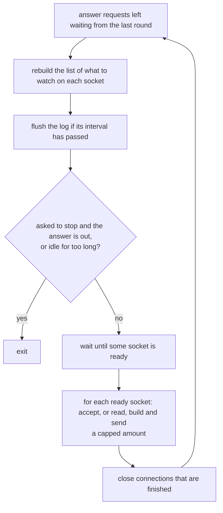
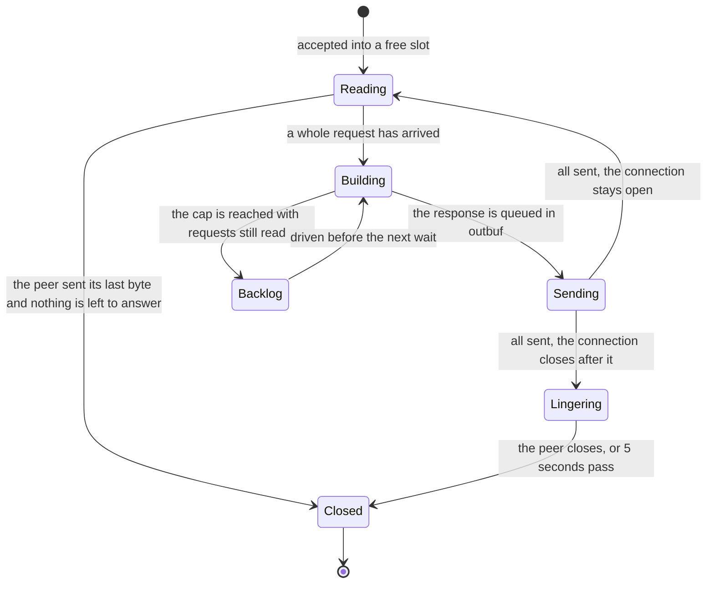

# kssrv — the design

kssrv (Kanso Server) is an HTTP server written in KSPL on `std`: a program that stays up and answers requests without end. This document holds its decisions and their grounds. Starting it is in [kssrv](../README.md), what a client can ask for in [`SPEC-api.md`](SPEC-api.md), and what is left in the "kssrv" section of [`docs/PLAN.md`](../../docs/PLAN.md).

## The command line and the two modes

Kssrv runs either as a *local* server for one person's browser (`--local`) or as an *outward-facing* server anyone on the network can reach. Only the outward-facing server answers HTTPS ("HTTPS faces outward only" below).

### The CLI takes positional arguments and named options only

**No setting comes from an environment variable.** Two ways into the settings would let a server run under a value nobody can see (Principle 5). The port is read by `to_i64`, which refuses trailing rubbish.

Caution: **Read the options by name.** Told apart by the argument count, the premise "the third must be `--local`" breaks silently once there are two options.

`--page` names the file returned for `/`, which can lie outside the root: the agreement's one exception ("Where it listens" in [`../../docs/SPEC-local-server.md`](../../docs/SPEC-local-server.md)).

### Local use and outward-facing use are split by one decision

The one flag `--local` sets three things together, and the body cap follows it, so no unsafe mix of them can be written.

| What it decides | Local use (`--local`) | Outward-facing use |
| :-- | :-- | :-- |
| The address it listens on | `127.0.0.1` only (the *loopback*: this machine alone) | every address (`0.0.0.0`) |
| A token needed on each request | yes (a secret string made at start-up) | no |
| The file endpoints (`/api/file`, `/api/stat`) | exist | answer **404** |
| The cap on a request's body | large: files are written back through it | small: each connection holds its part-read body |

**They are not separate options.** Made separate, "facing outward, no token needed, file endpoints open" becomes writable, and a combination that can be written is written eventually.

**Facing outward, the file endpoints answer 404 rather than 401.** A 401 would tell the client that a token would open something.

How the token is made, passed on and compared is "How the token gets across" in [`../../docs/SPEC-local-server.md`](../../docs/SPEC-local-server.md).

**The server checks the Host and token as soon as the request head arrives**, so a refused request never waits for its declared body. `http.parse_request_head` shares the complete reader's validation. The page needs no token only for GET or HEAD with no body.

## HTTPS

With `--cert` and `--key`, kssrv answers HTTPS on its port. TLS itself is OpenSSL's, through `ksbind/tls_server` ([ksbind](../../ksbind/README.md)); this chapter holds what kssrv decides around it.

### kssrv answers HTTPS itself, rather than behind a proxy

**A colleague's browser reaches kssrv directly**, so the encryption has to end in kssrv or in a second program in front of it. A second program is one more thing to install, configure and keep running, for a server meant to start with one command.

**So kssrv links OpenSSL, and building it needs OpenSSL on every platform**, the MSYS2 base list included. TLS that a build switch could leave out would be an option that compiles and does nothing (Principle 5). Two server programs, one with TLS and one without, would be two ways to serve (Principle 6).

**What it gives up**: a machine without OpenSSL cannot build kssrv, nor the ksmd launcher that starts it.

### HTTPS faces outward only

**`--local` with `--cert` is refused.** A local server listens on the loopback, so its traffic never leaves the machine. Browsers treat `http://127.0.0.1` as a secure origin already. A certificate for the loopback would have to be trusted by hand in each browser, for no gain.

### Two PEM files, read once at start

**`--cert` names the chain, the server's own certificate first, and `--key` its private key.** This is the shape most servers and certificate authorities use, so a file an authority hands out works as it is. Either option alone is refused.

* **A chain in the wrong order is refused**: a client fails on it with a message that names no file.
* **A file holding one certificate that another issued is warned of.** A browser often has the missing intermediate cached, so the gap shows only in other clients, after the server has gone live.

**What it gives up**: a renewed certificate takes effect at the next start.

### A key under a passphrase is refused, never asked for

**kssrv never waits for a typed passphrase.** A server restarted unattended, after a crash or a reboot, would wait at the prompt for good, and nothing would show why. A passphrase kept in a file beside the key protects the key no better than the key file's own permissions. So kssrv refuses such a key, and its error names the `openssl pkey` command that writes a copy without one.

**The key's protection is its file's permissions** (the next section).

### The key file must be private

**kssrv refuses a key file that its group or everyone can read or change, or that another user owns** (`fs.secret_trust`). A key others can read lets them pose as the server. The error names the `chmod` that fixes it. Group read counts too, so a key that a group shares with the server's account is refused; a copy the account owns, with mode 600, works.

**On Windows nothing is checked.** Who can read a file there is an ACL, which `std` does not read, and a guess either way would mislead.

### The dates are checked at start, and while it runs

**An expired certificate, or one not valid yet, stops the start.** Served, it makes every browser show a warning page, while the server's own log shows nothing wrong.

**The start prints the certificate's subject and expiry.** It warns when 30 days or fewer are left. **The accept loop looks again at each flush of the log**, and warns once when 30 days are left and once when the day has passed. A server stays up for months, so the start's check alone cannot see the day come.

### Plain HTTP on the HTTPS port gets a plain answer

**A plain HTTP request on the HTTPS port gets a 400 whose body says to use `https://`**, and the connection closes. Closed without an answer, the connection shows the person an empty failure, and they cannot tell what to change. `ksbind/tls_server` tells it apart before OpenSSL reads the first byte.

### A handshake must finish within `HANDSHAKE_TIME_US`

**A connection whose TLS handshake has not finished `HANDSHAKE_TIME_US` after accept is closed** (`handshake_late` in `kssrv/https.kspl`). A handshake takes two round trips. Without the cap, a client sending part of a handshake holds a slot until the idle timer, three times as long.

**A handshake never stops the loop.** `ksbind/tls_server` returns at once where the socket is not ready, so a client that never finishes its handshake holds only its own slot.

### Every byte goes through one pair of functions

**`https.read_some` and `https.write_some` move every connection's bytes**, through TLS where it has it. So `inbuf` and `outbuf` hold plain HTTP either way, and everything above them is shared.

* **TLS can hold bytes the socket did not take yet**: a handshake's reply, or the end of an answer. The connection is then watched for writable, as for `outbuf`, and `conn_pump` sends them first.
* **A connection's last answer ends with TLS's close_notify**, sent before the sending side closes. Then the peer reads a complete stream, not a cut one. A client that closed its own sending side gets it too, since it still reads the answer.
* **A lingering connection drains raw bytes**: its answer is out, so what the peer still sends is thrown away unread.

## One thread, many connections

Kssrv serves every client from one thread. It asks the operating system which sockets are ready and does a little work on each.

**The limits below are named by their constants.** Their values stand only in "What a client can rely on" in [`SPEC-api.md`](SPEC-api.md), which `make test-conventions` holds to the constants.

One round of the loop (the accept loop in `main` in `kssrv/main.kspl`):

And this is the life of one connection:

### Memory robustness comes first

In a long-running server, a leak or a double free is worse than a little hidden work. So `Rc<|Conn|>` holds a connection's memory (below), and `defer` and arenas free the rest. Seeing when ARC's hidden `retain`/`release` runs ([W0601]) matters less here, so kssrv leaves it off.

### Every socket is non-blocking and multiplexed on one thread

**A blocking read or write cannot be used**: waiting partway through one connection would stop every other. `std/reactor` watches all sockets together for readable or writable. Instead:

* **Receiving** validates the head once, then waits for the declared byte count before parsing the complete request.
* **Sending** builds the bytes with `http.format_response`, and `Conn` holds how far it has sent.

**The interests are rebuilt before every wait** (`reactor.clear`, then registration). Kept by difference, they can leave a closed peer registered, or a connection never switched back from part-sent to part-read.

Caution: **Watch writable only while part-sent.** A socket whose send buffer is empty is always writable. Watched permanently, it makes `wait()` return at once, over and over, burning the CPU.

### The connection table is fixed-length; free slots are zero handles

The table is one `Rc<|Conn|>[max_conns]` (`MAX_CONNS` in `kssrv/conn.kspl`), indexed by `reactor`'s token for each socket. A free slot is `Rc.empty()`, told apart by `is_empty()`.

* **Why fixed-length**: concurrent connections need a cap anyway. A capped table need not grow, and going from token to slot is one subscript.
* **Why `Rc`**: read, build and send borrow from the slot, which only the outer loop drops, so those phases carry no ownership transitions.
* **`Rc<|Conn|>` looks after the memory's lifetime and nothing else.** `table_drop` calls `conn_close` to free the socket, arena, buffers and file before emptying the slot, at shutdown too.

### Each connection holds an arena, rewound per request

Several requests are in flight at once, so each connection has its own arena, `restore`d when a request finishes. The response has already been copied into the heap-side `outbuf`, so rewinding loses nothing.

### Memory is checked by the server's own heap count

**`/api/status` reports `heap_bytes`, the bytes the server holds on its heap** (`mem.heap_used_bytes`). The run `memory` (`kssrv/tests/memory.kspl`) checks that it comes back to its figure after each wave of clients that misbehave.

**The count, not the resident size the OS reports.** The resident size moves with the allocator's caching, so a check on it either fails at random or hides a leak in its slack. The count does not see memory held outside the allocator: the OS's socket buffers and the C library's own.

### A response is split into 'building' and 'sending'

`queue_*` only appends to `outbuf` and never touches the socket.

Caution: **Do not let the building code write to the socket.** When not everything can be sent, nobody would own how far it got.

### One readiness notification drives a capped amount of work

Each time a socket is reported ready, kssrv does a capped amount of work on it, so one busy client cannot starve the others (`conn_read` in `kssrv/main.kspl`).

| What is capped | By what |
| :-- | :-- |
| `read`'s repeats, and the requests handled in a row | `max_read_rounds` |
| The bytes held part-read | `http.MAX_HEAD_BYTES` plus the body cap |

Bytes not yet read stay in the socket and come back as readable at the next `wait()`.

**Requests already read do not come back**: no notification comes for bytes already in `inbuf`, as when a client sends several requests in one write. So a connection the cap stops with requests left is marked (`backlog` in `kssrv/conn.kspl`). The loop drives it before the next `wait()`, which then does not sleep (`drive_backlog` in `kssrv/main.kspl`).

**Records that TLS took in do not come back either.** One TLS read gives one record, and the records that came with it wait inside OpenSSL, not in the socket. So a connection whose TLS holds such bytes is driven the same way, once nothing waits to go out (`reads_held` in `kssrv/main.kspl`). A head longer than one record, or a head and its body sent as two records, arrives like this.

**A connection with a backlog is not read further** until the backlog is answered. So a client's later requests wait in TCP's window rather than piling up in `inbuf`.

Note: The check is "requests past the cap in one write are all answered" in `kssrv/tests/main.kspl`, once with the sending side left open and once closed. The records TLS holds are checked by `records_cases` in `kssrv/tests/https.kspl`.

### With no free slot, a new connection is closed

With no free slot, an accepted connection is closed without a response. Making it wait would mean tracking who is waiting, since when, and how many.

**The refusal is not silent.** The log says once that every slot is taken, and again when one comes free, with how many were refused meanwhile. `/api/status` counts them (`connections_refused`).

### A connection that passes nothing for a while is dropped

**A connection that has neither sent nor received a byte for `idle_conn_us` is closed** by `sweep_done` (`moved_us` in `kssrv/conn.kspl`). Otherwise `MAX_CONNS` clients that connect and go quiet shut everyone else out.

* **A page's hold is exempt** (`GET /api/here`, `holding`): it is quiet by design, and closing it would read as the page having gone.
* **The clock restarts on every byte either way**, so a slow but moving transfer is not cut.

### A request has a deadline from its first byte

**A request still arriving `request_time_us` after its first byte is closed** by `sweep_done` (`request_since_us` in `kssrv/conn.kspl`). The idle timer alone does not bound it, because it restarts on every byte. A client sending one byte every few seconds would hold its slot for good (the attack called Slowloris).

* **One deadline for the head and body together.** The bodies taken facing outward are small (`max_request_body`), and a minimum rate would add a second figure to tune.
* **The clock starts at the request's first byte**, not at accept, so a keep-alive connection waiting between requests is the idle timer's to judge.

### One address holds only a few connections, facing outward

**A connection from an address that already holds `max_conns_per_peer` is closed at accept**, and counted in `connections_refused`. Without it one machine takes every slot. A browser opens six per host, so the cap leaves room for a few behind one address (a NAT). With `--local` every peer is this machine, so only the table's cap applies.

**Accepting comes last in each wakeup**, after its closes and the sweep (`accept_all` in `kssrv/main.kspl`). Accepted first, a connection already gone would still count against its address. So a client that closes one and reconnects at once would be refused.

### Parsing waits until there is something new to decide

**`conn_build` checks the head once it ends** (`head_decided`), including local authorization, before waiting for the declared body (`need`). `http.parse_request_head` uses the same parser as `http.parse_request`. So nothing is parsed again on every incoming byte.

### A file is sent in chunks as the connection drains

**A file's body is read 16 KiB at a time as `outbuf` empties** (`queue_file`, `refill_from_file`), so a connection holds one chunk, not the file. Slow readers of a large file read whole would each hold a copy of it. The head names the size `stat` gave, and a file that shrinks meanwhile ends the connection short. The chunks per notification are capped, as reads are.

### A name starting with a dot is not served

**A path with a name starting with `.` at any level answers 404**, as if absent (`hides_name` in `kssrv/main.kspl`). A root that is a checkout or holds settings has `.git/` and `.env`. **`.well-known` is served** (RFC 8615): certificate issuance and other discovery protocols read under it.

**Each segment's long name is checked too** (`hides_long_name`), because Windows opens `.git` by its short name `GIT~1`.

* **An empty segment (`a//b`) is skipped.** Windows reads no long name for `a/`. A lookup for each extra `/` would also let one request keep the server's one thread busy.
* **A long name that cannot be read hides what stands there.** Only where nothing stands is the path not hidden, and the walk ends there, since nothing deeper can stand.

### `read` returning 0 does not mean the connection is over

**A TCP connection has two directions, and `read`'s 0 only means the client closed its sending side** (a *half-close*). It can still be waiting for the response. Closing the connection there would lose the part of the answer still unsent.

**A half-closed connection is kept until nothing is left to send.**

* `peer_done` is raised, and the connection is not read again (EOF would come back as readable every time).
* Caution: **Do not watch it for readable.** `wait()` would return at once, over and over, burning the CPU. Once there is something to send, it is watched for writable.
* **Put the decision to close in one place** (`sweep_done`). No notification will come, so nothing else decides it, and without it the slot stays filled.

**Decide it by `read`'s answer, not by the event mark.** POSIX's `poll` shows a half-close only as `POLLIN`, while `WSAPoll` (Windows) raises `POLLHUP`. Folding `POLLHUP` into "it became unusable" would set off the chain above on Windows alone. `std/reactor` keeps the two marks apart (`ERR_OR_CLOSED`, `HANGUP`), and kssrv reads even on `HANGUP` until `read` returns 0. `make test-conventions` checks that the marks agree on both platforms.

Note: The check is in `keepalive_cases` in `kssrv/tests/main.kspl`. It closes only the sending side after a request, and waits for the answer.

### A connection reads what the peer sends after the answer

**Before closing a connection after its last answer, kssrv closes its sending side, then reads and throws away what the client still sends.** This goes on until the client closes or `LINGER_US` (5 seconds) passes (`lingering_since_us` in `kssrv/conn.kspl`, `conn_read` and `sweep_done` in `kssrv/main.kspl`). The same reader handles both phases with the same fairness cap and socket-error rules.

**Closing the socket with the peer's bytes unread makes the OS answer with a reset** (a TCP RST). The usual case is a client still sending a body past the cap, refused with a 413 as soon as the head names its length. On Windows a reset throws away what the client has not yet read, so the client sees a broken connection in place of the 413.

* **A lingering connection counts as closed for `open_serial`**: its answer is all sent, so a stop asked on it does not wait out the linger.
* **The time is capped**, so a peer that never stops sending cannot hold a slot.

Note: The check is "after a 413 it reads the rest of the body rather than resetting" in `kssrv/tests/main.kspl`.

### The server stops when no page is holding it

**`--idle=<seconds>` stops the server once no page has held it and nothing has been asked for that long.** The rule is "Keeping the server alive while a page is open" in [`../../docs/SPEC-local-server.md`](../../docs/SPEC-local-server.md). Why a held connection, and not a timer, is "A page asks the local machine through one protocol" in [`../../docs/DESIGN-repository.md`](../../docs/DESIGN-repository.md). Without the option the server stays up: a server told nothing must not stop itself.

Caution: **Stamp the clock for every request, in one place** (`queue_for_request` in `kssrv/main.kspl`). Stamped per entry point, the next one added is the one forgotten.

Caution: **Stamp it too when a page lets go of its hold** (`table_drop` in `kssrv/conn.kspl`). A page sends nothing while it holds the server. Counted from its last request alone, the wait would stop the server the moment a long-held page closed, and a reload would find no server.

`kssrv/tests/main.kspl` tests both halves: "a page holding it keeps it up past the wait" and "it stops itself once nothing holds it". With only the second, a server that never stayed up would pass. "It waits the whole time after the last page lets go" checks the second caution.

### The server stops when asked, once the answer is out

**`POST /api/stop` marks the connection that asked, and the accept loop stops once that connection is gone** (`stop_asked_by` / `open_serial` in `kssrv/conn.kspl`). A connection is dropped only after its last byte is sent, so the answer is out before the listener closes. The rule is "Stopping it when asked" in [`../../docs/SPEC-local-server.md`](../../docs/SPEC-local-server.md). Why it is a request and not a signal is "A page asks the local machine through one protocol" in [`../../docs/DESIGN-repository.md`](../../docs/DESIGN-repository.md).

`kssrv/tests/main.kspl` tests both halves ("a refused stop leaves it answering" and "it stops once it has answered"), for the same reason as the idle stop.

## Files and the API

Kssrv serves files from under its root and answers JSON under `/api/`. Every path is checked so that no request reaches a file outside the root.

### The path is checked after the decode

**The path part of the request target is *percent-decoded* (`%2e` becomes `.`) once, by `url.decode_component`.** **Only then does `fs.stays_under` check that it stays under the root. The order is everything.** Checked first, `%2e%2e` passes the check and then becomes `..`. So the regression in `kssrv/tests/main.kspl` sends encoded strings too.

Caution: **Decode a path with `decode_component`, which keeps a `+`.** `+` means a space only in a query or a form (`parse_query` reads it so). Mistaking one for the other makes a file with `+` in its name unreachable.

**A refused path returns 403, not 404.** What was refused is the path's shape; whether a file of that name exists was never checked. `sys.is_safe_relative` also refuses spellings the OS reads specially, Windows device names among them. A read of `COM1` never returns when nothing is attached, so one request would stop this single-loop server.

### `/api/` does not go through static serving

Everything under `/api/` is dispatched by the routing table alone, even over a directory named `api` under the root. **Every answer there is JSON, a refusal's included**, so a client of the API reads one form ("The JSON API" in [`SPEC-api.md`](SPEC-api.md)).

Caution: **Check a path in the query too.** An API taking `?path=` goes through the same `sys.is_safe_relative` as static serving.

### The counters are held in plain global variables

The counters `/api/status` returns sit in one `priv $stats`. On a one-thread server, handling a connection and reading the counters happen in the same loop, so no locking is needed.

### No process is started

**kssrv starts no program on a request.** The rule is "Only four things can be asked for" in [`../../docs/SPEC-local-server.md`](../../docs/SPEC-local-server.md). The reason is "No program is started", inside "A page asks the local machine through one protocol" in [`../../docs/DESIGN-repository.md`](../../docs/DESIGN-repository.md).

## The log

Every log line goes through one buffered logger on the server's one thread. The buffer is written out at most every 0.2 seconds, except for start-up lines, errors and warnings.

### The log is flushed at fixed intervals, not per line

`stdout` stays buffered and is flushed just before `wait()`, **once `FLUSH_GAP_US` has passed since the last flush** (`kssrv/main.kspl`).

* **Only the start-up lines are written at once**, before the loop, because whoever waits for the server watches for them. `kssrv/tests/start.kspl` waits for `kssrv: I: listening on`, and an opener that starts the server for `kssrv: I: open `.
* **An idle server still flushes a new line in the same round**, since an arriving connection makes `wait()` return at once.

Caution: **Do not flush per line.** A flush blocks the accepting thread and happens twice per connection, so a slow destination stalls static serving, on Windows most. No gate measures this.

**A line that must show in the log after a crash is written at `error` or `warning`.** `std/log` writes a line of either severity out the moment it closes ("Error and warning lines are flushed at once" in [`../../std/docs/DESIGN-core.md`](../../std/docs/DESIGN-core.md)).

**A line written through `at` stays open until the next one starts.** Every way out of `main` runs `done` (the logger's `defer`), so the lines before a crash are written. The accept loop's `accept failed` and `poll failed` close with the next line or at the flush interval.

### One buffered logger

Every line goes through one `std/log` logger, made by `prog.log_new()` and passed on. **It writes to `io.out()`** for the flush discipline above; `io.err()` is unbuffered.

**No logging thread is added.** `std/log` writes on the caller's thread, and kssrv has one thread, so every line is written without a lock.

Caution: **Do not write from a second thread.** A logger used from two threads cuts a line in two, since a line stays open until the next one starts.

**Do not hold the logger in a file-level variable.** `Log`'s fields belong to `std/log`, so it could only be a null pointer filled in later. The server could then be up but unable to speak.

The usage text is not a log line: it has no severity and is always printed, so it stays a plain write to `io.err()`.

## The car

The car (a small robot car that drives itself) takes its driving policy from kssrv as a plain file, `pilot_policy.safetensors`, once at start-up. kssrv has no endpoint for the car, and it trains nothing.

### The car carries its policy, handed out as a file

**The car decides every manoeuvre itself, and it keeps its own safety stops.** A car that asked the server on every round could decide nothing once the link dropped.

**The policy is trained offline and kept as a file.** So kssrv starts at once and needs no AI engine, and the car drives on the file that is kept. Any server that hands out files serves the car.
