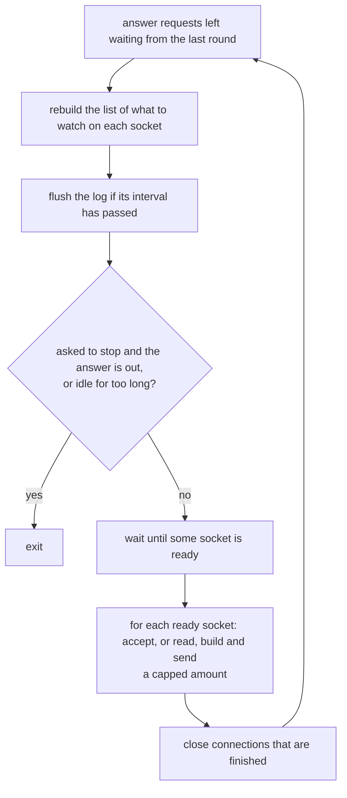
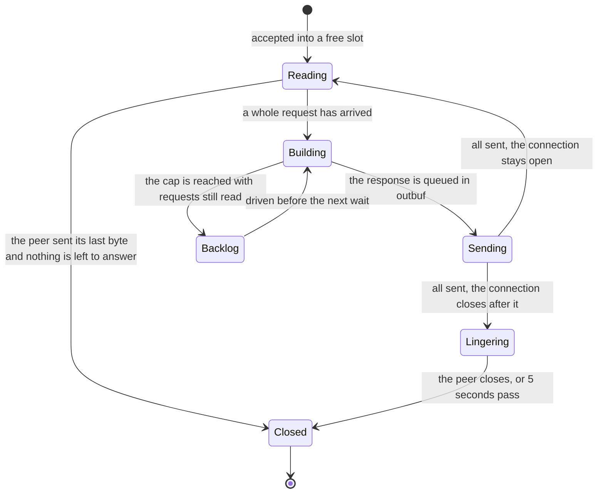

# kssrv — the design

kssrv (Kanso Server) is an HTTP server written in KSPL on `std`. It is where `ksplc` and `std` meet a real run: a program that stays up and answers requests without end. This document holds its decisions and their grounds. Starting it is in [kssrv](../README.md), what a client can ask for in [`SPEC-api.md`](SPEC-api.md), and what is left in the "kssrv" section of [`docs/PLAN.md`](../../docs/PLAN.md).

## The command line and the two modes

Kssrv runs either as a *local* server for one person's browser (`--local`) or as an *outward-facing* server anyone on the network can reach. Everything else about it is set on the command line.

### The CLI takes positional arguments and named options only

**No setting comes from an environment variable.** Two ways into the settings would let a server run under a value nobody can see (Principle 5). The port is read by `to_i64`, which takes only a whole number, so trailing rubbish is not let through silently.

Caution: **Read the options by name.** Told apart by the argument count, the premise "the third must be `--local`" breaks silently once there are two options.

`--page` names the file returned for `/`, which can lie outside the root (the folder the server serves). It is the agreement's one exception. The rule is "Where it listens" in [`../../docs/SPEC-local-server.md`](../../docs/SPEC-local-server.md). The reason is "A page asks the local machine through one protocol" in [`../../docs/DESIGN-repository.md`](../../docs/DESIGN-repository.md).

### Local use and outward-facing use are split by one decision

The one flag `--local` sets three things together, and the body cap follows it, so no unsafe mix of them can be written.

| What it decides | Local use (`--local`) | Outward-facing use |
| :-- | :-- | :-- |
| The address it listens on | `127.0.0.1` only (the *loopback*: this machine alone) | every address (`0.0.0.0`) |
| A token needed on each request | yes (a secret string made at start-up) | no |
| The file endpoints (`/api/file`, `/api/stat`) | exist | answer **404** |
| The cap on a request's body | large: files are written back through it | small: each connection holds its part-read body |

**They are not separate options.** Made separate, "facing outward, no token needed, file endpoints open" becomes writable, and a combination that can be written is written eventually.

**Facing outward, the file endpoints answer 404 rather than 401.** A 401 ("you need to log in") would tell the client that a token would open something. What is not there is answered as not there.

How the token is made, passed on and compared is in the agreement ("How the token gets across" in [`../../docs/SPEC-local-server.md`](../../docs/SPEC-local-server.md)).

**The server checks the Host and token as soon as the request head arrives.** `http.parse_request_head` shares the complete reader's validation. A refused request never waits for its declared body. The page needs no token only for GET or HEAD with no body. Before a head is accepted, each socket read returns to the parser. A read can include body bytes, but the server checks the head before collecting further chunks.

## One thread, many connections

Kssrv serves every client from one thread. It never waits on one client; it asks the operating system which sockets are ready and does a little work on each.

**The limits below are named by their constants, not by their values.** The values are what a client relies on, so they stand only in "What a client can rely on" in [`SPEC-api.md`](SPEC-api.md). `make test-conventions` holds them to the constants.

One round of the loop goes like this (the accept loop in `main` in `kssrv/main.kspl`):

And this is the life of one connection:

### Memory robustness comes first

In a long-running server, a leak or a double free is worse than a little hidden work. A connection's memory is reached from the reactor's table and from the code handling it, so `Rc<|Conn|>` holds it (below). The rest is freed by `defer` and arenas, as everywhere in Kanso. Seeing when ARC's hidden `retain`/`release` runs ([W0601]) matters less here, so kssrv leaves it off; a real-time system turns it on.

### Every socket is non-blocking and multiplexed on one thread

A *non-blocking* socket returns at once when it has nothing to give, instead of making the program wait. `std/reactor` watches whether each of them is ready (readable or writable), all together; this is *multiplexing*.

**A blocking read or write cannot be used**: waiting partway through one connection would stop every other. Instead:

* **Receiving** validates the head once, then waits for the declared byte count before parsing the complete request.
* **Sending** builds the bytes with `http.format_response`, and `Conn` holds how far it has sent.

**The interests (readable or writable) are rebuilt before every wait** (`reactor.clear`, then registration). Kept by difference, they can leave a closed peer registered, or a connection never switched back from part-sent to part-read.

Caution: **Watch writable only while part-sent.** A socket whose send buffer is empty is always writable. Watched permanently, it makes `wait()` return at once, over and over, burning the CPU.

### The connection table is fixed-length; free slots are zero handles

The table is one `Rc<|Conn|>[max_conns]` (`MAX_CONNS` in `kssrv/conn.kspl`), indexed by `reactor`'s token (the number it gives each socket). `Rc` is a reference-counted handle (ARC: the memory is freed when the last handle goes). A free slot is `Rc.empty()`, an ARC handle's zero value, told apart by `is_empty()`.

* **Why fixed-length**: concurrent connections need a cap anyway, or memory grows with the number of peers. A capped table need not grow, and going from token to slot is one subscript.
* **Why `Rc`**: each occupied slot owns an allocated connection; an empty slot owns nothing. Read, build and send borrow from the slot, which only the outer loop drops, after the driver returns. So those phases carry no ownership transitions of their own.
* **`Rc<|Conn|>` looks after the memory's lifetime and nothing else.** `table_drop` calls `conn_close` to free the socket, arena, buffers and file before emptying the slot. Shutdown drops every remaining slot through the same path before the table is released.

### Each connection holds an arena, rewound per request

An *arena* is a block of memory handed out piece by piece and freed all at once by rewinding it. Several requests are in flight at once, so one shared arena cannot be rewound without throwing away what other connections are using. Each connection has its own, `restore`d when a request finishes. The response has already been copied into the heap-side `outbuf`, so rewinding loses nothing.

### Memory is checked by the server's own heap count

**`/api/status` reports `heap_bytes`, the bytes the server holds on its heap** (`mem.heap_used_bytes`). The run `memory` (`kssrv/tests/memory.kspl`) checks that it comes back to its figure after each wave of clients that misbehave.

**The count, not the resident size the OS reports.** The resident size moves with the allocator's caching, which no wave of clients decides. A check on it either fails at random or allows enough slack to hide one connection's memory leaked per wave. The count moves only with what the server holds, so the check asks for the same figure on every platform. What it does not see is memory held outside the allocator: the OS's socket buffers and the C library's own.

### A response is split into 'building' and 'sending'

`queue_*` only appends to `outbuf` and never touches the socket.

Caution: **Do not let the building code write to the socket.** When not everything can be sent, nobody would own how far it got.

### One readiness notification drives a capped amount of work

Each time a socket is reported ready, kssrv does only a limited amount of work on it, so one busy client cannot starve the others.

| What is capped | By what |
| :-- | :-- |
| `read`'s repeats, and the requests handled in a row | `max_read_rounds` |
| The bytes held part-read | `http.MAX_HEAD_BYTES` plus the body cap |

(`conn_read` in `kssrv/main.kspl`.)

Caution: **Without a cap, one client that keeps sending makes everyone else wait.** Bytes not yet read stay in the socket and come back as readable at the next `wait()`.

**Requests already read do not come back**: no notification comes for bytes already in `inbuf`. A client can send several requests in one write (*pipelining*). So a connection the cap stops with requests left is marked (`backlog` in `kssrv/conn.kspl`). The loop drives it before the next `wait()`, which then does not sleep (`drive_backlog` in `kssrv/main.kspl`). Unmarked, a client that sent more requests in one write than the cap waits forever for the rest. One that then closes its sending side is swept away with them unanswered. nginx does the same with a pipelined request left in its buffer: it queues the connection to run again after the events at hand.

**A connection with a backlog is not read further** until the backlog is answered. So a client's later requests wait in TCP's window (the data the OS holds for the socket) rather than piling up in `inbuf`.

Note: The check is "requests past the cap in one write are all answered" in `kssrv/tests/main.kspl`, once with the sending side left open and once closed.

### With no free slot, a new connection is closed

With no free slot, an accepted connection is closed without a response. Making it wait would mean tracking who is waiting, since when, and how many.

* **The refusal is not silent.** The log says once that every slot is taken, and again when one comes free, with how many were refused meanwhile; `/api/status` counts them (`connections_refused`). A line per refusal would let a flood bury the log.

### A connection that passes nothing for a while is dropped

**A connection that has neither sent nor received a byte for `idle_conn_us` is closed** by `sweep_done` (`moved_us` in `kssrv/conn.kspl`). Without it, a client that connects and goes quiet holds its slot for good, and `MAX_CONNS` such clients shut everyone else out.

* **A page's hold is exempt** (`GET /api/here`, `holding`): it is quiet by design, and closing it would read as the page having gone.
* **The clock restarts on every byte either way**, so a slow but moving transfer is not cut.

### A request has a deadline from its first byte

**A request still arriving `request_time_us` after its first byte is closed** by `sweep_done` (`request_since_us` in `kssrv/conn.kspl`). **A request must arrive whole within that deadline.** The idle timer alone does not bound it, because it restarts on every byte. So a client that sends one byte every few seconds holds its slot for good. `MAX_CONNS` such clients shut everyone out (the attack called Slowloris).

* **One deadline for the head and body together.** The bodies taken are small (`max_request_body` facing outward), so a client that can send at all sends one well within it. A minimum rate would add a second figure to tune for no case kssrv meets.
* **The clock starts at the request's first byte**, not at accept, so a keep-alive connection waiting between requests is the idle timer's to judge.

### One address holds only a few connections, facing outward

**A connection from an address that already holds `max_conns_per_peer` is closed at accept**, as one at the table's cap is, and counted with them (`connections_refused`). Without it one machine takes every slot, however short the time it can hold each. A browser opens six per host, so the cap is set to leave room for a few behind one address (a NAT). With `--local` every peer is this machine, so only the table's cap applies.

**Accepting comes last in each wakeup**, after its closes and the sweep (`accept_all` in `kssrv/main.kspl`). Accepted first, a connection already gone still counts against its address and the table's cap. So a client that closes one and reconnects at once is refused.

### Parsing waits until there is something new to decide

**`conn_build` checks the head once it ends** (`head_decided`). It checks local authorization before waiting for the declared body (`need`). `http.parse_request_head` supplies the head size and body length through the same parser as `http.parse_request`. Temporary head allocations are released before waiting. Once the body arrives, the complete reader supplies the request. This avoids reparsing on every incoming byte.

### A file is sent in chunks as the connection drains

**A file's body is read 16 KiB at a time as `outbuf` empties** (`queue_file`, `refill_from_file`), so a connection holds one chunk, not the file. Read whole, 128 slow readers of a large file held 128 copies of it, enough to run the server out of memory. The head names the size `stat` gave. A file that shrinks meanwhile ends the connection short, which tells the client the body is cut. The server does not pad it with bytes that are not the file. The chunks per notification are capped, as reads are, so one fast download does not make the others wait.

### A name starting with a dot is not served

**A path with a name starting with `.` at any level answers 404**, as if absent (`hides_name` in `kssrv/main.kspl`). A root that is a checkout or holds settings has `.git/` and `.env`, and anyone the server faces could read them. **`.well-known` is served** (RFC 8615): certificate issuance and other discovery protocols read under it.

### `read` returning 0 does not mean the connection is over

**A TCP connection has two directions, and `read`'s 0 only means the client closed its sending side** (a *half-close*). It can still be waiting for the response, with its receiving half open. A client can close its sending side once it has nothing more to send. Closing the connection there would lose the part of the answer still unsent, and the client would wait forever on a request that never completes.

**A half-closed connection is kept until nothing is left to send.**

* `peer_done` is raised, and the connection is not read again (EOF would come back as readable every time).
* Caution: **Do not watch it for readable.** `wait()` would return at once, over and over, burning the CPU. Once there is something to send, it is watched for writable.
* **Put the decision to close in one place** (`sweep_done`). No notification will come, so nothing else decides it, and without it the slot stays filled.

**Decide it by `read`'s answer, not by the event mark.** POSIX's `poll` shows a half-close only as `POLLIN`, while `WSAPoll` (Windows) raises `POLLHUP`. Folding `POLLHUP` into "it became unusable" would set off the chain above on Windows alone. `std/reactor` keeps the two marks apart (`ERR_OR_CLOSED`, `HANGUP`). kssrv reads even on `HANGUP` until `read` returns 0, so the environment need not be checked. `make test-conventions` checks that the marks agree on both platforms.

Note: The check is in `keepalive_cases` in `kssrv/tests/main.kspl` (it closes only the sending side after a request, and waits for the answer to come through).

### A connection reads what the peer sends after the answer

**Before closing a connection after its last answer, kssrv closes its sending side. It then keeps reading and throwing away what the client still sends.** This goes on until the client closes or `LINGER_US` (5 seconds) passes (`lingering_since_us` in `kssrv/conn.kspl`, `conn_read` and `sweep_done` in `kssrv/main.kspl`). The same reader handles both phases with the same fairness cap and socket-error rules. Only a request read is buffered, and only a lingering EOF finishes the connection.

**Closing the socket with the peer's bytes unread makes the OS answer with a reset** (a TCP RST, which aborts the connection). The usual case is a client still sending a body past the cap, refused with a 413 as soon as the head names its length. On Windows a reset throws away what the client has received and not yet read. So the client sees a broken connection in place of the 413. On Linux the 413 survives, so the loss shows on Windows alone. nginx and Apache read on after their last answer for the same reason.

* **A lingering connection counts as closed for `open_serial`**: its answer is all sent, so a stop asked on it does not wait out the linger.
* **The time is capped**, so a peer that never stops sending cannot hold a slot.

Note: The check is "after a 413 it reads the rest of the body rather than resetting" in `kssrv/tests/main.kspl`. It sends the rest of the body after reading the 413, which a reset refuses.

### The server stops when no page is holding it

**`--idle=<seconds>` stops the server once no page has held it and nothing has been asked for that long.** The rule is "Keeping the server alive while a page is open" in [`../../docs/SPEC-local-server.md`](../../docs/SPEC-local-server.md). Why a held connection, and not a timer, is in "A page asks the local machine through one protocol" in [`../../docs/DESIGN-repository.md`](../../docs/DESIGN-repository.md). Without the option the server stays up. Facing outward no page holds it, and a server told nothing must not stop itself.

Caution: **Stamp the clock for every request, in one place** (`queue_for_request` in `kssrv/main.kspl`). Stamped per entry point, the next one added is the one forgotten.

Caution: **Stamp it too when a page lets go of its hold** (`table_drop` in `kssrv/conn.kspl`). A page sends nothing while it holds the server. Suppose the wait counted from its last request alone. Then a page held open longer than the wait would stop the server the moment it closed. A reload would find no server.

`kssrv/tests/main.kspl` tests both halves ("a page holding it keeps it up past the wait" and "it stops itself once nothing holds it"). **Both are needed**: with only the second, a server that never stayed up would pass. A third check is "it waits the whole time after the last page lets go". It holds the page past the wait, so it fails where the wait counts from the last request.

### The server stops when asked, once the answer is out

**`POST /api/stop` marks the connection that asked, and the accept loop stops once that connection is gone** (`stop_asked_by` / `open_serial` in `kssrv/conn.kspl`). A connection is dropped only after its last byte is sent, so the answer is out before the listener closes. Stopping inside the handler would close the socket with the answer still queued, and the asker would see a broken connection. The rule is "Stopping it when asked" in [`../../docs/SPEC-local-server.md`](../../docs/SPEC-local-server.md). Why it is a request and not a signal is in "A page asks the local machine through one protocol" in [`../../docs/DESIGN-repository.md`](../../docs/DESIGN-repository.md).

`kssrv/tests/main.kspl` tests both halves ("a refused stop leaves it answering" and "it stops once it has answered"), for the same reason as the idle stop.

## Files and the API

Kssrv serves files from under its root and answers JSON under `/api/`. Every path is checked so that no request reaches a file outside the root.

### The path is checked after the decode

**The path part of the request target is *percent-decoded* (`%2e` becomes `.`) once, by `url.decode_component`.** **Only then does `fs.stays_under` check that it stays under the root. The order is everything.** Checked first, `%2e%2e` passes the check and then becomes `..`, returning a file outside the root. A test with a raw `..` alone would not notice, so the regression in `kssrv/tests/main.kspl` sends encoded strings too.

Caution: **Decode a path with `decode_component`, which keeps a `+`.** `+` means a space only in a query or a form (`parse_query` reads it so). In a URI's path it is just a `+`, and mistaking one for the other makes a file with `+` in its name unreachable.

**A refused path returns 403, not 404.** What was refused is the path's shape; whether a file of that name exists was never checked. `sys.is_safe_relative` also refuses spellings the OS reads specially, Windows device names among them. A read or write of `COM1` never returns when nothing is attached, so one request would stop this single-loop server.

### `/api/` does not go through static serving

Everything under `/api/` is dispatched by the routing table alone, so the API takes priority even over a directory named `api` under the root.

**Every answer under `/api/` is JSON, a refusal's included**, so a client of the API reads one form:

| Request | Answer |
| :-- | :-- |
| A method the route does not name (HEAD among them) | a JSON 405 from the table |
| A `Host` that does not name the server (`--local`) | a JSON 403 there |
| A request that cannot be read at all | text, since its path is not known yet |

Caution: **Do not check only one of the two.** An API taking a path in the query, such as `?path=`, goes through the same `sys.is_safe_relative` as static serving. It is a different entry point, but pointing outside the root is the same hole.

### The counters are held in plain global variables

The counters `/api/status` returns (uptime, requests, connections) sit in one `priv $stats`. On a one-thread server, handling a connection and reading the counters happen in the same loop, so no synchronization (locking) is needed.

### No process is started

**kssrv starts no program on a request.** The rule is "Only four things can be asked for" in [`../../docs/SPEC-local-server.md`](../../docs/SPEC-local-server.md). The reason is in [`../../docs/DESIGN-repository.md`](../../docs/DESIGN-repository.md), under two headings:

* "A page asks the local machine through one protocol";
* "No program is started", inside it.

## The log

Every log line goes through one buffered logger on the server's one thread. The buffer is written out at most every 0.2 seconds, except for start-up lines, errors and warnings.

### The log is flushed at fixed intervals, not per line

`stdout` stays buffered and is flushed just before `wait()`, **once `FLUSH_GAP_US` has passed since the last flush** (`kssrv/main.kspl`).

* **Only the start-up lines are written at once**, before the loop, because whoever waits for the server watches for them. `kssrv/tests/start.kspl` waits for `kssrv: I: listening on`, and an opener that starts the server for `kssrv: I: open `.
* **An idle server still flushes a new line in the same round**, since an arriving connection makes `wait()` return at once.
* **A busy one is limited by the interval.**

Caution: **Do not flush per line.** A flush blocks the accepting thread and happens twice per connection (accepted, closed), so a slow destination stalls static serving. The interval cuts the accepting thread's writes for the same log by more than an order of magnitude. A flush costs far more on Windows than on Linux, where a flush per line shows first. No gate measures this; it is kept by reading.

**A line that must show in the log after a crash is written at `error` or `warning`.** `std/log` writes a line of either severity out the moment it closes ("Error and warning lines are flushed at once" in [`../../std/docs/DESIGN-core.md`](../../std/docs/DESIGN-core.md)).

**A line written through `at` stays open until the next one starts.** Every way out of `main` runs `done` (the logger's `defer`), so the lines before a crash are written before the process ends. The accept loop's `accept failed` and `poll failed` do not end it: the loop goes on, and they close with the next line or at the flush interval.

### One buffered logger

Every line goes through one `std/log` logger, made by `prog.log_new()` and passed on. **It writes to `io.out()`** for the flush discipline above. `io.err()` is unbuffered, so a connection's two lines would each cost a call on the accepting thread.

**No logging thread is added, and none is needed.** `std/log` is a struct over a `Writer` that writes on the caller's thread, and kssrv has one thread. So every line is written without a lock, which is also what the counters rely on.

Caution: **Do not write from a second thread.** A logger used from two threads cuts a line in two, since a line stays open until the next one starts.

**Do not hold the logger in a file-level variable.** `Log`'s fields belong to `std/log`, so what could be held is a null pointer filled in later. That is a server that is up but perhaps unable to speak, which the command-line decision at the top refuses.

The usage text is not a log line: it has no severity and is always printed, so it stays a plain write to `io.err()`.

## The car

The car (a small robot car that drives itself) takes its driving policy from kssrv as a plain file, `pilot_policy.safetensors`, once at start-up. kssrv has no endpoint for the car, and it trains nothing.

### The car carries its policy, handed out as a file

**The car decides every manoeuvre itself, and it keeps its own safety stops.** A car that asked the server on every round could decide nothing once the link dropped. Also, each round of its control loop would have to hold a network round trip.

**The policy is trained offline, before the server starts, and kept as a file.** So:

* kssrv starts at once in both modes, and it needs no AI engine.
* The file the car drives on is the file that is kept. A copy trained again at each start could differ from the kept one, and a test would have to compare the two.
* Any server that hands out files serves the car, kssrv among them.

