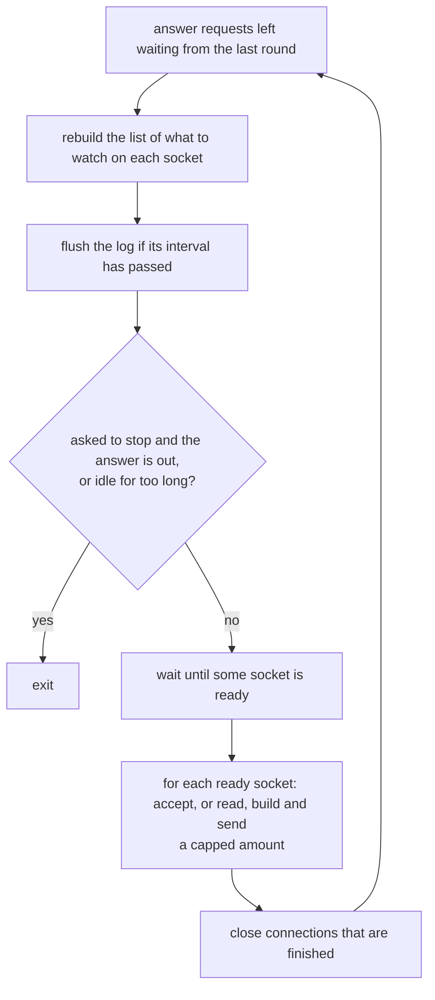
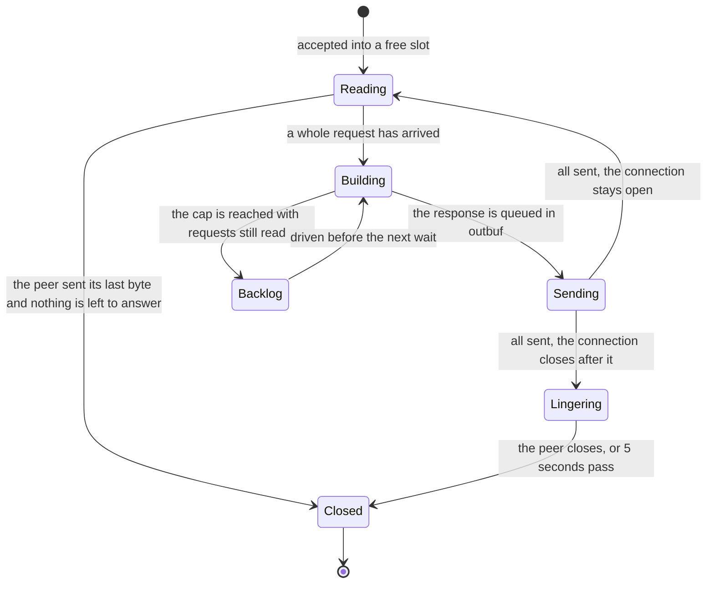

# kssrv — the design

kssrv (Kanso Server) is an HTTP server written in KSPL on `std` and `ksai`. It is where `ksplc` and `std` meet a real run: a program that stays up and answers requests without end. This document holds its decisions and their grounds. Starting it is in [kssrv](../README.md), what a client can ask for in [`SPEC-api.md`](SPEC-api.md), and what is left in [`PLAN.md`](PLAN.md).

## Contents

* [The command line and the two modes](#the-command-line-and-the-two-modes)
* [One thread, many connections](#one-thread-many-connections)
* [Files and the API](#files-and-the-api)
* [The log](#the-log)
* [The car](#the-car)

---

## The command line and the two modes

Kssrv runs either as a *local* server for one person's browser (`--local`) or as an *outward-facing* server anyone on the network may reach. Everything else about it is set on the command line.

### The CLI takes positional arguments, and options read by name, and nothing else

**No setting comes from an environment variable.** Two ways into the settings would let a server run under a value nobody can see (Principle 5). The port is read by `to_i64`, which takes only a whole number, so trailing rubbish is not let through silently.

Caution: **Read the options by name.** Told apart by the argument count, the premise "the third must be `--local`" breaks silently once there are two options.

`--page` names the file returned for `/`, which may lie outside the root (the folder the server serves). It is the agreement's one exception: the rule is "Where it listens" in [`../../docs/SPEC-local-server.md`](../../docs/SPEC-local-server.md), and the reason is "13.10 A page asks the local machine through one protocol" in [`../../docs/DESIGN.md`](../../docs/DESIGN.md).

### Local use and outward-facing use are split by one decision

The one flag `--local` sets four things together, and the body cap follows it, so no unsafe mix of them can be written.

| What it decides | Local use (`--local`) | Outward-facing use |
| :-- | :-- | :-- |
| The address it listens on | `127.0.0.1` only (the *loopback*: this machine alone) | every address (`0.0.0.0`) |
| A token needed on each request | yes (a secret string made at start-up) | no |
| The file endpoints (`/api/file`, `/api/stat`) | exist | answer **404** |
| The car's endpoints | answer **404**; no steering policy is trained | exist |
| The cap on a request's body | large: files are written back through it | small: each connection holds its part-read body |

**They are not separate options.** Made separate, "facing outward, no token needed, file endpoints open" becomes writable, and a combination that can be written is written eventually.

**Facing outward, the file endpoints answer 404 rather than 401.** A 401 ("you need to log in") would tell the client that a token would open something. What is not there is answered as not there.

**For local use, the car's endpoints answer 404 too, and no steering policy is trained** (`Reach` in `kssrv/api.kspls`). Local use listens on the loopback, which the car cannot reach. A page opening a document would otherwise wait on the training at every start.

How the token is made, passed on and compared is in the agreement ("How the token gets across" in [`../../docs/SPEC-local-server.md`](../../docs/SPEC-local-server.md)).

**The body cap is checked as soon as the head names the length, but the token only once the whole request has arrived.** So a client without a token can make the server hold the connection cap × the body cap (over 500MB for local use). Checking the token earlier needs `std/http` to pass on a head whose body has not arrived. That cost is not paid in advance, since local use listens on the loopback alone. The stage is in [`PLAN.md`](PLAN.md).

## One thread, many connections

Kssrv serves every client from one thread. It never waits on one client; it asks the operating system which sockets are ready and does a little work on each.

One round of the loop goes like this (the accept loop in `main` in `kssrv/main.kspls`):

And this is the life of one connection:

### Memory robustness comes first

Kssrv prefers reference-counted memory to memory it frees by hand, because a leak or a double free in a long-running server is worse than a little hidden work.

`kssrv/ksplc.cfg` sets `I0603 = on`, the lint that points out hand-made ownership (a raw pointer plus one's own `free`). A resident process that keeps handling other people's input ranks avoiding that hand-rolled ownership management ([I0603]) above seeing when the hidden `retain`/`release` of ARC runs ([W0602], the lint a real-time system turns on instead).

### Every socket is non-blocking and multiplexed on one thread

A *non-blocking* socket returns at once when it has nothing to give, instead of making the program wait. `std/reactor` watches whether each of them is ready (readable or writable), all together; this is *multiplexing*.

**The blocking `http.read_request` / `http.write_response` cannot be used**: waiting partway through one connection would stop every other. Instead:

* **Receiving** applies `http.parse_request` to the part-read buffer each time more arrives. `Http_error.incomplete` means "wait for more".
* **Sending** builds the bytes with `http.format_response`, and `Conn` holds how far it has sent.

**The interests (readable or writable) are rebuilt before every wait** (`reactor.clear`, then registration). Kept by difference, they can leave a closed peer registered, or a connection never switched back from part-sent to part-read.

Caution: **Watch writable only while part-sent.** A socket whose send buffer is empty is always writable. Watched permanently, it makes `wait()` return at once, over and over, burning the CPU.

### The connection table is fixed-length, and a free slot is an ARC handle's zero value

The table is one `Rc<|Conn|>[max_conns]` (`max_conns` in `kssrv/conn.kspls`), indexed by `reactor`'s token (the number it gives each socket). `Rc` is a reference-counted handle (ARC: the memory is freed when the last handle goes). A free slot is `Rc.empty()`, told apart by `is_empty()`.

* **Why fixed-length**: concurrent connections need a cap anyway, or memory grows with the number of peers. A capped table need not grow, and going from token to slot is one subscript.
* **Why `Rc`**: a connection can be closed partway through handling its notification (the response cannot be written, or the request is broken). Closing empties the slot, but a call that took the handle by value keeps the memory alive. So no hand-built "mark it dead and sweep it later" is needed.
* **`Rc<|Conn|>` looks after the memory's lifetime and nothing else.** `conn_close` returns the socket, the arena and the two buffers explicitly (releasing an `Rc` does not follow what it points at).
* Caution: **Do not put a field holding an ARC by value on `Conn`.** For the same reason it leaks silently.

### Each connection holds an arena, rewound per request

An *arena* is a block of memory handed out piece by piece and freed all at once by rewinding it. Several requests are in flight at once, so one shared arena cannot be rewound without throwing away what other connections are using. Each connection has its own, `restore`d when a request finishes. The response has already been copied into the heap-side `outbuf`, so rewinding loses nothing.

### Memory is checked by the server's own heap count

**`/api/status` reports `heap_bytes`, the bytes the server holds on its heap** (`mem.heap_used_bytes`). The run `memory` (`kssrv/tests/memory.kspls`) checks that it comes back to its figure after each wave of clients that misbehave.

**The count, not the resident size the OS reports.** The resident size moves with the allocator's caching, which no wave of clients decides. A check on it either fails at random or allows enough slack to hide one connection's memory leaked per wave. The count moves only with what the server holds, so the check asks for the same figure on every platform. What it does not see is memory held outside the allocator: the OS's socket buffers and the C library's own.

### A response is split into 'building' and 'sending'

`queue_*` only appends to `outbuf` and never touches the socket.

Caution: **Do not let the building code write to the socket.** When not everything can be sent, nobody would own how far it got.

### One readiness notification drives a capped amount of work

Each time a socket is reported ready, kssrv does only a limited amount of work on it, so one busy client cannot starve the others.

| What is capped | By what |
| :-- | :-- |
| `read`'s repeats, and the requests handled in a row | `max_read_rounds` |
| The bytes held part-read | `http.max_head_bytes` plus the body cap |

(`conn_read` in `kssrv/main.kspls`.)

Caution: **Without a cap, one client that keeps sending makes everyone else wait.** Bytes not yet read stay in the socket and come back as readable at the next `wait()`.

**Requests already read do not come back**: no notification comes for bytes already in `inbuf`. A client can send several requests in one write (*pipelining*). So a connection the cap stops with requests left is marked (`backlog` in `kssrv/conn.kspls`). The loop drives it before the next `wait()`, which then does not sleep (`drive_backlog` in `kssrv/main.kspls`). Unmarked, a client that sent more requests in one write than the cap waits forever for the rest. One that then closes its sending side is swept away with them unanswered. nginx does the same with a pipelined request left in its buffer: it queues the connection to run again after the events at hand.

**A connection with a backlog is not read further** until the backlog is answered. So a client's later requests wait in TCP's window (the data the OS holds for the socket) rather than piling up in `inbuf`.

Note: The check is "requests past the cap in one write are all answered" in `kssrv/tests/main.kspls`, once with the sending side left open and once closed.

### With no free slot, a new connection is closed

With no free slot, an accepted connection is closed without a response. Making it wait would mean tracking who is waiting, since when, and how many.

### `read` returning 0 does not mean the connection is over

A TCP connection has two directions. When `read` returns 0, the client has only stopped sending; it may still be waiting to receive the answer.

**`read`'s 0 only means the peer closed its sending side** (a *half-close*). It may still be waiting for the response, with its receiving half open: a client may close its sending side once it has nothing more to send. Closing the connection there would lose the part of the answer still unsent, and the client would wait forever on a request that never completes.

**A half-closed connection is kept until nothing is left to send.**

* `peer_done` is raised, and the connection is not read again (EOF would come back as readable every time).
* Caution: **Do not watch it for readable.** `wait()` would return at once, over and over, burning the CPU. Once there is something to send, it is watched for writable.
* **Put the decision to close in one place** (`sweep_done`). No notification will come, so nothing else decides it, and without it the slot stays filled.

**Decide it by `read`'s answer, not by the event mark.** POSIX's `poll` shows a half-close only as `POLLIN`, while `WSAPoll` (Windows) raises `POLLHUP`. Folding `POLLHUP` into "it became unusable" would set off the chain above on Windows alone. `std/reactor` keeps the two marks apart (`err_or_closed`, `hangup`). kssrv reads even on `hangup` until `read` returns 0, so the environment need not be checked. `make test-conventions` checks that the marks agree on both platforms.

Note: The check is in `keepalive_cases` in `kssrv/tests/main.kspls` (it closes only the sending side after a request, and waits for the answer to come through).

### A connection that closes after its answer reads what the peer still sends

Before closing, kssrv keeps reading and discarding what the client still sends, for up to 5 seconds. Otherwise Windows would destroy the answer the client has not read yet.

**After the last answer on a connection that closes, the sending side is closed, and what the peer still sends is read and thrown away**, until the peer closes or `linger_us` (5 seconds) passes (`lingering_since_us` in `kssrv/conn.kspls`, `conn_linger` and `sweep_done` in `kssrv/main.kspls`).

**Closing the socket with the peer's bytes unread makes the OS answer with a reset** (a TCP RST, which aborts the connection). The usual case is a client still sending a body past the cap, refused with a 413 as soon as the head names its length. On Windows a reset throws away what the client has received and not yet read, so the client sees a broken connection in place of the 413. On Linux the 413 survives, so the loss shows on Windows alone. nginx and Apache read on after their last answer for the same reason.

* **A lingering connection counts as closed for `open_serial`**: its answer is all sent, so a stop asked on it does not wait out the linger.
* **The time is capped**, so a peer that never stops sending cannot hold a slot.

Note: The check is "after a 413 it reads the rest of the body rather than resetting" in `kssrv/tests/main.kspls`: it sends the rest of the body after reading the 413, which a reset refuses.

### The server stops when no page is holding it

**`--idle=<seconds>` stops the server once no page is holding it and nothing has been asked for that long.** The rule is "Keeping the server alive while a page is open" in [`../../docs/SPEC-local-server.md`](../../docs/SPEC-local-server.md). Why a held connection, and not a timer, is in "13.10 A page asks the local machine through one protocol" in [`../../docs/DESIGN.md`](../../docs/DESIGN.md). Without the option the server stays up. Facing outward no page holds it, and a server told nothing must not stop itself.

Caution: **Stamp the clock for every request, in one place** (`queue_for_request` in `kssrv/main.kspls`). Stamped per entry point, the next one added is the one forgotten.

`kssrv/tests/main.kspls` tests both halves ("a page holding it keeps it up past the wait" and "it stops itself once nothing holds it"). **Both are needed**: with only the second, a server that never stayed up would pass.

### The server stops when asked, once the answer is out

**`POST /api/stop` marks the connection that asked, and the accept loop stops once that connection is gone** (`stop_asked_by` / `open_serial` in `kssrv/conn.kspls`). A connection is dropped only after its last byte is sent, so the answer is out before the listener closes. Stopping inside the handler would close the socket with the answer still queued, and the asker would see a broken connection. The rule is "Stopping it when asked" in [`../../docs/SPEC-local-server.md`](../../docs/SPEC-local-server.md); why it is a request and not a signal is in "13.10 A page asks the local machine through one protocol" in [`../../docs/DESIGN.md`](../../docs/DESIGN.md).

`kssrv/tests/main.kspls` tests both halves ("a refused stop leaves it answering" and "it stops once it has answered"), for the same reason as the idle stop.

## Files and the API

Kssrv serves files from under its root and answers JSON under `/api/`. Every path is checked so that no request reaches a file outside the root.

### The path is checked after the decode

The path part of the request target is *percent-decoded* (`%2e` becomes `.`), once, by `url.decode_component`. Only then does `fs.stays_under` check that it stays under the root.

**The order is everything.** Checked first, `%2e%2e` passes the check and then becomes `..`, returning a file outside the root. A test with a raw `..` alone would not notice, so the regression in `kssrv/tests/main.kspls` sends encoded strings too.

Caution: **Use `decode_component`, not `decode_form`.** `+` means a space only in a query or a form. In a URI's path it is just a `+`, and mistaking one for the other makes a file with `+` in its name unreachable.

**A refused path returns 403, not 404.** What was refused is the path's shape; whether a file of that name exists was never checked. `fs.is_safe_relative` also refuses spellings the OS reads specially, Windows device names among them. A read or write of `COM1` never returns when nothing is attached, so one request would stop this single-loop server.

### `/api/` does not go through static serving

Everything under `/api/` is dispatched by the routing table alone, so the API takes priority even over a directory named `api` under the root.

**Every answer under `/api/` is JSON, a refusal's included**, so a client of the API reads one form:

| Request | Answer |
| :-- | :-- |
| A method the route does not name (HEAD among them) | a JSON 405 from the table |
| A `Host` that does not name the server (`--local`) | a JSON 403 there |
| A request that cannot be read at all | text, since its path is not known yet |

Caution: **Do not check only one of the two.** An API taking a path in the query, such as `?path=`, goes through the same `fs.is_safe_relative` as static serving. It is a different entry point, but pointing outside the root is the same hole.

### The counters are held in plain global variables

The counters `/api/status` returns (uptime, requests, connections) sit in one `priv $stats`. On a one-thread server, handling a connection and reading the counters happen in the same loop, so no synchronization (locking) is needed.

### No process is started

**kssrv starts no program on a request.** The file endpoints at worst read and write under the root. A started process would be outside the root check: able to read beyond it, reach the network and write anything, with one token as the whole defence. What would need it (a language server, a plugin) serves writing code, which the page is not for ("No program is started" in "13.10 A page asks the local machine through one protocol" in [`../../docs/DESIGN.md`](../../docs/DESIGN.md)).

## The log

Every log line goes through one buffered logger on the server's one thread, and the buffer is written out at most every 0.2 seconds, except for start-up lines, errors and warnings.

### The log is flushed at a fixed interval rather than per line

`stdout` stays buffered and is flushed just before `wait()`, **once `flush_gap_us` has passed since the last flush** (`kssrv/main.kspls`).

* **Only the start-up lines are written at once**, before the loop, because whoever waits for the server watches for them (`kssrv/tests/start.kspls` for `kssrv: I: listening on`, `kspage/Makefile` for `kssrv: I: open `).
* **An idle server still flushes a new line in the same round**, since an arriving connection makes `wait()` return at once.
* **A busy one is limited by the interval.**

Caution: **Do not flush per line.** A flush blocks the accepting thread and happens twice per connection (accepted, closed), so a slow destination stalls static serving. The interval cuts the accepting thread's writes for the same log by more than an order of magnitude. A flush costs far more on Windows than on Linux, where a flush per line shows first. No gate measures this; it is kept by reading.

**A line that must show in the log after a crash is written at `error` or `warning`.** `std/log` writes a line of either severity out the moment it closes ("Error and warning lines are flushed at once" in [`../../std/docs/DESIGN.md`](../../std/docs/DESIGN.md)).

**A line written through `at` stays open until the next one starts.** Every way out of `main` runs `done` (the logger's `defer`), so the lines before a crash are written before the process ends. The accept loop's `accept failed` and `poll failed` do not end it: the loop goes on, and they close with the next line or at the flush interval.

### One buffered logger

Every line goes through one `std/log` logger, made by `prog.log_new()` and passed on. **It writes to `io.out()`** for the flush discipline above. `io.err()` is unbuffered, so a connection's two lines would each cost a call on the accepting thread.

**No logging thread is added, and none is needed.** `std/log` is a struct over a `Writer` that writes on the caller's thread, and kssrv has one thread. So every line is written without a lock, which is also what the counters rely on.

Caution: **Do not write from a second thread.** A logger used from two threads cuts a line in two, since a line stays open until the next one starts.

**Do not hold the logger in a file-level variable.** `Log`'s fields belong to `std/log`, so what could be held is a null pointer filled in later. That is a server that is up but may or may not be able to speak, which the command-line decision at the top refuses.

The usage text is not a log line: it has no severity and is always printed, so it stays a plain write to `io.err()`.

## The car

Kssrv also steers a toy car over the network. A small neural net, trained at start-up from written rules, picks the car's next move; the car keeps its own safety stops.

### The car's judgement is the server's, and the safety timeout is the car's

The MLP (a small neural net of a few layers) in `kssrv/pilot.kspls` answers `POST /api/car`. It is **trained at start-up with the written rules (`rule_action`) as its teacher**.

* **Why a net**: the point is to show the decision made outside the car; the rules as written would need no PC. The net is not cleverer than the rules. It only shows that a function learned from them runs inside a control loop.
* Caution: **Do not make the rules a runtime escape hatch.** Overriding a disagreement with them makes the net an ornament and the agreement rate meaningless. The rules are only the teacher and the answer key.
* **Measure the agreement rate by stepping end to end, not by random samples.** Disagreements gather in the few tens of mm past the boundaries (150mm and 400mm). As many random samples as training used can show "100%" without touching that band.
* **The agreement rate and the refusal at close range are tested together** (`kssrv/tests/car.kspls`). It needs 95% or more agreement at every stepped point, and no forward motion at an unmeasurable distance or at very close range. The rate alone is not enough: a fix that lowers it must still not tip toward danger.
* **The battery is not a net input.** Stopping on a flat battery is the car's own judgement, like backing off at very close range and stopping when no answer arrives. Once the link drops, the server can do nothing.

### The car's answer is computed on the accepting thread

A few hundred weights take microseconds per forward pass (one run of the net). So answering on the accepting thread stalls no other connection, and handing it to a second thread would stretch the control period by that round trip. After `build()` the policy is read-only and no endpoint rewrites it. **An endpoint that continues training it breaks this premise.**

### The policy shipped is a set that can be reproduced on its own

`GET /api/pilot` sends the car everything it needs to make the same decisions without the server, in one file.

That one safetensors file (a standard format for storing named arrays of numbers) holds not just the weights but **how the features are made (`far_mm`), the manoeuvre table and the format's version**.

* **Why all of it**: with the weights alone, the receiver would keep its own copy of the preprocessing and of the manoeuvres' meaning, and a copy cannot notice when the server's code is fixed. With everything needed to reproduce `decide` and the manoeuvres' meaning in one file, no disagreement arises.
* **Why safetensors**: it is the codebase's one format for storing tensors (`ksai/safetensors`), with reader and writer in place.
* **Why it is not quantized** (stored as smaller, less exact numbers): the weights are about a kilobyte even as F32. int8 would save about three quarters of that at a higher cost: the receiver's answers would drift from the server's. As F32, "the same observation gives the same manoeuvre" can be matched.
* **What tests it: a policy rebuilt from the shipped blob alone returns the same manoeuvre as `POST /api/car` at every swept point** (`kssrv/tests/car.kspls`). Shapes can fit while a drifted preprocessing constant or manoeuvre table changes the answer. The server computes in F32 and the checker in double precision. So points where the top two logits (the net's raw scores) nearly tie are not judged, with a cap on how many (more is itself an anomaly).
* **`command_valid_ms` is not included.** It is how long a car that asks may wait for an answer, which means nothing to a car carrying the policy. That car's timeout is its own.
* **Do not forget to raise the version (`__metadata__.kspl_pilot`).** The feature order, the activation and the manoeuvre table's meaning cannot be told from a tensor's shape. Left unraised, an old reader applies new weights the old way and goes wrong silently, the shapes fitting.
