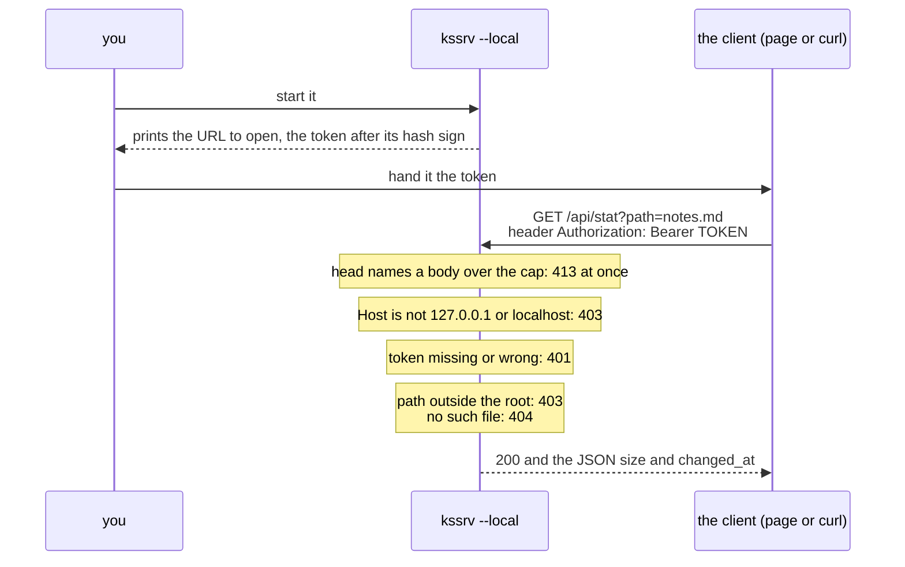

# kssrv — what a client can ask for

**This document is the agreement between the kssrv server and whoever calls it over HTTP.** It sets every request the server answers and what each answer holds, the JSON API under `/api/`, and the limits a caller writes against.

A *client* is any program that sends the server HTTP requests: a browser, `curl`, your own code, or the robot car ("The car's policy file" below). How to start the server is in [`kssrv/README.md`](../README.md).

The endpoints a page opened in a browser uses are set one level up, in [`../../docs/SPEC-local-server.md`](../../docs/SPEC-local-server.md). Where the two documents meet, that one is the canonical source.

**The server runs in one of two modes, picked when it starts**, and several answers below depend on the mode.

| Mode | Started as | Who can reach it | What it offers besides the files |
| :-- | :-- | :-- | :-- |
| Outward-facing | `kssrv.exe <port> <root>`, with `--cert` and `--key` for HTTPS | Any machine on the network | `/api/status` |
| Local use | `kssrv.exe <port> <root> --local` | This machine only. Every request but the page's carries the token it prints at start-up | `/api/status`, and the six endpoints a page uses |

Words used below:

| Word | What it means here |
| :-- | :-- |
| root (`<root>`) | The folder named on the command line. The server hands out the files inside it |
| endpoint | One path under `/api/` that the server answers itself, instead of returning a file |
| head | The request line and the headers, before the body |
| token | A random secret string the server makes and prints when it starts in local mode |

## What it returns

A request for any path outside `/api/` gets a file from the root. The first table shows which file a path gives; the second shows when the server refuses instead.

| Request | Response |
|---|---|
| `GET /` | `<root>/index.html` (a 404 if there is none). With `--page`, that file |
| `GET /index.html` | the same (`--page` swaps these two and nothing else) |
| `GET /a/b.txt` | `<root>/a/b.txt` |
| `GET /sub` (a directory) | `<root>/sub/index.html` |
| `HEAD <any of the above>` | the head alone; `Content-Length` is the real length. **No answer to a HEAD carries a body**, a refusal's included |

| Status | When the server answers it |
|---|---|
| 405 Method Not Allowed | anything but `GET` / `HEAD`; its `Allow` header names `GET, HEAD` |
| 403 Forbidden | a path pointing outside the root |
| 404 Not Found | not found |
| 400 Bad Request | a broken request, a broken `%XX`; plain HTTP on the HTTPS port ("HTTPS" below) |
| 413 Content Too Large | a body over the cap (refused as soon as the head names it) |
| 431 Request Header Fields Too Large | a head past 64 KiB, or more bytes held unanswered on one connection than 64 KiB plus the body cap (64 KiB facing outward, 8 MiB with `--local`) |

A path's `%XX` (one byte as `%` and two hex digits) is decoded once only.

| The path sent | The name looked up | Why |
| :-- | :-- | :-- |
| `/a%20b.txt` | `a b.txt` | `%20` is decoded to a space |
| `/a+b.txt` | `a+b.txt` | **A path's `+` is not a space.** A `+` for a space is the convention of HTML forms (`application/x-www-form-urlencoded`), not of a URI's path |
| `/%252e` | `%2e` | `%25` is decoded to `%`, and the result is not decoded again |

## HTTPS

**Started with `--cert` and `--key`, the port speaks HTTPS only**, and every answer above comes the same over it. The client needs TLS 1.2 or 1.3. Over TLS 1.2, only suites with an ECDHE key exchange and AES-GCM or ChaCha20-Poly1305 are taken.

| What the client does | What it gets |
| :-- | :-- |
| Sends plain HTTP to the HTTPS port | A plain-text 400 whose body says to use `https://`, then the connection closes |
| Ends a connection with `Connection: close` | The answer, then TLS's close_notify, so the stream ends whole |
| Sends no TLS handshake, or only part of one | The connection closes (the handshake's time is in "What a client can rely on" below) |

## The JSON API

Paths that start with `/api/` are not files. The server answers them itself through a routing table, even where a directory under the root is named `api`.

**Every answer under `/api/` is `application/json`, a refusal's included.** A 404 or a 405 there carries a JSON body such as `{"error":"Not Found","status":404}`. No endpoint under `/api/` takes `HEAD`, so `HEAD /api/status` gets a 405 whose head says `Content-Type: application/json` and gives the JSON's length, with no body. Three answers are not JSON:

| Answer | `Content-Type` |
| :-- | :-- |
| `GET /api/file` | bytes, as `application/octet-stream` |
| `GET /api/here` | a head and nothing after it |
| A request that cannot be read at all (the 400, 413 and 431 above) | `text/plain`, since its path is not known yet |

**An endpoint asked for in the other mode answers 404**, as if it did not exist.

In both modes:

| Method | Path | What it does | Answers |
| :-- | :-- | :-- | :-- |
| `GET` | `/api/status` | Reports how the server is doing | the fields in the table below the example |

```console
$ curl -s localhost:8080/api/status
{"root":"","local":false,"conditional_writes":false,"uptime_s":1802,"requests":45001,
 "connections_total":501,"connections_open":1,"connections_refused":0,"max_connections":128,
 "heap_bytes":86692}
```

| Field | What it holds |
| :-- | :-- |
| `uptime_s` | the uptime in seconds |
| `requests` | the requests handled |
| `connections_total` / `connections_open` / `max_connections` | the connection counters |
| `heap_bytes` | the bytes the server holds on its heap |
| `local` | whether it is for local use |
| `root` | the root's path, only for local use. Empty facing outward, where it would tell anyone the machine's layout |

For local use only (the page's endpoints; their rules are in [`../../docs/SPEC-local-server.md`](../../docs/SPEC-local-server.md)):

| Method | Path | What it does | Answers |
| :-- | :-- | :-- | :-- |
| `GET` | `/api/file?path=<p>` | Reads a file | that file's byte sequence |
| `PUT` | `/api/file?path=<p>` | Writes the body to that name | `{"wrote":<byte count>}` |
| `GET` | `/api/stat?path=<p>` | Tells whether a file changed | the size and the last modification |
| `GET` | `/api/list?path=<p>` | Lists the names in one folder, for a Save As dialog | `{"folders":[…],"files":[…],"more":false}`, links and hidden names left out |
| `GET` | `/api/here` | Keeps the server alive while a page is open | a head naming no length, then nothing until the client closes ("Keeping the server alive while a page is open" in [`../../docs/SPEC-local-server.md`](../../docs/SPEC-local-server.md)) |
| `POST` | `/api/stop` | Stops the server | `{}`, then the server stops |

Anything else under `/api/`:

| Request | Answers |
| :-- | :-- |
| a method not named above for its path | `{"error":"Method Not Allowed","status":405}`, with an `Allow` header naming the path's methods (`GET, PUT` for `/api/file`) |
| any other `/api/...` | `{"error":"Not Found","status":404}` |

**Facing outward, no endpoint lists a folder.** A listing would hand anyone the names under the root.

### The file endpoints for local use

Started with `--local`, the server lets a program on the same machine read and write files under the root. Each request carries the token in the header `Authorization: Bearer <token>`.

**`path=<p>` names a place relative to the root.** An absolute path, in any operating system's spelling (`/etc/passwd`, `C:\x`, `\\server\share\x`), is refused with 403 on every OS.

```console
$ ./out/kssrv.exe 8080 ./public --local
kssrv: I: listening on 127.0.0.1:8080, root=./public
kssrv: I: open http://127.0.0.1:8080/#t=0123456789abcdef0123456789abcdef0123456789abcdef

$ T=0123456789abcdef0123456789abcdef0123456789abcdef
$ curl -s -H "Authorization: Bearer $T" 'localhost:8080/api/stat?path=notes.md'
{"size":19,"changed_at":1787746013}

$ curl -s -H "Authorization: Bearer $T" -X PUT --data-binary @notes.md \
    'localhost:8080/api/file?path=notes.md'
{"wrote":19}
```

Caution: **The token above is a sample. Do not paste a token you ran into a document**: a reader would take it as a value to paste.

The diagram follows one request, and shows which refusal comes from which check. The statuses are the ones in "How it refuses" in [`../../docs/SPEC-local-server.md`](../../docs/SPEC-local-server.md).



**These endpoints are the protocol's, and their rules stand there.** They cover the token, why there is no `HEAD`, the type a file comes back as, and how a write keeps the original whole. They are "How the token gets across" and "Only four things can be asked for" in [`docs/SPEC-local-server.md`](../../docs/SPEC-local-server.md).

## The car's policy file

The small robot car takes its driving policy from kssrv once, at start-up, as a plain file. It asks for `GET /pilot_policy.safetensors`, so kssrv serves the folder that holds that file, as any other file under the root.

```console
$ ./out/kssrv.exe 8080 <the folder that holds pilot_policy.safetensors>
$ curl -s -o pilot.safetensors localhost:8080/pilot_policy.safetensors
```

The steps for connecting the car (a Freenove 4WD mecanum car and a Pico W) are in Phase 3 of [What works, and how far](../../README.md#-what-works-and-how-far). kssrv does not know the file's contents.

The `Content-Type` is looked up from the extension. **An extension it does not know is made `application/octet-stream`, not guessed at.** A receiver believes a wrong type and reads the content another way. No type is registered for safetensors, so the policy file is returned this way.

## What a client can rely on

These hold for every connection, in both modes.

| | What holds |
| :-- | :-- |
| The connection | **Kept, as HTTP/1.1's default calls for** (keep-alive: one connection carries many requests). It closes where `close` is among the client's `Connection` tokens, where an HTTP/1.0 client did not list `keep-alive` there, and after an error response |
| At the cap | **128 connections are held at once.** One arriving at the cap is closed at once with no response, not queued |
| From one address | **Facing outward, 16 at most.** One more from the same address is closed at once with no response. With `--local` only the cap of 128 applies |
| An idle connection | **Closed once it has passed no byte either way for 30 seconds**, a page's hold (`GET /api/here`) excepted |
| A request arriving slowly | **Closed if it has not arrived whole 30 seconds after its first byte**, however its bytes trickle in |
| A TLS handshake, with `--cert` | **Closed if it has not finished 10 seconds after the connection was accepted** |
| A large file | **Sent in chunks as the connection drains.** A file that shrinks while it is sent ends the connection before the length the head named, so the client sees the body cut short |

## Known limits

These are the places where the server does less than a client can expect.

* **`%2f` works as a separator.** It becomes a `/` after the decode, so `/a%2Fb` is the same as `/a/b`. The check for outside the root comes after the decode, so it is not a hole.
* **`Range` and conditional requests (`If-Modified-Since` and the like) are not supported.** It always returns the whole thing.
* **A symbolic link is refused, not followed** (403), at any level of the path and at the name actually served. A folder is checked together with its `index.html`. The root itself can be a link (macOS's `/tmp` is one).
* **Only a regular file is served.** A FIFO or a device in the root answers 404, as if absent, since its read can go on forever.
* **A name starting with a dot is not served** (404, as if absent), at any level of the path: `/.git/config`, `/.env`, `/sub/.hidden`. `/.well-known/` is the exception (RFC 8615).
* **An empty segment is skipped**: `/a//b` is `/a/b`.
* **A `\` in a path is refused on POSIX** (403), both here and in `path=`. There it is part of a name, and a file so named could not be saved. On Windows it separates, as `/` does.
