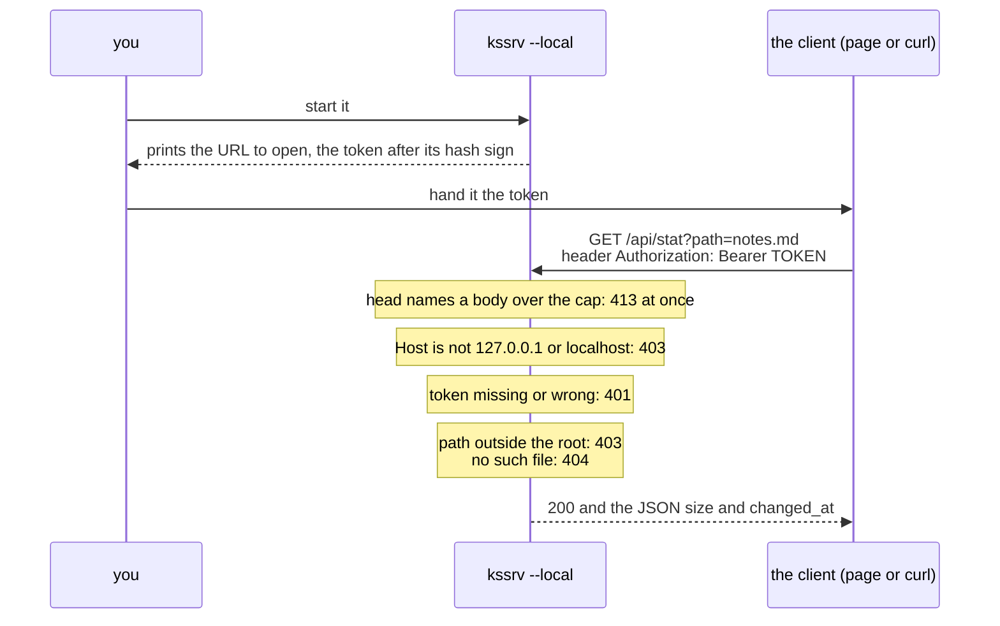

# kssrv — what a client can ask for

**This document is the agreement between the kssrv server and whoever calls it over HTTP.** It sets three things:

* every request the server answers, and what each answer holds;
* what the JSON API under `/api/` holds;
* the limits a caller has to write against.

A *client* is any program that sends the server HTTP requests. It can be a browser, `curl`, your own code, or the small robot car described under "The car's policy file". A client is written against this document, so a change here is a change to what somebody else's code depends on.

How to start it is in [`kssrv/README.md`](../README.md). The six endpoints a page opened in a browser can use are set one level up, in [`../../docs/SPEC-local-server.md`](../../docs/SPEC-local-server.md). That document is the agreement between the client page and this server and belongs to neither. Where the two documents meet, it is the canonical source (the one place the rule lives).

**The server runs in one of two modes, picked when it starts**, and several answers below depend on the mode.

| Mode | Started as | Who can reach it | What it offers besides the files |
| :-- | :-- | :-- | :-- |
| Outward-facing | `kssrv.exe <port> <root>` | Any machine on the network | `/api/status` |
| Local use | `kssrv.exe <port> <root> --local` | This machine only. Every request but the page's carries the token it prints at start-up | `/api/status`, and the six endpoints a page uses |

Words used below:

| Word | What it means here |
| :-- | :-- |
| root (`<root>`) | The folder named on the command line. The server hands out the files inside it |
| endpoint | One path under `/api/` that the server answers itself, instead of returning a file |
| head | The first part of a request or a response: the request line and the headers, before the body |
| token | A random secret string the server makes and prints when it starts in local mode. Every request but the page's must carry it |
| JSON | A plain-text format for data, such as `{"wrote":19}` |

## What it returns

A request for any path outside `/api/` gets a file from the root. The first table shows which file a path gives; the second shows when the server refuses instead.

| Request | Response |
|---|---|
| `GET /` | `<root>/index.html` (a 404 if there is none). With `--page`, that file |
| `GET /index.html` | the same (`--page` swaps these two and nothing else) |
| `GET /a/b.txt` | `<root>/a/b.txt` |
| `GET /sub` (a directory) | `<root>/sub/index.html` |
| `HEAD <any of the above>` | no body; `Content-Length` is the real length. **No answer to a HEAD carries a body**, a refusal's included |

A `HEAD` request asks for the head of the answer alone, without the file itself.

| Status | When the server answers it |
|---|---|
| 405 Method Not Allowed | anything but `GET` / `HEAD`; its `Allow` header names `GET, HEAD` |
| 403 Forbidden | a path pointing outside the root |
| 404 Not Found | not found |
| 400 Bad Request | a broken request, a broken `%XX` |
| 413 Content Too Large | a body over the cap (refused as soon as the head names it) |
| 431 Request Header Fields Too Large | a head past 64 KiB, or more bytes held unanswered on one connection than 64 KiB plus the body cap (64 KiB facing outward, 8 MiB with `--local`) |

A path's `%XX` is decoded, so a file whose name holds a `%20` can be returned too. (`%XX` writes one byte as `%` and two hex digits: `%20` is a space.) The decoding happens once only.

| The path sent | The name looked up | Why |
| :-- | :-- | :-- |
| `/a%20b.txt` | `a b.txt` | `%20` is decoded to a space |
| `/a+b.txt` | `a+b.txt` | **A path's `+` is not a space.** A `+` for a space is `application/x-www-form-urlencoded`'s convention (the one HTML forms use); in a URI's path a `+` is just a `+` |
| `/%252e` | `%2e` | `%25` is decoded to `%`, and the result is not decoded again, so it does not become `.` |

## The JSON API

Paths that start with `/api/` are not files. The server answers them itself, and the answer is JSON.

Everything under `/api/` skips static serving (handing out files from the root) and is handled by a routing table. Even where a directory under the root is named `api`, the API takes priority.

**Every answer under `/api/` is `application/json`, a refusal's included.** A 404 or a 405 there carries a JSON body such as `{"error":"Not Found","status":404}`. A file outside `/api/` would get a line of plain text instead. A `HEAD` is answered the same way. No endpoint under `/api/` takes `HEAD`, so `HEAD /api/status` gets a 405 whose head says `Content-Type: application/json` and gives the JSON's length in `Content-Length`, with no body after it. Three answers are not JSON:

| Answer | `Content-Type` |
| :-- | :-- |
| `GET /api/file` | bytes, as `application/octet-stream` |
| `GET /api/here` | a head and nothing after it |
| A request that cannot be read at all (the 400, 413 and 431 above) | `text/plain`, since its path is not known yet |

The endpoints come in two groups, by the mode they exist in. **An endpoint asked for in the other mode answers 404**, as if it did not exist.

In both modes:

| Method | Path | What it does | Answers |
| :-- | :-- | :-- | :-- |
| `GET` | `/api/status` | Reports how the server is doing | the fields in the table below the example |

```console
$ curl -s localhost:8080/api/status
{"root":"","local":false,"conditional_writes":false,"uptime_s":1802,"requests":45001,
 "connections_total":501,"connections_open":1,"connections_refused":0,"max_connections":128,
 "heap_bytes":86692}
```

| Field | What it holds |
| :-- | :-- |
| `uptime_s` | the uptime in seconds |
| `requests` | the requests handled |
| `connections_total` / `connections_open` / `max_connections` | the connection counters |
| `heap_bytes` | the bytes the server holds on its heap |
| `local` | whether it is for local use |
| `root` | the root's path, only for local use. Empty facing outward, where it would tell anyone the machine's layout |

For local use only (the page's endpoints; their rules are in [`../../docs/SPEC-local-server.md`](../../docs/SPEC-local-server.md)):

| Method | Path | What it does | Answers |
| :-- | :-- | :-- | :-- |
| `GET` | `/api/file?path=<p>` | Reads a file | that file's byte sequence |
| `PUT` | `/api/file?path=<p>` | Writes the body to that name | `{"wrote":<byte count>}` |
| `GET` | `/api/stat?path=<p>` | Tells whether a file changed | the size and the last modification |
| `GET` | `/api/list?path=<p>` | Lists the names in one folder, for a Save As dialog | `{"folders":[…],"files":[…],"more":false}`, links and hidden names left out |
| `GET` | `/api/here` | Keeps the server alive while a page is open | a head naming no length, then nothing until the client closes. The connection itself says a page is open ("Keeping the server alive while a page is open" in [`../../docs/SPEC-local-server.md`](../../docs/SPEC-local-server.md)) |
| `POST` | `/api/stop` | Stops the server | `{}`, then the server stops |

Anything else under `/api/`:

| Request | Answers |
| :-- | :-- |
| a method not named above for its path | `{"error":"Method Not Allowed","status":405}`, with an `Allow` header naming the path's methods (`GET, PUT` for `/api/file`) |
| any other `/api/...` | `{"error":"Not Found","status":404}` |

**Facing outward, no endpoint lists a folder.** A client asks for each file by name; a listing would hand anyone the names under the root. Only local use lists one, for the holder of the token.

### The file endpoints for local use

Started with `--local`, the server lets a program on the same machine read and write files under the root. Each request carries the token the server printed at start-up, in the header `Authorization: Bearer <token>`.

**`path=<p>` names a place relative to the root.** An absolute path, in any operating system's spelling (`/etc/passwd`, `C:\x`, `\\server\share\x`), is refused with 403 on every OS, as the text refusal in [`../../docs/SPEC-local-server.md`](../../docs/SPEC-local-server.md) requires. Only a URL's own path opens with `/`, so static serving drops that `/`, and `path=` does not.

```console
$ ./out/kssrv.exe 8080 ./public --local
kssrv: I: listening on 127.0.0.1:8080, root=./public
kssrv: I: open http://127.0.0.1:8080/#t=0123456789abcdef0123456789abcdef0123456789abcdef

$ T=0123456789abcdef0123456789abcdef0123456789abcdef
$ curl -s -H "Authorization: Bearer $T" 'localhost:8080/api/stat?path=notes.md'
{"size":19,"changed_at":1787746013}

$ curl -s -H "Authorization: Bearer $T" -X PUT --data-binary @notes.md \
    'localhost:8080/api/file?path=notes.md'
{"wrote":19}
```

Caution: **The token above is a sample. Do not paste a token you ran into a document.** The token is made again on every startup, so a pasted one would not work anyway. But a reader would take it as a value that can be pasted. A sample gets an obviously fake value.

The diagram follows one request from start-up to its answer, and shows which refusal comes from which check. The statuses are the ones in "How it refuses" in [`../../docs/SPEC-local-server.md`](../../docs/SPEC-local-server.md).



**These endpoints are the protocol's, and their rules stand there.** [`docs/SPEC-local-server.md`](../../docs/SPEC-local-server.md) says how the token reaches the page and why there is no `HEAD`. It also gives the type a file comes back as, and how a write keeps the original whole. The rules are under two headings there:

* "How the token gets across";
* "Only four things can be asked for".

## The car's policy file

The small robot car takes its driving policy from kssrv once, at start-up, as a plain file. It asks for `GET /pilot_policy.safetensors`, so kssrv serves the folder that holds that file. kssrv has no endpoint for the car: the file is handed out as any other file under the root.

```console
$ ./out/kssrv.exe 8080 <the folder that holds pilot_policy.safetensors>
$ curl -s -o pilot.safetensors localhost:8080/pilot_policy.safetensors
```

The car carries the policy and decides every manoeuvre itself, so it needs the link only while the file arrives. The steps for connecting the car (a Freenove 4WD mecanum car and a Pico W) are in Phase 3 of [What works, and how far](../../README.md#-what-works-and-how-far).

kssrv does not know the file's contents, and kssrv and ksos (the operating system for small boards) do not reference each other. A reference would build a dependency that one package cannot notice when the other is moved. What the file holds is set by the program that writes it.

The `Content-Type` is looked up from the extension. **An extension it does not know is not guessed at but made `application/octet-stream`.** A receiver believes a wrong type and reads the content another way, so saying "unknown" is safer than guessing. No type is registered for safetensors, so the policy file is returned this way.

## What a client can rely on

These hold for every connection, in both modes.

| | What holds |
| :-- | :-- |
| The connection | **Kept, as HTTP/1.1's default calls for** (keep-alive: one connection carries many requests). It closes where `close` is among the client's `Connection` tokens, where an HTTP/1.0 client did not list `keep-alive` there, and where an error response was returned |
| At the cap | **128 connections are held at once.** One arriving at the cap is closed at once with no response. It is not queued, so a client sees a closed socket rather than a wait |
| From one address | **Facing outward, 16 at most.** One more from the same address is closed at once with no response, so one machine cannot take every slot. With `--local` every peer is this machine, and only the cap of 128 applies |
| An idle connection | **Closed once it has passed no byte either way for 30 seconds**, a page's hold (`GET /api/here`) excepted |
| A request arriving slowly | **Closed if it has not arrived whole 30 seconds after its first byte**, however its bytes trickle in |
| A large file | **Sent in chunks as the connection drains**, so a connection holds one chunk of it, not the whole. A file that shrinks while it is sent ends the connection before the length the head named, so the client sees the body cut short |

## Known limits

These are the places where the server does less than a client can expect.

* **`%2f` works as a separator.** It becomes a `/` after the decode, so `/a%2Fb` is the same as `/a/b`. The check for outside the root is applied after the decode, so it is not a hole.
* **`Range` and conditional requests (`If-Modified-Since` and the like) are not supported.** It always returns the whole thing.
* **A symbolic link is refused, not followed** (403), at any level of the path and at the name actually served. A folder is checked together with its `index.html`. The root itself can be a link (macOS's `/tmp` is one), and every endpoint serves it as it serves any other root.
* **Only a regular file is served.** A FIFO or a device in the root answers 404, as if absent. Its read can go on forever and would hold the server.
* **A name starting with a dot is not served** (404, as if absent), at any level of the path: `/.git/config`, `/.env`, `/sub/.hidden`. `/.well-known/` is the exception, since certificate issuance and other discovery read under it (RFC 8615).
