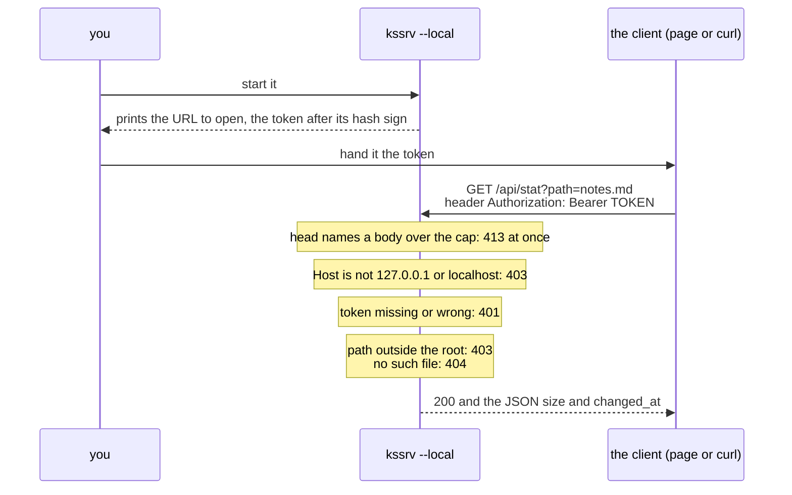

# kssrv — what a client can ask for

**This document is the agreement between the kssrv server and whoever calls it over HTTP.** It sets three things:

* every request the server answers, and what each answer holds;
* what the JSON API under `/api/` holds;
* the limits a caller has to write against.

A *client* is any program that sends the server HTTP requests. It can be a browser, `curl`, your own code, or the small robot car described under "Steering the car". A client is written against this document, so a change here is a change to what somebody else's code depends on.

How to start it is in [`kssrv/README.md`](../README.md), and why the server is shaped this way is in [`DESIGN-server.md`](DESIGN-server.md). The five endpoints a page opened in a browser can use are set one level up, in [`../../docs/SPEC-local-server.md`](../../docs/SPEC-local-server.md). That document is the agreement between the client page and this server and belongs to neither. Where the two documents meet, it is the canonical source (the one place the rule lives).

**The server runs in one of two modes, picked when it starts**, and several answers below depend on the mode. Why one flag decides all of this is "Local use and outward-facing use are split by one decision" in [`DESIGN-server.md`](DESIGN-server.md).

| Mode | Started as | Who can reach it | What it offers besides the files |
| :-- | :-- | :-- | :-- |
| Outward-facing | `kssrv.exe <port> <root>` | Any machine on the network | `/api/status`, and the car's two endpoints |
| Local use | `kssrv.exe <port> <root> --local` | This machine only. Every request but the page's carries the token it prints at start-up | `/api/status`, and the five endpoints a page uses |

Words used below:

| Word | What it means here |
| :-- | :-- |
| root (`<root>`) | The folder named on the command line. The server hands out the files inside it |
| endpoint | One path under `/api/` that the server answers itself, instead of returning a file |
| head | The first part of a request or a response: the request line and the headers, before the body |
| token | A random secret string the server makes and prints when it starts in local mode. Every request but the page's must carry it |
| JSON | A plain-text format for data, such as `{"wrote":19}` |

## What it returns

A request for any path outside `/api/` gets a file from the root. The first table shows which file a path gives; the second shows when the server refuses instead.

| Request | Response |
|---|---|
| `GET /` | `<root>/index.html` (a 404 if there is none). With `--page`, that file |
| `GET /index.html` | the same (`--page` swaps these two and nothing else) |
| `GET /a/b.txt` | `<root>/a/b.txt` |
| `GET /sub` (a directory) | `<root>/sub/index.html` |
| `HEAD <any of the above>` | no body; `Content-Length` is the real length. **No answer to a HEAD carries a body**, a refusal's included |

A `HEAD` request asks for the head of the answer alone, without the file itself.

| Status | When the server answers it |
|---|---|
| 405 Method Not Allowed | anything but `GET` / `HEAD`; its `Allow` header names `GET, HEAD` |
| 403 Forbidden | a path pointing outside the root |
| 404 Not Found | not found |
| 400 Bad Request | a broken request, a broken `%XX` |
| 413 Content Too Large | a body over the cap (refused as soon as the head names it) |
| 431 Request Header Fields Too Large | a head past 64 KiB, or more bytes held unanswered on one connection than 64 KiB plus the body cap (64 KiB facing outward, 4 MiB with `--local`) |

A path's `%XX` is decoded, so a file whose name holds a `%20` can be returned too. (`%XX` writes one byte as `%` and two hex digits: `%20` is a space.) The decoding happens once only.

| The path sent | The name looked up | Why |
| :-- | :-- | :-- |
| `/a%20b.txt` | `a b.txt` | `%20` is decoded to a space |
| `/a+b.txt` | `a+b.txt` | **A path's `+` is not a space.** A `+` for a space is `application/x-www-form-urlencoded`'s convention (the one HTML forms use); in a URI's path a `+` is just a `+` |
| `/%252e` | `%2e` | `%25` is decoded to `%`, and the result is not decoded again, so it does not become `.` |

## The JSON API

Paths that start with `/api/` are not files. The server answers them itself, and the answer is JSON.

Everything under `/api/` skips static serving (handing out files from the root) and is handled by a routing table. Even where a directory under the root is named `api`, the API takes priority.

**Every answer under `/api/` is `application/json`, a refusal's included.** A 404 or a 405 there carries a JSON body such as `{"error":"Not Found","status":404}`. A file outside `/api/` would get a line of plain text instead. A `HEAD` is answered the same way. No endpoint under `/api/` takes `HEAD`, so `HEAD /api/status` gets a 405 whose head says `Content-Type: application/json` and gives the JSON's length in `Content-Length`, with no body after it. Three answers are not JSON:

| Answer | `Content-Type` |
| :-- | :-- |
| `GET /api/file` and `GET /api/pilot` | bytes, as `application/octet-stream` |
| `GET /api/here` | a head and nothing after it |
| A request that cannot be read at all (the 400, 413 and 431 above) | `text/plain`, since its path is not known yet |

The endpoints come in three groups, by the mode they exist in. **An endpoint asked for in the other mode answers 404**, as if it did not exist.

In both modes:

| Method | Path | What it does | Answers |
| :-- | :-- | :-- | :-- |
| `GET` | `/api/status` | Reports how the server is doing | the fields in the table below the example |

```console
$ curl -s localhost:8080/api/status
{"root":"","local":false,"uptime_s":1802,"requests":45001,"commands":0,"connections_total":501,
 "connections_open":1,"max_connections":128,"heap_bytes":86692,"pilot":{"params":394,
 "samples":768,"train_cpu_ms":606,"agreement":0.985648918469218,"agreement_checked":4808,
 "command_valid_ms":500}}
```

| Field | What it holds |
| :-- | :-- |
| `uptime_s` | the uptime in seconds |
| `requests` | the requests handled |
| `commands` | the manoeuvres returned to the car |
| `connections_total` / `connections_open` / `max_connections` | the connection counters |
| `heap_bytes` | the bytes the server holds on its heap |
| `local` | whether it is for local use |
| `root` | the root's path, only for local use. Empty facing outward, where it would tell anyone the machine's layout |
| `pilot` | the steering policy's figures facing outward. `null` for local use, which trains none |

For local use only (the page's endpoints; their rules are in [`../../docs/SPEC-local-server.md`](../../docs/SPEC-local-server.md)):

| Method | Path | What it does | Answers |
| :-- | :-- | :-- | :-- |
| `GET` | `/api/file?path=<p>` | Reads a file | that file's byte sequence |
| `PUT` | `/api/file?path=<p>` | Writes the body to that name | `{"wrote":<byte count>}` |
| `GET` | `/api/stat?path=<p>` | Tells whether a file changed | the size and the last modification |
| `GET` | `/api/here` | Keeps the server alive while a page is open | a head naming no length, then nothing until the client closes. The connection itself says a page is open ("Keeping the server alive while a page is open" in [`../../docs/SPEC-local-server.md`](../../docs/SPEC-local-server.md)) |
| `POST` | `/api/stop` | Stops the server | `{}`, then the server stops |

Facing outward only (the car's endpoints):

| Method | Path | What it does | Answers |
| :-- | :-- | :-- | :-- |
| `POST` | `/api/car` | Takes the car's sensors | the next manoeuvre ("Steering the car" below) |
| `GET` | `/api/pilot` | Downloads the steering policy | one whole steering policy as safetensors ("Downloading the policy" below) |

Anything else under `/api/`:

| Request | Answers |
| :-- | :-- |
| a method not named above for its path | `{"error":"Method Not Allowed","status":405}`, with an `Allow` header naming the path's methods (`GET, PUT` for `/api/file`) |
| any other `/api/...` | `{"error":"Not Found","status":404}` |

**No endpoint lists a folder.** A client asks for each file by name; a listing would hand anyone the names under the root.

### The file endpoints for local use

Started with `--local`, the server lets a program on the same machine read and write files under the root. Each request carries the token the server printed at start-up, in the header `Authorization: Bearer <token>`.

**`path=<p>` names a place relative to the root.** An absolute path, in any operating system's spelling (`/etc/passwd`, `C:\x`, `\\server\share\x`), is refused with 403 on every OS, as the text refusal in [`../../docs/SPEC-local-server.md`](../../docs/SPEC-local-server.md) requires. Only a URL's own path opens with `/`, so static serving drops that `/`, and `path=` does not.

```console
$ ./out/kssrv.exe 8080 ./public --local
kssrv: I: listening on 127.0.0.1:8080, root=./public
kssrv: I: open http://127.0.0.1:8080/#t=0123456789abcdef0123456789abcdef0123456789abcdef

$ T=0123456789abcdef0123456789abcdef0123456789abcdef
$ curl -s -H "Authorization: Bearer $T" 'localhost:8080/api/stat?path=notes.md'
{"size":19,"changed_at":1787746013}

$ curl -s -H "Authorization: Bearer $T" -X PUT --data-binary @notes.md \
    'localhost:8080/api/file?path=notes.md'
{"wrote":19}
```

Caution: **The token above is a sample. Do not paste a token you ran into a document.** The token is made again on every startup, so a pasted one would not work anyway. But a reader would take it as a value that can be pasted. A sample gets an obviously fake value.

The diagram follows one request from start-up to its answer, and shows which refusal comes from which check. The statuses are the ones in "How it refuses" in [`../../docs/SPEC-local-server.md`](../../docs/SPEC-local-server.md).



**These endpoints are the protocol's, and their rules stand there.** [`docs/SPEC-local-server.md`](../../docs/SPEC-local-server.md) says how the token reaches the page and why there is no `HEAD`. It also gives the type a file comes back as, and how a write keeps the original whole. The rules are under two headings there:

* "How the token gets across";
* "Only three things can be asked for".

## Steering the car

Facing outward, kssrv can drive a small robot car over the network. The car sends what its sensors measure, and the server answers with the next move.

Send **the values measured at that moment** to `POST /api/car`, and it returns one next manoeuvre. The small MLP in `kssrv/pilot.kspl` decides it. (An MLP, a multi-layer perceptron, is the simplest kind of neural network: layers of weighted sums. This one has 394 weights.)

```console
$ curl -s -X POST localhost:8080/api/car -d '{"dist_mm":250,"line":2,"seq":17}'
{"seq":17,"cmd":"strafe_right","lon":0,"lat":50,"rot":0,"valid_ms":500}
```

What the car sends:

| Field | What it means |
|---|---|
| `dist_mm` | the ultrasonic distance [mm]. **0 means "it could not be measured"** (not "close") |
| `line` | the three reflective sensors as `left<<2 \| centre<<1 \| right` (1 = black). 0-7 |
| `seq` | the caller's serial. It is returned as it stands |

What comes back:

| Field | What it means |
|---|---|
| `seq` | the caller's serial, as it was sent |
| `cmd` | the manoeuvre's name (the table below) |
| `lon` / `lat` / `rot` | the fore-aft, side-to-side and rotation values. They can be passed to the car's `motor.drive` unchanged, with **positive = forward / right / clockwise** |
| `valid_ms` | how long this instruction can be trusted. Past that, with no next answer arriving, the car stops |

| Manoeuvre | lon | lat | rot |
|---|--:|--:|--:|
| `stop` | 0 | 0 | 0 |
| `forward` | 60 | 0 | 0 |
| `back` | -45 | 0 | 0 |
| `strafe_left` / `strafe_right` | 0 | ∓50 | 0 |
| `creep` | 18 | 0 | 0 |
| `track_left` / `track_right` | 40 | ∓15 | ∓25 |
| `track_left_hard` / `track_right_hard` | 10 | ∓30 | ∓50 |

**The line-following `track_*` hold forward motion, sideways motion and rotation at once.** If every correction were a turn on the spot, the car would not move forward while correcting the drift. It would alternate between going forward and turning in place, instead of following the line. There are two levels, so the correction's strength changes with the drift's size.

**Only the ratio of the three matters.** Once one value hits the car's cap, the car scales all three down together. So this table decides which way the car goes and how sharply it turns, not how fast; the car's cap decides the speed. That is why raising `rot` when the car cannot keep up with a curve has no effect: it is scaled back to the same ratio. Dropping `lon` is what raises the rotation per unit of distance travelled.

**The sideways component can be added without cutting the rotation.** With `rot` left at the maximum, the scaling does not change, so the force moving the car straight sideways grows by that much. On a sharp curve it is less likely to leave the line, because it can move sideways without waiting for the heading to catch up. This uses the advantage of mecanum wheels (wheels with angled rollers, which let a car move sideways as well as forward).

Both `dist_mm` and `line` decide which one comes back. **The distance alone does not decide it.** The distance is looked at first:

| `dist_mm` | What comes back |
|---|---|
| `0` (not measurable) | `stop` (it does not run without seeing ahead) |
| up to 150 | `back` |
| 150-400 | dodges sideways. **Where it dodges to is the side with no line**, so `strafe_left` where the right sensor is black (`line` is odd) and `strafe_right` otherwise |
| 400 and up | decided by the line (the table below) |

Where the path ahead is clear, the correction's strength changes with how far sideways the line has drifted. Only the end sensor black is a large drift; the end and the centre both black is a small one.

| `line` | The black sensors | What comes back |
|--:|---|---|
| 2 | the centre only | `forward` (it is riding on the line) |
| 6 / 3 | left and centre / centre and right | `track_left` / `track_right` (a small drift) |
| 4 / 1 | left only / right only | `track_left_hard` / `track_right_hard` (a large drift) |
| 7 | all three | `stop` (a junction or the end, and it cannot judge) |
| 0 / 5 | none of them / the two ends only | `creep` (the line's position is unknowable, so it goes slower than forward) |

**`line` being 0 is "the line is nowhere", not "on the line".** Moving at the same speed as `forward` would mean running at full speed without seeing. The observation does not keep which side the line was on before it was lost, so these rules cannot pick a direction to recover in. Picking one would need history among the features (the inputs the network reads). That is a change that raises the format's version ("Downloading the policy" below).

* This net's **teacher is the written rules** (`pilot.rule_action`): it learned by copying the tables above. The net is not cleverer than the rules. What it shows is that the decision is made outside the car.
* At every point of a fine sweep over the measurable distances it **almost entirely agrees with the rules** (`/api/status` reports the figure as `pilot.agreement`). The disagreements are only around the boundaries (150mm and 400mm). On the 400mm side, where the rules would follow the line, the net still dodges sideways. So the net's boundary sits farther out than the rules', which is the safe side.
* **The safety timeout is in the car, not the server.** The guards against a flat battery, a very close obstacle and no answer arriving are inside the car. The server can do nothing when the link drops.
* **It answers on the accepting thread**, the one thread that also takes new connections, with no hand-off to another. One forward pass (one run of the net) takes a few microseconds, and after `build()` the policy is read-only.

The steps for connecting the car (a Freenove 4WD mecanum car + a Pico W) are in Phase 3 of [What works, and how far](../../README.md#-what-works-and-how-far).

Kssrv and ksos (the operating system for small boards) do not reference each other. A reference would build a dependency that one package cannot notice when the other is moved.

## Downloading the policy

`GET /api/pilot` returns **the very same whole policy** `POST /api/car` is using, in one file in safetensors format. Safetensors is a common file format for a neural network's weights: a JSON header, then the numbers. A car that carries it can decide for itself, without asking on every observation.

```console
$ curl -s -o pilot.safetensors localhost:8080/api/pilot
$ python3 -c "import json,struct; d=open('pilot.safetensors','rb').read(); \
    n=struct.unpack('<Q',d[:8])[0]; print(sorted(json.loads(d[8:8+n])))"
['__metadata__', 'fc1.bias', 'fc1.weight', 'fc2.bias', 'fc2.weight', 'maneuvers']
```

| Content | Shape | What it means |
|---|---|---|
| `fc1.weight` / `fc1.bias` | [5, 24] / [24] | the input layer. The activation is SiLU (the curve applied to each layer's output) |
| `fc2.weight` / `fc2.bias` | [24, 10] / [10] | the output layer. 10 logits (one score per manoeuvre; the highest wins) |
| `maneuvers` | [10, 3] | a manoeuvre's number → `lon, lat, rot` (integers travelling as F32) |
| `__metadata__.far_mm` | — | the cap [mm] used when the distance is normalized |
| `__metadata__.kspl_pilot` | — | the format's version. Always confirm it before reading |

* **The weights are not sent alone.** A receiver holding its own copy of how the features are made (`far_mm`) and of the manoeuvres' meaning cannot notice when the server's code is fixed. So the file holds everything needed to give the same answer as `POST /api/car` (`kssrv/tests/car.kspl` matches them at 968 points).
* **`valid_ms` is not in it.** It is how long a car that asks can wait for an answer, and it means nothing to a car that carries the policy.
* Caution: **Check `__metadata__.kspl_pilot` before using the weights, and refuse a version the reader was not written for.** A reader written for an older version still loads a newer file without any error, then steers wrongly. The version rises when one of three things changes:
  * the order of the five features (whether the distance was measured, the distance, then the left, centre and right line sensors);
  * the activation (SiLU);
  * what each row of `maneuvers` means.

  None of these changes a tensor's shape, so a reader that checks only the shapes cannot notice. For example, left and right could swap places among the features. Every weight would still fit, and the old reader would turn the wrong way on every correction.

The `Content-Type` is looked up from the extension. **An extension it does not know is not guessed at but made `application/octet-stream`.** A receiver believes a wrong type and reads the content another way, so saying "unknown" is safer than guessing. No type is registered for safetensors, so `/api/pilot` is returned this way too.

## What a client can rely on

These hold for every connection, in both modes.

| | What holds |
| :-- | :-- |
| The connection | **Kept, as HTTP/1.1's default calls for** (keep-alive: one connection carries many requests). It closes where `close` is among the client's `Connection` tokens, where an HTTP/1.0 client did not list `keep-alive` there, and where an error response was returned |
| At the cap | **128 connections are held at once.** One arriving at the cap is closed at once with no response. It is not queued, so a client sees a closed socket rather than a wait |
| From one address | **Facing outward, 16 at most.** One more from the same address is closed at once with no response, so one machine cannot take every slot. With `--local` every peer is this machine, and only the cap of 128 applies |
| An idle connection | **Closed once it has passed no byte either way for 30 seconds**, a page's hold (`GET /api/here`) excepted |
| A request arriving slowly | **Closed if it has not arrived whole 30 seconds after its first byte**, however its bytes trickle in |
| A large file | **Sent in chunks as the connection drains**, so a connection holds one chunk of it, not the whole. A file that shrinks while it is sent ends the connection before the length the head named, so the client sees the body cut short |

## Known limits

These are the places where the server does less than a client can expect.

* **`%2f` works as a separator.** It becomes a `/` after the decode, so `/a%2Fb` is the same as `/a/b`. The check for outside the root is applied after the decode, so it is not a hole.
* **The steering policy is not saved.** It is trained again on every outward-facing startup. The seed is fixed, so the same version gives the same weights every time.
* **`Range` and conditional requests (`If-Modified-Since` and the like) are not supported.** It always returns the whole thing.
* **A symbolic link is refused, not followed** (403), at any level of the path and at the name actually served. A folder is checked together with its `index.html`.
* **Only a regular file is served.** A FIFO or a device in the root answers 404, as if absent. Its read can go on forever and would hold the server.
* **A name starting with a dot is not served** (404, as if absent), at any level of the path: `/.git/config`, `/.env`, `/sub/.hidden`. `/.well-known/` is the exception, since certificate issuance and other discovery read under it (RFC 8615).
