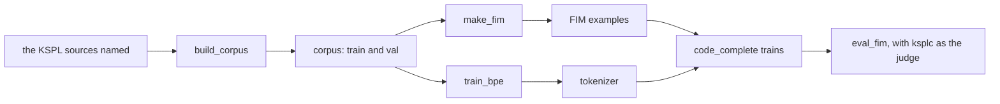

# code_complete — an AI that completes KSPL

This example trains a small AI on ksai to fill in a missing line of KSPL code. It measures how often the compiler accepts what the AI writes. **It is kept as an example of training and making an AI with ksai, not as a tool.** Why it is built this way is "The coding example: an AI that completes KSPL" in [`lib/ksai/docs/DESIGN-learning.md`](../../docs/DESIGN-learning.md).

Note: If how an AI works is new to you, read [`lib/ksai/README.md`](../../README.md) (the introduction to the KSPL-native AI engine) first.

Words used here: the *corpus* is the body of source text the model learns from. *FIM* (fill-in-the-middle) is a training example made by cutting a hole out of code; the model learns to fill it from the code around it. The *oracle* is the compiler used as the judge: a completion is good if `ksplc` accepts the file.

## Run it

From the root of the Kanso repository:

```sh
make fim-corpus   # the corpus and the FIM examples -> out/code_complete/corpus/
make fim-model    # the tokenizer, then the KSPL-native model -> data/code_complete.safetensors
make fim-eval     # the model's held-out loss, then the rate at which ksplc accepts its completions
```

The held-out loss is the model's error on validation files it never trained on. The corpus and the tokenizer are quick to make again, so they go into `out/code_complete/`. The trained weights take long to make again, so they go into `data/`, which `make clean` keeps.

**Each KSPL program also runs alone**, with the usage in the file's header. `build_corpus` reads the folders it is given, and Kanso's own sources when none is given. The programs that compile ask the installed `ksplc`, or the one `--ksplc=` names.



## What is here

| File | What it does |
| :-- | :-- |
| `main.kspl` | The model: `code_complete train` learns from the FIM examples, `complete` fills a file of holes, and `loss` scores held-out code. `make test` in `lib/ksai/` builds it as `code_complete.exe`. |
| `ksplc_oracle.kspl` | The compiler oracle's shared parts: an error count plus the diagnostics, and reading JSONL (one JSON value per line). It has no executable of its own. |
| `build_corpus.kspl` / `corpus_count.kspl` | Normalizes every source through `fmt`, removes duplicates, splits train/val and counts, writing to `out/code_complete/corpus/`. `corpus_count.kspl` holds the counting rules, split off so it can be tested. |
| `make_fim.kspl` | Writes FIM training examples to `corpus/fim_{train,val}.jsonl`. The source compiles, so the middle is the correct completion by definition. |
| `eval_fim.kspl` | Hides single lines of the validation files, inserts a model's completion, and measures the rate at which `ksplc` accepts the file (`make fim-eval`). `--model=native` runs `code_complete.exe` as its own process. |
| `train_bpe.kspl` | Derives the BPE vocabulary and merges from the corpus into `out/code_complete/tokenizer/`, which `Tokenizer.load` in `lib/ksai/tokenizer.kspl` reads. It splits the corpus by the tokenizer's own rule (`chunk_end` in `lib/ksai/pretokenizer.kspl`), so every merge it learns can apply. |

The tests stand with ksai's. `lib/ksai/tests/code_complete_test.kspl` checks the counting and how the oracle reads a verdict. `lib/ksai/tests/examples_main.kspl` runs the model, and the oracle on a real compiler.

## Further reading

* [`lib/ksai/docs/DESIGN-learning.md`](../../docs/DESIGN-learning.md) — why the example is built this way: what is borrowed, how a completion is scored, and why it runs alone.
* [ksai](../../README.md) — the engine the example trains on, with the other examples.
* [`lib/ksai/tools/README.md`](../../tools/README.md) — the tools that convert a borrowed model for ksai and check ksai against Hugging Face and llama.cpp.
