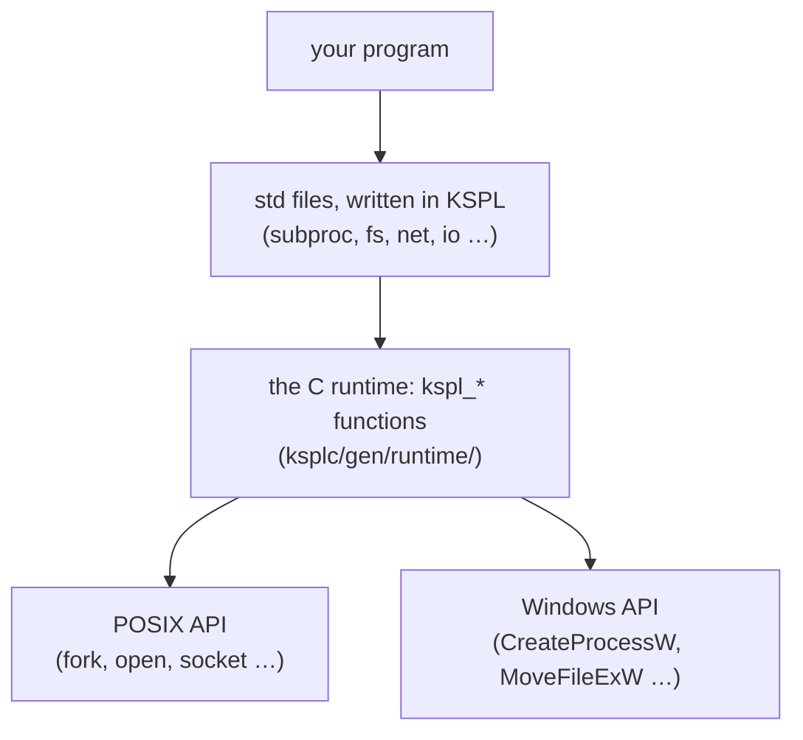
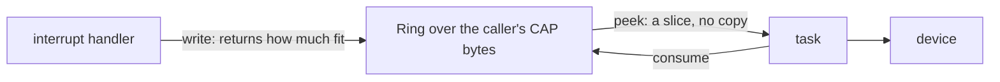

# The design policy of the standard library, and its core

This document says *why* the standard library (`std/`) works the way it does. It holds the grounds of its core: memory, containers, text, failures and the package's shape. What reaches outside the program is in [`DESIGN-system.md`](DESIGN-system.md): the process, files, threads, networking and the data formats. Each file starts from an API that other languages use widely. Where KSPL's type system can prevent a misuse or vulnerability that the API met, the design changes.

**The document holds two things.**

1. A table of the known problems of earlier implementations, how each `std` file handles them, and the holes still open.
2. By subject, the choices in `std`'s own API that make a reader ask "why this way?" (here and in [`DESIGN-system.md`](DESIGN-system.md)).

When you add or change a file, check whether the table can gain a row. If it cannot, confirm that the file has not become a plain copy of the API it started from. What each file is for is what `ksplc doc std` lists.

## Words used in this document

**This table explains the words of `std` that appear across many sections.** The words every package shares (arena, ARC, trait, vtable, freestanding, Principle N) are in "Words used throughout" in [`../../docs/DESIGN-principles.md`](../../docs/DESIGN-principles.md#words-used-throughout). *Gate* and the other terms of art are in "Terms of art" in [`../../docs/SPEC-documents.md`](../../docs/SPEC-documents.md#terms-of-art). The notation of the examples is "The notation the examples use" in [`../../docs/DESIGN-principles.md`](../../docs/DESIGN-principles.md#the-notation-the-examples-use).

| Word | What it means here |
| :-- | :-- |
| **the heap** (the global heap) | Memory taken with `malloc` and given back one block at a time with `free`. In `std`, a `null` where a function asks for an arena means "use the heap". The caller then owes a `free()` for what comes back ("A null arena is the heap, for every function") |
| **`Arc`** (the type) | Not ARC: `Arc<\|T\|>` is the reference-counted handle shared between threads ("The names of the reference-counting types" below) |
| **view** | A slice that points into memory something else owns. A new view copies nothing, and it stays valid only as long as that memory does |
| **`Option<\|T\|>`**, written `T?` | Either a value or none. The value comes out only through `switch` or `if v: = …`, so a forgotten check does not compile |
| **panic** | The program stops with a message. `std` keeps it mostly for a mistake in the program itself, such as an index out of range. Bad input comes back as a value |
| **POSIX** | The family of Unix-like systems (Linux, macOS, the BSDs) and the API they share. "Windows" here means its own API (`CreateProcessW` and the like) |

### How std reaches the operating system

**`std` is written in KSPL, and only a thin layer of C touches the OS.** The diagram shows the layers that a call passes through on a hosted build.



**The decisions live in the KSPL layer wherever they can**, such as a connection's schedule and the timeouts. The C layer keeps only what needs the OS's own types or calls. C is written twice, for POSIX and for Windows, and the Windows copy cannot run locally.

## What was inherited, and what was changed

### Known problems KSPL handles

Each row is a bug or attack that other libraries are known for. It says what `std` does so that it cannot happen, or not silently.

**Text, numbers and memory**

| File | The problem | Seen in | What `std` does |
| :-- | :-- | :-- | :-- |
| `str` | **A NUL byte cuts a string short** ("the poison NUL byte"). A KSPL string carries its length and can hold a byte 0, but C reads only up to the first 0. So a conversion to a C string silently drops the rest. PHP and Java had path checks bypassed this way | C's strings | `to_cstr()` returns `U8$@?`: `.none` when the input holds a NUL, which `switch` makes the caller handle. `contains_nul()` is public too |
| `checked_int` | **Signed overflow is undefined behavior**: the C compiler can assume it never happens, so optimization changes the result | C's integer arithmetic | The plain operators wrap around (`mod 2^N`), through the unsigned type of the same width, so no wrapping type is needed. Native `checked_*` methods report failure |
| `math` | **The absolute value of a signed integer's minimum is the minimum itself**, so a check `abs(x) >= 0` fails | C's `abs` (undefined), Java's `Math.abs` | `math.abs` stops the program there, naming the reason |
| `option` | **Null references**: a forgotten check for `null` still compiles | A raw pointer's `null` | `T?`'s content comes out only through `switch`. The linter's [H0701] proposes `T?` for a raw pointer returned as `null` |
| `chars`, `regex`, `subproc` and the rest | **"None" spelt as a value of the answer's own type**: a `-1`, an empty string or a flag beside the value. A forgotten check still compiles, and the stand-in flows on as data | C's `EOF` and `-1`, an `indexOf` or `find` answering -1 | "There can be none" is `T?`, and "it failed" is `T!E`, never a stand-in ("Absent or failed: one rule" below) |
| `mem` | **Double free and use after free** | `malloc` / `free` | The arena (`Arena`) is the main route, and `defer` shows in the code where memory is freed. The compiler traces the paths for a use after the free |

**Randomness**

| File | The problem | Seen in | What `std` does |
| :-- | :-- | :-- | :-- |
| `prng` / `rand` | **A weak random number used for a key** (CWE-330). The weak (predictable) kind and the safe kind have close names, so `Random` or `random` keeps being used for tokens and keys | Java's `Random` / `SecureRandom`, Python's `random` / `secrets` | **The name declares "pseudo"**: the reproducible side is `std/prng`'s `Prng`, and the plain name `std/rand` is the safe side. So "I need a random number" lands there. The weak side stays, so training and sampling can be rerun with the same results |
| `prng` (a number in a range) | **A remainder favours low values** when the count does not divide the generator's range: from 10 values, `% 3` gives 0 four times. C++'s distributions differ per library, so one seed gives different numbers on libstdc++, libc++ and MSVC | Java's `nextInt(bound)`, Python's `randrange`, C++'s `uniform_int_distribution` | `below` draws again past the last whole multiple of n. `below(0)` stops the program, as a division by zero does: [0, 0) holds no number. `between` keeps both ends and covers all of `I64`. Both are KSPL, so a seed gives the same numbers on every platform |

**Files**

| File | The problem | Seen in | What `std` does |
| :-- | :-- | :-- | :-- |
| `fs` | **A directory that fails part way through reads as one that ended.** `readdir` returns NULL at the end and on a failure, told apart only by an `errno` cleared before the call. `FindNextFileW` fails at the end too, with `ERROR_NO_MORE_FILES` | POSIX `readdir`, Windows `FindNextFileW` | `read_dir` fails (`operation_failed`). The runtime clears `errno` before each `readdir`, and on Windows takes only `ERROR_NO_MORE_FILES` as the end |
| `fs` | **On Windows alone, a read-only file cannot be removed or replaced.** POSIX looks at the folder's permission, so one clean-up works on one OS and fails on the other | Windows's `DeleteFileW` / `MoveFileExW` | `remove_path` and `rename_path` clear the read-only mark first on Windows. They put it back where the operation still fails |

**Networking**

| File | The problem | Seen in | What `std` does |
| :-- | :-- | :-- | :-- |
| `net` | **A write can send only part of the data** (a *short write*), yet callers discard the count it returns | POSIX `send(2)`, Go's `io.Writer`, Rust's `Write` | Both `write` (returns how much it sent) and `write_all` (sends it all), so the name states the intent |
| `net` | **A port out of range wraps around**: the field holds 16 bits, so 83659 binds 18123 and -1 binds 65535, with no error | C's `sockaddr_in` and `htons` | `bind` and `connect` refuse a port outside 0 to 65535 as `Net_error.bad_port`. The runtime refuses it too, as a backstop |
| `net` | **An accepted socket's mode depends on the OS.** From a *non-blocking* listener (one that answers "not ready" rather than wait), Linux returns a blocking socket. Windows, macOS and the BSDs copy the non-blocking mode | BSD sockets' `accept` | `accept` returns a blocking stream on every OS, as Python's does. A reactor's caller makes it non-blocking by asking |
| `http` | **Request smuggling**: a proxy and a server see a different end for one request, so a second request hides inside it. The causes: `Content-Length` against `Transfer-Encoding`, or two `Content-Length`s | HTTP/1.1 implementations in general | Refuses any `Transfer-Encoding`, and a duplicated `Content-Length` whose values disagree |
| `http` | **A chunk line read differently by two programs.** Take a size line ended by a bare LF, or a quoted extension that holds a line break. Two readers then cut one body at two places. The parser that cut it otherwise then has a fix to issue | Netty (2025 and 2026), and HTTP/1.1 implementations in general | `http_body` refuses a bare CR or LF in a chunk line, a size with a sign, a space or `0x`, and an extension off its grammar. It refuses a size line over 4 KiB and a trailer that is no header line. A size past the body's limit fails before its digits run out |
| `http` | **Response splitting**: a line break (CRLF) injected into a header value starts a header or a response of its own | The same | Refuses at write time a CRLF in a header name or value, the method, the target or the reason phrase |
| `http` | **A writer that frames otherwise than its reader**: a `Content-Length` that the body does not have, or one beside `Transfer-Encoding`. Either splits the message where another reader cuts it | The same | Refuses at write time whatever the reader refuses (`length_mismatch`). It also refuses a header value with a space or tab at either end, which the reader trims (`invalid_header`, RFC 9110 §5.5). 1xx, 204 and 304 get no length and no body (RFC 9110 §8.6). A HEAD's answer has its own builder (`format_response_to_head`) |
| `http` | **Two `Host` headers, or one value read differently by two programs on the way.** A proxy routes by one reading and the server checks the other: `user@a` and `a/b` are host `a` to some readers | HTTP/1.1 implementations in general; RFC 9112 §3.2 asks a server to answer each with 400 | `parse_request` and `parse_request_head` refuse (`invalid_host`) a request that names `Host` twice, or none on HTTP/1.1 and later. They also refuse a value that is not RFC 3986's `uri-host [":" port]`, the port up to 65535. `format_request` and `write_request` refuse the same head. Only `http.is_1_1_or_later` decides the version |
| `http` | **A body that runs to the close** cannot be told from one cut off early | The same | Refuses a response that can carry a body but names no length and is not chunked (`unsupported_close_delimited`). It does not return what arrived as the whole body. 1xx, 204 and 304 end at their head. A chunked body cut off before its last chunk fails as `connection_closed` |
| `http` | **A `Connection` value read as one word.** `keep-alive, close` and a second `Connection` line both ask to close. A reader that compares the whole value keeps the connection open | Hand-written servers; RFC 9110 §7.6.1 makes the field a list of tokens | `http.lists_token` reads a value as a list, in any case. `Request.wants_close` reads every `Connection` line (RFC 9112 §9.3), and `format_response_head` finds `close` the same way |
| `jsonrpc` | **Two readers cut one stream into different frames**: they differ on which of two `Content-Length` lines counts, or on how a head's limit is checked | LSP clients and servers in general | Two lengths that differ make the frame `broken`, and the head's limit counts its own bytes ("The frame is kept apart from the transport" in [`DESIGN-system.md`](DESIGN-system.md)) |
| `jsonrpc` | **Nothing comes back for a broken frame or a dropped response.** On a frame without `Content-Length`, `lsp4j` sends only a log line ([#210](https://github.com/eclipse-lsp4j/lsp4j/issues/210)). On a dropped response, `pylspclient` cannot look up the id and throws | LSP clients in general (`lsp4j` / `lsp-server` / `pylspclient`) | A frame that declares no length, or is over the limit, returns `Rpc_end.broken` **as a value**. Its head is dropped, so it cannot repeat (the same section) |

**Data formats**

| File | The problem | Seen in | What `std` does |
| :-- | :-- | :-- | :-- |
| `json_struct` | **A key's name is written twice, once for the writer and once for the reader.** n fields take 2n lines, and a fix of only one silently fills in the default | `serde`'s derive, Swift's `Codable`, Jackson's annotations, nlohmann's macros | `json_struct.from_struct` / `into_struct` walk `std/reflect`'s table of a type's fields. **ksplc synthesizes the table from an empty `impl X: reflect.Reflectable {}`** ([5.5 in `../../docs/SPEC-programming-language.md`](../../docs/SPEC-programming-language.md#55-worked-example-synthesizing-a-field-table-with-reflectable)), so it cannot drift from the declaration. A key is the field's name |
| `json_struct` | **A missing value silently becomes a default** | The same | A missing key and a `null` one are refused with different values (`missing_field` / `field_type`). So no sentinel default such as `as_int64().unwrap_or(-1)` folds two causes into one value |
| `json_struct` | **An integer is silently narrowed into a smaller field** | The same | **An integer that the field cannot hold is refused** (`field_type`): 70000 into a `U16`, -1 into a `U8`. On a write, so is a `U64` past the largest `I64`, the widest integer a `Value` holds. `std/reflect`'s `fits_int` decides |
| `json` | **Stack exhaustion from deep nesting**: a document nested very deep makes a recursive reader run out of stack and crash | JSON parsers in general | Nesting stops at `max_nesting_depth = 500` with a `Json_error`, not a panic |
| `json` | **Duplicate keys**: implementations read `{"a":1,"a":2}` differently, so two parsers given the same document see different values | The same | Refused (`Json_error.duplicate_key`), as I-JSON requires, with an error that names the key. `Object_builder.set` replaces, so a built object holds no repeat either. Past a few members, the parser sorts the keys once the object closes and compares neighbours. So a hostile object cannot make the check quadratic, and no hash takes part |
| `json` | **A read that cannot say "there is none".** A read with a default gives `""` for an absent key and an empty string alike, and 0 for an absent number and a written 0. So a misspelt key reads as a real value | Python's `dict.get`, Jackson's `asText()` / `asInt()`, Go's zero-filled fields | Each read of a kind returns an option (`as_str(): U8[]?`, `as_int64(): I64?`, …) ("A JSON read says when there is no value" in [`DESIGN-system.md`](DESIGN-system.md)) |

**Threads**

| File | The problem | Seen in | What `std` does |
| :-- | :-- | :-- | :-- |
| `thread` | **Nothing says which types can cross threads**, so a non-atomic count or a raw pointer gets handed over casually | POSIX threads | **Not handled.** A constraint on `spawn`'s arguments would miss sharing through a global. The grounds are "Why data races are not prevented by the type system" in [`../../docs/DESIGN-programming-language.md`](../../docs/DESIGN-programming-language.md#why-data-races-are-not-prevented-by-the-type-system). What exists is a choice by type name (`Rc` / `Arc`, `Mutex<\|T\|>` / a plain value) |

### Known holes, and what would fill them

Two known problems are not handled.

| File | What is not handled | Why it stays open | What would fill it |
| :-- | :-- | :-- | :-- |
| `reflect` | **The round-trip functions cannot walk a container of containers (`List<\|List<\|T\|>\|>`), or an option that holds a container or an option** | **One hole stops both.** Such a field needs a kind whose content kind refers to itself, so `Field_kind` would need a payload. Both backends can write one; the kind, its synthesis and the walkers are missing | A payload on the list and option kinds that names the contents' kind, with its synthesis and walkers in one change. It is not added ahead of time, since a shape nobody can walk would be writable (Principle 5). The mechanism is [5.5 in `../../docs/SPEC-programming-language.md`](../../docs/SPEC-programming-language.md#55-worked-example-synthesizing-a-field-table-with-reflectable) |
| `Map` | **Hash flooding.** An attacker sends many keys chosen to land in the same slot, so every lookup slows to a crawl. PHP, Python, Ruby and Java all issued CVEs and added hash randomization | No attacker's key reaches a `Map` in std or in the packages that take keys from outside. Their files use none, except where a line marks its keys as coming from a file the user chose to run, such as a model. `http` keeps its headers in a linked list, and `json` sorts a large object's keys to find a repeat. **All of std is held to it**: a library file cannot know where its caller's bytes come from. Only `ds` itself and std's tests are left out. `make test-conventions` holds which folders those are. It reads text, so a `Map` reached with no `Map<\|` written escapes it and still breaks the rule. **When that check fails, design the hash seed then** | Decided already. `str.hash` is FNV-1a plus extra mixing with a fixed seed. `Hashable`'s `hash(r: Self): U32` changes to take a seed per `Map`. Randomization by default is ruled out: an iteration order that changes per run would make the generated C differ per run. That breaks self-hosting's check that the compiler, built twice, gives identical outputs |

## Memory and ownership

KSPL has no garbage collector. Memory that `std` hands you lives in one of four places, and the call shows which, so you can see who frees it.

| Where it lives | How you ask for it | Who frees it, and when |
| :-- | :-- | :-- |
| The global heap | Pass `null` as the arena: `List<\|I32\|>(null)` | You, with `defer` in front of the declaration: `defer $xs: = List<\|I32\|>(null)` |
| An arena | Pass the arena: `List<\|I32\|>(arena)` | The arena, all at once |
| Your own buffer | `Buf_writer(U8$[]::buf)`, `Arena.from_buffer(…)` | Nothing is allocated, and the buffer stays yours |
| Shared by several owners | `Rc<\|T\|>(v)` / `Arc<\|T\|>(v)` (ARC) | The compiler, when the last owner lets go |

**Choose an arena first, and the heap only when no arena fits.** A value made in an arena needs no `free()`, so it cannot leak.

* **A function given an arena makes what it returns there**: `arena.text().s(…).take()`, not a `Str_builder` on the heap handed back.
* **Use the heap** where nothing that outlives the result holds an arena, or where memory must go back early, such as inside a long loop.

The first two side by side:

```kspl
import "std/ds" { List }
import "std/mem" { Arena }

fn main()
    // On the heap: this function owes a free(), which `defer` in front says.
    defer $on_heap: = List<|I32|>(null)
    on_heap.push(1)

    // In an arena: freed with the arena, all at once.
    defer arena: = Arena(4096)
    $in_arena: = List<|I32|>(arena)
    in_arena.push(2)
```

The rules of the language itself (`defer`, ARC, arenas) are "8.4 Memory management" in [`../../docs/SPEC-programming-language.md`](../../docs/SPEC-programming-language.md#84-memory-management).

### An owner is freed where it is declared

**Every type that owns something conforms to `Manual_free`, and its owner frees it.** In `std` these include `Str_builder`, `File_stream`, `File_lock`, `Mutex<|T|>`, `Cond_var`, `Reactor`, `regex`'s search state, `Scratch` and the containers on the heap. A local one is declared with `defer` in front, which frees it on every way out of its block, a propagated failure's included. No type frees itself, so a reader sees each free on the page ("Every cleanup stands in the source" in [`../../docs/DESIGN-programming-language.md`](../../docs/DESIGN-programming-language.md#every-cleanup-stands-in-the-source)).

* **A copy of a file, a lock or a thread primitive is refused.** `File_stream`, `File_lock`, `thread.Raw_mutex` and `Cond_var` conform to `Move_only` too, and `Mutex<|T|>` is move-only through its lock. A copy would close or destroy one resource twice.
* **A slice borrows.** A builder's slice becomes invalid when the builder is freed. Returning the builder hands it to the caller; returning its slice does not.
* **A free by hand releases early**, where later work needs the resource gone. Examples are a `File_stream` closed before the file is read back, and a `File_lock` let go for another process.
* **An owner frees the owners in its fields** in its own `free()`.
* **What a program shares is not an owner.** `io.out()` and `io.err()` hand out a stream that has no `free()`, since standard output and error stay open for the whole program.
* **An owner with more than one way to end has no `free()`.** A `subproc.Child` ends by `wait` or by `kill`, and only the caller knows which. So it conforms to `Move_only` alone, and its end is a `defer` statement of its own.
* **A network stream is handed out as a pointer.** A server keeps `net.Tcp_stream` and `net.Tcp_listener` in its table of connections past any one scope, and frees them there.

**A container on the heap needs its `free()`. One in an arena needs it only when its elements hold ARC values**, since the arena releases no element's count. An element that owns something (a `List` of `Str_builder`s) is freed by its owner before the container.

### A null arena is the heap, for every function

**A `null` arena needs no check in each function.** `Arena.alloc` with a null receiver takes the bytes from the heap, and every way an arena hands out memory goes through it. The arena's fields are private to `std/mem`, so a new function honours `null` without being told. `make test-conventions` holds each function that takes an arena to a call with `null` in std's tests.

**What comes back is the caller's to free**, and the function's summary says how:

| What it returns | How the caller frees it |
| :-- | :-- |
| One block: a string or bytes | `mem.dealloc(Void$@::s.ptr)` |
| A `List` | `xs.free()`, after the strings that each element owns. Those are a string each for `fs.read_dir` and `fs.walk_files`, `out` for `verdict.run_children`, the two outputs for `subproc.run_many`, and `name` and `data` for `fuzz.gather`. A list that `List.create` placed on the heap then gives back its own block with `mem.dealloc(Void$@::xs)` ([below](#a-lists-free-leaves-the-list-itself)) |
| A child's two outputs (`subproc.run_capture`) | Each with `mem.dealloc`. A child that did not start has empty ones, which free as nothing |
| A value of many blocks: a JSON document (`json.parse`), a `Json_builder`, an HTTP request or response, the headers that `http.headers` builds, a query's pairs, an `argparse.Parser`, the fuzz driver's `Setup` | `v.free()`, which lets all of it go at once ([below](#a-value-of-many-blocks-keeps-its-own-arena)) |
| The fields that `json_struct.into_struct` fills in the caller's struct | Each string with `mem.dealloc` and each list with `free()`, as above. **A refusal leaves the fields that it filled before it**, freed the same way |

**A whole file is read into the arena given** (`io.read_file`). Read onto the heap and copied, the file would be held twice at the peak.

**What a function does not return, it frees before it returns**, `null` or not, such as a path joined on the way. That work goes in `defer $work: = mem.scratch(arena)`. With an arena, the scratch is the caller's arena from a mark, rewound to it on the way out. Given `null`, it is an arena of the function's own. Either way, a failure thrown halfway gives the work back too. A result built in the scratch takes the work with `keep()`, so the caller's arena keeps the result alone. With `null`, the caller owes a free for the result alone.

* **Why the caller's arena is rewound**: a server reads each request into one arena per connection. Leftover work would grow it with every head read.
* **Why no arena of its own when one is given**: a caller who passes an arena avoids the heap, as on a microcontroller.
* Caution: **A function that writes into the caller's arena while it works takes `mem.scratch(null)`.** `fs.walk_files` pushes each path into its result as it walks, so a rewind would take the result with the work. A function that refuses after it made its result gives the result back too, so a failure leaves nothing to free. Only `into_struct` cannot, since what it fills is the caller's.

#### A list's `free()` leaves the list itself

**`free()` gives back what a list holds, never the block that the list stands in.** A list from `new` stands in the caller's variable, and one that `create` put in an arena goes with the arena. Only a list that `create` put on the heap leaves a block behind. Giving it back would make every list carry where it stands, 8 more bytes on each list's 32. So the caller who passed `null` writes `xs.free()`, then `mem.dealloc(Void$@::xs)`. The compiler reads that `dealloc` as the block's own release and refuses any use after it ("8.4.5 Tracking a free with `Manual_free`" in [`../../docs/SPEC-programming-language.md`](../../docs/SPEC-programming-language.md#845-tracking-a-free-with-manual_free)).

#### A value of many blocks keeps its own arena

**Given `null`, a value of many blocks is built in an arena of its own, which the value keeps** (`mem.Own_arena`), and its `free()` lets that arena go. The arena is the function's `mem.scratch`, handed over by `keep()`, the only way out of it. Given an arena, the value keeps nothing, and its `free()` frees nothing. So you write `doc: = json.parse(text, null)!` and then `defer doc.free()`, as for a `List`.

| What it settles | How |
| :-- | :-- |
| **No free walks the value block by block.** A part added to the build and not to the walk would leak without a word. A failure halfway would leave a partial structure to take apart | The value is built in one arena. A failed call frees that arena, and `free()` is one line whatever the value holds |
| **A free of a part frees nothing.** A header further down a list, or a request's `headers`, has the same type as the whole | Only the value that the call returned holds the arena; every part holds an empty one |
| **A second free is refused where it can be seen.** Each such type conforms to `Manual_free`, so a second `free()` of a local, or a use after it, is a compile error | Through a copy or a field it is not seen, as for any block given back |
| **Code outside std cannot make a value that claims an arena** | `mem.Own_arena`'s field is visible only inside std |

**A parsed JSON document is a type of its own, `json.Doc`.** It holds the value (`doc.val`), and the arena that `parse` made for it, given `null`. Kept in the value instead, the arena would sit in every variant, and every `switch` would have to write it.

* **What frees is in one place**: the document that `parse` returns. A value that a `Json_builder` makes lives in the builder's arena.
* **A part cannot be freed at all.** `doc.val`, and every value read out of it, is a `json.Value`, which has no `free()`.

**An HTTP response's version and reason phrase are copied into its arena when the status line is parsed.** A read of the body can grow and move the receive buffer, so views into it cannot last until the response is complete.

Caution: **The arena of its own takes a whole chunk at its first allocation**, however small the value. For many small values, such as each message that a server reads, pass an arena of the caller's and free it once.

**No free function takes the arena as an argument** (an `alloc_in(arena, n)`). It would be a second spelling of `arena.alloc(n)`.

### The names of the reference-counting types

`Rc<|T|>` shares a value between owners on one thread (`std/refcount.kspl`). `Arc<|T|>` shares it between threads, with an atomic count. A weak handle, which watches a value without owning it, is `Weak_` plus its owner's name (`Weak_arc<|T|>`). So the owner is what remains without the prefix. The names come from Rust and are short, since counted code repeats them constantly.

Caution: **Do not confuse `Arc` with ARC in a document.** ARC is Automatic Reference Counting, by which the compiler inserts retain and release. `Arc<|T|>` is the type, as Rust's `Arc<T>`.

**The zero value is an empty handle that owns nothing**, and retain and release skip it. So a table of empty slots such as `Rc<|T|>[N] = ::{}` is written plainly, and survives the compiler's chained release over zeroed storage. `empty()` / `is_empty()` spell it out.

### Release takes the value apart

**When the last owner of an `Rc<|T|>` or `Arc<|T|>` lets go, the `T` inside is taken apart too**, as when a stack value leaves its scope. **That is what lets a shared tree or graph be built from `Rc`.** A release that stopped at the outer value would leak every `Rc` held inside it. The rule, its costs (a long chain's recursion among them) and what a cycle needs are "8.4.2 Automatic reference counting via `Ref_counted` conformance" in [`../../docs/SPEC-programming-language.md`](../../docs/SPEC-programming-language.md#842-automatic-reference-counting-via-ref_counted-conformance).

**Both wrappers hold one implicit weak count for all strong owners together**, kept while the last owner takes the value apart. The value can hold the last weak handle to its own block, whose release must not free the block under the call. `Rc` updates its counts directly; `Arc` uses atomic operations, so one decrement decides which thread frees the block.

### A container owns its elements' ARC counts

Put an ARC value into a `List` or `Map`, and the container keeps its count right. That holds through every way to take it out, overwrite it, grow and free. The caller cannot reach the storage, so anything the container fails to release is a leak nobody can fix. The implementation keeps two promises:

| Promise | How | What breaks without it |
| :-- | :-- | :-- |
| **Zero freshly allocated capacity** | `mem.zero` on new storage | A store of an element is an ordinary assignment, so the compiler inserts a release of the value it overwrites. A release of leftover garbage as if it were ARC crashes |
| **Give the ownership back when discarding** | `clear` assigns the zero value to each element; `free` calls it before releasing storage. `pop` and `remove_at` clear the vacated last slot. A map's `remove` clears the removed pair, and a resize clears each moved pair's old slot. Keys holding an `Rc` are counted too | `mem.zero` runs no release. Without an assignment, the compiler has nowhere to insert one |

**An `Rc<|T|>` element's own release takes its value apart** ("Release takes the value apart", above). So a container of `Rc` needs nothing more.

**`pop()` returns `T?`: an empty list has no last element.** It keeps the value alive before clearing its slot, so the result owns its ARC count apart from the list.

**`clear()` releases elements and keeps capacity; `free()` also gives back heap storage.** Clearing visits every element, so a large buffer of plain values can reset its length instead. Caution: **A length reset on ARC elements leaks their ownership**, since `free` no longer visits those slots. Neither operation frees what elements own through raw pointers or manual `free()` methods.

### A constructor's name says where the returned thing goes

`alloc`, `new` and `create` are not three names for one thing. Each says where the result goes, so a reader can read a call without the signature. The table of the three names is "Pitfalls" in [std](../README.md). This section holds the rules that come with it.

**The arena that `new` receives is where the content goes.** `List<|T|>(a)` returns a `List` value whose elements go in `a`. To place the `List` itself in the arena, as a pointer, use `create(a)`. To put an arena in the caller's variable (with no malloc), use `Arena.from_buffer`, which returns a value.

**An arena is always the last parameter, and it has no default.** The heap is `null`, written at the call, so the call shows where the content goes and whether a `free()` is owed. Why a default is refused is "A default argument is allowed only for a foldable constant" in [`../../docs/DESIGN-principles.md`](../../docs/DESIGN-principles.md). The signature says whether a function takes one, so the name does not say it again.

Caution: **Do not mark an arena parameter with a suffix**, least of all `_in`. `_in` also means "in that place" (`harness.run_in(argv, cwd)`) and "inside a thing" (`index_in(row, cell)`).

**A function outside `std` can end in `_in`** where it returns a pointer beside a same-named one that returns a value. That holds where `create` would not name it, since it opens rather than makes. The function says so where it is defined.

**Do not take an arena only to discard it.** The caller reads an arena parameter as "I handed over where the content goes", so a discarded one misleads them about clean-up.

**Only a function that takes an arena allocates.** The one exception is `Str_builder`, a growing buffer on the heap that its owner frees. In `std/str`:

| Functions | Take an arena? | Return |
| :-- | :-- | :-- |
| `trim_*` / `strip_*`, `chars.sub` / `sub_from` | No | A view into the input |
| `replace` / `join` | Yes | A copy |
| `split` / `lines` | Yes | A `List` placed in the arena, whose elements are still views |

**Joining borrows a read-only slice of pieces**, so an array or a `sub()` need not be copied into a `List`. Empty pieces still get separators, so joining what `split('\n')` gave preserves a final newline.

Caution: **Do not judge by `U8[]` against `U8$[]`.** `sub_mut` returns a writable view without an allocation, so the return type cannot tell. The arguments can.

### The receiver aligns the start of a given buffer

**`mem.init_freestanding_heap()` and `Arena.from_buffer()` align the caller's buffer themselves** (`align_pad` in `std/mem.kspl`). The buffer is usually a plain byte array such as `$buf: U8[4096]`, aligned to 1, and the caller cannot control its alignment. Its address depends on how variables happen to be ordered in `.bss`, so one 1-byte variable before it puts it at an odd address.

Misaligned, a header's `Sz` or a pointer straddles a boundary. A host mostly tolerates it. Cortex-M raises an alignment fault, drops into the default handler's infinite loop, **and freezes with no output at all**.

Caution: **It shows only when an unrelated change adds one byte**, because the order decides whether it works.

Rounding only the chunk header's size up to a multiple of 8 is not enough: every address handed out stays misaligned, since the head itself is.

### An arena refuses a mark it cannot place

`arena.restore(mark)` rewinds to a mark that `save()` took. These marks stop the program at the `restore`, with a message, before anything is freed:

* A mark from another arena.
* A mark saved before `reset()`.
* A mark past what its chunk now holds (an earlier `restore()` rewound past it).

**A rewind frees every chunk from the newest down to the mark's.** For a chunk the arena does not hold, that walk frees all its chunks and makes the foreign one its head. The next allocations then land inside the other arena's live data. The first sign is a double free far from the cause.

So `restore` first looks for the mark's chunk among its own. The mark also carries the arena's count of resets, since a later chunk can take a freed chunk's address, and `reset()` keeps one chunk.

**What remains unchecked keeps the arena whole.** A mark that an earlier `restore()` rewound past, whose chunk now holds as much again, rewinds without a stop. Every chunk it keeps is this arena's, and every byte handed out afterwards is past it, so nothing overlaps. Testing for it would need a record of every mark ever saved, as marks are handed out by value.

## Containers and iteration

### A container's requirement on a type is a trait

To be a key of `Map<|K, V|>`, a type must conform to the trait `ds.Hashable<|Key|>`, which asks for `hash` and `equals`. A type that does not conform gets an error where you used it, not one deep inside `std`.

Caution: **Do not express a requirement by name agreement alone.** It is then written nowhere, and a key type that fails it gets a distant `has no field or method named 'hash'` inside `std/ds.kspl`. Express it as a trait: the rule is ② in `docs/DESIGN-programming-language.md` "The order of decision". Every key type declares its conformance (std's own are `I32` / `Sz` / `U8[]`).

**`Hashable.equals` and `Eq` are different requirements.** `Eq` is what `==` desugars to, and `Hashable.equals` asks by an explicit call whether two keys are the same. `U8[]` deliberately does not implement `Eq`. `a == b` would become an O(N) comparison, and a reader could not tell contents from pointers. That is why `switch` cannot take a `U8[]` subject (`docs/SPEC-programming-language.md` §6.1).

The other key arrives as the type argument `Key`, since `Self` stands only on the receiver ("Why a trait's receiver is fixed to a bare `Self`" in `docs/DESIGN-programming-language.md`).

**The built-in types' conformances go in std.** In the compiler, an implementation that exists to make a type a key of std's containers would invert the layers. So `Sz`'s `Hashable` sits in `std/ds.kspl` beside what requires it.

`ds.fmix32` is the one place where the bit mixing lives: it spreads keys with the same low bits over the slots. **Measure before you add it: added everywhere, it is a mistake.** In a `hash` on the innermost loop, the extra operation outweighs the diffusion. So a parser's memo lookup and a key of token IDs leave it out, since their low bits already differ.

### A map holding few pairs stays small over time

`Map` is open addressing. A removed pair leaves a tombstone, a mark that a lookup steps over, so a key pushed past that slot is still found. Tombstones take slots as live pairs do, and a resize comes once half the slots are used.

**A resize that finds at most a quarter of the slots live drops the tombstones in place, and keeps the capacity.** Only a fuller table doubles. Otherwise a map that holds a handful of pairs, such as a cache of open connections, would grow without end as keys come and go. The rehash leaves the table at most a quarter full, so each insertion pays O(1) for it, and it allocates nothing.

**The capacity never shrinks on its own**, since a map emptied once is usually filled again. A program that needs the memory back builds a new map and frees the old one.

### Returning every entry builds no nested generic

`Map` hands out its entries through an iterator, `items()`, not as a ready-made list. A listing would be `List<|Map_entry<|K, V|>$@|>`: one generic inside another (*nested generics*). So every `Map` type would specialize a whole set of `List`: `std/ds`'s container and `std/seq`'s chain. In a large program, one nine-line function that returns such a listing shows in translation time, peak memory and generated C. Every caller walks it once, so an iterator loses nothing.

**The test is whether the return type takes another generic as a type argument.** `List<|U8[]|>` does not (`U8[]` is a built-in array). Where even one caller needs `.len` or an index, a listing is fine. The one kept inside `std/ds` is there because a sort needs all of it.

### Iteration has one notation, `for x in`

Every loop over a collection is written `for x in xs`. The type of `xs` decides how it is walked.

| The subject's type has | `for x in` expands to |
| :-- | :-- |
| A `.len` field and an index (`List`, arrays) | Indexing, `xs[i]` |
| A conformance to `std/lang`'s `Iter<\|T\|>` (`next(): T?`) | Calling `next()` until it returns none |

The rule is `docs/SPEC-programming-language.md` 7.2, the reasoning `docs/DESIGN-principles.md` 9.2.

**Do not make a `has_next` / `next` pair.** It would bring a second notation into std, `for it.has_next() { x: = it.next(); … }`. That is also why `Iter` holds only `next`: split in two, a call of only one of them becomes writable.

**Eager or lazy.** An *eager* function does all the work at once and returns a `List`. A *lazy* one does the work only as the loop asks for each element.

| | Functions | Driven by |
| :-- | :-- | :-- |
| Eager: returns a `List` | `str.split` / `json.Value.arr_list` / `fs.read_dir`, and each `std/seq` operation that needs the whole (`order_by` / `distinct`) | Nothing: the work is done on return |
| Lazy: a chain | Only `where` / `select` | `for x in`, `to_list(arena)` or `count()` |

**A function that returns elements in order and can allocate them all is eager, and returns a `List`.** A `List` is walked by index, so it is not given `Iter`, which would win over the index. The eager side allocates more, so only code that tolerates a slowdown can rely on it. Which code that is, `std/` included, is for `docs/DESIGN-principles.md` 8.3 to say.

**`order_by` is the one sort, and it is stable**: equal keys keep their order. So an answer built from a sorted list is the same on every run, and sorts by two keys compose. Its algorithm is described at `order_by` in `std/seq.kspl`. There is no unstable variant: its one gain, a sort in place, does not suit operations that return a new list anyway.

**What eagerness costs** is the list's own storage (16 bytes per element), allocated up front; the elements are not copied. A caller that streams a huge input must allow for it. These functions take an `arena`, and with `null` the caller frees the result with a `defer`. So `for x in s.split(…)` can be written directly only when an arena is passed.

### Why the chain's stages cannot be folded

`where` and `select` build a *chain*: each call wraps the previous step in a new stage type. Other languages write such methods once, as a trait's default body that every conforming type gets. KSPL cannot do that for `where` / `select`, and chooses not to for `to_list`.

The diagram shows how `xs.where(p).select(f)` nests one stage inside the next, and what drives it.


`std/seq`'s `Keep` and `Conversion` each write `where` / `select` / `to_list`. Only `count` is a default body, on `std/lang`'s `Iter`.

| Method | Could it be a trait's default body? | Why it stays per stage |
| :-- | :-- | :-- |
| `where` / `select` | **No** | Their return type puts `Self` in a type-argument position (`Keep<\|Self, T\|>`). A trait that holds that shape cannot be implemented. The body is copied into a generic implementation such as `Keep<\|S, T\|>`'s, and there that `Self` is not resolved |
| `to_list` | **Yes, and it stays by choice** | Its return, `List<\|T\|>`, holds no `Self`. `std/lang`'s `Iter` cannot name `List` / `Arena`, since that file imports only `std/libc`. A trait in `std/seq` could serve both stages ("5.1 Traits (`trait`)" in [`../../docs/SPEC-programming-language.md`](../../docs/SPEC-programming-language.md)) |

**A fold of `to_list` alone saves one of its two bodies**, which does not pay with two kinds of stage. Fold once the kinds grow. `where` / `select` can join only once that `Self` is resolved.

**A chain can be driven any number of times**, since `for` and `to_list` each advance their own copy.

Caution: **Assemble and consume a chain in the same frame** (the same function call). A predicate's environment sits on the caller's frame. So a chain returned from a function points at a dead frame ("Why capture is made explicit and escape is forbidden" in [`../../docs/DESIGN-programming-language.md`](../../docs/DESIGN-programming-language.md)).

### Only `where` and `select` ride on the chain; a predicate is a `Callable1`

Only `where` (keep the elements that pass a test) and `select` (turn each element into another) are stages of a chain. Everything else is an ordinary method on `List`.

| Kind of operation | Examples | Where it lives |
| :-- | :-- | :-- |
| A stage of the chain | `where`, `select` | The chain |
| Needs the whole list | `order_by` / `distinct` | `List<\|T\|>` |
| Returns one answer | `any` / `all` | `List<\|T\|>` |
| A sum | None: write the `for` loop | — |

There is no `sum`: without overloading, it would be one method per numeric type, each the three-line loop a `for` writes. **Each new kind of stage multiplies the code** that keeps every operation callable from every stage. Those operations cannot be a trait's methods (the section above).

A predicate (a test that returns `Bool`), selector or comparator is taken as `Callable1` / `Callable2`, so a caller passes a *closure* as it is. A closure is a function value that carries variables from where it was made (its *captures*).

Caution: **Do not turn it back into a function pointer.** `where` / `any` / `all` are useless unless the predicate can be given what is searched for, such as "does it contain this node". One function pointer cannot hold both the function and its environment ([`../../docs/SPEC-programming-language.md`](../../docs/SPEC-programming-language.md) 8.1, "Closures").

**A callback is a `Callable` only where it needs a capture**, not because it is a predicate. The rule is "Whether a callback arrives as a function pointer or a `Callable`" in [`../../docs/DESIGN-programming-language.md`](../../docs/DESIGN-programming-language.md). `std/fs`'s `skip_dir` takes a function pointer, and `std/thread`'s `spawn` must, since its `entry` crosses the C boundary.

### `contains` compares by the element's own `equals`

**`xs.contains(x)` answers whether an element equals `x`, on a `List` and on a slice.** It calls the element's `equals`, the method that a `Map` key provides. So a list of texts or of numbers needs no closure and no loop of its own.

* **Why no closure, as `distinct` takes**: the common question is "is this name in this list", and a closure would repeat `a.equals(b$)` at every call. A test of any other kind is `any`.
* **Why no trait bound on the `impl`**: a bound on an `impl` is checked for every instance of the type. A `List` of structs would then fail to compile where nothing calls `contains`. Without it, a type with no `equals` is refused where it is called, with the type named.
* **Why not `==`**: a slice has no `==`, so it would refuse a list of texts.

### A test or comparison gets `T@`; `select` gets the element

**`where`, `any`, `all`, `distinct` and `order_by` hand their callback a read-only pointer to the element (`T@`).** `select` hands it the element itself. A test or a comparison only looks, while `select`'s function turns the element into the next one.

```kspl
sorted: = names.order_by(fn(a: U8[]@, b: U8[]@; ): I32 {
    return a.compare(b$);
}, arena)
```

* **A copy per call is a copy that the move check cannot see.** `order_by` compares each element O(log n) times, and `distinct` O(n) times. By value, each call reads the element through a pointer that the move check does not follow ("5.4 Worked example: forbidding copies with `Move_only`" in [`../../docs/SPEC-programming-language.md`](../../docs/SPEC-programming-language.md)). So a `Move_only` element, such as a lock, would be duplicated with no diagnostic.
* **`where` on a chain needs it to be correct at all.** Its `next` tests the element that it then returns. By value, that is two moves of one element, which a `Move_only` instance refuses.
* **`select` takes the element**, once per element. The move is the conversion's, and the move check sees it.
* **The cost**: a closure reads a scalar with `$` (`fn(a: I32@, b: I32@; ): I32 { return a$ - b$; }`). A field or a method needs none, since `.` dereferences.
* **What is still copied**: `order_by` and `distinct` return a new `List` holding the elements, and a chain's `next` hands each out by value. Caution: **For a `Move_only` element type, only one of the two lists can release its elements.**

### Indexing costs one comparison; the stop is out of line

`xs[i]` calls `at`, which compares `i` with the length and calls `bounds_panic` (`std/lang.kspl`) when it is out of range. **`at` carries `#inline`**: its body is copied into each call site, leaving one comparison and the address arithmetic.

**`bounds_panic` carries `#noinline` for that to happen.** The C compiler judges whether a function is small enough to copy only after it has copied that function's own callees into it. Copied into `at`, the message building (`Panic_msg`, three numbers turned into text) makes `at` too big, and every `xs[i]` stays a call. With it kept out, every `xs[i]` of an optimized build is the comparison inline, and a program that indexes lists runs measurably fewer instructions.

Caution: **Do not move the message building back into `at`.** The cost does not show in a test or a diagnostic, only in every loop over a list.

### The ring buffer neither blocks nor locks

`Ring` (`std/ring.kspl`) is a fixed-size circular buffer for one job: an *interrupt handler* (ISR) writes a little at a time, and a task reads in bulk. An interrupt handler is code that the hardware runs the moment an event arrives. The ring never waits and never locks; the caller decides both.



**Why it does not wait**: a wait needs a scheduler to know whom to wake. That would make the ring unusable right after a bare-metal start-up and inside an interrupt handler. So `write` / `read` return how much went in or came out.

**Why it does not lock**: the right exclusion depends on where the ring sits. Between a handler and a task, it is to disable interrupts; between cores, a hardware spinlock; on a single-threaded host, nothing.

**Why the capacity is a const generic, and the caller supplies the buffer**. A container that an interrupt handler touches cannot live on the heap, since `alloc` takes a lock. With the capacity in the type, `% CAP` is a constant, so Armv6-M calls no software division.

**No type guarantees the wraparound.** A modular index type would spread into signatures and need a conversion at every boundary. Instead, `head` / `tail` are `priv`, and only `step` advances them. `make debug`'s ring tests always cross the wraparound, since writes that do not cross pass without `% CAP`.

**The storage is a slice of exactly `CAP` bytes.** `Ring<|CAP|>.new` stops the program on any other length, naming both, since a longer slice would look larger than it is.

**Why `peek()` returns a slice into the buffer**: embedded send paths stream what accumulated straight to the device, so a copy would add a buffer. The cost: `peek()` returns only the part up to the wraparound, so taking everything goes round `peek` → `consume` twice.

## Strings, numbers and bytes

### String functions are split by whether they allocate

**`std/chars` only looks at text and never allocates. `std/str` builds new text and can allocate.** So files that cannot afford the whole string set, such as `std/base64` or `std/sha256`, can still test characters and cut slices: `chars` needs neither `std/mem` nor `std/ds`.

| File | What it does | Allocates? |
| :-- | :-- | :-- |
| `std/chars` | Looks: single-character tests and slicing | No |
| `std/str` | Makes: new strings, such as `replace`, `join` and `split` | Yes |

Caution: **Do not make `chars` point at `str`.** `str` imports `chars`, so the cycle would merge the two tiers into one lump (`make test-thin-use`).

Two functions cannot move to `chars`. `equals` must sit in `Hashable`'s impl block, so `Map<|U8[], V|>` needs `std/str`. `to_cstr` allocates. `std/strfmt` and `std/strnum` never allocate, so a program that only prints or reads numbers does not bring in `std/str`.

### A string allocated and returned is returned read-only

**A function that returns a newly allocated string returns `U8[]`**, the read-only type, though you own the copy: `fs.join`, `str.replace`, `json.Value.as_str`, `sys.get_env` and the rest. A writable `U8$[]` comes back only where a writable buffer was asked for: `arena.dup_str`, `Str_builder.slice`, `chars.sub_mut`, and the buffer that `rand.fill` receives.

**Write permission spreads through generics.** User-written generics are invariant, so `List<|U8$[]|>` cannot become `List<|U8[]|>` ("6.4 Type conversion (`::`) and implicit casts" in `docs/SPEC-programming-language.md`). A returned `List<|U8$[]|>` would make the caller carry the `$` into every variable, field and argument, as C's `strdup` spreads `char *`.

**"The caller frees it" is no reason to return it mutable.** A free needs no write permission (`dealloc` takes it through an explicit cast). A caller that needs to rewrite the string fills a buffer (`rand.fill`) or copies (`arena.dup_str`).

**Axis 1 (the binding's `$`) remains.** With a `U8[]` returned, the caller still chooses whether the variable later takes a different string. (The two axes are "4.2 The two axes of mutability" in [`../../docs/SPEC-programming-language.md`](../../docs/SPEC-programming-language.md#42-the-two-axes-of-mutability).)

### `dedent`, which removes common indentation, empties a whitespace-only line

`std/str`'s `dedent` removes the indentation that all lines share, and returns the text in the arena it is given. A line that holds only whitespace is emptied, and does not count when the shared indentation is measured. A whitespace-only CRLF line becomes `\r\n`.

```
before   "    a\n      \n    b\n"
after    "a\n\nb\n"
```

**A kept whitespace-only line leaves invisible trailing whitespace** where it is longer than the minimum width. The text looks aligned, and only a diff or a hash disagrees. Python's `textwrap.dedent` and Java's `String.stripIndent` empty it too.

Caution: **Do not change how a newline is written**: `dedent` lines up indentation and nothing else. Otherwise a path that reads a CRLF document and writes it back would differ exactly where the text passed through `dedent`. Fixing newlines too would be a second means of normalizing them (Principle 6).

**Do not treat `\r` as a character.** Otherwise a whitespace-only `\r\n` line would set the minimum width (`"    a\r\n  \r\n    b"` would leave two spaces before `b`).

**Do not let the final empty line set the minimum width.** Otherwise nothing would be stripped from a string that ends in a newline.

**The shared indentation is compared byte by byte, not counted.** Lines indented with a tab and with four spaces share none, so neither loses any. Counted as columns, both would lose one, and no longer line up.

### The destination is always named, in three shapes only

String interpolation (`"n=\{n\}"`) always writes into something that you name. No form quietly returns a new string.

| What is wanted | The notation | Where the memory is |
| :-- | :-- | :-- |
| Stream it | `w.s("n=\{n\}")` | The destination `w` holds it |
| Write into the caller's array | `Buf_writer(U8$[]::buf).s("n=\{n\}").slice()` | The caller's array; nothing is allocated |
| Allocate and keep it | `arena.text().s("n=\{n\}").take()` | The arena (`take` lets the builder go) |

It is Zig's three-way split (`w.print` / `bufPrint` / `allocPrint`) without the allocator argument.

**Interpolation that yields a value is not taken** (Python's f-string, Go's `Sprintf`). It hides the new string's allocation and lifetime. That goes against "Responsibility can only be assigned for what the writer can see" in `docs/DESIGN-programming-language.md`. Before you add a fourth shape, confirm that the three cannot write it.

**Why two writers?** `std/str`'s `Str_builder` grows. `std/buf`'s `Buf_writer` writes into the caller's array and never allocates, for places that cannot allocate (freestanding) or must not inside a loop. Both are `Writer`s, so interpolation works with either. **The choice is "can it allocate" and nothing else**; a split by speed or by an upper bound would make two ways to one purpose.

**Why an overflow is not a panic**: stopping because a display string outgrew its buffer is out of proportion. `Buf_writer` counts what it dropped and reports it through `overflowed()`, as C's `snprintf` returns the length it could have written. The count sits in the writer, since partway along a chain of calls no return value can be checked.

### A builder can take a view of its own bytes

`b.s(b.slice())` writes `b`'s text twice over. Any view of `b`'s bytes can be written back into `b`, through `escape_and_append` too, with nothing copied out first.

**Growth frees the buffer that such a view points into.** So `s` copies from the view, with `move`, before it frees the old buffer; no address is compared. `escape_and_append` writes many times from one source, so a source inside the builder's memory is copied once first.

Caution: **Do not free the old buffer before the copy.** The copy then reads freed memory and still gets the right bytes until the allocator reuses the block. So it passes every ordinary test and corrupts text far from the cause. Its test therefore runs as a child, with freed memory scribbled over.

**A refusal of such a write is not taken instead.** A view is an address and a length, so the type cannot say which builder it came from. A refusal at run time would cost every write the address comparison that the working version avoids.

### The digits of a floating-point number are assembled here

`std` prints floating-point numbers with its own code, not with libc's `printf`. The same code runs on bare metal, and prints the same digits on every platform. The shortest digits come from Raffaello Giulietti's Schubfach ("One table of powers of ten serves both directions" below). The digits of `.N` are assembled exactly with `std/bignat` (arithmetic on numbers of any length, *multiple precision*), and cut at a fixed place. What it prints is "3.6.1 The default notation for primitives" and "3.6.2 Format specifiers" in `docs/SPEC-programming-language.md`. This section holds why.

**Why here**: freestanding has no libc. Yet `Str_builder` conforms to `Writer`, and the vtable references every method's thunk. So `snprintf` would be linked into a bare-metal program that never writes a float: `--gc-sections` cannot drop a thunk.

**The default is the shortest representation that reads back to the same value**, as Rust, Swift, Python and Java print it. It switches to the exponent form at JSON's and JavaScript's boundaries, so `\{x\}` and `std/json` print by one rule. An F32 is shortest at its own width, or `0.1F32` would print as `0.10000000149011612`.

**`.N` is exact.** `1e300` at `.2` gets all 301 integer digits right, as libc's `%.2f` does. It rounds ties to even, like `printf`'s default; half away from zero would print `%.0f` of `0.5` as `"1"`. `make test-freestanding-math` compares against the real `snprintf` as strings, for every precision from 0 to 19, `1e300` and subnormals included.

**`.N` keeps multiple precision**, since its digits run as far as the 309th of `1e300`. It is written far less often than the shortest form. **It uses about 3KB of stack**, which a bare-metal program on a small stack must allow for. The shortest form needs about a quarter of that.

NaN and infinity (`nan` / `inf` / `-inf`) pad to a width with spaces only, since the `0` flag and the digit separator need digits.

`%p` (a pointer) cannot match the host: glibc prints lower case with `0x`, and MSVC's UCRT upper case, zero-padded, without it. Bare metal fixes `0x` plus lower-case hexadecimal as **its own contract**, which the harness checks.

### Converting a string to F64 is not left to libc

`std/strnum`'s `to_f64` turns text into an F64 with KSPL code, not with C's `strtod`. So it works on bare metal, gives the same answer everywhere, and rounds every text correctly.

**Why**: left to `strtod`, `to_f64` could exist only under `cfg(!freestanding)`. `std/json` and `std/argparse` call it, so **a build for a microcontroller would fail at type checking**.

**What is given up**: `strtod`'s `inf`, `nan` and hexadecimal floating point. JSON's numbers never hold them, and a configuration value holds them only ambiguously.

**Every text is rounded correctly**: to the nearest F64, and on a tie to the one whose mantissa is even. The significand takes the first 19 significant digits, in up to three steps:

| The text | How it is converted |
| :-- | :-- |
| At most 19 significant digits, a mantissa below 2^53 and a power of ten within ±22 | One exact step |
| Any other text | Eisel-Lemire: the 19 digits times the power of ten from the table ("One table of powers of ten serves both directions" below). It is exact for the digits it is given |
| A text past 19 digits whose later digits decide the rounding (the 19 digits and the 19 digits plus 1 give two F64s) | Compared with the midpoint to its neighbour in `std/bignat`'s multiple precision, then moved one *ulp* at a time (one step to the next F64). The method is Clinger's AlgorithmR |

Caution: **The 19 digits are significant ones: a leading 0 counts as none.** The third step starts from the F64 that the 19 digits give, and its ulp steps reach only a few ulp. Counted among the 19, the 0s of `0.0000301…` (the form `std/json` writes for a small decimal) leave that start out of reach. The text then reads as another F64.

Why those limits, and why 768 digits of mantissa are enough to read, is `POW10_MAX` / `F64_EXACT_DIGITS` in `std/strnum.kspl`. So regression tests can compare for equality against literals that the C compiler rounded correctly.

Caution: **Cap both the mantissa and the exponent.** Otherwise a 20th digit overflows U64, and the exponent of `1e999999999` overflows I64, which turns infinity into 0. The caps and their reasons are `F64_MANTISSA_DIGITS` / `F64_EXP_DIGITS_LIMIT` in `std/strnum.kspl`.

### One table of powers of ten serves both directions

**The write of the shortest digits and the read of a text each take one entry from a table of 10^q at 128 bits** (`pow10_128` in `std/bignat.kspl`). So every F64 takes about as long as C's `printf` and `strtod`. Multiple precision stays only where no fixed width can do the job. That is `.N`'s exact digits, and a long text whose later digits decide the rounding.

**Why a table: speed on every input, at the cost of the table's memory.** Multiple precision alone takes tens of times what C takes, for every shortest form and every text past 10^±22 or 2^53. The table costs read-only memory, only in a program that writes or reads a float. On a Cortex-M0+ at `-Os`, it adds about 1.5KB of flash for the shortest form and 2KB for the read, and no RAM. `arm-none-eabi-size` shows it on the ELFs of `make test-ksos-link` that read a float (the car demos).

| Direction | Algorithm | Why it |
| :-- | :-- | :-- |
| An F64 or an F32 to its shortest digits | Raffaello Giulietti's Schubfach | One entry and three 128-bit products decide the digits, with no case split by range, and its proof covers every F64. Ryu needs two tables, and Dragonbox several times the code. An F32 goes through the same code and is shortest at its own width |
| A text to the nearest F64 | Eisel-Lemire, as fast_float does it | One entry, and its lower half only when a carry could reach the bits kept. Mushtak and Lemire prove it exact for 19 digits, so only a longer text can need multiple precision |

**The table is held compressed**: one entry in 27 (25 entries), plus 2 bits a power that correct a rebuilt entry. That is 568 bytes, against 10.7KB for every power from 10^-342 to 10^324. Any other entry is the held one below it times 5^r, rebuilt with two more 64-bit products.

**Every entry is exact**: 10^q's top 128 bits, truncated, as both proofs assume. An entry one unit off moves the digits only of the values that use that power, and no sample of values finds that. `test_pow10_table` in `make debug` rebuilds every entry in multiple precision. Eisel-Lemire's proof wants 10^-27 to 10^-1 rounded up instead, where 5^-q fits a U64. `nearest_f64` in `std/strnum.kspl` adds that 1 itself, so the table holds one fact.

### Format-specifier dispatch per type stays as an impl per type

`std/strfmt.kspl` implements `fmt_spec` / `fmt_prec` / `fmt_hex` / `fmt_char` separately for twelve built-in types. Each delegates to the shared `int_fmt_spec` / `hex_fmt_spec` / `float_fmt_spec`, so the impls read as one shape repeated. **They are not folded, because the return type differs per type**: `Int_fmt` (signed, and `U8` through `U32`), `Uint_fmt` (`U64`) or `Float_fmt` (`F32` / `F64`). A default body declares one return type.

### `abs`, `min` and `max` are one generic each

**`math.abs`, `math.min` and `math.max` take every number type, with one name each.** The first argument fixes the type, and both arguments of `min` and `max` have it, so nothing converts silently. Write the typed operand first: `math.min(n, 16)`.

* **`abs` of a signed integer's minimum stops the program**; a caller that can meet it widens the value first.
* **`min` and `max` give the second argument when their comparison is false**: on a tie, and where either is a NaN. So `min(a, b)` is exactly `a if a < b else b`.
* **They live in `std/math`, not `std/lang`.** Every program carries `std/lang`, and most use none of the three.
* **One generic, not a method per type.** A method needs one `impl` per number type, and a type added later would lack it.

### The largest `Sz` is one constant

**`mem.SZ_MAX` is the largest `Sz`.** `Sz` is as wide as a pointer, so no literal is right on every target. Written by hand, a shift off by one bit gives -1 or half the value, and nothing catches it.

### Checked arithmetic shares its checks

**Native methods own overflow detection.** I64 and U64 hold the two algorithms. Narrower types calculate in I64 or U64, then check their own bounds before converting, and `Sz` checks the target's width.

**Each checked operation is a method that returns a failure**, such as `Sz!Checked_error` for a size multiplication. A longer calculation propagates each failure with `!`, or handles it with `catch`. Containers keep their local size check, so importing a `List` brings no checked arithmetic into every string program. Application limits still need their own checks: fitting in `Sz` does not mean a tensor or request is small enough.

**Importing checks changes no native operator**, since hashes and random generators depend on wrapping.

### Hexadecimal uses a format specifier; the wrapper adds only `0x`

Write hexadecimal as `\{v:x\}` or `\{v:08x\}`. The specifier's rules are "3.6.2 Format specifiers" in `docs/SPEC-programming-language.md`. This section holds why.

**Each item that a specifier can set has its own method**, which only a type the item applies to implements:

| Method | What it handles |
| :-- | :-- |
| `fmt_spec` | Width, `0` padding, `,` grouping |
| `fmt_prec` | The same, plus digits after the point |
| `fmt_hex` | Hexadecimal |

As arguments to one method, a `:x` on a float or a `:.2` on an integer would be ignored with no message. With the split, the interpolation stops with "there is no such method".

**`strfmt.hex(v, n)` exists only for a leading `0x`** (`\{strfmt.hex(addr, 8)\}` writes `0x10000144`). **No wrapper stands beside a specifier for width, zero padding, grouping or digits after the point**: that would be a second spelling (Principle 6 in [`../../docs/DESIGN-principles.md`](../../docs/DESIGN-principles.md)). Where the width is known only at run time, call the method that a specifier desugars to, such as `v.fmt_hex(n, true, false)`.

**A signed value goes through the unsigned type of the same width**, because hexadecimal shows the bits the type holds. Widened straight to `U64`, sign extension would print `I32`'s `-1` in 16 digits, where C's `%x` prints 8. `Sz` has no unsigned name of its width, so it widens to `U64`.

**The extension-method shape `impl Writer { fn hex(...) }` cannot be taken**: a method added to a trait has no vtable slot. Use a free function or a conforming wrapper such as `Hex_fmt`.

### Converting between bytes and integers holds no format string

`std/bytes` reads and writes an integer inside a byte array with one function per width and byte order, such as `get_u32_be(at)` and `put_u16_le(at, v)`. (`be` is big-endian, the most significant byte first; `le` is little-endian.) There is no format string like Python's `struct.pack(">HH", a, b)`.

**Why**: KSPL has no type checking for variadic arguments. A format string could drift from the arguments' count and types and still compile, which is `struct`'s standard misuse. Naming each position and width costs a few lines, but a mistake stops the compilation.

**Why the byte order has no default**: a mix-up silently garbles the value.

**Why there is no checked version**: out of range panics, as a slice index does. A `Result` would bury most calls, whose bounds are known, under a `!`. Where the input's length cannot be trusted, check `len` first.

**Why it holds `crc32`**: a boot ROM's image checksum and an append-only log's record check use it. It does no processing before or after, since the initial value, the final inversion and the bit order differ by purpose. Bit reversal stays out while it has one caller (Principle 1).

**Why it holds `fill` / `copy_from`**: `mem.copy` has no bounds check. `copy_from` behaves as memmove, since shifting a range within one buffer is a real use.

## Regular expressions

**A search with `std/regex` takes time linear in the text, whatever the pattern.** It runs every way through the pattern side by side, one byte at a time, and never steps back. Stepping back costs time exponential in the text for patterns such as `(a+)+$`. So a few dozen bytes could hang a program that matches a pattern or text it does not control (a *ReDoS*). A budget on the steps back stops the hang, but refuses correct questions instead.

**What this gives up**: the backreference (`\1`, "the text that group 1 caught, again"). It makes a way's future depend on the text caught, and a match with it is NP-hard. It is refused ("A notation that is refused stays refused" below), as is a lookaround (`(?=…)`).

Three words are used below:

* A *capture group* is a part of the pattern in parentheses. `Match.group(n)` returns its matched text afterwards.
* A *way* is one path through the pattern that the search follows.
* A *state* is one step of the program plus the count of empty rounds open there ("A round that read nothing stops the repetition").

### The pattern runs as a flat program, all ways together

`compile` turns the pattern into a tree once, and the tree into a program of steps. A step matches one byte, goes on at two places (the first preferred), or jumps. Others record a position, test a boundary, open or close a round, or finish. For `(ab|c)d`, the program is:

| Step | What it does |
| :-- | :-- |
| 0 | record where group 1 starts |
| 1 | go on at 2, and at 5 with lower priority |
| 2, 3 | match `a`, then `b` |
| 4 | go on at 6 |
| 5 | match `c` |
| 6 | record where group 1 ends |
| 7 | match `d` |
| 8 | done |

A search keeps the ways alive at the current byte in a list, in the order the pattern prefers them. It carries every way whose step matches the byte to the next byte's list. It follows the steps that read no byte until each way stands on one that does. **Two ways that reach the same state at the same byte have the same future**, so the later one is dropped. So a list holds at most one way per state, and a byte costs at most one visit to each state. This is Thompson's construction run as a *Pike VM*, the engine behind RE2, Go's `regexp` and Rust's `regex`.

**The answer is the one a search with steps back would give** (*leftmost-first*). The earliest start wins; from it, the match the pattern's order prefers, so `a|ab` on `ab` matches `a`. Every start runs in the same pass, at lower priority than the ways already alive. When a way reaches `done`, the ways after it are dropped, and those before it go on and can replace the match.

**A match does not recurse**, so a text is never refused for its length.

**A start at a byte that no match begins with is skipped**, using the first bytes that `compile` gathers. A pattern whose every alternative starts with `^` starts only at the search's first position.

### Repetitions are written out, and the program's size is limited

`x{2,4}` becomes `x x`, then two rounds, each preceded by a choice to skip the rest. `x{2,}` becomes `x x`, then a loop. The longest match prefers the round, and the shortest (`*?`, `{m,n}?`) the skip. `*`, `+` and `?` are `{0,}`, `{1,}` and `{0,1}`.

**A count is not kept beside a way.** A way's future would then depend on its count. So two ways at one step could no longer merge, and the list would lose its bound.

**So the program's size is limited, not only the count.** A program of more than `max_program_size` (20000) states is refused as `too_large`. A search's memory and work per byte grow with the states, so the limit bounds both. Memory reaches about 8 MB for a pattern with nine groups. One count up to `max_repeat_count` (1000) on a short body fits (`[a-z]{1,1000}`). A count of counts does not: `(a{1000}){1000}` would hold a million. **The write of the program stops once it passes the limit**, so `((a{1000}){1000}){1000}` is refused at once.

**`(…)?` is not a repetition** but an empty alternative. So when `(ab)?c` matches `c`, the group is "not participating", as Python's `re` and PCRE answer.

### A round that read nothing stops the repetition

**A round that ended where it started stops the repetition.** Without the check, `(a?)*` would go round on the empty match for good. **The round is not undone; only the repetition stops.** So `(a?)*b`'s group holds the empty string, as Python's `re` and PCRE answer.

A body that can match empty is wrapped in a step that opens a round and one that closes it. Each way counts the rounds it opened since it last read a byte. A close while that count is above zero means the round read nothing, so the way leaves the repetition.

**That count is part of the state.** Take two ways at one step. One in a round that read nothing leaves the repetition at its end; one in a round that read a byte goes round again. Merged, one would be dropped. **Only the innermost rounds can be empty**: a round opens after the ones around it, so if it read a byte, so did they. So one count says which rounds are empty, and a step inside n such repetitions holds n + 1 states, not 2ⁿ.

### Every match comes back in a `List`, with no lazy iterator

`find_all(text, arena)` returns every match at once, in a `List<|Match|>`, as "Iteration has one notation, `for x in`" above requires. Each `Match` holds its span and its groups, as positions in the original text.

**It returns `Match`es, not strings** (nor tuples where there are groups). Strings would lose the groups' positions, while a `Match` serves both "only the span" and "the groups too".

**Only `compile` can fail.** Every refusal (a malformed pattern, a limit) is `compile`'s, so no match is an answer, not a failure. `find` gives none, `find_all` an empty list, and `is_match` `false` ("Absent or failed: one rule" below). With a no-match variant in `Regex_error`, every caller of `find` would name compile errors a search never gives.

**The function, not the caller, steps one byte past a match of length zero**, as Python's `re.finditer` does: `a*` on "baa" gives (0,0) (1,3) (3,3). Left to the caller, a spin in place would be written every time.

**The positions are indices into the original string.** The search moves its start (`search`'s `from`) rather than cutting the string, which would leave the groups' offsets for the caller to add back unnoticed. `make debug`'s `test_regex_find_all` reads the second entry's group from the original string.

**Each search is linear in what it reads, but `find_all` searches again from each match's end.** A search can read past its match while it follows a preferred way that fails later. The next search reads those bytes again. `\w*x|\w` over a long word reads the rest of the word once per letter. So over a text built for it, `find_all` takes time quadratic in the text. Each entry also holds a whole `Slots`, heavier than the span alone.

### An unused group is none; a missing group panics

`Match.group(n, text)` returns `U8[]?`: `.none` for a group that took no part in the match, `.some("")` for one that matched empty. `(a)|b` against `b` leaves group 1 out; `(x?)y` against `y` gives it empty.

* **Why an option, not empty for both**: an empty string would make a caller misread an optional part as present and empty. `.unwrap_or("")` spells "I do not care which".
* **Why a number that the pattern lacks stops the program**: group numbers are fixed in the source. So `group(3)` on a pattern of two is a mistake in the program. Answered as none, it would read as a group that took no part. Group 0 is no group: the whole match is `start` and `end`.

### For a hot loop over many lines, look by hand

**For work line by line over hundreds of thousands of lines, look at the text by hand** (`starts_with` and an index). A search on a line pays for its lists before it reads a byte, then carries each way the alternatives open. Over 200,000 short lines, `^GET /`, `^(GET|POST) /` and `(GET|POST) /` each take tens of times what `starts_with` takes. A regular expression suits few applications of a complex pattern, such as a few searches over one log.

### After `\`, an alphanumeric is accepted only in a defined escape

**After a backslash, a letter or digit must be one of the escapes listed below, or the pattern is refused.** Under the rule "an unknown notation is the character itself", `\t` would become `t` and `\b` would become `b`. The pattern would compile, and the writer would see only "somehow it does not match". A symbol after a backslash is the symbol itself.

| The notation | How it is handled |
| :-- | :-- |
| `\d` `\w` `\s` and their negations | Expanded into a character class |
| `\t` `\n` `\r` | That control character |
| `\b` `\B` | A word boundary (**it holds no width**; a quantifier cannot be attached) |
| An alphanumeric absent from the above (`\q` `\z`) | **Refused** with `invalid_escape` |

A symbol is itself (`\.` `\*` `\[`), and **must not be refused**: that is what escapes are for. `\b` is refused inside a character class, where Python's `re` and PCRE read a backspace (0x08), a notation not held here. `\b`'s word test uses the same range as `\w`, or `\w+\b` would fail to break at the boundary.

**`std/str`'s `unescape_to_arena` holds the same rule, for the same reason.** It refuses an unknown alphanumeric escape (`\x41`, `\q`) with `invalid_format`, and lets a symbol through as itself. The caller's list decides which symbols are accepted (`std/json`'s `is_json_escape`, say). Otherwise `\x41` would silently turn into `x41`.

### A notation that is refused stays refused

A notation that `std/regex` does not support is refused with an error, never read as plain characters.

Caution: **`\1` is refused as a backreference** (`unsupported_backreference`). Swallowed as a literal, `(a)\1` would silently become "`a` followed by the character `1`". The only function that reads a captured string is `Match.group`; a pattern cannot refer to one.

A pattern with more than 9 capture groups is refused with `too_many_groups`. A count that stopped would leave the tenth group onward returning empty.

### `.` skips a newline, counts are `{m,n}`, broken shapes are refused

| Pattern | Result |
| :-- | :-- |
| `.` | Any character except `\n` |
| `[\s\S]` | Any character, `\n` included |
| `a{3}`, `a{3,}`, `a{3,5}` | Exactly 3, at least 3, from 3 to 5 |
| `a{3` | Refused: `invalid_repeat` |
| `\{` or `[{]` | A literal `{` |
| `}` | A literal `}` |
| `[z-a]` | Refused: `invalid_range` |
| `[\d-z]` | Refused: `invalid_range` |
| `-` at the head or tail of a class, or `\-` | A literal `-` |

**`.` does not match `\n`**, as in Python, Java and Rust by default, where an option (`(?s)`) changes it. KSPL holds no options, so a newline is matched with `[\s\S]`, and a `.*` brought from elsewhere keeps its span.

**The counted repetitions `{n}` `{n,}` `{n,m}` are held**, since `\d{4}-\d{2}` is needed daily. `*` `+` `?` are shorthands on the same tree (`.repeat`'s minimum and maximum), so an answer cannot split across two paths. A count on a group takes the same pair (`.group_repeat`'s); only `(ab){0,1}` takes `(ab)?`'s shape. The upper bound is `max_repeat_count` (1000, as in RE2 and Go).

**A `{` not in a count's shape is refused** (`invalid_repeat`), since swallowed, `a{3` would silently match the characters `a{3`. `}` alone is a character, as Python's `re` and PCRE read it.

**A malformed range is refused too** (`invalid_range`). The reversed `[z-a]` would build a class that matches nothing, with no error. A `-` beside a set (`[\d-z]`) reads as neither a range nor a character.

## Failures and the log

`std` reports trouble in a few fixed ways, chosen by the kind of trouble. The next section says how to choose between the first two.

| What happened | How `std` tells you | Examples |
| :-- | :-- | :-- |
| An operation that can fail did fail: a file, a socket, input that does not parse, a child that cannot start | It returns `T!E`, and you take it apart with `catch` or `!` | `!Fs_error`, `!Io_error`, `Strnum_error`, `Spawn_error`, `sys.Cwd_error` |
| A question that can have no answer: nothing matched, nothing is left, nothing is known | `T?`, none when there is none | `find_char`, `Regex.find`, `List.pop`, `io.getchar` at the end of input, `Child.wait` once reaped |
| A yes-or-no question | A `Bool`; "no" is a normal answer | `fs.exists`, `fs.is_dir` |
| Output that did not fit a fixed buffer | The writer counts the dropped bytes | `Buf_writer.overflowed()` |
| A mistake in the program itself | A panic: the program stops with a message | `xs[i]` out of range, `std/bytes` read past the end, a `Mutex` locked twice by one thread |

### Absent or failed: one rule

**"There can be none" is `T?`; "something went wrong" is `T!E`; no value of `T` stands in for either.**

| The caller asked | And got nothing because | So it is | Example |
| :-- | :-- | :-- | :-- |
| A question about data it already holds | The data holds no answer, which a correct program meets every day | `T?` | `"abc".find_char('z')`, a pattern with no match, the first element of an empty list, the hex value of `g`, a key that a `Map` does not hold (`m[k]`) |
| For something to be done | It could not be done, and the reason decides what to do next | `T!E`, the reason in `E` | A file that does not open, a pattern that does not compile, a child that cannot start, digits past the limit |
| For something to be done, whose answer can still be none | Either of the two | `T?!E` | `io.getchar`: none at the end of input, `read_failed` when the read failed |

**Why no stand-in value**, such as `-1`, an empty string, a flag beside the value or a `no_match` beside the errors:

* **A stand-in is a value of the answer's type, so a forgotten check compiles.** A `-1` for "not a hex digit" goes into `v * 16 + d`, and the number comes out wrong instead of refused.
* **A stand-in can be a real answer**: a child can exit with -1.
* **A flag beside a value leaves the value readable when it means nothing.** Beside a child that never started, the exit code and outputs would still be there to read. So a failed start is thrown, and a child stopped at its time limit has `exit_code` none.
* **"No match" among the errors joins two questions**, so passing it on with `!` turns an ordinary miss into a failure.

**Where "none" and "failed" meet, the reason decides**: absence is an answer the caller expected to be possible. `strnum.to_count` fails (`invalid_format`, `out_of_bounds`), since the text was handed over to be read as a count. `jsonrpc.content_length` is none for a head that declares no length, and fails with `broken` for one it cannot read.

**What is not a stand-in**:

* **An empty collection**, or **the empty part of a text**: `str.split` of an empty text, the extension of a name that has none. (`sys.last_ext("a")` is `""`, so `strip_last_ext(p) + last_ext(p)` restores `p`.) The test is whether the caller must check for it before using the value.
* **A count of 0**: `File_stream.read` answers 0 at the end, the number it read.
* **A yes-or-no answer**: `fs.exists`, and whether a `Map`'s `remove` found a pair. As `!Fs_error`, `exists` would put a `catch` on every normal path.
* **`std/libc` and `std/mem`**, which speak C. Their `-1`, `EOF` and `null` stay ("Things that look like duplication and are not" in [`../../docs/DESIGN-principles.md`](../../docs/DESIGN-principles.md)).

**A caller that does not care says so where it calls.** `.unwrap_or("")` writes an unknown HTTP phrase as empty, and `catch 0` reads a broken number as 0, where a reader sees it.

**A caller that asks only "did it fail?" writes `.is_err()`**, which hands out neither the value nor the error.

* **There is no `is_ok()`.** `!r.is_err()` says it, and two names for one question would need a rule for which to use.
* Caution: **`is_err()` drops the value without freeing it.** Ask it of a value in an arena, or of one that owns nothing. A test that frees what succeeded keeps its `catch`.

**Within one file, failure takes one shape**: `std/fs.kspl` returns every failure as `!Fs_error`, and `std/io.kspl` as `!Io_error`.

**Do not split into variants what cannot be told apart.** `fs.Fs_error.operation_failed` does not distinguish "already exists", "no permission" and "the parent is missing". The C runtime (`ksplc/gen/runtime/hosted.c`) does not pass `errno` up to KSPL, so to subdivide the error, pass `errno` up first. A variant that pretends to know leads the caller to a wrong branch.

### Logs and diagnostics share level names, not meaning

`std/log` has four levels, named like the compiler's diagnostics, so a weight is the same word wherever a reader meets it.

| Level | Mark | What Rust's `log`, Python's `logging` and slf4j call it |
| :-- | :-- | :-- |
| `error` | `E` | `error` |
| `warning` | `W` | `warn` / `warning` |
| `information` | `I` | `info` |
| `hint` | `H` | `debug` |

**The question still differs, and the word does not say which.** A diagnostic's `warning` asks for action. A log line's `warning` says only that the line passed the filter.

The price: **`hint` is the level turned on to chase a problem**, where the others say `debug`. So a reader from any of them looks for that word in vain.

**The mark is one letter**, so its column keeps one width for the eye and for a spreadsheet's filter.

### A line that is not emitted is not built

`log.at(level)` gives you somewhere to write only when that level is switched on. When it is off, the body of the `if` does not run, so the text of the line is never built.

**`at` is the primary entry point, not an optimization.** KSPL's interpolation streams into a writer and cannot produce a value. `say(.hint, "conn #\{n\}")` is rejected ("string interpolation can only be written as the argument of a writer chain"). So every line that carries a value goes through `at`.

**The shape gets the cost for free.** Python's `logging.debug(f"x={heavy()}")` builds the text and discards it when the level is off; Rust needs a macro to avoid it. **So the level check returns the destination, or nothing:**

```kspl
if w: = log.at(.hint)
    w.s("x=\{heavy()\}")
```

With the level off, nothing is interpolated or allocated: Rust's guarantee, with no macro and no new notation (`if <name>: = <expr>` is the language's own idiom). `say(lv, text)` remains for a literal, or a `U8[]` already at hand. It is the narrower path, not the cheaper one.

**`Writer?` is not worth a typedef.** A shorter name pays only where the type is written, and `if w: = lg.at(.error)` names no type.

### The destination is the caller's, not a global

A `Log` is a value that you build and pass around. No global logger hides behind the library.

Rust's `log`, Python's `logging` and slf4j reach their destination through global state. There a facade with no implementation emits nothing, and nobody can see which handler a line went to. `Log` is a struct that the caller builds and holds, so the destination is chosen in one place.

**A top-level variable cannot hold one**: its initializer must be a compile-time constant, and a `Writer` is a trait value. A program that logs from several files passes a `Log$@` down.

### A log line ends when the next one opens

`at` opens a line, and the caller writes its body. **The line ends when the next one opens, or at `done()`**, so the caller never has to remember a newline. A step that is easy to forget and silent when forgotten is refused. The price: the destination must not be shared mid-line, which is stated rather than promised (`Log` in `std/log.kspl`; Principle 8 in [`../../docs/DESIGN-principles.md`](../../docs/DESIGN-principles.md)).

### Error and warning lines are flushed at once

An `error` or `warning` line is pushed out (*flushed*) the moment it is complete, so a crash right after it cannot lose it. `information` and `hint` lines are buffered as the destination sees fit. **Nothing turns this off**: a setting that nobody would turn off is a second means to one purpose (Principle 6 in [`../../docs/DESIGN-principles.md`](../../docs/DESIGN-principles.md)).

**The reason is what a buffer loses.** When the run is killed, the tail that never went out is gone, and those are exactly the lines that said something went wrong.

**The close of a line pushes it** (`end_line`). **A body written through `at` is pushed piece by piece as well**, since the line closes only when the next one opens. So for a heavy line, `at` hands out a writer that flushes after each piece (`Pushing`); a light line gets the destination itself.

### The caller's position is a default argument, printed per logger

`say` and `at` end with `file: U8[] = caller_file, line: Sz = caller_line`. So the caller's position arrives without the call spelling it out ("The caller's position" in [`../../docs/SPEC-programming-language.md`](../../docs/SPEC-programming-language.md) 8.1.1), as for `assert`. **Whether the position is printed is `new`'s `place`, set once per logger**, with no second way in.

Caution: **Do not make it a choice per call.** One row would carry three fields and the next five, and a spreadsheet cannot filter a column that moves.

**It goes back one step only.** So `say` passes the two to `at` explicitly, and so must a wrapper of your own; left to the default, every line would name the wrapper.

**They cannot be made mandatory**: `caller_file` and `caller_line` can be written only as a default value. A literal file and line from every caller would be stale at the next edit.

### A comma is a separator, not a format

Pass `","` as `new`'s `sep` (by default `": "`). The rows then come out as columns that a spreadsheet filters: the tag, the mark, the place when `place` is on, and the body.

**The body is written exactly as the caller wrote it, on purpose.** Nothing quotes it, so a caller can write columns of its own: `say(.error, "row 1 value,row 2 value")` makes three columns. Quotes would take that away, and every line would pay to double its quotes.

Caution: **So the caller owns the row's shape past the fields written here.** A body that holds a newline breaks the row, and one that holds a quote is not what a strict reader expects. The logger separates fields; it does not escape them. The check is `test_log_parts_its_fields_with_the_separator_given` in [`tests/verdict_test.kspl`](../tests/verdict_test.kspl).

### No time is stamped here

`sys.wall_seconds` needs libc, which would shut out a device with no debugger, where a log is worth most. `std/log` imports nothing, so it builds under `--freestanding`. A destination that needs a time writes one itself.

## The shape of the package

### Why one import brings few files along

An import of one `std` file compiles that file and the files it imports, and no more. The tiers that this gives are the table "How many files one import brings along" in [std](../README.md).

**Each std file builds when it alone is imported** (`make test-thin-use` watches it). A conformance is the trap. `impl I32: Formattable` holds wherever `std/strfmt` is in the program, even in a file that does not import it. So a file that uses interpolation without importing `std/strfmt` breaks only for an outside user who imports it alone. Such a file imports the conformance's file as an *anchor*, an import kept only so that the file comes along (`as _strfmt`). The rule is "9.3 Adding a method to another file's type" in [`../../docs/SPEC-programming-language.md`](../../docs/SPEC-programming-language.md#93-adding-a-method-to-another-files-type).

**No std file is inside an import cycle** (`make test-thin-use` again). With a cycle, the use of one brings the other along, and the tiers collapse.

The cause is often small: one error type in a signature brings its whole file along.

| File | What it brings along, and why |
| :-- | :-- |
| `buf` | `bytes` owns bounded copying, including overlapping views. Both files allocate nothing |
| `str` | `strfmt`, which it imports for `to_hex_lower`. It is also the anchor that brings `\{x\}`'s conformances into every program that uses `str` |
| `str` | Not `io`: the `Writer` / `Formattable` contract is in `std/lang`, so code that only uses strings is spared file I/O. The reverse, `io` bringing `str` along, remains |
| `sha256`, `url` | `chars` holds the package's hex-digit encoder, so neither needs numeric formatting. `strfmt` uses the same encoder behind its public `to_hex_lower` / `to_hex_upper` methods |
| `ds`, `sha256` | Stay outside the lump, because they take no `Writer`. `ds` builds its message with `Panic_msg`, and `sha256` writes straight into the caller's array |

**Do not add a function that takes a `Writer` for convenience.** It brings the whole lump along.

These counts are **at compile time**: `--gc-sections` drops what nothing references at link time. The exceptions are the `Writer` vtable's thunks, and Windows, whose PE linker keeps unreferenced sections. `make test-thin-use` pins upper bounds on the size of `std/lang` + `std/libc`, of the files that bring only themselves, and of the three lumps.

### Only a unit with its own README gets a folder

`std/` is flat: every file that a user imports sits directly in it.

Caution: **Do not cut by area (networking, cryptography, strings): that makes two axes.** What `std/` promises its readers is the tier, how many files come along with one import ("Why one import brings few files along" above). An area cuts across it, and gives two maps.

**The one folder, `std/tests/`, holds std's own tests and is on no user's map.** Nobody imports it (only `make debug` calls it), and neither `SURFACE.txt` nor `std/README.md` lists it. Where a test goes is "A test of a unit's inside goes inside that unit" in [`../../docs/DESIGN-repository.md`](../../docs/DESIGN-repository.md).

**A group large enough to hold its own README becomes a package at the root, not a folder.** Such a group is also "a unit distributed together" (the table in the root [`../../README.md`](../../README.md)). A group of two or three files meets neither condition, so `regex` and `regex_node` stay uncut.

**A move of a file out leaves every call as it is**, since an import's alias is the path's last element (`a/b/engine` moved to `b/engine` keeps `engine`). What changes is the import line and the C-name prefix of the `priv` symbols, derived from the file's path. So the seed must be taken again, and the fixed point confirmed: the compiler, rebuilt by itself, gives the same output again.

### Whether `pub` is needed is not settled by walking the references

Caution: **Do not take a `pub` in `std/` off as "unused".** `std/` is distributed, and `pub` is the contract with its users outside. No reference inside the repository does not mean no contract.

**The failure type shows what a walk cannot decide.** A caller that only receives a `T!E` with `catch e` never writes `E`'s name. `std/regex`'s `Regex_error`, the failure type of `compile` and `find`, appears nowhere outside `std/regex.kspl`, so a walk calls it unused. A result struct and a trait fare the same.

**So [I0402], which flags a `pub` used only within its package, is not enabled in `std/`.** It judges by the references one compilation sees, so it calls the published API itself "unneeded". It can be enabled in a unit that builds an executable ("A test of a unit's inside goes inside that unit" in [`../../docs/DESIGN-repository.md`](../../docs/DESIGN-repository.md)).

Caution: **To narrow a published API, decide from the promise's side, not by a walk.** Decide that an entry point leaves the promise, then take it off. Done the other way round, the entry points whose names never appear go first.
