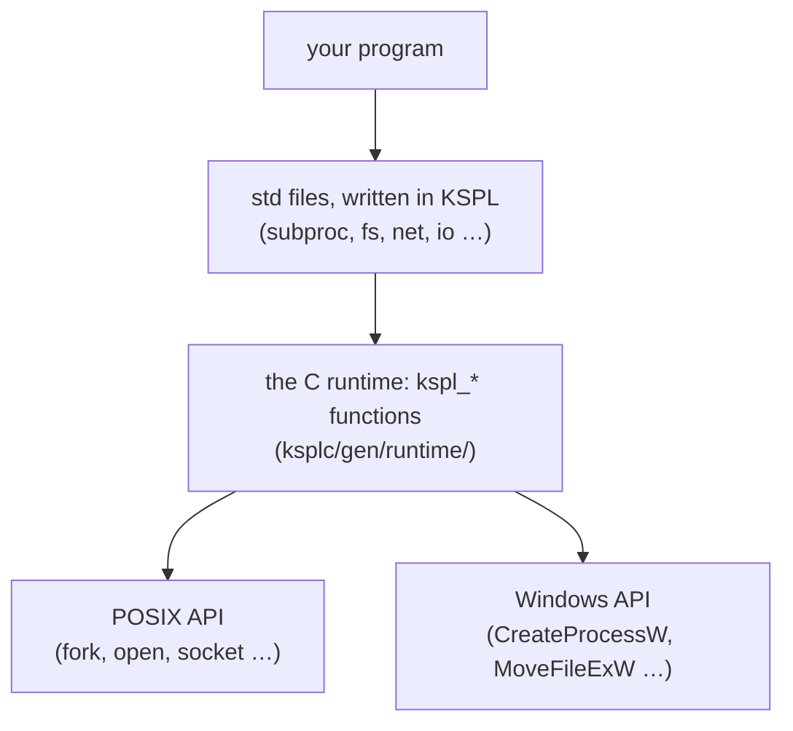
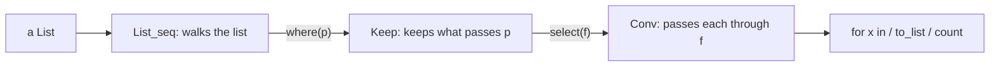
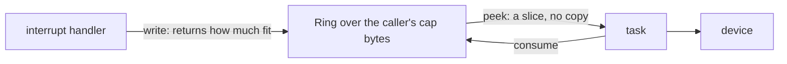

# The design policy of the standard library, and its core

This document says *why* the standard library (`std/`) works the way it does, and holds the grounds of its core: memory, containers, text, failures and the package's shape. The parts that reach outside the program (the process, files, threads, networking and the data formats) are in [`DESIGN-system.md`](DESIGN-system.md). Each file starts from an API that other languages use widely, but does not simply copy it. The criticism that API met over years of use is studied: the vulnerabilities reported against it, and the misuse it could not prevent. Where KSPL's type system can prevent one, the design changes.

**The document holds two things.**

1. A table of the known problems of earlier implementations, how each `std` file handles them, and the holes still open.
2. By subject, the choices in `std`'s own API that make a reader ask "why this way?" (here and in [`DESIGN-system.md`](DESIGN-system.md)).

When adding or changing a file, check whether the table can gain a row. If it cannot, confirm the file has not become a plain copy of the API it started from. The language's own grounds are in [`../../docs/DESIGN-principles.md`](../../docs/DESIGN-principles.md); what each file is for is what `ksplc doc std` lists, and how many files one import brings along is [`std/README.md`](../README.md).

## Words used in this document

**This table explains the words of `std` that appear across many sections.** A word used in one section only is explained where it appears. The words every package shares (arena, ARC, trait, generic, vtable, thunk, hosted and freestanding, libc, the C runtime, the seed, Principle N and the rest) are in "Words used throughout" in [`../../docs/DESIGN-principles.md`](../../docs/DESIGN-principles.md#words-used-throughout). *Gate* and the other words with one fixed meaning in every document are in "Terms of art" in [`../../docs/SPEC-documents.md`](../../docs/SPEC-documents.md#terms-of-art). The language's own rules are in [`../../docs/SPEC-language.md`](../../docs/SPEC-language.md).

| Word | What it means here |
| :-- | :-- |
| **the heap** (the global heap) | Memory taken with `malloc` and given back one block at a time with `free`. In `std`, passing `null` where a function asks for an arena means "use the heap", and then the caller owes a `free()` for what comes back ("A null arena is the heap, for every function that takes one") |
| **`Arc`** (the type) | Not ARC: `Arc<\|T\|>` is the reference-counted handle shared between threads ("The names of the reference-counting types" below) |
| **`T@` / `T$@`** | A pointer to a `T`. Without `$`, you may only read through it; with `$`, you may also write |
| **`U8[]` / `U8$[]`** | A slice: a pointer plus a length. `U8[]` is a read-only byte string; `U8$[]` is one whose bytes may be rewritten. A `$` before a variable's name (`$x: = 1`) instead lets the variable itself change later. The two kinds of `$` are "4.2 The two axes of mutability" in [`../../docs/SPEC-language.md`](../../docs/SPEC-language.md#42-the-two-axes-of-mutability) |
| **view** | A slice that points into memory something else owns. Making one copies nothing, and it stays valid only as long as that memory does |
| **`T!E`** | The return type of a function that may fail: it holds either the result `T` or the failure `E`. The caller must take it apart with `catch` or `!` ("8.3 Error handling" in [`../../docs/SPEC-language.md`](../../docs/SPEC-language.md#83-error-handling)) |
| **`Option<\|T\|>`**, written `T?` | Either a value or none. The value comes out only through `switch` or `if v: = …`, so a forgotten check does not compile |
| **panic** | The program stops with a message. `std` keeps it mostly for a mistake in the program itself, such as an index out of range; bad input comes back as a value |
| **POSIX** | The family of Unix-like systems (Linux, macOS, the BSDs) and the API they share. "Windows" here means its own API (`CreateProcessW` and the like) |

### Where to read for each file

**This table tells you which part of this document is about the file you are working on.** What each file is for is not repeated here: `ksplc doc std` lists it.

| You are working on | The files | Read |
| :-- | :-- | :-- |
| A problem other libraries are known for | any | [What was inherited, and what was changed](#what-was-inherited-and-what-was-changed) |
| Memory: who frees what | `mem`, `refcount`, `ds` | [Memory and ownership](DESIGN-core.md#memory-and-ownership) |
| Text, numbers, bytes | `chars`, `str`, `strfmt`, `strnum`, `buf`, `bytes` | [Strings, numbers and bytes](DESIGN-core.md#strings-numbers-and-bytes) |
| Lists, maps, loops, chains | `ds`, `seq`, `lang`, `ring` | [Containers and iteration](DESIGN-core.md#containers-and-iteration) |
| Reporting failures, logging | every file's `T!E`, `log` | [Failures and the log](#failures-and-the-log) |
| Arguments, output, tests, children, the clock | `argp`, `io`, `verdict`, `fuzz`, `subproc`, `sys`, `time` | [The process](DESIGN-system.md#the-process-its-arguments-its-output-its-children-and-the-clock) |
| Paths and directories | `fs` | [Files and paths](DESIGN-system.md#files-and-paths) |
| Locks, threads, sockets, JSON | `thread`, `reactor`, `stack_limit`, `net`, `jsonrpc`, `reflect`, `json`, `json_struct` | [Threads, networking and the data formats](DESIGN-system.md#threads-networking-and-the-data-formats) |
| Patterns | `regex` | [Regular expressions](DESIGN-core.md#regular-expressions) |
| Adding a file, or an import | any | [The shape of the package](#the-shape-of-the-package) |

### How std reaches the operating system

**`std` is written in KSPL, and only a thin layer of C touches the OS.** The diagram shows the layers a call passes through on a hosted build.



**The decisions live in the KSPL layer wherever they can**: the schedule of a connection attempt, the four ways of starting a child, the timeouts. The C layer keeps only what needs the OS's own types or calls. C is written twice, once for POSIX and once for Windows, and the Windows copy cannot be run locally, so the less of it the better. Several sections below return to this split.

## What was inherited, and what was changed

### Known problems KSPL handles

Each row is a bug or attack that other libraries are known for, and what the `std` file does so that it cannot happen, or cannot happen silently. The rows are grouped by area.

**Text, numbers and memory**

| File | The problem | Seen in | What `std` does |
| :-- | :-- | :-- | :-- |
| `str` | **A NUL byte cuts a string short** ("the poison NUL byte"). A KSPL string carries its length, so it may hold a byte 0. C reads a string only up to its first 0, so converting to a C string silently drops everything after it. PHP and Java had path checks bypassed this way | C's strings | `to_cstr()` returns `U8$@?`: `.none` when the input holds a NUL. `switch` must cover every case, so the caller has to handle it. `contains_nul()` is public too |
| `checked_int` | **Signed overflow is undefined behavior**: the C compiler may assume it never happens, so optimization changes the result | C's integer arithmetic | The plain operators wrap around (`mod 2^N`) whatever the signedness: the generated code goes through the unsigned type of the same width, which erases C's undefined behavior. **Only detecting overflow is chosen by type** (`Ci8` through `Cu64`). There is no wrapping type, since the plain operators already are that |
| `option` | **Null references**: a forgotten check for `null` still compiles | A raw pointer's `null` | `T?`'s content comes out only through `switch`. The linter's [H0701] proposes `T?` for a raw pointer returned as `null` |
| `mem` | **Double free and use after free** | `malloc` / `free` | The arena (`Arena`) is the main route, and `defer` shows in the code where memory is freed. The compiler traces the paths for a use after the free |

**Randomness**

| File | The problem | Seen in | What `std` does |
| :-- | :-- | :-- | :-- |
| `prng` / `rand` | **A weak random number used for a key** (CWE-330). Both languages hold a weak (predictable) kind and a safe kind, but the names are close, and `Random` or `random` keeps being used for tokens and keys | Java's `Random` / `SecureRandom`, Python's `random` / `secrets` | **The name declares "pseudo"**: the reproducible side is `std/prng`'s `Prng`, the safe side is `std/rand`. The plain name `rand` goes to the safe side, so "I need a random number" lands there. Neither is removed: Swift has no weak side, so it cannot rerun training or sampling with the same results |
| `prng` (a number in a range) | **Taking a remainder favours low values** whenever the count does not divide the generator's range: from 10 equally likely values, `% 3` gives 0 four times and 1 and 2 three times each. C++'s distributions are each library's own, so one seed gives different numbers on libstdc++, libc++ and MSVC | Java's `nextInt(bound)`, Python's `randrange`, C++'s `uniform_int_distribution` | `below` draws again past the last whole multiple of n; `between` keeps both ends and covers all of `I64`. Both are written in KSPL, so a seed gives the same numbers on every platform |

**Files**

| File | The problem | Seen in | What `std` does |
| :-- | :-- | :-- | :-- |
| `fs` | **On Windows alone, a read-only file cannot be removed or replaced.** POSIX looks at the folder's permission, not the file's, so the same clean-up works on one OS and fails on the other. Python's `shutil.rmtree` documentation carries a handler that clears the mark for this | Windows's `DeleteFileW` / `MoveFileExW` | `remove_path` and `rename_path` clear the read-only mark first on Windows, and put it back where the operation still fails |

**Networking**

| File | The problem | Seen in | What `std` does |
| :-- | :-- | :-- | :-- |
| `net` | **A write may send only part of the data** (a *short write*), yet callers keep discarding the count it returns. That is why Go and Rust hold a separate "write everything" API | POSIX `send(2)`, Go's `io.Writer`, Rust's `Write` | Both `write` (returns how much it sent) and `write_all` (sends it all), so the name states the intent. `std/http` uses `write_all` |
| `net` | **A port out of range wraps around.** The field holds 16 bits, so 83659 binds 18123 and -1 binds 65535, with no error. Rust and Swift make the type 16 bits; Python, Java and Go refuse it at run time | C's `sockaddr_in` and `htons` | Every entry taking a port (`bind`, `connect`) refuses one outside 0 to 65535 as `Net_error.bad_port`. The runtime refuses it too, as a backstop |
| `net` | **An accepted socket's mode depends on the OS.** A *non-blocking* socket returns "not ready" where a blocking one would wait. From a non-blocking listener, Linux returns a blocking socket, while Windows, macOS and the BSDs copy the non-blocking mode. So the same read waits on one OS and returns "not ready" on another. Python made `accept` return blocking for this reason | BSD sockets' `accept` | `accept` returns a blocking stream on every OS. A reactor's caller makes it non-blocking by asking, as for any other stream |
| `http` | **Request smuggling**: two programs on the way (a proxy and a server) see a different end for the same request, so a second request hides inside the first. The causes: `Content-Length` and `Transfer-Encoding` read differently, or `Content-Length` given twice | HTTP/1.1 implementations in general | Refuses any `Transfer-Encoding`, and a duplicated `Content-Length` whose values disagree |
| `http` | **Response splitting**: a line break (CRLF) injected into a header value starts a header or a response of its own | The same | Refuses at write time a CRLF in a header name or value, the method, the target or the reason phrase |
| `http` | **A writer that frames otherwise than its reader**: a `Content-Length` the body does not have, or one beside `Transfer-Encoding`, splits the message where another reader cuts it | The same | Refuses at write time whatever the reader refuses: `Transfer-Encoding`, and a `Content-Length` that is not the body's or is given twice (`length_mismatch`). A header value with a space or a tab at either end is refused too (`invalid_header`): RFC 9110 §5.5 gives a value none, and the reader trims it, so it would read back as another value. 1xx, 204 and 304 get no length and no body (RFC 9110 §8.6). The answer to a HEAD, which names the length of a body it does not carry, has its own builder (`format_response_to_head`) |
| `http` | **Two `Host` headers, or one value, read differently by two programs on the way**: a proxy routes by one and the server checks the other, so a request reaches a host by a name nobody checked. `user@a` is host `a` to a reader that takes userinfo, and `a/b` is host `a` to one that takes a path. A request with no `Host` on HTTP/1.1 is malformed the same way | HTTP/1.1 implementations in general; RFC 9112 §3.2 asks a server to answer each with 400 | `parse_request` and `request_length` refuse a request naming `Host` more than once, on HTTP/1.1 and later not at all, or with a value that is not a host and an optional port (RFC 3986's `uri-host [":" port]`, the port up to 65535) (`invalid_host`); HTTP/1.0 may leave it out. `format_request` and `write_request` refuse the same head. Whether a version is "1.1 or later" is decided in one place, `http.is_1_1_or_later`, which a server's keep-alive default reads too |
| `http` | **A body that runs to the close** cannot be told from one cut off early | The same | Refuses a response that may carry a body but names no length (`unsupported_close_delimited`), rather than return what arrived as the whole body. 1xx, 204 and 304 end at their head |
| `jsonrpc` | **Two readers cut one stream into different frames.** Readers differ on which of two `Content-Length` lines counts, the first or the last; and a limit on the head checked against what one read brought takes a long head arriving at once and refuses it arriving a byte at a time | LSP clients and servers in general | A head naming two lengths that differ, or one it cannot read, has no length, so the frame is `broken`. The head's limit counts its own bytes: its end is looked for only within `max_head_bytes`, however the bytes arrive |
| `jsonrpc` | **Nothing comes back for a broken frame or a dropped response.** (A *frame* is one message with its `Content-Length` header in front.) On a frame missing `Content-Length`, `lsp4j` sends no response, only a log line ([#210](https://github.com/eclipse-lsp4j/lsp4j/issues/210)); on a dropped response, `pylspclient` cannot look up the id and throws | LSP clients in general (`lsp4j` / `lsp-server` / `pylspclient`) | A frame declaring no length, or over the limit, returns `Rpc_end.broken` **as a value**, and its broken head is dropped from the pool so it cannot repeat forever ("The frame is kept apart from the transport" below) |

**Data formats**

| File | The problem | Seen in | What `std` does |
| :-- | :-- | :-- | :-- |
| `json_struct` | **A key's name is written twice, once for the writer and once for the reader.** n fields take 2n lines, and fixing only one silently fills in the default | `serde`'s derive, Swift's `Codable`, Jackson's annotations, nlohmann's macros | The round-trip functions (`json_struct.from_struct` / `json_struct.into_struct`) walk `std/reflect`'s table of a type's fields, and **ksplc synthesizes the table and `fields()` from an empty `impl X: reflect.Reflectable {}`** ([3.2.5 in `../../docs/DESIGN-principles.md`](../../docs/DESIGN-principles.md)). Synthesized, the table cannot drift from the type's declaration; a drift would give no diagnostic and show as reading and writing the neighbouring field. A key cannot be given another name: it is the field's name |
| `json_struct` | **A missing value silently becomes a default** | The same | A missing key and a `null` one are refused with different values (`missing_field` / `field_type`), so no sentinel default such as `as_int64(-1)` folds two causes into one value |
| `json_struct` | **An integer is silently narrowed into a smaller field** | The same | **An integer the field cannot hold is refused** (`field_type`), not narrowed: 70000 into a `U16`, -1 into a `U8`, and on writing, a `U64` past the largest `I64`, the widest integer a `Val` holds. Whether it fits is `std/reflect`'s `fits_int` |
| `json` | **Stack exhaustion from deep nesting** (the billion-laughs family): a document nested very deep makes a recursive reader run out of stack and crash | JSON parsers in general | Nesting stops at `max_nesting_depth = 500` with a `Json_error`, not a panic |
| `json` | **Duplicate keys**: implementations read `{"a":1,"a":2}` differently, so two parsers given the same document see different values | The same | Not refused: RFC 8259's uniqueness is only a SHOULD, and refusing would drop legitimate requests over the sender's implementation quirks. Reading is first wins, and `dump` keeps the duplicates. `Obj_builder.set` replaces (appending would write a value `get` cannot see). `Val.get` walks a linked list, and `max_nesting_depth` does not bound the member count |

**Threads**

| File | The problem | Seen in | What `std` does |
| :-- | :-- | :-- | :-- |
| `thread` | **Nothing says which types may cross threads**, so a non-atomic reference count or a raw pointer gets handed over casually | POSIX threads | **Not handled.** Constraining `spawn`'s argument types guarantees nothing: it checks only the argument, sharing through a global goes unchecked, and "the constraint is met" would not mean safe (the grounds are "Why data races are not prevented by the type system" in [`../../docs/DESIGN-language.md`](../../docs/DESIGN-language.md#why-data-races-are-not-prevented-by-the-type-system)). What exists is choosing by type name (`Rc` / `Arc`, `Mutex<\|T\|>` / a plain value) |

### Known holes, and what would fill them

Two known problems are not handled. For each, the table says why it is open and what filling it would take.

| File | What is not handled | Why it stays open | What would fill it |
| :-- | :-- | :-- | :-- |
| `reflect` | **A container of containers (`List<\|List<\|T\|>\|>`), and an option holding a container or an option, cannot be walked** by the round-trip functions | **One hole stops both.** Describing such a field needs a kind whose content kind refers to itself, so `Field_kind` would need a payload. The LLVM backend (`--to=llvm`) cannot lower that: a global's type is named, so its initializer must be of that type | Either bit-packed constants or a second lowering from a layout to an LLVM type; neither is taken. Lowering only the shapes reflection needs would let only some types' payloads through. The kind is not added ahead of time, since a shape that cannot be walked would then be writable (Principle 5; the mechanism is [3.2.5 in `../../docs/DESIGN-principles.md`](../../docs/DESIGN-principles.md)) |
| `Map` | **Hash flooding.** An attacker sends many keys chosen to land in the same slot, so every lookup slows to a crawl: an algorithmic-complexity attack. PHP, Python, Ruby and Java all issued CVEs and added hash randomization | No attacker's key reaches a `Map`. The packages taking keys from outside do not use `Map` (`http` keeps its headers in a linked list too); `make test-conventions` holds which packages those are. **When that check fails, design the hash seed then**: it fails exactly where a key from outside gets in | Decided already. `str.hash` is FNV-1a plus extra mixing with a fixed seed, and `Hashable`'s `hash(r: Self): U32` cannot take a seed, so the signature changes to pass one per `Map`. Randomizing by default is ruled out: the compiler uses `Map` heavily, and an iteration order changing per run makes the generated C differ per run. That breaks self-hosting's zero-difference check, where the compiler builds itself twice and both outputs must be identical |

## Memory and ownership

KSPL has no garbage collector. Memory that `std` hands you lives in one of four places, and the call itself shows which, so you can see who frees it.

| Where it lives | How you ask for it | Who frees it, and when |
| :-- | :-- | :-- |
| The global heap | Pass `null` as the arena: `List.new(null)` | You, usually with `defer xs.free()` right after |
| An arena | Pass the arena: `List.new(arena)` | Nobody frees it piece by piece: it all goes when the arena is freed |
| Your own buffer | `Buf_writer.new(U8$[]::buf)`, `Arena.from_buffer(…)` | Nothing is allocated, and the buffer stays yours |
| Shared by several owners | `Rc<\|T\|>.new(v)` / `Arc<\|T\|>.new(v)` (ARC) | The compiler, when the last owner lets go |

The first two side by side:

```kspl
import "std/ds" { List }
import "std/mem" { Arena }

fn main()
    // On the heap: this function owes a free().
    $on_heap: = List<|I32|>.new(null)
    defer on_heap.free()
    on_heap.push(1)

    // In an arena: freed with the arena, all at once.
    arena: = Arena.new(4096)
    defer arena.free()
    $in_arena: = List<|I32|>.new(arena)
    in_arena.push(2)
```

### A null arena is the heap, for every function that takes one

Pass `null` where a function takes an arena, and it works on the heap instead. **Taking `null` needs no check in each function.** `Arena.alloc` with a null receiver takes the bytes from the heap, and every way an arena hands out memory (`alloc_as`, `create`, `dup_str`, `text`) goes through it. The arena's fields are private to `std/mem`, so nothing reaches arena memory another way, and a new function honours `null` without being told. `make test-conventions` holds each function that takes an arena to a call with `null` in std's tests, so a new one without such a call fails there.

**What comes back is the caller's to free**, and the function's summary says how:

| What it returns | How the caller frees it |
| :-- | :-- |
| One block: a string or bytes | `mem.dealloc(Void$@::s.ptr)` |
| A `List` | `xs.free()`, after the strings each element owns (`fs.read_dir` and `fs.walk_files` a string each, `verdict.run_children` its `out`, `subproc.run_many` its two outputs, `fuzz.gather` its `name` and `data`). A list placed on the heap and handed out as a pointer (`List.create`) then gives back its own block with `mem.dealloc(Void$@::xs)` ([below](#a-lists-free-leaves-the-list-itself)) |
| A child's two outputs (`subproc.run_capture`) | Each with `mem.dealloc`; a child that did not start has empty ones, which free as nothing |
| A value of many blocks: a JSON document (`json.parse`, `jsonrpc`'s `read_msg` and `request`), a `Json_builder`, an HTTP request or response, the headers `http.headers` builds, a query's pairs, an `argp.Parser`, the fuzz driver's `Findings` and `Setup` | `v.free()`, which lets all of it go at once ([below](#a-value-of-many-blocks-keeps-an-arena-of-its-own)) |
| The fields `json_struct.into_struct` fills in the caller's struct | Each string with `mem.dealloc` and each list with `free()`, as above. **A refusal leaves the fields it filled before it**, freed the same way |

**What a function does not return, it frees before returning**, `null` or not: a path joined on the way, a list it sorts from, the object it encodes into text. That work goes in `mem.scratch(arena)`: the caller's arena where one was given, else an arena of the function's own that is freed on the way out. So with `null` the caller owes a free for the result alone. A function that refuses after making its result gives the result back too, so a failure leaves nothing to free; `into_struct` alone cannot, since what it fills is the caller's.

#### A list's `free()` leaves the list itself

**`free()` gives back what a list holds, never the block the list stands in.** A list from `new` stands in the caller's variable, and one `create` put in an arena goes with the arena, so only a list `create` put on the heap leaves a block behind. Giving that one back from `free()` would mean every list carrying where it stands: 8 more bytes on each list's 32, paid by every list, the many small ones a tree keeps in each node included, for the few made on the heap. So the caller who passed `null` gives the block back, as for any one block: `xs.free()`, then `mem.dealloc(Void$@::xs)`. The compiler reads that `dealloc` as the block's own release and not as a use of what `free()` released, and refuses any use after it ("8.4.5 Tracking a free with `Owned`" in [`../../docs/SPEC-language.md`](../../docs/SPEC-language.md#845-tracking-a-free-with-owned)).

#### A value of many blocks keeps an arena of its own

**Given `null`, a value of many blocks is built in an arena of its own, which the value keeps** (`mem.Own_arena`), and its `free()` lets that arena go at once. The arena is the same `mem.scratch` a function's work goes in: the function keeps it with the result instead of freeing it on the way out. Given an arena, the value keeps nothing, and its `free()` frees nothing: that arena does. So `doc: = json.parse(text, null)!` and then `defer doc.free()` is written as for a `List`.

| What it settles | How |
| :-- | :-- |
| **No free walks the value block by block.** A walk names every block the build made, so a part added to the build and not to the walk leaks without a word, and a failure halfway leaves a partial structure the walk must take apart | Building in one arena, a failed call frees that arena and leaves nothing, and `free()` is one line whatever the value holds |
| **Freeing a part frees nothing.** A header further down a list, or a request's `headers`, has the same type as the whole | Only the value the call returned holds the arena; every part holds an empty one, so freeing a part cannot tear a hole in the whole |
| **Freeing twice is refused where it can be seen.** Each such type conforms to `Owned`, so a second `free()` of a local, or a use after it, is a compile error, as for a `List` | Through a copy or a field it is not seen, as for any block given back |
| **Code outside std cannot make a value that claims an arena** | `mem.Own_arena`'s field is visible only inside std, so such a value is built through std's own functions |

**A parsed JSON document is a type of its own, `json.Doc`: the value (`doc.val`), and the arena `parse` made for it given `null`.** Any kind of JSON value can be the whole document, so an arena kept in the value would sit in the string, array and object variants alike. The document keeps it apart instead:

* **Every `switch` over a value writes each variant's own field alone** (`case .str_val(s)`), never a field for the arena it does not read.
* **What frees is in one place**: the document `parse`, `read_msg` and `request` return. A value a `Json_builder` makes lives in the builder's arena, and the builder frees it.
* **A part cannot be freed at all.** `doc.val`, and every value read out of it (`get`, `get_at`, `arr_list`), is a `json.Val`, which has no `free()`, so freeing a part is a compile error instead of a call that frees nothing.

Parsed into the caller's arena, a document holds nothing to free, so keeping `doc.val` alone is enough.

**An HTTP response's version and reason phrase enter its arena when the status line is parsed.** Reading the body may grow and move the receive buffer, so views into that buffer cannot survive until the response is complete. The buffer and socket readers share this arena-owned status line, and each field is copied once.

Caution: **The arena of its own takes a whole chunk at its first allocation**, however small the value. For many small values, such as each message a server reads, pass an arena of the caller's and free it once.

**No free function takes the arena as an argument** (an `alloc_in(arena, n)`): it would be a second spelling of `arena.alloc(n)`.

The rules of the language itself (`defer`, ARC, arenas) are "8.4 The memory management model" in [`../../docs/SPEC-language.md`](../../docs/SPEC-language.md#84-the-memory-management-model-defer--arc--arenas). The sections below say how `std` uses them.

### The names of the reference-counting types

`Rc<|T|>` shares a value between owners on one thread, `Arc<|T|>` between threads, and a weak handle is named `Weak_` plus its owner's name. The names are short because they are written often.

Caution: **Do not confuse `Arc` with ARC in a document.** ARC (upper case) is Automatic Reference Counting, the mechanism by which the compiler inserts retain/release; a specification using the three letters always means it. `Arc<|T|>` (a type name) is Atomically Reference Counted, the type shareable between threads, with the role and name of Rust's `Arc<T>`.

| Name | What it is | Why this name |
| :-- | :-- | :-- |
| `Rc<\|T\|>` | Counted owner, one thread (`std/refcount.kspl`) | Code that needs reference counting repeats the type name constantly, and a long name spends lines and pushes the subject aside in every annotation. `Rc` / `Arc` come from Rust and are widely recognized |
| `Arc<\|T\|>` | Counted owner whose count is atomic, so threads can share it | The same |
| `Weak_arc<\|T\|>` | A handle that watches an `Arc`'s value without owning it | A weak handle's name is `Weak_` plus its owner's type name, so stripping the prefix gives the owner (`Rc` / `Arc`), and the pairing reads from the text |

**The zero value is an empty handle that owns nothing**, and retain/release skip it. So a table of empty slots such as `Rc<|T|>[N] = ::{}` is written plainly. It also survives the compiler's chained release over storage filled with zeros. `empty()` / `is_empty()` spell it out.

### Release takes the value apart

**When the last owner of an `Rc<|T|>` or `Arc<|T|>` lets go, the `T` inside is taken apart too**: every ARC value it holds by value is released, to any depth, as when a `T` on the stack leaves its scope. Left alone, every `Rc` held inside a shared value leaked, so a shared tree or graph could not be built from `Rc` at all.

| What it costs | What to do |
| :-- | :-- |
| **The time goes where the last owner goes**: leaving one scope can free a whole tree, at a line that shows no call | Where timing matters (an interrupt, a control loop), take the structure apart step by step before that point |
| **A long chain recurses once per link** (`next: Rc<\|Node\|>`, a million deep), and can run the stack out | Walk the chain in a loop, moving the head forward (`head = head.get().next`): each step frees one node while the rest is still held |
| **The free runs on the thread, or in the handler, where the last owner goes**. An `Rc` inside an `Arc`'s value is then released from another thread, a data race | Hold only `Arc` in a value threads share; on bare metal, let the last owner go outside an interrupt handler |

A cycle still leaks, as in every reference-counted language: make one side a weak handle. A resource that is not ARC (a `List`, a file) still needs its `free()`, since nothing runs one implicitly.

**Both wrappers hold one implicit weak count for all strong owners together.** It stays held while the last owner takes the value apart: the value may hold the last explicit weak handle to its own block, whose release must not free the block under that call. The wrappers share one private control-block layout and initialization. `Rc` updates its counts directly; `Arc` uses atomic operations, so a single atomic decrement decides which thread frees the block.

### A container owns its elements' ARC counts

Put an ARC value into a `List` or `Map`, and the container keeps its count right for you, through every way of taking it out, overwriting it, growing and freeing. Nothing leaks, and nothing is released twice.

The caller cannot reach the storage, so anything the container fails to release is a leak nobody can fix. The implementation keeps two promises:

| Promise | How | What breaks without it |
| :-- | :-- | :-- |
| **Zero freshly allocated capacity** | `mem.zero` on new storage | Storing an element is an ordinary assignment, so the compiler inserts a release of the value being overwritten. Releasing leftover garbage as if it were ARC crashes |
| **Give the ownership back when discarding** | `free` assigns an empty (the zero value) to the remaining elements, `remove` to the removed one, and a resize to every slot it moved a pair from | `mem.zero` runs no release: without an assignment, the compiler has nowhere to insert one |

**An `Rc<|T|>` element's own release takes its value apart** ("Release takes the value apart", above), so a container of `Rc` needs nothing more.

### A constructor's name says where the returned thing goes

`alloc`, `new` and `create` are not three names for one thing. Each says where the result goes, so a call can be read without looking up the signature. An arena, when a function takes one, is always the last argument and is never filled in for you.

The table of the three names is "Pitfalls" in [std](../README.md). This section holds the rules that come with it.

**The arena `new` receives is where the content goes**: `List.new(a)` returns a `List` value whose elements go in `a`. To place the `List` itself in the arena, carried as a pointer, use `create(a)`. To put an arena in the caller's variable (for a configuration with no malloc), use `Arena.from_buffer`, which returns a value.

**An arena is always the last parameter, and it has no default.** The global heap is `null`, written at the call (`List.new(arena)` against `List.new(null)`). So the call shows where the content goes and whether a `free()` is owed. Why a default is refused: "A default argument is allowed only for a foldable constant" in [`../../docs/DESIGN-principles.md`](../../docs/DESIGN-principles.md). The signature says whether a function takes one, so the name does not say it again.

Caution: **Do not mark an arena parameter with a suffix**, least of all `_in`. `_in` also means "in that place" (`harness.run_in(argv, cwd)`) and "inside a thing" (`index_in(row, cell)`), so it cannot be read as pointing at an arena.

**A function outside `std` that returns a pointer, beside one of the same name returning a value, may end in `_in`** where `create` does not name what it does (opening something, not making an empty one). The suffix then says where the result is, not that an arena is taken, and the function says so where it is defined.

**Do not take an arena only to discard it.** The signature is the one mark that a function takes an arena, so the caller reads one there as "I handed over where the content goes". A discarded one misleads them about whether clean-up is needed.

**Only a function that takes an arena allocates.** In `std/str`:

| Functions | Take an arena? | Return |
| :-- | :-- | :-- |
| `trim_*` / `strip_*`, `chars.sub` / `sub_from` | No | A view into the input |
| `replace` / `join` | Yes | A copy |
| `split` / `lines` | Yes | A `List` placed in the arena, whose elements are still views |

Caution: **Do not judge by `U8[]` against `U8$[]`.** `sub_mut` returns a writable view without allocating, so the return type cannot tell; the arguments can.

### The receiver aligns the start of a buffer it is given

When you hand `std` a plain byte array to use as memory, `std` itself moves past any odd start address. You do not have to place the array on an 8-byte boundary, and you could not if you tried.

`mem.init_freestanding_heap()` and `Arena.from_buffer()` use the caller's static buffer as it stands, and **nothing guarantees its head is aligned**. The buffer is usually a plain byte array such as `$buf: U8[4096]`, aligned to 1, so its address depends on how the variables happen to be ordered in memory (`.bss`). One 1-byte variable just before it puts it at an odd address.

Misaligned, a header's `Sz` or a pointer straddles a boundary. A host mostly tolerates it. Cortex-M (a common microcontroller core) raises an alignment fault and drops into the default handler's infinite loop, **freezing with no output at all**, so the symptom hides the cause.

Caution: **It shows only when an unrelated change adds one byte**, because the ordering decides whether it works.

So **the receiver** aligns it (`align_pad` in `std/mem.kspl`), rather than asking the caller to place the buffer on an 8-byte boundary: the caller cannot control a `U8[N]`'s alignment. Rounding only the chunk header's size up to a multiple of 8 is not enough: every address handed out stays misaligned, since the head itself is.

### An arena refuses a mark it cannot place

`arena.restore(mark)` rewinds to a mark `save()` took. A mark from another arena, one saved before `reset()`, and one past what its chunk now holds (an earlier `restore()` rewound past it) stop the program at the `restore`, with a message that names them, before anything is freed.

**Rewinding frees every chunk from the newest down to the mark's.** With a mark whose chunk the arena does not hold, that walk frees all of its chunks and makes the foreign chunk its head. The next allocations then land inside the other arena's live data, and the first sign is a double free when both arenas are freed, far from the call that caused it.

So `restore` first looks for the mark's chunk among its own, the same walk it makes to free them, and the mark carries the arena's count of resets. The count is needed because a chunk allocated later can take a freed chunk's address, and because `reset()` keeps one chunk, where an old mark would otherwise look valid once the new round has used as much.

**What remains unchecked keeps the arena whole.** A mark that an earlier `restore()` rewound past, but whose chunk now holds at least as much again, rewinds to its place without a stop. Every chunk it keeps is one of this arena's, and every byte it hands out afterwards is past what it keeps, so nothing allocated overlaps. Telling that mark apart would cost a record of every mark ever saved, as an arena hands them out by value.

## Containers and iteration

### What a container requires of a type is written as a trait

To be a key of `Map<|K, V|>`, a type must conform to the trait `ds.Hashable<|Key|>`, which asks for `hash` and `equals`. A type that does not conform gets an error where you used it, not one deep inside `std`.

Caution: **Do not express a requirement by name agreement alone.** It is then written nowhere, and a key type failing it gets a distant error inside `std/ds.kspl`. Where there is a requirement, express it as a trait (the rule is ② in `docs/DESIGN-language.md` "The order of decision"). Every key type declares its conformance (std's own are `I32` / `Sz` / `U8[]`). `Map`'s constraint `K: Hashable<|K|>` then reports a type that does not conform as not implementing this trait, where the user wrote it, rather than as `has no field or method named 'hash'` inside std.

**`Hashable.equals` and `Eq` are different requirements.** `Eq` is what `==` desugars to; `Hashable.equals` asks, by an explicit call, whether two keys are the same. `U8[]` deliberately does not implement `Eq`. `a == b` would become an O(N) content comparison, and a reader could not tell whether `==` compares contents or pointers (the reason `switch` cannot take a `U8[]` subject; `docs/SPEC-language.md` §6.1).

The other key arrives as the type argument `Key`, as in `std/lang`'s `Add` / `Eq`, because `Self` cannot be written on an argument other than the receiver (the value before the `.`; `docs/DESIGN-language.md` "Why a trait's receiver is fixed to a bare `Self`"). The compiler rejects such a `Self` at the definition, rather than let it fail in the C compiler with no KSPL diagnostic.

**The built-in types' conformances go in std.** In the compiler, an implementation that exists to make a type a key of std's containers would invert the layers. So `Sz`'s `Hashable` sits in `std/ds.kspl` beside what requires it.

`ds.fmix32` is the one place the bit mixing lives, so no key type copies it. It scrambles a hash so that keys whose low bits are the same still spread over the slots. Without it such keys crowd one slot, and `Map` degrades into a linear search (the masking is described at `fmix32` in `std/ds.kspl`). **Measure before adding it — adding it everywhere is a mistake.** In a `hash` on the innermost loop the extra operation outweighs the diffusion, so a parser's memo lookup and a key of token IDs, whose low bits already differ, leave it out.

### A map that keeps a few pairs stays small however many keys pass through it

`Map` is open addressing: a removed pair leaves a tombstone, a mark a lookup steps over, so a key pushed past that slot is still found. Tombstones take slots as live pairs do, and a resize comes once half the slots are used, counting both.

**A resize that finds at most a quarter of the slots live drops the tombstones in place and keeps the capacity.** Only a fuller table doubles. Doubling every time would grow a map that holds a handful of pairs without end while different keys are set and removed, as a cache of open connections or a table of in-flight requests does: memory grows with the number of keys ever seen, not with the number held. The rehash leaves the table at most a quarter full, so a quarter of its slots must go before the next, and each insertion pays O(1) for it. Working in place, it allocates nothing, so a map in an arena does not grow the arena either.

**The capacity never shrinks on its own**, since a map emptied once is usually filled again. A program that needs the memory back builds a new map and frees the old one.

### A function that returns every entry does not build a nested generic

`Map` hands out its entries through an iterator, `items()`, not as a ready-made list. A list of entries would make the compiler build a whole extra copy of `List` for every `Map` type, and every caller only walks it once anyway.

A listing would be `List<|Map_entry<|K, V|>$@|>`: one generic inside another (*nested generics*). So every `Map` type would specialize **a whole set of `List`** (`std/ds`'s container and `std/seq`'s chain) at that element type. The cost lands on specialization. In a large program, a single nine-line function returning a listing shows in translation time, bodies analyzed, peak memory and generated C size. Every caller builds the listing, walks it once and drops it, so an iterator loses nothing.

**The test is whether the return type takes another generic as a type argument.** `List<|U8[]|>` does not (`U8[]` is a built-in array, not a generic). Where even one caller needs `.len` or an index, a listing is fine; the one kept inside `std/ds` is there because sorting needs all of it.

### Iteration has one notation, `for x in`

Every loop over a collection is written `for x in xs`. The type of `xs`, not the writer, decides how it is walked.

| The subject's type has | `for x in` expands to |
| :-- | :-- |
| A `.len` field and an index (`List`, arrays) | Indexing, `xs[i]` |
| A conformance to `std/lang`'s `Iter<\|T\|>` (`next(): T?`) | Calling `next()` until it returns none |

The rule is `docs/SPEC-language.md` 7.2, the reasoning `docs/DESIGN-principles.md` 9.2.

**Do not make a `has_next` / `next` pair.** It would bring a second notation into std, `for it.has_next() { x: = it.next(); … }`. That is also why `Iter` holds only `next`: split in two, calling only one of them becomes writable.

**Eager or lazy.** An *eager* function does all the work at once and returns a `List`; a *lazy* one does the work only as the loop asks for each element.

| | Functions | Driven by |
| :-- | :-- | :-- |
| Eager: returns a `List` | `str.split` / `json.Val.arr_list` / `fs.read_dir`, and each `std/seq` operation needing the whole (`order_by` / `distinct`) | Nothing: the work is done on return |
| Lazy: a chain | Only `where` / `select` | `for x in`, `to_list(arena)` or `count()` |

**A function returning elements in order that may allocate them all is eager, returning a `List`.** A `List` carries `.len` and an index, so `for x in` walks it by index; it is not given `Iter`, which would win over the index. The eager side allocates more, so only code tolerating a slowdown (tools, example code) may rely on it. Where it may not, `std/` itself included, is for `docs/DESIGN-principles.md` 8.3 to say.

**`order_by` is the one sort, and it is stable** (its algorithm is described at `order_by` in `std/seq.kspl`). *Stable* means equal keys keep their order. So an answer built from a sorted list (completions, references) is the same on every run, and sorting by a second key after a first gives the expected listing. There is no unstable variant: its one gain, sorting in place without a second buffer, is not what `std/seq`'s eager operations are for, since they return a new list anyway.

**What eagerness costs** is the list's own storage (16 bytes per element), allocated up front (the elements are not copied); a caller streaming a huge input must allow for it. These functions take an `arena`. With `null` they allocate from the global heap (as `List.new(null)` does), and the caller frees the result with a `defer`. So `for x in s.split(…)` can be written directly only when an arena is passed: with `null`, nothing could free the temporary the loop uses.

### Why the chain's stages cannot be folded

`where` and `select` build a *chain*: each call wraps the previous step in a new stage type. Other languages write such methods once, as a trait's default body (a body every conforming type gets unless it writes its own). KSPL cannot do that for `where` / `select`, and chooses not to for `to_list`.

The diagram shows how `xs.where(p).select(f)` nests one stage inside the next, and what drives it.



`std/seq`'s `Keep` and `Conv` each write `where` / `select` / `to_list` per stage; only `count`, which needs nothing but `next`, is a trait's default body, on `std/lang`'s `Iter`. **The three stay per stage for different reasons.**

| Method | Could it be a trait's default body? | Why it stays per stage |
| :-- | :-- | :-- |
| `where` / `select` | **No** | Their return type puts `Self` in a type-argument position (`Keep<\|Self, T\|>`). A trait holding that shape cannot be implemented even when the method has a default body: in the body copied into a generic implementation such as `Keep<\|S, T\|>`'s, that `Self` is not resolved |
| `to_list` | **Yes, and it stays by choice** | Its return, `List<\|T\|>`, holds no `Self`. `std/lang`'s `Iter` cannot take it, since that file imports only `std/libc` and so cannot name `List` / `Arena`. A trait in `std/seq` itself can, and one body serves both stages: the trait's type parameter becomes each stage's element type, `T` for `Keep` and `U` for `Conv` ("5.1 Traits (`trait`)" in [`../../docs/SPEC-language.md`](../../docs/SPEC-language.md)) |

**Folding `to_list` alone saves one of its two bodies**, not enough to pay off with two kinds of stage. Fold once the kinds grow, since that is when the count multiplies; `where` / `select` can join only once that `Self` is resolved.

**A chain can be driven any number of times**: the receiver is taken by value, so `for` and `to_list` each advance their own copy, whereas a Python generator is empty after one pass.

Caution: **Assemble and consume a chain in the same frame** (the same function call). A predicate's environment sits on the caller's frame, so a chain returned from a function points at a dead frame ("Why capture is made explicit and escape is forbidden" in [`../../docs/DESIGN-language.md`](../../docs/DESIGN-language.md)).

### Only `where` and `select` ride on the chain, and a predicate is a `Callable1`

Only `where` (keep the elements that pass a test) and `select` (turn each element into another) are stages of a chain. Everything else is an ordinary method on `List`. The test you pass in is a `Callable1`, so it can be a closure that carries the value being searched for.

| Kind of operation | Examples | Where it lives |
| :-- | :-- | :-- |
| A stage of the chain | `where`, `select` | The chain |
| Needs the whole list | `order_by` / `distinct` | `List<\|T\|>` |
| Returns one answer | `first` / `any` / `all` | `List<\|T\|>` |
| A sum | None: write the `for` loop | — |

There is no `sum`: without overloading it would be one method per numeric type, each the same three-line loop a `for` writes directly. **Only `where` and `select` ride on the chain**, because the stages' types nest. Each new kind of stage multiplies the code that keeps every operation callable from every stage, since the ones returning a stage cannot become a trait's methods (the section above).

A predicate (a test returning `Bool`), selector or comparator is taken as `Callable1` / `Callable2`, so a caller passes a closure as it is. A *closure* is a function value that carries variables from the place where it was made (its *captures*).

Caution: **Do not turn it back into a function pointer.** `where` / `any` / `all` are useless unless the predicate can be given what is searched for: "does it contain this node" could not be written, and a plain `for` would replace them. A function value with a capture carries the function and its environment, which one function pointer cannot hold ([`../../docs/SPEC-language.md`](../../docs/SPEC-language.md) 8.1, "Closures").

**Whether a callback is a function pointer or a `Callable` depends on whether it needs a capture** (the rule is "Whether a callback is received as a function pointer or as a `Callable`" in [`../../docs/DESIGN-language.md`](../../docs/DESIGN-language.md)). `std/fs`'s `skip_dir` makes do with a constant set of names, so it takes a function pointer. `std/thread`'s `spawn` has no choice, since its `entry` crosses the C boundary. Do not reason "it is a predicate, so a `Callable`": taking a `Callable` where no capture is needed stops one named predicate from being passed to several functions.

### Indexing costs one comparison, and the stop is called out of line

`xs[i]` on a `List` becomes one comparison plus the address arithmetic. The code that builds the "index out of range" message sits in a separate function that is never copied into the caller.

`xs[i]` calls `at`, which compares `i` with the length and calls `bounds_panic` (`std/lang.kspl`) when it is out of range. **`at` is meant to vanish into its caller** (to be *inlined*: its body copied into each call site), leaving the comparison and the address arithmetic, so it carries `#inline`.

**`bounds_panic` carries `#noinline` for that to happen.** The C compiler judges whether a function is small enough to copy into its caller only after it has copied that function's own callees into it. Copied into `at`, the message building (`Panic_msg`, three numbers turned into text) makes `at` too big, so every `xs[i]` stays a call. Nothing else changes, since the stop runs only when the index is wrong. Keeping that copy out turns every `xs[i]` of an optimized build into the comparison inline; a program that indexes lists throughout runs measurably fewer instructions.

Caution: **Do not move the message building back into `at`.** The cost does not show in a test or a diagnostic, only in every loop over a list.

### The ring buffer neither blocks nor locks

`Ring` (`std/ring.kspl`) is a fixed-size circular buffer for one job: an interrupt handler writes a little at a time, and a task reads in bulk. It never waits and never locks; the caller decides both.

An *interrupt handler* (ISR) is code the hardware runs the moment an event arrives, cutting into whatever was running. The diagram shows the path `Ring<|const cap: Sz|>` sits on.



**Why it does not wait**: waiting needs something that knows whom to wake (a scheduler), which would make it unusable right after a bare-metal start-up and inside an interrupt handler. Instead `write` / `read` return how much went in or came out, and the caller decides.

**Why it does not lock**: the right exclusion depends on where it sits — disabling interrupts between a handler and a task, a hardware spinlock between cores, nothing on a single-threaded host. Any one built in is too much or too little elsewhere.

**Why the capacity is a const generic and the caller supplies the buffer**: a container touched from an interrupt handler cannot live on the heap (`alloc` takes a lock, so an ISR calling it freezes). With the capacity in the type, `% cap` is a constant in the generated C, so even a target without hardware division (Armv6-M) calls no software division.

**The wraparound is not guaranteed by a type.** Wrapping the index in a modular type would stop a forgotten `% cap`, but the type spreads into signatures and needs a conversion at every boundary. Rust's `std::num::Wrapping` shows this: methods such as `wrapping_add` are the usual way there. Instead `head` / `tail` are `priv` and only `step` advances them. Tests, not the type, catch a forgotten one: `make debug`'s ring tests always cross the wraparound, since writes that do not cross pass with or without `% cap`.

**The storage is a slice of exactly `cap` bytes.** `Ring<|cap|>.new` stops the program, naming both lengths, when the slice is any other length: shorter, the queue would write past its end; longer, bytes the caller sized would never be used, a capacity that looks larger than it is. The slice's bounds check stays on every byte. It costs one comparison, while the wrap stays `% cap` on the type, a constant.

**Why `peek()` returns a slice into the buffer**: most embedded send paths stream what accumulated straight to the device, and copying it out would add a working buffer. The cost: `peek()` returns only the contiguous part up to the wraparound, so a caller taking everything goes round `peek` → `consume` twice. Joining the parts inside would need a memmove, defeating the point.

## Strings, numbers and bytes

### String functions are split by whether they allocate

**`std/chars` only looks at text and never allocates memory, and `std/str` builds new text and may allocate: the split is by whether a function allocates, not by line count.** So a file that cannot afford the whole string set, such as `std/base64` or `std/sha256`, can still test characters and cut slices, since `chars` needs neither `std/mem` nor `std/ds`.

| File | What it does | Allocates? |
| :-- | :-- | :-- |
| `std/chars` | Looks: single-character tests and slicing | No |
| `std/str` | Makes: new strings, such as `replace`, `join` and `split` | Yes |

Caution: **Do not make `chars` point at `str`.** `str` imports `chars`, so the cycle would merge the two tiers into one lump (`make test-thin-use`).

Two functions cannot move to `chars`. `equals` is one of `Hashable`'s required methods, so it must sit in that impl block, since a trait's implementation is one block. Hence `Map<|U8[], V|>` needs `std/str`. `to_cstr` allocates. The number conversions follow the same rule: `std/strfmt` (writing a value as characters) and `std/strnum` (reading a number from a string) never allocate, so they sit outside `std/str`, and a program that only prints or reads numbers does not bring in `std/str`.

### A string allocated and returned is returned read-only

A function that makes a new string for you returns `U8[]`, the read-only type, even though you own the copy. A writable `U8$[]` comes back only from a function whose job is to give you a writable buffer.

A function that **returns a newly allocated string** (`fs.join`, `str.replace`, `json.Val.as_str`, `sys.get_env` and the rest) returns a `U8[]`. One returns a `U8$[]` only where a writable buffer was asked for (`arena.dup_str` / `Str_builder.slice` / `chars.sub_mut`, and the buffer `rand.fill` receives).

**Write permission spreads through generics.** The conversion from writable to read-only (`U8$[]` → `U8[]`) applies only one level deep, to a built-in type constructor. `List<|U8$[]|>` cannot become `List<|U8[]|>`, since user-written generics are invariant: their type arguments must match exactly ("6.4 Type conversion (`::`) and implicit casts" in `docs/SPEC-language.md`). Had `fs.walk_files` returned a `List<|U8$[]|>`, the caller would carry the `$` into every variable, field and argument, and could not pass the list to a function taking `List<|U8[]|>`. One character in the return type fixes every type the caller writes.

**"The caller frees it" is no reason to return it mutable**: freeing needs no write permission (`dealloc` takes it through an explicit cast). A caller that needs to rewrite the string uses a function that fills a buffer (`rand.fill`) or one that copies (`arena.dup_str`).

C also keeps writability in the type (`char *` against `const char *`), and `strdup` returns `char *`, so every type in the caller becomes `char *`. KSPL carries axis 2, the `$` just before `[]`, in the type too, so returning `U8$[]` would get stuck the way C does. **Axis 1 (the binding's `$`) remains**: with a `U8[]` returned, whether the variable later takes a different string is still the caller's choice. (The two axes are "4.2 The two axes of mutability" in [`../../docs/SPEC-language.md`](../../docs/SPEC-language.md#42-the-two-axes-of-mutability).)

### `dedent`, which removes common indentation, empties a whitespace-only line

`std/str`'s `dedent` removes the indentation that all lines share. A line holding only whitespace is emptied, and it does not count when the shared indentation is measured.

```
before   "    a\n      \n    b\n"
after    "a\n\nb\n"
```

A whitespace-only CRLF line becomes `\r\n`.

**A kept whitespace-only line leaves invisible trailing whitespace**: where the line is longer than the minimum width, the excess stays behind. The text looks aligned, and only a diff or a hash disagrees. Python's `textwrap.dedent` and Java's `String.stripIndent` empty it too.

Caution: **Do not change how a newline is written**: `dedent` lines up indentation and nothing else. Otherwise a path that reads a CRLF document and writes it back would differ exactly where the text passed through `dedent`. An indentation function that also fixes newlines is a second means of normalizing them (Principle 6).

**Do not treat `\r` as a character**, or a whitespace-only `\r\n` line would set the minimum width while the other lines keep theirs (`"    a\r\n  \r\n    b"` would leave two spaces before `b`).

**Do not let the final empty line set the minimum width**, or nothing would be stripped from a string ending in a newline.

**The shared indentation is compared byte by byte, not counted.** Lines indented with a tab and with four spaces share none, so neither loses any. Counted as one column each, the tab and the first space would both go, and the two lines would no longer line up as they did.

### The destination is always named. There are three shapes, and no more are added

String interpolation (`"n=\{n\}"`, which puts the value of `n` into the text) always writes into something you name. There are three choices, and no form quietly returns a new string.

| What is wanted | The notation | Where the memory is |
| :-- | :-- | :-- |
| Stream it | `w.s("n=\{n\}")` | The destination `w` holds it |
| Write into the caller's array | `Buf_writer.new(U8$[]::buf).s("n=\{n\}").slice()` | The caller's array; nothing is allocated |
| Allocate and keep it | `arena.text().s("n=\{n\}").take()` | The arena (`take` lets the builder go) |

It is Zig's three-way split (`w.print` / `bufPrint` / `allocPrint`) without the allocator argument: a `Str_builder` allocates on its own.

**Interpolation that yields a value (Python's f-string, Go's `Sprintf`, C++'s `std::format`) is not taken.** That notation returns a new string whose memory something else frees: the garbage collector in Python and Go, `std::string`'s destructor in C++. KSPL frees nothing it was not told to. So the same notation would hide an allocation and a lifetime (to the end of the enclosing block), against `docs/DESIGN-language.md`'s "Responsibility can only be assigned for what the writer can see". Before adding a fourth shape, confirm it cannot be written with the three.

**Why two writers**, `std/str`'s growing `Str_builder` and `std/buf`'s `Buf_writer`, which writes into the caller's array and never allocates? Some places cannot allocate (freestanding), and some must not inside a loop: a `Str_builder.new()` with its `defer b.free()` in a control loop costs a malloc/free every round. Yet output of unpredictable length, forced into a fixed buffer, spreads the truncation decision across its callers. Both are `Writer`s, so interpolation works with either. **The choice is "may it allocate" and nothing else**: splitting by speed or by an upper bound would make two ways to one purpose.

**Why an overflow is not a panic**: the length is unknown until the text is assembled, and stopping a program because a display string outgrew its buffer is out of proportion. `Buf_writer` counts what it dropped and reports it through `overflowed()`. That serves the purpose of C's `snprintf` returning the length it could have written. The count is held in the writer instead, since partway along a chain of calls no return value can be checked.

### A builder can be written from a view of its own bytes

`b.s(b.slice())` writes `b`'s text twice over, and any view of `b`'s bytes can be written back into `b`, through `escape_and_append` too. Nothing has to be copied out first.

**Growing frees the buffer such a view points into**, so `s` copies from the view before it frees the old buffer, and copies with `move`, since a view taken before `clear()` can overlap where its bytes land. A write from anywhere else pays nothing for it: no address is compared. `escape_and_append` writes many times from one source, so a source lying in the builder's memory is copied once before it starts.

Caution: **Do not free the old buffer before the copy.** The copy then reads freed memory and still gets the right bytes until the allocator happens to reuse or unmap the block, so it passes every ordinary test and corrupts text far from the cause. Its test runs as a child with freed memory scribbled over, for that reason.

**Refusing such a write is not taken instead.** The type cannot refuse it, since a view is an address and a length with nothing saying which builder it came from; and refusing at run time would cost every write the address comparison that making it work avoids.

### The digits of a floating-point number are assembled here

`std` prints floating-point numbers with its own code, not with C's `printf`. The same code runs on bare metal, where there is no C library, and prints the same digits on every platform.

`std/strfmt` does not take a floating-point number's digits from libc's `%f`. The shortest digits come from Raffaello Giulietti's Schubfach, which reads one power of ten from a table and decides the digits with 64-bit products ("One table of powers of ten serves both directions" below). The digits of `.N` are assembled exactly with `std/bignat`, which does arithmetic on numbers with as many digits as needed (*multiple precision*), and cut at a fixed place. One implementation serves hosted and freestanding alike. What it prints is "3.6.1 The default notation for primitives" and "3.6.2 Format specifiers" in `docs/SPEC-language.md`; this section holds why.

**Why here**: freestanding has no libc. Yet `Str_builder` conforms to `Writer`, and the vtable references every method's thunk. So `snprintf` would be linked into a bare-metal program that never writes a float: the linker's removal of unused code (`--gc-sections`) cannot drop a thunk.

**The default is the shortest representation that reads back to the same value**, as Rust, Swift, Python, Java's `Double.toString` and C++'s `std::format` print. It switches to the exponent form at JSON's and JavaScript's boundaries. Where the languages differ, KSPL follows JSON, the most common output format, so `\{x\}` and `std/json` print by one rule. An F32 is shortest at its own width, or `0.1F32` would print as `0.10000000149011612`.

**`.N` is exact**: `1e300` at `.2` gets all 301 integer digits right, as libc's `%.2f` does. It rounds ties to even like `printf`'s default, since rounding half away from zero would print `%.0f` of `0.5` as `"1"`, a visible disagreement. `make test-freestanding-math` compares against the real `snprintf` as strings: every precision from 0 to 19 agrees, `1e300` and subnormals included.

**`.N` keeps multiple precision.** Its digits run as far as the 309th of `1e300`, which no fixed width holds, and a set count of decimals is written far less often than the shortest form. **It uses about 3KB of stack** (its multiple-precision values), which a bare-metal program writing `.N` on a small stack must allow for; the shortest form needs about a quarter of that.

NaN and infinity (`nan` / `inf` / `-inf`) pad to a width with spaces, since the `0` flag and the digit separator mean something only for a run of digits.

`%p` (a pointer) cannot match the host: glibc prints lower case with `0x`, MSVC's UCRT upper case zero-padded without it. Bare metal fixes `0x` plus lower-case hexadecimal as **its own contract**, and the harness checks that contract, not agreement with libc.

### Converting a string to F64 is not left to libc

`std/strnum`'s `to_f64` turns text into an F64 with code written in KSPL, not with C's `strtod`. So it works on bare metal too, gives the same answer everywhere, and rounds every text correctly.

**Why**: left to `strtod`, `to_f64` could exist only under `cfg(!freestanding)`. Since `std/json` and `std/argp` call it, **a build for a microcontroller would fail at type checking**. One implementation returning the same value everywhere outweighs accepting strings that vary with the environment.

**What is given up**: `strtod`'s `inf`, `nan` and hexadecimal floating point, which JSON's numbers never hold and a configuration value holds only ambiguously.

**Every text is rounded correctly**: to the nearest F64, and on a tie to the one whose mantissa is even. The significand takes the first 19 significant digits, and the work goes in up to three steps:

| The text | How it is converted |
| :-- | :-- |
| At most 19 significant digits, a mantissa below 2^53 and a power of ten within ±22 | One exact step |
| Any other text | Eisel-Lemire: the 19 digits times the power of ten from the table ("One table of powers of ten serves both directions" below). It is exact for the digits it is given |
| A text past 19 digits whose later digits decide the rounding: the 19 digits and the 19 digits plus 1 read as two F64s | Compared with the midpoint to its neighbour in `std/bignat`'s multiple precision, and moved one *ulp* at a time (one step to the next representable F64). The method is Clinger's AlgorithmR |

Caution: **The 19 digits are significant ones: a leading 0 counts as none.** The third step starts from the F64 the 19 digits give, and its ulp steps reach only a few ulp. Counted among them, the 0s of `0.0000301…` (the fixed form `std/json` writes for a small decimal) leave that start further off than the steps reach, and the text reads as another F64.

Why those limits, and why reading 768 digits of mantissa is enough, is `pow10_max` / `f64_exact_digits` in `std/strnum.kspl`. So regression tests may compare for equality, against literals the C compiler rounded correctly.

Caution: **Cap both the mantissa and the exponent**, or a 20th digit overflows U64, and the exponent of `1e999999999` overflows I64 and turns infinity into 0. The caps and their reasons are `f64_mantissa_digits` / `f64_exp_digits_limit` in `std/strnum.kspl`.

### One table of powers of ten serves both directions

**Writing the shortest digits and reading a text each take one entry from a table of 10^q at 128 bits** (`pow10_128` in `std/bignat.kspl`), so every F64 takes about the same short time, of the order of C's `printf` and `strtod`. Multiple precision stays only where no fixed width can do: `.N`'s exact digits, and a text past 19 digits whose later digits decide the rounding.

**Why a table: speed on every input, at the table's memory.** Multiple precision alone takes microseconds a number, tens of times what C takes, for every shortest form, every subnormal and every text past 10^±22 or 2^53. A program reading or writing many numbers (a JSON file of measurements) pays that on each one. The table costs read-only memory instead, and only in a program that writes or reads a float: the linker drops it from any other. On a Cortex-M0+ at `-Os` it comes to about 1.5KB more flash for writing the shortest form and 2KB for reading a text, and no RAM; `arm-none-eabi-size` on `make test-ksos-link`'s ELFs that read a float (the car demos) shows it.

| Direction | Algorithm | Why it |
| :-- | :-- | :-- |
| An F64 or an F32 to its shortest digits | Raffaello Giulietti's Schubfach | One entry and three 128-bit products decide the digits, with no case split by range, and its proof covers every F64. Ryu needs two tables and Dragonbox several times the code, for speed beyond what is asked. An F32 goes through the same code and is shortest at its own width |
| A text to the nearest F64 | Eisel-Lemire, as fast_float does it | One entry, and its lower half only when a carry could reach the bits kept. Mushtak and Lemire prove it exact for 19 digits, so only a longer text can need multiple precision |

**The table is held compressed**: one entry in 27 (25 entries) and 2 bits a power that correct a rebuilt entry, 568 bytes against 10.7KB for every power from 10^-342 to 10^324. Any other entry is the held one below it times 5^r, rebuilt with two more 64-bit products. That costs little next to the conversion, and a small microcontroller keeps the 10KB.

**Every entry is exact**, 10^q's top 128 bits truncated: both proofs assume it, and an entry one unit off moves the digits only of the values that use that power, which no sample of values finds. `test_pow10_table` in `make debug` rebuilds every entry, held or rebuilt, in multiple precision. Eisel-Lemire's proof wants 10^-27 to 10^-1 rounded up instead: 5^-q fits a U64 there, so a quotient that comes out exact, where a tie can lie, shows nothing or a 1 below the bits kept. `nearest_f64` in `std/strnum.kspl` adds that 1 itself, so the table holds one fact.

### Format-specifier dispatch per type stays as an impl per type

The code that applies a format specifier (the `:08` or `.2` in `\{v:08\}`) is written once per built-in number type, not folded into one shared body, because each type returns a different result type.

`std/strfmt.kspl` implements `fmt_spec` / `fmt_prec` / `fmt_hex` / `fmt_char` separately for twelve built-in types. Each delegates to the shared `int_fmt_spec` / `hex_fmt_spec` / `float_fmt_spec`, so the impls read as one shape repeated. **They are not folded, because the return type differs per type**: `Int_fmt` (signed, and `U8` through `U32`), `Uint_fmt` (`U64`), `Float_fmt` (`F32` / `F64`). A default body declares one return type.

Note: `std/checked_int.kspl`'s eight types stay apart for the same reason. There the promoted type and the boundary value differ per type, and they are the body itself. Generics would need a trait holding an associated type and constant (Rust's associated type / const, Swift's `static var max`), and KSPL has neither. When they arrive, `checked_int` is the first to use them.

### Hexadecimal is written with a format specifier, and only `0x` and a fixed digit count stay on the wrapper type

Write hexadecimal as `\{v:x\}` or `\{v:08x\}`. The wrapper `strfmt.hex(v, n)` exists only to put `0x` in front.

The rules of the hexadecimal specifier (with no `0x`) are "3.6.2 Format specifiers" in `docs/SPEC-language.md`; this section holds why.

**Each specifiable item has its own method**, and only a type the item applies to implements it:

| Method | What it handles |
| :-- | :-- |
| `fmt_spec` | Width, `0` padding, `,` grouping |
| `fmt_prec` | The same, plus digits after the point |
| `fmt_hex` | Hexadecimal |

As arguments to one method, a type with nothing to apply them to could only ignore them, and a `:x` on a float or a `:.2` on an integer would be accepted with no message. Split, the interpolation calls a method the type lacks and stops with "there is no such method".

`hex` in `std/strfmt.kspl` exists for one thing only: a leading `0x` (`\{strfmt.hex(addr, 8)\}` writes `0x10000144`). Without the prefix a specifier says it all (`\{v:08x\}`). **No wrapper stands beside a specifier for width, zero padding, grouping or digits after the point**: a second spelling of the same output goes against Principle 6 in [`../../docs/DESIGN-principles.md`](../../docs/DESIGN-principles.md). Where the width is known only at run time, call the method a specifier desugars to directly (`v.fmt_hex(n, true, false)`, `v.fmt_spec(n, true, false)`).

**A signed value goes through the unsigned type of the same width**, because hexadecimal shows the bits the type holds. Widened straight to `U64`, sign extension would fill the high bits with 1s and print `I32`'s `-1` in 16 digits (C's `%x` prints 8). `Sz` has no same-width unsigned name, so it widens to `U64`.

**The extension-method shape `impl Writer { fn hex(...) }` cannot be taken**: a method added to a trait has no vtable slot, and the compiler rejects it at the declaration. To extend a trait, use a free function or a conforming wrapper such as `Hex_fmt`.

### Converting between bytes and integers holds no format string

`std/bytes` reads and writes an integer inside a byte array with one function per width and byte order, such as `get_u32_be(at)` or `put_u16_le(at, v)`. There is no format string like Python's `struct.pack(">HH", a, b)`.

(`be` is big-endian, the most significant byte first; `le` is little-endian, the least significant first.)

**Why**: KSPL has no type checking for variadic arguments (a variable number of arguments). With a format string, the format and the arguments' count and types could drift apart and still compile, failing only at run time. That is the structure behind `struct`'s standard misuse. Naming the position and width once each costs a few lines, but a mistake stops the compilation.

**Why the byte order has no default**: a mix-up silently garbles the value and no type catches it, so the intended order is written every time.

**Why there is no checked version**: out of range panics, as a slice index does. Returning a `Result` would put a `!` on most calls, whose bounds are already known, and bury them. Where the input's length cannot be trusted, check `len` before the call.

**Why it holds `crc32`**: it has two users, the image checksum a boot ROM requires and an append-only log's record check. It does no pre- or post-processing: the initial value and the final inversion differ by purpose. The boot ROM also reverses the bit order of input and result against the standard, so any default would silently give one caller a different value. Bit reversal stays out while it has one caller (Principle 1; std can take it once there are several).

**Why it holds `fill` / `copy_from`**: filling with zeros and copying a range are common, and `mem.copy` takes a `Void$@` and a byte count, so no bounds check applies. `copy_from` behaves as memmove (the ranges may overlap), not memcpy, because shifting a range within one buffer is a real use.

## Regular expressions

**A search with `std/regex` takes time linear in the text, whatever the pattern.** It runs every way through the pattern side by side, one byte of the text at a time, and never tries one way and then steps back to try the next. Stepping back costs time exponential in the text for patterns such as `(a+)+$` or `(a|a)*b`, so a program matching a pattern or a text it does not control could be made to hang by a few dozen bytes (a *ReDoS*, regular-expression denial of service). Capping the stepping back with a budget stops the hang but refuses correct questions instead, and which ones depends on the text.

**What this gives up**: the backreference (`\1`, "the text group 1 caught, again"). It makes a way's future depend on the text it caught, not only on its place in the pattern, and matching with it is NP-hard, so no search linear in the text takes it on. It is refused ("A notation that is refused stays refused" below), as is a lookaround (`(?=…)`).

Three words used below: a *capture group* is a part of the pattern in parentheses, `( … )`, whose matched text `Match.group(n)` returns afterwards. A *way* is one path through the pattern that the search is following. A *state* is one step of the compiled program together with how many empty rounds are open there ("A round that read nothing stops the repetition" below).

### The pattern runs as a flat program, every way at once

`compile` turns the pattern into a tree once, and the tree into a program of steps: match one byte, go on at two places (the first preferred), jump, record a position, test a boundary, open or close a round, done. For the pattern `(ab|c)d` the program is:

| Step | What it does |
| :-- | :-- |
| 0 | record where group 1 starts |
| 1 | go on at 2, and at 5 with lower priority |
| 2, 3 | match `a`, then `b` |
| 4 | go on at 6 |
| 5 | match `c` |
| 6 | record where group 1 ends |
| 7 | match `d` |
| 8 | done |

A search keeps the ways alive at the current byte in a list, in the order the pattern prefers them. For each byte it carries every way whose step matches the byte to the next byte's list, following the steps that read no byte until each way stands on a step that reads one. **Two ways that reach the same state at the same byte have the same future**, so the later one is dropped: a list never holds more ways than the program has states, and a byte costs at most one visit to each state. This is Thompson's construction run as a *Pike VM*, the engine behind RE2, Go's `regexp` and Rust's `regex`.

**The answer is the one stepping back would give** (*leftmost-first*): the earliest start wins, and from it the match the pattern's order prefers, so `a|ab` on `ab` matches `a`. Every start runs in the same pass, a later start with lower priority than the ways already alive. When a way reaches `done`, the ways after it in the list are dropped; those before it are preferred, so they go on and may replace the match.

**Matching does not recurse.** The steps that read no byte are followed through a list on the heap, and a round of `(ab)*` costs one entry, so a text is never refused for its length.

**A start at a byte no match begins with is skipped**: `compile` gathers the bytes a match can begin with, and while no way is alive the search moves to the next such byte without running the program. A pattern whose every alternative starts with `^` (`anchored`) starts only at the search's first position.

### A repetition is written out round by round, and the program's size is limited

`x{2,4}` becomes `x x`, then two rounds each preceded by a choice to skip past the whole repetition; `x{2,}` becomes `x x`, then a loop. The longest match prefers the round, the shortest (`*?`, `{m,n}?`) the skip. `*`, `+` and `?` are the counts `{0,}`, `{1,}` and `{0,1}`.

**A count is not kept beside a way.** A way's future would then depend on its count, two ways at the same step could no longer be merged, and the bound on the list would be lost.

**So the program's size is limited, not only the count: a pattern whose program would hold more than `max_program_size` (20000) states is refused as `too_large`.** A search's memory and its work per byte grow with the states, since each list holds a row of positions per state, so the limit bounds both: up to about 8 MB for a pattern with nine groups. One count up to `max_repeat_count` (1000) on a short body fits (`[a-z]{1,1000}`, `(ab){1000}`); a count of counts does not (`(a{1000}){1000}` would hold a million). **The program stops being written once it passes the limit**, so `((a{1000}){1000}){1000}` is refused at once, not after a billion steps.

**`(…)?` is not a repetition** but an empty alternative, wrapped from outside in a non-capturing group, so that `(ab)?c` matching `c` leaves the group "not participating", as Python's `re` and PCRE answer.

### A round that read nothing stops the repetition

**A round that ended where it started stops the repetition**: without the check, `(a?)*` would go round on the empty match for good. **The round is not undone; only the repetition stops**, so `(a?)*b`'s group holds the empty string, as Python's `re` and PCRE answer.

A body that can match empty is wrapped in a step that opens a round and one that closes it. Each way counts the rounds it opened since it last read a byte; closing a round while that count is above zero means the round read nothing, so the way leaves the repetition there.

**That count is part of the state.** Two ways at the same step, one in a round that has read nothing and one in a round that has, have different futures: at the round's end the first leaves the repetition and the second goes round again, so merging them would drop one. **Only the innermost rounds can be empty**: a round opens after the ones around it, so if it has read a byte, so have they. One count therefore says which rounds are empty, and a step inside n such repetitions holds n + 1 states, not 2ⁿ.

### Every match is returned in a `List`. No lazy iterator is made

`find_all(text, arena)` returns every match at once, in a `List<|Match|>`. Each `Match` holds its span and its groups, as positions in the original text.

`find_all` is eager (following "Iteration has one notation, `for x in`" above).

**It returns `Match`es, not strings** (nor tuples where there are groups): strings would lose the groups' positions. A `Match` holds the groups too, so one function serves both "only the span" and "the groups too".

**Only `compile` and `find` can fail.** Every refusal (a malformed pattern, a limit) is `compile`'s, and a search cannot be refused, so `find` fails only with `no_match`, while `find_all` answers no match with an empty list and `is_match` with `false`. A `catch` written on either would be accepted and never run.

**The function, not the caller, steps one byte past a zero-length match**; left to the caller, the mistake of spinning in place would be written every time. It steps as Python's `re.finditer` does: `a*` on "baa" gives the three entries (0,0) (1,3) (3,3).

**The positions are indices into the original string**: the search moves its start (`search`'s `from`) rather than cutting the string and searching again. Cutting would leave even the groups' positions for the caller to add back, and forgetting it leaves the match itself correct, so it goes unnoticed (`make debug`'s `test_regex_find_all` catches it by reading the second entry's group from the original string).

**Each search is linear in what it reads, but `find_all` searches again from each match's end.** A search may read past the match it returns, following a preferred way that fails later, and the next search reads those bytes again: `\w*x|\w` over a long word reads the rest of the word once per letter. So over a text built for it, `find_all` takes time quadratic in the text. **The cost** besides: each entry holds a whole `Slots`, heavier than the span alone, which a caller streaming through a huge input accounts for.

### For a hot loop over many lines, look by hand

A pattern costs far more per line than a direct look at the string. For line-by-line work over hundreds of thousands of lines, look at the text by hand instead.

A search on a line pays for its lists before it reads a byte, and then carries each way the pattern's alternatives open; `starts_with` pays neither. Over 200,000 short lines, `^GET /`, `^(GET|POST) /` and the unanchored `(GET|POST) /` each take tens of times what `starts_with` for the same words takes. **So for "line by line, over hundreds of thousands of lines", look by hand** (`starts_with` and an index). A regular expression suits few applications of a complex pattern, such as a few searches over one log.

### After `\`, an alphanumeric is accepted only in a defined escape

**After a backslash, a letter or digit must be one of the escapes listed below, or the pattern is refused; no branch swallows it as a literal.** Under "if it is not a known notation, then the character itself", `\t` becomes the character `t` and `\b` the character `b`. The pattern compiles, only the match fails, and all the writer sees is "somehow it does not match". So an alphanumeric always lands in one of four cases. A symbol after a backslash is the symbol itself.

| The notation | How it is handled |
| :-- | :-- |
| `\d` `\w` `\s` and their negations | Expanded into a character class |
| `\t` `\n` `\r` | That control character |
| `\b` `\B` | A word boundary (**it holds no width**; a quantifier cannot be attached) |
| An alphanumeric absent from the above (`\q` `\z`) | **Refused** with `invalid_escape` |

A symbol is itself (`\.` `\*` `\[`), and **must not be refused**: that is what escaping is for. `\b` is refused inside a character class. Python's `re` and PCRE read it there as a backspace (0x08), a notation not held here, and refusing it is more correct than swallowing it as the plain character `b`. `\b`'s word test uses the same range as `\w`, or a pattern writing both, such as `\w+\b`, would fail to break where the boundary should be.

**`std/str`'s `unescape_to_arena` holds the same rule**, for the same reason: it refuses an unknown alphanumeric escape (`\x41`, `\q`) with `invalid_format` and lets a symbol through as itself. The caller's list decides which symbols are accepted (`std/json`'s `is_json_escape`, say). Letting an alphanumeric through as "the character itself" would turn `\x41` into `x41`, the `\` silently gone.

### A notation that is refused stays refused

A notation `std/regex` does not support, such as a backreference, is refused with an error, never read as plain characters.

Caution: **`\1` is refused as a backreference** (`unsupported_backreference`). Swallowed as a literal, `(a)\1` silently becomes another pattern, "`a` followed by the character `1`", and all the writer sees is "it does not match". The only function that reads a captured string is `Match.group`; a pattern cannot refer to one.

A pattern with more than 9 capture groups is refused with `too_many_groups` too: stopping the count would leave the tenth group onward returning empty.

### `.` does not match a newline, counts are written as `{m,n}`, and broken shapes are refused

`.` matches any character except a newline; counted repetition such as `\d{4}` is supported; a `{` or a range that is not well formed is refused.

| Pattern | Result |
| :-- | :-- |
| `.` | Any character except `\n` |
| `[\s\S]` | Any character, `\n` included |
| `a{3}`, `a{3,}`, `a{3,5}` | Exactly 3, at least 3, from 3 to 5 |
| `a{3` | Refused: `invalid_repeat` |
| `\{` or `[{]` | A literal `{` |
| `}` | A literal `}` |
| `[z-a]` | Refused: `invalid_range` |
| `[\d-z]` | Refused: `invalid_range` |
| `-` at the head or tail of a class, or `\-` | A literal `-` |

**`.` does not match `\n`.** Python, Java, Rust's `regex` and C++'s `std::regex` do not match one by default either, and matching newlines takes an option (`(?s)` / DOTALL) written elsewhere. KSPL holds no options, so a newline is matched with `[\s\S]`. Differing here would make a `.*` spanning lines return another answer, which someone bringing a pattern from another implementation sees only as the matched span growing.

**The counted repetitions `{n}` `{n,}` `{n,m}` are held** (the `\d{4}-\d{2}` shape is needed daily for a date or an ID). `*` `+` `?` are shorthands for them on one tree (`.repeat`'s minimum and maximum counts); with `a{0,}` and `a*` as different trees, a difference in the answer would split across two paths. A count on a group takes the same pair (`.group_repeat`'s). Only `(ab){0,1}` takes `(ab)?`'s "wrap in an empty alternative" shape (that one is not a count). The upper bound is `max_repeat_count` (1000, as in RE2 and Go), and a count is written out round by round, so a count on a large body meets `max_program_size` first ("A repetition is written out round by round, and the program's size is limited" above).

**A `{` not in a count's shape is refused** (`invalid_repeat`): swallowed as a character, `a{3` would silently match "the three characters `a{3`" (the reason in "A notation that is refused stays refused" above). A literal `{` is written `\{` or `[{]`, and `}` alone is a character (Python's `re` and PCRE read it so).

**A malformed range is refused too** (`invalid_range`). The reversed `[z-a]` could pass as an empty range, but a class matching nothing would then be built with no error. A `-` beside a set (`[\d-z]`) reads as neither a range nor a character, so a shape that reads neither way is refused. A literal `-` goes at the head or the tail, or is written `\-`.

## Failures and the log

`std` reports trouble in a few fixed ways, chosen by the kind of trouble. The table gathers the shapes that the sections of this document use.

| What happened | How `std` tells you | Examples |
| :-- | :-- | :-- |
| An operation that can fail did fail: a file, a socket, input that does not parse | It returns `T!E`, and you take it apart with `catch` or `!` | `!Fs_error`, `!Io_error`, `Net_error.bad_port`, `Json_error` |
| A yes-or-no question | A `Bool`; "no" is a normal answer | `fs.exists`, `fs.is_dir` |
| A value that may be absent | `T?`, none when absent | `to_cstr()` on text holding a NUL, `Piped_child.exit_code` while the child runs |
| Output that did not fit a fixed buffer | The writer counts the dropped bytes | `Buf_writer.overflowed()` |
| A mistake in the program itself | A panic: the program stops with a message | `xs[i]` out of range, `std/bytes` read past the end, a `Mutex` locked twice by one thread |

### A failure is returned as `T!E`

Every file reports failure the same way, as `T!E`. A function that answers a yes-or-no question stays a `Bool`.

Returned as a `Bool` or an `Option`, failures would make the caller read each signature for the function's style. `std/fs.kspl` returns every failure as `!Fs_error`, as `std/io.kspl` does with `!Io_error`.

Caution: **Do not mix `Option`, `Bool` and `!Fs_error` in one file**, or the caller must remember per function how to receive a failure.

**A predicate stays a `Bool`.** `fs.exists` / `fs.is_dir` answer a question, and "it does not exist" is a normal answer; as `!Fs_error` they would put a `catch` on every normal path. Do not conflate a failure with a no.

**Do not split into variants what cannot be told apart.** `fs.Fs_error.operation_failed` does not distinguish "already exists", "no permission" and "the parent is missing". The C runtime (`ksplc/gen/runtime/hosted.c`) does not pass `errno`, the C library's number for why a call failed, up to KSPL. To subdivide it, pass `errno` up first. A variant pretending to know leads the caller to write a wrong branch.

### Logs and diagnostics share level names, not meaning

`std/log` has four levels, named like the compiler's diagnostics: error, warning, information, hint. The names are shared; what they ask of the reader is not.

| Level | Mark | What Rust's `log`, Python's `logging` and slf4j call it |
| :-- | :-- | :-- |
| `error` | `E` | `error` |
| `warning` | `W` | `warn` / `warning` |
| `information` | `I` | `info` |
| `hint` | `H` | `debug` |

**The diagnostic ladder's own names** serve both ladders, so a weight is the same word wherever it is met.

**The question still differs, and the word does not say which**: a diagnostic's `warning` asks for action, a log line's says only that the line passed the filter.

The price: **`hint` is the level turned on while chasing a problem**, where Rust's `log`, Python's `logging` and slf4j say `debug`, so a reader from any of them looks for that word in vain.

**The mark is one letter** (`E` / `W` / `I` / `H`), so its column keeps one width for the eye and for a spreadsheet's filter. `rank` and `word` are `Level`'s own methods: what a weight is worth and which mark it prints are the enum's business, and nothing outside needs either.

### A line that is not emitted is not built

`log.at(level)` gives you somewhere to write only when that level is switched on. When it is off, the body of the `if` does not run, so the text of the line is never built and costs nothing.

**`at` is the primary entry point, not an optimization.** KSPL's interpolation streams into a writer and cannot produce a value: `say(.hint, "conn #\{n\}")` is rejected ("string interpolation can only be written as the argument of a writer chain"). So every line carrying a value goes through `at`.

**The shape gets the cost for free.** Elsewhere a call such as Python's `logging.debug(f"x={heavy()}")` builds the text and discards it when the level is off. The two escapes other libraries use, a macro (Rust) and a second formatting language (Python, slf4j), do not exist in KSPL.

**So the level check returns the destination, or nothing:**

```kspl
if w: = log.at(.hint)
    w.s("x=\{heavy()\}")
```

With the level off, the body does not run, so nothing is interpolated or allocated. That is Rust's guarantee, with no macro, no second way of writing a value, and no new notation, since `if <name>: = <expr>` binding an Option is the language's own idiom. `say(lv, text)` remains for a literal or a `U8[]` already available: the narrower path, not the cheaper one.

**`Writer?` is not worth a typedef.** `typedef Opt_w = Writer?` would name the same type, but a shorter name pays only where the type is written, and a caller writes `if w: = lg.at(.error)`, naming no type.

### The destination is the caller's, not a global

A `Log` is a value you build and pass around. No global logger hides behind the library.

Rust's `log`, Python's `logging` and slf4j reach their destination through global state, and that causes the complaints: a facade with no implementation installed emits nothing, and "which handler did this line go to" means walking a tree the program never wrote down. `Log` is a struct the caller builds and holds. So the destination is chosen explicitly in one place, and no vtable is reached behind the caller's back.

**A top-level variable cannot hold one**: its initializer must be a compile-time constant, and a `Writer` is a trait value. A program logging from several files passes a `Log$@` down instead of reaching for a global name.

### A log line ends when the next one opens

`at` opens a line and the caller writes its body; **the line ends when the next one opens, or at `done()`**. The caller never has to remember a newline: this repository refuses a step that is easy to forget and silent when forgotten. The price: the destination must not be shared mid-line, which is stated rather than promised (`Log` in `std/log.kspl`; Principle 8 in [`../../docs/DESIGN-principles.md`](../../docs/DESIGN-principles.md)).

### Error and warning lines are flushed at once

Output is usually held in memory and written out in batches (*buffered*). An `error` or `warning` line is instead pushed out (*flushed*) the moment it is complete, so a crash right after it cannot lose it.

`information` and `hint` lines are left to pile up as the destination sees fit. **Nothing turns this off**: a setting nobody would turn off is a second means to one purpose (Principle 6 in [`../../docs/DESIGN-principles.md`](../../docs/DESIGN-principles.md)).

**The reason is what piling loses**: when the run is killed, the tail that never went out is gone, and those are exactly the lines that said something went wrong.

**Closing a line pushes it, not opening it**, since a line `at` opens is still being written. `end_line` does it, and both ways into a line close through it. The cost lands only on the heavy levels, rare by construction, and a logger writing into a `Str_builder` pays nothing, since its flush does nothing.

### The caller's position reaches `say` as a default argument, and printing it is the logger's setting

A log line can carry the file and line of the code that wrote it. The position arrives without the call spelling it out, and whether it is printed is set once per logger, not per line.

`say` and `at` end with `file: U8[] = caller_file, line: Sz = caller_line`, so the caller's position arrives without the call spelling it out ("The caller's position" in [`../../docs/SPEC-language.md`](../../docs/SPEC-language.md) 8.1.1). `assert` uses the same mechanism. **Whether the position is printed is `new`'s `place`, set once per logger**, with no second way in.

Caution: **Do not make it a per-call choice.** One row would carry three fields and the next five, and a spreadsheet cannot filter a column that moves, which is the whole reason for the separator. A ragged row is worse than one with no place.

**It goes back one step only**, so `say` passes the two to `at` explicitly, and so must a wrapper of your own; left to default, every line would name the wrapper.

**They cannot be made mandatory**: `caller_file` and `caller_line` can be written only as a default value (at a call site the compiler answers `undefined path or identifier`). So a mandatory position would be a literal file name and line, hand-written by every caller of `at`, the recommended path for a costly body, and stale at the next edit.

### A comma is a separator, not a format

Passing `","` as `new`'s `sep` (by default `": "`) gives rows a spreadsheet filters by column: the tag, the mark, the place when `place` is on, and the body.

**The body is written exactly as the caller wrote it, on purpose.** Nothing quotes it, so a caller that needs columns of its own writes them: `say(.error, "row 1 value,row 2 value")` makes three columns, not one. Quoting would take that away and make every line pay for doubling quotes whether or not anything reads the log as a table.

Caution: **So the caller owns the row's shape past the fields written here.** A body holding a newline breaks the row, and one holding a quote is not what a strict reader expects: the logger separates fields, it does not escape them. The check is `test_log_parts_its_fields_with_the_separator_given` in [`tests/verdict_test.kspl`](../tests/verdict_test.kspl).

### No time is stamped here

`std/time` needs libc, which would shut out a device with no debugger, where a log is worth most. `std/log` imports nothing, so it builds under `--freestanding`; a destination that needs a time writes one itself.

## The shape of the package

### Why one import brings few files along

Importing one `std` file compiles that file and the files it imports, and no more. The files are kept apart so that this number stays small, and a check watches it.

The tiers this gives are the table "How many files one import brings along" in [std](../README.md).

**Each std file builds imported on its own** (`make test-thin-use` watches it). A conformance is the trap: `impl I32: Formattable` holds wherever `std/strfmt` is in the program, even in a file that does not import it. So a file using interpolation without importing `std/strfmt` breaks only for an outside user importing that file alone. Such a file imports the conformance's file as an *anchor*, an import kept only so that the file comes along, as in `as _strfmt` ("9.3 Adding a method to another file's type" in [`../../docs/SPEC-language.md`](../../docs/SPEC-language.md#93-adding-a-method-to-another-files-type)).

**No std file is inside an import cycle** (`make test-thin-use` again): with a cycle, using one brings the other along, the tiers collapse, and nothing can be selected.

The cause is often small: one error type in a signature brings its whole file along.

| File | What it brings along, and why |
| :-- | :-- |
| `str` | `strfmt`, which it imports for `to_hex_lower` and as the anchor bringing `\{x\}`'s conformances into every program using `str` |
| `str` | Not `io`: the `Writer` / `Formattable` contract is in `std/lang`, so string-only code is spared file I/O. The reverse, `io` bringing `str` along, remains |
| `sha256`, `url` | `chars` holds the package's hex-digit encoder, so neither needs numeric formatting. `strfmt` uses the same encoder behind its public `to_hex_lower` / `to_hex_upper` methods, whose callers still import `strfmt` |
| `ds`, `sha256` | Stay outside the lump, because they take no `Writer`: `ds` builds its message with `Panic_msg`, and `sha256` writes straight into the caller's array |

**Do not add a function taking a `Writer` for convenience**: it brings the whole lump along.

These counts are **at compile time**. `--gc-sections` drops what nothing references at link time, so no artifact, hosted or freestanding, grows by them. The exceptions are the `Writer` vtable's thunks ("The digits of a floating-point number are assembled here" above) and Windows, whose PE linker keeps unreferenced sections. `make test-thin-use` pins with upper bounds the size of `std/lang` + `std/libc`, the files that bring only themselves, and the three lumps. Adding to `std/lang` costs every program, and adding an import to a file in a lump widens it.

### A folder is made only for a unit with its own README

`std/` is flat. Every file a user imports sits directly in it, and a group large enough to need its own README becomes a package at the root instead of a folder here.

Caution: **Do not cut by area (networking, cryptography, strings) — that makes two axes.** What `std/` promises its readers is the tier, how many files come along when one is imported ("Why one import brings few files along" above; the upper bound is `make test-thin-use`), and an area cuts across it, giving two maps.

**The one folder, `std/tests/`, holds std's own tests and is on no user's map**: nobody imports it (only `make debug` calls it), and neither `SURFACE.txt` nor `std/README.md`'s listing shows it, so it does not cut across the tiers. Where a test goes is "A test inspecting the inside of a unit goes inside that unit" in [`../../docs/DESIGN-repository.md`](../../docs/DESIGN-repository.md).

**A group large enough to hold its own README becomes a package at the root, not a folder**: a group holding its own table is also "a unit distributed together" (the table in the root [`../../README.md`](../../README.md)). A group of two or three files meets neither condition, so `regex` and `regex_node` stay uncut.

**Moving a file out leaves every call as it is**: an import's alias is the path's last element (`a/b/engine` moved to `b/engine` keeps the alias `engine`). What changes is the import line and the `priv` symbols' C-name prefix (derived from the file's path), so the seed must be retaken and the fixed point confirmed (the compiler, rebuilt by itself, gives the same output again).

### Whether `pub` is needed is not settled by walking the references

Caution: **Do not take a `pub` in `std/` off as "unused".** `std/` is distributed, `pub` is the contract with its users outside, and no reference inside the repository does not mean no contract.

**The failure type shows what a walk cannot decide**: a caller that only receives a `T!E` with `catch e` never writes `E`'s name. `std/regex`'s `Regex_error`, the failure type of `compile` / `find` themselves, appears nowhere outside `std/regex.kspl`, so a walk calls it "a `pub` nobody uses"; a result struct and a trait fare the same.

**So [I0402], which flags a `pub` used only within its package, is not enabled in `std/`**: judging by the references one compilation sees, it calls the published API itself, with no users yet, "unneeded". It may be enabled in a unit building an executable (which ones is "A test inspecting the inside of a unit goes inside that unit" in [`../../docs/DESIGN-repository.md`](../../docs/DESIGN-repository.md)).

Caution: **To narrow a published API, decide from the promise's side, not by walking**: decide that an entry point leaves the promise, then take it off. Done the other way round, the entry points whose names never appear go first.
