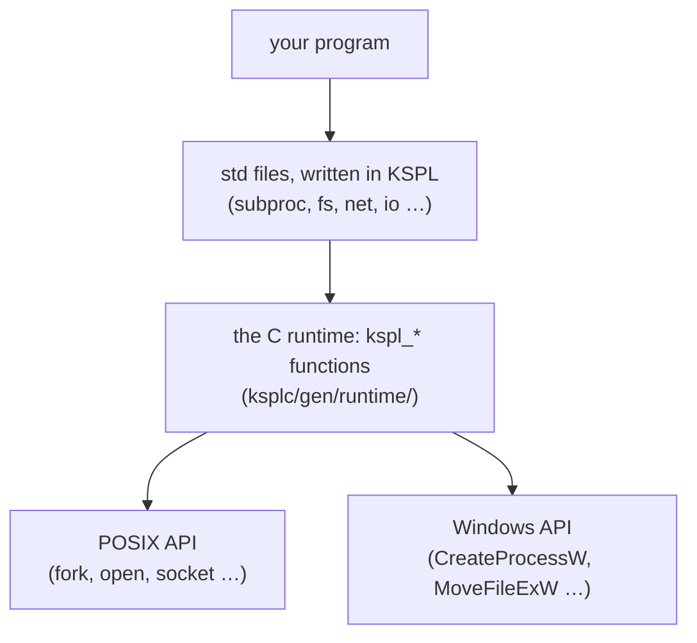
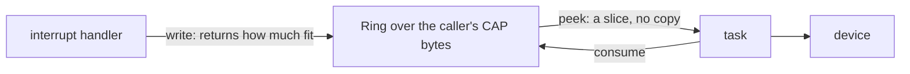

# The design policy of the standard library, and its core

This document says *why* the standard library (`std/`) works the way it does. It also holds the grounds of its core: memory, containers, text, failures and the package's shape. The parts that reach outside the program are in [`DESIGN-system.md`](DESIGN-system.md). Those are the process, files, threads, networking and the data formats. Each file starts from an API that other languages use widely, but does not simply copy it. The criticism that the API met over years of use is studied: the vulnerabilities reported against it, and the misuse it could not prevent. Where KSPL's type system can prevent one, the design changes.

**The document holds two things.**

1. A table of the known problems of earlier implementations, how each `std` file handles them, and the holes still open.
2. By subject, the choices in `std`'s own API that make a reader ask "why this way?" (here and in [`DESIGN-system.md`](DESIGN-system.md)).

When you add or change a file, check whether the table can gain a row. If it cannot, confirm that the file has not become a plain copy of the API it started from. The language's own grounds are in [`../../docs/DESIGN-principles.md`](../../docs/DESIGN-principles.md). What each file is for is what `ksplc doc std` lists. How many files one import brings along is in [`std/README.md`](../README.md).

## Words used in this document

**This table explains the words of `std` that appear across many sections.** A word used in one section only is explained where it appears. Every package shares some words: arena, ARC, trait, generic, vtable, thunk, hosted, freestanding, libc, the C runtime, the seed, Principle N and the rest. They are in "Words used throughout" in [`../../docs/DESIGN-principles.md`](../../docs/DESIGN-principles.md#words-used-throughout). *Gate* and the other words with one fixed meaning in every document are in "Terms of art" in [`../../docs/SPEC-documents.md`](../../docs/SPEC-documents.md#terms-of-art). The notation of the examples (`T@`, `U8[]`, `T!E` and the rest) is "The notation the examples use" in [`../../docs/DESIGN-principles.md`](../../docs/DESIGN-principles.md#the-notation-the-examples-use). The language's own rules are in [`../../docs/SPEC-programming-language.md`](../../docs/SPEC-programming-language.md).

| Word | What it means here |
| :-- | :-- |
| **the heap** (the global heap) | Memory taken with `malloc` and given back one block at a time with `free`. In `std`, a `null` where a function asks for an arena means "use the heap". The caller then owes a `free()` for what comes back ("A null arena is the heap, for every function") |
| **`Arc`** (the type) | Not ARC: `Arc<\|T\|>` is the reference-counted handle shared between threads ("The names of the reference-counting types" below) |
| **view** | A slice that points into memory something else owns. A new view copies nothing, and it stays valid only as long as that memory does |
| **`Option<\|T\|>`**, written `T?` | Either a value or none. The value comes out only through `switch` or `if v: = …`, so a forgotten check does not compile |
| **panic** | The program stops with a message. `std` keeps it mostly for a mistake in the program itself, such as an index out of range. Bad input comes back as a value |
| **POSIX** | The family of Unix-like systems (Linux, macOS, the BSDs) and the API they share. "Windows" here means its own API (`CreateProcessW` and the like) |

### Where to read for each file

**This table tells you which part of this document is about the file you work on.** What each file is for is not repeated here: `ksplc doc std` lists it.

| You are working on | The files | Read |
| :-- | :-- | :-- |
| A problem other libraries are known for | any | [What was inherited, and what was changed](#what-was-inherited-and-what-was-changed) |
| Memory: who frees what | `mem`, `refcount`, `ds` | [Memory and ownership](DESIGN-core.md#memory-and-ownership) |
| Text, numbers, bytes | `chars`, `str`, `strfmt`, `strnum`, `buf`, `bytes`, `checked_int` | [Strings, numbers and bytes](DESIGN-core.md#strings-numbers-and-bytes) |
| Lists, maps, loops, chains | `ds`, `seq`, `lang`, `ring` | [Containers and iteration](DESIGN-core.md#containers-and-iteration) |
| Reporting failures, logging | every file's `T!E`, `log` | [Failures and the log](#failures-and-the-log) |
| Arguments, output, tests, children, the clock | `argparse`, `io`, `verdict`, `fuzz`, `subproc`, `sys` | [The process](DESIGN-system.md#the-process-arguments-output-children-and-the-clock) |
| Paths and directories | `fs` | [Files and paths](DESIGN-system.md#files-and-paths) |
| Locks, threads, sockets, JSON | `thread`, `reactor`, `stack_limit`, `net`, `jsonrpc`, `reflect`, `json`, `json_struct` | [Threads, networking and the data formats](DESIGN-system.md#threads-networking-and-the-data-formats) |
| Patterns | `regex` | [Regular expressions](DESIGN-core.md#regular-expressions) |
| Adding a file, or an import | any | [The shape of the package](#the-shape-of-the-package) |

### How std reaches the operating system

**`std` is written in KSPL, and only a thin layer of C touches the OS.** The diagram shows the layers that a call passes through on a hosted build.



**The decisions live in the KSPL layer wherever they can.** Examples are the schedule of a connection attempt, the four ways to start a child, and the timeouts. The C layer keeps only what needs the OS's own types or calls. C is written twice, once for POSIX and once for Windows. The Windows copy cannot run locally, so the less of it the better. Several sections below return to this split.

## What was inherited, and what was changed

### Known problems KSPL handles

Each row is a bug or attack that other libraries are known for. It says what the `std` file does so that the problem cannot happen, or cannot happen silently. The rows are grouped by area.

**Text, numbers and memory**

| File | The problem | Seen in | What `std` does |
| :-- | :-- | :-- | :-- |
| `str` | **A NUL byte cuts a string short** ("the poison NUL byte"). A KSPL string carries its length, so it can hold a byte 0. C reads a string only up to its first 0. So a conversion to a C string silently drops everything after it. PHP and Java had path checks bypassed this way | C's strings | `to_cstr()` returns `U8$@?`: `.none` when the input holds a NUL. `switch` must cover every case, so the caller has to handle it. `contains_nul()` is public too |
| `checked_int` | **Signed overflow is undefined behavior**: the C compiler can assume it never happens, so optimization changes the result | C's integer arithmetic | The plain operators wrap around (`mod 2^N`) whatever the signedness. The generated code goes through the unsigned type of the same width, which erases C's undefined behavior. Native `checked_*` methods report failure; `Ci8` through `Cu64` and `Csz` keep checks on a formula’s operators. There is no wrapping type, since the plain operators already are that |
| `option` | **Null references**: a forgotten check for `null` still compiles | A raw pointer's `null` | `T?`'s content comes out only through `switch`. The linter's [H0701] proposes `T?` for a raw pointer returned as `null` |
| `chars`, `regex`, `subproc` and the rest | **"None" spelt as a value of the answer's own type**: a `-1`, an empty string or a flag beside the value. A forgotten check still compiles, and the stand-in flows on as data. Examples are `-1` as an index or as a digit of a number, and an empty string as a name | C's `EOF` and `-1`, an `indexOf` or `find` answering -1 | "There can be none" is `T?`, and "it failed" is `T!E`, never a stand-in ("Absent or failed: one rule" below) |
| `mem` | **Double free and use after free** | `malloc` / `free` | The arena (`Arena`) is the main route, and `defer` shows in the code where memory is freed. The compiler traces the paths for a use after the free |

**Randomness**

| File | The problem | Seen in | What `std` does |
| :-- | :-- | :-- | :-- |
| `prng` / `rand` | **A weak random number used for a key** (CWE-330). Both languages hold a weak (predictable) kind and a safe kind, but the names are close. So `Random` or `random` keeps being used for tokens and keys | Java's `Random` / `SecureRandom`, Python's `random` / `secrets` | **The name declares "pseudo"**: the reproducible side is `std/prng`'s `Prng`, the safe side is `std/rand`. The plain name `rand` goes to the safe side, so "I need a random number" lands there. Neither is removed. Swift has no weak side, so it cannot rerun training or sampling with the same results |
| `prng` (a number in a range) | **A remainder favours low values** whenever the count does not divide the generator's range. From 10 equally likely values, `% 3` gives 0 four times, and 1 and 2 three times each. C++'s distributions are each library's own. So one seed gives different numbers on libstdc++, libc++ and MSVC | Java's `nextInt(bound)`, Python's `randrange`, C++'s `uniform_int_distribution` | `below` draws again past the last whole multiple of n. `below(0)` stops the program: [0, 0) holds no number. So the call is a mistake in the caller, as a division by zero is. `between` keeps both ends and covers all of `I64`. Both are written in KSPL, so a seed gives the same numbers on every platform |

**Files**

| File | The problem | Seen in | What `std` does |
| :-- | :-- | :-- | :-- |
| `fs` | **A directory that fails part way through reads as one that ended.** POSIX's `readdir` returns NULL both at the end and on a failure. Only `errno` tells them apart, and it must be cleared before the call. Windows's `FindNextFileW` fails at the end too, with `ERROR_NO_MORE_FILES`. Read as the end, a failure hands back a listing cut short as whole | POSIX `readdir`, Windows `FindNextFileW` | `read_dir` fails (`operation_failed`). The runtime clears `errno` before each `readdir`. On Windows, it takes only `ERROR_NO_MORE_FILES` as the end |
| `fs` | **On Windows alone, a read-only file cannot be removed or replaced.** POSIX looks at the folder's permission, not the file's. So the same clean-up works on one OS and fails on the other. Python's `shutil.rmtree` documentation carries a handler that clears the mark for this | Windows's `DeleteFileW` / `MoveFileExW` | `remove_path` and `rename_path` clear the read-only mark first on Windows. They put it back where the operation still fails |

**Networking**

| File | The problem | Seen in | What `std` does |
| :-- | :-- | :-- | :-- |
| `net` | **A write can send only part of the data** (a *short write*), yet callers keep discarding the count it returns. That is why Go and Rust hold a separate "write everything" API | POSIX `send(2)`, Go's `io.Writer`, Rust's `Write` | Both `write` (returns how much it sent) and `write_all` (sends it all), so the name states the intent. `std/http` uses `write_all` |
| `net` | **A port out of range wraps around.** The field holds 16 bits, so 83659 binds 18123 and -1 binds 65535, with no error. Rust and Swift make the type 16 bits; Python, Java and Go refuse it at run time | C's `sockaddr_in` and `htons` | Every entry that takes a port (`bind`, `connect`) refuses one outside 0 to 65535 as `Net_error.bad_port`. The runtime refuses it too, as a backstop |
| `net` | **An accepted socket's mode depends on the OS.** A *non-blocking* socket returns "not ready" where a blocking one would wait. From a non-blocking listener, Linux returns a blocking socket. Windows, macOS and the BSDs copy the non-blocking mode. So the same read waits on one OS and returns "not ready" on another. Python made `accept` return blocking for this reason | BSD sockets' `accept` | `accept` returns a blocking stream on every OS. A reactor's caller makes it non-blocking by asking, as for any other stream |
| `http` | **Request smuggling**: two programs on the way (a proxy and a server) see a different end for the same request. So a second request hides inside the first. The causes: `Content-Length` and `Transfer-Encoding` read differently, or `Content-Length` given twice | HTTP/1.1 implementations in general | Refuses any `Transfer-Encoding`, and a duplicated `Content-Length` whose values disagree |
| `http` | **Response splitting**: a line break (CRLF) injected into a header value starts a header or a response of its own | The same | Refuses at write time a CRLF in a header name or value, the method, the target or the reason phrase |
| `http` | **A writer that frames otherwise than its reader**: a `Content-Length` that the body does not have, or one beside `Transfer-Encoding`. Either splits the message where another reader cuts it | The same | Refuses at write time whatever the reader refuses: `Transfer-Encoding`, and a `Content-Length` that is not the body's or is given twice (`length_mismatch`). A header value with a space or a tab at either end is refused too (`invalid_header`). RFC 9110 §5.5 gives a value none, and the reader trims it, so it would read back as another value. 1xx, 204 and 304 get no length and no body (RFC 9110 §8.6). A HEAD's answer names the length of a body that it does not carry. It has its own builder (`format_response_to_head`) |
| `http` | **Two `Host` headers, or one value, read differently by two programs on the way.** A proxy routes by one, and the server checks the other. So a request reaches a host by a name that nobody checked. `user@a` is host `a` to a reader that takes userinfo, and `a/b` is host `a` to one that takes a path. A request with no `Host` on HTTP/1.1 is malformed the same way | HTTP/1.1 implementations in general; RFC 9112 §3.2 asks a server to answer each with 400 | `parse_request` and `request_length` refuse such a request (`invalid_host`). That is a request that names `Host` more than once, or not at all on HTTP/1.1 and later. It is also one whose value is not a host and an optional port (RFC 3986's `uri-host [":" port]`, the port up to 65535). HTTP/1.0 can leave it out. `format_request` and `write_request` refuse the same head. One place decides whether a version is "1.1 or later": `http.is_1_1_or_later`. A server's keep-alive default reads it too |
| `http` | **A body that runs to the close** cannot be told from one cut off early | The same | Refuses a response that can carry a body but names no length (`unsupported_close_delimited`). It does not return what arrived as the whole body. 1xx, 204 and 304 end at their head |
| `jsonrpc` | **Two readers cut one stream into different frames.** Readers differ on which of two `Content-Length` lines counts, the first or the last. And take a limit on the head, checked against what one read brought. It takes a long head that arrives at once, and refuses it when it arrives a byte at a time | LSP clients and servers in general | A head that names two lengths that differ, or one that it cannot read, has no length. So the frame is `broken`. The head's limit counts its own bytes. Its end is looked for only within `max_head_bytes`, however the bytes arrive |
| `jsonrpc` | **Nothing comes back for a broken frame or a dropped response.** (A *frame* is one message with its `Content-Length` header in front.) On a frame without `Content-Length`, `lsp4j` sends no response, only a log line ([#210](https://github.com/eclipse-lsp4j/lsp4j/issues/210)). On a dropped response, `pylspclient` cannot look up the id and throws | LSP clients in general (`lsp4j` / `lsp-server` / `pylspclient`) | A frame that declares no length, or is over the limit, returns `Rpc_end.broken` **as a value**. Its broken head is dropped from the pool, so it cannot repeat forever ("The frame is kept apart from the transport" below) |

**Data formats**

| File | The problem | Seen in | What `std` does |
| :-- | :-- | :-- | :-- |
| `json_struct` | **A key's name is written twice, once for the writer and once for the reader.** n fields take 2n lines, and a fix of only one silently fills in the default | `serde`'s derive, Swift's `Codable`, Jackson's annotations, nlohmann's macros | The round-trip functions (`json_struct.from_struct` / `json_struct.into_struct`) walk `std/reflect`'s table of a type's fields. **ksplc synthesizes the table and `fields()` from an empty `impl X: reflect.Reflectable {}`** ([5.5 in `../../docs/SPEC-programming-language.md`](../../docs/SPEC-programming-language.md#55-worked-example-synthesizing-a-field-table-with-reflectable)). Synthesized, the table cannot drift from the type's declaration. A drift would give no diagnostic, and would show as reads and writes of the neighbouring field. A key cannot be given another name: it is the field's name |
| `json_struct` | **A missing value silently becomes a default** | The same | A missing key and a `null` one are refused with different values (`missing_field` / `field_type`). So no sentinel default such as `as_int64().unwrap_or(-1)` folds two causes into one value |
| `json_struct` | **An integer is silently narrowed into a smaller field** | The same | **An integer that the field cannot hold is refused** (`field_type`), not narrowed. Examples are 70000 into a `U16`, and -1 into a `U8`. On a write, so is a `U64` past the largest `I64`, the widest integer a `Value` holds. Whether it fits is `std/reflect`'s `fits_int` |
| `json` | **Stack exhaustion from deep nesting** (the billion-laughs family): a document nested very deep makes a recursive reader run out of stack and crash | JSON parsers in general | Nesting stops at `max_nesting_depth = 500` with a `Json_error`, not a panic |
| `json` | **Duplicate keys**: implementations read `{"a":1,"a":2}` differently, so two parsers given the same document see different values | The same | Refused (`Json_error.duplicate_key`), as I-JSON requires. A document that two readers can read differently is not one document. Whether the first or the last wins, one of them is wrong. A sender that repeats a key gets back an error that names it. One value is not dropped without a word. `Object_builder.set` replaces, so a built object never holds a repeat either. Past a few members, the parser checks the keys with a set. So a hostile object cannot make the check quadratic. `Value.get` walks a linked list, and `max_nesting_depth` does not bound the member count |
| `json` | **A read that cannot say "there is none".** A read with a default gives `""` both for an absent key and for an empty string. It gives 0 both for an absent number and for a written 0. It gives the same again for a value of another kind. So a sender's misspelt key reads as a real value | Python's `dict.get`, Jackson's `asText()` / `asInt()`, Go's zero-filled fields | Each read of a kind returns an option (`as_str(): U8[]?`, `as_int64(): I64?`, …). Absent, `null` and another kind give nothing, while `""` and 0 are values. `find` tells an absent member from a `null` one. Only a path still reads absent as `null` (`get`, `get_at`). So `v.get("a").get("b").as_str()` stays one line ("A JSON read says when there is no value" in [`DESIGN-system.md`](DESIGN-system.md)) |

**Threads**

| File | The problem | Seen in | What `std` does |
| :-- | :-- | :-- | :-- |
| `thread` | **Nothing says which types can cross threads.** So a non-atomic reference count or a raw pointer gets handed over casually | POSIX threads | **Not handled.** A constraint on `spawn`'s argument types guarantees nothing. It checks only the argument, and sharing through a global goes unchecked. And "the constraint is met" would not mean safe. The grounds are "Why data races are not prevented by the type system" in [`../../docs/DESIGN-programming-language.md`](../../docs/DESIGN-programming-language.md#why-data-races-are-not-prevented-by-the-type-system). What exists is a choice by type name (`Rc` / `Arc`, `Mutex<\|T\|>` / a plain value) |

### Known holes, and what would fill them

Two known problems are not handled. For each, the table says why it is open and what a fill would take.

| File | What is not handled | Why it stays open | What would fill it |
| :-- | :-- | :-- | :-- |
| `reflect` | **The round-trip functions cannot walk a container of containers (`List<\|List<\|T\|>\|>`).** Nor can they walk an option that holds a container or an option | **One hole stops both.** The description of such a field needs a kind whose content kind refers to itself. So `Field_kind` would need a payload. Both backends can write such a payload into the table's global initializer. What is missing is the kind itself, its synthesis and the walkers that read it | A payload on the list and option kinds that names the contents' kind. The synthesis writes it, and the round-trip walkers read it, all in one change. The kind is not added ahead of time: a shape that nobody can walk would then be writable. That is Principle 5; the mechanism is [5.5 in `../../docs/SPEC-programming-language.md`](../../docs/SPEC-programming-language.md#55-worked-example-synthesizing-a-field-table-with-reflectable) |
| `Map` | **Hash flooding.** An attacker sends many keys chosen to land in the same slot, so every lookup slows to a crawl: an algorithmic-complexity attack. PHP, Python, Ruby and Java all issued CVEs and added hash randomization | No attacker's key reaches a `Map`. The packages that take keys from outside do not use `Map` (`http` keeps its headers in a linked list too). `make test-conventions` holds which packages those are. **When that check fails, design the hash seed then.** It fails exactly where a key from outside gets in | Decided already. `str.hash` is FNV-1a plus extra mixing with a fixed seed. `Hashable`'s `hash(r: Self): U32` cannot take a seed, so the signature changes to pass one per `Map`. Randomization by default is ruled out. The compiler uses `Map` heavily, and an iteration order that changes per run makes the generated C differ per run. That breaks self-hosting's zero-difference check, where the compiler builds itself twice and both outputs must be identical |

## Memory and ownership

KSPL has no garbage collector. Memory that `std` hands you lives in one of four places. The call itself shows which, so you can see who frees it.

| Where it lives | How you ask for it | Who frees it, and when |
| :-- | :-- | :-- |
| The global heap | Pass `null` as the arena: `List.new(null)` | The type decides: `Str_builder` uses `Drop`; manual owners use `defer xs.free()` |
| An arena | Pass the arena: `List.new(arena)` | The arena releases storage; containers still release their automatic elements |
| Your own buffer | `Buf_writer.new(U8$[]::buf)`, `Arena.from_buffer(…)` | Nothing is allocated, and the buffer stays yours |
| Shared by several owners | `Rc<\|T\|>.new(v)` / `Arc<\|T\|>.new(v)` (ARC) | The compiler, when the last owner lets go |

The first two side by side:

```kspl
import "std/ds" { List }
import "std/mem" { Arena }

fn main()
    // On the heap: this function owes a free().
    $on_heap: = List<|I32|>.new(null)
    defer on_heap.free()
    on_heap.push(1)

    // In an arena: freed with the arena, all at once.
    arena: = Arena.new(4096)
    defer arena.free()
    $in_arena: = List<|I32|>.new(arena)
    in_arena.push(2)
```

### Builders own their cleanup

`Str_builder` implements `Drop`. A local builder needs no `defer`; moving it transfers responsibility for its buffer. A slice borrows the builder's bytes and becomes invalid when that owner is destroyed. Returning the builder transfers ownership, while returning its slice does not.

**Containers distinguish a live element from an empty slot.** Push and insertion initialize storage without destroying its old bytes. Pop transfers a live element out. Removal, replacement and clear destroy the old element exactly once. Resizing transfers bytes without creating another owner. A manually managed container still needs its `free()`, including one whose storage belongs to an arena.

**Shared ownership owns its payload once.** `Rc` and `Arc` transfer a new payload into their control block. The last strong owner destroys that payload through the same storage operations. A payload can itself contain an automatic owner.

### A null arena is the heap, for every function

Pass `null` where a function takes an arena, and it works on the heap instead. **A `null` needs no check in each function.** `Arena.alloc` with a null receiver takes the bytes from the heap. Every way in which an arena hands out memory (`alloc_as`, `create`, `dup_str`, `text`) goes through it. The arena's fields are private to `std/mem`, so nothing reaches arena memory another way. So a new function honours `null` without being told. `make test-conventions` holds each function that takes an arena to a call with `null` in std's tests. So a new function without such a call fails there.

**What comes back is the caller's to free**, and the function's summary says how:

| What it returns | How the caller frees it |
| :-- | :-- |
| One block: a string or bytes | `mem.dealloc(Void$@::s.ptr)` |
| A `List` | `xs.free()`, after the strings that each element owns. Those are a string each for `fs.read_dir` and `fs.walk_files`, `out` for `verdict.run_children`, the two outputs for `subproc.run_many`, and `name` and `data` for `fuzz.gather`. A list placed on the heap and handed out as a pointer (`List.create`) then gives back its own block with `mem.dealloc(Void$@::xs)` ([below](#a-lists-free-leaves-the-list-itself)) |
| A child's two outputs (`subproc.run_capture`) | Each with `mem.dealloc`. A child that did not start has empty ones, which free as nothing |
| A value of many blocks. Examples are a JSON document (`json.parse`), a `Json_builder`, an HTTP request or response, and the headers that `http.headers` builds. Others are a query's pairs, an `argparse.Parser`, and the fuzz driver's `Findings` and `Setup` | `v.free()`, which lets all of it go at once ([below](#a-value-of-many-blocks-keeps-its-own-arena)) |
| The fields that `json_struct.into_struct` fills in the caller's struct | Each string with `mem.dealloc` and each list with `free()`, as above. **A refusal leaves the fields that it filled before it**, freed the same way |

**What a function does not return, it frees before it returns**, `null` or not. Examples are a path joined on the way, a list that it sorts from, and the object that it encodes into text. That work goes in `mem.scratch(arena)`. With an arena, that is the caller's arena from a mark, rewound to the mark on the way out. Given `null`, it is an arena of the function's own, freed on the way out. So the caller's arena keeps the result alone, however many calls pass through it and however many fail. With `null`, the caller owes a free for the result alone.

* **Why the caller's arena is rewound, not left as it is**: a server reads each request into one arena per connection. A reader that left its work there would grow that arena by every head that it reads, until the connection closes. That includes each try at a request that is still incomplete.
* **Why the work does not go in its own arena when one is given**: a caller who passes an arena avoids the heap. That includes a fixed buffer on a microcontroller.
* Caution: **A function that writes into the caller's arena while it works takes `mem.scratch(null)`.** `fs.walk_files` pushes each path into the list that it returns as it walks. A rewind to a mark taken before would take the result with the work. Nothing tells the two arenas' writes apart, so the choice is made where the function is written. A function that refuses after it made its result gives the result back too. So a failure leaves nothing to free. Only `into_struct` cannot, since what it fills is the caller's.

#### A list's `free()` leaves the list itself

**`free()` gives back what a list holds, never the block that the list stands in.** A list from `new` stands in the caller's variable. A list that `create` put in an arena goes with the arena. So only a list that `create` put on the heap leaves a block behind. If `free()` gave that one back, every list would have to carry where it stands. That is 8 more bytes on each list's 32, paid by every list for the few made on the heap. The many small lists that a tree keeps in each node would pay too. So the caller who passed `null` gives the block back, as for any one block: `xs.free()`, then `mem.dealloc(Void$@::xs)`. The compiler reads that `dealloc` as the block's own release, not as a use of what `free()` released. It refuses any use after it ("8.4.5 Tracking a free with `Manual_free`" in [`../../docs/SPEC-programming-language.md`](../../docs/SPEC-programming-language.md#845-tracking-a-free-with-manual_free)).

#### A value of many blocks keeps its own arena

**Given `null`, a value of many blocks is built in an arena of its own, which the value keeps** (`mem.Own_arena`). Its `free()` lets that arena go at once. The arena is the same `mem.scratch` that a function's work goes in. The function keeps it with the result, instead of freeing it on the way out. Given an arena, the value keeps nothing, and its `free()` frees nothing: that arena does. A build that fails rewinds the caller's arena, as any work does. So you write `doc: = json.parse(text, null)!` and then `defer doc.free()`, as for a `List`.

| What it settles | How |
| :-- | :-- |
| **No free walks the value block by block.** A walk names every block that the build made. So a part added to the build and not to the walk leaks without a word. And a failure halfway leaves a partial structure that the walk must take apart | The value is built in one arena. So a failed call frees that arena and leaves nothing, and `free()` is one line whatever the value holds |
| **A free of a part frees nothing.** A header further down a list, or a request's `headers`, has the same type as the whole | Only the value that the call returned holds the arena. Every part holds an empty one, so a free of a part cannot tear a hole in the whole |
| **A second free is refused where it can be seen.** Each such type conforms to `Manual_free`. So a second `free()` of a local, or a use after it, is a compile error, as for a `List` | Through a copy or a field, it is not seen, as for any block given back |
| **Code outside std cannot make a value that claims an arena** | `mem.Own_arena`'s field is visible only inside std. So such a value is built through std's own functions |

**A parsed JSON document is a type of its own, `json.Doc`.** It holds the value (`doc.val`), and the arena that `parse` made for it, given `null`. Any kind of JSON value can be the whole document. So an arena kept in the value would sit in the string, array and object variants alike. The document keeps it apart instead:

* **Every `switch` over a value writes each variant's own field alone** (`case .str_val(s)`). It never writes a field for the arena, which it does not read.
* **What frees is in one place**: the document that `parse` returns. A value that a `Json_builder` makes lives in the builder's arena, and the builder frees it.
* **A part cannot be freed at all.** `doc.val` is a `json.Value`, and so is every value read out of it (`get`, `get_at`, `arr_list`). A `json.Value` has no `free()`. So a free of a part is a compile error, instead of a call that frees nothing.

A document parsed into the caller's arena holds nothing to free, so it is enough to keep `doc.val` alone.

**An HTTP response's version and reason phrase enter its arena when the status line is parsed.** A read of the body can grow and move the receive buffer. So views into that buffer cannot survive until the response is complete. The buffer and socket readers share this status line that the arena owns, and each field is copied once.

Caution: **The arena of its own takes a whole chunk at its first allocation**, however small the value. For many small values, such as each message that a server reads, pass an arena of the caller's and free it once.

**No free function takes the arena as an argument** (an `alloc_in(arena, n)`). It would be a second spelling of `arena.alloc(n)`.

The rules of the language itself (`defer`, ARC, arenas) are "8.4 Memory management" in [`../../docs/SPEC-programming-language.md`](../../docs/SPEC-programming-language.md#84-memory-management). The sections below say how `std` uses them.

### The names of the reference-counting types

`Rc<|T|>` shares a value between owners on one thread, and `Arc<|T|>` between threads. A weak handle is named `Weak_` plus its owner's name. The names are short because they are written often.

Caution: **Do not confuse `Arc` with ARC in a document.** ARC (upper case) is Automatic Reference Counting, the mechanism by which the compiler inserts retain/release. A specification that uses the three letters always means it. `Arc<|T|>` (a type name) is Atomically Reference Counted, the type that threads can share. It has the role and name of Rust's `Arc<T>`.

| Name | What it is | Why this name |
| :-- | :-- | :-- |
| `Rc<\|T\|>` | Counted owner, one thread (`std/refcount.kspl`) | Code that needs reference counting repeats the type name constantly. A long name spends lines, and pushes the subject aside in every annotation. `Rc` / `Arc` come from Rust and are widely recognized |
| `Arc<\|T\|>` | Counted owner whose count is atomic, so threads can share it | The same |
| `Weak_arc<\|T\|>` | A handle that watches an `Arc`'s value without owning it | A weak handle's name is `Weak_` plus its owner's type name. So the owner (`Rc` / `Arc`) is what remains without the prefix, and the pairing reads from the text |

**The zero value is an empty handle that owns nothing**, and retain/release skip it. So a table of empty slots such as `Rc<|T|>[N] = ::{}` is written plainly. It also survives the compiler's chained release over storage filled with zeros. `empty()` / `is_empty()` spell it out.

### Release takes the value apart

**When the last owner of an `Rc<|T|>` or `Arc<|T|>` lets go, the `T` inside is taken apart too.** That is as when a `T` on the stack leaves its scope. **That is what lets a shared tree or graph be built from `Rc`.** A release that stopped at the outer value would leak every `Rc` held inside it. The rule, what it costs the writer and what a cycle needs are in one place. That place is "8.4.2 Automatic reference counting via `Ref_counted` conformance" in [`../../docs/SPEC-programming-language.md`](../../docs/SPEC-programming-language.md#842-automatic-reference-counting-via-ref_counted-conformance). The costs are where the time goes, a long chain's recursion, and which thread or handler runs the release.

**Both wrappers hold one implicit weak count for all strong owners together.** It stays held while the last owner takes the value apart. The value can hold the last explicit weak handle to its own block. That handle's release must not free the block under that call. The wrappers share one private layout of the control block, and one initialization. `Rc` updates its counts directly. `Arc` uses atomic operations, so a single atomic decrement decides which thread frees the block.

### A container owns its elements' ARC counts

Put an ARC value into a `List` or `Map`, and the container keeps its count right for you. That holds through every way to take it out, to overwrite it, to grow and to free. Nothing leaks, and nothing is released twice.

The caller cannot reach the storage. So anything that the container fails to release is a leak that nobody can fix. The implementation keeps two promises:

| Promise | How | What breaks without it |
| :-- | :-- | :-- |
| **Zero freshly allocated capacity** | `mem.zero` on new storage | A store of an element is an ordinary assignment, so the compiler inserts a release of the value that it overwrites. A release of leftover garbage as if it were ARC crashes |
| **Give the ownership back when discarding** | `clear` assigns the zero value to each element; `free` calls it before releasing storage. `pop` and `remove_at` clear the vacated last slot. A map's `remove` clears the removed pair, and a resize clears each moved pair's old slot. Keys holding an `Rc` are counted too | `mem.zero` runs no release. Without an assignment, the compiler has nowhere to insert one |

**An `Rc<|T|>` element's own release takes its value apart** ("Release takes the value apart", above). So a container of `Rc` needs nothing more.

**`pop()` returns `T?`: an empty list has no last element.** It keeps the returned value alive before clearing its slot. The result therefore owns its ARC count independently of the list. Capacity stays available for another push.

**`clear()` releases elements and keeps capacity; `free()` also resets capacity and gives back heap storage.** Arena storage stays until the arena releases it. A caller reusing a list can choose `clear` without allocating another buffer. Clearing visits every element, even for plain values. A large buffer of plain values can deliberately reset its length when constant-time reuse matters. Caution: **A length reset on ARC elements leaks their ownership**, since those slots are no longer visited by `free`. Neither operation frees resources owned through raw pointers or manual `free()` methods.

### A constructor's name says where the returned thing goes

`alloc`, `new` and `create` are not three names for one thing. Each says where the result goes, so a reader can read a call without a look at the signature. An arena, when a function takes one, is always the last argument. It is never filled in for you.

The table of the three names is "Pitfalls" in [std](../README.md). This section holds the rules that come with it.

**The arena that `new` receives is where the content goes.** `List.new(a)` returns a `List` value whose elements go in `a`. To place the `List` itself in the arena, carried as a pointer, use `create(a)`. To put an arena in the caller's variable (for a configuration with no malloc), use `Arena.from_buffer`, which returns a value.

**An arena is always the last parameter, and it has no default.** The global heap is `null`, written at the call (`List.new(arena)` against `List.new(null)`). So the call shows where the content goes, and whether a `free()` is owed. Why a default is refused is "A default argument is allowed only for a foldable constant" in [`../../docs/DESIGN-principles.md`](../../docs/DESIGN-principles.md). The signature says whether a function takes one, so the name does not say it again.

Caution: **Do not mark an arena parameter with a suffix**, least of all `_in`. `_in` also means "in that place" (`harness.run_in(argv, cwd)`) and "inside a thing" (`index_in(row, cell)`). So a reader cannot take it as pointing at an arena.

**A function outside `std` can end in `_in`.** That holds for a function that returns a pointer, beside one of the same name that returns a value. It applies where `create` does not name what it does (it opens something, rather than making an empty one). The suffix then says where the result is, not that an arena is taken. The function says so where it is defined.

**Do not take an arena only to discard it.** The signature is the one mark that a function takes an arena. So the caller reads one there as "I handed over where the content goes". A discarded one misleads them about whether clean-up is needed.

**Only a function that takes an arena allocates.** In `std/str`:

| Functions | Take an arena? | Return |
| :-- | :-- | :-- |
| `trim_*` / `strip_*`, `chars.sub` / `sub_from` | No | A view into the input |
| `replace` / `join` | Yes | A copy |
| `split` / `lines` | Yes | A `List` placed in the arena, whose elements are still views |

**Joining borrows a read-only slice of pieces.** An array, a list's `slice()` and a borrowed `sub()` can all supply it. Requiring a `List` would force an array or a range to allocate a container just to be read. The caller supplies that view explicitly, so no intermediate list of pieces is needed. Empty pieces still have separators between them. So joining ranges from `split('\n')` preserves a final newline represented by an empty last piece.

Caution: **Do not judge by `U8[]` against `U8$[]`.** `sub_mut` returns a writable view without an allocation, so the return type cannot tell. The arguments can.

### The receiver aligns the start of a given buffer

When you hand `std` a plain byte array to use as memory, `std` itself moves past any odd start address. You do not have to place the array on an 8-byte boundary, and you could not if you tried.

`mem.init_freestanding_heap()` and `Arena.from_buffer()` use the caller's static buffer as it stands. **Nothing guarantees that its head is aligned.** The buffer is usually a plain byte array such as `$buf: U8[4096]`, aligned to 1. So its address depends on how the variables happen to be ordered in memory (`.bss`). One 1-byte variable just before it puts it at an odd address.

Misaligned, a header's `Sz` or a pointer straddles a boundary. A host mostly tolerates it. Cortex-M (a common microcontroller core) raises an alignment fault. It drops into the default handler's infinite loop, **and freezes with no output at all**. So the symptom hides the cause.

Caution: **It shows only when an unrelated change adds one byte**, because the order decides whether it works.

So **the receiver** aligns it (`align_pad` in `std/mem.kspl`). It does not ask the caller to place the buffer on an 8-byte boundary, because the caller cannot control a `U8[N]`'s alignment. A round-up of only the chunk header's size to a multiple of 8 is not enough. Every address handed out stays misaligned, since the head itself is.

### An arena refuses a mark it cannot place

`arena.restore(mark)` rewinds to a mark that `save()` took. Some marks stop the program at the `restore`, with a message that names them, before anything is freed:

* A mark from another arena.
* A mark saved before `reset()`.
* A mark past what its chunk now holds (an earlier `restore()` rewound past it).

**A rewind frees every chunk from the newest down to the mark's.** Suppose the arena does not hold the mark's chunk. That walk then frees all of the arena's chunks and makes the foreign chunk its head. The next allocations then land inside the other arena's live data. The first sign is a double free when both arenas are freed, far from the call that caused it.

So `restore` first looks for the mark's chunk among its own, with the same walk that it makes to free them. And the mark carries the arena's count of resets. The count is needed for two reasons. A chunk allocated later can take a freed chunk's address. And `reset()` keeps one chunk, so an old mark would otherwise look valid once the new round has used as much.

**What remains unchecked keeps the arena whole.** Take a mark that an earlier `restore()` rewound past, but whose chunk now holds at least as much again. It rewinds to its place without a stop. Every chunk that it keeps is one of this arena's. And every byte that it hands out afterwards is past what it keeps, so nothing allocated overlaps. A test for that mark would cost a record of every mark ever saved, as an arena hands them out by value.

## Containers and iteration

### A container's requirement on a type is a trait

To be a key of `Map<|K, V|>`, a type must conform to the trait `ds.Hashable<|Key|>`, which asks for `hash` and `equals`. A type that does not conform gets an error where you used it, not one deep inside `std`.

Caution: **Do not express a requirement by name agreement alone.** It is then written nowhere, and a key type that fails it gets a distant error inside `std/ds.kspl`. Where there is a requirement, express it as a trait. The rule is ② in `docs/DESIGN-programming-language.md` "The order of decision". Every key type declares its conformance (std's own are `I32` / `Sz` / `U8[]`). `Map`'s constraint `K: Hashable<|K|>` then reports a type that does not conform, where the user wrote it. It reports it as not implementing this trait. It does not report `has no field or method named 'hash'` inside std.

**`Hashable.equals` and `Eq` are different requirements.** `Eq` is what `==` desugars to. `Hashable.equals` asks, by an explicit call, whether two keys are the same. `U8[]` deliberately does not implement `Eq`. `a == b` would become an O(N) comparison of contents. And a reader could not tell whether `==` compares contents or pointers. That is the reason why `switch` cannot take a `U8[]` subject (`docs/SPEC-programming-language.md` §6.1).

The other key arrives as the type argument `Key`, as in `std/lang`'s `Add` / `Eq`. The reason is that `Self` cannot be written on an argument other than the receiver (the value before the `.`). The rule is `docs/DESIGN-programming-language.md` "Why a trait's receiver is fixed to a bare `Self`". The compiler rejects such a `Self` at the definition. It does not let it fail in the C compiler with no KSPL diagnostic.

**The built-in types' conformances go in std.** In the compiler, an implementation that exists to make a type a key of std's containers would invert the layers. So `Sz`'s `Hashable` sits in `std/ds.kspl` beside what requires it.

`ds.fmix32` is the one place where the bit mixing lives, so no key type copies it. It scrambles a hash so that keys whose low bits are the same still spread over the slots. Without it, such keys crowd one slot, and `Map` degrades into a linear search. (The masking is described at `fmix32` in `std/ds.kspl`.) **Measure before you add it — to add it everywhere is a mistake.** In a `hash` on the innermost loop, the extra operation outweighs the diffusion. So a parser's memo lookup and a key of token IDs leave it out, since their low bits already differ.

### A map holding few pairs stays small over time

`Map` is open addressing. A removed pair leaves a tombstone, a mark that a lookup steps over. So a key pushed past that slot is still found. Tombstones take slots as live pairs do. A resize comes once half the slots are used, with both counted.

**A resize that finds at most a quarter of the slots live drops the tombstones in place, and keeps the capacity.** Only a fuller table doubles. Suppose every resize doubled. A map that holds a handful of pairs would then grow without end while different keys are set and removed. A cache of open connections does this, and so does a table of requests in flight. Memory would grow with the number of keys ever seen, not with the number held. The rehash leaves the table at most a quarter full. So a quarter of its slots must go before the next one, and each insertion pays O(1) for it. It works in place and allocates nothing, so a map in an arena does not grow the arena either.

**The capacity never shrinks on its own**, since a map emptied once is usually filled again. A program that needs the memory back builds a new map and frees the old one.

### Returning every entry builds no nested generic

`Map` hands out its entries through an iterator, `items()`, not as a ready-made list. A list of entries would make the compiler build a whole extra copy of `List` for every `Map` type. And every caller only walks it once anyway.

A listing would be `List<|Map_entry<|K, V|>$@|>`: one generic inside another (*nested generics*). So every `Map` type would specialize **a whole set of `List`** at that element type: `std/ds`'s container and `std/seq`'s chain. The cost lands on specialization. In a large program, a single nine-line function that returns a listing shows in several places. It shows in translation time, bodies analyzed, peak memory and the size of the generated C. Every caller builds the listing, walks it once and drops it, so an iterator loses nothing.

**The test is whether the return type takes another generic as a type argument.** `List<|U8[]|>` does not (`U8[]` is a built-in array, not a generic). Where even one caller needs `.len` or an index, a listing is fine. The one kept inside `std/ds` is there because a sort needs all of it.

### Iteration has one notation, `for x in`

Every loop over a collection is written `for x in xs`. The type of `xs`, not the writer, decides how it is walked.

| The subject's type has | `for x in` expands to |
| :-- | :-- |
| A `.len` field and an index (`List`, arrays) | Indexing, `xs[i]` |
| A conformance to `std/lang`'s `Iter<\|T\|>` (`next(): T?`) | Calling `next()` until it returns none |

The rule is `docs/SPEC-programming-language.md` 7.2, the reasoning `docs/DESIGN-principles.md` 9.2.

**Do not make a `has_next` / `next` pair.** It would bring a second notation into std, `for it.has_next() { x: = it.next(); … }`. That is also why `Iter` holds only `next`. Split in two, a call of only one of them becomes writable.

**Eager or lazy.** An *eager* function does all the work at once and returns a `List`. A *lazy* one does the work only as the loop asks for each element.

| | Functions | Driven by |
| :-- | :-- | :-- |
| Eager: returns a `List` | `str.split` / `json.Value.arr_list` / `fs.read_dir`, and each `std/seq` operation that needs the whole (`order_by` / `distinct`) | Nothing: the work is done on return |
| Lazy: a chain | Only `where` / `select` | `for x in`, `to_list(arena)` or `count()` |

**A function that returns elements in order and can allocate them all is eager, and returns a `List`.** A `List` carries `.len` and an index, so `for x in` walks it by index. It is not given `Iter`, which would win over the index. The eager side allocates more. So only code that tolerates a slowdown (tools, example code) can rely on it. Where code cannot rely on it, `std/` itself included, is for `docs/DESIGN-principles.md` 8.3 to say.

**`order_by` is the one sort, and it is stable.** Its algorithm is described at `order_by` in `std/seq.kspl`. *Stable* means that equal keys keep their order. So an answer built from a sorted list (completions, references) is the same on every run. And a sort by a second key after a first gives the expected listing. There is no unstable variant. Its one gain is a sort in place without a second buffer. That is not what `std/seq`'s eager operations are for, since they return a new list anyway.

**What eagerness costs** is the list's own storage (16 bytes per element), allocated up front. The elements are not copied. A caller that streams a huge input must allow for it. These functions take an `arena`. With `null`, they allocate from the global heap (as `List.new(null)` does), and the caller frees the result with a `defer`. So `for x in s.split(…)` can be written directly only when an arena is passed. With `null`, nothing could free the temporary that the loop uses.

### Why the chain's stages cannot be folded

`where` and `select` build a *chain*: each call wraps the previous step in a new stage type. Other languages write such methods once, as a trait's default body. That is a body that every conforming type gets unless it writes its own. KSPL cannot do that for `where` / `select`, and chooses not to for `to_list`.

The diagram shows how `xs.where(p).select(f)` nests one stage inside the next, and what drives it.


`std/seq`'s `Keep` and `Conversion` each write `where` / `select` / `to_list` per stage. Only `count`, which needs nothing but `next`, is a trait's default body, on `std/lang`'s `Iter`. **The three stay per stage for different reasons.**

| Method | Could it be a trait's default body? | Why it stays per stage |
| :-- | :-- | :-- |
| `where` / `select` | **No** | Their return type puts `Self` in a type-argument position (`Keep<\|Self, T\|>`). A trait that holds that shape cannot be implemented, even when the method has a default body. The body is copied into a generic implementation such as `Keep<\|S, T\|>`'s, and there that `Self` is not resolved |
| `to_list` | **Yes, and it stays by choice** | Its return, `List<\|T\|>`, holds no `Self`. `std/lang`'s `Iter` cannot take it. That file imports only `std/libc`, so it cannot name `List` / `Arena`. A trait in `std/seq` itself can, and one body serves both stages. The trait's type parameter becomes each stage's element type, `T` for `Keep` and `U` for `Conversion` ("5.1 Traits (`trait`)" in [`../../docs/SPEC-programming-language.md`](../../docs/SPEC-programming-language.md)) |

**A fold of `to_list` alone saves one of its two bodies.** With two kinds of stage, that does not pay off. Fold once the kinds grow, since that is when the count multiplies. `where` / `select` can join only once that `Self` is resolved.

**A chain can be driven any number of times.** The receiver is taken by value, so `for` and `to_list` each advance their own copy. A Python generator, by contrast, is empty after one pass.

Caution: **Assemble and consume a chain in the same frame** (the same function call). A predicate's environment sits on the caller's frame. So a chain returned from a function points at a dead frame ("Why capture is made explicit and escape is forbidden" in [`../../docs/DESIGN-programming-language.md`](../../docs/DESIGN-programming-language.md)).

### Only `where` and `select` ride on the chain; a predicate is a `Callable1`

Only `where` (keep the elements that pass a test) and `select` (turn each element into another) are stages of a chain. Everything else is an ordinary method on `List`. The test that you pass in is a `Callable1`. So it can be a closure that carries the value being searched for.

| Kind of operation | Examples | Where it lives |
| :-- | :-- | :-- |
| A stage of the chain | `where`, `select` | The chain |
| Needs the whole list | `order_by` / `distinct` | `List<\|T\|>` |
| Returns one answer | `first` / `any` / `all` | `List<\|T\|>` |
| A sum | None: write the `for` loop | — |

There is no `sum`. Without overloading, it would be one method per numeric type, each the same three-line loop that a `for` writes directly. **Only `where` and `select` ride on the chain**, because the stages' types nest. Each new kind of stage multiplies the code that keeps every operation callable from every stage. The reason is that the operations that return a stage cannot become a trait's methods (the section above).

A predicate (a test that returns `Bool`), selector or comparator is taken as `Callable1` / `Callable2`. So a caller passes a closure as it is. A *closure* is a function value that carries variables from the place where it was made (its *captures*).

Caution: **Do not turn it back into a function pointer.** `where` / `any` / `all` are useless unless the predicate can be given what is searched for. "Does it contain this node" could not be written, and a plain `for` would replace them. A function value with a capture carries the function and its environment. One function pointer cannot hold both ([`../../docs/SPEC-programming-language.md`](../../docs/SPEC-programming-language.md) 8.1, "Closures").

**Whether a callback is a function pointer or a `Callable` depends on whether it needs a capture.** The rule is "Whether a callback arrives as a function pointer or a `Callable`" in [`../../docs/DESIGN-programming-language.md`](../../docs/DESIGN-programming-language.md). `std/fs`'s `skip_dir` makes do with a constant set of names, so it takes a function pointer. `std/thread`'s `spawn` has no choice, since its `entry` crosses the C boundary. Do not reason "it is a predicate, so a `Callable`". A `Callable` where no capture is needed stops one named predicate from being passed to several functions.

### A test or comparison gets `T@`; `select` gets the element

**`where`, `any`, `all`, `distinct` and `order_by` hand their callback a read-only pointer to the element (`T@`).** `select` hands it the element itself. The rule is what the callback does with it. A test or a comparison only looks, while `select`'s function turns the element into the next one.

```kspl
sorted: = names.order_by(fn(a: U8[]@, b: U8[]@; ): I32 {
    return a.compare(b$);
}, arena)
```

* **A copy per call is a copy that the move check cannot see.** `order_by` compares each element O(log n) times, and `distinct` O(n) times. Handed by value, each call reads the element out of the list's memory through a pointer. The move check does not follow that pointer ("5.4 Worked example: forbidding copies with `Move_only`" in [`../../docs/SPEC-programming-language.md`](../../docs/SPEC-programming-language.md)). For a `Move_only` element, such as an owning handle like a lock, `std` would duplicate it with no diagnostic. Handed a `T@`, the call copies nothing.
* **`where` on a chain needs it to be correct at all.** Its `next` asks the test about the element that it then returns. By value, that is two moves of one element, which the instance for a `Move_only` element refuses. With `T@`, it is one.
* **`select` takes the element**, called once per element. The move is the one that the conversion makes, and the move check sees it.
* **The cost**: a closure reads a scalar with `$` (`fn(a: I32@, b: I32@; ): I32 { return a$ - b$; }`). A field or a method needs none, since `.` dereferences.
* **What is still copied**: `order_by` and `distinct` return a new `List` that holds the elements. So the list returned and the one sorted both hold each one. And a chain's `next` hands each element out by value. Caution: **For a `Move_only` element type, only one of the two lists can release its elements.**

### Indexing costs one comparison; the stop is out of line

`xs[i]` on a `List` becomes one comparison plus the address arithmetic. The code that builds the "index out of range" message sits in a separate function. That function is never copied into the caller.

`xs[i]` calls `at`. `at` compares `i` with the length and calls `bounds_panic` (`std/lang.kspl`) when it is out of range. **`at` is meant to vanish into its caller.** It is meant to be *inlined*: its body copied into each call site. That leaves the comparison and the address arithmetic, so `at` carries `#inline`.

**`bounds_panic` carries `#noinline` for that to happen.** The C compiler judges whether a function is small enough to copy into its caller. It judges only after it has copied that function's own callees into it. Copied into `at`, the message building (`Panic_msg`, three numbers turned into text) makes `at` too big. Then every `xs[i]` stays a call. Nothing else changes, since the stop runs only when the index is wrong. With that copy kept out, every `xs[i]` of an optimized build turns into the comparison inline. A program that indexes lists throughout runs measurably fewer instructions.

Caution: **Do not move the message building back into `at`.** The cost does not show in a test or a diagnostic, only in every loop over a list.

### The ring buffer neither blocks nor locks

`Ring` (`std/ring.kspl`) is a fixed-size circular buffer for one job. An interrupt handler writes a little at a time, and a task reads in bulk. It never waits and never locks; the caller decides both.

An *interrupt handler* (ISR) is code that the hardware runs the moment an event arrives, cutting into whatever was running. The diagram shows the path that `Ring<|const CAP: Sz|>` sits on.



**Why it does not wait**: a wait needs something that knows whom to wake (a scheduler). That would make the ring unusable right after a bare-metal start-up, and inside an interrupt handler. Instead, `write` / `read` return how much went in or came out, and the caller decides.

**Why it does not lock**: the right exclusion depends on where the ring sits. Between a handler and a task, it is to disable interrupts. Between cores, it is a hardware spinlock. On a single-threaded host, it is nothing. Any one built in is too much or too little elsewhere.

**Why the capacity is a const generic, and the caller supplies the buffer**: a container that an interrupt handler touches cannot live on the heap. `alloc` takes a lock, so an ISR that calls it freezes. With the capacity in the type, `% CAP` is a constant in the generated C. So even a target without hardware division (Armv6-M) calls no software division.

**No type guarantees the wraparound.** A modular type for the index would stop a forgotten `% CAP`. But the type spreads into signatures and needs a conversion at every boundary. Rust's `std::num::Wrapping` shows this: methods such as `wrapping_add` are the usual way there. Instead, `head` / `tail` are `priv`, and only `step` advances them. Tests, not the type, catch a forgotten one. `make debug`'s ring tests always cross the wraparound, since writes that do not cross pass with or without `% CAP`.

**The storage is a slice of exactly `CAP` bytes.** `Ring<|CAP|>.new` stops the program when the slice has any other length, and names both lengths. If it were shorter, the queue would write past its end. If it were longer, bytes that the caller sized would never be used: a capacity that looks larger than it is. The slice's bounds check stays on every byte. It costs one comparison, while the wrap stays `% CAP` on the type, a constant.

**Why `peek()` returns a slice into the buffer**: most embedded send paths stream what accumulated straight to the device. A copy out would add a working buffer. The cost: `peek()` returns only the contiguous part up to the wraparound. So a caller that takes everything goes round `peek` → `consume` twice. A join of the parts inside would need a memmove, which defeats the point.

## Strings, numbers and bytes

### String functions are split by whether they allocate

**`std/chars` only looks at text and never allocates memory. `std/str` builds new text and can allocate.** The split is by whether a function allocates, not by line count. Some files cannot afford the whole string set, such as `std/base64` or `std/sha256`. They can still test characters and cut slices, since `chars` needs neither `std/mem` nor `std/ds`.

| File | What it does | Allocates? |
| :-- | :-- | :-- |
| `std/chars` | Looks: single-character tests and slicing | No |
| `std/str` | Makes: new strings, such as `replace`, `join` and `split` | Yes |

Caution: **Do not make `chars` point at `str`.** `str` imports `chars`, so the cycle would merge the two tiers into one lump (`make test-thin-use`).

Two functions cannot move to `chars`. `equals` is one of `Hashable`'s required methods. A trait's implementation is one block, so `equals` must sit in that impl block. Hence `Map<|U8[], V|>` needs `std/str`. `to_cstr` allocates. The number conversions follow the same rule. `std/strfmt` (writing a value as characters) and `std/strnum` (reading a number from a string) never allocate. So they sit outside `std/str`, and a program that only prints or reads numbers does not bring in `std/str`.

### A string allocated and returned is returned read-only

A function that makes a new string for you returns `U8[]`, the read-only type, even though you own the copy. A writable `U8$[]` comes back only from a function whose job is to give you a writable buffer.

A function that **returns a newly allocated string** returns a `U8[]`. Examples are `fs.join`, `str.replace`, `json.Value.as_str`, `sys.get_env` and the rest. One returns a `U8$[]` only where a writable buffer was asked for. Those are `arena.dup_str` / `Str_builder.slice` / `chars.sub_mut`, and the buffer that `rand.fill` receives.

**Write permission spreads through generics.** The conversion from writable to read-only (`U8$[]` → `U8[]`) applies only one level deep, to a built-in type constructor. `List<|U8$[]|>` cannot become `List<|U8[]|>`. The reason is that user-written generics are invariant: their type arguments must match exactly. The rule is "6.4 Type conversion (`::`) and implicit casts" in `docs/SPEC-programming-language.md`. Suppose `fs.walk_files` returned a `List<|U8$[]|>`. The caller would then carry the `$` into every variable, field and argument. And it could not pass the list to a function that takes `List<|U8[]|>`. One character in the return type fixes every type that the caller writes.

**"The caller frees it" is no reason to return it mutable.** A free needs no write permission (`dealloc` takes it through an explicit cast). A caller that needs to rewrite the string uses a function that fills a buffer (`rand.fill`). Or it uses one that copies (`arena.dup_str`).

C also keeps writability in the type (`char *` against `const char *`). `strdup` returns `char *`, so every type in the caller becomes `char *`. KSPL carries axis 2, the `$` just before `[]`, in the type too. So a returned `U8$[]` would get stuck the way C does. **Axis 1 (the binding's `$`) remains.** With a `U8[]` returned, the caller still chooses whether the variable later takes a different string. (The two axes are "4.2 The two axes of mutability" in [`../../docs/SPEC-programming-language.md`](../../docs/SPEC-programming-language.md#42-the-two-axes-of-mutability).)

### `dedent`, which removes common indentation, empties a whitespace-only line

`std/str`'s `dedent` removes the indentation that all lines share. A line that holds only whitespace is emptied. It does not count when the shared indentation is measured.

```
before   "    a\n      \n    b\n"
after    "a\n\nb\n"
```

A whitespace-only CRLF line becomes `\r\n`.

**A kept whitespace-only line leaves invisible trailing whitespace.** Where the line is longer than the minimum width, the excess stays behind. The text looks aligned, and only a diff or a hash disagrees. Python's `textwrap.dedent` and Java's `String.stripIndent` empty it too.

Caution: **Do not change how a newline is written**: `dedent` lines up indentation and nothing else. Otherwise, take a path that reads a CRLF document and writes it back. The output would differ exactly where the text passed through `dedent`. An indentation function that also fixes newlines is a second means of normalizing them (Principle 6).

**Do not treat `\r` as a character.** Otherwise a whitespace-only `\r\n` line would set the minimum width while the other lines keep theirs. (`"    a\r\n  \r\n    b"` would leave two spaces before `b`.)

**Do not let the final empty line set the minimum width.** Otherwise nothing would be stripped from a string that ends in a newline.

**The shared indentation is compared byte by byte, not counted.** Lines indented with a tab and with four spaces share none, so neither loses any. Counted as one column each, the tab and the first space would both go. The two lines would then no longer line up as they did.

### The destination is always named, in three shapes only

String interpolation (`"n=\{n\}"`, which puts the value of `n` into the text) always writes into something that you name. There are three choices, and no form quietly returns a new string.

| What is wanted | The notation | Where the memory is |
| :-- | :-- | :-- |
| Stream it | `w.s("n=\{n\}")` | The destination `w` holds it |
| Write into the caller's array | `Buf_writer.new(U8$[]::buf).s("n=\{n\}").slice()` | The caller's array; nothing is allocated |
| Allocate and keep it | `arena.text().s("n=\{n\}").take()` | The arena (`take` lets the builder go) |

It is Zig's three-way split (`w.print` / `bufPrint` / `allocPrint`) without the allocator argument. A `Str_builder` allocates on its own.

**Interpolation that yields a value is not taken.** Examples are Python's f-string, Go's `Sprintf` and C++'s `std::format`. That notation returns a new string whose memory something else frees. In Python and Go, that is the garbage collector; in C++, it is `std::string`'s destructor. An automatic owner could release that memory, but the notation would still hide its allocation and lifetime. That goes against `docs/DESIGN-programming-language.md`'s "Responsibility can only be assigned for what the writer can see". Before you add a fourth shape, confirm that it cannot be written with the three.

**Why two writers?** `std/str` has the growing `Str_builder`. `std/buf` has `Buf_writer`, which writes into the caller's array and never allocates. Some places cannot allocate (freestanding). Some must not allocate inside a loop. A `Str_builder.new()` in a control loop costs a malloc/free every round. Yet output of unpredictable length, forced into a fixed buffer, spreads the decision to truncate across its callers. Both are `Writer`s, so interpolation works with either. **The choice is "can it allocate" and nothing else.** A split by speed or by an upper bound would make two ways to one purpose.

**Why an overflow is not a panic**: the length is unknown until the text is assembled. A stop of a program because a display string outgrew its buffer is out of proportion. `Buf_writer` counts what it dropped, and reports it through `overflowed()`. That serves the purpose of C's `snprintf`, which returns the length it could have written. The count is held in the writer instead. Partway along a chain of calls, no return value can be checked.

### A builder can take a view of its own bytes

`b.s(b.slice())` writes `b`'s text twice over. Any view of `b`'s bytes can be written back into `b`, through `escape_and_append` too. Nothing has to be copied out first.

**Growth frees the buffer that such a view points into.** So `s` copies from the view before it frees the old buffer. And it copies with `move`, since a view taken before `clear()` can overlap where its bytes land. A write from anywhere else pays nothing for it: no address is compared. `escape_and_append` writes many times from one source. So a source that lies in the builder's memory is copied once before it starts.

Caution: **Do not free the old buffer before the copy.** The copy then reads freed memory, and still gets the right bytes until the allocator happens to reuse or unmap the block. So it passes every ordinary test, and corrupts text far from the cause. For that reason, its test runs as a child, with freed memory scribbled over.

**A refusal of such a write is not taken instead.** The type cannot refuse it, since a view is an address and a length. Nothing says which builder it came from. And a refusal at run time would cost every write the address comparison that the working version avoids.

### The digits of a floating-point number are assembled here

`std` prints floating-point numbers with its own code, not with C's `printf`. The same code runs on bare metal, where there is no C library. It prints the same digits on every platform.

`std/strfmt` does not take a floating-point number's digits from libc's `%f`. The shortest digits come from Raffaello Giulietti's Schubfach. It reads one power of ten from a table, and 64-bit products decide the digits ("One table of powers of ten serves both directions" below). The digits of `.N` are assembled exactly with `std/bignat`, and cut at a fixed place. `std/bignat` does arithmetic on numbers with as many digits as needed (*multiple precision*). One implementation serves hosted and freestanding alike. What it prints is in `docs/SPEC-programming-language.md`, in two sections: "3.6.1 The default notation for primitives" and "3.6.2 Format specifiers". This section holds why.

**Why here**: freestanding has no libc. Yet `Str_builder` conforms to `Writer`, and the vtable references every method's thunk. So `snprintf` would be linked into a bare-metal program that never writes a float. The linker's removal of unused code (`--gc-sections`) cannot drop a thunk.

**The default is the shortest representation that reads back to the same value.** Rust, Swift, Python, Java's `Double.toString` and C++'s `std::format` print it so. It switches to the exponent form at JSON's and JavaScript's boundaries. Where the languages differ, KSPL follows JSON, the most common output format. So `\{x\}` and `std/json` print by one rule. An F32 is shortest at its own width, or `0.1F32` would print as `0.10000000149011612`.

**`.N` is exact.** `1e300` at `.2` gets all 301 integer digits right, as libc's `%.2f` does. It rounds ties to even, like `printf`'s default. Rounding half away from zero would print `%.0f` of `0.5` as `"1"`, a visible disagreement. `make test-freestanding-math` compares against the real `snprintf` as strings. Every precision from 0 to 19 agrees, `1e300` and subnormals included.

**`.N` keeps multiple precision.** Its digits run as far as the 309th of `1e300`, which no fixed width holds. And a set count of decimals is written far less often than the shortest form. **It uses about 3KB of stack** (its multiple-precision values). A bare-metal program that writes `.N` on a small stack must allow for it. The shortest form needs about a quarter of that.

NaN and infinity (`nan` / `inf` / `-inf`) pad to a width with spaces. The `0` flag and the digit separator mean something only for a run of digits.

`%p` (a pointer) cannot match the host. glibc prints lower case with `0x`, and MSVC's UCRT prints upper case, zero-padded, without it. Bare metal fixes `0x` plus lower-case hexadecimal as **its own contract**. The harness checks that contract, not agreement with libc.

### Converting a string to F64 is not left to libc

`std/strnum`'s `to_f64` turns text into an F64 with code written in KSPL, not with C's `strtod`. So it works on bare metal too, gives the same answer everywhere, and rounds every text correctly.

**Why**: left to `strtod`, `to_f64` could exist only under `cfg(!freestanding)`. `std/json` and `std/argparse` call it. So **a build for a microcontroller would fail at type checking**. One implementation that returns the same value everywhere outweighs the acceptance of strings that vary with the environment.

**What is given up**: `strtod`'s `inf`, `nan` and hexadecimal floating point. JSON's numbers never hold them, and a configuration value holds them only ambiguously.

**Every text is rounded correctly.** It goes to the nearest F64, and on a tie to the one whose mantissa is even. The significand takes the first 19 significant digits. The work goes in up to three steps:

| The text | How it is converted |
| :-- | :-- |
| At most 19 significant digits, a mantissa below 2^53 and a power of ten within ±22 | One exact step |
| Any other text | Eisel-Lemire: the 19 digits times the power of ten from the table ("One table of powers of ten serves both directions" below). It is exact for the digits it is given |
| A text past 19 digits whose later digits decide the rounding. Read as two F64s, the 19 digits and the 19 digits plus 1 differ | Compared with the midpoint to its neighbour in `std/bignat`'s multiple precision. Then moved one *ulp* at a time (one step to the next representable F64). The method is Clinger's AlgorithmR |

Caution: **The 19 digits are significant ones: a leading 0 counts as none.** The third step starts from the F64 that the 19 digits give, and its ulp steps reach only a few ulp. Take the 0s of `0.0000301…` (the fixed form that `std/json` writes for a small decimal). Counted among the 19, they leave that start further off than the steps reach. The text then reads as another F64.

Why those limits, and why 768 digits of mantissa are enough to read, is `POW10_MAX` / `F64_EXACT_DIGITS` in `std/strnum.kspl`. So regression tests can compare for equality, against literals that the C compiler rounded correctly.

Caution: **Cap both the mantissa and the exponent.** Otherwise a 20th digit overflows U64. And the exponent of `1e999999999` overflows I64, which turns infinity into 0. The caps and their reasons are `F64_MANTISSA_DIGITS` / `F64_EXP_DIGITS_LIMIT` in `std/strnum.kspl`.

### One table of powers of ten serves both directions

**The write of the shortest digits and the read of a text each take one entry from a table of 10^q at 128 bits** (`pow10_128` in `std/bignat.kspl`). So every F64 takes about the same short time, of the order of C's `printf` and `strtod`. Multiple precision stays only where no fixed width can do the job. That is `.N`'s exact digits, and a text past 19 digits whose later digits decide the rounding.

**Why a table: speed on every input, at the cost of the table's memory.** Multiple precision alone takes microseconds a number, tens of times what C takes. It would take that for every shortest form and every subnormal. It would also take it for every text past 10^±22 or 2^53. A program that reads or writes many numbers (a JSON file of measurements) pays that on each one. The table costs read-only memory instead, and only in a program that writes or reads a float. The linker drops it from any other. On a Cortex-M0+ at `-Os`, it comes to about 1.5KB more flash for the write of the shortest form. It comes to 2KB for the read of a text, and no RAM. `arm-none-eabi-size` shows it on the ELFs of `make test-ksos-link` that read a float (the car demos).

| Direction | Algorithm | Why it |
| :-- | :-- | :-- |
| An F64 or an F32 to its shortest digits | Raffaello Giulietti's Schubfach | One entry and three 128-bit products decide the digits, with no case split by range. Its proof covers every F64. Ryu needs two tables, and Dragonbox several times the code, for speed beyond what is asked. An F32 goes through the same code and is shortest at its own width |
| A text to the nearest F64 | Eisel-Lemire, as fast_float does it | One entry, and its lower half only when a carry could reach the bits kept. Mushtak and Lemire prove it exact for 19 digits. So only a longer text can need multiple precision |

**The table is held compressed.** It holds one entry in 27 (25 entries), and 2 bits a power that correct a rebuilt entry. That is 568 bytes, against 10.7KB for every power from 10^-342 to 10^324. Any other entry is the held one below it times 5^r, rebuilt with two more 64-bit products. That costs little next to the conversion, and a small microcontroller keeps the 10KB.

**Every entry is exact**: 10^q's top 128 bits, truncated. Both proofs assume it. An entry one unit off moves the digits only of the values that use that power, and no sample of values finds that. `test_pow10_table` in `make debug` rebuilds every entry, held or rebuilt, in multiple precision. Eisel-Lemire's proof wants 10^-27 to 10^-1 rounded up instead. There, 5^-q fits a U64. So a quotient that comes out exact, where a tie can lie, shows nothing or a 1 below the bits kept. `nearest_f64` in `std/strnum.kspl` adds that 1 itself, so the table holds one fact.

### Format-specifier dispatch per type stays as an impl per type

The code that applies a format specifier (the `:08` or `.2` in `\{v:08\}`) is written once per built-in number type. It is not folded into one shared body, because each type returns a different result type.

`std/strfmt.kspl` implements `fmt_spec` / `fmt_prec` / `fmt_hex` / `fmt_char` separately for twelve built-in types. Each delegates to the shared `int_fmt_spec` / `hex_fmt_spec` / `float_fmt_spec`. So the impls read as one shape repeated. **They are not folded, because the return type differs per type.** It is `Int_fmt` (signed, and `U8` through `U32`), `Uint_fmt` (`U64`) or `Float_fmt` (`F32` / `F64`). A default body declares one return type.

### Checked arithmetic shares its checks

**Native methods own overflow detection.** I64 and U64 hold the two algorithms. Narrower types calculate in I64 or U64, then check their own bounds before converting. `Sz` checks the target machine's width. No associated type or constant is needed.

**A formula keeps its checked type.** `Ci8` through `Cu64` and `Csz` name instances of `Signed` or `Unsigned` in `std/checked_int.kspl`. Convert each input once, then keep the formula's ordinary operators until reading the final `.val`. Each operator checks its intermediate result and panics on failure. The wrappers keep long formulas readable; they do not offer recovery from an operator's panic. Each family shares its methods and operators; signed and unsigned stay separate because only signed values support negation.

**A calculation that must recover uses methods.** A size multiplication can return `Sz!Checked_error` without constructing a wrapper. A longer calculation propagates each method's failure with `!`, or handles it with `catch`. Containers keep their local size check, so importing a List brings no checked wrappers into every string program. Application limits still need their own checks: fitting in `Sz` does not mean a tensor or request is acceptably small.

**Importing checks changes no native operator.** Hashes and random generators depend on wrapping. A checked wrapper makes a whole formula stop on overflow; a native method marks one operation whose caller handles failure.

### Hexadecimal uses a format specifier; the wrapper adds only `0x`

Write hexadecimal as `\{v:x\}` or `\{v:08x\}`. The wrapper `strfmt.hex(v, n)` exists only to put `0x` in front.

The rules of the hexadecimal specifier (with no `0x`) are "3.6.2 Format specifiers" in `docs/SPEC-programming-language.md`. This section holds why.

**Each item that a specifier can set has its own method.** Only a type that the item applies to implements it:

| Method | What it handles |
| :-- | :-- |
| `fmt_spec` | Width, `0` padding, `,` grouping |
| `fmt_prec` | The same, plus digits after the point |
| `fmt_hex` | Hexadecimal |

Suppose the items were arguments to one method. A type with nothing to apply them to could only ignore them. A `:x` on a float or a `:.2` on an integer would then be accepted with no message. With the split, the interpolation calls a method that the type lacks, and stops with "there is no such method".

`hex` in `std/strfmt.kspl` exists for one thing only: a leading `0x`. (`\{strfmt.hex(addr, 8)\}` writes `0x10000144`.) Without the prefix, a specifier says it all (`\{v:08x\}`). **No wrapper stands beside a specifier for width, zero padding, grouping or digits after the point.** A second spelling of the same output goes against Principle 6 in [`../../docs/DESIGN-principles.md`](../../docs/DESIGN-principles.md). Where the width is known only at run time, call directly the method that a specifier desugars to. Examples are `v.fmt_hex(n, true, false)` and `v.fmt_spec(n, true, false)`.

**A signed value goes through the unsigned type of the same width**, because hexadecimal shows the bits that the type holds. Widened straight to `U64`, sign extension would fill the high bits with 1s. It would print `I32`'s `-1` in 16 digits, where C's `%x` prints 8. `Sz` has no unsigned name of the same width, so it widens to `U64`.

**The extension-method shape `impl Writer { fn hex(...) }` cannot be taken.** A method added to a trait has no vtable slot, and the compiler rejects it at the declaration. To extend a trait, use a free function or a conforming wrapper such as `Hex_fmt`.

### Converting between bytes and integers holds no format string

`std/bytes` reads and writes an integer inside a byte array, with one function per width and byte order. Examples are `get_u32_be(at)` and `put_u16_le(at, v)`. There is no format string like Python's `struct.pack(">HH", a, b)`.

(`be` is big-endian, the most significant byte first; `le` is little-endian, the least significant first.)

**Why**: KSPL has no type checking for variadic arguments (a variable number of arguments). With a format string, the format could drift apart from the arguments' count and types, and still compile. It would fail only at run time. That is the structure behind `struct`'s standard misuse. A name of the position and width once each costs a few lines. But a mistake stops the compilation.

**Why the byte order has no default**: a mix-up silently garbles the value, and no type catches it. So the intended order is written every time.

**Why there is no checked version**: out of range panics, as a slice index does. A `Result` would put a `!` on most calls, whose bounds are already known, and bury them. Where the input's length cannot be trusted, check `len` before the call.

**Why it holds `crc32`**: it has two users. One is the image checksum that a boot ROM requires. The other is the record check of a log that only grows at its end. It does no processing before or after: the initial value and the final inversion differ by purpose. The boot ROM also reverses the bit order of input and result against the standard. So any default would silently give one caller a different value. Bit reversal stays out while it has one caller (Principle 1; std can take it once there are several).

**Why it holds `fill` / `copy_from`**: a fill with zeros and a copy of a range are common. `mem.copy` takes a `Void$@` and a byte count, so no bounds check applies. `copy_from` behaves as memmove (the ranges can overlap), not memcpy. The reason is that a shift of a range within one buffer is a real use.

## Regular expressions

**A search with `std/regex` takes time linear in the text, whatever the pattern.** It runs every way through the pattern side by side, one byte of the text at a time. It never tries one way and then steps back to try the next. A step back costs time exponential in the text for patterns such as `(a+)+$` or `(a|a)*b`. So a few dozen bytes could hang a program that matches a pattern or a text it does not control. That is a *ReDoS*, a regular-expression denial of service. A budget that caps the steps back stops the hang. But it refuses correct questions instead, and which ones depends on the text.

**What this gives up**: the backreference (`\1`, "the text that group 1 caught, again"). It makes a way's future depend on the text that it caught, not only on its place in the pattern. A match with it is NP-hard, so no search linear in the text takes it on. It is refused ("A notation that is refused stays refused" below), as is a lookaround (`(?=…)`).

Three words are used below:

* A *capture group* is a part of the pattern in parentheses, `( … )`. `Match.group(n)` returns its matched text afterwards.
* A *way* is one path through the pattern that the search follows.
* A *state* is one step of the compiled program, together with how many empty rounds are open there. (See "A round that read nothing stops the repetition" below.)

### The pattern runs as a flat program, all ways together

`compile` turns the pattern into a tree once, and the tree into a program of steps. A step does one of these things:

* match one byte;
* go on at two places (the first preferred);
* jump;
* record a position;
* test a boundary;
* open or close a round;
* finish.

For the pattern `(ab|c)d`, the program is:

| Step | What it does |
| :-- | :-- |
| 0 | record where group 1 starts |
| 1 | go on at 2, and at 5 with lower priority |
| 2, 3 | match `a`, then `b` |
| 4 | go on at 6 |
| 5 | match `c` |
| 6 | record where group 1 ends |
| 7 | match `d` |
| 8 | done |

A search keeps the ways alive at the current byte in a list, in the order that the pattern prefers them. For each byte, it carries every way whose step matches the byte to the next byte's list. It follows the steps that read no byte, until each way stands on a step that reads one. **Two ways that reach the same state at the same byte have the same future.** So the later one is dropped. A list never holds more ways than the program has states, and a byte costs at most one visit to each state. This is Thompson's construction run as a *Pike VM*, the engine behind RE2, Go's `regexp` and Rust's `regex`.

**The answer is the one that a search with steps back would give** (*leftmost-first*). The earliest start wins. From it, the match that the pattern's order prefers wins, so `a|ab` on `ab` matches `a`. Every start runs in the same pass, a later start with lower priority than the ways already alive. When a way reaches `done`, the ways after it in the list are dropped. Those before it are preferred, so they go on, and can replace the match.

**A match does not recurse.** The steps that read no byte are followed through a list on the heap, and a round of `(ab)*` costs one entry. So a text is never refused for its length.

**A start at a byte that no match begins with is skipped.** `compile` gathers the bytes that a match can begin with. While no way is alive, the search moves to the next such byte without a run of the program. A pattern whose every alternative starts with `^` (`anchored`) starts only at the search's first position.

### Repetitions are written out, and the program's size is limited

`x{2,4}` becomes `x x`, then two rounds, each preceded by a choice to skip past the whole repetition. `x{2,}` becomes `x x`, then a loop. The longest match prefers the round, and the shortest (`*?`, `{m,n}?`) prefers the skip. `*`, `+` and `?` are the counts `{0,}`, `{1,}` and `{0,1}`.

**A count is not kept beside a way.** A way's future would then depend on its count. Two ways at the same step could no longer be merged, and the bound on the list would be lost.

**So the program's size is limited, not only the count.** A pattern whose program would hold more than `max_program_size` (20000) states is refused as `too_large`. A search's memory and its work per byte grow with the states, since each list holds a row of positions per state. So the limit bounds both: up to about 8 MB for a pattern with nine groups. One count up to `max_repeat_count` (1000) on a short body fits (`[a-z]{1,1000}`, `(ab){1000}`). A count of counts does not: `(a{1000}){1000}` would hold a million. **The write of the program stops once it passes the limit.** So `((a{1000}){1000}){1000}` is refused at once, not after a billion steps.

**`(…)?` is not a repetition** but an empty alternative, wrapped from outside in a non-capturing group. So when `(ab)?c` matches `c`, the group is "not participating", as Python's `re` and PCRE answer.

### A round that read nothing stops the repetition

**A round that ended where it started stops the repetition.** Without the check, `(a?)*` would go round on the empty match for good. **The round is not undone; only the repetition stops.** So `(a?)*b`'s group holds the empty string, as Python's `re` and PCRE answer.

A body that can match empty is wrapped in a step that opens a round and one that closes it. Each way counts the rounds that it opened since it last read a byte. A close of a round while that count is above zero means that the round read nothing. So the way leaves the repetition there.

**That count is part of the state.** Take two ways at the same step: one in a round that has read nothing, and one in a round that has. They have different futures. At the round's end, the first leaves the repetition and the second goes round again. So a merge of them would drop one. **Only the innermost rounds can be empty.** A round opens after the ones around it, so if it has read a byte, so have they. One count therefore says which rounds are empty. A step inside n such repetitions holds n + 1 states, not 2ⁿ.

### Every match comes back in a `List`, with no lazy iterator

`find_all(text, arena)` returns every match at once, in a `List<|Match|>`. Each `Match` holds its span and its groups, as positions in the original text.

`find_all` is eager (it follows "Iteration has one notation, `for x in`" above).

**It returns `Match`es, not strings** (nor tuples where there are groups). Strings would lose the groups' positions. A `Match` holds the groups too, so one function serves both "only the span" and "the groups too".

**Only `compile` can fail.** Every refusal (a malformed pattern, a limit) is `compile`'s, and a search cannot be refused. So no match is an answer, not a failure. `find` gives none, `find_all` an empty list, and `is_match` `false` ("Absent or failed: one rule" below). Suppose no match were kept in `Regex_error` beside the refusals. Every caller of `find` would then name the compile errors that a search can never give.

**The function, not the caller, steps one byte past a match of length zero.** Left to the caller, the mistake of a spin in place would be written every time. It steps as Python's `re.finditer` does: `a*` on "baa" gives the three entries (0,0) (1,3) (3,3).

**The positions are indices into the original string.** The search moves its start (`search`'s `from`), rather than cutting the string and searching again. A cut would leave even the groups' positions for the caller to add back. A caller that forgets it still gets a correct match, so the mistake goes unnoticed. (`make debug`'s `test_regex_find_all` catches it by reading the second entry's group from the original string.)

**Each search is linear in what it reads, but `find_all` searches again from each match's end.** A search can read past the match that it returns, when it follows a preferred way that fails later. The next search reads those bytes again. `\w*x|\w` over a long word reads the rest of the word once per letter. So over a text built for it, `find_all` takes time quadratic in the text. **The cost** besides: each entry holds a whole `Slots`, heavier than the span alone. A caller that streams through a huge input accounts for it.

### An unused group is none; a missing group panics

`Match.group(n, text)` returns `U8[]?`. It gives `.none` for a group that took no part in the match, and `.some("")` for one that matched empty. `(a)|b` against `b` leaves group 1 out; `(x?)y` against `y` gives it empty.

* **Why an option, not empty for both**: an empty string folds the two cases into one value. A caller that tells them apart then needs a second call. A caller that does not misreads an optional part as present and empty. `T?` makes the caller choose at the call, and `.unwrap_or("")` is the spelling of "I do not care which".
* **Why a number that the pattern lacks stops the program**: the group numbers are fixed when the pattern is written. So `group(3)` on a pattern of two is a mistake in the program, as an index out of range is. Answered as none, it would read as a group that took no part. Group 0 is no group. The whole match is `start` and `end`, and one name for it is enough.

### For a hot loop over many lines, look by hand

A pattern costs far more per line than a direct look at the string. For work line by line over hundreds of thousands of lines, look at the text by hand instead.

A search on a line pays for its lists before it reads a byte. Then it carries each way that the pattern's alternatives open. `starts_with` pays neither. Take 200,000 short lines, and three patterns: `^GET /`, `^(GET|POST) /` and the unanchored `(GET|POST) /`. Each takes tens of times what `starts_with` takes for the same words. **So for "line by line, over hundreds of thousands of lines", look by hand** (`starts_with` and an index). A regular expression suits few applications of a complex pattern, such as a few searches over one log.

### After `\`, an alphanumeric is accepted only in a defined escape

**After a backslash, a letter or digit must be one of the escapes listed below, or the pattern is refused.** No branch swallows it as a literal. Take the rule "if it is not a known notation, then the character itself". Under it, `\t` becomes the character `t`, and `\b` the character `b`. The pattern compiles, and only the match fails. All the writer sees is "somehow it does not match". So an alphanumeric always lands in one of four cases. A symbol after a backslash is the symbol itself.

| The notation | How it is handled |
| :-- | :-- |
| `\d` `\w` `\s` and their negations | Expanded into a character class |
| `\t` `\n` `\r` | That control character |
| `\b` `\B` | A word boundary (**it holds no width**; a quantifier cannot be attached) |
| An alphanumeric absent from the above (`\q` `\z`) | **Refused** with `invalid_escape` |

A symbol is itself (`\.` `\*` `\[`), and **must not be refused**: that is what escapes are for. `\b` is refused inside a character class. Python's `re` and PCRE read it there as a backspace (0x08), a notation not held here. A refusal is more correct than to swallow it as the plain character `b`. `\b`'s word test uses the same range as `\w`. Otherwise a pattern that writes both, such as `\w+\b`, would fail to break where the boundary is.

**`std/str`'s `unescape_to_arena` holds the same rule, for the same reason.** It refuses an unknown alphanumeric escape (`\x41`, `\q`) with `invalid_format`, and lets a symbol through as itself. The caller's list decides which symbols are accepted (`std/json`'s `is_json_escape`, say). If an alphanumeric went through as "the character itself", `\x41` would turn into `x41`, with the `\` silently gone.

### A notation that is refused stays refused

A notation that `std/regex` does not support, such as a backreference, is refused with an error. It is never read as plain characters.

Caution: **`\1` is refused as a backreference** (`unsupported_backreference`). Swallowed as a literal, `(a)\1` silently becomes another pattern: "`a` followed by the character `1`". All the writer sees is "it does not match". The only function that reads a captured string is `Match.group`; a pattern cannot refer to one.

A pattern with more than 9 capture groups is refused with `too_many_groups` too. A count that stopped would leave the tenth group onward returning empty.

### `.` skips a newline, counts are `{m,n}`, broken shapes are refused

`.` matches any character except a newline. Counted repetition such as `\d{4}` is supported. A `{` or a range that is not well formed is refused.

| Pattern | Result |
| :-- | :-- |
| `.` | Any character except `\n` |
| `[\s\S]` | Any character, `\n` included |
| `a{3}`, `a{3,}`, `a{3,5}` | Exactly 3, at least 3, from 3 to 5 |
| `a{3` | Refused: `invalid_repeat` |
| `\{` or `[{]` | A literal `{` |
| `}` | A literal `}` |
| `[z-a]` | Refused: `invalid_range` |
| `[\d-z]` | Refused: `invalid_range` |
| `-` at the head or tail of a class, or `\-` | A literal `-` |

**`.` does not match `\n`.** Python, Java, Rust's `regex` and C++'s `std::regex` do not match one by default either. A match of newlines takes an option (`(?s)` / DOTALL) written elsewhere. KSPL holds no options, so a newline is matched with `[\s\S]`. A difference here would make a `.*` that spans lines return another answer. Someone who brings a pattern from another implementation would see that only as the matched span that grows.

**The counted repetitions `{n}` `{n,}` `{n,m}` are held.** The `\d{4}-\d{2}` shape is needed daily for a date or an ID. `*` `+` `?` are shorthands for them on one tree (`.repeat`'s minimum and maximum counts). With `a{0,}` and `a*` as different trees, a difference in the answer would split across two paths. A count on a group takes the same pair (`.group_repeat`'s). Only `(ab){0,1}` takes the shape of `(ab)?`, "wrap in an empty alternative" (that one is not a count). The upper bound is `max_repeat_count` (1000, as in RE2 and Go). A count is written out round by round. So a count on a large body meets `max_program_size` first ("Repetitions are written out, and the program's size is limited" above).

**A `{` not in a count's shape is refused** (`invalid_repeat`). Swallowed as a character, `a{3` would silently match "the three characters `a{3`". The reason is in "A notation that is refused stays refused" above. A literal `{` is written `\{` or `[{]`. `}` alone is a character (Python's `re` and PCRE read it so).

**A malformed range is refused too** (`invalid_range`). The reversed `[z-a]` could pass as an empty range. But a class that matches nothing would then be built with no error. A `-` beside a set (`[\d-z]`) reads as neither a range nor a character. So a shape that reads neither way is refused. A literal `-` goes at the head or the tail, or is written `\-`.

## Failures and the log

`std` reports trouble in a few fixed ways, chosen by the kind of trouble. The table gathers the shapes that the sections of this document use. The next section says how to choose between the first two.

| What happened | How `std` tells you | Examples |
| :-- | :-- | :-- |
| An operation that can fail did fail: a file, a socket, input that does not parse, a child that cannot start | It returns `T!E`, and you take it apart with `catch` or `!` | `!Fs_error`, `!Io_error`, `Strnum_error`, `Spawn_error`, `sys.Cwd_error` |
| A question that can have no answer: nothing matched, nothing is left, nothing is known | `T?`, none when there is none | `find_char`, `Regex.find`, `List.first`, `io.getchar` at the end of input, `Child.wait` once reaped |
| A yes-or-no question | A `Bool`; "no" is a normal answer | `fs.exists`, `fs.is_dir` |
| Output that did not fit a fixed buffer | The writer counts the dropped bytes | `Buf_writer.overflowed()` |
| A mistake in the program itself | A panic: the program stops with a message | `xs[i]` out of range, `std/bytes` read past the end, a `Mutex` locked twice by one thread |

### Absent or failed: one rule

**"There can be none" is `T?`; "something went wrong" is `T!E`; no value of `T` stands in for either.**

| The caller asked | And got nothing because | So it is | Example |
| :-- | :-- | :-- | :-- |
| A question about data it already holds | The data holds no answer, which a correct program meets every day | `T?` | `"abc".find_char('z')`, a pattern with no match, the first element of an empty list, the hex value of `g`, a key that a `Map` does not hold (`m[k]`) |
| For something to be done | It could not be done, and the reason decides what to do next | `T!E`, the reason in `E` | A file that does not open, a pattern that does not compile, a child that cannot start, digits past the limit |
| For something to be done, whose answer can still be none | Either of the two | `T?!E` | `io.getchar`: none at the end of input, `read_failed` when the read failed |

**Why no stand-in value**, such as `-1`, an empty string, a flag beside the value or a `no_match` beside the errors:

* **A stand-in is a value of the answer's type, so a forgotten check compiles.** A `-1` for "not a hex digit" goes into `v * 16 + d` as a digit. The number comes out wrong instead of refused. Behind `T?`, the value comes out only past the check, so a forgotten check does not compile.
* **A stand-in can be a real answer.** Windows ends a child that calls `exit(-1)` with -1, so -1 cannot also mean "no code". An empty string is a real string.
* **A flag beside a value leaves the value readable when it means nothing.** Take a `Bool` beside a child that says that the child never started. Its exit code and outputs would still be there to read. So a start that fails is thrown, as every way to start a child throws it. And a child stopped at its time limit has `exit_code` none.
* **"No match" among the errors joins two questions.** A caller that handles `find` would name every compile error, which a search never gives. A caller that passes it on with `!` would turn an ordinary miss into its own caller's failure.

**Where "none" and "failed" meet, the reason decides.** Absence is an answer that the caller expected to be possible. Failure is one that it did not ask for. `strnum.to_count` fails (`invalid_format`, `out_of_bounds`). The text was handed over to be read as a count, as `to_i64` beside it fails. `jsonrpc.content_length` is none for a head that declares no length. It fails with `broken` for one that declares a length that it cannot read, or two that differ.

**What is not a stand-in**:

* **An empty collection**, or **the empty part of a text**. Examples are `str.split` of an empty text, and the extension of a name that has none. (`sys.last_ext("a")` is `""`, so `strip_last_ext(p) + last_ext(p)` restores `p`.) The test is whether the caller must check for it before it uses the value. An empty part is used as it is.
* **A count of 0**: `Reader.read` answers 0 at the end, the number that it read.
* **A yes-or-no answer**: `fs.exists`, and whether a `Map`'s `remove` found a pair. As `!Fs_error`, `exists` would put a `catch` on every normal path.
* **`std/libc` and `std/mem`**, which speak C. Their `-1`, `EOF` and `null` stay. The null rule in "Things that look like duplication and are not" in [`../../docs/DESIGN-principles.md`](../../docs/DESIGN-principles.md) says so.

**A caller that does not care says so where it calls.** `.unwrap_or("")` writes an unknown HTTP phrase as empty, and `catch 0` reads a broken number as 0. The decision is in the caller's code, where a reader sees it, not in the function's documentation.

**Within one file, failure takes one shape.** `std/fs.kspl` returns every failure as `!Fs_error`, as `std/io.kspl` does with `!Io_error`. A file that mixed `T!E`, `T?` and `Bool` for failure would make the caller read each signature for the function's style.

**Do not split into variants what cannot be told apart.** `fs.Fs_error.operation_failed` does not distinguish "already exists", "no permission" and "the parent is missing". The C runtime (`ksplc/gen/runtime/hosted.c`) does not pass `errno` up to KSPL. `errno` is the C library's number for why a call failed. To subdivide the error, pass `errno` up first. A variant that pretends to know leads the caller to write a wrong branch.

### Logs and diagnostics share level names, not meaning

`std/log` has four levels, named like the compiler's diagnostics: error, warning, information, hint. The names are shared; what they ask of the reader is not.

| Level | Mark | What Rust's `log`, Python's `logging` and slf4j call it |
| :-- | :-- | :-- |
| `error` | `E` | `error` |
| `warning` | `W` | `warn` / `warning` |
| `information` | `I` | `info` |
| `hint` | `H` | `debug` |

**The diagnostic ladder's own names** serve both ladders. So a weight is the same word wherever a reader meets it.

**The question still differs, and the word does not say which.** A diagnostic's `warning` asks for action. A log line's `warning` says only that the line passed the filter.

The price: **`hint` is the level turned on to chase a problem.** Rust's `log`, Python's `logging` and slf4j say `debug` there. So a reader from any of them looks for that word in vain.

**The mark is one letter** (`E` / `W` / `I` / `H`). So its column keeps one width for the eye and for a spreadsheet's filter. `rank` and `word` are `Level`'s own methods. What a weight is worth, and which mark it prints, are the enum's business. Nothing outside needs either.

### A line that is not emitted is not built

`log.at(level)` gives you somewhere to write only when that level is switched on. When it is off, the body of the `if` does not run. So the text of the line is never built and costs nothing.

**`at` is the primary entry point, not an optimization.** KSPL's interpolation streams into a writer and cannot produce a value. `say(.hint, "conn #\{n\}")` is rejected ("string interpolation can only be written as the argument of a writer chain"). So every line that carries a value goes through `at`.

**The shape gets the cost for free.** Elsewhere, a call such as Python's `logging.debug(f"x={heavy()}")` builds the text and discards it when the level is off. Other libraries use two escapes: a macro (Rust), and a second formatting language (Python, slf4j). Neither exists in KSPL.

**So the level check returns the destination, or nothing:**

```kspl
if w: = log.at(.hint)
    w.s("x=\{heavy()\}")
```

With the level off, the body does not run, so nothing is interpolated or allocated. That is Rust's guarantee, with no macro and no second way to write a value. And it adds no new notation, since `if <name>: = <expr>` binding an Option is the language's own idiom. `say(lv, text)` remains for a literal, or for a `U8[]` already available. It is the narrower path, not the cheaper one.

**`Writer?` is not worth a typedef.** `typedef Opt_w = Writer?` would name the same type. But a shorter name pays only where the type is written. A caller writes `if w: = lg.at(.error)`, which names no type.

### The destination is the caller's, not a global

A `Log` is a value that you build and pass around. No global logger hides behind the library.

Rust's `log`, Python's `logging` and slf4j reach their destination through global state, and that causes the complaints. A facade with no implementation installed emits nothing. And "which handler did this line go to" means a walk of a tree that the program never wrote down. `Log` is a struct that the caller builds and holds. So the destination is chosen explicitly in one place, and no vtable is reached behind the caller's back.

**A top-level variable cannot hold one.** Its initializer must be a compile-time constant, and a `Writer` is a trait value. A program that logs from several files passes a `Log$@` down, instead of reaching for a global name.

### A log line ends when the next one opens

`at` opens a line, and the caller writes its body. **The line ends when the next one opens, or at `done()`.** The caller never has to remember a newline. This repository refuses a step that is easy to forget and silent when forgotten. The price: the destination must not be shared mid-line. That is stated rather than promised (`Log` in `std/log.kspl`; Principle 8 in [`../../docs/DESIGN-principles.md`](../../docs/DESIGN-principles.md)).

### Error and warning lines are flushed at once

Output is usually held in memory and written out in batches (*buffered*). An `error` or `warning` line is instead pushed out (*flushed*) the moment it is complete. So a crash right after it cannot lose it.

`information` and `hint` lines are left to pile up as the destination sees fit. **Nothing turns this off.** A setting that nobody would turn off is a second means to one purpose (Principle 6 in [`../../docs/DESIGN-principles.md`](../../docs/DESIGN-principles.md)).

**The reason is what a pile-up loses.** When the run is killed, the tail that never went out is gone. Those are exactly the lines that said that something went wrong.

**The close of a line pushes it, not the open**, since a line just opened holds no body yet. `end_line` does it, and both ways into a line close through it. **A body written through `at` is pushed piece by piece as well.** Nothing tells the logger when that body ends. The line closes only when the next one opens, or at `done`. So a wait for the close would leave a killed run's last warning in the buffer. For a heavy line, `at` hands out a writer that flushes after each piece (`Pushing`). A light line gets the destination itself. The cost lands only on the heavy levels, rare by construction. A logger that writes into a `Str_builder` pays nothing, since its flush does nothing.

### The caller's position is a default argument, printed per logger

A log line can carry the file and line of the code that wrote it. The position arrives without the call spelling it out. Whether it is printed is set once per logger, not per line.

`say` and `at` end with `file: U8[] = caller_file, line: Sz = caller_line`. So the caller's position arrives without the call spelling it out ("The caller's position" in [`../../docs/SPEC-programming-language.md`](../../docs/SPEC-programming-language.md) 8.1.1). `assert` uses the same mechanism. **Whether the position is printed is `new`'s `place`, set once per logger**, with no second way in.

Caution: **Do not make it a choice per call.** One row would carry three fields and the next five. A spreadsheet cannot filter a column that moves, which is the whole reason for the separator. A ragged row is worse than one with no place.

**It goes back one step only.** So `say` passes the two to `at` explicitly, and so must a wrapper of your own. Left to the default, every line would name the wrapper.

**They cannot be made mandatory.** `caller_file` and `caller_line` can be written only as a default value. (At a call site, the compiler answers `undefined path or identifier`.) So a mandatory position would be a literal file name and line, written by hand by every caller of `at`. `at` is the recommended path for a costly body. And the literal would be stale at the next edit.

### A comma is a separator, not a format

Pass `","` as `new`'s `sep` (by default `": "`). The rows then come out as columns that a spreadsheet filters: the tag, the mark, the place when `place` is on, and the body.

**The body is written exactly as the caller wrote it, on purpose.** Nothing quotes it. So a caller that needs columns of its own writes them: `say(.error, "row 1 value,row 2 value")` makes three columns, not one. Quotes would take that away. And every line would pay to double its quotes, whether or not anything reads the log as a table.

Caution: **So the caller owns the row's shape past the fields written here.** A body that holds a newline breaks the row. A body that holds a quote is not what a strict reader expects. The logger separates fields; it does not escape them. The check is `test_log_parts_its_fields_with_the_separator_given` in [`tests/verdict_test.kspl`](../tests/verdict_test.kspl).

### No time is stamped here

`sys.wall_seconds` needs libc. That would shut out a device with no debugger, where a log is worth most. `std/log` imports nothing, so it builds under `--freestanding`. A destination that needs a time writes one itself.

## The shape of the package

### Why one import brings few files along

An import of one `std` file compiles that file and the files that it imports, and no more. The files are kept apart so that this number stays small, and a check watches it.

The tiers that this gives are the table "How many files one import brings along" in [std](../README.md).

**Each std file builds when it alone is imported** (`make test-thin-use` watches it). A conformance is the trap. `impl I32: Formattable` holds wherever `std/strfmt` is in the program, even in a file that does not import it. So take a file that uses interpolation without an import of `std/strfmt`. It breaks only for an outside user who imports that file alone. Such a file imports the conformance's file as an *anchor*. That is an import kept only so that the file comes along, as in `as _strfmt`. The rule is "9.3 Adding a method to another file's type" in [`../../docs/SPEC-programming-language.md`](../../docs/SPEC-programming-language.md#93-adding-a-method-to-another-files-type).

**No std file is inside an import cycle** (`make test-thin-use` again). With a cycle, the use of one brings the other along. The tiers collapse, and nothing can be selected.

The cause is often small: one error type in a signature brings its whole file along.

| File | What it brings along, and why |
| :-- | :-- |
| `buf` | `bytes` owns bounded copying, including overlapping views. Both files allocate nothing |
| `str` | `strfmt`, which it imports for `to_hex_lower`. It is also the anchor that brings `\{x\}`'s conformances into every program that uses `str` |
| `str` | Not `io`: the `Writer` / `Formattable` contract is in `std/lang`, so code that only uses strings is spared file I/O. The reverse, `io` bringing `str` along, remains |
| `sha256`, `url` | `chars` holds the package's hex-digit encoder, so neither needs numeric formatting. `strfmt` uses the same encoder behind its public `to_hex_lower` / `to_hex_upper` methods. Their callers still import `strfmt` |
| `ds`, `sha256` | Stay outside the lump, because they take no `Writer`. `ds` builds its message with `Panic_msg`, and `sha256` writes straight into the caller's array |

**Do not add a function that takes a `Writer` for convenience.** It brings the whole lump along.

These counts are **at compile time**. `--gc-sections` drops what nothing references at link time. So no artifact, hosted or freestanding, grows by them. There are two exceptions. One is the `Writer` vtable's thunks ("The digits of a floating-point number are assembled here" above). The other is Windows, whose PE linker keeps unreferenced sections. `make test-thin-use` pins upper bounds on some sizes. Those are the size of `std/lang` + `std/libc`, the files that bring only themselves, and the size of the three lumps. An addition to `std/lang` costs every program. An import added to a file in a lump widens it.

### Only a unit with its own README gets a folder

`std/` is flat. Every file that a user imports sits directly in it. A group large enough to need its own README becomes a package at the root, instead of a folder here.

Caution: **Do not cut by area (networking, cryptography, strings) — that makes two axes.** What `std/` promises its readers is the tier: how many files come along when one is imported. The rule is "Why one import brings few files along" above, and the upper bound is `make test-thin-use`. An area cuts across it, and gives two maps.

**The one folder, `std/tests/`, holds std's own tests and is on no user's map.** Nobody imports it (only `make debug` calls it). Neither `SURFACE.txt` nor `std/README.md`'s listing shows it, so it does not cut across the tiers. Where a test goes is "A test of a unit's inside goes inside that unit" in [`../../docs/DESIGN-repository.md`](../../docs/DESIGN-repository.md).

**A group large enough to hold its own README becomes a package at the root, not a folder.** A group that holds its own table is also "a unit distributed together" (the table in the root [`../../README.md`](../../README.md)). A group of two or three files meets neither condition, so `regex` and `regex_node` stay uncut.

**A move of a file out leaves every call as it is.** An import's alias is the path's last element: `a/b/engine` moved to `b/engine` keeps the alias `engine`. What changes is the import line, and the C-name prefix of the `priv` symbols (derived from the file's path). So the seed must be taken again, and the fixed point confirmed. (The fixed point means that the compiler, rebuilt by itself, gives the same output again.)

### Whether `pub` is needed is not settled by walking the references

Caution: **Do not take a `pub` in `std/` off as "unused".** `std/` is distributed, and `pub` is the contract with its users outside. No reference inside the repository does not mean no contract.

**The failure type shows what a walk cannot decide.** A caller that only receives a `T!E` with `catch e` never writes `E`'s name. `std/regex`'s `Regex_error` is the failure type of `compile` / `find` themselves. It appears nowhere outside `std/regex.kspl`, so a walk calls it "a `pub` nobody uses". A result struct and a trait fare the same.

**So [I0402], which flags a `pub` used only within its package, is not enabled in `std/`.** It judges by the references that one compilation sees. So it calls the published API itself, with no users yet, "unneeded". It can be enabled in a unit that builds an executable. Which units those are is "A test of a unit's inside goes inside that unit" in [`../../docs/DESIGN-repository.md`](../../docs/DESIGN-repository.md).

Caution: **To narrow a published API, decide from the promise's side, not by a walk.** Decide that an entry point leaves the promise, then take it off. Done the other way round, the entry points whose names never appear go first.
