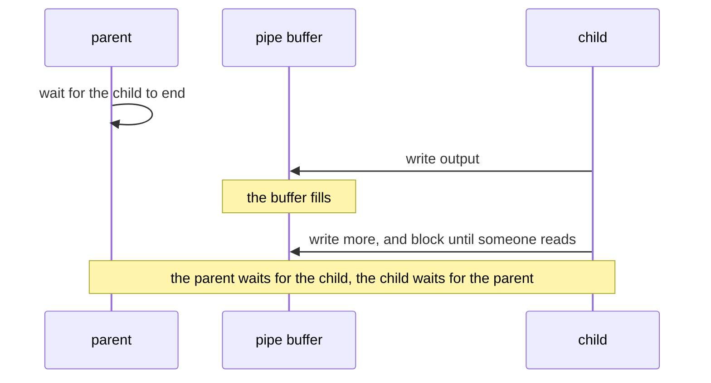
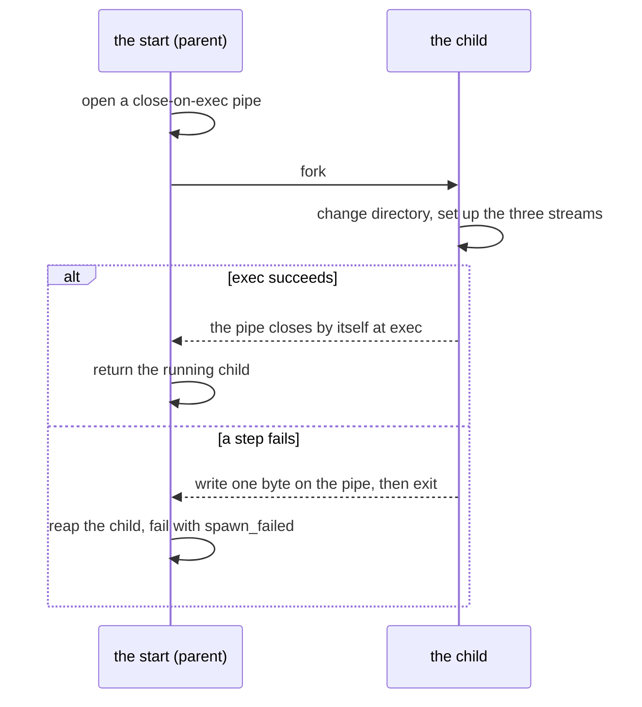
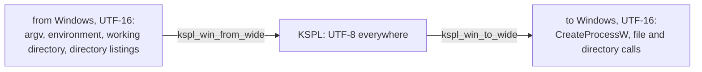
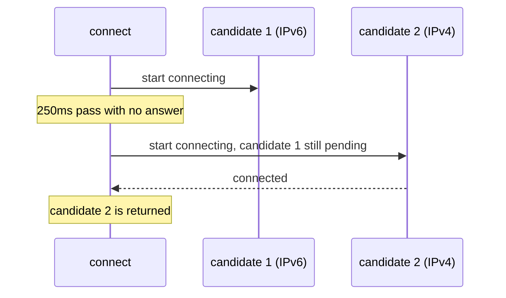

# Processes, files, threads, networking and data formats

**This document says why the parts of `std` that reach outside the program work the way they do.** These parts are the process and its children, files and paths, threads, networking and the data formats. The words used across `std` and the table of what was inherited are in [`DESIGN-core.md`](DESIGN-core.md).

## The process: arguments, output, children and the clock

### An argument's destination is declared, and unknown ones are errors

With `std/argparse`, each option writes straight into a variable of yours. That variable's starting value is the default. An argument that starts with `-` and that nothing declared is an error; it is never skipped.

Each declared item receives **a pointer to the caller's variable**, so the default value is that variable's initial value.

```kspl
$out: U8[] = "out/result.jsonl" // the default is the variable's initial value itself
$vocab: I64 = 2000
$verbose: = false
p: = argparse.Parser.create("build_corpus", "build a corpus", arena)
p.str_opt("--out", out@, "where to write")
p.int_opt("--vocab", vocab@, "the target vocabulary size")
p.flag("--verbose", verbose@, "show the progress")
p.parse_or_exit(sys.args(), arena)
```

The destination carries `$` because argparse rewrites it. Without it, the diagnostic is `expected 'Bool$@', but got 'Bool@'`. The `$` also tells the reader that the variable changes later. **There is no lookup by name** (`get_str("--out")`). So the compiler catches a misspelt name or a mismatched type at compile time, not at run time.

The table shows what the parser above does with a few command lines.

| Command line | Result |
| :-- | :-- |
| `--out=result.jsonl` | `out` becomes `result.jsonl` |
| `--out=-7`, `--out=` | `out` becomes `-7`, or empty: the value is whatever follows the first `=` |
| `--out result.jsonl` | Refused: "needs a value, written as '--out=<value>'" |
| `--outt=x` (declared nowhere) | Refused as an unknown option |
| `--out=a --out=b` | Refused as `repeated`: an item of one value takes one |
| `-5` as a positional argument | Refused as an unknown option |
| `-` | A positional argument, meaning standard input by convention |
| `-h` | Refused as an unknown option, and the refusal prints the usage |
| `-- -5 --help` | Two positional arguments, `-5` and `--help`. After a lone `--`, nothing is read as an option or a command |

Caution: **Anything that starts with `-` and that no declaration knows is an error.** It is never let through silently. Besides misspellings, this catches the pieces that the shell makes from a path with a space in it. The shell splits such a path into several words. Ignored, those pieces cause a failure that nobody can trace. The price: a negative number such as `-5`, or a file named `-x`, is a positional argument only after a lone `--`. That follows the POSIX convention that everything after a lone `--` is positional. A lone `-` is positional, meaning standard input by convention.

**A value is joined with `=`, and only so** (`--out=result.jsonl`). The parser refuses `--out result.jsonl` with "needs a value, written as '--out=<value>'". Two spellings of one option are two ways to write the same thing (Principle 6 in [`../../docs/DESIGN-principles.md`](../../docs/DESIGN-principles.md)). And the spaced spelling has to guess. Is the next argument the value or another option? In `--root --show`, taking `--show` as the value serves a folder that does not exist. That shows 30 seconds later as a server that fails to start. And can a value start with `-`? Joined, the value is whatever follows the first `=`, `-7` and an empty value included. An option never takes the argument after it. The parser takes positional arguments only where they are declared (`p.positional`, read from `p.rest`). The reason is that a word-split fragment can also arrive in the positional shape.

**An item of one value given twice is refused** (`repeated`), for a string and an integer alike. Taking the later one lets a word added to the end of a command line undo an earlier one without a trace. For example, a wrapper that appends `--out=safe` hides the `--out=/etc/passwd` that a caller wrote. A reader of the line cannot tell which one counts. An item that can be given many times says so in its declaration (`str_list_opt`, which keeps every value in order). A flag given twice says the same thing twice, so the parser takes it. The price: a script cannot override a default by appending an option to a fixed line. The script builds the line once instead.

**Asking about an item declared nowhere stops the program** (`saw`, `saw_empty`). If the answer were false, a misspelt name (`saw("--outt")`) would read as an item never given. The check that it guards would then pass for good. The name is the program's own text, so the mistake is the program's, not the user's.

**An item has one name, and there are no short names.** An `--in-place` has no `-i`, and a `--define` has no `-D`. Two spellings of one option are two ways to write the same thing (Principle 6 in [`../../docs/DESIGN-principles.md`](../../docs/DESIGN-principles.md)). A script, a document and a model's answer each pick one, and the reader must know that they are the same. A short letter also means different things from tool to tool:

* `-i` means in place for `sed` and `clang-format`.
* `-i` means ignoring case for `grep`.
* `-i` means asking first for `cp`.

Joining a value to a short letter (`-Dflag`) needs its own matching rule. The cost is typing. The lines that repeat an option are in build files and scripts, which are written once. `--help` has no `-h` either: a rule with one exception is two rules to learn. And `-h` means something else elsewhere: human-readable sizes for `ls -h` and `df -h`, and no file names for `grep -h`. The parser refuses a `-h` as an unknown option, and the refusal prints the usage. So the reader still gets what they came for.

### An option names the subcommands it takes effect on

**An option given with a subcommand that does not act on it is refused.** `p.only_for("--in-place", "fmt")` limits `--in-place` to `fmt`. The refusal (`not_for_command`) names the subcommands that take the option. Accepted, the option would do nothing, and the writer would believe that it took effect. An option without `only_for` takes effect on every subcommand.

**Where an option stands on the line does not matter.** `--std-dir=x info std-dir` and `info --std-dir=x std-dir` mean the same. The parser checks the scope once it has read the whole line. The other design ties an option to a level of the line: the program's options before the subcommand's name, the subcommand's own after it. The user must then remember each option's level. An option that several subcommands share needs a copy at each level.

**One subcommand can be the default** (`default_command`). The parser chooses it when the line names none, as `ksplc a.kspl a.c` compiles. Its name is never typed: two ways to ask for one thing are two spellings to learn (Principle 6 in [`../../docs/DESIGN-principles.md`](../../docs/DESIGN-principles.md)). The name still stands in the usage, in `command` and in `only_for`.

**Each subcommand can carry its usage line** (`command_form`). The usage then opens with one line per subcommand, and it lists the options that each subcommand takes. `print_command_usage` writes the line of one subcommand, for the refusal of its arguments. The parser writes these lists from the declarations, so no copy kept by hand drifts.

The price: a scope is a string of names, separated by spaces. A name that no declaration knows stops the program at the declaration, as `saw` does. So the mistake shows at the first run, not at compile time.

### A program keeps its own output on an abnormal exit

Output that waits in a buffer is lost when a program crashes. A program whose last lines matter, such as the test harness, asks for its output to be written out at every newline.

`panic` (`std/lang`) flushes standard output before `abort()`. But **the log's last line is not necessarily where the program died**. Into a pipe (CI's log collection, `| tee`), the C library buffers fully: it writes only when its buffer is full. An abnormal exit, death by a signal included, loses everything that was not flushed. So a program whose main clue is how far it got, such as the test harness, calls `io.set_line_buffered()`. Its flush at each newline means the same on both backends and on every platform. `setvbuf`'s `_IOLBF` would not: its value is 1 on glibc and macOS, and 0x40 on MSVC's UCRT. It would put another mode into genllvm's IR on Windows.

Caution: **The code that keeps the panic record must not itself crash.** On freestanding, `panic` sets three things aside in `.noinit_panic`: the message, the stack pointer (SP) and a piece of the stack. That region is one that start-up does not clear.

`kspl_get_sp` is inline assembly per architecture, and it returns 0 where an architecture lacks it. A read of address 0 crashes, and not one word survives about why the program stopped. On wasm, this turns "there is not enough space" into `memory access out of bounds`.

When `sp == 0`, `panic` does not read the stack. Otherwise, `kspl_panic_stack_words` asks the port how many words are readable, up to the record's capacity. The default returns zero because it knows no memory bounds. The record keeps the actual count, which `take_panic_record` returns as `stack_len`. This also prevents a panic inside an interrupt from reading past the end of RAM.

### Standard output has one buffer, the C library's

A program writes to standard output through `io.out()`. The C library's stream (`stdout`) holds what waits to be written. Nothing in `std/io` keeps a second buffer above it.

| Where standard output goes | When the bytes are written |
| :-- | :-- |
| A terminal | At each newline (on Windows, at each call). Also before the program waits to read from a terminal, so a prompt shows |
| A pipe or a file | When the buffer is full, at `flush()`, and at a normal exit |
| Any of them, after `io.set_line_buffered()` | At each newline too |
| Any of them, at a `panic` or before a child is started | All that waits is written first |

Standard error waits for nothing: each call is written at once.

**Each `Writer` call is one call into C, the cheapest that does the job.** `s` hands the whole string to `fwrite`, and `c` hands one byte to `fputc`. A number's digits go out as one string per run between separators, not as a call per digit. The cost of output is per call, not per byte. A `fprintf` per byte parses a format each time. With it, a program that prints many short numbers runs about four times slower than a C program's `printf`. With these calls, it runs as fast.

**Why no buffer of its own**: the runtime's own paths write through the C stream. A panic flushes `stdout` in C, and so does the start of a child. They cannot see a buffer above it. So a panic would lose the output before it. And a child started with bytes still waiting would write its own output ahead of them. Two buffers for one purpose would also mean two answers to "has it been written yet".

**Why not unbuffered**: a write to the OS per call makes heavy output into a pipe slower by a system call per string. **Why not line-buffered everywhere**: into a pipe, that costs a system call per line. And another program usually reads a program's output from a pipe, in blocks. A watched run that wants each line at once asks for it with `io.set_line_buffered()` (the section above).

**Reading does not flush standard output.** On a terminal, a prompt still shows before the read. The C library writes a terminal's waiting output before a read from standard input waits (glibc and macOS's libc). Windows writes to a console at once. **Into a pipe** (`prog | tee log`), the prompt waits in the buffer. So a program that prompts there calls `io.out().flush()` before it reads. Take a program that reads a byte (`io.getchar`) and writes between reads, with its output into a pipe. A flush at every read would cost it a system call per byte. That gives up a filter's throughput for a case that one flush call covers.

### A write to a freed file stream stops the program

**A `File_stream` closes itself when its owner leaves scope** (`Drop`). `free()` closes it sooner, closing the C stream and leaving the handle null, and the compiler refuses a use of that local after it. **A later write through a pointer stops the program with a message**, since a `Writer` call returns no failure. Otherwise the bytes would go to standard output or into the closed stream, and be lost. The program would carry on and exit 0. `read` and `sync` can report a failure, so they refuse it as `invalid_arg`. A copy would keep the stream that its original closes, so a `File_stream` moves instead (`Drop` brings that rule).

**Standard output and standard error are not `File_stream`s.** The whole program shares them and nothing closes them, so `out()` / `err()` hand out a stream of another type, opened on the first call. It is never a null that stands for them. It also lives in a global, where an owner that frees itself cannot.

### A crash names what happened, in one line

Some programs touch memory that they must not touch. Examples are a write through a null pointer, or a recursion that runs its stack out. The OS stops such a program, not one of the language's checks. Left there, the program ends without a word. A shell can print "Segmentation fault", and a parent sees the code 139, but nothing names what happened. **With an OS, the runtime writes one line to standard error. Then it lets the fault end the program as it would have.**

| What the fault's address says | The line (POSIX; Windows names the exception, such as `STATUS_ACCESS_VIOLATION`) |
| :-- | :-- |
| It lies in the first page: a null pointer, with a field's offset added | `crash: null pointer dereference (SIGSEGV at address 0x0)` |
| It lies at the end of the thread's stack | `crash: stack overflow (SIGSEGV at address 0x7ffc5d4b8ee8)` |
| Anywhere else | `crash: invalid memory access (SIGSEGV at address 0x…)`, or `crash: bus error (SIGBUS …)` |

* **The exit code stays the fault's own.** POSIX puts the signal back to its default and raises it again. So a parent reads 139, and a core dump is written where one is enabled. Windows ends with the exception's code, read as 139 ("A child's end is one code on every OS" below). A caller that checks the code sees no difference.
* **The prefix is `crash: `, not `panic: `.** A panic is a stop that the program makes at a rule it checks, at a line it names. That rule is "Conditions that stop execution at run time" in [`../../docs/SPEC-programming-language.md`](../../docs/SPEC-programming-language.md). A crash is the OS's stop, and the fault names an address, not a line. One word per kind of stop keeps each one a single string to search for.
* **No trace is printed.** A walk of the stack inside a fault handler is safe only with an unwinder. The runtime does not carry one on every OS. And `print_trace`'s error trace is the route of the last `!` failure, which is unrelated to the fault. The line says what happened. A debugger on a build with `-g`, as `ksplc build` makes, says where.
* **The handler calls only what is safe there** (write, signal, raise). The fault can strike inside the C library while it holds its locks. So the handler does not flush standard output, and a program whose last lines matter is line-buffered (the section above).
* **A handler already in place is kept** (a sanitizer's, a host program's). A library takes none, since its host owns the signals.
* **An overflow handler needs stack room reserved before the stack runs out.** POSIX uses a separate 64 KiB stack. Windows reserves 64 KiB on the thread's own stack with `SetThreadStackGuarantee`; the default guard alone can leave too little room to report. The runtime prepares the main thread before `main` and each `std/thread` thread before its entry point. It does not prepare threads started by C code, so their overflow can end with 139 and no line.
* **Freestanding has no OS to stop the access**, so nothing here applies to it.

The implementation is "A crash says what happened" in [`../../ksplc/gen/runtime/hosted.c`](../../ksplc/gen/runtime/hosted.c). The check is `make test-runtime` (the `crash_*` cases in `ksplc/tests/runtime/stops.kspl`).

### A run of checks goes past failures, naming them last

`std/verdict` can run many checks without a stop at the first failure. It ends with one `RESULT:` line that names every check that failed. The exit code is the verdict.

| Shape | Calls | Stops at the first failure? | Suits |
| :-- | :-- | :-- | :-- |
| Tests one at a time | `start` / `pass` / `skip` | Yes, at `std/lang`'s panic | Ordinary unit tests |
| **A run of checks** | `begin` / `check` / `finish` | No: it goes on past a `FAIL` line | A run with something to stop before it ends, such as a server still listening on its port. Also many independent checks, where the first failure is not the only one worth reading |

**The names on the `RESULT:` line are copied into the tally's own room** (`Names` in `std/verdict.kspl`). The caller often builds a name for `check` in its scratch arena and frees it straight after. So a view kept until `finish` would read freed memory. An allocation would make the tally the one part of a failing run that can itself fail.

**A child's run is read here too** (`run_child` / `run_children`). A check on a compiler or a tool asks two things of it: how it ended, and what it wrote. Its stdout and stderr come back as one text, since a diagnostic appears on either, by version and path. A run that could not start, or that was killed, has no code, and says why in that text. `exited_with(code)` asks whether the run ended by itself with that code. So a check never reads a run that did not end as one that ended non-zero. `run_child` waits at most `default_timeout_ms`, unless the check passes its own limit. `run_children` runs `jobs()` children side by side, each under `default_timeout_ms`. It returns them in the input's order. So the code that judges has one form, sequential or parallel.

**A finding is indented on the lines below its `FAIL` line.** The gates read a line by its head (`FAIL `, `RESULT:`). So a finding at a line's head could be read as a verdict.

Why a walk that walked nothing fails is at `check_list` in `std/verdict.kspl`. Why this stands in `std` at all is "What tests share stands in std" in [`../../docs/DESIGN-repository.md`](../../docs/DESIGN-repository.md). The check is `make debug`, which runs each shape as a child and holds its whole output.

### Fuzzing watches the program from outside

*Fuzzing* feeds a program many broken inputs to find crashes.

**A round of `std/fuzz` is one run of the program.** The driver judges it from outside by how it ended: its exit code, an announced stop, or no end within the wait. Nothing is built into the program. There is no coverage instrumentation, and no entry point called in the fuzzer's own process.

**Why**: in another process, a crash is seen. Inside the fuzzer's process, it would take the tally down with it. With nothing built in, the same fuzzing runs on all three platforms with the C compiler as it is. A coverage-guided fuzzer (one that watches which code each input reaches) needs a runtime that the toolchain can lack. The same seed, seeds and count give the same rounds. `std/prng` is written in KSPL, so a round generated on Linux is generated on Windows too. A developer reproduces a gate's failure at a desk from the two numbers it prints. A gate can also run a fixed count, where a coverage-guided fuzzer runs until stopped.

**The program under test is built with the address sanitizer where the C compiler holds its runtime.** The driver is told so (`fuzz.Sanitized`). The address sanitizer is a build option that stops a program at a bad memory access. Take a read past an allocation's end that stays inside a mapped page. Built plain, it returns a stale byte, and the round ends well. Built with the sanitizer, the read stops at its line. Nobody can see the build from outside, so `report_asan` prints a line either way. It prints a check where the sanitizer is in or required, and a skip where the toolchain holds no runtime.

**A round past its wait runs again with five times the wait** before it counts as not ending. A crowded machine slows a finite round, and the target is a program that never stops. `check_reach` keeps a run that tried nothing from passing. Without it, a check only for crashes would go green on a mutation that broke every seed at the parser's entry.

**What this gives up**: coverage and speed. A coverage-guided fuzzer keeps an input that opened a new path and mutates it further. It reaches deep paths that a blind fuzzer reaches only by luck. Here the seeds carry the depth, so the suites gather real files and write seeds from each writer. And a process per round is far slower than a call.

**std's own fuzz (`make test-fuzz`) scatters at each reader of outside bytes.** It checks a round trip wherever std holds a writer for what it reads. The program under test, `std/tests/read_prog.kspl`, is told the kind of each input:

| Kind | What reads it | What must hold besides an end |
| :-- | :-- | :-- |
| `json` | `json.parse` | The value is written (`dump`, flat and indented) and read back. The result `equals` the one read, and is written the same again |
| `json-struct` | `json_struct.into_struct`, into a struct with a field of each kind it walks. The fields are integers of each width and sign, an `F32`, a `Bool`, a string, a nested struct, lists of numbers, strings and structs, and options | The struct is written (`from_struct`) and read back into another. It is written the same again. Only this second trip must be equal: the first drops unknown keys and rounds an `F32` |
| `url` | `url.decode_component`, `url.parse_query` | A component, encoded (`url.encode`), decodes to itself. The pairs, encoded into a query, parse back to the same pairs in order |
| `base64` | `base64.decode` | The bytes, encoded, decode to themselves |
| `regex` | `Regex.compile`, then matching | `is_match`, `find` and `find_all`'s first match agree. A search visits no more states per byte than the program holds, plus one |
| `http-req` | `http.parse_request` | None |
| `http-res` | `http.parse_response` | A response that the writer takes (`format_response`) reads back as the status, headers and body it was given. It is written the same again |
| `http-write` | `http.format_request` and `format_response`, given fields split at each 0 byte | What the writer takes reads back the same. That covers the method and target or the status, the headers in order with the writer's `Content-Length`, and the body |
| `jsonrpc` | `jsonrpc.take_frame`, over a stream of frames | The frames before the first broken one are the same, however the bytes arrive. They can arrive at once, a byte at a time or seven at a time. Each body, framed again (`frame_into`), is taken back the same |
| `argv` | `argparse.Parser.parse_list`, with flags, values, a repeated item and positionals. It also has `--`, a command chosen by name and by flag, and one command taking an uninterpreted rest | What it read, written back as a command line, parses to the same values, items given, command and positionals |

**Every seed is read once before any mutation** (`fuzz.check_seeds`). A seed that the program refuses is dropped, unless the program's own writer made it. A seed that stops the program fails. Dropped, it would hide a crash on a file that nobody mutated. **A broken round trip stops with `assert`.** So the driver counts it among the announced stops. And the input it keeps prints the broken property when it runs again. **Why under the fuzz, beside the unit tests**: a unit test checks the values that its writer thought of. Under the fuzz, the trip runs on every value that a mutation reaches. Examples are a header value that ends in a space, or a head one byte past its limit.

### Writing to a closed pipe returns an error value

In a KSPL program, a write whose reader has gone comes back as a failure value. Standard output is the exception: there, the program ends quietly.

POSIX ends a process that writes to a pipe whose reader has closed (SIGPIPE's default). So a server whose peer leaves dies **without printing anything**, and a peer that leaves is an ordinary event. From outside, no request comes back, and nothing points at the cause.

**The runtime ignores SIGPIPE, and a function that writes returns the refusal as a value.**

| Where the write goes | What happens when the reader is gone |
| :-- | :-- |
| A child's standard input (`Piped_child.write`) | Returns false |
| A socket (`std/net`'s send) | Returns a failure |
| The program's own standard output | The program ends quietly, as `prog \| head` expects |
| Anything, inside a child the program starts | SIGPIPE's default is back, so the child dies as usual |

**Standard output is the exception**: Unix promises that `prog | head` ends quietly. So once a write comes up short, `std/io` restores SIGPIPE's default and raises it on itself. A buffered `fwrite` reports that it wrote. So the flush passes the same check, because the flush is the only place where the loss shows.

Caution: **Do not stop at only ignoring it.** The output is then silently discarded. The program runs on to the end, with its destination lost.

**A socket's write fails as a value even in a library.** SIGPIPE stays with the program that links the library. Otherwise a server library would kill its host the first time a client left. The runtime asks the OS not to raise the signal for a socket. It passes `MSG_NOSIGNAL` on each send, or sets `SO_NOSIGPIPE` where the OS has no such flag. A pipe's write stays the program's to handle.

**Do not carry the ignoring setting over to a child.** The setting survives exec, so `git`, `clang` or a shell pipeline would not die either. And the `yes | head -1` family would never finish. The runtime restores it between the fork and the exec.

The implementation is "Writing when nobody is left to read it" in [`../../ksplc/gen/runtime/hosted.c`](../../ksplc/gen/runtime/hosted.c). The check is `make test-broken-pipe`.

### Parallel children's output comes through files, not pipes

`std/subproc`'s `run_many` starts several children at once. It sends each child's two output streams to files in the caller's directory. It reads the files after the child has ended and been reaped (its exit status collected).

**Why not pipes**: a pipe fills before the parent reads it, and the child stops. A watch on every child's pipe at once needs a `poll` set or threads, which only the C runtime could hold. A file does not fill. So it is enough to start and wait in order, and the scheduling stays in KSPL. The cost is the trip through the disk. That rules it out for a measure of the output's latency.

**Why not `run_capture` on threads**: each call copies its output into the caller's arena. That arena is not safe to share between threads. So each thread would need an arena of its own, and its results copied back. Processes side by side keep the scheduling and every copy on the caller's one thread.

**Why results are reaped in submission order**: they then match the input, so the caller carries no mapping. The cost: one slow item at the front leaves the slots behind it idle. Reaping in completion order would keep the slots full. But it would leave the caller to restore the order.

**Each child has a time limit of its own**, counted from its start, as `run_capture`'s is. Past it, the child is killed with all it started ("A time limit stops the child and all it started" below). It comes back with no exit code, with what it wrote by then, and the rest run on. A limit over the whole batch would grow too short as the batch grows. And a slow child would take the others' results down with it. POSIX's `waitpid` takes no time limit. So a wait with a limit means looking again after a pause. The pauses start at 1 ms and double up to 10 ms. So a slot stands idle at most 10 ms after its child ends. Submission order keeps every child's limit honoured. The children start in order, so each one's deadline falls no earlier than those of the children reaped before it.

### Three ways to start a child process, by its output

`std/subproc` has one function per purpose, not one function with options. The three purposes are these:

* Collect everything, once or many in parallel.
* Keep it running.
* Talk back and forth.

With this split, nobody can write the combinations that hang.

| What is wanted | The function | Where the output goes |
| :-- | :-- | :-- |
| Run it and collect everything | `run_capture(argv, cwd, timeout_ms, cap, arena)` | The parent's memory (cut at the cap) |
| Run many side by side and collect everything | `run_many(jobs, …)` | Files in a directory (the section above) |
| Keep it running | `spawn_redirect(argv, cwd, out_path, err_path)` | Files the caller named |
| Hand it input and let it write where the parent does | `spawn_feed(argv, cwd, input, idle_ms)` | Inherited (the terminal) |
| Let it write where the parent does, as it goes, and stop it with all it started at a time limit | `spawn_limited(argv, cwd, timeout_ms)` + `wait(wait_ms)` | Inherited (the terminal) |
| Talk back and forth | `spawn_piped(argv, cwd)` + `read(buf, timeout_ms)` | A pipe (with a timeout) |

Why not options on one function: Python's `subprocess` and Java's `ProcessBuilder` take that shape, which is easier to start writing. But **the shape cannot stop the combinations that deadlock**. A wait for the child to finish, while the parent is still attached to its pipe, stalls once the buffer fills. Both leave the avoidance to the user's discipline, by documentation alone. With the split by purpose, nobody can write that combination.

The stall, step by step:



**Why only the functions that use a pipe take a timeout**: only a pipe's buffer can fill. So the timeout is an argument of the read, and of `spawn_feed`, whose input goes through a pipe. No form omits it. Its expiry comes back as a value, which makes the stall a diagnostic at once. Java expresses a timeout as `waitFor`'s false return value, which a caller can overlook. The timeout also tells a slow child from a dead one (a dead one returns 0, as EOF). The time limit of `run_capture`, `run_many` and `spawn_limited` is another thing. It bounds the child's whole run, and stops it ("A time limit stops the child and all it started" below).

**Inherited and file-directed children share `Child`**, with `wait`, `alive` and `kill`. Neither needs its outputs drained before a wait. So a raw integer handle and a separate function to reap would give the same lifetime two interfaces. `Child` has no read method: inherited output goes to the terminal, and redirected output goes to files. `Piped_child` stays separate and has no blocking `wait`, because its pipes can fill.

**Both are `Move_only`, and a repeated `wait` or `kill` does nothing.** The runtime frees the child's record when it reaps the child, at `wait` or `kill`. So each clears its handle, and a second call meets an empty one. `wait` gives none, as a reaped child has no code left to give, and `kill` returns at once. A copy would still hold the freed record, and its own call would read freed memory. So the type refuses the copy instead.

**A child with a time limit is a type of its own, `Limited_child`, also `Move_only`.** Its limit is fixed at the start, as `run_capture`'s is. The limit holds however the caller waits on it. `wait(wait_ms)` comes back with one of three answers:

* `ended(code)` when the child ended.
* `running` when its own wait passes first.
* `timed_out` once the limit has stopped the child with all it started.

`running` lets a caller say something while a long child is quiet, with one way to wait. After `ended` or `timed_out`, a wait gives none at once. It has no `kill`: its limit is its stop. `Child` does not take a limit. Its `kill` stops the child alone, and `spawn_redirect`'s child is meant to outlive its starter.

**Why `spawn_redirect` alone asks for no console window**: on Windows, a program without its own console can start a console program. That program then gets a new console window. `spawn_redirect`'s child already writes both streams to files, so the window would show nothing. And the child is meant to outlive its starter. The functions that collect must not ask. Ctrl+C in the starter's console does not reach a detached child. For a parallel build, that means orphaned compilers.

**A child that does not take all its input has no exit code to give** (`spawn_feed`'s `Feed_error.input_not_taken`). Its code answers for part of the input, as if it were all of it. For example, a compiler fed half a program reports on half a program. So the child is stopped and the call fails. That happens when the child closed its input, ended early, or took none of it for `idle_ms`. The failure is its own enum beside `spawn_failed`, as `Run_error` is. The reason is that the other ways of starting cannot fail this way.

**A read of a finished child's output as one text is a way to read the result, not another function** (`Run_result.text`).

**The split is on the KSPL side.** C starts a child one way, `kspl_proc_start`. It takes the arguments, the working directory, and a pipe or a file for each standard stream. The four functions combine it in KSPL with `kspl_proc_poll` / `kspl_proc_read` / `kspl_proc_wait` / `kspl_proc_kill`. That covers the collection cap, the timeout and the kill on a timeout.

Caution: **Do not add a per-purpose way to start a child to C.** C code is written twice, for POSIX and for Windows, and the Windows copy cannot run locally. C keeps only what needs the OS's API directly. That is `fork` / `CreateProcessW`, the creation of a pipe, Windows's quoting of the command line, and the UTF-16 conversion.

### A bare program name is looked up in PATH alone

**`argv[0]` without a directory is looked up in PATH and nowhere else, on every OS.** So the current directory is searched only where PATH names it. POSIX's `execvp` already does this.

| Where the OS looks, in order | POSIX `execvp` | Windows `CreateProcessW` | `std/subproc` |
| :-- | :-- | :-- | :-- |
| This executable's directory | — | 1 | — |
| The current directory | — | 2 | — |
| The system directory | — | 3 | — |
| The Windows directory | — | 4 | — |
| The directories PATH names | 1 | 5 | 1 |

So on Windows, a `cc.exe` in a cloned repository would run in place of the compiler for anyone who builds there. And `bash` would start WSL's launcher in the system directory, in place of the bash that PATH names. So on Windows, `std/subproc` looks the name up itself, in PATH. It adds `.exe` to a name with no extension, as `CreateProcessW` does. Then it puts the full path it found in the command line. A name that it does not find fails to start, rather than falling back to the OS's search.

### A relative program path starts at the child's working directory

**A relative path with a directory part (`./tool`, `bin/tool`) is read from the child's working directory**, where the start is given one. POSIX reads it so: the child changes directory, then execs. `CreateProcessW` reads it from the parent's directory instead. So on Windows, `std/subproc` joins it onto the working directory itself. Without that, one call would run a different program, or none, per OS. Rust leaves this case "platform specific and unstable" and asks for an absolute path. Go joins it onto the directory on Windows, as here.

### A child that cannot start fails the start everywhere

**Every function in `std/subproc` gives `spawn_failed` for a program that cannot start.** That covers a program that is not there or cannot run. It also covers one that cannot be given its working directory or output files. It is never an exit code. `CreateProcessW` fails for each of those, so Windows answers this way by itself. POSIX first copies the process (`fork`) and meets the failure in the copy, the child. That happens after the fork has succeeded. So the child reports the failure to the start before it ends. It writes a byte on a pipe that the start already waits on. That pipe closes by itself when the child's `exec` succeeds. It is *close-on-exec* ("A child holds only the streams it is handed" below).



**Why not the shell's 127**: an exit code of 127 is also what a program gives that runs and exits 127. A missing shared library gives it too, on POSIX. So the caller cannot tell "it is not there" from "it ran and failed". And Windows has no such code. So a caller that reads 127 as "missing" would be right on POSIX alone.

### A child's end is one code on every OS

A *signal* is how POSIX tells a process about an event such as a crash (`SIGSEGV` for a bad memory access). **A child that crashed or was killed ends as 128 + the signal number, on every OS.** That is the shell's convention: a segmentation fault is 139, and an abort is 134. POSIX's wait reports a signal apart from an exit code, and `std/subproc` folds it into that number. Windows has no signals. A crash ends the process with the NTSTATUS of the exception (Windows's code for why a process ended). `__fastfail` ends it with `STATUS_STACK_BUFFER_OVERRUN`. So on Windows, each of those is read as the signal that POSIX raises for the same fault:

| How the child ended on Windows | Read as | Code |
| :-- | :-- | :-- |
| `STATUS_ACCESS_VIOLATION`, `STATUS_STACK_OVERFLOW` | `SIGSEGV` | 139 |
| `STATUS_ILLEGAL_INSTRUCTION` | `SIGILL` | 132 |
| `STATUS_FLOAT_DENORMAL_OPERAND`, `STATUS_FLOAT_DIVIDE_BY_ZERO`, `STATUS_FLOAT_INEXACT_RESULT`, `STATUS_FLOAT_INVALID_OPERATION`, `STATUS_FLOAT_OVERFLOW`, `STATUS_FLOAT_STACK_CHECK`, `STATUS_FLOAT_UNDERFLOW`, `STATUS_INTEGER_DIVIDE_BY_ZERO`, `STATUS_INTEGER_OVERFLOW` | `SIGFPE` | 136 |
| `STATUS_STACK_BUFFER_OVERRUN` (`__fastfail`, UCRT's `abort()` by default, and every KSPL program's) | `SIGABRT` | 134 |
| `STATUS_CONTROL_C_EXIT` | `SIGINT` | 130 |
| `STATUS_DLL_NOT_FOUND` | the loader's 127, as on POSIX for a missing shared library | 127 |

Any other code is the child's own, a negative one included. The table's copy in the runtime is `kspl_proc_status_code` in `ksplc/gen/runtime/hosted_proc.c`. `make test-conventions` checks that the two agree. Some faults have no single POSIX signal. For example, an in-page error is `SIGBUS` on Linux and macOS, under different numbers. Such a fault stays as Windows gives it.

**A KSPL program's own abnormal end is `STATUS_STACK_BUFFER_OVERRUN` on Windows, whatever the C runtime does.** A panic and the run-time checks end in `abort()`, which raises `SIGABRT` first. The runtime's handler ends the process there with that code (`kspl_end_on_abort` in `ksplc/gen/runtime/hosted.c`). Left to the C runtime, msvcrt's `abort()` exits 3. UCRT's either exits 3 or fails fast, by a setting.

**Exit code 3 is not read as an abort.** A program that ends normally with 3 gives it too (robocopy's "files copied, extra files present"). So a read of 3 as 134 would report a crash that did not happen. The cost: a program built against msvcrt, or UCRT without fault reporting, that calls `abort()` reads as 3.

**Whether the child has finished is not one of the codes.** `Piped_child.exit_code` returns an `I32?`, which is none while the child runs. A number set aside for "still running" is also some child's exit code. Windows's `exit(-1)` ends with -1, which would read as "not finished" forever. A kill by `Child.kill` or `Piped_child.kill` reaps the child and gives no code, since nothing can read the handle afterwards.

### A time limit stops the child and all it started

**`run_capture`, `run`, `run_many` and `spawn_limited` can stop a child at its time limit. They stop it together with every process it started.** A child is often a shell or a compiler driver whose work runs in children of its own. For example, `cc` starts the compiler proper and the assembler. Killed alone, the child leaves those running. They go on writing files after the caller has given up, and hold its output open.

**So on POSIX these children lead a process group of their own. On Windows, they are put in a job object of their own.** The kill is sent to the group, or ends the job. On Windows, the child starts suspended and runs only once it is in the job. So nothing it starts can begin outside the job.

**A terminal's signals are passed on.** A group of its own is outside the terminal's foreground group. So Ctrl+C and a hangup reach the starter alone. A starter that they ended would leave its children running, with nobody left to stop them at their limit. So while such a child runs, the runtime takes `SIGINT`, `SIGQUIT`, `SIGHUP` and `SIGTERM`. It passes each one on to every group it holds. Then it ends by the signal, as it would have by default. **It takes a signal only where the signal is still at its default.** A program that ignores or handles one has chosen how it ends. Its grouped children then do not hear of it. Windows needs none of this: a console's Ctrl+C reaches every process attached to it, in a job or not.

**The other ways to start a child stay in the starter's group.** Out of the foreground group, the OS stops a child that reads the terminal. The children of `spawn_wait` and `spawn_async` are on the terminal, so they would hang an interactive tool. `spawn_redirect`'s child is meant to outlive its starter. `Child.kill` and `Piped_child.kill` stop the child alone.

**The kill asks the group to end before it forces the group to.** The steps are these:

1. The kill sends `SIGTERM` to the group, with `SIGCONT`, since a stopped process takes no other signal.
2. It waits until every process in the group has ended, or until a grace of half a second has passed.
3. It sends `SIGKILL` to whatever is left.

The wait ends as soon as the group is empty. So a group that ends on `SIGTERM` costs a few milliseconds, where its ended members are reaped at once. A KSPL program inside the group can lead groups of its own (a test harness's own `run_capture` child). It passes the `SIGTERM` on to them before it ends, as the paragraph above says. `SIGKILL` alone would end it before it could. The groups that it leads would then run on, with nobody left to stop them. The grace is the room for that hand-off, not a time to tidy up. It is short beside any time limit, and a process that needs longer is killed. Windows needs none of this. A job made inside a job is nested in it, so the end of the outer job ends the inner ones too.

**`spawn_limited`'s child writes on the terminal from a group of its own, and reads an empty standard input.** A write from outside the foreground group is allowed, so its output reaches the screen as it comes. The OS stops a read, so its standard input is a pipe closed at the start. A child that reads it sees the end at once, rather than a stop until its limit.

What this gives up:

| Case | What happens |
| :-- | :-- |
| A child stopped at its limit asks something on the terminal itself (a password prompt that opens `/dev/tty`), or changes the terminal's modes | The OS stops it until the limit ends it. A tool that must ask runs through `spawn_wait` |
| The terminal is set to stop a background writer (`stty tostop`) | `spawn_limited`'s child is stopped at its first write until the limit ends it |
| A process that the child started leaves the group on purpose (a daemon that calls `setsid`) | It is not stopped |
| A process that the child started leads a group of its own on POSIX. Its starter is not a KSPL program at its default for `SIGTERM` (a shell's job control, another language's runner) | It hears nothing of the stop and runs until it ends. A KSPL starter passes the `SIGTERM` on, so a KSPL program's own `run_capture` child is stopped. Windows nests a job inside the job, so there it is stopped either way |
| A process in the group handles or ignores `SIGTERM` | It has the grace, half a second, and is then killed. A KSPL starter that handles `SIGTERM` itself passes nothing on, as it chose |
| The members that ended are reaped late (a container whose first process reaps orphans slowly, or never) | An ended process still counts as in the group until it is reaped. Nothing portable tells it from a live one, so the kill waits out the whole grace |
| The child has ended and been reaped | Nothing is stopped. On POSIX, the group's number was the child's process ID. The OS can then hand that number to another process, so the kill could reach a stranger. Windows keeps the job, but stops nothing either, so the two agree |

**The job object does not kill on close.** With that setting, what the child left running at a normal end would die when the starter lets the job go. It would also die on the starter's crash. On POSIX, it runs on. So one call would end differently per OS.

### A child's outputs are read briefly past its end

**Once the child itself has ended, `run_capture` reads its outputs for `pipe_grace_ms` (100 ms) more.** Then it closes them and returns the child's own exit code. The child can start a process without a redirect of its outputs (`server &` in a shell script). That process holds the pipes open after the child has ended. A wait for them to close would run to the time limit. It would then report a child that ended in time as stopped there, with its exit code lost.

**Nothing that the child itself wrote is lost.** Once the child has ended, everything it wrote is in the pipes, and is read. The grace can cut only what the processes that it left behind write after it. Those processes are not killed. A child that ended normally can have started something meant to stay, and only a time limit stops what a child started. Their next write to the closed pipe fails.

**The grace is short because it guards nothing that the child wrote.** It only lets a process that is finishing its last write land it. `run_many` collects through files, which a leftover process cannot hold open. So `run_many` sees its children's ends at once.

### A child holds only the streams it is handed

A child gets its three standard streams (input, output, error) and nothing else of what the parent has open. A file, socket or pipe left open in a child would stay alive and in use, for as long as the child runs.

What a child started by `std/subproc` receives from the parent:

| | Does the child get it? |
| :-- | :-- |
| Its three standard streams | Yes, as the start sets them up: inherited, a pipe, or a file |
| Its working directory | The `cwd` the start was given |
| Any other socket, file or pipe end the runtime opened | No |
| SIGPIPE ignored | No: the default is restored between the fork and the exec ("Writing to a closed pipe returns an error value" above) |
| A console window of its own, on Windows | Only from `spawn_redirect` ("Three ways to start a child process" above) |
| A descriptor a foreign C library opened without the mark, on POSIX | Yes: the gap this section gives up, below |

**Every socket, file and pipe end that the runtime opens is closed on exec (POSIX) or not inheritable (Windows).** So a child holds its three standard streams and nothing else. A copy in a child keeps what it names alive for as long as the child runs. Here is what that would break:

* A server that started a helper could not bind its port again after it closed its listener.
* The server's client would never see the connection close.
* A reader would wait for a pipe's end until an unrelated child exits.

**The mark is given in the call that opens** (`SOCK_CLOEXEC`, `accept4`, `pipe2`, `O_CLOEXEC`, `WSA_FLAG_NO_HANDLE_INHERIT`). If the mark came afterwards, a child started from another thread in between would take the copy. Some opens have no such call: a socket or a pipe on macOS, and an accepted socket on Windows. There the mark is given right after. On macOS, the starts then take turns from their first pipe to the fork. So one start's pipes never reach another start's child.

**On Windows, each child is handed a list of exactly its three handles** (`PROC_THREAD_ATTRIBUTE_HANDLE_LIST`). A stream left to inherit is a copy of the parent's own. Without the list, `CreateProcessW` hands a child every inheritable handle. A start on another thread holds its child's pipe ends inheritable until its own `CreateProcessW` returns. So our child could take them, and the other reader would see its end only when our child ends. A lock around the starts would also keep one start's ends out of another's child. But the starts would wait on each other. And a handle that some library made inheritable would still pass.

**A start returns once the child has exec'd.** Until then, the forked copy holds every descriptor of the parent. So a listener closed right after the start could still not be bound again.

**`std/io`'s `open` takes C11's mode letters alone** (`r`, `w`, `a`, then `+`, `b`, and `x` after `w`). It refuses any other letter. It builds the open flags itself to give the mark. A letter that one C library reads and another skips would mean two things.

**What this gives up**: on POSIX, a descriptor that a foreign C library opens without the mark still reaches a child. A close of everything in the child would catch it. The price would be a walk over every possible descriptor per start, which is slow where the limit is high.

**A batch file (`.bat` / `.cmd`) refuses an argument that holds `"`, `%`, `!` or a line break.** Windows hands a batch file to `cmd.exe`, which parses the command line again by rules of its own. For every other program, the `\"` keeps a `"` inside an argument. In `cmd.exe` it means nothing. So the `"` closes the quoting, and the rest of the argument runs as a command. `%` and `!` expand even inside quotes. An escape for `cmd.exe` was not taken. Its rules depend on settings that the parent cannot see: delayed expansion is a registry switch. And an escape that is wrong for one setting runs the argument. With those characters refused, every argument stays inside its own quotes. There, `cmd.exe` takes `&|<>^()` as they are.

### The clock has separate functions for 'elapsed' and 'date-time'

Use `sys.mono_us()` to measure how long something takes. Use `sys.wall_seconds()` for the date and time. They are different clocks, and a swap breaks timeouts.

| Function | The clock | Use it for |
| :-- | :-- | :-- |
| `std/sys`'s `mono_us()` | Monotonic: it only moves forward, and only differences mean anything | Elapsed time, timeouts |
| `std/sys`'s `wall_seconds()` | The wall clock, as epoch seconds | The date and time |

Caution: **Do not measure elapsed time with the wall clock.** NTP or a user can set it back, which gives a negative difference. A timeout reads that as "not yet", and so waits a whole round.

**No function for CPU time is held.** CPU time does not advance during a wait. So used as elapsed time, it erases whole spans spent in reading the source. If "how much was computed" is needed, add it under a different name. Merged into `mono_us`, one name would mean different things per environment. Zig, Rust and Go make the same split. C has only `time()` and `clock()`, and neither is correct for elapsed time. So everyone calls `clock_gettime` directly.

### A wait's sign means one thing everywhere

Every wait that std takes in milliseconds reads its number the same way. Such waits are a child's pipe, a socket, `std/reactor`'s `wait`, an HTTP read and a JSON-RPC call.

| The wait | What it does |
| :-- | :-- |
| a positive number | waits at most that long, then answers "timed out" |
| `0` | looks once, without waiting |
| a negative number | a time already up: it looks once, as `0` does |

**There is no "wait for good".** A wait is required exactly so that a peer that goes silent comes back as a value. A wait forever would make that silence a hang again. A deadline counted down (`deadline - now`) can go negative on a slow machine. It then means "the time is up", never "no limit".

Caution: **Read the sign in one place, the runtime's entry** (`kspl_wait_ms`). It was once read where each OS call takes it, with three results:

* `-1` waited for good in POSIX `poll()`.
* It waited 49 days through Windows' unsigned tick comparison.
* POSIX's write deadline did not read it at all.

That was one number with three behaviours. A program that worked on one OS hung on another.

## Files and paths

### Paths are UTF-8, converted to the wide API on Windows

KSPL keeps every path, and every string, as UTF-8. On Windows, it calls only the *wide* functions, which take UTF-16. It converts at one place in the C runtime, in both directions. It never calls the *narrow* functions, which read bytes in the machine's local code page.

Windows offers most functions twice:

* The narrow form (`…A`, `_getcwd`, `fopen`) takes bytes in the current *code page*. A code page is a per-machine character encoding, such as CP932 for Japanese or CP1252 for Western European.
* The wide form (`…W`, `_wgetcwd`) takes UTF-16, which holds every character.

KSPL's strings are UTF-8 in every environment, like the source text and POSIX. **No Windows narrow (ANSI) API is used.** Those functions read the current code page. So under CP932, `_getcwd` returns CP932 bytes, and `_mkdir` takes them.

**Inside KSPL, the narrow API reads back what it wrote. So nothing shows until the bytes reach a child process.** CP932 bytes from `sys.cwd()` cannot be converted to UTF-16. So the command line for `CreateProcessW` cannot be built, and the child cannot start at all. The symptom is a failure to link or to start, far from its cause in `sys.cwd()`.

**It cannot be converted halfway.** Suppose only part of it is UTF-8. Then a path that joins `sys.cwd()`'s result with a name written in the source mixes two code pages, and neither API can resolve them. So the boundary is one place: the round trip goes through `kspl_win_to_wide` / `kspl_win_from_wide` in `ksplc/gen/runtime/hosted.c`.

The diagram shows both directions through that one boundary.



**The inbound side is converted too, since a fix of only the outbound side is worse than no fix.** Three things arrive from the OS narrow:

* `argv`. The CRT, the C library's start-up code, moves it to the current code page before the generated main receives it.
* The environment variables (`getenv`).
* `getcwd`, and directory enumeration.

Suppose only the outbound calls (`CreateProcessW` and the like) are wide. Then `sys.args()[0]` is invalid UTF-8 the moment a program puts it on a child's command line. And again the child cannot start. So `argv` goes through `kspl_os_argv` just once, inside the generated main. On every `sys.args()`, the allocations would pile up. The environment variables go through `kspl_get_env` / `kspl_set_env`.

**One gap remains that the wide API cannot close: a receiving program with a narrow `main`.** Its CRT moves the UTF-16 command line from Windows to the current code page to build `argv`. A character that the code page cannot represent collapses into `?`, which no file name can hold. So the tool fails with `Invalid argument` (under CP1252, `かんそ` becomes `???`). Nothing on the sending side can close it. KSPL's own calls (`_wmkdir` / `_wstat64` …) are wide. But `cc` and `ld` are third-party tools, and mingw's GNU binutils takes a narrow `main`.

**So a third-party tool is given relative paths, with their base directory as `cwd`.** The OS sets `cwd` without going through `argv`, so non-ASCII in it survives. That is why `spawn_wait` / `spawn_async` take a `cwd` too. All five functions that start a child take one. A single function without it would make "hand it over relative" impossible to write.

CMake makes the same move (the Ninja generator writes paths relative to the build directory).

**The C standard's path functions are not used.** `fopen` and `rename` are narrow, so `std/libc`'s versions break on Windows alone. `std/fs`'s `rename_path` and `std/io`'s `open` go through `kspl_rename_cstr` / `kspl_fopen_cstr`. These keep the branch per environment in one place in C. `std/libc`'s `fopen` / `rename` carry a mark that says not to use them. They stay as the companions of `fclose` / `fread`, which work on an already open `FILE*`. Python abolished all use of the `*A` APIs for the same reason. The path is passed with a NUL at its end, so it goes to `fopen` / `rename` as it is. A pair of a `ptr` and a length would need repacking in C.

**An OS function is not declared directly with `extern "C"`, because its declaration differs per environment.** `shutdown` is `int shutdown(int, int)` on POSIX and `int shutdown(SOCKET, int)` on Windows. (`SOCKET` is a 64-bit unsigned type.) A declaration that matches one makes that one line fail to compile on the other (winsock2.h: `conflicting types for 'shutdown'`).

Caution: **Nobody can notice it on POSIX.** What fails is the Windows job or a user's machine. `std/net`'s `shut_write` goes through `kspl_net_shutdown_write`. That keeps even the constant (`SHUT_WR` / `SD_SEND`) in one place in C.

**A new `kspl_*` function has its body in the compiler's C runtime (`ksplc/gen/runtime/`).** The seed must carry that body before `std/` calls it. Otherwise the bootstrap does not build. Stage1 (the compiler that the seed builds) fails to link on an undefined symbol.

**Where the environments answer one call differently, one answer is chosen for all.** `rename` onto an existing destination replaces it silently on POSIX. It fails with `EEXIST` in Windows UCRT's `rename` / `_wrename`. That breaks "write under another name, then replace". Only the first round succeeds, and every later one silently fails to write. A server that writes the files it serves takes this shape, and so does a cache kept on disk. The answer must not be aligned on the side that fails. `rename_path` is contracted to replace, through `MoveFileExW(MOVEFILE_REPLACE_EXISTING)` on Windows. `MOVEFILE_COPY_ALLOWED` is not added. POSIX fails with `EXDEV` across volumes, so the flag would split the answer the other way. And a copy is not atomic.

Note: One difference remains. POSIX renames a directory over an empty one, while `MoveFileExW` fails if the destination exists. Every caller replaces a file, so this is left. **`make debug` pins the contract.** Linux passes it regardless. So what catches a break is the real Windows runner (`make debug` is a gate shared by Linux and Windows).

### A long path goes to Windows in the extended form

**On Windows, a path of 248 UTF-16 units or more goes to the OS with the `\\?\` prefix.** The forms are `\\?\C:\…`, or `\\?\UNC\server\…` on a share. The prefix lifts Windows's usual limit of 260. KSPL code never sees the prefix. Passed as it is, a path stops every file function at 260 (`CreateDirectoryW` at 248). Windows keeps that limit unless both the machine and the program opt out. A build cache inside a OneDrive folder easily puts files past that depth. clang and lld widen a path themselves and write such files. But without the extended form, `std/fs` can neither see, reuse nor delete them. Nothing on Linux, or on CI's shorter checkout, can show it.

**The OS's switch is not relied on.** It needs `LongPathsEnabled` for the whole machine, which takes an administrator. It also needs a manifest in every program. So a program that relies on it breaks on most machines, far from the cause.

**The prefix goes on in the one place where a path becomes UTF-16 for the OS.** So no function can miss it. The path is resolved first, and the form never comes back to KSPL. The rules are at `kspl_path_to_wide` in `ksplc/gen/runtime/hosted_fs.c`. Rust's `fs::canonicalize` returns the form, and not every tool can read such a path.

Note: **A child's working directory stays under 260.** The OS keeps a process's current directory within MAX_PATH unless the program opts in. So a program that gives a child a deep directory as its working directory hits the limit there. (`kspl_proc_start` in `ksplc/gen/runtime/hosted_spawn.c` passes the directory as it is.)

### A path stays under the root by refusal, not comparison

`fs.stays_under(root, rel)` is the one check that a relative path from outside stays inside a folder. It reads the path's text and refuses any link along the way. It does not work out the final path and compare it with the folder.

A *link* here is a file system entry that points somewhere else: a symbolic link, or on Windows also a junction.

The text check alone cannot block a link. `link.txt` is a legitimate name, which a check for `..` lets through.

**A resolve of the path with a comparison of prefixes is not taken, because the answer splits on Windows.** "Is it a link" is one call on each system (`lstat`, `GetFileAttributesW`). But POSIX resolves with `realpath`, while Windows's `_fullpath` does not resolve reparse points. And `GetFinalPathNameByHandleW` needs an open handle, so it would open first in order to refuse.

**Either way, a race remains.** A step swapped between the look and the open breaks the check. So nothing stops a party that can write to the root. That needs the kernel to guarantee that the open cannot leave the root (`openat2(RESOLVE_BENEATH)` / Go's `os.Root`). It also needs an API that carries the opened handle rather than a path. **`stays_under` defends against a party that can only send a path, not one that can write into the root.** A typical case is a web page in the browser that has found a local server's address. It asks the server for `../secret.txt`. Such a page cannot create a link inside the root, so it cannot win the race. A program on the same machine that can write into the root could win it. `stays_under` does not claim to stop it.

Caution: **Do not look at `FILE_ATTRIBUTE_REPARSE_POINT` alone on Windows.** OneDrive's and Dropbox's files that are not yet downloaded carry it too. So a refusal on it makes every file under a root inside OneDrive unreadable. `kspl_is_link` looks at the name-surrogate tag, which only a link and a junction carry. `FindFirstFileW`'s `dwReserved0` holds it, so it is read without an open.

**Do not merge "cannot tell" into "not a link".** If a step that could not be inspected were let through, it would open a path out of the root. So `kspl_is_link` returns one of three answers, and -1 counts towards a refusal:

| `kspl_is_link` returns | Meaning | `stays_under` |
| :-- | :-- | :-- |
| 1 | A link | Refuses |
| 0 | Not a link | Goes on |
| -1 | Cannot tell | Refuses |

The LLVM backend's degenerate case is -1 too. Made 0, it would land on the unsafe side.

### A link test answers true when it cannot tell

When `fs.is_link` cannot inspect a path, it answers true, so the caller does not follow it. `is_dir` and `exists` do the reverse and answer false.

**The predicate asks "is it a link", but the caller needs to know "can it be followed".** False (= it can be followed) sends every caller the costlier way:

* `stays_under` blocks paths out of the root. So a step that it could not inspect, let through, opens a hole.
* A check's clean-up (the function that removes the workspace) removes a tree. So a descent into a path that it could not inspect removes beyond the workspace.

| Function | Answers when it cannot tell |
| :-- | :-- |
| `is_link` | true |
| `is_dir` / `exists` | false |

**The two answers differ because each is the one that makes the caller hold back.** True from `is_link` means "do not follow it". So a walk neither leaves the root nor deletes beyond the workspace. False from `is_dir` and `exists` means "nothing usable is there". So the caller does not go into or use a path that it could not see. When you write them side by side, do not copy one function's choice into the other.

Caution: **Do not substitute `stat`.** It follows a link, and answers "a directory" for a link to one. So `rmdir` always fails, and the link can never be removed. `remove_path` looks at the link itself on both systems (`kspl_remove_path` in `ksplc/gen/runtime/hosted_fs.c`).

### Creating refuses a taken name, and trees are not removed

**`std/fs` makes a new directory or file by an attempt to create it.** It never checks first and creates afterwards. Between a look and the creation, another process could slip a link in. `mkdir_unique` retries a taken name with another random tail, as Python's `mkdtemp` and Go's `os.MkdirTemp` do. `write_tree` refuses a name that climbs out, before it writes anything. So a list of names taken from outside cannot write beside the tree.

**`write_unique` gives a file its owner-only mode as it creates the file.** That is for a file that holds what others on the machine must not read. A creation with 0600 decides the mode from the first byte. A `chmod` after the creation leaves a moment in which another user can open the file and keep reading it. The creation decides that the name is new, as for `mkdir_unique`. So a link planted at the name is not followed. Python's `mkstemp` does the same. **On Windows, no ACL is set.** The file takes its folder's ACL, as `dir_trust` reads none there. To set one means to build a security descriptor for the current user, which no caller has needed yet.

**`copy_tree` refuses a destination that already stands.** A copy mixed with an earlier run's leftovers is not the tree copied, and nothing says so. Python's `copytree` refuses the same by default. Go's `CopyFS` refuses to overwrite a file that exists.

**Each file that `copy_tree` copies has its source's permission bits from its first byte.** The reason is the one for which `write_unique` gives its mode as it creates. Suppose a file only its owner can read were created with the default mode and narrowed afterwards. Others could read it while its contents are written. Where the narrowing failed, they could read it for good. The umask can only narrow the bits at the creation. So the bits are set exactly once the contents are in, on the open file. Each file is created as new, so a link planted in the copy is not followed. A file that fails partway is removed. Only a regular file is copied: a read of a FIFO would wait for good. **On Windows, the read-only mark is what is carried over.** It is put on once the contents are in. Who can read the copy is its folder's ACL, as for `write_unique`.

**Removing a tree is not offered.** Several removers were attacked through a check of whether an entry is a link, followed by a descent into it:

* Rust's `remove_dir_all` (CVE-2022-21658)
* libc++'s `remove_all`
* Python's `rmtree` before 3.3
* Go's `RemoveAll` (golang/go#52745)

Between the check and the removal, an attacker swaps a directory for a link, and the removal runs outside the tree. Each fixed it by removing relative to a directory that it holds open, and by refusing to follow links. That needs the runtime to open and remove relative to a handle, on POSIX and Windows alike. Without that, removing is the caller's job, over a tree that it made and that nobody else writes into.

### A file is replaced durably, or not at all

**`fs.replace_file` writes the new content beside the file and flushes it to the disk.** Then it renames it over the file and flushes the folder. A crash at any moment then leaves the old content or the new. And a replacement reported done survives a power cut. A rename alone keeps a reader from seeing half a file, but not a crash. Some file systems delay the write of the data (XFS, btrfs, ext4 under some mount options). They can put the rename on the disk before the data. After a power cut, the file then stands empty or cut short, though it was reported written. Whoever was told "saved" has let go of their copy, so that content is lost for good.

| Step | POSIX | Windows |
| :-- | :-- | :-- |
| Write the part, beside the file | `open` with `O_CREAT \| O_EXCL`, mode 0600 | `CreateFileW` with `CREATE_NEW` |
| Flush the part | `fsync`; on macOS `fcntl(F_FULLFSYNC)` | `FlushFileBuffers` |
| Rename it over the file | `rename` | `MoveFileExW` with `MOVEFILE_REPLACE_EXISTING \| MOVEFILE_WRITE_THROUGH` |
| Flush the new name | `fsync` on the folder | Part of the step above |

**On macOS, the flush is `F_FULLFSYNC`.** There, `fsync` hands the data to the drive, and a power cut can still lose the drive's own cache. `F_FULLFSYNC` asks the drive to empty that cache. That costs a wait several times as long. A replacement that survives only an OS crash would not keep this function's promise, so the longer wait is taken. A volume that refuses it (most network shares) gets `fsync`, which is all it offers. A folder whose file system cannot be flushed (`fsync` answers `EINVAL`) is no failure: there is nothing more to ask of it.

**Who can read the result is the caller's choice** (`Replace_access`). Renamed over the file, the part's own mode would become the file's. A shared document would turn private, and a script would lose its execute bit. So there are two choices:

* `kept` gives the result the replaced file's permission bits. It gives a new file the bits that a plain write gives one.
* `owner_only` gives 0600, for a file that holds a secret.

The part is 0600 while it is written. It takes its bits once its content is in, so nobody else reads it halfway. On Windows, the folder's ACL decides under either choice, as for `write_unique`. And `kept` carries the read-only mark.

**The part's name is new on every call** (`<name>.<16 hex digits>.part`), and the creation decides that it is new. Two replacements at once each write their own part, and the later rename wins whole. With one fixed name, one would remove the other's part while it was being written. A link planted at the name is not followed.

**`io.write_file` and `fs.rename_path` wait for no disk.** What a build writes (caches, objects, generated files) is made again after a crash. A flush per file would make every build wait on the disk for nothing that it needs. A file that someone wrote, and was told is saved, goes through `replace_file`.

What this gives up:

| Case | What happens |
| :-- | :-- |
| The folder's flush fails, after the rename | The new content stands, but the call fails: nobody knows that it is on the disk |
| A crash between the creation of the part and the rename | The part stays beside the file; nothing removes it |
| The replaced file's owner, group, ACL, extended attributes | Not carried: the result is a new file, owned by whoever wrote it |
| A second hard link to the replaced file | It keeps the old content |
| A link at the path | It is replaced by the file, not followed |
| A drive that reports a flush it has not done | Nothing a program calls can help |
| A crash itself | Not tested. The tests check the result: the content, the mode, no part left. A test cannot make a power cut, nor see the flushes from inside one |

### A path's metadata names three kinds: file, directory, other

`fs.stat` reports what stands at a path as `File_kind`: `file`, `dir` or `other`. **What a caller decides is whether it can read the thing through to its end.** Only a regular file can be read so. A FIFO's read waits for a writer that can never come, and a device's read never ends. A server that serves a FIFO stops there with nothing said, and so does a copy that reads one. So `other` holds every kind that is not read as a file (a FIFO, a device, a socket). No caller has to list them.

**Not taken: a variant per kind that the OS knows.** The kinds differ per OS: Windows reports a device and no FIFO by path. And no caller in the tree acts on one of them apart from the rest. A variant that nobody reads would be kept in step on every OS for nothing.

### A path is made absolute by its spelling alone

`fs.absolute` joins a relative path onto the working directory and changes nothing else. `..` and links stay as written.

`absolute` resolves nothing. A fold of `a/link/..` into `a` would name another place wherever `link` points elsewhere. Python's `os.path.abspath` does that fold. It is the reason why Rust's `std::path::absolute` keeps `..` on Unix.

### A cache folder that others can write is refused

**A build cache in a folder that another user could write is refused.** What the cache holds is built into the user's programs. So such a folder is a way to run code as the user. `std/fs`'s `dir_trust` says who, besides the current user, could have put something in a directory:

| Answer | Meaning |
| :-- | :-- |
| `own` | No one else |
| `foreign` | Another user owns it |
| `shared` | Its group or everyone can write it |
| `unchecked` | Windows: not looked at (below) |

A link is followed. So a cache moved to another disk by a link is judged by the folder that it reaches.

**Group write counts as shared.** A group can hold other users, and the directory cannot tell. OpenSSH refuses a key folder by the same rule. `std/fs` makes directories with `0755`, so a folder that it made never trips it. Only a folder made by hand under a loose `umask` does. The refusal names the `chmod` that fixes it.

**Windows answers `unchecked`.** Who can write there is an ACL (a per-file list of who can do what). `dir_trust` does not read it, and a guess either way would mislead.

## Threads, networking and the data formats

### A mutex makes the lock and its data one thing

The only public lock is `thread.Mutex<|T|>`, which holds the data it protects inside it. The data can be reached only through `lock()`. So nobody can write code that touches it without a lock.

The only mutex that KSPL publishes is `thread.Mutex<|T|>`. The OS's lock itself (`Raw_mutex`) is a `priv` part of `std/thread`.

**Why**: with the lock and the data held apart, the compiler cannot notice when a caller forgets `lock()` and touches the data directly. `Mutex<|T|>` keeps `value` `priv`, so `lock()`'s return value is the only way to the content. To publish the plain lock beside it would make the bypass writable again. Rust's std, which publishes no lock on its own, makes the same judgement.

| Rust | KSPL |
| :-- | :-- |
| `Mutex<T>` (the lock plus the data) | `thread.Mutex<\|T\|>` |
| `MutexGuard<'a, T>` (the RAII guard) | None |
| The lock on its own (not in std) | `Raw_mutex` (priv) |

**There is no guard type, because the release is already guaranteed.** A *guard* is an object that unlocks when it goes out of scope; that pattern is called RAII. `defer mx.unlock()` releases the lock on leaving the scope, and lint [W0106] catches a forgotten one. A guard type would add one-line sugar, not the guarantee. `Cond_var.wait` takes a `Mutex<|T|>`. A condition variable must be given the lock while it waits, and the plain lock is not published. `Cond_var` is in the same file, so it can reach the handle inside.

### A mutex is locked once, by one thread

A second lock of a `Mutex<|T|>` on the thread that already holds it stops the program with a message, on every OS. So does an unlock, or a wait on a `Cond_var` with it, from a thread that does not hold it.

A second lock on the holding thread is a bug in the program. The first holder can be in the middle of a change, and the second sees it half-done. The OS's plain locks answer it differently, which is worse than either answer:

| A second lock on the thread that holds it | What happens |
| :-- | :-- |
| POSIX's default mutex | Deadlocks, with nothing said |
| Windows's `CRITICAL_SECTION` | Lets the second lock through, so the half-done data would be read on Windows alone |
| Rust's `std::sync::Mutex` | Promises only that such a lock never returns |
| Go | Stops a program whose goroutines all wait |
| KSPL's `Mutex<\|T\|>` | Stops the program with a message, on every OS |

**How**: POSIX gives the check itself, as a mutex of type `PTHREAD_MUTEX_ERRORCHECK`. It returns `EDEADLK` for the second lock and `EPERM` for an unlock by another thread. Windows has no such lock. So the mutex is an `SRWLOCK` with the holder's thread id kept beside it, checked before each lock and unlock. `SleepConditionVariableSRW` waits on it. The price on Windows is a comparison per call. On POSIX, it is what glibc's error-checking type costs beside the default (a read of the owner that it already keeps).

**Not offered: a re-entrant mutex** (one that the holding thread can lock again). Its use is code that calls itself while it holds the lock. That is the half-done read above, made legal.

### The lock and the condition variable are value types

`Raw_mutex` and `Cond_var` are small values, not pointers to the heap, so the creation of one allocates nothing. They cannot be copied, because a copy could free the OS object twice.

`Raw_mutex` and `Cond_var` hold one number (`I64`) that names the OS-side object. They need not stay at one address. So `new()` returns a value with no heap allocation, and `Mutex<|T|>` holds it by value too. That is one allocation and one indirection fewer than a returned pointer (`Mutex<|I32|>.new()` adds 0 bytes to the heap). **Both destroy the OS-side object when their owner leaves scope** (`Drop`). The value itself lives as long as the place that it sits in. A `Mutex<|T|>` holds its lock and its value by value, so it is destroyed with them, and lets its value go too. **As a value type, a copy could free twice.** So each moves instead of being copied, the rule `Drop` brings.

A lock kept in memory that the program allocated by hand is let go by hand too. `mem.drop_at` runs its cleanup before the block is given back.

### A bounded condition wait names how it ended

`Cond_var` wakes one waiter (`signal`) or all of them (`broadcast`). It waits for good (`wait`) or up to a limit (`wait_for(m, timeout_ms)`). The limited wait returns `Cond_wait.woken` or `.timed_out`, and holds the lock again either way.

* **Why an enum, not a `Bool`**: libraries answer the same question with opposite truths. Java's `await` and Python's `wait` give true when woken. Rust's `timed_out()` gives true when the time ran out. A `Bool` read the other way round makes a timeout look like a wakeup. So the answer names itself.
* **Why the limit is on the monotonic clock**: POSIX times the wait on the wall clock unless told otherwise. So when the date is set back, every wait stretches by as much. The runtime creates each condition variable on `CLOCK_MONOTONIC`. macOS cannot set that clock, so it waits by a relative time, as Windows does.
* **The limit is read as every wait in std reads it** ("A wait's sign means one thing everywhere" above): 0 or less looks once.
* Caution: **Check the condition whatever comes back.** `woken` can be a spurious wakeup. And the condition can come true just as the limit passes.

`broadcast` is for a change that every waiter must see, such as a queue that closes. With `signal` alone, one waiter wakes, and the others sleep on past it.

### Threads and the reactor are both kept

Use threads for work that keeps the CPU busy, or for a few connections. Use the reactor for many connections that mostly wait. You can use both in one program.

The *reactor* (`std/reactor.kspl`) is one thread that watches many non-blocking sockets. It runs the code for whichever socket is ready. `std/thread.kspl` and `std/reactor.kspl` can both "handle many connections", but they suit different situations.

| | `std/thread.kspl` | `std/reactor.kspl` |
| :-- | :-- | :-- |
| Where it suits | CPU-bound parallel work. A call of a blocking API as it is. Few connections, a thread for each | Many connections (hundreds or more), without a stack for each. Waiting that is almost all I/O |
| The cost | A stack per connection. Shared state needs a lock | One thread, so no synchronization. But the caller must make the socket `set_nonblocking()`. Its failure comes back as `!Net_error`, which the compiler refuses to see dropped |

You can use both together: accept with the reactor, and hand only the heavy work to a worker thread.

### A deep walk asks where its stack ends

Some walks recurse deeply, such as the parse of nested JSON or the match of a regular expression. Such a walk checks how close it is to the end of its thread's stack. It refuses the input before the stack runs out. A fixed count of levels alone is not enough, because the stack that one level uses changes from build to build.

Each call of a recursive function takes some of the thread's *stack*. When the stack runs out, the program crashes. The ways to guard against it:

| Way | Taken? | Why |
| :-- | :-- | :-- |
| A count of levels | Kept, together with the next | The same on every target, which the guaranteed depth needs. Alone, it fits only the build that it was measured on |
| Asking where the stack ends (`std/stack_limit`) | Taken | Works whatever one level costs |
| Growing the stack | Not taken | Needs a way of switching stacks the language lacks |
| A thread with a chosen stack size | Not taken | The size must still be guessed |

**A count of levels guards a recursion only on the build that it was measured on.** One level's stack cost moves with the backend, the toolchain, the optimization and the thread. A walk that fits in 8 MB from clang's C spends about twice that when the LLVM backend or MSVC's toolchain built it. And a thread other than the main one can hold far less. So a count that is right for one build dies of an exhausted stack on another. That is the complaint raised against other products' count limits.

**`std/stack_limit` asks the OS where the calling thread's stack ends. A walk compares its own position with that.** The walk calls `Stack_limit.new(margin)` once per walk, and `near()` at each level. The per-OS calls are in `kspl_stack_floor` in [`../../ksplc/gen/runtime/hosted_thread.c`](../../ksplc/gen/runtime/hosted_thread.c). The margin is the caller's. What runs after the walk refuses (the unwind, the build of the message) runs below where it stopped. Only the walk knows how much that is.

**The walk's position is its frame's address, not a local's** (`kspl_stack_here` in [`../../ksplc/gen/runtime/core.c`](../../ksplc/gen/runtime/core.c)). The address sanitizer moves a local whose address is taken onto a stack of its own on the heap, to catch a use after return. Measured by a local, every walk built with the sanitizer would read as past its stack's end. It would then refuse input of any depth. A frame's address is on the thread's stack on every build. So a sanitized program refuses only what an unsanitized one does.

**A walk that runs many times over mostly shallow input asks late** (`Stack_limit.later(margin)`, checked by the same `near()`). On Linux's main thread, the question costs a read of `/proc/self/maps`, far more than a shallow walk. So the walk asks only once it has gone a fixed amount of stack below where the limit was made (`UNASKED_ROOM` in `std/stack_limit.kspl`). `std/json`'s parse and `std/regex`'s compile take that shape. **That amount is counted in bytes, not levels**, for the reason the count alone fails. The address sanitizer's frames are several times the plain ones. So a count of levels small enough for any stack on one build is not small enough on another. The bytes are few enough for any thread's stack to hold.

**A walk that reaches a limit refuses the whole input**, never one branch of it. A branch refused alone reads as that branch being absent. A parse would return a tree with a part missing, which is a wrong answer rather than a refusal. So `std/json`'s parse ends the whole document as `too_deep`, and `std/regex`'s compile ends the whole pattern.

**Not taken: growing the stack** (rustc's `stacker`, Go's goroutines). It lifts the limit instead of reporting it. But it needs a way of switching stacks that the language lacks. And a debugger and a profiler lose the thread across the switch. Not taken either: a run of the walk on a thread whose stack size is chosen. The size must still be guessed from what a level costs, and that is the very number that moves.

**The count stays too.** "Implementation limits" in [`../../docs/SPEC-programming-language.md`](../../docs/SPEC-programming-language.md) requires the guaranteed depth to be the same on every target. Only a count is the same everywhere. The stack is watched so that a refusal beyond the count's reach is a diagnostic rather than a crash. So a walk holds both, the count and the limit, and refuses at whichever comes first.

### Connecting by name tries the candidates overlapped

`std/net`'s `Tcp_stream.connect` takes a host name or an address. A name can give several addresses, IPv4 and IPv6. They are tried overlapped. A new attempt starts every 250ms, without a wait for the earlier ones to fail. The first that connects is used.

`getaddrinfo` resolves a name with `AF_UNSPEC` (both families). The candidates are started overlapped, 250ms apart, and the first that connects is taken. That is RFC 8305's §4 and §5, known as "Happy Eyeballs". The diagram shows two candidates, where the first never answers.



**The schedule is written in KSPL, in `std/net`** (`connect_over`). It is built over what the C runtime offers one socket at a time:

* Start a non-blocking connect to one address.
* Wait on several sockets at once.
* Ask one socket whether it connected.

The reactor drives the same three, so the connect needs nothing of its own in C. The runtime keeps what needs the OS's types. One part is name resolution. It hands each candidate back as address text with its scope (`fe80::1%eth0`), so a connect to the text reaches the same socket address. The other part puts the winner back to blocking. The delay, the order and the count of attempts at once then read and change in one language. And a test hands `connect_over` candidates of its own, such as one that refuses before one that accepts. A name's answer would differ per machine.

Caution: **Do not wait for one candidate's reply before you try the next.** Where the IPv6 path is silently down, that stalls until the OS gives up. That can take minutes, against the overlapped shape's quarter-second. A sequential connect, such as Python's `socket.create_connection`, is open to that failure.

**Do not re-order them as "IPv6 first".** The resolver orders them under RFC 6724 by the local connectivity. A machine can know that even where a family does not work. The order within a family is kept. Only the interleave is rebuilt, from whichever family came first. Take the resolver's order as it stands, with one family in a long run. Where that family is down, it cannot go on until those candidates are used up. Java's default, fixed to IPv4 first, is a third answer, blind to the local conditions.

**RFC 8305's §3 is not taken.** That section overlaps the queries themselves: A and AAAA sent apart, with a 50ms wait. It needs a resolver asked per family, and `getaddrinfo` answers both in one call. Name resolution itself has no timeout. glibc's default is 5 seconds twice, and a lookup in progress cannot be cancelled.

**Do not decide a connection's failure by `poll`'s reply.** Windows's `WSAPoll` does not report a failed connection, and curl does not rely on it either. So an empty wait cannot be told from a refusal. The socket's own answer (`SO_ERROR`) decides a failure, checked every round. The wait is taken in slices, and is never given an infinite timeout.

**A success needs both answers.** The wait reported the socket writable, and `getpeername` succeeds on it. The socket's answer alone is not enough on Windows. There, an attempt still in flight can pass it. The first such attempt in the order would then win over the one that connected.

**Failures are split into "the name does not resolve" and "it resolved but does not connect".** Only the reasons per candidate are folded, into a fixed number of entries that allocate no buffer.

Caution: **Do not fold across that line.** It decides whether the caller fixes the name or checks the peer.

**`connect` takes no timeout of its own.** A timeout given to each candidate in full is not the shape to add, since the wait would grow with their number. Go divides one timeout among them.

**An empty string is not a name, so the side that connects refuses it.** It refuses it as `resolve_failed` everywhere, before the OS sees it. Linux answers that there is no such name, but Windows returns every address that the machine holds. So on Windows alone, a program that forgot its destination would connect to itself. It would link and run, with only the peer wrong. On the side that listens, an empty string still means "all interfaces".

**The side that listens takes only one candidate.** One socket binds one address, the one that the resolver put first. A socket that listens on `"::"` does not accept IPv4 clients. The default differs per environment: Linux accepts them, while Windows and OpenBSD do not. OpenBSD cannot change it. So the socket is fixed explicitly to IPv6 alone, and a server that needs both opens two sockets.

**A listening socket's options are chosen by meaning, per OS.** After a connection closes, its port stays reserved for a while (the TCP state TIME_WAIT).

| OS | The option | What it does |
| :-- | :-- | :-- |
| POSIX | `SO_REUSEADDR` | Lets a new run bind despite a previous run's TIME_WAIT. Never takes over a socket that somebody else listens on |
| Windows | `SO_EXCLUSIVEADDRUSE` | Cannot be taken over. Windows's option named `SO_REUSEADDR` instead lets a later socket cut in on one that somebody else listens on. After that, nobody knows which socket an incoming connection reaches |

**Do not pass the same option everywhere for uniform code.** It would share the socket on one OS only. The exclusive option sometimes cannot bind again until the accepted connections have fully closed. It is taken even so. A wait is visible and fixable. A shared socket breaks as only half the incoming connections arriving, with the cause invisible.

**KSPL caches no resolver answers.** Each `connect` resolves its name again. Java caches in the language, and then misses a party whose address changes. An address buffer shorter than `addr_text_max` is refused rather than truncated. A truncated `2001:db8::1` looks like another address, `2001:db8:`.

### The frame is kept apart from the transport

`std/jsonrpc` handles JSON-RPC's frames, the message protocol that a language server speaks. A broken message comes back as a value. A size limit keeps a peer's declared length from starting an endless wait.

Each message travels in a *frame*. A frame is a `Content-Length` header that gives the body's size in bytes, a blank line, then the JSON body.

```
Content-Length: 17\r\n
\r\n
{"jsonrpc":"2.0"}
```

`std/jsonrpc` holds the Content-Length frame and JSON-RPC's id. **It starts no process and reads no pipe.** Whatever carries the bytes calls it, so the frame's rules hold over a pipe or a socket alike.

**Why a broken frame is returned as a value**: `lsp4j` returns nothing for a frame that declares no length. That leaves the sender with only "nothing comes back". And from "nothing comes back", nobody can tell slow from dead from broken. So `broken` is returned.

Caution: **Drop the broken header from the buffer then.** Kept, it makes every later read see the same header and return the same failure forever. There is no way to resynchronize.

**Where a read ends must not change the frames.** A pipe splits a message anywhere. The same bytes can arrive at once or a byte at a time. Either way, they must give the same frames, up to the first broken one. Two rules follow:

* **A head's limit counts the head's own bytes.** Its end is looked for only within `max_head_bytes`. Suppose its end were looked for in all that has arrived. A head past the limit would be read when it came in one read, and broken when it came a byte at a time.
* **Two lengths that differ give no length.** Readers differ on which `Content-Length` line counts, the first or the last. So a head that names two would be cut at one place here and at another by the peer. The frame is `broken`, as `std/http` refuses the same head. The same length named twice is read.

**Why a frame's body is bound by a size**: suppose the reader waits out a declared length as it stands. Then a peer that only declares 4GB starts an endless wait. That holds however short each read's timeout is. "There is a timeout, so it is fine" does not hold for it.


**Why no second frame, writable by hand, is held**: clangd keeps a frame delimited by newlines, so that lit's tests can be written by hand. KSPL assembles the frame in KSPL too (`frame_into`), so its tests are written in the same language. A second frame for the same purpose would create a place where only one of the two gets fixed.

### The field table holds widths as data, nesting by pointer

`std/reflect` describes a struct as a table of its fields. Walkers such as `std/json_struct` read the table at run time. A nested struct is a pointer to its own table. A number's width is a number in the table, not a kind of its own.

**Nesting is a table that points at a table**, since a flattened table never ends on a recursive type such as `Tree { left: Tree$@ }`. Keys nest with it (`{"cold":{"ms":1}}`), never flat (`"cold.ms"`).

**A container (`List<|T|>`) can be described because `ptr` / `len` / `cap` / `arena` are `pub`.** So `offsetof` (a field's position inside its struct) gives their positions. They do not depend on `T`, so the walker asks one representative instantiation. An element's stride (the distance from one element to the next) is `sizeof(T)`.

**A number's width is `Field_extra.width`, not part of the kind.** The kinds are signed integer, unsigned integer and floating point. The width is the declaration's `sizeof`. So `Sz`, whose width varies with the environment, fits as it is.

**There is no kind per width.** The ten from `i8` to `f64` would swell the `switch` in each walker. That is `std/json_struct`, and every other package's walker of the table. It goes against Principle 6 in [`../../docs/DESIGN-principles.md`](../../docs/DESIGN-principles.md). So only `std/reflect`'s read and write functions branch on width.

**Signed and unsigned are separate kinds for reads.** A `U32`'s `0xFFFFFFFF`, read with sign extension, is `-1`. A write only truncates to the width, so one path serves both. `Sz` is the signed kind, as the type is.

**Whether a value fits is asked apart from its write** (`fits_int`, from the kind and the width). Truncated, 300 becomes 44 in a `U8`. So a walker that takes values from outside refuses one that does not fit, rather than write it. Kept in `std/reflect`, the ranges stand in one place for every walker.

**The JSON walker uses one value dispatcher in each direction.** An optional's contents and a list's element use a local copy of the field descriptor, with the element's kind and width. The name and the nested table stay with it. The object walk handles absent keys and optional tags before the dispatch. So a missing optional becomes `.none`, while an explicit `null` fails without a change to its tag. Scalar fields and container contents then share the same conversions and range checks.

**Other encoders spell out every width because they are collections of methods.** Examples are serde's `serialize_i8` … `serialize_f64`, and the overloads of Swift's `Codable`. Static dispatch (the choice of the method at compile time) puts the width in their API. KSPL's table is data walked at run time, so it holds the width as a number. A rounded width, as Jackson's `NumberType` gives, loses `short` versus `int` across the round trip.

### JSON's numbers hold integers and decimals separately

`json.Value` keeps integers and decimals apart, so a large integer is never rounded. The reader accepts strict JSON (RFC 8259) only.

`json.Value` holds `int_val(I64)` and `float_val(F64)` as separate variants. All F64 would silently round an integer over 53 bits, such as an offset in a file in safetensors and the like. Integers only could not read ordinary JSON that holds a decimal. The text's shape tells them apart:

| The text | Read as |
| :-- | :-- |
| `42` | `int_val` |
| `42.0`, `4.2e1` (a `.` or an `e`) | `float_val` |
| An integer with more digits than I64 holds | `float_val`: lost precision that shows in the type is better than a truncated value |

**The reader accepts only RFC 8259's shapes.** It refuses three things:

* A raw control character inside a string (`"a<newline>b"`).
* Bytes in a string that are not UTF-8 (RFC 8259 §8.1: an overlong form, a surrogate, a sequence cut short).
* A comma before the closing bracket (`[1,]`, `{"a":1,}`).

The last is refused as `trailing_comma`. Reported as `invalid_string` at a key's position, it would not lead the writer to the trailing comma. Unlike the others, KSPL holds no option to loosen this. A loose reader lets the sender's broken output take hold unseen.

**Two values are equal (`Value.equals`) when they hold the same JSON:**

* A number equals only one of its own kind.
* A decimal equals only the same F64, bit for bit.
* An object equals one with the same members in any order. A repeated key counts each time it appears.

The kinds stay apart because the reader keeps `1` and `1.0` apart. The comparison is bit for bit because the writer promises the same F64 back (below). And `==` would take `-0.0` for `0.0`. Any order counts, because RFC 8259's object is unordered and another writer can reorder it. Each repeated key counts, because the reader keeps every member and `dump` writes them all. A round trip does not lose the order of members all the same. `dump` writes them as read, which the byte-for-byte check under the fuzz holds ("Fuzzing watches the program from outside").

**A write takes the shortest representation that reads back as the same F64.** That is the `F64`'s own `fmt`, through which `dump` writes it in `std/json.kspl`. An integral value keeps its `.0`, so it does not come back as the integer variant. The switch to the `1e+21` shape sits where JS's `Number::toString` puts it. So a round trip through JS does not move the text.

### A JSON read says when there is no value

**A read of a kind returns an option**: `as_str(): U8[]?`, `as_bool(): Bool?`, `as_int(): I32?`, `as_int64(): I64?`, `as_f64(): F64?`. A value of another kind, `null` and an absent member all give `.none`. `""`, `false` and 0 are values. A reader that takes a default writes it once, with the option's own `unwrap_or`. So the default sits in the reader's line, and there is one way to write it. There is no default parameter on each read.

**A path reads an absent member as `null`.** `get(key)` and `get_at(index)` return a `Value`, which is `null_val` where there is none. So `msg.get("params").get("textDocument").get("uri").as_str()` stays one line. An option at each step would need a nested `if` per level, since KSPL has no `?.`. Nothing is lost, since the read at the end gives `.none` for a `null`. An absent member and a `null` one differ only for `find(key): Value?`. That is the one way to ask "is it there"; a `has_key` beside it would be a second. An array has no such pair. Its elements are counted (`arr_list`), and a position past the end reads as an absent member does.

**An array's chain is hidden as an object's is.** `array_val` carries a `json.Array` whose chain is private, read through `arr_list` and `get_at`. A payload that held the first node would hand every `switch` a pointer that is null for `[]`.
