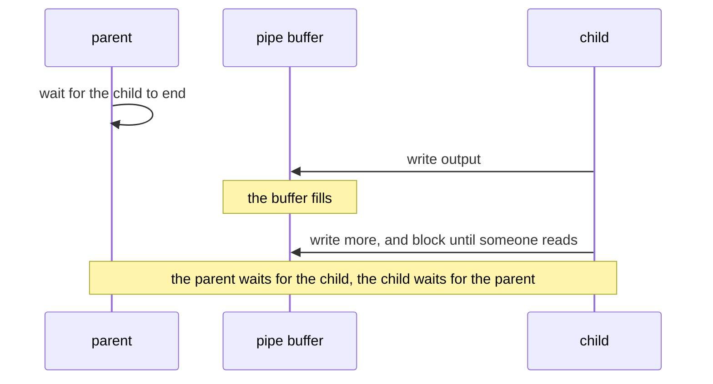
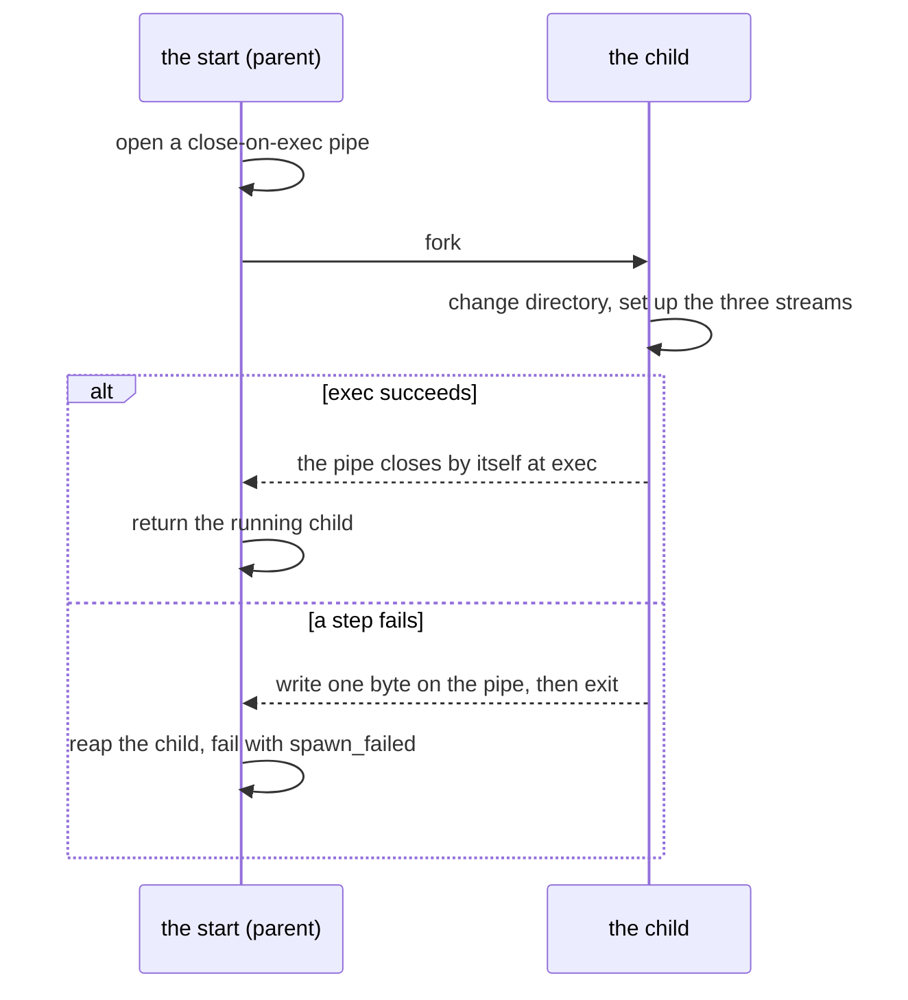
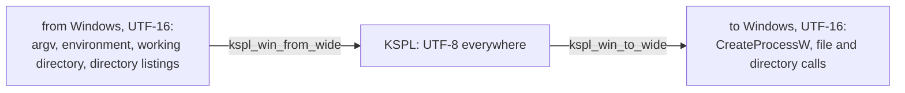
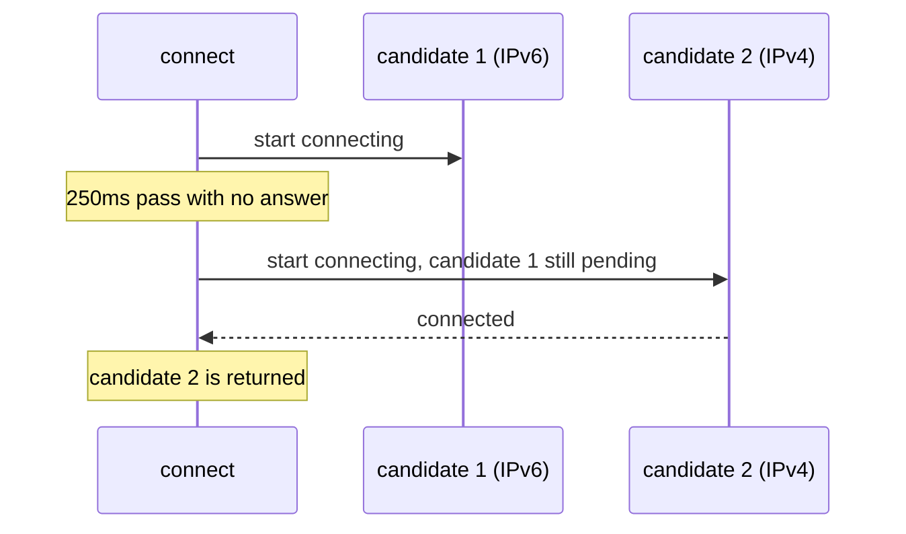

# Processes, files, threads, networking and data formats

**This document says why the parts of `std` that reach outside the program work the way they do.** These parts are the process and its children, files and paths, threads, networking and the data formats. The words used across `std` and the table of what was inherited are in [`DESIGN-core.md`](DESIGN-core.md).

## The process: arguments, output, children and the clock

### An argument's destination is declared, and unknown ones are errors

With `std/argparse`, each declared item receives **a pointer to the caller's variable**, so the default is that variable's initial value. An argument that starts with `-` and that nothing declared is an error; it is never skipped.

```kspl
$out: U8[] = "out/result.jsonl" // the default is the variable's initial value itself
$vocab: I64 = 2000
$verbose: = false
p: = argparse.Parser.create("build_corpus", "build a corpus", arena)
p.str_opt("--out", out@, "where to write")
p.int_opt("--vocab", vocab@, "the target vocabulary size")
p.flag("--verbose", verbose@, "show the progress")
p.parse_or_exit()
```

The destination carries `$` because argparse rewrites it, which also tells the reader that it changes later. Without it, the diagnostic is `expected 'Bool$@', but got 'Bool@'`. **There is no lookup by name** (`get_str("--out")`), so the compiler catches a misspelt name or a mismatched type.

| Command line | Result |
| :-- | :-- |
| `--out=result.jsonl` | `out` becomes `result.jsonl` |
| `--out=-7`, `--out=` | `out` becomes `-7`, or empty: the value is whatever follows the first `=` |
| `--out result.jsonl` | Refused: "needs a value, written as '--out=<value>'" |
| `--outt=x` (declared nowhere) | Refused as an unknown option |
| `--out=a --out=b` | Refused as `repeated`: an item of one value takes one |
| `-5` as a positional argument | Refused as an unknown option |
| `-` | A positional argument, meaning standard input by convention |
| `-h` | Refused as an unknown option, and the refusal prints the usage |
| `-- -5 --help` | Two positional arguments, `-5` and `--help`. After a lone `--`, nothing is read as an option or a command |

Caution: **Anything that starts with `-` and that no declaration knows is an error.** Besides misspellings, this catches the pieces that the shell makes from a path with a space in it. Ignored, those pieces cause a failure that nobody can trace. The price: a negative number such as `-5`, or a file named `-x`, is positional only after a lone `--`, as POSIX has it.

**A value is joined with `=`, and only so**, since two spellings of one option are two ways to write one thing (Principle 6 in [`../../docs/DESIGN-principles.md`](../../docs/DESIGN-principles.md)). The spaced spelling must also guess whether the next argument is the value. In `--root --show`, taking `--show` as the value would serve a folder that does not exist. Positional arguments are taken only where declared (`p.positional`, read from `p.rest`).

**An item of one value given twice is refused** (`repeated`). Taking the later one would let a word appended to a command line undo an earlier one without a trace. An item that can be given many times says so in its declaration (`str_list_opt`, which keeps every value in order). A flag given twice is taken. The price: a script cannot override a default by appending an option to a fixed line.

**Asking about an item declared nowhere stops the program** (`saw`, `saw_empty`). Answered false, a misspelt `saw("--outt")` would read as an item never given, and the check it guards would pass for good. The name is the program's own text, so the mistake is the program's.

**An item has one name, and there are no short names**: `--in-place` has no `-i` (Principle 6). A short letter also means different things per tool: `-i` is in place for `sed`, ignoring case for `grep`, and asking first for `cp`. The cost is typing, in build files and scripts that are written once. `--help` has no `-h` either, since a rule with one exception is two rules; a `-h` is refused, and the refusal prints the usage.

### An option names the subcommands it takes effect on

**An option given with a subcommand that does not act on it is refused.** `p.only_for("--in-place", "fmt")` limits `--in-place` to `fmt`, and the refusal (`not_for_command`) names the subcommands that take it. Accepted, the option would do nothing while the writer believed it took effect. An option without `only_for` takes effect on every subcommand.

**Where an option stands on the line does not matter**: `--std-dir=x info std-dir` and `info --std-dir=x std-dir` mean the same. The parser checks the scope once it has read the whole line, so nobody remembers which level of the line an option belongs to.

**One subcommand can be the default** (`default_command`), chosen when the line names none, as `ksplc a.kspl a.c` compiles. Its name is never typed, since two ways to ask for one thing are two spellings to learn. The name still stands in the usage, in `command` and in `only_for`.

**Each subcommand can carry its usage line** (`command_form`), and the usage lists the options each takes. `print_command_usage` writes one subcommand's line, for the refusal of its arguments. All of it comes from the declarations, so no copy kept by hand drifts.

The price: a scope is a string of names, separated by spaces. A name no declaration knows stops the program at the declaration, at the first run rather than at compile time.

### A program keeps its own output on an abnormal exit

`panic` (`std/lang`) flushes standard output before `abort()`. But into a pipe (CI's log collection, `| tee`), the C library writes only when its buffer is full. An abnormal exit, death by a signal included, loses everything not flushed. So **the log's last line is not necessarily where the program died**.

So a program whose main clue is how far it got, such as the test harness, calls `io.set_line_buffered()`. Its flush at each newline means the same on both backends and every platform. `setvbuf`'s `_IOLBF` would not: it is 1 on glibc and macOS, and 0x40 on MSVC's UCRT.

Caution: **The code that keeps the panic record must not itself crash.** On freestanding, `panic` sets three things aside in `.noinit_panic`, a region that start-up does not clear. They are the message, the stack pointer (SP) and a piece of the stack.

`kspl_get_sp` returns 0 where an architecture lacks it, and a read of address 0 would crash with no word about why. So when `sp == 0`, `panic` does not read the stack. Otherwise, `kspl_panic_stack_words` asks the port how many words are readable, by default zero. `take_panic_record` returns the actual count as `stack_len`. So a panic inside an interrupt cannot read past the end of RAM either.

### Standard output has one buffer, the C library's

`io.out()` writes through the C library's stream (`stdout`). Nothing in `std/io` keeps a second buffer above it.

| Where standard output goes | When the bytes are written |
| :-- | :-- |
| A terminal | At each newline (on Windows, at each call). Also before the program waits to read from a terminal, so a prompt shows |
| A pipe or a file | When the buffer is full, at `flush()`, and at a normal exit |
| Any of them, after `io.set_line_buffered()` | At each newline too |
| Any of them, at a `panic` or before a child is started | All that waits is written first |

Standard error waits for nothing: each call is written at once.

**Each `Writer` call is one call into C, the cheapest that does the job**: `s` hands the whole string to `fwrite`, and `c` one byte to `fputc`. A `fprintf` per byte would make printing numbers about four times slower than C.

**Why no buffer of its own**: a panic and the start of a child flush `stdout` in C, and cannot see a buffer above it. So a panic would lose the output before it. A child started with bytes still waiting would write its own output ahead of them.

**Why not unbuffered, or line-buffered everywhere**: into a pipe, that costs a system call per string or per line. Another program usually reads a program's output from a pipe, in blocks. A watched run that wants each line at once asks with `io.set_line_buffered()`.

**Reading does not flush standard output.** On a terminal, the C library already writes waiting output before a read waits. **Into a pipe** (`prog | tee log`), a program that prompts calls `io.out().flush()` before it reads. A flush at every read would cost a filter a system call per byte.

### A write to a freed file stream stops the program

**Its owner closes a `File_stream` with `free()`**, usually by declaring it with `defer` in front. `free()` closes the C stream and leaves the handle null, and the compiler refuses a use of that local after it. **A later write through a pointer stops the program with a message**, since a `Writer` call returns no failure. Otherwise the bytes would be lost, and the program would exit 0. `read` and `sync` can report a failure, so they refuse it as `invalid_arg`. `File_stream` conforms to `Move_only`, since a copy would keep the stream its original closes.

**Standard output and standard error are not `File_stream`s.** The whole program shares them, so `out()` / `err()` hand out a stream of another type, opened on the first call. It has no `free()`, so no part of the program can close the stream every other part writes to.

### A crash names what happened, in one line

The OS, not a check of the language, stops a write through a null pointer or a recursion that runs its stack out. Left there, the program ends without a word, and a parent sees only 139. **With an OS, the runtime writes one line to standard error. Then it lets the fault end the program as it would have.**

| What the fault's address says | The line (POSIX; Windows names the exception, such as `STATUS_ACCESS_VIOLATION`) |
| :-- | :-- |
| It lies in the first page: a null pointer, with a field's offset added | `crash: null pointer dereference (SIGSEGV at address 0x0)` |
| It lies at the end of the thread's stack | `crash: stack overflow (SIGSEGV at address 0x7ffc5d4b8ee8)` |
| Anywhere else | `crash: invalid memory access (SIGSEGV at address 0x…)`, or `crash: bus error (SIGBUS …)` |

* **The exit code stays the fault's own.** POSIX puts the signal back to its default and raises it again, so a parent reads 139, and a core dump is written where enabled. Windows ends with the exception's code, read as 139 ("A child's end is one code on every OS" below).
* **The prefix is `crash: `, not `panic: `.** A panic is the program's stop at a rule it checks ("Conditions that stop execution at run time" in [`../../docs/SPEC-programming-language.md`](../../docs/SPEC-programming-language.md)). A crash is the OS's stop, at an address.
* **No trace is printed.** A walk of the stack inside a fault handler is safe only with an unwinder, which the runtime does not carry on every OS. A debugger on a build with `-g`, as `ksplc build` makes, says where.
* **The handler calls only what is safe there** (write, signal, raise). It does not flush standard output, since the fault can strike while the C library holds its locks.
* **A handler already in place is kept** (a sanitizer's, a host program's). A library takes none, since its host owns the signals.
* **An overflow handler needs stack room reserved before the stack runs out.** POSIX uses a separate 64 KiB stack. Windows reserves 64 KiB on the thread's own stack with `SetThreadStackGuarantee`. The runtime prepares the main thread and each `std/thread` thread. A thread started by C code is not prepared, so its overflow can end with 139 and no line.
* **Freestanding has no OS to stop the access**, so nothing here applies to it.

The implementation is "A crash says what happened" in [`../../ksplc/gen/runtime/hosted.c`](../../ksplc/gen/runtime/hosted.c). The check is `make test-runtime` (the `crash_*` cases in `ksplc/tests/runtime/stops.kspl`).

### A run of checks goes past failures, naming them last

| Shape | Calls | Stops at the first failure? | Suits |
| :-- | :-- | :-- | :-- |
| Tests one at a time | `start` / `pass` / `skip` | Yes, at `std/lang`'s panic | Ordinary unit tests |
| **A run of checks** | `begin` / `check` / `finish` | No: it goes on past a `FAIL` line, and ends with one `RESULT:` line that names every check that failed | A run with something to stop before it ends, such as a server still on its port. Also many independent checks, where the first failure is not the only one worth reading |

The exit code is the verdict.

**The names on the `RESULT:` line are copied into the tally's own room** (`Names` in `std/verdict.kspl`). A caller often builds a name for `check` in its scratch arena and frees it straight after. An allocation instead would make the tally the one part of a failing run that can itself fail.

**A child's run is read here too** (`run_child` / `run_children`). Its stdout and stderr come back as one text, since a diagnostic appears on either. A run that could not start, or was killed, has no code, and says why in that text. `exited_with(code)` asks whether the run ended by itself with that code. `run_child` waits at most `default_timeout_ms`, unless the check passes its own limit. `run_children` runs `jobs()` children side by side, in the input's order, so the judging code is the same either way.

**A finding is indented on the lines below its `FAIL` line**, since the gates read a line by its head (`FAIL `, `RESULT:`).

Why a walk that walked nothing fails is at `check_list` in `std/verdict.kspl`. Why this stands in `std` is "What tests share stands in std" in [`../../docs/DESIGN-repository.md`](../../docs/DESIGN-repository.md). The check is `make debug`, which runs each shape as a child and holds its whole output.

### Fuzzing watches the program from outside

*Fuzzing* feeds a program many broken inputs to find crashes.

**A round of `std/fuzz` is one run of the program.** The driver judges it from outside by how it ended: its exit code, an announced stop, or no end within the wait. Nothing is built into the program: no coverage instrumentation, no entry point called in the fuzzer's own process.

**Why**: in another process, a crash is seen; inside the fuzzer's, it would take the tally down with it. With nothing built in, the same fuzzing runs on all three platforms with the C compiler as it is. `std/prng` is KSPL, so the same seed, seeds and count give the same rounds everywhere. A developer reproduces a gate's failure from the two numbers it prints.

**The program under test is built with the address sanitizer where the C compiler holds its runtime** (`fuzz.Sanitized`). Built plain, a read past an allocation's end that stays inside a mapped page returns a stale byte, and the round ends well. With the sanitizer, the read stops at its line. `report_asan` prints a check where the sanitizer is in or required, and a skip where the toolchain holds no runtime.

**A round past its wait runs again with five times the wait** before it counts as not ending. A crowded machine slows a finite round. `check_reach` keeps a run that tried nothing from passing. Without it, a mutation that broke every seed at the parser's entry would go green.

**What this gives up**: coverage and speed. A coverage-guided fuzzer reaches deep paths that a blind one reaches only by luck. Here the seeds carry the depth: real files, and seeds from each writer. A process per round is also far slower than a call.

**std's own fuzz (`make test-fuzz`) aims at each reader of outside bytes**, and checks a round trip wherever std holds a writer. `std/tests/read_prog.kspl` is told the kind of each input:

| Kind | What reads it | What must hold besides an end |
| :-- | :-- | :-- |
| `json` | `json.parse` | The value is written (`dump`, flat and indented) and read back. The result `equals` the one read, and is written the same again |
| `json-struct` | `json_struct.into_struct`, into a struct with a field of each kind it walks. That is integers of each width and sign, an `F32`, a `Bool`, a string, a nested struct, lists and options | The struct is written (`from_struct`) and read back into another, then written the same again. Only this second trip must be equal: the first drops unknown keys and rounds an `F32` |
| `url` | `url.decode_component`, `url.parse_query` | A component, encoded (`url.encode`), decodes to itself. The pairs, encoded into a query, parse back to the same pairs in order |
| `base64` | `base64.decode` | The bytes, encoded, decode to themselves |
| `regex` | `Regex.compile`, then matching | `is_match`, `find` and `find_all`'s first match agree. A search visits no more states per byte than the program holds, plus one |
| `http-req` | `http.parse_request` | None |
| `http-res` | `http.parse_response` | A response that the writer takes (`format_response`) reads back as the status, headers and body it was given, and is written the same again |
| `http-write` | `http.format_request` and `format_response`, given fields split at each 0 byte | What the writer takes reads back the same: the method and target or the status, the headers in order with the writer's `Content-Length`, and the body |
| `jsonrpc` | `jsonrpc.take_frame`, over a stream of frames | The frames before the first broken one are the same whether the bytes arrive at once, singly or seven at a time. Each body, framed again (`frame_into`), is taken back the same |
| `argv` | `argparse.Parser.parse_list`, with flags, values, a repeated item, positionals, `--`, a command chosen by name and by flag, and a command taking an uninterpreted rest | What it read, written back as a command line, parses to the same values, items given, command and positionals |

**Every seed is read once before any mutation** (`fuzz.check_seeds`). A seed that the program refuses is dropped, unless the program's own writer made it. A seed that stops the program fails, or it would hide a crash. **A broken round trip stops with `assert`**, so the driver counts it among the announced stops. Under the fuzz, the trip runs on every value a mutation reaches, beyond those a unit test thought of.

### Writing to a closed pipe returns an error value

POSIX ends a process that writes to a pipe whose reader has closed (SIGPIPE's default). So a server whose peer leaves, an ordinary event, dies **without printing anything**. **The runtime ignores SIGPIPE, and a function that writes returns the refusal as a value.**

| Where the write goes | What happens when the reader is gone |
| :-- | :-- |
| A child's standard input (`Piped_child.write`) | Returns false |
| A socket (`std/net`'s send) | Returns a failure |
| The program's own standard output | The program ends quietly, as `prog \| head` expects |
| Anything, inside a child the program starts | SIGPIPE's default is back, so the child dies as usual |

**Standard output is the exception**, since Unix promises that `prog | head` ends quietly. Once a write comes up short, `std/io` restores SIGPIPE's default and raises it on itself. A buffered `fwrite` reports that it wrote, so the flush passes the same check.

Caution: **Do not stop at only ignoring it.** The output is then silently discarded, and the program runs on with its destination lost.

**A socket's write fails as a value even in a library**, where SIGPIPE stays with the host program. Otherwise a server library would kill its host the first time a client left. The runtime passes `MSG_NOSIGNAL` on each send, or sets `SO_NOSIGPIPE` where the OS has no such flag. A pipe's write stays the program's to handle.

**Do not carry the ignoring setting over to a child.** It survives exec, so `git`, `clang` or a shell pipeline would not die either, and `yes | head -1` would never finish. The runtime restores it between the fork and the exec.

The implementation is "Writing when nobody is left to read it" in [`../../ksplc/gen/runtime/hosted.c`](../../ksplc/gen/runtime/hosted.c). The check is `make test-broken-pipe`.

### Parallel children's output comes through files, not pipes

`std/subproc`'s `run_many` starts several children at once. It sends each child's two output streams to files in the caller's directory, and reads them once the child has ended and been reaped.

**Why not pipes**: a pipe fills before the parent reads it, and the child stops. Watching every child's pipe at once needs a `poll` set or threads, which only the C runtime could hold. A file does not fill, so starting and waiting in order is enough, and the scheduling stays in KSPL. The cost is the trip through the disk.

**Why not `run_capture` on threads**: each call copies its output into the caller's arena, which is not safe to share between threads.

**Why results are reaped in submission order**: they then match the input, so the caller carries no mapping. The cost: one slow item at the front leaves the slots behind it idle.

**Each child has a time limit of its own**, counted from its start. Past it, the child is killed with all it started, and comes back with no exit code and what it wrote by then. A limit over the whole batch would grow too short as the batch grows. POSIX's `waitpid` takes no time limit, so a wait looks again after a pause that doubles from 1 ms up to 10 ms.

### Three ways to start a child process, by its output

`std/subproc` has one function per purpose, not one function with options: collect everything, keep it running, or talk back and forth. With this split, nobody can write the combinations that hang.

| What is wanted | The function | Where the output goes |
| :-- | :-- | :-- |
| Run it and collect everything | `run_capture(argv, cwd, timeout_ms, cap, arena)` | The parent's memory (cut at the cap) |
| Run many side by side and collect everything | `run_many(jobs, …)` | Files in a directory (the section above) |
| Keep it running | `spawn_redirect(argv, cwd, out_path, err_path)` | Files the caller named |
| Run a helper only while the starter runs, stopped by the same Ctrl+C | `spawn_beside(argv, cwd, out_path, err_path)` | Files the caller named |
| Hand it input and let it write where the parent does | `spawn_feed(argv, cwd, input, idle_ms)` | Inherited (the terminal) |
| Let it write where the parent does, as it goes, and stop it with all it started at a time limit | `spawn_limited(argv, cwd, timeout_ms)` + `wait(wait_ms)` | Inherited (the terminal) |
| Talk back and forth | `spawn_piped(argv, cwd)` + `read(buf, timeout_ms)` | A pipe (with a timeout) |

Python's `subprocess` and Java's `ProcessBuilder` take options on one function, which is easier to start writing. But **that shape cannot stop the combinations that deadlock**. A wait for the child to finish, while the parent is still attached to its pipe, stalls once the buffer fills:



**Why only the functions that use a pipe take a timeout**: only a pipe's buffer can fill. So the timeout is an argument of the read, and of `spawn_feed`, and its expiry comes back as a value. It also tells a slow child from a dead one, which returns 0. The time limit of `run_capture`, `run_many` and `spawn_limited` is another thing: it bounds the child's whole run.

**Inherited and file-directed children share `Child`**, with `wait`, `alive` and `kill`. Neither needs its outputs drained before a wait, so one type serves one lifetime. `Child` has no read method: inherited output goes to the terminal, and redirected output to files. `Piped_child` stays separate and has no blocking `wait`, because its pipes can fill.

**Both are `Move_only`, and a repeated `wait` or `kill` does nothing.** The runtime frees the child's record when it reaps the child, so each call clears its handle. A copy would still hold the freed record, so it is refused.

**A child with a time limit is a type of its own, `Limited_child`, also `Move_only`.** Its limit is fixed at the start and holds however the caller waits. `wait(wait_ms)` comes back with one of three answers:

* `ended(code)` when the child ended.
* `running` when its own wait passes first.
* `timed_out` once the limit has stopped the child with all it started.

After `ended` or `timed_out`, a wait gives none at once. It has no `kill`: its limit is its stop. `Child` takes no limit, since `spawn_redirect`'s child is meant to outlive its starter.

**Why `spawn_redirect` alone asks for no console window**: on Windows, its child would otherwise get a new window showing nothing, since it writes to files. The functions that collect must not ask, since Ctrl+C does not reach a detached child.

**Why `spawn_beside` is a function of its own**: its child writes to files too, yet stays on the starter's console. Ctrl+C at that console then stops both, so a helper such as a model server never outlives the command that started it. `spawn_redirect`'s child has no console on Windows, so it outlives its starter there, as a server opened by a double click must. On POSIX the two start a child the same way.

**A child that does not take all its input has no exit code to give** (`spawn_feed`'s `Feed_error.input_not_taken`). Its code would answer for part of the input, as a compiler fed half a program would. So the child is stopped and the call fails when it closed its input, ended early, or took none of it for `idle_ms`.

**Reading a finished child's output as one text is a way to read the result, not another function** (`Run_result.text`).

**The split is on the KSPL side.** C starts a child one way, `kspl_proc_start`, given the arguments, the working directory, and a pipe or a file for each standard stream. The functions combine it in KSPL with `kspl_proc_poll` / `kspl_proc_read` / `kspl_proc_wait` / `kspl_proc_kill`, for the cap, the timeout and the kill.

Caution: **Do not add a per-purpose way to start a child to C.** C is written twice, for POSIX and for Windows, and the Windows copy cannot run locally. C keeps only what needs the OS's API: `fork` / `CreateProcessW`, pipes, Windows's command-line quoting, and the UTF-16 conversion.

### A bare program name is looked up in PATH alone

**`argv[0]` without a directory is looked up in PATH and nowhere else, on every OS**, as POSIX's `execvp` does.

| Where the OS looks, in order | POSIX `execvp` | Windows `CreateProcessW` | `std/subproc` |
| :-- | :-- | :-- | :-- |
| This executable's directory | — | 1 | — |
| The current directory | — | 2 | — |
| The system directory | — | 3 | — |
| The Windows directory | — | 4 | — |
| The directories PATH names | 1 | 5 | 1 |

Left to Windows, a `cc.exe` in a cloned repository would run in place of the compiler, and `bash` would start WSL's launcher. So on Windows, `std/subproc` looks the name up in PATH itself, adding `.exe` to a name with no extension. It puts the full path found in the command line, and a name not found fails to start.

### A relative program path starts at the child's working directory

**A relative path with a directory part (`./tool`, `bin/tool`) is read from the child's working directory**, where the start is given one. POSIX reads it so: the child changes directory, then execs. `CreateProcessW` reads it from the parent's directory, so on Windows `std/subproc` joins it onto the working directory itself. Otherwise one call would run a different program, or none, per OS. Rust leaves this case "platform specific and unstable"; Go joins it, as here.

### A child that cannot start fails the start everywhere

**Every function in `std/subproc` gives `spawn_failed` for a program that cannot start**, never an exit code. That covers a program that is missing or cannot run, and one that cannot be given its working directory or output files. `CreateProcessW` fails for each of those by itself. POSIX meets the failure in the forked child, after the fork has succeeded. So the child writes a byte on a pipe that the start already waits on, which closes by itself when `exec` succeeds (*close-on-exec*).



**Why not the shell's 127**: a program that runs and exits 127 gives it too, as does a missing shared library on POSIX. And Windows has no such code, so a caller reading 127 as "missing" would be right on POSIX alone.

### A child's end is one code on every OS

A *signal* is how POSIX tells a process about an event such as a crash (`SIGSEGV` for a bad memory access). **A child that crashed or was killed ends as 128 + the signal number, on every OS**, as in the shell. A segmentation fault is 139, and an abort is 134. Windows has no signals: a crash ends the process with the exception's NTSTATUS, and `__fastfail` with `STATUS_STACK_BUFFER_OVERRUN`. So on Windows, each is read as the signal that POSIX raises for the same fault:

| How the child ended on Windows | Read as | Code |
| :-- | :-- | :-- |
| `STATUS_ACCESS_VIOLATION`, `STATUS_STACK_OVERFLOW` | `SIGSEGV` | 139 |
| `STATUS_ILLEGAL_INSTRUCTION` | `SIGILL` | 132 |
| `STATUS_FLOAT_DENORMAL_OPERAND`, `STATUS_FLOAT_DIVIDE_BY_ZERO`, `STATUS_FLOAT_INEXACT_RESULT`, `STATUS_FLOAT_INVALID_OPERATION`, `STATUS_FLOAT_OVERFLOW`, `STATUS_FLOAT_STACK_CHECK`, `STATUS_FLOAT_UNDERFLOW`, `STATUS_INTEGER_DIVIDE_BY_ZERO`, `STATUS_INTEGER_OVERFLOW` | `SIGFPE` | 136 |
| `STATUS_STACK_BUFFER_OVERRUN` (`__fastfail`, UCRT's `abort()` by default, and every KSPL program's) | `SIGABRT` | 134 |
| `STATUS_CONTROL_C_EXIT` | `SIGINT` | 130 |
| `STATUS_DLL_NOT_FOUND` | the loader's 127, as on POSIX for a missing shared library | 127 |

Any other code is the child's own, a negative one included. The table's copy in the runtime is `kspl_proc_status_code` in `ksplc/gen/runtime/hosted_proc.c`, and `make test-conventions` checks that the two agree. A fault with no single POSIX signal stays as Windows gives it: an in-page error is `SIGBUS` on Linux and macOS, under different numbers.

**A KSPL program's own abnormal end is `STATUS_STACK_BUFFER_OVERRUN` on Windows, whatever the C runtime does.** A panic and the run-time checks end in `abort()`, which raises `SIGABRT` first. The runtime's handler ends the process there with that code (`kspl_end_on_abort` in `ksplc/gen/runtime/hosted.c`). Left alone, msvcrt's `abort()` exits 3, and UCRT's exits 3 or fails fast, by a setting.

**Exit code 3 is not read as an abort.** A program that ends normally with 3 gives it too (robocopy's "files copied, extra files present"). The cost: a program built against msvcrt, or UCRT without fault reporting, that calls `abort()` reads as 3.

**Whether the child has finished is not one of the codes.** `Piped_child.exit_code` returns an `I32?`, none while the child runs. A number set aside for "still running" is some child's exit code: Windows's `exit(-1)` ends with -1. A kill by `Child.kill` or `Piped_child.kill` reaps the child and gives no code.

### A time limit stops the child and all it started

**`run_capture`, `run`, `run_many` and `spawn_limited` stop a child at its time limit together with every process it started.** A child is often a shell or a compiler driver: `cc` starts the compiler proper and the assembler. Killed alone, the child leaves those running, writing files and holding its output open.

**So on POSIX these children lead a process group of their own. On Windows, they are put in a job object of their own.** The kill goes to the group, or ends the job. On Windows, the child starts suspended and runs only once it is in the job, so nothing it starts begins outside it.

**A terminal's signals are passed on.** A group of its own is outside the terminal's foreground group, so Ctrl+C and a hangup reach the starter alone. So while such a child runs, the runtime takes `SIGINT`, `SIGQUIT`, `SIGHUP` and `SIGTERM`. It passes each on to every group it holds, then ends by the signal as it would have by default. **It takes a signal only where the signal is still at its default**: a program that ignores or handles one has chosen how it ends. Windows needs none of this, since a console's Ctrl+C reaches every process attached to it.

**The other ways to start a child stay in the starter's group.** The OS stops a child outside the foreground group that reads the terminal. So the children of `spawn_wait` and `spawn_async`, which are on the terminal, would hang an interactive tool. `spawn_redirect`'s child is meant to outlive its starter. `Child.kill` and `Piped_child.kill` stop the child alone.

**The kill asks the group to end before it forces the group to.**

1. The kill sends `SIGTERM` to the group, with `SIGCONT`, since a stopped process takes no other signal.
2. It waits until every process in the group has ended, or until a grace of half a second has passed.
3. It sends `SIGKILL` to whatever is left.

The wait ends as soon as the group is empty. A KSPL program inside the group can lead groups of its own, and passes the `SIGTERM` on to them, which `SIGKILL` alone would prevent. The grace is the room for that hand-off. On Windows, a job made inside a job is nested in it.

**`spawn_limited`'s child writes on the terminal from a group of its own, and reads an empty standard input.** A write from outside the foreground group is allowed, so its output reaches the screen as it comes. A read would be stopped, so its standard input is a pipe closed at the start.

What this gives up:

| Case | What happens |
| :-- | :-- |
| A child stopped at its limit asks something on the terminal itself (a password prompt that opens `/dev/tty`), or changes the terminal's modes | The OS stops it until the limit ends it. A tool that must ask runs through `spawn_wait` |
| The terminal is set to stop a background writer (`stty tostop`) | `spawn_limited`'s child is stopped at its first write until the limit ends it |
| A process that the child started leaves the group on purpose (a daemon that calls `setsid`) | It is not stopped |
| On POSIX, a process that the child started leads a group of its own. Its starter does not pass `SIGTERM` on (a shell's job control, another language's runner) | It runs until it ends. A KSPL starter at its default passes `SIGTERM` on. Windows nests a job inside the job, so there it is stopped either way |
| A process in the group handles or ignores `SIGTERM` | It has the grace, half a second, and is then killed. A KSPL starter that handles `SIGTERM` itself passes nothing on, as it chose |
| The members that ended are reaped late (a container whose first process reaps orphans slowly, or never) | An ended process counts as in the group until reaped, and nothing portable tells it from a live one. So the kill waits out the whole grace |
| The child has ended and been reaped | Nothing is stopped. On POSIX, the group's number was the child's process ID, which the OS can hand to a stranger. Windows keeps the job but stops nothing either, so the two agree |

**The job object does not kill on close.** With that setting, what the child left running at a normal end would die when the starter lets the job go, or crashes. On POSIX it runs on, so one call would end differently per OS.

### A child's outputs are read briefly past its end

**Once the child itself has ended, `run_capture` reads its outputs for `pipe_grace_ms` (100 ms) more.** Then it closes them and returns the child's own exit code. A process the child started without redirecting its outputs (`server &` in a shell script) holds the pipes open. Waiting for them to close would run to the time limit, and report a child that ended in time as stopped.

**Nothing that the child itself wrote is lost**: once it has ended, all it wrote is in the pipes. The grace can cut only what the processes it left behind write later. Those are not killed, since only a time limit stops what a child started. `run_many` collects through files, which a leftover process cannot hold open.

### A child holds only the streams it is handed

**A child gets its three standard streams and nothing else that the runtime opened.** Every socket, file and pipe end the runtime opens is closed on exec (POSIX) or not inheritable (Windows). A copy in a child keeps what it names alive for as long as the child runs:

* A server that started a helper could not bind its port again after it closed its listener.
* The server's client would never see the connection close.
* A reader would wait for a pipe's end until an unrelated child exits.

**The mark is given in the call that opens** (`SOCK_CLOEXEC`, `accept4`, `pipe2`, `O_CLOEXEC`, `WSA_FLAG_NO_HANDLE_INHERIT`). Given afterwards, a child started from another thread in between would take the copy. Some opens have no such call: a socket or a pipe on macOS, and an accepted socket on Windows. There the mark is given right after. On macOS, the starts take turns from their first pipe to the fork, so one start's pipes never reach another start's child.

**On Windows, each child is handed a list of exactly its three handles** (`PROC_THREAD_ATTRIBUTE_HANDLE_LIST`). Otherwise it would get every inheritable handle, such as another thread's start's pipe ends. A lock around the starts would make them wait on each other, and still pass a handle that some library made inheritable.

**A start returns once the child has exec'd.** Until then, the forked copy holds every descriptor of the parent, so a listener closed right after the start could not be bound again.

**`std/io`'s `open` takes C11's mode letters alone** (`r`, `w`, `a`, then `+`, `b`, and `x` after `w`), and refuses any other. It builds the open flags itself to give the mark. A letter that one C library reads and another skips would mean two things.

**What this gives up**: on POSIX, a descriptor that a foreign C library opens without the mark still reaches a child. Closing everything in the child would cost a walk over every possible descriptor per start, which is slow where the limit is high.

**A batch file (`.bat` / `.cmd`) refuses an argument that holds `"`, `%`, `!` or a line break.** Windows hands a batch file to `cmd.exe`, which parses the command line again. There, `\"` means nothing, so a `"` closes the quoting and the rest runs as a command, and `%` and `!` expand inside quotes. An escape would depend on settings the parent cannot see (delayed expansion is a registry switch). Without those characters, `cmd.exe` takes `&|<>^()` inside quotes as they are.

### The clock has separate functions for 'elapsed' and 'date-time'

| Function | The clock | Use it for |
| :-- | :-- | :-- |
| `std/sys`'s `mono_us()` | Monotonic: it only moves forward, and only differences mean anything | Elapsed time, timeouts |
| `std/sys`'s `wall_seconds()` | The wall clock, as epoch seconds | The date and time |

Caution: **Do not measure elapsed time with the wall clock.** NTP or a user can set it back, which gives a negative difference. A timeout reads that as "not yet", and waits a whole round.

**No function for CPU time is held.** CPU time does not advance during a wait, so as elapsed time it erases whole spans. If it is needed, add it under another name.

### A wait's sign means one thing everywhere

Every wait that std takes in milliseconds reads its number the same way. Such waits are a child's pipe, a socket, `std/reactor`'s `wait`, an HTTP read and a JSON-RPC call.

| The wait | What it does |
| :-- | :-- |
| a positive number | waits at most that long, then answers "timed out" |
| `0` | looks once, without waiting |
| a negative number | a time already up: it looks once, as `0` does |

**There is no "wait for good".** A wait exists so that a peer that goes silent comes back as a value. A deadline counted down (`deadline - now`) can go negative on a slow machine, and then means "the time is up", never "no limit".

Caution: **Read the sign in one place, the runtime's entry** (`kspl_wait_ms`). Read at each OS call, one number gave three behaviours, so a program that worked on one OS hung on another:

* `-1` waited for good in POSIX `poll()`.
* It waited 49 days through Windows' unsigned tick comparison.
* POSIX's write deadline did not read it at all.

## Files and paths

### Paths are UTF-8, converted to the wide API on Windows

KSPL keeps every path, and every string, as UTF-8, like the source text and POSIX. On Windows, it calls only the *wide* functions, which take UTF-16, and converts at one place in the C runtime, in both directions. Windows offers most functions twice:

* The narrow form (`…A`, `_getcwd`, `fopen`) takes bytes in the current *code page*, a per-machine encoding such as CP932 for Japanese or CP1252.
* The wide form (`…W`, `_wgetcwd`) takes UTF-16, which holds every character.

**No Windows narrow (ANSI) API is used.** Under CP932, `_getcwd` returns CP932 bytes and `_mkdir` takes them. **Inside KSPL, the narrow API reads back what it wrote, so nothing shows until the bytes reach a child process.** CP932 bytes from `sys.cwd()` cannot be converted to UTF-16, so the command line for `CreateProcessW` cannot be built. The symptom is a failure to link or to start, far from its cause.

**It cannot be converted halfway.** A path that joins `sys.cwd()`'s result with a name from the source would mix two code pages, which neither API resolves. So the round trip goes through one boundary, `kspl_win_to_wide` / `kspl_win_from_wide` in `ksplc/gen/runtime/hosted.c`.



**The inbound side is converted too, since a fix of only the outbound side is worse than no fix.** Three things arrive from the OS narrow:

* `argv`. The CRT, the C library's start-up code, moves it to the current code page before the generated main receives it.
* The environment variables (`getenv`).
* `getcwd`, and directory enumeration.

With only the outbound calls wide, `sys.args()[0]` is invalid UTF-8 on a child's command line. So `argv` goes through `kspl_os_argv` once, inside the generated main, and the environment through `kspl_get_env` / `kspl_set_env`.

**One gap remains that the wide API cannot close: a receiving program with a narrow `main`.** Its CRT moves the UTF-16 command line to the current code page to build `argv`. A character that the code page cannot represent collapses into `?`, so the tool fails with `Invalid argument` (under CP1252, `かんそ` becomes `???`). KSPL's own calls are wide, but `cc` and `ld` are third-party tools, and mingw's GNU binutils takes a narrow `main`.

**So a third-party tool is given relative paths, with their base directory as `cwd`.** The OS sets `cwd` without going through `argv`, so non-ASCII in it survives. That is why all five functions that start a child take a `cwd`, `spawn_wait` / `spawn_async` included. CMake's Ninja generator makes the same move.

**The C standard's path functions are not used.** `fopen` and `rename` are narrow, so `std/fs`'s `rename_path` and `std/io`'s `open` go through `kspl_rename_cstr` / `kspl_fopen_cstr`. `std/libc`'s `fopen` / `rename` carry a mark that says not to use them; they stay as companions of `fclose` / `fread`.

**An OS function is not declared directly with `extern "C"`, because its declaration differs per environment.** `shutdown` is `int shutdown(int, int)` on POSIX and `int shutdown(SOCKET, int)` on Windows, where `SOCKET` is 64-bit unsigned. A declaration that matches one fails to compile on the other (winsock2.h: `conflicting types for 'shutdown'`).

Caution: **Nobody can notice it on POSIX.** What fails is the Windows job or a user's machine. `std/net`'s `shut_write` goes through `kspl_net_shutdown_write`, which keeps even the constant (`SHUT_WR` / `SD_SEND`) in one place in C.

**A new `kspl_*` function has its body in the compiler's C runtime (`ksplc/gen/runtime/`).** The seed must carry that body before `std/` calls it. Otherwise Stage1, the compiler that the seed builds, fails to link on an undefined symbol.

**Where the environments answer one call differently, one answer is chosen for all.** `rename` onto an existing destination replaces it on POSIX, and fails with `EEXIST` in UCRT, which breaks "write under another name, then replace". `rename_path` is contracted to replace, through `MoveFileExW(MOVEFILE_REPLACE_EXISTING)` on Windows. `MOVEFILE_COPY_ALLOWED` is not added: POSIX fails with `EXDEV` across volumes, and a copy is not atomic.

Note: One difference remains. POSIX renames a directory over an empty one, while `MoveFileExW` fails if the destination exists; every caller replaces a file. **`make debug` pins the contract**, and the real Windows runner is what catches a break.

### A long path goes to Windows in the extended form

**On Windows, a path that resolves to 248 UTF-16 units or more goes to the OS with the `\\?\` prefix** (`\\?\C:\…`, or `\\?\UNC\server\…` on a share). The prefix lifts Windows's usual limit of 260, and KSPL code never sees it. A build cache inside a OneDrive folder easily passes that depth, and clang and lld write such files themselves.

**The OS's switch is not relied on.** It needs `LongPathsEnabled` for the whole machine, set by an administrator, and a manifest in every program.

**A long path that names a short one goes in its resolved form**, with no prefix. Windows measures the path as written, so a folder's name followed by thousands of `/` fails, though it names that folder.

**The prefix goes on in the one place where a path becomes UTF-16 for the OS**, so no function can miss it. The path is resolved first, and the form never comes back to KSPL (Rust's `fs::canonicalize` returns it, which not every tool reads). The rules are at `kspl_path_to_wide` in `ksplc/gen/runtime/hosted_fs.c`.

Note: **A child's working directory stays under 260**, since the OS keeps a process's current directory within MAX_PATH unless the program opts in. `kspl_proc_start` in `ksplc/gen/runtime/hosted_spawn.c` passes the directory as it is.

### A path stays under the root by refusal, not comparison

`fs.stays_under(root, rel)` is the one check that a relative path from outside stays inside a folder. It reads the path's text and refuses any *link* along the way: a symbolic link, or on Windows also a junction. It does not work out the final path and compare it with the folder. A text check for `..` alone cannot block a link, since `link.txt` is a legitimate name.

**Resolving the path and comparing prefixes is not taken, because the answer splits on Windows.** "Is it a link" is one call on each system (`lstat`, `GetFileAttributesW`). But POSIX resolves with `realpath`, while Windows's `_fullpath` does not resolve reparse points. `GetFinalPathNameByHandleW` needs an open handle, so it would open first in order to refuse.

**Either way, a race remains**: a step swapped between the look and the open breaks the check. Stopping that needs the kernel's help (`openat2(RESOLVE_BENEATH)` / Go's `os.Root`). **`stays_under` defends against a party that can only send a path, not one that can write into the root.** An example is a web page asking a local server for `../secret.txt`.

Caution: **Do not look at `FILE_ATTRIBUTE_REPARSE_POINT` alone on Windows.** OneDrive's and Dropbox's files that are not yet downloaded carry it too, so every file under a root in OneDrive would be refused. `kspl_is_link` looks at the name-surrogate tag, which only a link and a junction carry. `FindFirstFileW`'s `dwReserved0` holds it, so it is read without an open.

**Do not merge "cannot tell" into "not a link".** A step that could not be inspected, let through, would open a path out of the root:

| `kspl_is_link` returns | Meaning | `stays_under` |
| :-- | :-- | :-- |
| 1 | A link | Refuses |
| 0 | Not a link | Goes on |
| -1 | Cannot tell | Refuses |

The LLVM backend's degenerate case is -1 too. Made 0, it would land on the unsafe side.

### A link test answers true when it cannot tell

| Function | Answers when it cannot tell |
| :-- | :-- |
| `is_link` | true |
| `is_dir` / `exists` | false |

**Each answer is the one that makes the caller hold back.** The predicate asks "is it a link", but the caller needs "can it be followed". True from `is_link` means "do not follow it". So `stays_under` does not leave the root, and a check's clean-up does not remove beyond its workspace. False from `is_dir` and `exists` means "nothing usable is there", so the caller does not go into a path it could not see. Do not copy one function's choice into the other.

Caution: **Do not substitute `stat`.** It follows a link, and answers "a directory" for a link to one, so `rmdir` always fails and the link can never be removed. `remove_path` looks at the link itself on both systems (`kspl_remove_path` in `ksplc/gen/runtime/hosted_fs.c`).

### Creating refuses a taken name, and trees are not removed

**`std/fs` makes a new directory or file by an attempt to create it**, never by a check first. Another process could slip a link in between. `mkdir_unique` retries a taken name with another random tail, as Python's `mkdtemp` and Go's `os.MkdirTemp` do. `write_tree` refuses a name that climbs out before it writes anything, so names from outside cannot write beside the tree.

**`write_unique` gives a file its owner-only mode as it creates the file**, for what others on the machine must not read. A `chmod` after the creation leaves a moment in which another user can open the file and keep reading it. The creation also decides that the name is new, so a link planted there is not followed, as Python's `mkstemp` does. **On Windows, no ACL is set**: the file takes its folder's ACL, as `dir_trust` reads none there. Building a security descriptor for the current user is left until a caller needs it.

**`copy_tree` refuses a destination that already stands**, since a copy mixed with an earlier run's leftovers is not the tree copied. Python's `copytree` refuses the same by default, and Go's `CopyFS` refuses to overwrite a file.

**Each file that `copy_tree` copies has its source's permission bits from its first byte**, for the reason `write_unique` gives its mode as it creates. The umask can only narrow at the creation, so the exact bits are set on the open file once the contents are in. Each file is created as new, so a planted link is not followed, and a file that fails partway is removed. Only a regular file is copied, since a read of a FIFO would wait for good. **On Windows, the read-only mark is what is carried over.**

**Removing a tree is not offered.** Several removers were attacked through a check of whether an entry is a link, followed by a descent into it:

* Rust's `remove_dir_all` (CVE-2022-21658)
* libc++'s `remove_all`
* Python's `rmtree` before 3.3
* Go's `RemoveAll` (golang/go#52745)

Between the check and the removal, an attacker swaps a directory for a link, and the removal runs outside the tree. Each fixed it by removing relative to a directory it holds open, refusing to follow links. That needs the runtime to remove relative to a handle, on POSIX and Windows alike. Until then, removing is the caller's job, over a tree it made and nobody else writes into.

### A file is replaced durably, or not at all

**`fs.replace_file` writes the new content beside the file and flushes it to the disk.** Then it renames it over the file and flushes the folder. So a crash at any moment leaves the old content or the new, and a replacement reported done survives a power cut. A rename alone keeps a reader from seeing half a file, but not a crash. File systems that delay the data (XFS, btrfs, ext4 under some options) can put the rename on the disk first. After a power cut, the file then stands empty or cut short, though it was reported written.

| Step | POSIX | Windows |
| :-- | :-- | :-- |
| Write the part, beside the file | `open` with `O_CREAT \| O_EXCL`, mode 0600 | `CreateFileW` with `CREATE_NEW` |
| Flush the part | `fsync`; on macOS `fcntl(F_FULLFSYNC)` | `FlushFileBuffers` |
| Rename it over the file | `rename` | `MoveFileExW` with `MOVEFILE_REPLACE_EXISTING \| MOVEFILE_WRITE_THROUGH` |
| Flush the new name | `fsync` on the folder | Part of the step above |

**On macOS, the flush is `F_FULLFSYNC`**, since `fsync` there leaves the data in the drive's cache. It takes several times as long. A volume that refuses it (most network shares) gets `fsync`. A folder whose file system cannot be flushed (`fsync` answers `EINVAL`) is no failure.

**Who can read the result is the caller's choice** (`Replace_access`). Renamed over the file, the part's own mode would become the file's. A shared document would turn private, and a script would lose its execute bit:

* `kept` gives the result the replaced file's permission bits, and a new file the bits that a plain write gives one.
* `owner_only` gives 0600, for a file that holds a secret.

The part is 0600 while it is written, and takes its bits once its content is in. On Windows, the folder's ACL decides under either choice, as for `write_unique`, and `kept` carries the read-only mark.

**The part's name is new on every call** (`<name>.<16 hex digits>.part`), and the creation decides that it is new. Two replacements at once each write their own part, and the later rename wins whole. A link planted at the name is not followed.

**`io.write_file` and `fs.rename_path` wait for no disk**, since what a build writes is made again after a crash. A file that someone was told is saved goes through `replace_file`.

What this gives up:

| Case | What happens |
| :-- | :-- |
| The folder's flush fails, after the rename | The new content stands, but the call fails: nobody knows that it is on the disk |
| A crash between the creation of the part and the rename | The part stays beside the file; nothing removes it |
| The replaced file's owner, group, ACL, extended attributes | Not carried: the result is a new file, owned by whoever wrote it |
| A second hard link to the replaced file | It keeps the old content |
| A link at the path | It is replaced by the file, not followed |
| A drive that reports a flush it has not done | Nothing a program calls can help |
| A crash itself | Not tested. The tests check the result: the content, the mode, no part left. A test cannot make a power cut, nor see the flushes from inside one |

### A path's metadata names three kinds: file, directory, other

`fs.stat` reports what stands at a path as `File_kind`: `file`, `dir` or `other`. **What a caller decides is whether it can read the thing through to its end**, which only a regular file allows. A FIFO's read waits for a writer that may never come, and a device's read never ends. A server that served a FIFO would stop there silently. So `other` holds every kind not read as a file (a FIFO, a device, a socket), and no caller has to list them.

**Not taken: a variant per kind that the OS knows.** The kinds differ per OS, and no caller acts on one apart from the rest.

### A path is made absolute by its spelling alone

`fs.absolute` joins a relative path onto the working directory and changes nothing else; `..` and links stay as written. A fold of `a/link/..` into `a` would name another place wherever `link` points elsewhere. Python's `os.path.abspath` does that fold, which is why Rust's `std::path::absolute` keeps `..` on Unix.

### A cache folder that others can write is refused

**A build cache in a folder that another user could write is refused.** What the cache holds is built into the user's programs, so such a folder is a way to run code as the user. `std/fs`'s `dir_trust` says who, besides the current user, could have put something in a directory:

| Answer | Meaning |
| :-- | :-- |
| `own` | No one else |
| `foreign` | Another user owns it |
| `shared` | Its group or everyone can write it |
| `unchecked` | Windows: not looked at (below) |

A link is followed, so a cache moved to another disk by a link is judged by the folder it reaches.

**Group write counts as shared**, since a group can hold other users; OpenSSH refuses a key folder by the same rule. `std/fs` makes directories with `0755`, so only a folder made by hand under a loose `umask` trips it. The refusal names the `chmod` that fixes it.

**Windows answers `unchecked`.** Who can write there is an ACL (a per-file list of who can do what). `dir_trust` does not read it, and a guess either way would mislead.

### A file holding a secret must be private

**A private key or a password file that another user can read is no longer a secret.** `std/fs`'s `secret_trust` says who, besides the current user, could read or change a regular file. A server checks its key with it before it reads the key.

| Answer | Meaning |
| :-- | :-- |
| `own` | No one else |
| `foreign` | Another user owns it |
| `shared` | Its group or everyone can read or write it |
| `unchecked` | Windows: not looked at, as for `dir_trust` |
| `missing` | It is not a regular file, or cannot be read |

**Group read counts as shared**, by the rule OpenSSH applies to a private key. A key file that a group shares with the server's account fails too. A copy that the server's account owns, with mode `600`, passes.

**It is a separate question from `dir_trust`'s**: a folder is judged by who can write in it, a secret also by who can read it.

## Threads, networking and the data formats

### A mutex makes the lock and its data one thing

The only public lock is `thread.Mutex<|T|>`, which holds the data it protects. `value` is `priv`, so `lock()`'s return value is the only way to the content. The OS's lock itself (`Raw_mutex`) is a `priv` part of `std/thread`.

**Why**: with the lock and the data apart, the compiler cannot notice a caller who forgets `lock()`. Publishing the plain lock beside it would make that bypass writable again.

| Rust | KSPL |
| :-- | :-- |
| `Mutex<T>` (the lock plus the data) | `thread.Mutex<\|T\|>` |
| `MutexGuard<'a, T>` (the RAII guard) | None |
| The lock on its own (not in std) | `Raw_mutex` (priv) |

**There is no guard type, because the release is already guaranteed.** A *guard* is an object that unlocks when it goes out of scope (RAII). `defer mx.unlock()` releases the lock on leaving the scope, and lint [W0106] catches a forgotten one. `Cond_var.wait` takes a `Mutex<|T|>`, since a condition variable must be given the lock while it waits. `Cond_var` is in the same file, so it can reach the handle inside.

### A mutex is locked once, by one thread

A second lock of a `Mutex<|T|>` on the thread that already holds it stops the program with a message, on every OS. So does an unlock, or a wait on a `Cond_var` with it, from a thread that does not hold it.

A second lock on the holding thread is a bug: the second would see the first holder's change half-done. The OS's plain locks answer it differently, which is worse than either answer:

| A second lock on the thread that holds it | What happens |
| :-- | :-- |
| POSIX's default mutex | Deadlocks, with nothing said |
| Windows's `CRITICAL_SECTION` | Lets the second lock through, so the half-done data would be read on Windows alone |
| Rust's `std::sync::Mutex` | Promises only that such a lock never returns |
| Go | Stops a program whose goroutines all wait |
| KSPL's `Mutex<\|T\|>` | Stops the program with a message, on every OS |

**How**: POSIX gives the check itself, as a mutex of type `PTHREAD_MUTEX_ERRORCHECK`. It returns `EDEADLK` for the second lock and `EPERM` for an unlock by another thread. Windows has no such lock, so the mutex is an `SRWLOCK` with the holder's thread id beside it, checked before each lock and unlock. `SleepConditionVariableSRW` waits on it. The price is a comparison per call on Windows, and on POSIX a read of the owner that glibc already keeps.

**Not offered: a re-entrant mutex** (one that the holding thread can lock again). Its use is code that calls itself while it holds the lock: the half-done read above, made legal.

### The lock and the condition variable are value types

`Raw_mutex` and `Cond_var` hold one number (`I64`) that names the OS-side object, so they need not stay at one address. `new()` returns a value with no heap allocation, and `Mutex<|T|>` holds it by value too (`Mutex<|I32|>()` adds 0 bytes to the heap). **Their owner destroys the OS-side object with `free()`.** A `Mutex<|T|>`'s `free()` destroys the lock; what its value owns is the owner's to free before. **As a value type, a copy could free twice**, so both conform to `Move_only`, and a `Mutex<|T|>` is move-only through its lock.

A lock kept in memory that the program allocated by hand is freed by hand too, before the block is given back.

### A bounded condition wait names how it ended

`Cond_var` wakes one waiter (`signal`) or all of them (`broadcast`). It waits for good (`wait`) or up to a limit (`wait_for(m, timeout_ms)`). The limited wait returns `Cond_wait.woken` or `.timed_out`, and holds the lock again either way.

* **Why an enum, not a `Bool`**: Java's `await` and Python's `wait` give true when woken, and Rust's `timed_out()` gives true when the time ran out. A `Bool` read the other way round makes a timeout look like a wakeup.
* **Why the limit is on the monotonic clock**: POSIX times waits by the wall clock by default, so setting the date back stretches them. The runtime creates each condition variable on `CLOCK_MONOTONIC`. macOS cannot set that clock, so it waits by a relative time, as Windows does.
* **The limit is read as every wait in std reads it** ("A wait's sign means one thing everywhere" above): 0 or less looks once.
* Caution: **Check the condition whatever comes back.** `woken` can be a spurious wakeup, and the condition can come true just as the limit passes.

`broadcast` is for a change that every waiter must see, such as a queue that closes. With `signal` alone, the others sleep on past it.

### Threads and the reactor are both kept

The *reactor* (`std/reactor.kspl`) is one thread that watches many non-blocking sockets, and runs the code for whichever is ready.

| | `std/thread.kspl` | `std/reactor.kspl` |
| :-- | :-- | :-- |
| Where it suits | CPU-bound parallel work. A call of a blocking API as it is. Few connections, a thread for each | Many connections (hundreds or more), without a stack for each. Waiting that is almost all I/O |
| The cost | A stack per connection. Shared state needs a lock | One thread, so no synchronization. But the caller must make the socket `set_nonblocking()`. Its failure comes back as `!Net_error`, which the compiler refuses to see dropped |

Both can work together: the reactor accepts, and a worker thread takes heavy work.

### A deep walk asks where its stack ends

Some walks recurse deeply, such as parsing nested JSON or compiling a regular expression. Such a walk checks how close it is to the end of its thread's stack, and refuses the input before the stack runs out.

| Way | Taken? | Why |
| :-- | :-- | :-- |
| A count of levels | Kept, together with the next | The same on every target, which the guaranteed depth needs. Alone, it fits only the build that it was measured on |
| Asking where the stack ends (`std/stack_limit`) | Taken | Works whatever one level costs |
| Growing the stack | Not taken | Needs a way of switching stacks the language lacks |
| A thread with a chosen stack size | Not taken | The size must still be guessed |

**A count of levels guards a recursion only on the build that it was measured on.** One level's stack cost moves with the backend, the toolchain, the optimization and the thread. A walk that fits in 8 MB from clang's C spends about twice that from the LLVM backend or MSVC's toolchain. A thread other than the main one can hold far less.

**`std/stack_limit` asks the OS where the calling thread's stack ends.** A walk calls `Stack_limit(margin)` once, and `near()` at each level. The per-OS calls are in `kspl_stack_floor` in [`../../ksplc/gen/runtime/hosted_thread.c`](../../ksplc/gen/runtime/hosted_thread.c). The margin is the caller's, since only the walk knows what runs after it refuses.

**The walk's position is its frame's address, not a local's** (`kspl_stack_here` in [`../../ksplc/gen/runtime/core.c`](../../ksplc/gen/runtime/core.c)). The address sanitizer moves a local whose address is taken onto a stack of its own on the heap. Measured by a local, every sanitized walk would read as past its stack's end, and refuse input of any depth.

**A walk that runs many times over mostly shallow input asks late** (`Stack_limit.later(margin)`, checked by the same `near()`). On Linux's main thread, the question costs a read of `/proc/self/maps`, far more than a shallow walk. So the walk asks only once it has gone a fixed amount of stack below its start (`UNASKED_ROOM` in `std/stack_limit.kspl`). `std/json`'s parse and `std/regex`'s compile take that shape. **That amount is counted in bytes, not levels**, since the address sanitizer's frames are several times the plain ones.

**A walk that reaches a limit refuses the whole input**, never one branch of it. A branch refused alone would read as absent, so a parse would return a tree with a part missing. So `std/json`'s parse ends the whole document as `too_deep`, and `std/regex`'s compile ends the whole pattern.

**The count stays too.** "Implementation limits" in [`../../docs/SPEC-programming-language.md`](../../docs/SPEC-programming-language.md) requires the guaranteed depth to be the same on every target, which only a count gives. The stack is watched so that a refusal beyond the count's reach is a diagnostic rather than a crash. So a walk refuses at whichever comes first.

### Connecting by name tries the candidates overlapped

`std/net`'s `Tcp_stream.connect` takes a host name or an address. `getaddrinfo` resolves a name with `AF_UNSPEC`, which can give several IPv4 and IPv6 addresses. A new attempt starts every 250ms without a wait for the earlier ones to fail, and the first that connects is taken. That is RFC 8305's §4 and §5, known as "Happy Eyeballs".



**The schedule is written in KSPL, in `std/net`** (`connect_over`), over what the C runtime offers one socket at a time:

* Start a non-blocking connect to one address.
* Wait on several sockets at once.
* Ask one socket whether it connected.

The runtime keeps name resolution, which hands each candidate back as address text with its scope (`fe80::1%eth0`), and putting the winner back to blocking. So the schedule reads and changes in one language, and a test hands `connect_over` candidates of its own.

Caution: **Do not wait for one candidate's reply before you try the next.** Where the IPv6 path is silently down, that stalls until the OS gives up, which can take minutes. A sequential connect, such as Python's `socket.create_connection`, is open to that failure.

**Do not re-order them as "IPv6 first".** The resolver orders them under RFC 6724 by the local connectivity. The order within a family is kept, and only the interleave is rebuilt, from whichever family came first. So a family that is down cannot block the other.

**RFC 8305's §3 is not taken.** It overlaps the queries themselves, A and AAAA apart, which needs a resolver asked per family; `getaddrinfo` answers both in one call. Name resolution itself has no timeout: glibc's default is 5 seconds twice, and a lookup in progress cannot be cancelled.

**Do not decide a connection's failure by `poll`'s reply.** Windows's `WSAPoll` does not report a failed connection, and curl does not rely on it either. The socket's own answer (`SO_ERROR`) decides a failure, checked every round. The wait is taken in slices, never with an infinite timeout.

**A success needs both answers**: the wait reported the socket writable, and `getpeername` succeeds on it. On Windows, an attempt still in flight can pass the socket's answer alone, and would win over the one that connected.

**Failures are split into "the name does not resolve" and "it resolved but does not connect".** Only the reasons per candidate are folded, into a fixed number of entries that allocate no buffer.

Caution: **Do not fold across that line.** It decides whether the caller fixes the name or checks the peer.

**`connect` takes no timeout of its own.** A timeout given to each candidate in full would grow with their number; Go divides one timeout among them.

**An empty string is not a name, so the side that connects refuses it** as `resolve_failed`, before the OS sees it. Windows returns every address that the machine holds for it, so a program that forgot its destination would connect to itself. On the side that listens, an empty string still means "all interfaces".

**The side that listens takes only one candidate**, the one that the resolver put first. Whether a socket that listens on `"::"` accepts IPv4 clients differs per environment: Linux accepts them, Windows and OpenBSD do not. So the socket is fixed to IPv6 alone, and a server that needs both opens two sockets.

**A listening socket's options are chosen by meaning, per OS.** After a connection closes, its port stays reserved for a while (the TCP state TIME_WAIT).

| OS | The option | What it does |
| :-- | :-- | :-- |
| POSIX | `SO_REUSEADDR` | Lets a new run bind despite a previous run's TIME_WAIT. Never takes over a socket that somebody else listens on |
| Windows | `SO_EXCLUSIVEADDRUSE` | Cannot be taken over. Windows's option named `SO_REUSEADDR` instead lets a later socket cut in on one that somebody else listens on. After that, nobody knows which socket an incoming connection reaches |

**Do not pass the same option everywhere for uniform code.** It would share the socket on Windows. The exclusive option sometimes cannot bind again until accepted connections have fully closed, which is visible and fixable.

**KSPL caches no resolver answers**: each `connect` resolves its name again, so a changed address is not missed. An address buffer shorter than `addr_text_max` is refused rather than truncated, since `2001:db8::1` cut short looks like another address.

### A response's body is read piece by piece

`std/http_body` reads a response from a connection. `read_response` reads it whole, and `read_response_head` reads the head, then hands the body out as it arrives (`Body_reader.next`).

* **A streamed reply needs its pieces as they come.** A model server writes its answer token by token for minutes. A reader that waits for the whole body shows nothing until then.
* **A body comes by its length or in chunks, and in no other way.** A chunked body ends with a chunk of size 0, so one cut off early fails as `connection_closed`. A body that runs to the close cannot be told from one cut short, so it is refused.
* **Chunks are read in a response only.** A server behind a proxy reads requests, and a chunked request is the usual way to smuggle a second one in. No client here sends one.
* **The buffer form, `parse_response`, reads a body by its length alone.** It serves a caller that cannot block, and none of those reads a stream. It refuses a chunked body by name, rather than read it as empty.
* **A wait that brings nothing returns `waiting`**, so the caller can do other work between pieces, such as deciding to stop. The response's own time limit still holds over all the waits.
* **Each piece is a view of the reader's buffer until the next call**, so a body is never copied twice. A caller that keeps a piece copies it.
* **The limits**: the body's limit counts the data alone, not the chunks' framing. A size line holds at most 4 KiB (`MAX_CHUNK_LINE`), and the trailers 64 KiB together. A trailer is checked as a header line is, then dropped: RFC 9110 §6.5.1 forbids merging one into the headers unasked.

**A server streams a body with `format_chunked_head`, a `format_chunk` per piece, and `format_last_chunk`.** `format_response_head` writes a head whose body runs to the close, which this reader refuses. That one serves a body that never ends, such as kssrv's keep-alive answer.

### The frame is kept apart from the transport

`std/jsonrpc` handles JSON-RPC's frames, the message protocol that a language server speaks. Each message travels in a *frame*: a `Content-Length` header that gives the body's size in bytes, a blank line, then the JSON body.

```
Content-Length: 17\r\n
\r\n
{"jsonrpc":"2.0"}
```

`std/jsonrpc` holds the frame and JSON-RPC's id. **It starts no process and reads no pipe.** Whatever carries the bytes calls it, so the frame's rules hold over a pipe or a socket alike.

**Why a broken frame is returned as a value**: from "nothing comes back", nobody can tell slow from dead from broken.

Caution: **Drop the broken header from the buffer then.** Kept, it makes every later read return the same failure forever.

**Where a read ends must not change the frames.** A pipe splits a message anywhere, and the same bytes must give the same frames up to the first broken one. Two rules follow:

* **A head's limit counts the head's own bytes**: its end is looked for only within `max_head_bytes`. Otherwise a head past the limit would be read when it came in one read, and broken a byte at a time.
* **Two lengths that differ give no length.** Readers differ on which `Content-Length` line counts, so the peer could cut the frame elsewhere. The frame is `broken`, as `std/http` refuses the same head. The same length named twice is read.

**Why a frame's body is bound by a size**: otherwise a peer that declares 4GB starts an endless wait. A short timeout on each read does not prevent that.

**No second frame, writable by hand, is held.** KSPL assembles the frame in KSPL too (`frame_into`), so its tests need none.

### The field table holds widths as data, nesting by pointer

`std/reflect` describes a struct as a table of its fields, which walkers such as `std/json_struct` read at run time.

**Nesting is a table that points at a table**, since a flattened table never ends on a recursive type such as `Tree { left: Tree$@ }`. Keys nest with it (`{"cold":{"ms":1}}`), never flat (`"cold.ms"`).

**A container (`List<|T|>`) can be described because `ptr` / `len` / `cap` / `arena` are `pub`**, so `offsetof` gives their positions. They do not depend on `T`, so the walker asks one representative instantiation. An element's stride is `sizeof(T)`.

**A number's width is `Field_extra.width`, not part of the kind.** The kinds are signed integer, unsigned integer and floating point, and the width is the declaration's `sizeof`. So `Sz`, whose width varies with the environment, fits as it is. A kind per width (ten, from `i8` to `f64`) would swell the `switch` in every walker (Principle 6 in [`../../docs/DESIGN-principles.md`](../../docs/DESIGN-principles.md)). So only `std/reflect`'s read and write functions branch on width.

**Signed and unsigned are separate kinds for reads**, since a `U32`'s `0xFFFFFFFF` read with sign extension is `-1`. A write only truncates to the width, so one path serves both. `Sz` is the signed kind, as the type is.

**Whether a value fits is asked apart from its write** (`fits_int`, from the kind and the width). Truncated, 300 becomes 44 in a `U8`, so a walker that takes values from outside refuses it instead. Kept in `std/reflect`, the ranges stand in one place for every walker.

**The JSON walker uses one value dispatcher in each direction.** An optional's contents and a list's element use a local copy of the field descriptor, with the element's kind and width. The object walk handles absent keys and optional tags before the dispatch. So a missing optional becomes `.none`, while an explicit `null` fails without a change to its tag.

**Other encoders spell out every width** (serde's `serialize_i8` … `serialize_f64`), since static dispatch puts the width in their API. KSPL's table is data walked at run time, so it holds the width as a number. A rounded width, as Jackson's `NumberType` gives, loses `short` versus `int`.

### JSON's numbers hold integers and decimals separately

`json.Value` holds `int_val(I64)` and `float_val(F64)` as separate variants. All F64 would silently round an integer over 53 bits, such as a file offset in safetensors. Integers only could not read a decimal. The text's shape tells them apart:

| The text | Read as |
| :-- | :-- |
| `42` | `int_val` |
| `42.0`, `4.2e1` (a `.` or an `e`) | `float_val` |
| An integer with more digits than I64 holds | `float_val`: lost precision that shows in the type is better than a truncated value |

**The reader accepts only RFC 8259's shapes.** It refuses three things:

* A raw control character inside a string (`"a<newline>b"`).
* Bytes in a string that are not UTF-8 (RFC 8259 §8.1: an overlong form, a surrogate, a sequence cut short).
* A comma before the closing bracket (`[1,]`, `{"a":1,}`), as `trailing_comma`, which leads the writer to it.

KSPL holds no option to loosen these. A loose reader lets the sender's broken output take hold unseen.

**Two values are equal (`Value.equals`) when they hold the same JSON:**

* A number equals only one of its own kind, since the reader keeps `1` and `1.0` apart.
* A decimal equals only the same F64, bit for bit, since `==` would take `-0.0` for `0.0`.
* An object equals one with the same members in any order, as RFC 8259 has it. A repeated key counts each time it appears.

`dump` still writes the members in the order read.

**A write takes the shortest representation that reads back as the same F64**, the `F64`'s own `fmt`. An integral value keeps its `.0`, so it does not come back as the integer variant. The switch to the `1e+21` shape sits where JS's `Number::toString` puts it, so a round trip through JS does not move the text.

### A JSON read says when there is no value

**A read of a kind returns an option**: `as_str(): U8[]?`, `as_bool(): Bool?`, `as_int(): I32?`, `as_int64(): I64?`, `as_f64(): F64?`. A value of another kind, `null` and an absent member all give `.none`, while `""`, `false` and 0 are values. A reader that takes a default writes it once, with the option's own `unwrap_or`, so there is no default parameter on each read.

**A path reads an absent member as `null`.** `get(key)` and `get_at(index)` return `null_val` where there is none, so `msg.get("params").get("uri").as_str()` stays one line, and the read at the end gives `.none`. Only `find(key): Value?` tells an absent member from a `null` one; a `has_key` beside it would be a second way.

**An array's chain is hidden as an object's is.** `array_val` carries a `json.Array` whose chain is private, read through `arr_list` and `get_at`. A payload that held the first node would hand every `switch` a pointer that is null for `[]`.
