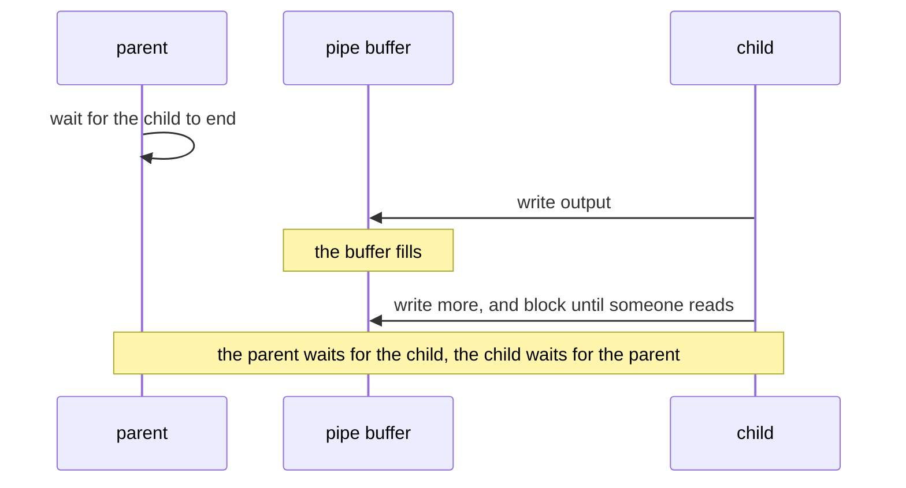
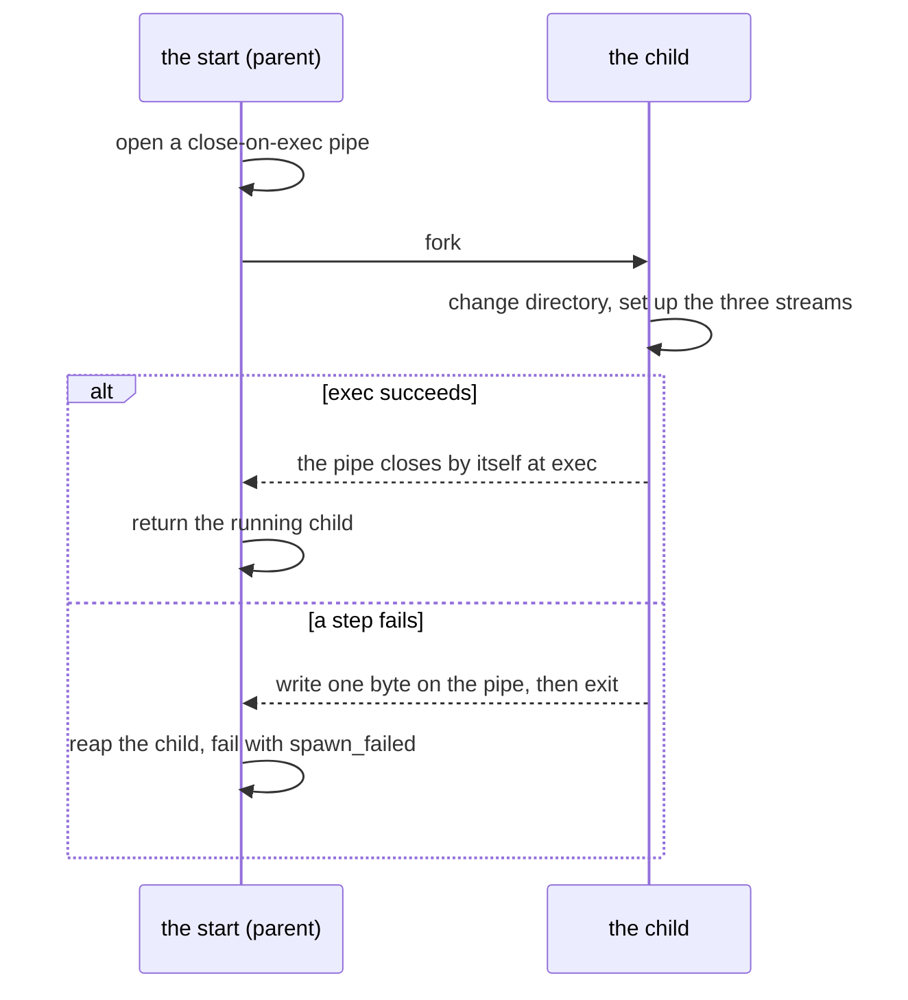
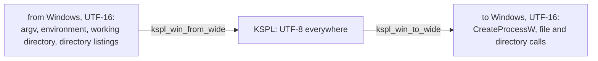
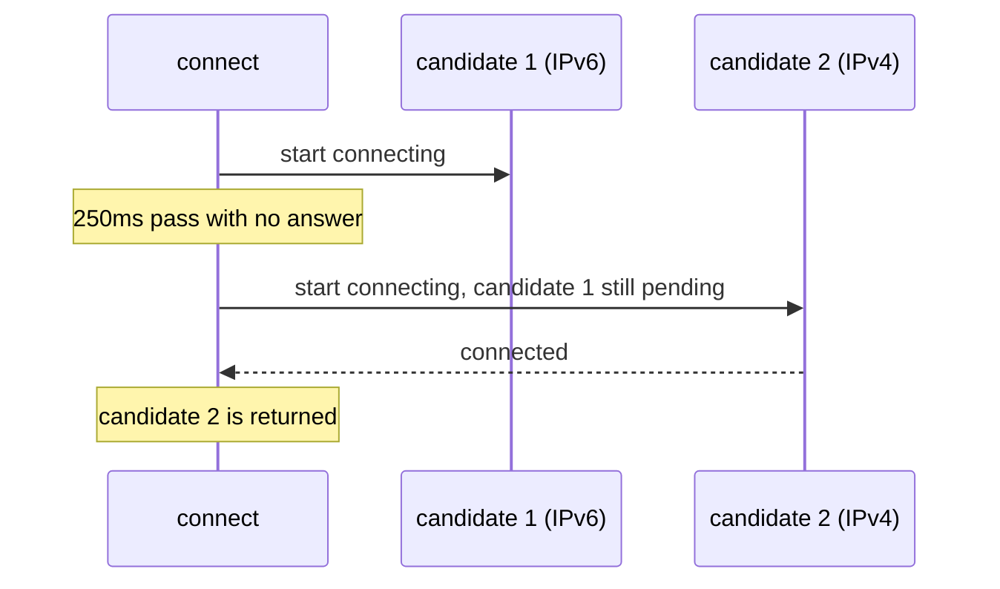

# Processes, files, threads, networking and data formats

**This document says why the parts of `std` that reach outside the program work the way they do**: the process and its children, files and paths, threads, networking and the data formats. The words used across `std` and the table of what was inherited are in [`DESIGN-core.md`](DESIGN-core.md).

## The process: its arguments, its output, its children and the clock

### How an argument's destination is declared, and why anything unknown is an error

With `std/argp`, each option writes straight into a variable of yours, and that variable's starting value is the default. An argument starting with `-` that nothing declared is an error, never skipped.

Each declared item receives **a pointer to the caller's variable**, so the default value is that variable's initial value.

```kspl
$out: U8[] = "out/result.jsonl" // the default is the variable's initial value itself
$vocab: I64 = 2000
$verbose: = false
p: = argp.Parser.create("build_corpus", "build a corpus", arena)
p.str_opt("--out", out@, "where to write")
p.int_opt("--vocab", vocab@, "the target vocabulary size")
p.flag("--verbose", verbose@, "show the progress")
p.parse_or_exit(sys.args(), arena)
```

The destination carries `$` because argp rewrites it (without it the diagnostic is `expected 'Bool$@', but got 'Bool@'`), and the `$` also tells the reader the variable changes later. **There is no lookup by name** (`get_str("--out")`), so a misspelt name, or a mismatched type, is caught at compile time, not at run time.

What the parser above does with a few command lines:

| Command line | Result |
| :-- | :-- |
| `--out=result.jsonl` | `out` becomes `result.jsonl` |
| `--out=-7`, `--out=` | `out` becomes `-7`, or empty: the value is whatever follows the first `=` |
| `--out result.jsonl` | Refused: "needs a value, written as '--out=<value>'" |
| `--outt=x` (declared nowhere) | Refused as an unknown option |
| `-5` as a positional argument | Refused as an unknown option |
| `-` | A positional argument, meaning standard input by convention |
| `-h` | Refused as an unknown option, and the refusal prints the usage |
| `-- -5 --help` | Two positional arguments, `-5` and `--help`: after a lone `--` nothing is read as an option or a command |

Caution: **Anything starting with `-` that no declaration knows is an error, never let through silently.** Besides misspellings, it catches the pieces the shell makes when it splits a path holding a space into several words; ignored, they cause an untraceable failure. The price: a negative number such as `-5`, or a file named `-x`, is a positional argument only after a lone `--`, the POSIX convention that everything after it is positional. A lone `-` is positional, meaning standard input by convention.

**A value is joined with `=`, and only so** (`--out=result.jsonl`); `--out result.jsonl` is refused with "needs a value, written as '--out=<value>'". Two spellings of one option are two ways to write the same thing (Principle 6 in [`../../docs/DESIGN-principles.md`](../../docs/DESIGN-principles.md)), and the spaced one has to guess. Is the next argument the value or another option? In `--root --show`, taking `--show` as the value serves a folder that does not exist, which shows 30 seconds later as the server failing to start. And may a value start with `-`? Joined, the value is whatever follows the first `=`, `-7` and an empty value included, and an option never takes the argument after it. Positional arguments are taken only where declared (`p.positional`, read from `p.rest`), since a word-split fragment can also arrive in the positional shape.

**An item has one name, and there are no short names.** An `--in-place` has no `-i`, and a `--define` no `-D`. Two spellings of one option are two ways to write the same thing (Principle 6 in [`../../docs/DESIGN-principles.md`](../../docs/DESIGN-principles.md)): a script, a document and a model's answer each pick one, and the reader must know they are the same. A short letter also means different things from tool to tool (`-i` is in place for `sed` and `clang-format`, ignoring case for `grep`, asking first for `cp`). Joining a value to it (`-Dflag`) needs its own matching rule. The cost is typing, and the lines repeating an option are in build files and scripts, written once. `--help` has no `-h` either: a rule with one exception is two rules to learn. And `-h` means something else elsewhere (`ls -h`, `df -h`: human-readable sizes; `grep -h`: no file names). A `-h` is refused as an unknown option, and the refusal prints the usage, so the reader still gets what they came for.

### A program does not lose its own output on an abnormal exit

Output waiting in a buffer is lost when a program crashes. A program whose last lines matter, such as the test harness, asks for its output to be written out at every newline.

`panic` (`std/lang`) flushes standard output before `abort()`, but **the log's last line is not necessarily where the program died**. Into a pipe (CI's log collection, `| tee`) the C library buffers fully: it writes only when its buffer is full. An abnormal exit, death by a signal included, loses everything unflushed. So a program whose main clue is how far it got, such as the test harness, calls `io.set_line_buffered()`. Its flush at each newline means the same on both backends and every platform, where `setvbuf`'s `_IOLBF` (1 on glibc and macOS, 0x40 on MSVC's UCRT) would put another mode into genllvm's IR on Windows.

Caution: **The code that keeps the panic record must not itself crash.** On freestanding, `panic` sets the message, the stack pointer (SP) and a piece of the stack aside in `.noinit_panic`, a region that start-up does not clear. But `kspl_get_sp` is per-architecture inline assembly that returns 0 where an architecture lacks it. Reading address 0 crashes that read, and not one word about why the program stopped survives: on wasm this turns "there is not enough space" into `memory access out of bounds`. So when `sp == 0` the stack piece is not read, and `take_panic_record` returns a `stack_len` of 0.

### Standard output has one buffer, the C library's

A program writes to standard output through `io.out()`, and the C library's stream (`stdout`) holds what waits to be written. Nothing in `std/io` keeps a second buffer above it.

| Where standard output goes | When the bytes are written |
| :-- | :-- |
| A terminal | At each newline (on Windows, at each call), and before the program waits to read from a terminal, so a prompt shows |
| A pipe or a file | When the buffer is full, at `flush()`, and at a normal exit |
| Any of them, after `io.set_line_buffered()` | At each newline too |
| Any of them, at a `panic` or before a child is started | All that waits is written first |

Standard error waits for nothing: each call is written at once.

**Each `Writer` call is one call into C, the cheapest that does the job.** `s` hands the whole string to `fwrite`, and `c` one byte to `fputc`. A number's digits go out as one string per run between separators, not a call per digit. The cost of output is per call, not per byte: a `fprintf` per byte, parsing a format each time, makes a program printing many short numbers about four times slower than a C program's `printf`, and with these calls it runs as fast.

**Why no buffer of its own**: the runtime's own paths write through the C stream. A panic, and starting a child, flush `stdout` in C. They cannot see a buffer above it, so a panic would lose the output before it, and a child started with bytes still waiting would write its own output ahead of them. Two buffers for one purpose would also mean two answers to "has it been written yet".

**Why not unbuffered**: a write to the OS per call makes heavy output into a pipe slower by a system call per string. **Why not line-buffered everywhere**: into a pipe that costs a system call per line, and a program's output into a pipe is usually read by another program, which reads it in blocks. A watched run that wants each line at once asks for it with `io.set_line_buffered()` (the section above).

**Reading does not flush standard output.** On a terminal a prompt still shows before the read: the C library writes a terminal's waiting output before a read from standard input waits (glibc and macOS's libc), and Windows's writes to a console at once. **Into a pipe** (`prog | tee log`) the prompt waits in the buffer, so a program that prompts there calls `io.out().flush()` before it reads. A flush at every read would cost a program that reads a byte (`io.getchar`) and writes between reads a system call per byte when its output is a pipe: a filter's throughput, given up for a case a flush call covers.

### A crash names what happened, in one line

A program that touches memory it may not, such as a write through a null pointer or a recursion that runs its stack out, is stopped by the OS, not by one of the language's checks. Left there, it ends without a word: a shell may print "Segmentation fault", a parent sees the code 139, and nothing names what happened. **With an OS, the runtime writes one line to standard error, then lets the fault end the program as it would have.**

| What the fault's address says | The line (POSIX; Windows names the exception, such as `STATUS_ACCESS_VIOLATION`) |
| :-- | :-- |
| It lies in the first page: a null pointer, with a field's offset added | `crash: null pointer dereference (SIGSEGV at address 0x0)` |
| It lies at the end of the thread's stack | `crash: stack overflow (SIGSEGV at address 0x7ffc5d4b8ee8)` |
| Anywhere else | `crash: invalid memory access (SIGSEGV at address 0x…)`, or `crash: bus error (SIGBUS …)` |

* **The exit code stays the fault's own.** POSIX puts the signal back to its default and raises it again, so a parent reads 139 and a core dump is written where one is enabled; Windows ends with the exception's code, read as 139 ("A child's end is one code on every OS" below). A caller checking the code sees no difference.
* **The prefix is `crash: `, not `panic: `.** A panic is a stop the program makes at a rule it checks, at a line it names ("Conditions that stop execution at run time" in [`../../docs/SPEC-language.md`](../../docs/SPEC-language.md)); a crash is the OS's, and the fault names an address, not a line. One word per kind of stop keeps each one a single string to search for.
* **No trace is printed.** Walking the stack inside a fault handler is safe only with an unwinder the runtime does not carry on every OS, and `print_trace`'s error trace is the route of the last `!` failure, unrelated to the fault. The line says what happened; a debugger on a build with `-g`, as `ksplc build` makes, says where.
* **The handler calls only what is safe there** (write, signal, raise): the fault may strike inside the C library, holding its locks. So standard output is not flushed, and a program whose last lines matter is line-buffered (the section above).
* **A handler already in place is kept** (a sanitizer's, a host program's), and a library takes none, since its host owns the signals.
* **A stack overflow needs a stack of its own for the handler.** The main thread's is set before `main`, a `std/thread` thread's as it starts. A thread that C code starts has none, so its overflow ends with 139 and no line.
* **Freestanding has no OS to stop the access**, so nothing here applies to it.

The implementation is "A crash says what happened" in [`../../ksplc/gen/runtime/hosted.c`](../../ksplc/gen/runtime/hosted.c). The check is `make test-runtime` (the `crash_*` cases in `ksplc/tests/runtime/stops.kspl`).

### A run of checks goes on past a failure, and names what failed on its last line

`std/verdict` can run many checks without stopping at the first failure. It ends with one `RESULT:` line naming every check that failed, and the exit code is the verdict.

| Shape | Calls | Stops at the first failure? | Suits |
| :-- | :-- | :-- | :-- |
| Tests one at a time | `start` / `pass` / `skip` | Yes, at `std/lang`'s panic | Ordinary unit tests |
| **A run of checks** | `begin` / `check` / `finish` | No: it goes on past a `FAIL` line | A run with something to stop before it ends (a server still listening on its port), and many independent checks, where the first failure is not the only one worth reading |

**The names on the `RESULT:` line are copied into the tally's own room** (`Names` in `std/verdict.kspl`). A name passed to `check` is often built in the caller's scratch arena and freed straight after, so a view kept until `finish` would read freed memory. An allocation would make the tally the one part of a failing run that can itself fail.

**A child's run is read here too** (`run_child` / `run_children`), since a check on a compiler or a tool asks two things of it: how it ended and what it wrote. Its stdout and stderr come back as one text, since a diagnostic appears on either, by version and path. A run that could not start or was killed says so in that text, so the code alone never passes for "it ended non-zero". `run_child` waits at most `default_timeout_ms` unless the check passes its own limit. `run_children` runs `jobs()` children side by side, each under `default_timeout_ms`, and returns them in the input's order, so the code that judges has one form, sequential or parallel.

**A finding is indented on the lines below its `FAIL` line**: the gates read a line by its head (`FAIL `, `RESULT:`), so a finding at a line's head could be read as a verdict.

Why a walk that walked nothing fails is at `check_list` in `std/verdict.kspl`; why this stands in `std` at all is "What tests share stands in std" in [`../../docs/DESIGN-repository.md`](../../docs/DESIGN-repository.md). The check is `make debug`, which runs each shape as a child and holds its whole output.

### Fuzzing watches the program from outside

*Fuzzing* feeds a program many broken inputs to find crashes.

**A round of `std/fuzz` is one run of the program, judged from outside by how it ended**: its exit code, an announced stop, or no end within the wait. Nothing is built into the program: no coverage instrumentation, no entry point called in the fuzzer's own process.

**Why**: in another process a crash is seen, while inside the fuzzer's process it would take the tally down with it. With nothing built in, the same fuzzing runs on all three platforms with the C compiler as it is. A coverage-guided fuzzer (one that watches which code each input reaches) needs a runtime the toolchain may not carry. The same seed, seeds and count give the same rounds: `std/prng` is written in KSPL, so a round generated on Linux is generated on Windows too. A gate's failure is reproduced at a desk from the two numbers it prints. A gate can also run a fixed count, where a coverage-guided fuzzer runs until stopped.

**The program under test is built with the address sanitizer where the C compiler holds its runtime, and the driver is told so** (`fuzz.Sanitized`). The address sanitizer is a build option that stops a program at a bad memory access. Built plain, a read past an allocation's end that stays inside a mapped page returns a stale byte and the round ends well; built with it, the read stops at its line. The build cannot be seen from outside, so `report_asan` prints a line either way: a check where it is in or required, a skip where the toolchain holds no runtime.

**A round past its wait is run again with five times the wait** before it counts as not ending, since a crowded machine slows a finite round, and the target is a program that never stops. `check_reach` keeps a run that tried nothing from passing: checking only for crashes, a mutation that broke every seed at the parser's entry would go green.

**What this gives up**: coverage and speed. A coverage-guided fuzzer keeps an input that opened a new path and mutates it further, reaching deep paths a blind one reaches only by luck. Here the seeds carry the depth, so the suites gather real files and write seeds from each writer. And a process per round is far slower than a call.

**std's own fuzz (`make test-fuzz`) scatters at each reader of outside bytes, and checks a round trip wherever std holds a writer for what it reads.** The program under test, `std/tests/read_prog.kspl`, is told the kind of each input:

| Kind | What reads it | What must hold besides an end |
| :-- | :-- | :-- |
| `json` | `json.parse` | The value, written (`dump`, flat and indented) and read back, `equals` the one read, and is written the same again |
| `json-struct` | `json_struct.into_struct`, into a struct with a field of each kind it walks: integers of each width and sign, an `F32`, a `Bool`, a string, a nested struct, lists of numbers, strings and structs, and options | The struct, written (`from_struct`) and read back into another, is written the same again. Only this second trip is held to equality: the first drops unknown keys and rounds an `F32` |
| `url` | `url.decode_component`, `url.parse_query` | A component, encoded (`url.encode`), decodes to itself; the pairs, encoded into a query, parse back to the same pairs in order |
| `base64` | `base64.decode` | The bytes, encoded, decode to themselves |
| `regex` | `Regex.compile`, then matching | `is_match`, `find` and `find_all`'s first match agree, and a search visits no more states than the program holds per byte, plus one |
| `http-req` | `http.parse_request` | None |
| `http-res` | `http.parse_response` | A response the writer takes (`format_response`) reads back as the status, headers and body it was given, and is written the same again |
| `http-write` | `http.format_request` and `format_response`, given fields split at each 0 byte | What the writer takes reads back the same: the method and target or the status, the headers in order with the `Content-Length` the writer adds, and the body |
| `jsonrpc` | `jsonrpc.take_frame`, over a stream of frames | The frames before the first broken one are the same whether the bytes arrive at once, a byte at a time or seven at a time; each body, framed again (`frame_into`), is taken back the same |
| `argv` | `argp.Parser.parse_list`, with flags, values, a repeated item, a command chosen by name and by flag, one taking an uninterpreted rest, positionals and `--` | What it read, written back as a command line, parses to the same values, items given, command and positionals |

**Every seed is read once before any mutation** (`fuzz.check_seeds`): one the program refuses is dropped, unless the program's own writer made it, and one that stops the program fails, since dropped it would hide a crash on a file nobody mutated. **A broken round trip stops with `assert`**, so the driver counts it among the announced stops, and the input it keeps prints the broken property when run again. **Why under the fuzz, beside the unit tests**: a unit test checks the values its writer thought of; under the fuzz, the trip runs on every value a mutation reaches, such as a header value ending in a space or a head one byte past its limit.

### Writing to a closed pipe returns an error value, and output whose destination is gone ends quietly

In a KSPL program, a write whose reader has gone comes back as a failure value, except on standard output, which ends the program quietly.

POSIX terminates a process writing to a pipe whose reader has closed (SIGPIPE's default). So a server whose peer leaves, an ordinary event, dies **printing nothing**: from outside no request comes back, and nothing points at the cause.

**The runtime ignores SIGPIPE, and a writing function returns the refusal as a value.**

| Where the write goes | What happens when the reader is gone |
| :-- | :-- |
| A child's standard input (`Piped_child.write`) | Returns false |
| A socket (`std/net`'s send) | Returns a failure |
| The program's own standard output | The program ends quietly, as `prog \| head` expects |
| Anything, inside a child the program starts | SIGPIPE's default is back, so the child dies as usual |

**Standard output is the exception**: Unix promises that `prog | head` ends quietly. So once a write comes up short, `std/io` restores SIGPIPE's default and raises it on itself. A buffered `fwrite` reports that it wrote, so the flush passes the same check, the only place the loss shows.

Caution: **Do not stop at merely ignoring it.** The output is then silently discarded, and the program runs on to the end having lost its destination.

**A socket's write fails as a value even in a library**, which leaves SIGPIPE to the program linking it: a server library would otherwise kill its host the first time a client left. The runtime asks the OS not to raise the signal for a socket (`MSG_NOSIGNAL` on each send, `SO_NOSIGPIPE` where the OS has no such flag); a pipe's write stays the program's to handle.

**Do not carry the ignoring setting over to a child**: it survives exec, so `git`, `clang` or a shell pipeline would not die either, and the `yes | head -1` family would never finish. It is restored between the fork and the exec.

The implementation is "Writing when nobody is left to read it" in [`../../ksplc/gen/runtime/hosted.c`](../../ksplc/gen/runtime/hosted.c). The check is `make test-broken-pipe`.

### The output of children started in parallel is received through files, not pipes

`std/subproc`'s `run_many` starts several children at once and sends each one's two output streams to files in the caller's directory. It reads the files after the child has ended and been reaped (its exit status collected).

**Why not pipes**: a pipe fills before the parent reads it, and the child stops. Watching every child's pipe at once needs a `poll` set or threads, which only the C runtime could hold. A file does not fill, so starting and waiting in order is enough, and the scheduling stays in KSPL. The cost is the trip through the disk, which rules it out when measuring the output's latency.

**Why not `run_capture` on threads**: each call copies its output into the caller's arena, which is not safe to share between threads, so each thread would need an arena of its own and its results copied back. Processes side by side keep the scheduling and every copy on the caller's one thread.

**Why results are reaped in submission order**: they then match the input, so the caller carries no mapping. The cost: one slow item at the front leaves the slots behind it idle; reaping in completion order would keep the slots full, but leave restoring the order to the caller.

**Each child has a time limit of its own**, counted from its start, as `run_capture`'s is; past it, the child is killed with all it started ("A child stopped at its time limit is stopped with all it started" below) and comes back `timed_out` with what it wrote by then, and the rest run on. A limit over the whole batch instead would grow too short as the batch grows, and a slow child would take the others' results down with it. Waiting with a limit means looking again after a pause, since POSIX's `waitpid` takes no time limit: the pauses start at 1 ms and double up to 10 ms, so a slot stands idle at most 10 ms after its child ends. Submission order keeps every child's limit honoured: children start in order, so each one's deadline falls no earlier than those of the children reaped before it.

### Three ways to start a child process, split by where its output goes

`std/subproc` has one function per purpose, not one function with options. The three purposes are: collect everything (once, or many in parallel), keep it running, and talk back and forth. Split this way, the combinations that hang cannot be written.

| What is wanted | The function | Where the output goes |
| :-- | :-- | :-- |
| Run it and collect everything | `run_capture(argv, cwd, timeout_ms, cap, arena)` | The parent's memory (cut at the cap) |
| Run many side by side and collect everything | `run_many(jobs, …)` | Files in a directory (the section above) |
| Keep it running | `spawn_redirect(argv, cwd, out_path, err_path)` | Files the caller named |
| Hand it input and let it write where the parent does | `spawn_feed(argv, cwd, input, idle_ms)` | Inherited (the terminal) |
| Talk back and forth | `spawn_piped(argv, cwd)` + `read(buf, timeout_ms)` | A pipe (with a timeout) |

Why not options on one function: Python's `subprocess` and Java's `ProcessBuilder` take that shape, which is easier to start writing. But **the shape cannot stop the combinations that deadlock**: waiting for the child to finish while still attached to its pipe stalls once the buffer fills. Both leave the avoidance to the user's discipline, by documentation alone. Split by purpose, that combination cannot be written.

The stall, step by step:



**Why only the functions that use a pipe take a timeout**: only a pipe's buffer can fill. So the timeout is an argument of the read, and of `spawn_feed`, whose input goes through a pipe, with no form that omits it. Its expiry comes back as a value, which makes the stall a diagnostic at once; Java expresses a timeout as `waitFor`'s false return value, which can be overlooked. The timeout also tells a slow child from a dead one (a dead one returns 0, as EOF).

**Inherited and file-directed children share `Child`**, with `wait`, `alive` and `kill`. Neither needs its outputs drained before waiting, so a raw integer handle and a separate reaping function would give the same lifetime two interfaces. It has no read method: inherited output goes to the terminal, and redirected output to files. `Piped_child` stays separate and has no blocking `wait`, because its pipes can fill.

**Why `spawn_redirect` alone asks for no console window**: on Windows, a console program started by a program without its own console gets a new console window. `spawn_redirect`'s child already writes both streams to files, so the window would show nothing, and the child is meant to outlive its starter. The collecting functions must not ask: Ctrl+C in the starter's console does not reach a detached child, which for a parallel build means orphaned compilers.

**Reading a finished child's output as one text is a way of reading the result, not another function** (`Run_result.text`).

**The split is on the KSPL side**: C starts a child one way, `kspl_proc_start` (the arguments, the working directory, and a pipe or a file for each standard stream). The four functions combine it in KSPL with `kspl_proc_poll` / `kspl_proc_read` / `kspl_proc_wait` / `kspl_proc_kill`, the collection cap, the timeout and the kill on a timeout included.

Caution: **Do not add a per-purpose way of starting to C.** C code is written twice, for POSIX and for Windows, and the Windows copy cannot be run locally. C keeps only what needs the OS's API directly (`fork` / `CreateProcessW`, creating a pipe, Windows's command-line quoting, the UTF-16 conversion).

### A program named without a directory is looked up in PATH alone

**`argv[0]` without a directory is looked up in PATH and nowhere else**, on every OS, so the current directory is searched only where PATH names it. POSIX's `execvp` already does this.

| Where the OS looks, in order | POSIX `execvp` | Windows `CreateProcessW` | `std/subproc` |
| :-- | :-- | :-- | :-- |
| This executable's directory | — | 1 | — |
| The current directory | — | 2 | — |
| The system directory | — | 3 | — |
| The Windows directory | — | 4 | — |
| The directories PATH names | 1 | 5 | 1 |

So on Windows a `cc.exe` lying in a cloned repository would run in place of the compiler for anyone building there, and `bash` would start WSL's launcher in the system directory in place of the bash PATH names. On Windows `std/subproc` therefore looks the name up itself, in PATH, adding `.exe` to a name with no extension as `CreateProcessW` does, and puts the full path it found in the command line. A name it does not find fails to start rather than falling back to the OS's search.

### A relative program path is read from the child's working directory

**A relative path with a directory part (`./tool`, `bin/tool`) is read from the child's working directory** where the start is given one, as POSIX reads it: the child changes directory, then execs. `CreateProcessW` reads it from the parent's directory instead, so on Windows `std/subproc` joins it onto the working directory itself. Without that, one call would run a different program, or none, per OS. Rust leaves this case "platform specific and unstable" and asks for an absolute path; Go joins it onto the directory on Windows, as here.

### A child that cannot start fails the start, on every OS

**A program that is not there, cannot be run, or cannot be given its working directory or output files is `spawn_failed`**, from every function in `std/subproc`, never an exit code. `CreateProcessW` fails for each of those, so Windows answers this way by itself. POSIX first copies the process (`fork`) and meets the failure in the copy, the child, after the fork has succeeded. So the child reports it to the start before it ends: it writes a byte on a pipe the start already waits on. That pipe closes by itself when the child's `exec` succeeds (it is *close-on-exec*; "A child holds only the streams it is handed" below).



**Why not the shell's 127**: an exit code of 127 is also what a program that runs and exits 127 gives, and what a missing shared library gives on POSIX, so the caller cannot tell "it is not there" from "it ran and failed". And Windows has no such code, so a caller reading 127 as "missing" would be right on POSIX alone.

### A child's end is one code on every OS

A *signal* is how POSIX tells a process about an event such as a crash (`SIGSEGV` for a bad memory access). **A child that crashed or was killed ends as 128 + the signal number, on every OS**, the shell's convention: a segmentation fault is 139 and an abort 134. POSIX's wait reports a signal apart from an exit code, and `std/subproc` folds it into that number. Windows has no signals: a crash ends the process with the NTSTATUS (Windows's code for why a process ended) of the exception, and `__fastfail` with `STATUS_STACK_BUFFER_OVERRUN`. So on Windows each of those is read as the signal POSIX raises for the same fault:

| How the child ended on Windows | Read as | Code |
| :-- | :-- | :-- |
| `STATUS_ACCESS_VIOLATION`, `STATUS_STACK_OVERFLOW` | `SIGSEGV` | 139 |
| `STATUS_ILLEGAL_INSTRUCTION` | `SIGILL` | 132 |
| `STATUS_FLOAT_DENORMAL_OPERAND`, `STATUS_FLOAT_DIVIDE_BY_ZERO`, `STATUS_FLOAT_INEXACT_RESULT`, `STATUS_FLOAT_INVALID_OPERATION`, `STATUS_FLOAT_OVERFLOW`, `STATUS_FLOAT_STACK_CHECK`, `STATUS_FLOAT_UNDERFLOW`, `STATUS_INTEGER_DIVIDE_BY_ZERO`, `STATUS_INTEGER_OVERFLOW` | `SIGFPE` | 136 |
| `STATUS_STACK_BUFFER_OVERRUN` (`__fastfail`, UCRT's `abort()` by default, and every KSPL program's) | `SIGABRT` | 134 |
| `STATUS_CONTROL_C_EXIT` | `SIGINT` | 130 |
| `STATUS_DLL_NOT_FOUND` | the loader's 127, as on POSIX for a missing shared library | 127 |

Any other code is the child's own, a negative one included. The table's copy in the runtime is `kspl_proc_status_code` in `ksplc/gen/runtime/hosted_proc.c`, and `make test-conventions` checks that the two agree. A fault with no single POSIX signal (an in-page error is `SIGBUS` on Linux and macOS under different numbers) stays as Windows gives it.

**A KSPL program's own abnormal end is `STATUS_STACK_BUFFER_OVERRUN` on Windows, whatever the C runtime does.** A panic and the run-time checks end in `abort()`, which raises `SIGABRT` first, and the runtime's handler ends the process there with that code (`kspl_end_on_abort` in `ksplc/gen/runtime/hosted.c`). Left to the C runtime, msvcrt's `abort()` exits 3, and UCRT's either exits 3 or fails fast, by a setting.

**Exit code 3 is not read as an abort.** It is what a program that ends normally with 3 gives (robocopy's "files copied, extra files present"), so reading it as 134 would report a crash that did not happen. The cost: a program built against msvcrt, or UCRT without fault reporting, that calls `abort()` reads as 3.

**Whether the child has finished is not one of the codes.** `Piped_child.exit_code` returns an `I32?`, none while the child runs. A number set aside for "still running" is also some child's exit code: Windows's `exit(-1)` ends with -1, which would read as "not finished" forever. A kill by `Child.kill` or `Piped_child.kill` reaps the child and gives no code, since nothing can read the handle afterwards.

### A child stopped at its time limit is stopped with all it started

**A child that `run_capture`, `run` or `run_many` stops at its time limit is stopped together with every process it started.** A child is often a shell or a compiler driver whose work runs in children of its own (`cc` starts the compiler proper and the assembler). Killed alone, it leaves those running: they go on writing files after the caller has given up, and hold its output open.

**So these children lead a process group of their own on POSIX, and are put in a job object of their own on Windows**, and the kill is sent to the group, or ends the job. On Windows the child starts suspended and runs only once it is in the job, so nothing it starts can begin outside it.

**A terminal's signals are passed on.** A group of its own is outside the terminal's foreground group, so Ctrl+C and a hangup reach the starter alone; a starter they ended would leave its children running with nobody left to stop them at their limit. So while such a child runs, the runtime takes `SIGINT`, `SIGQUIT`, `SIGHUP` and `SIGTERM`, passes each on to every group it holds, and then ends by the signal as it would have by default. **It takes a signal only where it is still at its default**: a program that ignores or handles one has chosen how it ends, and its grouped children then do not hear of it. Windows needs none of this: a console's Ctrl+C reaches every process attached to it, in a job or not.

**The other ways of starting stay in the starter's group.** Out of the foreground group, a child that reads the terminal is stopped by the OS, so `spawn_wait` and `spawn_async`, whose children are on the terminal, would hang an interactive tool. `spawn_redirect`'s child is meant to outlive its starter, and `Child.kill` and `Piped_child.kill` stop the child alone.

What this gives up:

| Case | What happens |
| :-- | :-- |
| A child stopped at its limit asks something on the terminal (a password prompt) | The OS stops it until the limit ends it; a tool that must ask runs through `spawn_wait` |
| A process the child started leaves the group on purpose (a daemon calling `setsid`) | It is not stopped |
| The child has ended and been reaped | Nothing is stopped. On POSIX the group's number was the child's process ID, which the OS may then hand to another process, so the kill could reach a stranger. Windows keeps the job, but stops nothing either, so the two agree |

**The job object does not kill on close.** With that setting, what the child left running at a normal end would die when the starter lets the job go, and on the starter's crash, while on POSIX it runs on; one call would end differently per OS.

### A child's outputs are read a short while past its end

**Once the child itself has ended, `run_capture` reads its outputs for `pipe_grace_ms` (100 ms) more, then closes them and returns the child's own exit code.** A process the child started without redirecting its outputs (`server &` in a shell script) holds the pipes open after the child has ended. Waiting for them to close would run to the time limit and report a child that ended in time as `timed_out`, its exit code lost.

**Nothing the child itself wrote is lost**: once it has ended, everything it wrote is in the pipes, and is read. What the grace can cut is what the processes it left behind write after it. Those processes are not killed: a child that ended normally may have started something meant to stay, and only a time limit stops what a child started. Their next write to the closed pipe fails.

**The grace is short because it guards nothing the child wrote**: it only lets a process that is finishing its last write land it. `run_many` collects through files, which a leftover process cannot hold open, so its children's ends are seen at once.

### A child holds only the streams it is handed

A child gets its three standard streams (input, output, error) and nothing else of what the parent has open. A file, socket or pipe left open in a child would stay alive, and in use, for as long as the child runs.

What a child started by `std/subproc` receives from the parent:

| | Does the child get it? |
| :-- | :-- |
| Its three standard streams | Yes, as the start sets them up: inherited, a pipe, or a file |
| Its working directory | The `cwd` the start was given |
| Any other socket, file or pipe end the runtime opened | No |
| SIGPIPE ignored | No: the default is restored between the fork and the exec ("Writing to a closed pipe returns an error value" above) |
| A console window of its own, on Windows | Only from `spawn_redirect` ("Three ways to start a child process" above) |
| A descriptor a foreign C library opened without the mark, on POSIX | Yes: the gap this section gives up, below |

**Every socket, file and pipe end the runtime opens is closed on exec (POSIX) or not inheritable (Windows)**, so a child holds its three standard streams and nothing else. A copy in a child keeps what it names alive for as long as the child runs: a server that started a helper could not bind its port again after closing its listener, its client would never see the connection close, and a reader would wait for a pipe's end until an unrelated child exits.

**The mark is given in the call that opens** (`SOCK_CLOEXEC`, `accept4`, `pipe2`, `O_CLOEXEC`, `WSA_FLAG_NO_HANDLE_INHERIT`). Given afterwards, a child started from another thread in between takes the copy. Where the OS has no such call (a socket or a pipe on macOS, an accepted socket on Windows) it is given right after; on macOS the starts then take turns from their first pipe to the fork, so one start's pipes never reach another's child.

**On Windows each child is handed a list of exactly its three handles** (`PROC_THREAD_ATTRIBUTE_HANDLE_LIST`), a stream left to inherit as a copy of the parent's own. Without the list `CreateProcessW` hands a child every inheritable handle. A start on another thread holds its child's pipe ends inheritable until its own `CreateProcessW` returns, so our child could take them, and the other reader would see its end only when our child ends. A lock around the starts would also keep one start's ends out of another's child, but the starts would wait on each other, and a handle some library made inheritable would still pass.

**A start returns once the child has exec'd.** Until then the forked copy holds every descriptor of the parent, so a listener closed right after the start could still not be bound again.

**`std/io`'s `open` takes C11's mode letters alone** (`r`, `w`, `a`, then `+`, `b`, and `x` after `w`) and refuses any other. It builds the open flags itself to give the mark, and a letter one C library reads and another skips would mean two things.

**What this gives up**: on POSIX, a descriptor a foreign C library opens without the mark still reaches a child. Closing everything in the child instead would catch it, at the price of a walk over every possible descriptor per start, slow where the limit is high.

**A batch file (`.bat` / `.cmd`) refuses an argument holding `"`, `%`, `!` or a line break.** Windows hands a batch file to `cmd.exe`, which parses the command line again by rules of its own. The `\"` that keeps a `"` inside an argument for every other program means nothing there, so the `"` closes the quoting and the rest of the argument runs as a command. `%` and `!` expand even inside quotes. Escaping for `cmd.exe` was not taken: its rules depend on settings the parent cannot see (delayed expansion is a registry switch), and an escape that is wrong for one of them runs the argument. With those characters refused, every argument stays inside its own quotes, where `cmd.exe` takes `&|<>^()` as they are.

### The clock has separate functions for 'elapsed' and 'date-time'

Use `sys.mono_us()` to measure how long something takes, and `time.now()` for the date and time. They are different clocks, and swapping them breaks timeouts.

| Function | The clock | Use it for |
| :-- | :-- | :-- |
| `std/sys`'s `mono_us()` | Monotonic: it only moves forward, and only differences mean anything | Elapsed time, timeouts |
| `std/time`'s `now()` | The wall clock, as epoch seconds | The date and time |

Caution: **Do not measure elapsed time with the wall clock.** Rewound by NTP or a user, it gives a negative difference, which a timeout reads as "not yet" and so waits a whole round.

**No function for CPU time is held**: CPU time does not advance while waiting, so used as elapsed time it erases whole spans spent reading the source. If "how much was computed" is needed, add it under a different name; merged into `mono_us`, one name would mean different things per environment. Zig, Rust and Go make the same split. C has only `time()` and `clock()`, neither correct for elapsed time, so everyone calls `clock_gettime` directly.

### A wait's sign means one thing everywhere

Every wait std takes in milliseconds (a child's pipe, a socket, `std/reactor`'s `wait`, an HTTP read, a JSON-RPC call) reads its number the same way:

| The wait | What it does |
| :-- | :-- |
| a positive number | waits at most that long, then answers "timed out" |
| `0` | looks once, without waiting |
| a negative number | a time already up: it looks once, as `0` does |

**There is no "wait for good".** A wait is required exactly so that a peer that goes silent comes back as a value; a forever wait would make that silence a hang again. A deadline counted down (`deadline - now`) can go negative on a slow machine, and it then means "the time is up", never "no limit".

Caution: **Read the sign in one place, the runtime's entry** (`kspl_wait_ms`). Read where each OS call takes it, `-1` waited for good in POSIX `poll()`, 49 days through Windows' unsigned tick comparison, and not at all on POSIX's write deadline: one number, three behaviours, and a program that worked on one OS hung on another.

## Files and paths

### Paths are held in UTF-8, and converted to the wide API on Windows

KSPL keeps every path, and every string, as UTF-8. On Windows it calls only the *wide* functions, which take UTF-16, and converts at one place in the C runtime, in both directions. It never calls the *narrow* functions, which read bytes in the machine's local code page.

Windows offers most functions twice. The narrow form (`…A`, `_getcwd`, `fopen`) takes bytes in the current *code page*, a per-machine character encoding such as CP932 for Japanese or CP1252 for Western European. The wide form (`…W`, `_wgetcwd`) takes UTF-16, which holds every character.

KSPL's strings are UTF-8 in every environment, like the source text and POSIX. **No Windows narrow (ANSI) API is used**: those read the current code page, so under CP932 `_getcwd` returns CP932 bytes and `_mkdir` takes them.

**Inside KSPL the narrow API reads back what it wrote, so nothing shows until the bytes reach a child process.** CP932 bytes from `sys.cwd()` cannot be converted to UTF-16, so the command line for `CreateProcessW` cannot be built and the child cannot start at all. The symptom is a link or start-up failure, far from its cause in `sys.cwd()`.

**It cannot be converted halfway**: with only part of it UTF-8, a path joining `sys.cwd()`'s result with a name written in the source mixes two code pages, which neither API can resolve. So the boundary is one place: the round trip goes through `kspl_win_to_wide` / `kspl_win_from_wide` in `ksplc/gen/runtime/hosted.c`.

The diagram shows both directions through that one boundary.



**The inbound side is converted too, since fixing only the outbound side is worse than no fix.** Three things arrive from the OS narrow: `argv` (which the CRT, the C library's start-up code, moves to the current code page before the generated main receives it), the environment variables (`getenv`), and `getcwd` plus directory enumeration. With only the outbound calls (`CreateProcessW` and the like) wide, `sys.args()[0]` is invalid UTF-8 the moment a program puts it on a child's command line, and again the child cannot start. So `argv` goes through `kspl_os_argv` just once, inside the generated main (on every `sys.args()` the allocations would pile up). The environment variables go through `kspl_get_env` / `kspl_set_env`.

**One gap remains that the wide API cannot close: a receiving program with a narrow `main`.** Its CRT moves the UTF-16 command line from Windows to the current code page to build `argv`. A character it cannot represent collapses into `?`, which no file name can hold, so the tool fails with `Invalid argument` (under CP1252, `かんそ` becomes `???`). Nothing on the sending side can close it: KSPL's own calls (`_wmkdir` / `_wstat64` …) are wide, but `cc` and `ld` are third-party tools, and mingw's GNU binutils takes a narrow `main`.

**So a third-party tool is given relative paths, with their base directory as `cwd`.** The OS sets `cwd` without going through `argv`, so non-ASCII in it survives. That is why `spawn_wait` / `spawn_async` take a `cwd` too: all five starting functions take one, since a single function without it would make "hand it over relative" impossible to write.

CMake makes the same move (the Ninja generator writes paths relative to the build directory).

**The C standard's path functions are not used**: `fopen` and `rename` are narrow, so `std/libc`'s versions break on Windows alone. `std/fs`'s `rename_path` and `std/io`'s `open` go through `kspl_rename_cstr` / `kspl_fopen_cstr`, which keep the per-environment branch in one place in C. `std/libc`'s `fopen` / `rename` carry a do-not-use mark; they stay as the companions of `fclose` / `fread`, which work on an already open `FILE*`. Python abolished all use of the `*A` APIs for the same reason. The path is passed NUL-terminated so it goes to `fopen` / `rename` as it is, where a `ptr` plus length pair would need repacking in C.

**An OS function is not declared directly with `extern "C"`, because its declaration differs per environment**: `shutdown` is `int shutdown(int, int)` on POSIX and `int shutdown(SOCKET, int)` on Windows (`SOCKET` is 64-bit unsigned). A declaration matching one makes that one line fail to compile on the other (winsock2.h: `conflicting types for 'shutdown'`).

Caution: **It cannot be noticed on POSIX.** What fails is the Windows job or a user's machine. `std/net`'s `shut_write` goes through `kspl_net_shutdown_write`, which keeps even the constant (`SHUT_WR` / `SD_SEND`) in one place in C.

**A new `kspl_*` function has its body in the compiler's C runtime (`ksplc/gen/runtime/`), and the seed must carry that body before `std/` calls it**: otherwise the bootstrap does not build, since stage1 (the compiler the seed builds) fails to link on an undefined symbol.

**Where the environments answer one call differently, one answer is chosen for all.** `rename` onto an existing destination replaces it silently on POSIX, but fails with `EEXIST` in Windows UCRT's `rename` / `_wrename`. That breaks "write under another name, then replace": only the first round succeeds, and every later one silently fails to write. A server writing the files it serves, and a cache kept on disk, both take this shape. It must not be aligned on the failing side: `rename_path` is contracted to replace, through `MoveFileExW(MOVEFILE_REPLACE_EXISTING)` on Windows. `MOVEFILE_COPY_ALLOWED` is not added: POSIX fails with `EXDEV` across volumes, so it would split the answer the other way, and a copy is not atomic.

Note: One difference remains. POSIX renames a directory over an empty one, while `MoveFileExW` fails if the destination exists; every caller replaces a file, so this is left. **`make debug` pins the contract**; Linux passes it regardless, so what catches a break is the real Windows runner (`make debug` is a gate shared by Linux and Windows).

### A long path is handed to Windows in the extended form

**On Windows, a path of 248 UTF-16 units or more goes to the OS with the `\\?\` prefix (`\\?\C:\…`, or `\\?\UNC\server\…` on a share), which lifts Windows's usual limit of 260; KSPL code never sees the prefix.** Passed as it is, every file function stops at 260 (`CreateDirectoryW` at 248), the limit Windows keeps unless both the machine and the program opt out. A build cache inside a OneDrive folder easily puts files past that depth. clang and lld widen a path themselves and write them, but without the extended form `std/fs` can neither see, reuse nor delete them. Nothing on Linux or on CI's shorter checkout can show it.

**The OS's switch is not relied on**: it needs `LongPathsEnabled` for the whole machine, which takes an administrator, and a manifest in every program, so a program relying on it breaks on most machines, far from the cause.

**The prefix goes on in the one place a path becomes UTF-16 for the OS**, so no function can miss it; the path is resolved first, and the form never comes back to KSPL (the rules are at `kspl_path_to_wide` in `ksplc/gen/runtime/hosted_fs.c`). Rust's `fs::canonicalize` returns it, and not every tool can read such a path.

Note: **A child's working directory stays under 260.** The OS keeps a process's current directory within MAX_PATH unless the program opts in, so a program that gives a child a deep directory as its working directory hits the limit there (`kspl_proc_start` in `ksplc/gen/runtime/hosted_spawn.c` passes the directory as it is).

### A path is kept under the root by refusing, not by resolving and comparing

`fs.stays_under(root, rel)` is the one check that a relative path from outside stays inside a folder. It reads the path's text and refuses any link along the way. It does not work out the final path and compare it with the folder.

A *link* here is a file system entry that points somewhere else: a symbolic link, or on Windows also a junction.

The text check alone cannot block a link, since `link.txt` is a legitimate name that a check looking for `..` lets through.

**Resolving the path and comparing prefixes is not taken, because the answer splits on Windows.** "Is it a link" is one call on each system (`lstat`, `GetFileAttributesW`). But where POSIX resolves with `realpath`, Windows's `_fullpath` does not resolve reparse points, and `GetFinalPathNameByHandleW` needs an open handle: it would open first to refuse.

**Either way a race remains**: a step swapped between the look and the open breaks it, so a party that can write to the root cannot be stopped. Stopping it needs the kernel to guarantee the open cannot leave the root (`openat2(RESOLVE_BENEATH)` / Go's `os.Root`), and presupposes an API carrying the opened handle rather than a path. **`stays_under` defends against a party that can only send a path, not one that can write into the root.** A typical case is a web page in the browser that has found a local server's address and asks it for `../secret.txt`. Such a page cannot create a link inside the root, so it cannot win the race. A program on the same machine that can write into the root could, and `stays_under` does not claim to stop it.

Caution: **Do not look at `FILE_ATTRIBUTE_REPARSE_POINT` alone on Windows.** OneDrive's and Dropbox's not-yet-downloaded files carry it too, so refusing on it makes every file under a root inside OneDrive unreadable. `kspl_is_link` looks at the name-surrogate tag, which only a link and a junction carry (`FindFirstFileW`'s `dwReserved0` holds it, so it is read without opening).

**Do not merge "cannot tell" into "not a link"**: letting through a step that could not be inspected opens a path out of the root. So `kspl_is_link` returns one of three answers, and -1 counts towards refusing:

| `kspl_is_link` returns | Meaning | `stays_under` |
| :-- | :-- | :-- |
| 1 | A link | Refuses |
| 0 | Not a link | Goes on |
| -1 | Cannot tell | Refuses |

The LLVM backend's degenerate case is -1 too (made 0, it would land on the unsafe side).

### A predicate asking 'may this be followed' returns true when it cannot tell

When `fs.is_link` cannot inspect a path, it answers true, so the caller does not follow it. `is_dir` and `exists` do the reverse and answer false.

**The predicate asks "is it a link", but the caller needs to know "may it be followed"**, and false (= may be followed) sends every caller the costlier way.

* `stays_under` blocks paths out of the root, so letting through a step it could not inspect opens a hole.
* A check's clean-up (the function removing the workspace) removes a tree, so descending into a path it could not inspect removes beyond the workspace.

| Function | Answers when it cannot tell |
| :-- | :-- |
| `is_link` | true |
| `is_dir` / `exists` | false |

**The two answers differ because each is the one that makes the caller hold back.** True from `is_link` means "do not follow it", so a walk neither leaves the root nor deletes beyond the workspace. False from `is_dir` and `exists` means "nothing usable is there", so the caller does not go into or use a path it could not see. Do not copy one function's choice into the other when writing them side by side.

Caution: **Do not substitute `stat`.** It follows a link, answering "a directory" for a link to one, so `rmdir` always fails and the link can never be removed; `remove_path` looks at the link itself on both systems (`kspl_remove_path` in `ksplc/gen/runtime/hosted_fs.c`).

### Making a directory refuses an existing name, and removing a tree is not offered

**`std/fs` makes a new directory or file by trying to create it, never by checking first and creating afterwards**: between a look and the making, another process could slip a link in. `mkdir_unique` retries a taken name with another random tail, as Python's `mkdtemp` and Go's `os.MkdirTemp` do. `write_tree` refuses a name that climbs out before writing anything, so a list of names taken from outside cannot write beside the tree.

**`write_unique` gives a file its owner-only mode as it creates it**, for a file holding what others on the machine must not read. Creating with 0600 decides the mode from the first byte; a `chmod` after creating leaves a moment in which another user can open the file and keep reading it. Creating decides that the name is new, as for `mkdir_unique`, so a link planted at the name is not followed. Python's `mkstemp` does the same. **On Windows no ACL is set**: the file takes its folder's, as `dir_trust` reads none there. Setting one means building a security descriptor for the current user, which no caller has needed yet.

**`copy_tree` refuses a destination that already stands**: a copy mixed with an earlier run's leftovers is not the tree copied, and nothing says so. Python's `copytree` refuses the same by default, and Go's `CopyFS` refuses to overwrite a file that exists.

**Each file `copy_tree` copies has its source's permission bits from its first byte**, for the reason `write_unique` gives its mode as it creates: created with the default mode and narrowed afterwards, a file only its owner may read would stand readable by others while its contents are written, and for good where the narrowing failed. The umask can only narrow the bits at the creation, so they are set exactly once the contents are in, on the open file. Each file is created as new, so a link planted in the copy is not followed, and one that fails partway is removed. Only a regular file is copied: read, a FIFO would wait for good. **On Windows the read-only mark is what is carried over**, put on once the contents are in; who may read the copy is its folder's ACL, as for `write_unique`.

**Removing a tree is not offered.** Checking whether an entry is a link, then descending into it, is how Rust's `remove_dir_all` (CVE-2022-21658), libc++'s `remove_all`, Python's `rmtree` before 3.3 and Go's `RemoveAll` (golang/go#52745) were all attacked: between the check and the removal a directory is swapped for a link, and the removal runs outside the tree. Each fixed it by removing relative to a directory it holds open and refusing to follow links. That needs the runtime to open and remove relative to a handle, on POSIX and Windows alike. Without that, removing is the caller's job, over a tree it made and nobody else writes into.

### A path's metadata names three kinds: a regular file, a directory, anything else

`fs.stat` reports what stands at a path as `File_kind`: `file`, `dir` or `other`. **What a caller decides is whether it may read the thing through to its end**, and only a regular file can be: a FIFO's read waits for a writer that may never come, and a device's never ends. A server that serves a FIFO, or a copy that reads one, stops there with nothing said. So `other` holds every kind that is not read as a file (a FIFO, a device, a socket), and no caller has to list them.

**Not taken: a variant per kind the OS knows.** The kinds differ per OS (Windows reports a device and no FIFO by path), and no caller in the tree acts on one of them apart from the rest; a variant nobody reads would be kept in step on every OS for nothing.

### A path is made absolute by its spelling alone

`fs.absolute` joins a relative path onto the working directory and changes nothing else. `..` and links stay as written.

`absolute` resolves nothing. Folding `a/link/..` into `a` would name another place wherever `link` points elsewhere. Python's `os.path.abspath` does that, and it is the reason Rust's `std::path::absolute` keeps `..` on Unix.

### A cache folder that others can write is refused

**A build cache in a folder that another user could write is refused: what the cache holds is built into the user's programs, so such a folder is a way to run code as the user.** `std/fs`'s `dir_trust` says who besides the current user could have put something in a directory:

| Answer | Meaning |
| :-- | :-- |
| `own` | No one else |
| `foreign` | Another user owns it |
| `shared` | Its group or everyone may write it |
| `unchecked` | Windows: not looked at (below) |

A link is followed, so a cache moved to another disk by a link is judged by the folder it reaches.

**Group write counts as shared.** A group may hold other users, and the directory cannot tell. OpenSSH refuses a key folder by the same rule. `std/fs` makes directories with `0755`, so a folder it made never trips it; only one made by hand under a loose `umask` does, and the refusal names the `chmod` that fixes it.

**Windows answers `unchecked`.** Who may write there is an ACL (a per-file list of who may do what), which `dir_trust` does not read, and a guess either way would mislead.

## Threads, networking and the data formats

### A mutex makes the lock and what it protects one thing

The only public lock is `thread.Mutex<|T|>`, which holds the data it protects inside it. The data can be reached only through `lock()`, so touching it without locking cannot be written.

The only mutex KSPL publishes is `thread.Mutex<|T|>`; the OS's lock itself (`Raw_mutex`) is a `priv` part of `std/thread`.

**Why**: with the lock and the data held apart, the compiler cannot notice a caller forgetting `lock()` and touching the data directly. `Mutex<|T|>` keeps `value` `priv`, so `lock()`'s return value is the only way to the content; publishing the plain lock beside it would make the bypass writable again. Rust's std, which publishes no lock on its own, makes the same judgement.

| Rust | KSPL |
| :-- | :-- |
| `Mutex<T>` (the lock plus the data) | `thread.Mutex<\|T\|>` |
| `MutexGuard<'a, T>` (the RAII guard) | None |
| The lock on its own (not in std) | `Raw_mutex` (priv) |

**No guard type, because the release is already guaranteed.** (A *guard* is an object that unlocks when it goes out of scope; that pattern is called RAII.) `defer mx.unlock()` releases the lock on leaving the scope, and lint [W0106] catches forgetting it. A guard type would add one-line sugar, not the guarantee. `Cond_var.wait` takes a `Mutex<|T|>`, since a condition variable must be given the lock while it waits and the plain lock is not published; being in the same file, it can reach the handle inside.

### A mutex is locked once, by one thread

Locking a `Mutex<|T|>` again on the thread that already holds it stops the program with a message, on every OS. So does unlocking it, or waiting on a `Cond_var` with it, from a thread that does not hold it.

A second lock on the holding thread is a bug in the program: whatever the first holder was in the middle of changing, the second sees half-done. The OS's plain locks answer it differently, which is worse than either answer:

| A second lock on the thread that holds it | What happens |
| :-- | :-- |
| POSIX's default mutex | Deadlocks, with nothing said |
| Windows's `CRITICAL_SECTION` | Lets the second lock through, so the half-done data would be read on Windows alone |
| Rust's `std::sync::Mutex` | Promises only that such a lock never returns |
| Go | Stops a program whose goroutines all wait |
| KSPL's `Mutex<\|T\|>` | Stops the program with a message, on every OS |

**How**: POSIX gives the check itself, as a mutex of type `PTHREAD_MUTEX_ERRORCHECK`, which returns `EDEADLK` for the re-lock and `EPERM` for a foreign unlock. Windows has no such lock, so the mutex is an `SRWLOCK` with the holder's thread id kept beside it, checked before each lock and unlock; `SleepConditionVariableSRW` waits on it. The price is a comparison per call on Windows, and on POSIX what glibc's error-checking type costs beside the default (a read of the owner it already keeps).

**Not offered: a re-entrant mutex** (one the holding thread may lock again). Its use is code that calls itself while holding the lock, which is the half-done read above, made legal.

### The lock and the condition variable are value types

`Raw_mutex` and `Cond_var` are small values, not pointers to the heap, so making one allocates nothing. They cannot be copied, because a copy could free the OS object twice.

`Raw_mutex` and `Cond_var` hold one number (`I64`) naming the OS-side object, and need not stay at one address. So `new()` returns a value with no heap allocation, and `Mutex<|T|>` holds it by value too: one allocation and one indirection fewer than returning a pointer (`Mutex<|I32|>.new()` adds 0 bytes to the heap). `free()` destroys only the OS-side object; the value itself lives as long as the place it sits in. **As a value type, a copy could free twice**, so both conform to `Move_only`, which forbids copying.

### Threads and the reactor are both kept

Use threads for work that keeps the CPU busy, or for a few connections; use the reactor for many connections that mostly wait. You can use both in one program.

The *reactor* (`std/reactor.kspl`) is one thread that watches many non-blocking sockets and runs the code for whichever is ready. `std/thread.kspl` and `std/reactor.kspl` can both "handle many connections", but they suit different situations.

| | `std/thread.kspl` | `std/reactor.kspl` |
| :-- | :-- | :-- |
| Where it suits | CPU-bound parallel work. Calling a blocking API as it is. Few connections, a thread for each | Many connections (hundreds or more), without a stack for each. Waiting that is almost all I/O |
| The cost | A stack per connection. Shared state needs a lock | One thread, so no synchronization, but the caller must make the socket `set_nonblocking()` (its failure comes back as `!Net_error`: do not discard it, or [W0701] fires) |

Both can be used together: accept with the reactor, and hand only the heavy work to a worker thread.

### A walk that must not exhaust its stack asks where the stack ends

A deep recursive walk, such as parsing nested JSON or matching a regular expression, checks how close it is to the end of its thread's stack and refuses the input before the stack runs out. A fixed count of levels alone is not enough, because the stack one level uses changes from build to build.

Each call of a recursive function takes some of the thread's *stack*; when the stack runs out, the program crashes. The ways to guard against it:

| Way | Taken? | Why |
| :-- | :-- | :-- |
| A count of levels | Kept, together with the next | The same on every target, which the guaranteed depth needs; alone it fits only the build it was measured on |
| Asking where the stack ends (`std/stack_limit`) | Taken | Works whatever one level costs |
| Growing the stack | Not taken | Needs a way of switching stacks the language lacks |
| A thread with a chosen stack size | Not taken | The size must still be guessed |

**A count of levels guards a recursion only on the build it was measured on.** One level's stack cost moves with the backend, the toolchain, the optimization and the thread. A walk that fits in 8 MB from clang's C spends about twice that when the LLVM backend or MSVC's toolchain built it, and a thread other than the main one may hold far less. So a count right for one build dies of an exhausted stack on another, the complaint raised against other products' count limits.

**`std/stack_limit` asks the OS where the calling thread's stack ends, and a walk compares its own position with that** (`Stack_limit.new(margin)` once per walk, `near()` at each level; the per-OS calls are in `kspl_stack_floor` in [`../../ksplc/gen/runtime/hosted_thread.c`](../../ksplc/gen/runtime/hosted_thread.c)). The margin is the caller's: what runs after the walk refuses (the unwinding, building the message) runs below where it stopped, and only the walk knows how much that is.

**The walk's position is its frame's address, not a local's** (`kspl_stack_here` in [`../../ksplc/gen/runtime/core.c`](../../ksplc/gen/runtime/core.c)). The address sanitizer moves a local whose address is taken onto a stack of its own on the heap, to catch a use after return. Measured by a local, every walk built with it would read as past its stack's end and refuse input of any depth. A frame's address is on the thread's stack on every build, so a sanitized program refuses only what an unsanitized one does.

**A walk run many times over mostly shallow input asks late** (`Stack_limit.later(margin)`, checked by the same `near()`). Asking costs a read of `/proc/self/maps` on Linux's main thread, far more than a shallow walk, so it is asked only once the walk has gone a fixed amount of stack below where the limit was made (`unasked_room` in `std/stack_limit.kspl`). `std/json`'s parse and `std/regex`'s compile take that shape. **That amount is counted in bytes, not levels**, for the reason the count alone fails: the address sanitizer's frames are several times the plain ones, so a count of levels small enough for any stack on one build is not on another. The bytes are few enough for any thread's stack to hold.

**A walk that reaches a limit refuses the whole input**, never one branch of it. A branch refused alone reads as that branch being absent: a parse would return a tree missing a part, a wrong answer rather than a refusal. So `std/json`'s parse ends the whole document as `too_deep`, and `std/regex`'s compile the whole pattern.

**Not taken: growing the stack** (rustc's `stacker`, Go's goroutines). It lifts the limit instead of reporting it, but it needs a way of switching stacks the language lacks, and a debugger and a profiler lose the thread across the switch. Not taken either: running the walk on a thread whose stack size is chosen. The size must still be guessed from what a level costs, the very number that moves.

**The count stays too**: "Implementation limits" in [`../../docs/SPEC-language.md`](../../docs/SPEC-language.md) requires the guaranteed depth to be the same on every target, and only a count is the same everywhere. The stack is watched so that a refusal beyond the count's reach is a diagnostic rather than a crash. So a walk holds both, the count and the limit, and refuses at whichever comes first.

### Connecting by name tries the candidates overlapped

`std/net`'s `Tcp_stream.connect` takes a host name or an address. A name can give several addresses, IPv4 and IPv6. They are tried overlapped: a new attempt starts every 250ms without waiting for the earlier ones to fail, and the first that connects is used.

`getaddrinfo` resolves a name with `AF_UNSPEC` (both families), and the candidates are started overlapped, 250ms apart, taking the first that connects (RFC 8305's §4 and §5, known as "Happy Eyeballs"). The diagram shows two candidates where the first never answers.



**The schedule is written in KSPL, in `std/net`** (`connect_over`), over what the C runtime offers one socket at a time: start a non-blocking connect to one address, wait on several sockets at once, ask one whether it connected. The reactor drives the same three, so the connect needs nothing of its own in C. The runtime keeps what needs the OS's types: resolving a name, which hands each candidate back as address text with its scope (`fe80::1%eth0`) so connecting to the text reaches the same socket address, and putting the winner back to blocking. The delay, the order and how many attempts run at once then read and change in one language. And a test hands `connect_over` candidates of its own (one that refuses before one that accepts), where a name's answer differs per machine.

Caution: **Do not wait for one candidate's reply before trying the next.** Where the IPv6 path is silently down, that stalls until the OS gives up, which can take minutes against the overlapped shape's quarter-second. A sequential connect, such as Python's `socket.create_connection`, is open to that failure.

**Do not re-order them as "IPv6 first"**: the resolver orders them under RFC 6724 by the local connectivity, which a machine can know even where a family does not work. The order within a family is kept, and only the interleaving is rebuilt, starting from whichever family came first. The resolver's order as it stands, one family in a long run, cannot proceed where that family is down until those candidates are used up. Java's default, fixed to IPv4 first, is a third answer, blind to the local conditions.

**RFC 8305's §3 (overlapping the queries themselves, A and AAAA sent apart with a 50ms wait) is not taken**: it needs a resolver asked per family, and `getaddrinfo` answers both in one call. Name resolution itself has no timeout (glibc's default is 5 seconds twice, and a lookup in progress cannot be cancelled).

**Do not decide a connection's failure by `poll`'s reply**: Windows's `WSAPoll` does not report a failed connection (curl does not rely on it either), so an empty wait cannot be told from a refusal. The socket's own answer decides a failure (`SO_ERROR`), checked every round; the wait is taken in slices, never given an infinite timeout.

**A success needs both answers**: the wait reported the socket writable, and `getpeername` succeeds on it. The socket's answer alone is not enough on Windows, where an attempt still in flight can pass it, and the first such attempt in the order would win over the one that connected.

**Failures are split into "the name does not resolve" and "it resolved but does not connect"**; only the per-candidate reasons are folded (a fixed number of entries, allocating no buffer).

Caution: **Do not fold across that line.** It decides whether the caller fixes the name or checks the peer.

**`connect` takes no timeout of its own.** A timeout given to each candidate in full is not the shape to add, since the wait would grow with their number; Go divides one timeout among them.

**An empty string is not a name, so the connecting side refuses it**, as `resolve_failed` everywhere, before the OS sees it. Linux answers there is no such name, but Windows returns every address the machine holds. So a program that forgot its destination would connect to itself on Windows alone, linking and running with only the peer wrong. On the listening side an empty string still means "all interfaces".

**The listening side takes only one candidate**: one socket binds one address, the one the resolver put first. A socket listening on `"::"` does not accept IPv4 clients. The default differs per environment (Linux accepts, Windows and OpenBSD do not), and OpenBSD cannot change it, so it is fixed explicitly to IPv6 alone; a server that needs both opens two sockets.

**A listening socket's options are chosen by meaning, per OS.** After a connection closes, its port stays reserved for a while (the TCP state TIME_WAIT).

| OS | The option | What it does |
| :-- | :-- | :-- |
| POSIX | `SO_REUSEADDR` | Lets a new run bind despite a previous run's TIME_WAIT, and never takes over a socket somebody else is listening on |
| Windows | `SO_EXCLUSIVEADDRUSE` | Cannot be taken over. Windows's option named `SO_REUSEADDR` instead lets a later socket cut in on one somebody else is listening on, after which the socket an incoming connection reaches is undefined |

**Do not pass the same option everywhere for uniform code**: it would share the socket on one OS only. The exclusive option sometimes cannot rebind until the accepted connections have fully closed, and is taken even so: waiting is visible and fixable, whereas a shared socket breaks as only half the incoming connections arriving, with the cause invisible.

**KSPL caches no resolver answers**: each `connect` resolves its name again. Java caches in the language, and then misses a party whose address changes. An address buffer shorter than `addr_text_max` is refused rather than truncated: a truncated `2001:db8::1` looks like another address, `2001:db8:`.

### The frame is kept apart from the transport, and a broken frame is returned as a value too

`std/jsonrpc` handles JSON-RPC, the message protocol a language server speaks, over a child process's pipes. A broken message comes back as a value. Limits on size, count and time keep a misbehaving peer from hanging the client.

Each message travels in a *frame*: a `Content-Length` header giving the body's size in bytes, a blank line, then the JSON body.

```
Content-Length: 17\r\n
\r\n
{"jsonrpc":"2.0"}
```

`std/jsonrpc` holds the Content-Length frame and JSON-RPC's id, and `std/subproc`'s `Piped_child` carries them. **The layers are split by file, with no point of substitution**: `Client` holds a `Piped_child` directly and calls `spawn_piped` itself, so it cannot be used over a socket. Earlier implementations put an abstraction here (Swift wraps a `DataChannel` in the frame, and clangd took in a change carving out a `Transport`). KSPL does not, because the only carrier is a child process (the same reason as "Three ways to start a child process, split by where its output goes" above).

**Why a broken frame is returned as a value**: `lsp4j` returns nothing for a frame declaring no length, leaving the sender with only "nothing comes back", and nothing coming back cannot tell slow from dead from broken. So `broken` is returned.

Caution: **Drop the broken header from the buffer then.** Kept, every later read sees the same header and returns the same failure forever, with no way to resynchronize.

**Where a read ends must not change the frames.** A pipe splits a message anywhere, so the same bytes arriving at once or a byte at a time must give the same frames, up to the first broken one. Two rules follow:

* **A head's limit counts the head's own bytes.** Its end is looked for only within `max_head_bytes`. Looked for in all that has arrived, a head past the limit would be read when it came in one read, and broken when it came a byte at a time.
* **Two lengths that differ give no length.** Readers differ on which `Content-Length` line counts, the first or the last, so a head naming two would be cut at one place here and at another by the peer. The frame is `broken`, as `std/http` refuses the same head; the same length named twice is read.

What is bounded, and by what:

| What could run forever | Bounded by |
| :-- | :-- |
| Waiting out one frame's declared body | A size limit |
| Waiting for one request's response, past the notifications before it | `Client.request`'s deadline, in real time |
| Waiting for a whole frame to arrive | `read_msg`'s timeout, in real time |

**Why a frame's body is bound by a size**: waiting out a declared length as it stands lets a peer merely declaring 4GB start an endless wait, however short each read's timeout. "There is a timeout, so it is fine" does not hold for it.

**Why a request's wait is bound by its deadline, not a count of skipped messages**: a server may send any number of notifications before the response (a language server sends one per open document), so a cap on them turns a valid burst into `broken`. One deadline for the whole round trip still ends the wait for a response that was lost, however many notifications keep coming.

**Why the wait for a whole frame is bound by a timeout rather than a count**: `std/subproc`'s timeout is per read, so a peer streaming one byte at a time keeps the reads going without the frame completing. Bounding the number of reads would make the real time to the limit vary with the peer's speed. `read_msg`'s timeout bounds the real time of one call: past the time the caller passed, it returns `timed_out`, however the peer streams, so no count limit is held beside it (Principle 6).

**Why the client drains standard error**: that is where the peer writes why it does not answer. Left undrained, the pipe fills and stops the peer too; discarded, nothing is left to tell why the response came out empty.

Caution: **Hold separate buffers for standard output and standard error.** Shared, draining one treads on what was read from the other (the symptom is only "the frame breaks now and then").

**Why it drains while waiting too**: a peer whose standard-error pipe fills during a wait on standard output stops there, and the client does not move until the timeout runs out. So the wait is taken in slices (`read_slice_ms`), draining between them. A slice running out is not a failure; the call ends at its own timeout. The usual answers are a thread per stream, `select` or asynchronous I/O, machinery KSPL lacks. Merging the two streams is not an option: non-frame bytes entering standard output break the frame, as under "Why a broken frame is returned as a value" above. Nor is discarding standard error, which loses the peer's account. Slicing the timeout avoids both with no machinery.

**Why no second, hand-writable frame is held**: clangd keeps a newline-delimited frame so lit's tests can be written by hand. KSPL assembles the frame in KSPL too (`frame_into`), so its tests are written in the same language, and a second frame for the same purpose would create a place where only one of the two gets fixed.

### The field table holds a number's width as data, and nests by pointing

`std/reflect` describes a struct as a table of its fields, which walkers such as `std/json_struct` read at run time. A nested struct is a pointer to its own table, and a number's width is a number in the table, not a kind of its own.

**Nesting is a table pointing at a table**, since flattening never ends on a recursive type such as `Tree { left: Tree$@ }`. Keys nest with it (`{"cold":{"ms":1}}`), never flat (`"cold.ms"`).

**A container (`List<|T|>`) can be described because `ptr` / `len` / `cap` / `arena` are `pub`**, so `offsetof` (a field's position inside its struct) gives their positions. They do not depend on `T`, so the walker asks one representative instantiation, and an element's stride (the distance from one element to the next) is `sizeof(T)`.

**A number's width is `Field_extra.width`, not part of the kind.** The kinds are signed integer, unsigned integer and floating point, and the width is the declaration's `sizeof`. So `Sz`, whose width varies with the environment, fits as it is.

**There is no kind per width.** The ten from `i8` to `f64` would swell the `switch` in each walker (`std/json_struct`, and every other package's that walks the table), against Principle 6 in [`../../docs/DESIGN-principles.md`](../../docs/DESIGN-principles.md). So only `std/reflect`'s read and write functions branch on width.

**Signed and unsigned are separate kinds for reading**: a `U32`'s `0xFFFFFFFF`, read with sign extension, is `-1`. Writing only truncates to the width, so one path serves both. `Sz` is the signed kind, as the type is.

**Whether a value fits is asked apart from writing it** (`fits_int`, from the kind and the width): truncated, 300 becomes 44 in a `U8`, so a walker taking values from outside refuses one that does not fit rather than writing it. Kept in `std/reflect`, the ranges stand in one place for every walker.

**The JSON walker uses one value dispatcher in each direction.** An optional's contents and a list's element use a local copy of the field descriptor with the element's kind and width; the name and nested table stay with it. The object walk handles absent keys and optional tags before dispatch, so a missing optional becomes `.none` while an explicit `null` fails without changing its tag. Scalar fields and container contents then share the same conversions and range checks.

**Other encoders spell out every width because they are collections of methods** (serde's `serialize_i8` … `serialize_f64`, the overloads of Swift's `Codable`). Static dispatch (choosing the method at compile time) puts the width in their API. KSPL's table is data walked at run time, so it holds the width as a number. Rounding the width instead, as Jackson's `NumberType` does, loses `short` versus `int` across the round trip.

### JSON's numbers hold integers and decimals separately

`json.Val` keeps integers and decimals apart, so a large integer is never rounded. The reader accepts strict JSON (RFC 8259) only.

`json.Val` holds `int_val(I64)` and `float_val(F64)` as separate variants. All F64 would silently round an integer over 53 bits (an in-file offset in safetensors and the like), and integers only could not read ordinary JSON holding a decimal. The text's shape tells them apart:

| The text | Read as |
| :-- | :-- |
| `42` | `int_val` |
| `42.0`, `4.2e1` (a `.` or an `e`) | `float_val` |
| An integer with more digits than I64 holds | `float_val`: lost precision showing in the type is better than a truncated value |

**The reader accepts only RFC 8259's shapes.** A raw control character inside a string (`"a<newline>b"`), bytes in a string that are not UTF-8 (§8.1: an overlong form, a surrogate, a sequence cut short), and a comma before the closing bracket (`[1,]`, `{"a":1,}`) are refused, the latter as `trailing_comma`; reported as `invalid_string` at a key's position, it would not lead the writer to the trailing comma. Unlike the others, KSPL holds no option to loosen this: a loose reader lets the sender's broken output take hold unseen.

**Two values are equal (`Val.equals`) when they hold the same JSON**: a number only one of its own kind, a decimal only the same F64 bit for bit, and an object the same members in any order, a repeated key counted each time it appears. The kinds stay apart because the reader keeps `1` and `1.0` apart. Bit for bit, because the writer promises the same F64 back (below), and `==` would take `-0.0` for `0.0`. Any order, because RFC 8259's object is unordered and another writer may reorder it; each repeated key counts, because the reader keeps every member and `dump` writes them all. The order of members is not lost to a round trip all the same: `dump` writes them as read, which the byte-for-byte check under the fuzz holds ("Fuzzing watches the program from outside").

**Writing takes the shortest representation that reads back as the same F64** (the `F64`'s own `fmt`, through which `dump` writes it in `std/json.kspl`). An integral value keeps its `.0`, so it does not come back as the integer variant, and the switch to the `1e+21` shape sits where JS's `Number::toString` puts it, so a round trip through JS does not move the text.
