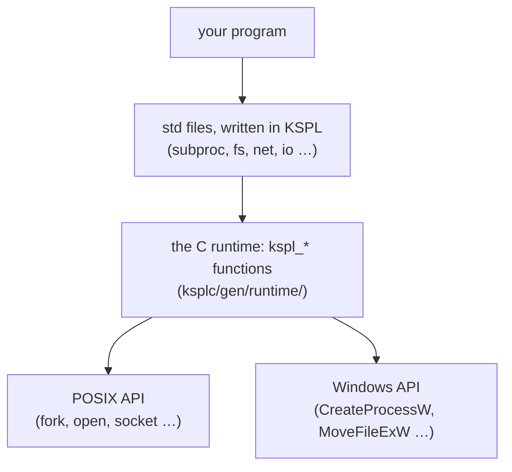
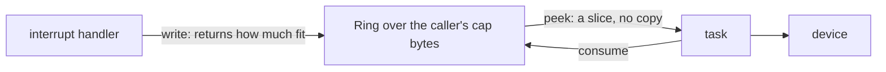
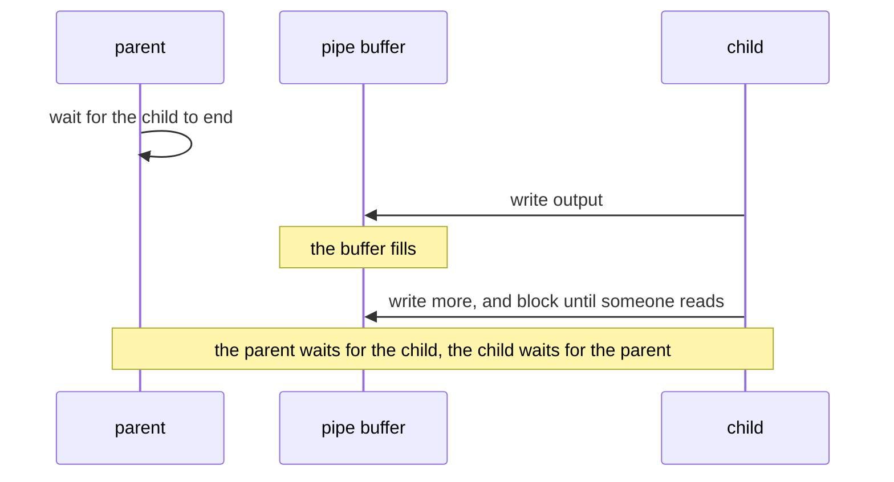
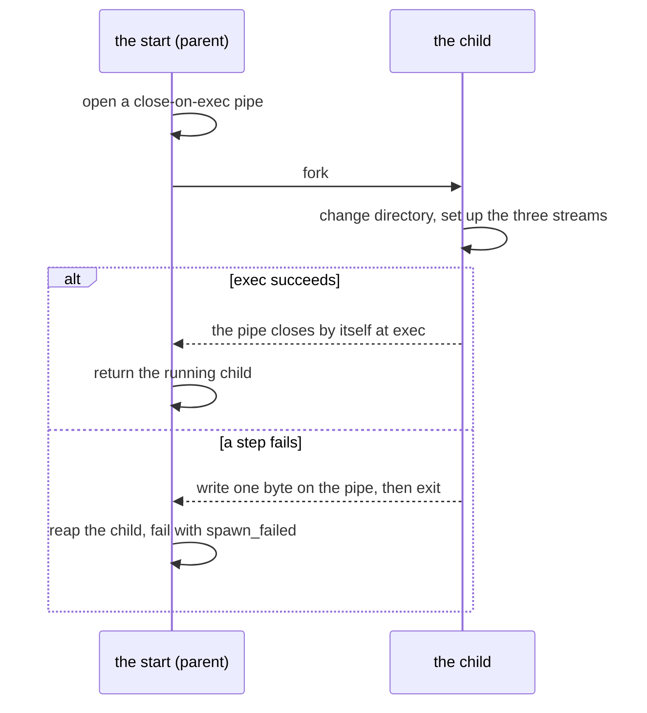
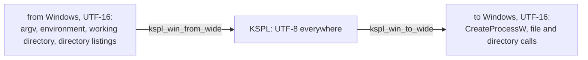
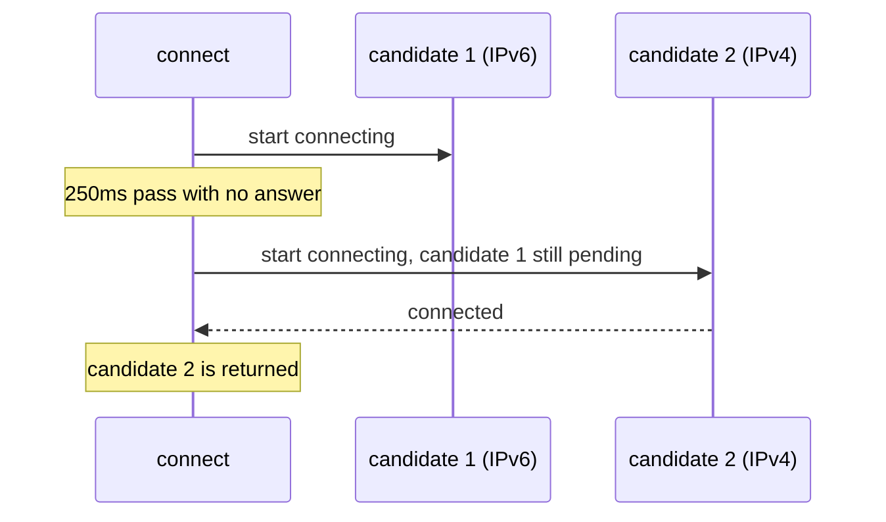

# The design policy of the standard library

This document says *why* the standard library (`std/`) works the way it does. Each file starts from an API that other languages use widely, but does not simply copy it. The criticism that API met over years of use is studied: the vulnerabilities reported against it, and the misuse it could not prevent. Where KSPL's type system can prevent one, the design changes.

**The document holds two things.**

1. A table of the known problems of earlier implementations, how each `std` file handles them, and the holes still open.
2. By subject, the choices in `std`'s own API that make a reader ask "why this way?".

When adding or changing a file, check whether the table can gain a row. If it cannot, confirm the file has not become a plain copy of the API it started from. The language's own grounds are in [`../../docs/DESIGN.md`](../../docs/DESIGN.md); what each file is for is what `ksplc doc std` lists, and how many files one import brings along is [`std/README.md`](../README.md).

## Words used in this document

**This table explains the words of `std` that appear across many sections.** A word used in one section only is explained where it appears. The words every package shares (arena, ARC, trait, generic, vtable, thunk, hosted and freestanding, libc, the C runtime, the seed, Principle N and the rest) are in "Words used throughout" in [`../../docs/DESIGN.md`](../../docs/DESIGN.md#words-used-throughout). *Gate* and the other words with one fixed meaning in every document are in "Terms of art" in [`../../docs/SPEC-documents.md`](../../docs/SPEC-documents.md#terms-of-art). The language's own rules are in [`../../docs/SPEC-language.md`](../../docs/SPEC-language.md).

| Word | What it means here |
| :-- | :-- |
| **the heap** (the global heap) | Memory taken with `malloc` and given back one block at a time with `free`. In `std`, passing `null` where a function asks for an arena means "use the heap", and then the caller owes a `free()` for what comes back ("A null arena is the heap, for every function that takes one") |
| **`Arc`** (the type) | Not ARC: `Arc<\|T\|>` is the reference-counted handle shared between threads ("The names of the reference-counting types" below) |
| **`T@` / `T$@`** | A pointer to a `T`. Without `$`, you may only read through it; with `$`, you may also write |
| **`U8[]` / `U8$[]`** | A slice: a pointer plus a length. `U8[]` is a read-only byte string; `U8$[]` is one whose bytes may be rewritten. A `$` before a variable's name (`$x: = 1`) instead lets the variable itself change later. The two kinds of `$` are "4.2 The two axes of mutability" in [`../../docs/SPEC-language.md`](../../docs/SPEC-language.md#42-the-two-axes-of-mutability) |
| **view** | A slice that points into memory something else owns. Making one copies nothing, and it stays valid only as long as that memory does |
| **`T!E`** | The return type of a function that may fail: it holds either the result `T` or the failure `E`. The caller must take it apart with `catch` or `!` ("8.3 Error handling" in [`../../docs/SPEC-language.md`](../../docs/SPEC-language.md#83-error-handling)) |
| **`Option<\|T\|>`**, written `T?` | Either a value or none. The value comes out only through `switch` or `if v: = …`, so a forgotten check does not compile |
| **panic** | The program stops with a message. `std` keeps it mostly for a mistake in the program itself, such as an index out of range; bad input comes back as a value |
| **POSIX** | The family of Unix-like systems (Linux, macOS, the BSDs) and the API they share. "Windows" here means its own API (`CreateProcessW` and the like) |

### Where to read for each file

**This table tells you which part of this document is about the file you are working on.** What each file is for is not repeated here: `ksplc doc std` lists it.

| You are working on | The files | Read |
| :-- | :-- | :-- |
| A problem other libraries are known for | any | [What was inherited, and what was changed](#what-was-inherited-and-what-was-changed) |
| Memory: who frees what | `mem`, `refcount`, `ds` | [Memory and ownership](#memory-and-ownership) |
| Text, numbers, bytes | `chars`, `str`, `strfmt`, `strnum`, `buf`, `bytes` | [Strings, numbers and bytes](#strings-numbers-and-bytes) |
| Lists, maps, loops, chains | `ds`, `seq`, `lang`, `ring` | [Containers and iteration](#containers-and-iteration) |
| Reporting failures, logging | every file's `T!E`, `log` | [Failures and the log](#failures-and-the-log) |
| Arguments, output, tests, children, the clock | `argp`, `io`, `verdict`, `fuzz`, `subproc`, `sys`, `time` | [The process](#the-process-its-arguments-its-output-its-children-and-the-clock) |
| Paths and directories | `fs` | [Files and paths](#files-and-paths) |
| Locks, threads, sockets, JSON | `thread`, `reactor`, `stack_limit`, `net`, `jsonrpc`, `reflect`, `json`, `json_struct` | [Threads, networking and the data formats](#threads-networking-and-the-data-formats) |
| Patterns | `regex` | [Regular expressions](#regular-expressions) |
| Adding a file, or an import | any | [The shape of the package](#the-shape-of-the-package) |

### How std reaches the operating system

**`std` is written in KSPL, and only a thin layer of C touches the OS.** The diagram shows the layers a call passes through on a hosted build.



**The decisions live in the KSPL layer wherever they can**: the schedule of a connection attempt, the four ways of starting a child, the timeouts. The C layer keeps only what needs the OS's own types or calls. C is written twice, once for POSIX and once for Windows, and the Windows copy cannot be run locally, so the less of it the better. Several sections below return to this split.

## What was inherited, and what was changed

### Known problems KSPL handles

Each row is a bug or attack that other libraries are known for, and what the `std` file does so that it cannot happen, or cannot happen silently. The rows are grouped by area.

**Text, numbers and memory**

| File | The problem | Seen in | What `std` does |
| :-- | :-- | :-- | :-- |
| `str` | **A NUL byte cuts a string short** ("the poison NUL byte"). A KSPL string carries its length, so it may hold a byte 0. C reads a string only up to its first 0, so converting to a C string silently drops everything after it. PHP and Java had path checks bypassed this way | C's strings | `to_cstr()` returns `U8$@?`: `.none` when the input holds a NUL. `switch` must cover every case, so the caller has to handle it. `contains_nul()` is public too |
| `checked_int` | **Signed overflow is undefined behavior**: the C compiler may assume it never happens, so optimization changes the result | C's integer arithmetic | The plain operators wrap around (`mod 2^N`) whatever the signedness: the generated code goes through the unsigned type of the same width, which erases C's undefined behavior. **Only detecting overflow is chosen by type** (`Ci8` through `Cu64`). There is no wrapping type, since the plain operators already are that |
| `option` | **Null references**: a forgotten check for `null` still compiles | A raw pointer's `null` | `T?`'s content comes out only through `switch`. The linter's [H0701] proposes `T?` for a raw pointer returned as `null` |
| `mem` | **Double free and use after free** | `malloc` / `free` | The arena (`Arena`) is the main route, and `defer` shows in the code where memory is freed. The compiler traces the paths for a use after the free |

**Randomness**

| File | The problem | Seen in | What `std` does |
| :-- | :-- | :-- | :-- |
| `prng` / `rand` | **A weak random number used for a key** (CWE-330). Both languages hold a weak (predictable) kind and a safe kind, but the names are close, and `Random` or `random` keeps being used for tokens and keys | Java's `Random` / `SecureRandom`, Python's `random` / `secrets` | **The name declares "pseudo"**: the reproducible side is `std/prng`'s `Prng`, the safe side is `std/rand`. The plain name `rand` goes to the safe side, so "I need a random number" lands there. Neither is removed: Swift has no weak side, so it cannot rerun training or sampling with the same results |
| `prng` (a number in a range) | **Taking a remainder favours low values** whenever the count does not divide the generator's range: from 10 equally likely values, `% 3` gives 0 four times and 1 and 2 three times each. C++'s distributions are each library's own, so one seed gives different numbers on libstdc++, libc++ and MSVC | Java's `nextInt(bound)`, Python's `randrange`, C++'s `uniform_int_distribution` | `below` draws again past the last whole multiple of n; `between` keeps both ends and covers all of `I64`. Both are written in KSPL, so a seed gives the same numbers on every platform |

**Files**

| File | The problem | Seen in | What `std` does |
| :-- | :-- | :-- | :-- |
| `fs` | **On Windows alone, a read-only file cannot be removed or replaced.** POSIX looks at the folder's permission, not the file's, so the same clean-up works on one OS and fails on the other. Python's `shutil.rmtree` documentation carries a handler that clears the mark for this | Windows's `DeleteFileW` / `MoveFileExW` | `remove_path` and `rename_path` clear the read-only mark first on Windows, and put it back where the operation still fails |

**Networking**

| File | The problem | Seen in | What `std` does |
| :-- | :-- | :-- | :-- |
| `net` | **A write may send only part of the data** (a *short write*), yet callers keep discarding the count it returns. That is why Go and Rust hold a separate "write everything" API | POSIX `send(2)`, Go's `io.Writer`, Rust's `Write` | Both `write` (returns how much it sent) and `write_all` (sends it all), so the name states the intent. `std/http` uses `write_all` |
| `net` | **A port out of range wraps around.** The field holds 16 bits, so 83659 binds 18123 and -1 binds 65535, with no error. Rust and Swift make the type 16 bits; Python, Java and Go refuse it at run time | C's `sockaddr_in` and `htons` | Every entry taking a port (`bind`, `connect`) refuses one outside 0 to 65535 as `Net_error.bad_port`. The runtime refuses it too, as a backstop |
| `net` | **An accepted socket's mode depends on the OS.** A *non-blocking* socket returns "not ready" where a blocking one would wait. From a non-blocking listener, Linux returns a blocking socket, while Windows, macOS and the BSDs copy the non-blocking mode. So the same read waits on one OS and returns "not ready" on another. Python made `accept` return blocking for this reason | BSD sockets' `accept` | `accept` returns a blocking stream on every OS. A reactor's caller makes it non-blocking by asking, as for any other stream |
| `http` | **Request smuggling**: two programs on the way (a proxy and a server) see a different end for the same request, so a second request hides inside the first. The causes: `Content-Length` and `Transfer-Encoding` read differently, or `Content-Length` given twice | HTTP/1.1 implementations in general | Refuses any `Transfer-Encoding`, and a duplicated `Content-Length` whose values disagree |
| `http` | **Response splitting**: a line break (CRLF) injected into a header value starts a header or a response of its own | The same | Refuses at write time a CRLF in a header name or value, the method, the target or the reason phrase |
| `http` | **A writer that frames otherwise than its reader**: a `Content-Length` the body does not have, or one beside `Transfer-Encoding`, splits the message where another reader cuts it | The same | Refuses at write time whatever the reader refuses: `Transfer-Encoding`, and a `Content-Length` that is not the body's or is given twice (`length_mismatch`). A header value with a space or a tab at either end is refused too (`invalid_header`): RFC 9110 §5.5 gives a value none, and the reader trims it, so it would read back as another value. 1xx, 204 and 304 get no length and no body (RFC 9110 §8.6). The answer to a HEAD, which names the length of a body it does not carry, has its own builder (`format_response_to_head`) |
| `http` | **Two `Host` headers, or one value, read differently by two programs on the way**: a proxy routes by one and the server checks the other, so a request reaches a host by a name nobody checked. `user@a` is host `a` to a reader that takes userinfo, and `a/b` is host `a` to one that takes a path. A request with no `Host` on HTTP/1.1 is malformed the same way | HTTP/1.1 implementations in general; RFC 9112 §3.2 asks a server to answer each with 400 | `parse_request` and `request_length` refuse a request naming `Host` more than once, on HTTP/1.1 and later not at all, or with a value that is not a host and an optional port (RFC 3986's `uri-host [":" port]`, the port up to 65535) (`invalid_host`); HTTP/1.0 may leave it out. `format_request` and `write_request` refuse the same head. Whether a version is "1.1 or later" is decided in one place, `http.is_1_1_or_later`, which a server's keep-alive default reads too |
| `http` | **A body that runs to the close** cannot be told from one cut off early | The same | Refuses a response that may carry a body but names no length (`unsupported_close_delimited`), rather than return what arrived as the whole body. 1xx, 204 and 304 end at their head |
| `jsonrpc` | **Two readers cut one stream into different frames.** Readers differ on which of two `Content-Length` lines counts, the first or the last; and a limit on the head checked against what one read brought takes a long head arriving at once and refuses it arriving a byte at a time | LSP clients and servers in general | A head naming two lengths that differ, or one it cannot read, has no length, so the frame is `broken`. The head's limit counts its own bytes: its end is looked for only within `max_head_bytes`, however the bytes arrive |
| `jsonrpc` | **Nothing comes back for a broken frame or a dropped response.** (A *frame* is one message with its `Content-Length` header in front.) On a frame missing `Content-Length`, `lsp4j` sends no response, only a log line ([#210](https://github.com/eclipse-lsp4j/lsp4j/issues/210)); on a dropped response, `pylspclient` cannot look up the id and throws | LSP clients in general (`lsp4j` / `lsp-server` / `pylspclient`) | A frame declaring no length, or over the limit, returns `Rpc_end.broken` **as a value**, and its broken head is dropped from the pool so it cannot repeat forever ("The frame is kept apart from the transport" below) |

**Data formats**

| File | The problem | Seen in | What `std` does |
| :-- | :-- | :-- | :-- |
| `json_struct` | **A key's name is written twice, once for the writer and once for the reader.** n fields take 2n lines, and fixing only one silently fills in the default | `serde`'s derive, Swift's `Codable`, Jackson's annotations, nlohmann's macros | The round-trip functions (`json_struct.from_struct` / `json_struct.into_struct`) walk `std/reflect`'s table of a type's fields, and **ksplc synthesizes the table and `fields()` from an empty `impl X: reflect.Reflectable {}`** ([3.2.5 in `../../docs/DESIGN.md`](../../docs/DESIGN.md)). Synthesized, the table cannot drift from the type's declaration; a drift would give no diagnostic and show as reading and writing the neighbouring field. A key cannot be given another name: it is the field's name |
| `json_struct` | **A missing value silently becomes a default** | The same | A missing key and a `null` one are refused with different values (`missing_field` / `field_type`), so no sentinel default such as `as_int64(-1)` folds two causes into one value |
| `json_struct` | **An integer is silently narrowed into a smaller field** | The same | **An integer the field cannot hold is refused** (`field_type`), not narrowed: 70000 into a `U16`, -1 into a `U8`, and on writing, a `U64` past the largest `I64`, the widest integer a `Val` holds. Whether it fits is `std/reflect`'s `fits_int` |
| `json` | **Stack exhaustion from deep nesting** (the billion-laughs family): a document nested very deep makes a recursive reader run out of stack and crash | JSON parsers in general | Nesting stops at `max_nesting_depth = 500` with a `Json_error`, not a panic |
| `json` | **Duplicate keys**: implementations read `{"a":1,"a":2}` differently, so two parsers given the same document see different values | The same | Not refused: RFC 8259's uniqueness is only a SHOULD, and refusing would drop legitimate requests over the sender's implementation quirks. Reading is first wins, and `dump` keeps the duplicates. `Obj_builder.set` replaces (appending would write a value `get` cannot see). `Val.get` walks a linked list, and `max_nesting_depth` does not bound the member count |

**Threads**

| File | The problem | Seen in | What `std` does |
| :-- | :-- | :-- | :-- |
| `thread` | **Nothing says which types may cross threads**, so a non-atomic reference count or a raw pointer gets handed over casually | POSIX threads | **Not handled.** Constraining `spawn`'s argument types guarantees nothing: it checks only the argument, sharing through a global goes unchecked, and "the constraint is met" would not mean safe (the grounds are "Why data races are not prevented by the type system" in [`../../docs/DESIGN.md`](../../docs/DESIGN.md#why-data-races-are-not-prevented-by-the-type-system)). What exists is choosing by type name (`Rc` / `Arc`, `Mutex<\|T\|>` / a plain value) |

### Known holes, and what would fill them

Two known problems are not handled. For each, the table says why it is open and what filling it would take.

| File | What is not handled | Why it stays open | What would fill it |
| :-- | :-- | :-- | :-- |
| `reflect` | **A container of containers (`List<\|List<\|T\|>\|>`), and an option holding a container or an option, cannot be walked** by the round-trip functions | **One hole stops both.** Describing such a field needs a kind whose content kind refers to itself, so `Field_kind` would need a payload. The LLVM backend (`--to=llvm`) cannot lower that: a global's type is named, so its initializer must be of that type | Either bit-packed constants or a second lowering from a layout to an LLVM type; neither is taken. Lowering only the shapes reflection needs would let only some types' payloads through. The kind is not added ahead of time, since a shape that cannot be walked would then be writable (Principle 5; the mechanism is [3.2.5 in `../../docs/DESIGN.md`](../../docs/DESIGN.md)) |
| `Map` | **Hash flooding.** An attacker sends many keys chosen to land in the same slot, so every lookup slows to a crawl: an algorithmic-complexity attack. PHP, Python, Ruby and Java all issued CVEs and added hash randomization | No attacker's key reaches a `Map`. The packages taking keys from outside do not use `Map` (`http` keeps its headers in a linked list too); `make test-conventions` holds which packages those are. **When that check fails, design the hash seed then**: it fails exactly where a key from outside gets in | Decided already. `str.hash` is FNV-1a plus extra mixing with a fixed seed, and `Hashable`'s `hash(r: Self): U32` cannot take a seed, so the signature changes to pass one per `Map`. Randomizing by default is ruled out: the compiler uses `Map` heavily, and an iteration order changing per run makes the generated C differ per run. That breaks self-hosting's zero-difference check, where the compiler builds itself twice and both outputs must be identical |

## Memory and ownership

KSPL has no garbage collector. Memory that `std` hands you lives in one of four places, and the call itself shows which, so you can see who frees it.

| Where it lives | How you ask for it | Who frees it, and when |
| :-- | :-- | :-- |
| The global heap | Pass `null` as the arena: `List.new(null)` | You, usually with `defer xs.free()` right after |
| An arena | Pass the arena: `List.new(arena)` | Nobody frees it piece by piece: it all goes when the arena is freed |
| Your own buffer | `Buf_writer.new(U8$[]::buf)`, `Arena.from_buffer(…)` | Nothing is allocated, and the buffer stays yours |
| Shared by several owners | `Rc<\|T\|>.new(v)` / `Arc<\|T\|>.new(v)` (ARC) | The compiler, when the last owner lets go |

The first two side by side:

```kspls
import "std/ds" { List }
import "std/mem" { Arena }

fn main()
    // On the heap: this function owes a free().
    $on_heap: = List<|I32|>.new(null)
    defer on_heap.free()
    on_heap.push(1)

    // In an arena: freed with the arena, all at once.
    arena: = Arena.new(4096)
    defer arena.free()
    $in_arena: = List<|I32|>.new(arena)
    in_arena.push(2)
```

### A null arena is the heap, for every function that takes one

Pass `null` where a function takes an arena, and it works on the heap instead. **Taking `null` needs no check in each function.** `Arena.alloc` with a null receiver takes the bytes from the heap, and every way an arena hands out memory (`alloc_as`, `create`, `dup_str`, `text`) goes through it. The arena's fields are private to `std/mem`, so nothing reaches arena memory another way, and a new function honours `null` without being told. `make test-conventions` holds each function that takes an arena to a call with `null` in std's tests, so a new one without such a call fails there.

**What comes back is the caller's to free**, and the function's summary says how:

| What it returns | How the caller frees it |
| :-- | :-- |
| One block: a string or bytes | `mem.dealloc(Void$@::s.ptr)` |
| A `List` | `xs.free()`, after the strings each element owns (`fs.read_dir` and `fs.walk_files` a string each, `verdict.run_children` its `out`, `subproc.run_many` its two outputs, `fuzz.gather` its `name` and `data`). A list placed on the heap and handed out as a pointer (`List.create`) then gives back its own block with `mem.dealloc(Void$@::xs)` ([below](#a-lists-free-leaves-the-list-itself)) |
| A child's two outputs (`subproc.run_capture`) | Each with `mem.dealloc`; a child that did not start has empty ones, which free as nothing |
| A value of many blocks: a JSON document (`json.parse`, `jsonrpc`'s `read_msg` and `request`), a `Json_builder`, an HTTP request or response, the headers `http.headers` builds, a query's pairs, an `argp.Parser`, the fuzz driver's `Findings` and `Setup` | `v.free()`, which lets all of it go at once ([below](#a-value-of-many-blocks-keeps-an-arena-of-its-own)) |
| The fields `json_struct.into_struct` fills in the caller's struct | Each string with `mem.dealloc` and each list with `free()`, as above. **A refusal leaves the fields it filled before it**, freed the same way |

**What a function does not return, it frees before returning**, `null` or not: a path joined on the way, a list it sorts from, the object it encodes into text. That work goes in `mem.scratch(arena)`: the caller's arena where one was given, else an arena of the function's own that is freed on the way out. So with `null` the caller owes a free for the result alone. A function that refuses after making its result gives the result back too, so a failure leaves nothing to free; `into_struct` alone cannot, since what it fills is the caller's.

#### A list's `free()` leaves the list itself

**`free()` gives back what a list holds, never the block the list stands in.** A list from `new` stands in the caller's variable, and one `create` put in an arena goes with the arena, so only a list `create` put on the heap leaves a block behind. Giving that one back from `free()` would mean every list carrying where it stands: 8 more bytes on each list's 32, paid by every list, the many small ones a tree keeps in each node included, for the few made on the heap. So the caller who passed `null` gives the block back, as for any one block: `xs.free()`, then `mem.dealloc(Void$@::xs)`. The compiler reads that `dealloc` as the block's own release and not as a use of what `free()` released, and refuses any use after it ("8.4.5 Tracking a free with `Owned`" in [`../../docs/SPEC-language.md`](../../docs/SPEC-language.md#845-tracking-a-free-with-owned)).

#### A value of many blocks keeps an arena of its own

**Given `null`, a value of many blocks is built in an arena of its own, which the value keeps** (`mem.Own_arena`), and its `free()` lets that arena go at once. The arena is the same `mem.scratch` a function's work goes in: the function keeps it with the result instead of freeing it on the way out. Given an arena, the value keeps nothing, and its `free()` frees nothing: that arena does. So `doc: = json.parse(text, null)!` and then `defer doc.free()` is written as for a `List`.

| What it settles | How |
| :-- | :-- |
| **No free walks the value block by block.** A walk names every block the build made, so a part added to the build and not to the walk leaks without a word, and a failure halfway leaves a partial structure the walk must take apart | Building in one arena, a failed call frees that arena and leaves nothing, and `free()` is one line whatever the value holds |
| **Freeing a part frees nothing.** A header further down a list, or a request's `headers`, has the same type as the whole | Only the value the call returned holds the arena; every part holds an empty one, so freeing a part cannot tear a hole in the whole |
| **Freeing twice is refused where it can be seen.** Each such type conforms to `Owned`, so a second `free()` of a local, or a use after it, is a compile error, as for a `List` | Through a copy or a field it is not seen, as for any block given back |
| **Code outside std cannot make a value that claims an arena** | `mem.Own_arena`'s field is visible only inside std, so such a value is built through std's own functions |

**A parsed JSON document is a type of its own, `json.Doc`: the value (`doc.val`), and the arena `parse` made for it given `null`.** Any kind of JSON value can be the whole document, so an arena kept in the value would sit in the string, array and object variants alike. The document keeps it apart instead:

* **Every `switch` over a value writes each variant's own field alone** (`case .str_val(s)`), never a field for the arena it does not read.
* **What frees is in one place**: the document `parse`, `read_msg` and `request` return. A value a `Json_builder` makes lives in the builder's arena, and the builder frees it.
* **A part cannot be freed at all.** `doc.val`, and every value read out of it (`get`, `get_at`, `arr_list`), is a `json.Val`, which has no `free()`, so freeing a part is a compile error instead of a call that frees nothing.

Parsed into the caller's arena, a document holds nothing to free, so keeping `doc.val` alone is enough.

Caution: **The arena of its own takes a whole chunk at its first allocation**, however small the value. For many small values, such as each message a server reads, pass an arena of the caller's and free it once.

**No free function takes the arena as an argument** (an `alloc_in(arena, n)`): it would be a second spelling of `arena.alloc(n)`.

The rules of the language itself (`defer`, ARC, arenas) are "8.4 The memory management model" in [`../../docs/SPEC-language.md`](../../docs/SPEC-language.md#84-the-memory-management-model-defer--arc--arenas). The sections below say how `std` uses them.

### The names of the reference-counting types

`Rc<|T|>` shares a value between owners on one thread, `Arc<|T|>` between threads, and a weak handle is named `Weak_` plus its owner's name. The names are short because they are written often.

Caution: **Do not confuse `Arc` with ARC in a document.** ARC (upper case) is Automatic Reference Counting, the mechanism by which the compiler inserts retain/release; a specification using the three letters always means it. `Arc<|T|>` (a type name) is Atomically Reference Counted, the type shareable between threads, with the role and name of Rust's `Arc<T>`.

| Name | What it is | Why this name |
| :-- | :-- | :-- |
| `Rc<\|T\|>` | Counted owner, one thread (`std/refcount.kspls`) | Code that needs reference counting repeats the type name constantly, and a long name spends lines and pushes the subject aside in every annotation. `Rc` / `Arc` come from Rust and are widely recognized |
| `Arc<\|T\|>` | Counted owner whose count is atomic, so threads can share it | The same |
| `Weak_arc<\|T\|>` | A handle that watches an `Arc`'s value without owning it | A weak handle's name is `Weak_` plus its owner's type name, so stripping the prefix gives the owner (`Rc` / `Arc`), and the pairing reads from the text |

**The zero value is an empty handle that owns nothing**, and retain/release skip it. So a table of empty slots such as `Rc<|T|>[N] = ::{}` is written plainly. It also survives the compiler's chained release over storage filled with zeros. `empty()` / `is_empty()` spell it out.

### Release takes the value apart

**When the last owner of an `Rc<|T|>` or `Arc<|T|>` lets go, the `T` inside is taken apart too**: every ARC value it holds by value is released, to any depth, as when a `T` on the stack leaves its scope. Left alone, every `Rc` held inside a shared value leaked, so a shared tree or graph could not be built from `Rc` at all.

| What it costs | What to do |
| :-- | :-- |
| **The time goes where the last owner goes**: leaving one scope can free a whole tree, at a line that shows no call | Where timing matters (an interrupt, a control loop), take the structure apart step by step before that point |
| **A long chain recurses once per link** (`next: Rc<\|Node\|>`, a million deep), and can run the stack out | Walk the chain in a loop, moving the head forward (`head = head.get().next`): each step frees one node while the rest is still held |
| **The free runs on the thread, or in the handler, where the last owner goes**. An `Rc` inside an `Arc`'s value is then released from another thread, a data race | Hold only `Arc` in a value threads share; on bare metal, let the last owner go outside an interrupt handler |

A cycle still leaks, as in every reference-counted language: make one side a weak handle. A resource that is not ARC (a `List`, a file) still needs its `free()`, since nothing runs one implicitly.

**release holds one weak count while the value is taken apart.** The value may hold the last weak handle to its own block, and that handle's release would free the block under the release still using it. `Arc` gets the same from the weak count its owners hold together.

### A container owns its elements' ARC counts

Put an ARC value into a `List` or `Map`, and the container keeps its count right for you, through every way of taking it out, overwriting it, growing and freeing. Nothing leaks, and nothing is released twice.

The caller cannot reach the storage, so anything the container fails to release is a leak nobody can fix. The implementation keeps two promises:

| Promise | How | What breaks without it |
| :-- | :-- | :-- |
| **Zero freshly allocated capacity** | `mem.zero` on new storage | Storing an element is an ordinary assignment, so the compiler inserts a release of the value being overwritten. Releasing leftover garbage as if it were ARC crashes |
| **Give the ownership back when discarding** | `free` assigns an empty (the zero value) to the remaining elements, `remove` to the removed one, and a resize to every slot it moved a pair from | `mem.zero` runs no release: without an assignment, the compiler has nowhere to insert one |

**An `Rc<|T|>` element's own release takes its value apart** ("Release takes the value apart", above), so a container of `Rc` needs nothing more.

### A constructor's name says where the returned thing goes

`alloc`, `new` and `create` are not three names for one thing. Each says where the result goes, so a call can be read without looking up the signature. An arena, when a function takes one, is always the last argument and is never filled in for you.

The table of the three names is "Pitfalls" in [std](../README.md). This section holds the rules that come with it.

**The arena `new` receives is where the content goes**: `List.new(a)` returns a `List` value whose elements go in `a`. To place the `List` itself in the arena, carried as a pointer, use `create(a)`. To put an arena in the caller's variable (for a configuration with no malloc), use `Arena.from_buffer`, which returns a value.

**An arena is always the last parameter, and it has no default.** The global heap is `null`, written at the call (`List.new(arena)` against `List.new(null)`). So the call shows where the content goes and whether a `free()` is owed. Why a default is refused: "A default argument is allowed only for a foldable constant" in [`../../docs/DESIGN.md`](../../docs/DESIGN.md). The signature says whether a function takes one, so the name does not say it again.

Caution: **Do not mark an arena parameter with a suffix**, least of all `_in`. `_in` also means "in that place" (`harness.run_in(argv, cwd)`) and "inside a thing" (`index_in(row, cell)`), so it cannot be read as pointing at an arena.

**A function outside `std` that returns a pointer, beside one of the same name returning a value, may end in `_in`** where `create` does not name what it does (opening something, not making an empty one). The suffix then says where the result is, not that an arena is taken, and the function says so where it is defined.

**Do not take an arena only to discard it.** The signature is the one mark that a function takes an arena, so the caller reads one there as "I handed over where the content goes". A discarded one misleads them about whether clean-up is needed.

**Only a function that takes an arena allocates.** In `std/str`:

| Functions | Take an arena? | Return |
| :-- | :-- | :-- |
| `trim_*` / `strip_*`, `chars.sub` / `sub_from` | No | A view into the input |
| `replace` / `join` | Yes | A copy |
| `split` / `lines` | Yes | A `List` placed in the arena, whose elements are still views |

Caution: **Do not judge by `U8[]` against `U8$[]`.** `sub_mut` returns a writable view without allocating, so the return type cannot tell; the arguments can.

### The receiver aligns the start of a buffer it is given

When you hand `std` a plain byte array to use as memory, `std` itself moves past any odd start address. You do not have to place the array on an 8-byte boundary, and you could not if you tried.

`mem.init_freestanding_heap()` and `Arena.from_buffer()` use the caller's static buffer as it stands, and **nothing guarantees its head is aligned**. The buffer is usually a plain byte array such as `$buf: U8[4096]`, aligned to 1, so its address depends on how the variables happen to be ordered in memory (`.bss`). One 1-byte variable just before it puts it at an odd address.

Misaligned, a header's `Sz` or a pointer straddles a boundary. A host mostly tolerates it. Cortex-M (a common microcontroller core) raises an alignment fault and drops into the default handler's infinite loop, **freezing with no output at all**, so the symptom hides the cause.

Caution: **It shows only when an unrelated change adds one byte**, because the ordering decides whether it works.

So **the receiver** aligns it (`align_pad` in `std/mem.kspls`), rather than asking the caller to place the buffer on an 8-byte boundary: the caller cannot control a `U8[N]`'s alignment. Rounding only the chunk header's size up to a multiple of 8 is not enough: every address handed out stays misaligned, since the head itself is.

### An arena refuses a mark it cannot place

`arena.restore(mark)` rewinds to a mark `save()` took. A mark from another arena, one saved before `reset()`, and one past what its chunk now holds (an earlier `restore()` rewound past it) stop the program at the `restore`, with a message that names them, before anything is freed.

**Rewinding frees every chunk from the newest down to the mark's.** With a mark whose chunk the arena does not hold, that walk frees all of its chunks and makes the foreign chunk its head. The next allocations then land inside the other arena's live data, and the first sign is a double free when both arenas are freed, far from the call that caused it.

So `restore` first looks for the mark's chunk among its own, the same walk it makes to free them, and the mark carries the arena's count of resets. The count is needed because a chunk allocated later can take a freed chunk's address, and because `reset()` keeps one chunk, where an old mark would otherwise look valid once the new round has used as much.

**What remains unchecked keeps the arena whole.** A mark that an earlier `restore()` rewound past, but whose chunk now holds at least as much again, rewinds to its place without a stop. Every chunk it keeps is one of this arena's, and every byte it hands out afterwards is past what it keeps, so nothing allocated overlaps. Telling that mark apart would cost a record of every mark ever saved, as an arena hands them out by value.

## Strings, numbers and bytes

### String functions are split by whether they allocate

**`std/chars` only looks at text and never allocates memory, and `std/str` builds new text and may allocate: the split is by whether a function allocates, not by line count.** So a file that cannot afford the whole string set, such as `std/base64` or `std/sha256`, can still test characters and cut slices, since `chars` needs neither `std/mem` nor `std/ds`.

| File | What it does | Allocates? |
| :-- | :-- | :-- |
| `std/chars` | Looks: single-character tests and slicing | No |
| `std/str` | Makes: new strings, such as `replace`, `join` and `split` | Yes |

Caution: **Do not make `chars` point at `str`.** `str` imports `chars`, so the cycle would merge the two tiers into one lump (`make test-thin-use`).

Two functions cannot move to `chars`. `equals` is one of `Hashable`'s required methods, so it must sit in that impl block, since a trait's implementation is one block. Hence `Map<|U8[], V|>` needs `std/str`. `to_cstr` allocates. The number conversions follow the same rule: `std/strfmt` (writing a value as characters) and `std/strnum` (reading a number from a string) never allocate, so they sit outside `std/str`, and a program that only prints or reads numbers does not bring in `std/str`.

### A string allocated and returned is returned read-only

A function that makes a new string for you returns `U8[]`, the read-only type, even though you own the copy. A writable `U8$[]` comes back only from a function whose job is to give you a writable buffer.

A function that **returns a newly allocated string** (`fs.join`, `str.replace`, `json.Val.as_str`, `sys.get_env` and the rest) returns a `U8[]`. One returns a `U8$[]` only where a writable buffer was asked for (`arena.dup_str` / `Str_builder.slice` / `chars.sub_mut`, and the buffer `rand.fill` receives).

**Write permission spreads through generics.** The conversion from writable to read-only (`U8$[]` → `U8[]`) applies only one level deep, to a built-in type constructor. `List<|U8$[]|>` cannot become `List<|U8[]|>`, since user-written generics are invariant: their type arguments must match exactly ("6.4 Type conversion (`::`) and implicit casts" in `docs/SPEC-language.md`). Had `fs.walk_files` returned a `List<|U8$[]|>`, the caller would carry the `$` into every variable, field and argument, and could not pass the list to a function taking `List<|U8[]|>`. One character in the return type fixes every type the caller writes.

**"The caller frees it" is no reason to return it mutable**: freeing needs no write permission (`dealloc` takes it through an explicit cast). A caller that needs to rewrite the string uses a function that fills a buffer (`rand.fill`) or one that copies (`arena.dup_str`).

C also keeps writability in the type (`char *` against `const char *`), and `strdup` returns `char *`, so every type in the caller becomes `char *`. KSPL carries axis 2, the `$` just before `[]`, in the type too, so returning `U8$[]` would get stuck the way C does. **Axis 1 (the binding's `$`) remains**: with a `U8[]` returned, whether the variable later takes a different string is still the caller's choice. (The two axes are "4.2 The two axes of mutability" in [`../../docs/SPEC-language.md`](../../docs/SPEC-language.md#42-the-two-axes-of-mutability).)

### `dedent`, which removes common indentation, empties a whitespace-only line

`std/str`'s `dedent` removes the indentation that all lines share. A line holding only whitespace is emptied, and it does not count when the shared indentation is measured.

```
before   "    a\n      \n    b\n"
after    "a\n\nb\n"
```

A whitespace-only CRLF line becomes `\r\n`.

**A kept whitespace-only line leaves invisible trailing whitespace**: where the line is longer than the minimum width, the excess stays behind. The text looks aligned, and only a diff or a hash disagrees. Python's `textwrap.dedent` and Java's `String.stripIndent` empty it too.

Caution: **Do not change how a newline is written**: `dedent` lines up indentation and nothing else. Otherwise a path that reads a CRLF document and writes it back would differ exactly where the text passed through `dedent`. An indentation function that also fixes newlines is a second means of normalizing them (Principle 6).

**Do not treat `\r` as a character**, or a whitespace-only `\r\n` line would set the minimum width while the other lines keep theirs (`"    a\r\n  \r\n    b"` would leave two spaces before `b`).

**Do not let the final empty line set the minimum width**, or nothing would be stripped from a string ending in a newline.

**The shared indentation is compared byte by byte, not counted.** Lines indented with a tab and with four spaces share none, so neither loses any. Counted as one column each, the tab and the first space would both go, and the two lines would no longer line up as they did.

### The destination is always named. There are three shapes, and no more are added

String interpolation (`"n=\{n\}"`, which puts the value of `n` into the text) always writes into something you name. There are three choices, and no form quietly returns a new string.

| What is wanted | The notation | Where the memory is |
| :-- | :-- | :-- |
| Stream it | `w.s("n=\{n\}")` | The destination `w` holds it |
| Write into the caller's array | `Buf_writer.new(U8$[]::buf).s("n=\{n\}").slice()` | The caller's array; nothing is allocated |
| Allocate and keep it | `arena.text().s("n=\{n\}").take()` | The arena (`take` lets the builder go) |

It is Zig's three-way split (`w.print` / `bufPrint` / `allocPrint`) without the allocator argument: a `Str_builder` allocates on its own.

**Interpolation that yields a value (Python's f-string, Go's `Sprintf`, C++'s `std::format`) is not taken.** That notation returns a new string whose memory something else frees: the garbage collector in Python and Go, `std::string`'s destructor in C++. KSPL frees nothing it was not told to. So the same notation would hide an allocation and a lifetime (to the end of the enclosing block), against `docs/DESIGN.md`'s "Responsibility can only be assigned for what the writer can see". Before adding a fourth shape, confirm it cannot be written with the three.

**Why two writers**, `std/str`'s growing `Str_builder` and `std/buf`'s `Buf_writer`, which writes into the caller's array and never allocates? Some places cannot allocate (freestanding), and some must not inside a loop: a `Str_builder.new()` with its `defer b.free()` in a control loop costs a malloc/free every round. Yet output of unpredictable length, forced into a fixed buffer, spreads the truncation decision across its callers. Both are `Writer`s, so interpolation works with either. **The choice is "may it allocate" and nothing else**: splitting by speed or by an upper bound would make two ways to one purpose.

**Why an overflow is not a panic**: the length is unknown until the text is assembled, and stopping a program because a display string outgrew its buffer is out of proportion. `Buf_writer` counts what it dropped and reports it through `overflowed()`. That serves the purpose of C's `snprintf` returning the length it could have written. The count is held in the writer instead, since partway along a chain of calls no return value can be checked.

### A builder can be written from a view of its own bytes

`b.s(b.slice())` writes `b`'s text twice over, and any view of `b`'s bytes can be written back into `b`, through `escape_and_append` too. Nothing has to be copied out first.

**Growing frees the buffer such a view points into**, so `s` copies from the view before it frees the old buffer, and copies with `move`, since a view taken before `clear()` can overlap where its bytes land. A write from anywhere else pays nothing for it: no address is compared. `escape_and_append` writes many times from one source, so a source lying in the builder's memory is copied once before it starts.

Caution: **Do not free the old buffer before the copy.** The copy then reads freed memory and still gets the right bytes until the allocator happens to reuse or unmap the block, so it passes every ordinary test and corrupts text far from the cause. Its test runs as a child with freed memory scribbled over, for that reason.

**Refusing such a write is not taken instead.** The type cannot refuse it, since a view is an address and a length with nothing saying which builder it came from; and refusing at run time would cost every write the address comparison that making it work avoids.

### The digits of a floating-point number are assembled here

`std` prints floating-point numbers with its own code, not with C's `printf`. The same code runs on bare metal, where there is no C library, and prints the same digits on every platform.

`std/strfmt` does not take a floating-point number's digits from libc's `%f`. The shortest digits come from Raffaello Giulietti's Schubfach, which reads one power of ten from a table and decides the digits with 64-bit products ("One table of powers of ten serves both directions" below). The digits of `.N` are assembled exactly with `std/bignat`, which does arithmetic on numbers with as many digits as needed (*multiple precision*), and cut at a fixed place. One implementation serves hosted and freestanding alike. What it prints is "3.6.1 The default notation for primitives" and "3.6.2 Format specifiers" in `docs/SPEC-language.md`; this section holds why.

**Why here**: freestanding has no libc. Yet `Str_builder` conforms to `Writer`, and the vtable references every method's thunk. So `snprintf` would be linked into a bare-metal program that never writes a float: the linker's removal of unused code (`--gc-sections`) cannot drop a thunk.

**The default is the shortest representation that reads back to the same value**, as Rust, Swift, Python, Java's `Double.toString` and C++'s `std::format` print. It switches to the exponent form at JSON's and JavaScript's boundaries. Where the languages differ, KSPL follows JSON, the most common output format, so `\{x\}` and `std/json` print by one rule. An F32 is shortest at its own width, or `0.1F32` would print as `0.10000000149011612`.

**`.N` is exact**: `1e300` at `.2` gets all 301 integer digits right, as libc's `%.2f` does. It rounds ties to even like `printf`'s default, since rounding half away from zero would print `%.0f` of `0.5` as `"1"`, a visible disagreement. `make test-freestanding-math` compares against the real `snprintf` as strings: every precision from 0 to 19 agrees, `1e300` and subnormals included.

**`.N` keeps multiple precision.** Its digits run as far as the 309th of `1e300`, which no fixed width holds, and a set count of decimals is written far less often than the shortest form. **It uses about 3KB of stack** (its multiple-precision values), which a bare-metal program writing `.N` on a small stack must allow for; the shortest form needs about a quarter of that.

NaN and infinity (`nan` / `inf` / `-inf`) pad to a width with spaces, since the `0` flag and the digit separator mean something only for a run of digits.

`%p` (a pointer) cannot match the host: glibc prints lower case with `0x`, MSVC's UCRT upper case zero-padded without it. Bare metal fixes `0x` plus lower-case hexadecimal as **its own contract**, and the harness checks that contract, not agreement with libc.

### Converting a string to F64 is not left to libc

`std/strnum`'s `to_f64` turns text into an F64 with code written in KSPL, not with C's `strtod`. So it works on bare metal too, gives the same answer everywhere, and rounds every text correctly.

**Why**: left to `strtod`, `to_f64` could exist only under `cfg(!freestanding)`. Since `std/json` and `std/argp` call it, **a build for a microcontroller would fail at type checking**. One implementation returning the same value everywhere outweighs accepting strings that vary with the environment.

**What is given up**: `strtod`'s `inf`, `nan` and hexadecimal floating point, which JSON's numbers never hold and a configuration value holds only ambiguously.

**Every text is rounded correctly**: to the nearest F64, and on a tie to the one whose mantissa is even. The significand takes the first 19 significant digits, and the work goes in up to three steps:

| The text | How it is converted |
| :-- | :-- |
| At most 19 significant digits, a mantissa below 2^53 and a power of ten within ±22 | One exact step |
| Any other text | Eisel-Lemire: the 19 digits times the power of ten from the table ("One table of powers of ten serves both directions" below). It is exact for the digits it is given |
| A text past 19 digits whose later digits decide the rounding: the 19 digits and the 19 digits plus 1 read as two F64s | Compared with the midpoint to its neighbour in `std/bignat`'s multiple precision, and moved one *ulp* at a time (one step to the next representable F64). The method is Clinger's AlgorithmR |

Caution: **The 19 digits are significant ones: a leading 0 counts as none.** The third step starts from the F64 the 19 digits give, and its ulp steps reach only a few ulp. Counted among them, the 0s of `0.0000301…` (the fixed form `std/json` writes for a small decimal) leave that start further off than the steps reach, and the text reads as another F64.

Why those limits, and why reading 768 digits of mantissa is enough, is `pow10_max` / `f64_exact_digits` in `std/strnum.kspls`. So regression tests may compare for equality, against literals the C compiler rounded correctly.

Caution: **Cap both the mantissa and the exponent**, or a 20th digit overflows U64, and the exponent of `1e999999999` overflows I64 and turns infinity into 0. The caps and their reasons are `f64_mantissa_digits` / `f64_exp_digits_limit` in `std/strnum.kspls`.

### One table of powers of ten serves both directions

**Writing the shortest digits and reading a text each take one entry from a table of 10^q at 128 bits** (`pow10_128` in `std/bignat.kspls`), so every F64 takes about the same short time, of the order of C's `printf` and `strtod`. Multiple precision stays only where no fixed width can do: `.N`'s exact digits, and a text past 19 digits whose later digits decide the rounding.

**Why a table: speed on every input, at the table's memory.** Multiple precision alone takes microseconds a number, tens of times what C takes, for every shortest form, every subnormal and every text past 10^±22 or 2^53. A program reading or writing many numbers (a JSON file of measurements) pays that on each one. The table costs read-only memory instead, and only in a program that writes or reads a float: the linker drops it from any other. On a Cortex-M0+ at `-Os` it comes to about 1.5KB more flash for writing the shortest form and 2KB for reading a text, and no RAM; `arm-none-eabi-size` on `make test-ksos-link`'s ELFs that read a float (the car demos) shows it.

| Direction | Algorithm | Why it |
| :-- | :-- | :-- |
| An F64 or an F32 to its shortest digits | Raffaello Giulietti's Schubfach | One entry and three 128-bit products decide the digits, with no case split by range, and its proof covers every F64. Ryu needs two tables and Dragonbox several times the code, for speed beyond what is asked. An F32 goes through the same code and is shortest at its own width |
| A text to the nearest F64 | Eisel-Lemire, as fast_float does it | One entry, and its lower half only when a carry could reach the bits kept. Mushtak and Lemire prove it exact for 19 digits, so only a longer text can need multiple precision |

**The table is held compressed**: one entry in 27 (25 entries) and 2 bits a power that correct a rebuilt entry, 568 bytes against 10.7KB for every power from 10^-342 to 10^324. Any other entry is the held one below it times 5^r, rebuilt with two more 64-bit products. That costs little next to the conversion, and a small microcontroller keeps the 10KB.

**Every entry is exact**, 10^q's top 128 bits truncated: both proofs assume it, and an entry one unit off moves the digits only of the values that use that power, which no sample of values finds. `test_pow10_table` in `make debug` rebuilds every entry, held or rebuilt, in multiple precision. Eisel-Lemire's proof wants 10^-27 to 10^-1 rounded up instead: 5^-q fits a U64 there, so a quotient that comes out exact, where a tie can lie, shows nothing or a 1 below the bits kept. `nearest_f64` in `std/strnum.kspls` adds that 1 itself, so the table holds one fact.

### Format-specifier dispatch per type stays as an impl per type

The code that applies a format specifier (the `:08` or `.2` in `\{v:08\}`) is written once per built-in number type, not folded into one shared body, because each type returns a different result type.

`std/strfmt.kspls` implements `fmt_spec` / `fmt_prec` / `fmt_hex` / `fmt_char` separately for twelve built-in types. Each delegates to the shared `int_fmt_spec` / `hex_fmt_spec` / `float_fmt_spec`, so the impls read as one shape repeated. **They are not folded, because the return type differs per type**: `Int_fmt` (signed, and `U8` through `U32`), `Uint_fmt` (`U64`), `Float_fmt` (`F32` / `F64`). A default body declares one return type.

Note: `std/checked_int.kspls`'s eight types stay apart for the same reason. There the promoted type and the boundary value differ per type, and they are the body itself. Generics would need a trait holding an associated type and constant (Rust's associated type / const, Swift's `static var max`), and KSPL has neither. When they arrive, `checked_int` is the first to use them.

### Hexadecimal is written with a format specifier, and only `0x` and a fixed digit count stay on the wrapper type

Write hexadecimal as `\{v:x\}` or `\{v:08x\}`. The wrapper `strfmt.hex(v, n)` exists only to put `0x` in front.

The rules of the hexadecimal specifier (with no `0x`) are "3.6.2 Format specifiers" in `docs/SPEC-language.md`; this section holds why.

**Each specifiable item has its own method**, and only a type the item applies to implements it:

| Method | What it handles |
| :-- | :-- |
| `fmt_spec` | Width, `0` padding, `,` grouping |
| `fmt_prec` | The same, plus digits after the point |
| `fmt_hex` | Hexadecimal |

As arguments to one method, a type with nothing to apply them to could only ignore them, and a `:x` on a float or a `:.2` on an integer would be accepted with no message. Split, the interpolation calls a method the type lacks and stops with "there is no such method".

`hex` in `std/strfmt.kspls` exists for one thing only: a leading `0x` (`\{strfmt.hex(addr, 8)\}` writes `0x10000144`). Without the prefix a specifier says it all (`\{v:08x\}`). **No wrapper stands beside a specifier for width, zero padding, grouping or digits after the point**: a second spelling of the same output goes against Principle 6 in [`../../docs/DESIGN.md`](../../docs/DESIGN.md). Where the width is known only at run time, call the method a specifier desugars to directly (`v.fmt_hex(n, true, false)`, `v.fmt_spec(n, true, false)`).

**A signed value goes through the unsigned type of the same width**, because hexadecimal shows the bits the type holds. Widened straight to `U64`, sign extension would fill the high bits with 1s and print `I32`'s `-1` in 16 digits (C's `%x` prints 8). `Sz` has no same-width unsigned name, so it widens to `U64`.

**The extension-method shape `impl Writer { fn hex(...) }` cannot be taken**: a method added to a trait has no vtable slot, and the compiler rejects it at the declaration. To extend a trait, use a free function or a conforming wrapper such as `Hex_fmt`.

### Converting between bytes and integers holds no format string

`std/bytes` reads and writes an integer inside a byte array with one function per width and byte order, such as `get_u32_be(at)` or `put_u16_le(at, v)`. There is no format string like Python's `struct.pack(">HH", a, b)`.

(`be` is big-endian, the most significant byte first; `le` is little-endian, the least significant first.)

**Why**: KSPL has no type checking for variadic arguments (a variable number of arguments). With a format string, the format and the arguments' count and types could drift apart and still compile, failing only at run time. That is the structure behind `struct`'s standard misuse. Naming the position and width once each costs a few lines, but a mistake stops the compilation.

**Why the byte order has no default**: a mix-up silently garbles the value and no type catches it, so the intended order is written every time.

**Why there is no checked version**: out of range panics, as a slice index does. Returning a `Result` would put a `!` on most calls, whose bounds are already known, and bury them. Where the input's length cannot be trusted, check `len` before the call.

**Why it holds `crc32`**: it has two users, the image checksum a boot ROM requires and an append-only log's record check. It does no pre- or post-processing: the initial value and the final inversion differ by purpose. The boot ROM also reverses the bit order of input and result against the standard, so any default would silently give one caller a different value. Bit reversal stays out while it has one caller (Principle 1; std can take it once there are several).

**Why it holds `fill` / `copy_from`**: filling with zeros and copying a range are common, and `mem.copy` takes a `Void$@` and a byte count, so no bounds check applies. `copy_from` behaves as memmove (the ranges may overlap), not memcpy, because shifting a range within one buffer is a real use.

## Containers and iteration

### What a container requires of a type is written as a trait

To be a key of `Map<|K, V|>`, a type must conform to the trait `ds.Hashable<|Key|>`, which asks for `hash` and `equals`. A type that does not conform gets an error where you used it, not one deep inside `std`.

Caution: **Do not express a requirement by name agreement alone.** It is then written nowhere, and a key type failing it gets a distant error inside `std/ds.kspls`. Where there is a requirement, express it as a trait (the rule is ② in `docs/DESIGN.md` "The order of decision"). Every key type declares its conformance (std's own are `I32` / `Sz` / `U8[]`). `Map`'s constraint `K: Hashable<|K|>` then reports a type that does not conform as not implementing this trait, where the user wrote it, rather than as `has no field or method named 'hash'` inside std.

**`Hashable.equals` and `Eq` are different requirements.** `Eq` is what `==` desugars to; `Hashable.equals` asks, by an explicit call, whether two keys are the same. `U8[]` deliberately does not implement `Eq`. `a == b` would become an O(N) content comparison, and a reader could not tell whether `==` compares contents or pointers (the reason `switch` cannot take a `U8[]` subject; `docs/SPEC-language.md` §6.1).

The other key arrives as the type argument `Key`, as in `std/lang`'s `Add` / `Eq`, because `Self` cannot be written on an argument other than the receiver (the value before the `.`; `docs/DESIGN.md` "Why a trait's receiver is fixed to a bare `Self`"). The compiler rejects such a `Self` at the definition, rather than let it fail in the C compiler with no KSPL diagnostic.

**The built-in types' conformances go in std.** In the compiler, an implementation that exists to make a type a key of std's containers would invert the layers. So `Sz`'s `Hashable` sits in `std/ds.kspls` beside what requires it.

`ds.fmix32` is the one place the bit mixing lives, so no key type copies it. It scrambles a hash so that keys whose low bits are the same still spread over the slots. Without it such keys crowd one slot, and `Map` degrades into a linear search (the masking is described at `fmix32` in `std/ds.kspls`). **Measure before adding it — adding it everywhere is a mistake.** In a `hash` on the innermost loop the extra operation outweighs the diffusion, so a parser's memo lookup and a key of token IDs, whose low bits already differ, leave it out.

### A map that keeps a few pairs stays small however many keys pass through it

`Map` is open addressing: a removed pair leaves a tombstone, a mark a lookup steps over, so a key pushed past that slot is still found. Tombstones take slots as live pairs do, and a resize comes once half the slots are used, counting both.

**A resize that finds at most a quarter of the slots live drops the tombstones in place and keeps the capacity.** Only a fuller table doubles. Doubling every time would grow a map that holds a handful of pairs without end while different keys are set and removed, as a cache of open connections or a table of in-flight requests does: memory grows with the number of keys ever seen, not with the number held. The rehash leaves the table at most a quarter full, so a quarter of its slots must go before the next, and each insertion pays O(1) for it. Working in place, it allocates nothing, so a map in an arena does not grow the arena either.

**The capacity never shrinks on its own**, since a map emptied once is usually filled again. A program that needs the memory back builds a new map and frees the old one.

### A function that returns every entry does not build a nested generic

`Map` hands out its entries through an iterator, `items()`, not as a ready-made list. A list of entries would make the compiler build a whole extra copy of `List` for every `Map` type, and every caller only walks it once anyway.

A listing would be `List<|Map_entry<|K, V|>$@|>`: one generic inside another (*nested generics*). So every `Map` type would specialize **a whole set of `List`** (`std/ds`'s container and `std/seq`'s chain) at that element type. The cost lands on specialization. In a large program, a single nine-line function returning a listing shows in translation time, bodies analyzed, peak memory and generated C size. Every caller builds the listing, walks it once and drops it, so an iterator loses nothing.

**The test is whether the return type takes another generic as a type argument.** `List<|U8[]|>` does not (`U8[]` is a built-in array, not a generic). Where even one caller needs `.len` or an index, a listing is fine; the one kept inside `std/ds` is there because sorting needs all of it.

### Iteration has one notation, `for x in`

Every loop over a collection is written `for x in xs`. The type of `xs`, not the writer, decides how it is walked.

| The subject's type has | `for x in` expands to |
| :-- | :-- |
| A `.len` field and an index (`List`, arrays) | Indexing, `xs[i]` |
| A conformance to `std/lang`'s `Iter<\|T\|>` (`next(): T?`) | Calling `next()` until it returns none |

The rule is `docs/SPEC-language.md` 7.2, the reasoning `docs/DESIGN.md` 9.2.

**Do not make a `has_next` / `next` pair.** It would bring a second notation into std, `for it.has_next() { x: = it.next(); … }`. That is also why `Iter` holds only `next`: split in two, calling only one of them becomes writable.

**Eager or lazy.** An *eager* function does all the work at once and returns a `List`; a *lazy* one does the work only as the loop asks for each element.

| | Functions | Driven by |
| :-- | :-- | :-- |
| Eager: returns a `List` | `str.split` / `json.Val.arr_list` / `fs.read_dir`, and each `std/seq` operation needing the whole (`order_by` / `distinct`) | Nothing: the work is done on return |
| Lazy: a chain | Only `where` / `select` | `for x in`, `to_list(arena)` or `count()` |

**A function returning elements in order that may allocate them all is eager, returning a `List`.** A `List` carries `.len` and an index, so `for x in` walks it by index; it is not given `Iter`, which would win over the index. The eager side allocates more, so only code tolerating a slowdown (tools, example code) may rely on it. Where it may not, `std/` itself included, is for `docs/DESIGN.md` 8.3 to say.

**`order_by` is the one sort, and it is stable** (its algorithm is described at `order_by` in `std/seq.kspls`). *Stable* means equal keys keep their order. So an answer built from a sorted list (completions, references) is the same on every run, and sorting by a second key after a first gives the expected listing. There is no unstable variant: its one gain, sorting in place without a second buffer, is not what `std/seq`'s eager operations are for, since they return a new list anyway.

**What eagerness costs** is the list's own storage (16 bytes per element), allocated up front (the elements are not copied); a caller streaming a huge input must allow for it. These functions take an `arena`. With `null` they allocate from the global heap (as `List.new(null)` does), and the caller frees the result with a `defer`. So `for x in s.split(…)` can be written directly only when an arena is passed: with `null`, nothing could free the temporary the loop uses.

### Why the chain's stages cannot be folded

`where` and `select` build a *chain*: each call wraps the previous step in a new stage type. Other languages write such methods once, as a trait's default body (a body every conforming type gets unless it writes its own). KSPL cannot do that for `where` / `select`, and chooses not to for `to_list`.

The diagram shows how `xs.where(p).select(f)` nests one stage inside the next, and what drives it.


`std/seq`'s `Keep` and `Conv` each write `where` / `select` / `to_list` per stage; only `count`, which needs nothing but `next`, is a trait's default body, on `std/lang`'s `Iter`. **The three stay per stage for different reasons.**

| Method | Could it be a trait's default body? | Why it stays per stage |
| :-- | :-- | :-- |
| `where` / `select` | **No** | Their return type puts `Self` in a type-argument position (`Keep<\|Self, T\|>`). A trait holding that shape cannot be implemented even when the method has a default body: in the body copied into a generic implementation such as `Keep<\|S, T\|>`'s, that `Self` is not resolved |
| `to_list` | **Yes, and it stays by choice** | Its return, `List<\|T\|>`, holds no `Self`. `std/lang`'s `Iter` cannot take it, since that file imports only `std/libc` and so cannot name `List` / `Arena`. A trait in `std/seq` itself can, and one body serves both stages: the trait's type parameter becomes each stage's element type, `T` for `Keep` and `U` for `Conv` ("5.1 Traits (`trait`)" in [`../../docs/SPEC-language.md`](../../docs/SPEC-language.md)) |

**Folding `to_list` alone saves one of its two bodies**, not enough to pay off with two kinds of stage. Fold once the kinds grow, since that is when the count multiplies; `where` / `select` can join only once that `Self` is resolved.

**A chain can be driven any number of times**: the receiver is taken by value, so `for` and `to_list` each advance their own copy, whereas a Python generator is empty after one pass.

Caution: **Assemble and consume a chain in the same frame** (the same function call). A predicate's environment sits on the caller's frame, so a chain returned from a function points at a dead frame ("Why capture is made explicit and escape is forbidden" in [`../../docs/DESIGN.md`](../../docs/DESIGN.md)).

### Only `where` and `select` ride on the chain, and a predicate is a `Callable1`

Only `where` (keep the elements that pass a test) and `select` (turn each element into another) are stages of a chain. Everything else is an ordinary method on `List`. The test you pass in is a `Callable1`, so it can be a closure that carries the value being searched for.

| Kind of operation | Examples | Where it lives |
| :-- | :-- | :-- |
| A stage of the chain | `where`, `select` | The chain |
| Needs the whole list | `order_by` / `distinct` | `List<\|T\|>` |
| Returns one answer | `first` / `any` / `all` | `List<\|T\|>` |
| A sum | None: write the `for` loop | — |

There is no `sum`: without overloading it would be one method per numeric type, each the same three-line loop a `for` writes directly. **Only `where` and `select` ride on the chain**, because the stages' types nest. Each new kind of stage multiplies the code that keeps every operation callable from every stage, since the ones returning a stage cannot become a trait's methods (the section above).

A predicate (a test returning `Bool`), selector or comparator is taken as `Callable1` / `Callable2`, so a caller passes a closure as it is. A *closure* is a function value that carries variables from the place where it was made (its *captures*).

Caution: **Do not turn it back into a function pointer.** `where` / `any` / `all` are useless unless the predicate can be given what is searched for: "does it contain this node" could not be written, and a plain `for` would replace them. A function value with a capture carries the function and its environment, which one function pointer cannot hold ([`../../docs/SPEC-language.md`](../../docs/SPEC-language.md) 8.1, "Closures").

**Whether a callback is a function pointer or a `Callable` depends on whether it needs a capture** (the rule is "Whether a callback is received as a function pointer or as a `Callable`" in [`../../docs/DESIGN.md`](../../docs/DESIGN.md)). `std/fs`'s `skip_dir` makes do with a constant set of names, so it takes a function pointer. `std/thread`'s `spawn` has no choice, since its `entry` crosses the C boundary. Do not reason "it is a predicate, so a `Callable`": taking a `Callable` where no capture is needed stops one named predicate from being passed to several functions.

### Indexing costs one comparison, and the stop is called out of line

`xs[i]` on a `List` becomes one comparison plus the address arithmetic. The code that builds the "index out of range" message sits in a separate function that is never copied into the caller.

`xs[i]` calls `at`, which compares `i` with the length and calls `bounds_panic` (`std/lang.kspls`) when it is out of range. **`at` is meant to vanish into its caller** (to be *inlined*: its body copied into each call site), leaving the comparison and the address arithmetic, so it carries `#inline`.

**`bounds_panic` carries `#noinline` for that to happen.** The C compiler judges whether a function is small enough to copy into its caller only after it has copied that function's own callees into it. Copied into `at`, the message building (`Panic_msg`, three numbers turned into text) makes `at` too big, so every `xs[i]` stays a call. Nothing else changes, since the stop runs only when the index is wrong. Keeping that copy out turns every `xs[i]` of an optimized build into the comparison inline; a program that indexes lists throughout runs measurably fewer instructions.

Caution: **Do not move the message building back into `at`.** The cost does not show in a test or a diagnostic, only in every loop over a list.

### The ring buffer neither blocks nor locks

`Ring` (`std/ring.kspls`) is a fixed-size circular buffer for one job: an interrupt handler writes a little at a time, and a task reads in bulk. It never waits and never locks; the caller decides both.

An *interrupt handler* (ISR) is code the hardware runs the moment an event arrives, cutting into whatever was running. The diagram shows the path `Ring<|const cap: Sz|>` sits on.



**Why it does not wait**: waiting needs something that knows whom to wake (a scheduler), which would make it unusable right after a bare-metal start-up and inside an interrupt handler. Instead `write` / `read` return how much went in or came out, and the caller decides.

**Why it does not lock**: the right exclusion depends on where it sits — disabling interrupts between a handler and a task, a hardware spinlock between cores, nothing on a single-threaded host. Any one built in is too much or too little elsewhere.

**Why the capacity is a const generic and the caller supplies the buffer**: a container touched from an interrupt handler cannot live on the heap (`alloc` takes a lock, so an ISR calling it freezes). With the capacity in the type, `% cap` is a constant in the generated C, so even a target without hardware division (Armv6-M) calls no software division.

**The wraparound is not guaranteed by a type.** Wrapping the index in a modular type would stop a forgotten `% cap`, but the type spreads into signatures and needs a conversion at every boundary. Rust's `std::num::Wrapping` shows this: methods such as `wrapping_add` are the usual way there. Instead `head` / `tail` are `priv` and only `step` advances them. Tests, not the type, catch a forgotten one: `make debug`'s ring tests always cross the wraparound, since writes that do not cross pass with or without `% cap`.

**The storage is a slice of exactly `cap` bytes.** `Ring<|cap|>.new` stops the program, naming both lengths, when the slice is any other length: shorter, the queue would write past its end; longer, bytes the caller sized would never be used, a capacity that looks larger than it is. The slice's bounds check stays on every byte. It costs one comparison, while the wrap stays `% cap` on the type, a constant.

**Why `peek()` returns a slice into the buffer**: most embedded send paths stream what accumulated straight to the device, and copying it out would add a working buffer. The cost: `peek()` returns only the contiguous part up to the wraparound, so a caller taking everything goes round `peek` → `consume` twice. Joining the parts inside would need a memmove, defeating the point.

## Failures and the log

`std` reports trouble in a few fixed ways, chosen by the kind of trouble. The table gathers the shapes that the sections of this document use.

| What happened | How `std` tells you | Examples |
| :-- | :-- | :-- |
| An operation that can fail did fail: a file, a socket, input that does not parse | It returns `T!E`, and you take it apart with `catch` or `!` | `!Fs_error`, `!Io_error`, `Net_error.bad_port`, `Json_error` |
| A yes-or-no question | A `Bool`; "no" is a normal answer | `fs.exists`, `fs.is_dir` |
| A value that may be absent | `T?`, none when absent | `to_cstr()` on text holding a NUL, `Piped_child.exit_code` while the child runs |
| Output that did not fit a fixed buffer | The writer counts the dropped bytes | `Buf_writer.overflowed()` |
| A mistake in the program itself | A panic: the program stops with a message | `xs[i]` out of range, `std/bytes` read past the end, a `Mutex` locked twice by one thread |

### A failure is returned as `T!E`

Every file reports failure the same way, as `T!E`. A function that answers a yes-or-no question stays a `Bool`.

Returned as a `Bool` or an `Option`, failures would make the caller read each signature for the function's style. `std/fs.kspls` returns every failure as `!Fs_error`, as `std/io.kspls` does with `!Io_error`.

Caution: **Do not mix `Option`, `Bool` and `!Fs_error` in one file**, or the caller must remember per function how to receive a failure.

**A predicate stays a `Bool`.** `fs.exists` / `fs.is_dir` answer a question, and "it does not exist" is a normal answer; as `!Fs_error` they would put a `catch` on every normal path. Do not conflate a failure with a no.

**Do not split into variants what cannot be told apart.** `fs.Fs_error.operation_failed` does not distinguish "already exists", "no permission" and "the parent is missing". The C runtime (`ksplc/gen/runtime/hosted.c`) does not pass `errno`, the C library's number for why a call failed, up to KSPL. To subdivide it, pass `errno` up first. A variant pretending to know leads the caller to write a wrong branch.

### Logs and diagnostics share level names, not meaning

`std/log` has four levels, named like the compiler's diagnostics: error, warning, information, hint. The names are shared; what they ask of the reader is not.

| Level | Mark | What Rust's `log`, Python's `logging` and slf4j call it |
| :-- | :-- | :-- |
| `error` | `E` | `error` |
| `warning` | `W` | `warn` / `warning` |
| `information` | `I` | `info` |
| `hint` | `H` | `debug` |

**The diagnostic ladder's own names** serve both ladders, so a weight is the same word wherever it is met.

**The question still differs, and the word does not say which**: a diagnostic's `warning` asks for action, a log line's says only that the line passed the filter.

The price: **`hint` is the level turned on while chasing a problem**, where Rust's `log`, Python's `logging` and slf4j say `debug`, so a reader from any of them looks for that word in vain.

**The mark is one letter** (`E` / `W` / `I` / `H`), so its column keeps one width for the eye and for a spreadsheet's filter. `rank` and `word` are `Level`'s own methods: what a weight is worth and which mark it prints are the enum's business, and nothing outside needs either.

### A line that is not emitted is not built

`log.at(level)` gives you somewhere to write only when that level is switched on. When it is off, the body of the `if` does not run, so the text of the line is never built and costs nothing.

**`at` is the primary entry point, not an optimization.** KSPL's interpolation streams into a writer and cannot produce a value: `say(.hint, "conn #\{n\}")` is rejected ("string interpolation can only be written as the argument of a writer chain"). So every line carrying a value goes through `at`.

**The shape gets the cost for free.** Elsewhere a call such as Python's `logging.debug(f"x={heavy()}")` builds the text and discards it when the level is off. The two escapes other libraries use, a macro (Rust) and a second formatting language (Python, slf4j), do not exist in KSPL.

**So the level check returns the destination, or nothing:**

```kspls
if w: = log.at(.hint)
    w.s("x=\{heavy()\}")
```

With the level off, the body does not run, so nothing is interpolated or allocated. That is Rust's guarantee, with no macro, no second way of writing a value, and no new notation, since `if <name>: = <expr>` binding an Option is the language's own idiom. `say(lv, text)` remains for a literal or a `U8[]` already available: the narrower path, not the cheaper one.

**`Writer?` is not worth a typedef.** `typedef Opt_w = Writer?` would name the same type, but a shorter name pays only where the type is written, and a caller writes `if w: = lg.at(.error)`, naming no type.

### The destination is the caller's, not a global

A `Log` is a value you build and pass around. No global logger hides behind the library.

Rust's `log`, Python's `logging` and slf4j reach their destination through global state, and that causes the complaints: a facade with no implementation installed emits nothing, and "which handler did this line go to" means walking a tree the program never wrote down. `Log` is a struct the caller builds and holds. So the destination is chosen explicitly in one place, and no vtable is reached behind the caller's back.

**A top-level variable cannot hold one**: its initializer must be a compile-time constant, and a `Writer` is a trait value. A program logging from several files passes a `Log$@` down instead of reaching for a global name.

### A log line ends when the next one opens

`at` opens a line and the caller writes its body; **the line ends when the next one opens, or at `done()`**. The caller never has to remember a newline: this repository refuses a step that is easy to forget and silent when forgotten. The price: the destination must not be shared mid-line, which is stated rather than promised (`Log` in `std/log.kspls`; Principle 8 in [`../../docs/DESIGN.md`](../../docs/DESIGN.md)).

### Error and warning lines are flushed at once

Output is usually held in memory and written out in batches (*buffered*). An `error` or `warning` line is instead pushed out (*flushed*) the moment it is complete, so a crash right after it cannot lose it.

`information` and `hint` lines are left to pile up as the destination sees fit. **Nothing turns this off**: a setting nobody would turn off is a second means to one purpose (Principle 6 in [`../../docs/DESIGN.md`](../../docs/DESIGN.md)).

**The reason is what piling loses**: when the run is killed, the tail that never went out is gone, and those are exactly the lines that said something went wrong.

**Closing a line pushes it, not opening it**, since a line `at` opens is still being written. `end_line` does it, and both ways into a line close through it. The cost lands only on the heavy levels, rare by construction, and a logger writing into a `Str_builder` pays nothing, since its flush does nothing.

### The caller's position reaches `say` as a default argument, and printing it is the logger's setting

A log line can carry the file and line of the code that wrote it. The position arrives without the call spelling it out, and whether it is printed is set once per logger, not per line.

`say` and `at` end with `file: U8[] = caller_file, line: Sz = caller_line`, so the caller's position arrives without the call spelling it out ("The caller's position" in [`../../docs/SPEC-language.md`](../../docs/SPEC-language.md) 8.1.1). `assert` uses the same mechanism. **Whether the position is printed is `new`'s `place`, set once per logger**, with no second way in.

Caution: **Do not make it a per-call choice.** One row would carry three fields and the next five, and a spreadsheet cannot filter a column that moves, which is the whole reason for the separator. A ragged row is worse than one with no place.

**It goes back one step only**, so `say` passes the two to `at` explicitly, and so must a wrapper of your own; left to default, every line would name the wrapper.

**They cannot be made mandatory**: `caller_file` and `caller_line` can be written only as a default value (at a call site the compiler answers `undefined path or identifier`). So a mandatory position would be a literal file name and line, hand-written by every caller of `at`, the recommended path for a costly body, and stale at the next edit.

### A comma is a separator, not a format

Passing `","` as `new`'s `sep` (by default `": "`) gives rows a spreadsheet filters by column: the tag, the mark, the place when `place` is on, and the body.

**The body is written exactly as the caller wrote it, on purpose.** Nothing quotes it, so a caller that needs columns of its own writes them: `say(.error, "row 1 value,row 2 value")` makes three columns, not one. Quoting would take that away and make every line pay for doubling quotes whether or not anything reads the log as a table.

Caution: **So the caller owns the row's shape past the fields written here.** A body holding a newline breaks the row, and one holding a quote is not what a strict reader expects: the logger separates fields, it does not escape them. The check is `test_log_parts_its_fields_with_the_separator_given` in [`tests/verdict_test.kspls`](../tests/verdict_test.kspls).

### No time is stamped here

`std/time` needs libc, which would shut out a device with no debugger, where a log is worth most. `std/log` imports nothing, so it builds under `--freestanding`; a destination that needs a time writes one itself.

## The process: its arguments, its output, its children and the clock

### How an argument's destination is declared, and why anything unknown is an error

With `std/argp`, each option writes straight into a variable of yours, and that variable's starting value is the default. An argument starting with `-` that nothing declared is an error, never skipped.

Each declared item receives **a pointer to the caller's variable**, so the default value is that variable's initial value.

```kspls
$out: U8[] = "out/result.jsonl" // the default is the variable's initial value itself
$vocab: I64 = 2000
$verbose: = false
p: = argp.Parser.create("build_corpus", "build a corpus", arena)
p.str_opt("--out", out@, "where to write")
p.int_opt("--vocab", vocab@, "the target vocabulary size")
p.flag("--verbose", verbose@, "show the progress")
p.parse_or_exit(sys.args(), arena)
```

The destination carries `$` because argp rewrites it (without it the diagnostic is `expected 'Bool$@', but got 'Bool@'`), and the `$` also tells the reader the variable changes later. **There is no lookup by name** (`get_str("--out")`), so a misspelt name, or a mismatched type, is caught at compile time, not at run time.

What the parser above does with a few command lines:

| Command line | Result |
| :-- | :-- |
| `--out=result.jsonl` | `out` becomes `result.jsonl` |
| `--out=-7`, `--out=` | `out` becomes `-7`, or empty: the value is whatever follows the first `=` |
| `--out result.jsonl` | Refused: "needs a value, written as '--out=<value>'" |
| `--outt=x` (declared nowhere) | Refused as an unknown option |
| `-5` as a positional argument | Refused as an unknown option |
| `-` | A positional argument, meaning standard input by convention |
| `-h` | Refused as an unknown option, and the refusal prints the usage |
| `-- -5 --help` | Two positional arguments, `-5` and `--help`: after a lone `--` nothing is read as an option or a command |

Caution: **Anything starting with `-` that no declaration knows is an error, never let through silently.** Besides misspellings, it catches the pieces the shell makes when it splits a path holding a space into several words; ignored, they cause an untraceable failure. The price: a negative number such as `-5`, or a file named `-x`, is a positional argument only after a lone `--`, the POSIX convention that everything after it is positional. A lone `-` is positional, meaning standard input by convention.

**A value is joined with `=`, and only so** (`--out=result.jsonl`); `--out result.jsonl` is refused with "needs a value, written as '--out=<value>'". Two spellings of one option are two ways to write the same thing (Principle 6 in [`../../docs/DESIGN.md`](../../docs/DESIGN.md)), and the spaced one has to guess. Is the next argument the value or another option? In `--root --show`, taking `--show` as the value serves a folder that does not exist, which shows 30 seconds later as the server failing to start. And may a value start with `-`? Joined, the value is whatever follows the first `=`, `-7` and an empty value included, and an option never takes the argument after it. Positional arguments are taken only where declared (`p.positional`, read from `p.rest`), since a word-split fragment can also arrive in the positional shape.

**An item has one name, and there are no short names.** An `--in-place` has no `-i`, and a `--define` no `-D`. Two spellings of one option are two ways to write the same thing (Principle 6 in [`../../docs/DESIGN.md`](../../docs/DESIGN.md)): a script, a document and a model's answer each pick one, and the reader must know they are the same. A short letter also means different things from tool to tool (`-i` is in place for `sed` and `clang-format`, ignoring case for `grep`, asking first for `cp`). Joining a value to it (`-Dflag`) needs its own matching rule. The cost is typing, and the lines repeating an option are in build files and scripts, written once. `--help` has no `-h` either: a rule with one exception is two rules to learn. And `-h` means something else elsewhere (`ls -h`, `df -h`: human-readable sizes; `grep -h`: no file names). A `-h` is refused as an unknown option, and the refusal prints the usage, so the reader still gets what they came for.

### A program does not lose its own output on an abnormal exit

Output waiting in a buffer is lost when a program crashes. A program whose last lines matter, such as the test harness, asks for its output to be written out at every newline.

`panic` (`std/lang`) flushes standard output before `abort()`, but **the log's last line is not necessarily where the program died**. Into a pipe (CI's log collection, `| tee`) the C library buffers fully: it writes only when its buffer is full. An abnormal exit, death by a signal included, loses everything unflushed. So a program whose main clue is how far it got, such as the test harness, calls `io.set_line_buffered()`. Its flush at each newline means the same on both backends and every platform, where `setvbuf`'s `_IOLBF` (1 on glibc and macOS, 0x40 on MSVC's UCRT) would put another mode into genllvm's IR on Windows.

Caution: **The code that keeps the panic record must not itself crash.** On freestanding, `panic` sets the message, the stack pointer (SP) and a piece of the stack aside in `.noinit_panic`, a region that start-up does not clear. But `kspl_get_sp` is per-architecture inline assembly that returns 0 where an architecture lacks it. Reading address 0 crashes that read, and not one word about why the program stopped survives: on wasm this turns "there is not enough space" into `memory access out of bounds`. So when `sp == 0` the stack piece is not read, and `take_panic_record` returns a `stack_len` of 0.

### Standard output has one buffer, the C library's

A program writes to standard output through `io.out()`, and the C library's stream (`stdout`) holds what waits to be written. Nothing in `std/io` keeps a second buffer above it.

| Where standard output goes | When the bytes are written |
| :-- | :-- |
| A terminal | At each newline (on Windows, at each call), and before the program waits to read from a terminal, so a prompt shows |
| A pipe or a file | When the buffer is full, at `flush()`, and at a normal exit |
| Any of them, after `io.set_line_buffered()` | At each newline too |
| Any of them, at a `panic` or before a child is started | All that waits is written first |

Standard error waits for nothing: each call is written at once.

**Each `Writer` call is one call into C, the cheapest that does the job.** `s` hands the whole string to `fwrite`, and `c` one byte to `fputc`. A number's digits go out as one string per run between separators, not a call per digit. The cost of output is per call, not per byte: a `fprintf` per byte, parsing a format each time, makes a program printing many short numbers about four times slower than a C program's `printf`, and with these calls it runs as fast.

**Why no buffer of its own**: the runtime's own paths write through the C stream. A panic, and starting a child, flush `stdout` in C. They cannot see a buffer above it, so a panic would lose the output before it, and a child started with bytes still waiting would write its own output ahead of them. Two buffers for one purpose would also mean two answers to "has it been written yet".

**Why not unbuffered**: a write to the OS per call makes heavy output into a pipe slower by a system call per string. **Why not line-buffered everywhere**: into a pipe that costs a system call per line, and a program's output into a pipe is usually read by another program, which reads it in blocks. A watched run that wants each line at once asks for it with `io.set_line_buffered()` (the section above).

**Reading does not flush standard output.** On a terminal a prompt still shows before the read: the C library writes a terminal's waiting output before a read from standard input waits (glibc and macOS's libc), and Windows's writes to a console at once. **Into a pipe** (`prog | tee log`) the prompt waits in the buffer, so a program that prompts there calls `io.out().flush()` before it reads. A flush at every read would cost a program that reads a byte (`io.getchar`) and writes between reads a system call per byte when its output is a pipe: a filter's throughput, given up for a case a flush call covers.

### A crash names what happened, in one line

A program that touches memory it may not, such as a write through a null pointer or a recursion that runs its stack out, is stopped by the OS, not by one of the language's checks. Left there, it ends without a word: a shell may print "Segmentation fault", a parent sees the code 139, and nothing names what happened. **With an OS, the runtime writes one line to standard error, then lets the fault end the program as it would have.**

| What the fault's address says | The line (POSIX; Windows names the exception, such as `STATUS_ACCESS_VIOLATION`) |
| :-- | :-- |
| It lies in the first page: a null pointer, with a field's offset added | `crash: null pointer dereference (SIGSEGV at address 0x0)` |
| It lies at the end of the thread's stack | `crash: stack overflow (SIGSEGV at address 0x7ffc5d4b8ee8)` |
| Anywhere else | `crash: invalid memory access (SIGSEGV at address 0x…)`, or `crash: bus error (SIGBUS …)` |

* **The exit code stays the fault's own.** POSIX puts the signal back to its default and raises it again, so a parent reads 139 and a core dump is written where one is enabled; Windows ends with the exception's code, read as 139 ("A child's end is one code on every OS" below). A caller checking the code sees no difference.
* **The prefix is `crash: `, not `panic: `.** A panic is a stop the program makes at a rule it checks, at a line it names ("Conditions that stop execution at run time" in [`../../docs/SPEC-language.md`](../../docs/SPEC-language.md)); a crash is the OS's, and the fault names an address, not a line. One word per kind of stop keeps each one a single string to search for.
* **No trace is printed.** Walking the stack inside a fault handler is safe only with an unwinder the runtime does not carry on every OS, and `print_trace`'s error trace is the route of the last `!` failure, unrelated to the fault. The line says what happened; a debugger on a build with `-g`, as `ksplc build` makes, says where.
* **The handler calls only what is safe there** (write, signal, raise): the fault may strike inside the C library, holding its locks. So standard output is not flushed, and a program whose last lines matter is line-buffered (the section above).
* **A handler already in place is kept** (a sanitizer's, a host program's), and a library takes none, since its host owns the signals.
* **A stack overflow needs a stack of its own for the handler.** The main thread's is set before `main`, a `std/thread` thread's as it starts. A thread that C code starts has none, so its overflow ends with 139 and no line.
* **Freestanding has no OS to stop the access**, so nothing here applies to it.

The implementation is "A crash says what happened" in [`../../ksplc/gen/runtime/hosted.c`](../../ksplc/gen/runtime/hosted.c). The check is `make test-runtime` (the `crash_*` cases in `ksplc/tests/runtime/stops.kspls`).

### A run of checks goes on past a failure, and names what failed on its last line

`std/verdict` can run many checks without stopping at the first failure. It ends with one `RESULT:` line naming every check that failed, and the exit code is the verdict.

| Shape | Calls | Stops at the first failure? | Suits |
| :-- | :-- | :-- | :-- |
| Tests one at a time | `start` / `pass` / `skip` | Yes, at `std/lang`'s panic | Ordinary unit tests |
| **A run of checks** | `begin` / `check` / `finish` | No: it goes on past a `FAIL` line | A run with something to stop before it ends (a server still listening on its port), and many independent checks, where the first failure is not the only one worth reading |

**The names on the `RESULT:` line are copied into the tally's own room** (`Names` in `std/verdict.kspls`). A name passed to `check` is often built in the caller's scratch arena and freed straight after, so a view kept until `finish` would read freed memory. An allocation would make the tally the one part of a failing run that can itself fail.

**A child's run is read here too** (`run_child` / `run_children`), since a check on a compiler or a tool asks two things of it: how it ended and what it wrote. Its stdout and stderr come back as one text, since a diagnostic appears on either, by version and path. A run that could not start or was killed says so in that text, so the code alone never passes for "it ended non-zero". `run_child` waits at most `default_timeout_ms` unless the check passes its own limit. `run_children` runs `jobs()` children side by side, each under `default_timeout_ms`, and returns them in the input's order, so the code that judges has one form, sequential or parallel.

**A finding is indented on the lines below its `FAIL` line**: the gates read a line by its head (`FAIL `, `RESULT:`), so a finding at a line's head could be read as a verdict.

Why a walk that walked nothing fails is at `check_list` in `std/verdict.kspls`; why this stands in `std` at all is "What tests share stands in std" in [`../../docs/DESIGN.md`](../../docs/DESIGN.md). The check is `make debug`, which runs each shape as a child and holds its whole output.

### Fuzzing watches the program from outside

*Fuzzing* feeds a program many broken inputs to find crashes.

**A round of `std/fuzz` is one run of the program, judged from outside by how it ended**: its exit code, an announced stop, or no end within the wait. Nothing is built into the program: no coverage instrumentation, no entry point called in the fuzzer's own process.

**Why**: in another process a crash is seen, while inside the fuzzer's process it would take the tally down with it. With nothing built in, the same fuzzing runs on all three platforms with the C compiler as it is. A coverage-guided fuzzer (one that watches which code each input reaches) needs a runtime the toolchain may not carry. The same seed, seeds and count give the same rounds: `std/prng` is written in KSPL, so a round generated on Linux is generated on Windows too. A gate's failure is reproduced at a desk from the two numbers it prints. A gate can also run a fixed count, where a coverage-guided fuzzer runs until stopped.

**The program under test is built with the address sanitizer where the C compiler holds its runtime, and the driver is told so** (`fuzz.Sanitized`). The address sanitizer is a build option that stops a program at a bad memory access. Built plain, a read past an allocation's end that stays inside a mapped page returns a stale byte and the round ends well; built with it, the read stops at its line. The build cannot be seen from outside, so `report_asan` prints a line either way: a check where it is in or required, a skip where the toolchain holds no runtime.

**A round past its wait is run again with five times the wait** before it counts as not ending, since a crowded machine slows a finite round, and the target is a program that never stops. `check_reach` keeps a run that tried nothing from passing: checking only for crashes, a mutation that broke every seed at the parser's entry would go green.

**What this gives up**: coverage and speed. A coverage-guided fuzzer keeps an input that opened a new path and mutates it further, reaching deep paths a blind one reaches only by luck. Here the seeds carry the depth, so the suites gather real files and write seeds from each writer. And a process per round is far slower than a call.

**std's own fuzz (`make test-fuzz`) scatters at each reader of outside bytes, and checks a round trip wherever std holds a writer for what it reads.** The program under test, `std/tests/read_prog.kspls`, is told the kind of each input:

| Kind | What reads it | What must hold besides an end |
| :-- | :-- | :-- |
| `json` | `json.parse` | The value, written (`dump`, flat and indented) and read back, `equals` the one read, and is written the same again |
| `json-struct` | `json_struct.into_struct`, into a struct with a field of each kind it walks: integers of each width and sign, an `F32`, a `Bool`, a string, a nested struct, lists of numbers, strings and structs, and options | The struct, written (`from_struct`) and read back into another, is written the same again. Only this second trip is held to equality: the first drops unknown keys and rounds an `F32` |
| `url` | `url.decode_component`, `url.parse_query` | A component, encoded (`url.encode`), decodes to itself; the pairs, encoded into a query, parse back to the same pairs in order |
| `base64` | `base64.decode` | The bytes, encoded, decode to themselves |
| `regex` | `Regex.compile`, then matching | `is_match`, `find` and `find_all`'s first match agree, and a search visits no more states than the program holds per byte, plus one |
| `http-req` | `http.parse_request` | None |
| `http-res` | `http.parse_response` | A response the writer takes (`format_response`) reads back as the status, headers and body it was given, and is written the same again |
| `http-write` | `http.format_request` and `format_response`, given fields split at each 0 byte | What the writer takes reads back the same: the method and target or the status, the headers in order with the `Content-Length` the writer adds, and the body |
| `jsonrpc` | `jsonrpc.take_frame`, over a stream of frames | The frames before the first broken one are the same whether the bytes arrive at once, a byte at a time or seven at a time; each body, framed again (`frame_into`), is taken back the same |
| `argv` | `argp.Parser.parse_list`, with flags, values, a repeated item, a command chosen by name and by flag, one taking an uninterpreted rest, positionals and `--` | What it read, written back as a command line, parses to the same values, items given, command and positionals |

**Every seed is read once before any mutation** (`fuzz.check_seeds`): one the program refuses is dropped, unless the program's own writer made it, and one that stops the program fails, since dropped it would hide a crash on a file nobody mutated. **A broken round trip stops with `assert`**, so the driver counts it among the announced stops, and the input it keeps prints the broken property when run again. **Why under the fuzz, beside the unit tests**: a unit test checks the values its writer thought of; under the fuzz, the trip runs on every value a mutation reaches, such as a header value ending in a space or a head one byte past its limit.

### Writing to a closed pipe returns an error value, and output whose destination is gone ends quietly

In a KSPL program, a write whose reader has gone comes back as a failure value, except on standard output, which ends the program quietly.

POSIX terminates a process writing to a pipe whose reader has closed (SIGPIPE's default). So a server whose peer leaves, an ordinary event, dies **printing nothing**: from outside no request comes back, and nothing points at the cause.

**The runtime ignores SIGPIPE, and a writing function returns the refusal as a value.**

| Where the write goes | What happens when the reader is gone |
| :-- | :-- |
| A child's standard input (`Piped_child.write`) | Returns false |
| A socket (`std/net`'s send) | Returns a failure |
| The program's own standard output | The program ends quietly, as `prog \| head` expects |
| Anything, inside a child the program starts | SIGPIPE's default is back, so the child dies as usual |

**Standard output is the exception**: Unix promises that `prog | head` ends quietly. So once a write comes up short, `std/io` restores SIGPIPE's default and raises it on itself. A buffered `fwrite` reports that it wrote, so the flush passes the same check, the only place the loss shows.

Caution: **Do not stop at merely ignoring it.** The output is then silently discarded, and the program runs on to the end having lost its destination.

**A socket's write fails as a value even in a library**, which leaves SIGPIPE to the program linking it: a server library would otherwise kill its host the first time a client left. The runtime asks the OS not to raise the signal for a socket (`MSG_NOSIGNAL` on each send, `SO_NOSIGPIPE` where the OS has no such flag); a pipe's write stays the program's to handle.

**Do not carry the ignoring setting over to a child**: it survives exec, so `git`, `clang` or a shell pipeline would not die either, and the `yes | head -1` family would never finish. It is restored between the fork and the exec.

The implementation is "Writing when nobody is left to read it" in [`../../ksplc/gen/runtime/hosted.c`](../../ksplc/gen/runtime/hosted.c). The check is `make test-broken-pipe`.

### The output of children started in parallel is received through files, not pipes

`std/subproc`'s `run_many` starts several children at once and sends each one's two output streams to files in the caller's directory. It reads the files after the child has ended and been reaped (its exit status collected).

**Why not pipes**: a pipe fills before the parent reads it, and the child stops. Watching every child's pipe at once needs a `poll` set or threads, which only the C runtime could hold. A file does not fill, so starting and waiting in order is enough, and the scheduling stays in KSPL. The cost is the trip through the disk, which rules it out when measuring the output's latency.

**Why not `run_capture` on threads**: each call copies its output into the caller's arena, which is not safe to share between threads, so each thread would need an arena of its own and its results copied back. Processes side by side keep the scheduling and every copy on the caller's one thread.

**Why results are reaped in submission order**: they then match the input, so the caller carries no mapping. The cost: one slow item at the front leaves the slots behind it idle; reaping in completion order would keep the slots full, but leave restoring the order to the caller.

**Each child has a time limit of its own**, counted from its start, as `run_capture`'s is; past it, the child is killed with all it started ("A child stopped at its time limit is stopped with all it started" below) and comes back `timed_out` with what it wrote by then, and the rest run on. A limit over the whole batch instead would grow too short as the batch grows, and a slow child would take the others' results down with it. Waiting with a limit means looking again after a pause, since POSIX's `waitpid` takes no time limit: the pauses start at 1 ms and double up to 10 ms, so a slot stands idle at most 10 ms after its child ends. Submission order keeps every child's limit honoured: children start in order, so each one's deadline falls no earlier than those of the children reaped before it.

### Three ways to start a child process, split by where its output goes

`std/subproc` has one function per purpose, not one function with options. The three purposes are: collect everything (once, or many in parallel), keep it running, and talk back and forth. Split this way, the combinations that hang cannot be written.

| What is wanted | The function | Where the output goes |
| :-- | :-- | :-- |
| Run it and collect everything | `run_capture(argv, cwd, timeout_ms, cap, arena)` | The parent's memory (cut at the cap) |
| Run many side by side and collect everything | `run_many(jobs, …)` | Files in a directory (the section above) |
| Keep it running | `spawn_redirect(argv, cwd, out_path, err_path)` | Files the caller named |
| Talk back and forth | `spawn_piped(argv, cwd)` + `read(buf, timeout_ms)` | A pipe (with a timeout) |

Why not options on one function: Python's `subprocess` and Java's `ProcessBuilder` take that shape, which is easier to start writing. But **the shape cannot stop the combinations that deadlock**: waiting for the child to finish while still attached to its pipe stalls once the buffer fills. Both leave the avoidance to the user's discipline, by documentation alone. Split by purpose, that combination cannot be written.

The stall, step by step:



**Why only the back-and-forth function takes a timeout**: only a pipe's buffer can fill. So the timeout is an argument of the read, with no form that omits it. Its expiry comes back as a value, which makes the stall a diagnostic at once; Java expresses a timeout as `waitFor`'s false return value, which can be overlooked. The timeout also tells a slow child from a dead one (a dead one returns 0, as EOF).

**Why `spawn_redirect` has nothing to read with**: its output goes only to files, so a read function would leave open which to read from. In Java, `getInputStream()` silently returns empty once `redirectOutput` is used.

**Why `spawn_redirect` alone asks for no console window**: on Windows, a console program started by a program without its own console gets a new console window. `spawn_redirect`'s child already writes both streams to files, so the window would show nothing, and the child is meant to outlive its starter. The collecting functions must not ask: Ctrl+C in the starter's console does not reach a detached child, which for a parallel build means orphaned compilers.

**Reading a finished child's output as one text is a way of reading the result, not another function** (`Run_result.text`).

**The split is on the KSPL side**: C starts a child one way, `kspl_proc_start` (the arguments, the working directory, and a pipe or a file for each standard stream). The four functions combine it in KSPL with `kspl_proc_poll` / `kspl_proc_read` / `kspl_proc_wait` / `kspl_proc_kill`, the collection cap, the timeout and the kill on a timeout included.

Caution: **Do not add a per-purpose way of starting to C.** C code is written twice, for POSIX and for Windows, and the Windows copy cannot be run locally. C keeps only what needs the OS's API directly (`fork` / `CreateProcessW`, creating a pipe, Windows's command-line quoting, the UTF-16 conversion).

### A program named without a directory is looked up in PATH alone

**`argv[0]` without a directory is looked up in PATH and nowhere else**, on every OS, so the current directory is searched only where PATH names it. POSIX's `execvp` already does this.

| Where the OS looks, in order | POSIX `execvp` | Windows `CreateProcessW` | `std/subproc` |
| :-- | :-- | :-- | :-- |
| This executable's directory | — | 1 | — |
| The current directory | — | 2 | — |
| The system directory | — | 3 | — |
| The Windows directory | — | 4 | — |
| The directories PATH names | 1 | 5 | 1 |

So on Windows a `cc.exe` lying in a cloned repository would run in place of the compiler for anyone building there, and `bash` would start WSL's launcher in the system directory in place of the bash PATH names. On Windows `std/subproc` therefore looks the name up itself, in PATH, adding `.exe` to a name with no extension as `CreateProcessW` does, and puts the full path it found in the command line. A name it does not find fails to start rather than falling back to the OS's search.

### A relative program path is read from the child's working directory

**A relative path with a directory part (`./tool`, `bin/tool`) is read from the child's working directory** where the start is given one, as POSIX reads it: the child changes directory, then execs. `CreateProcessW` reads it from the parent's directory instead, so on Windows `std/subproc` joins it onto the working directory itself. Without that, one call would run a different program, or none, per OS. Rust leaves this case "platform specific and unstable" and asks for an absolute path; Go joins it onto the directory on Windows, as here.

### A child that cannot start fails the start, on every OS

**A program that is not there, cannot be run, or cannot be given its working directory or output files is `spawn_failed`**, from every function in `std/subproc`, never an exit code. `CreateProcessW` fails for each of those, so Windows answers this way by itself. POSIX first copies the process (`fork`) and meets the failure in the copy, the child, after the fork has succeeded. So the child reports it to the start before it ends: it writes a byte on a pipe the start already waits on. That pipe closes by itself when the child's `exec` succeeds (it is *close-on-exec*; "A child holds only the streams it is handed" below).



**Why not the shell's 127**: an exit code of 127 is also what a program that runs and exits 127 gives, and what a missing shared library gives on POSIX, so the caller cannot tell "it is not there" from "it ran and failed". And Windows has no such code, so a caller reading 127 as "missing" would be right on POSIX alone.

### A child's end is one code on every OS

A *signal* is how POSIX tells a process about an event such as a crash (`SIGSEGV` for a bad memory access). **A child that crashed or was killed ends as 128 + the signal number, on every OS**, the shell's convention: a segmentation fault is 139 and an abort 134. POSIX's wait reports a signal apart from an exit code, and `std/subproc` folds it into that number. Windows has no signals: a crash ends the process with the NTSTATUS (Windows's code for why a process ended) of the exception, and `__fastfail` with `STATUS_STACK_BUFFER_OVERRUN`. So on Windows each of those is read as the signal POSIX raises for the same fault:

| How the child ended on Windows | Read as | Code |
| :-- | :-- | :-- |
| `STATUS_ACCESS_VIOLATION`, `STATUS_STACK_OVERFLOW` | `SIGSEGV` | 139 |
| `STATUS_ILLEGAL_INSTRUCTION` | `SIGILL` | 132 |
| `STATUS_FLOAT_DENORMAL_OPERAND`, `STATUS_FLOAT_DIVIDE_BY_ZERO`, `STATUS_FLOAT_INEXACT_RESULT`, `STATUS_FLOAT_INVALID_OPERATION`, `STATUS_FLOAT_OVERFLOW`, `STATUS_FLOAT_STACK_CHECK`, `STATUS_FLOAT_UNDERFLOW`, `STATUS_INTEGER_DIVIDE_BY_ZERO`, `STATUS_INTEGER_OVERFLOW` | `SIGFPE` | 136 |
| `STATUS_STACK_BUFFER_OVERRUN` (`__fastfail`, UCRT's `abort()` by default, and every KSPL program's) | `SIGABRT` | 134 |
| `STATUS_CONTROL_C_EXIT` | `SIGINT` | 130 |
| `STATUS_DLL_NOT_FOUND` | the loader's 127, as on POSIX for a missing shared library | 127 |

Any other code is the child's own, a negative one included. The table's copy in the runtime is `kspl_proc_status_code` in `ksplc/gen/runtime/hosted_proc.c`, and `make test-conventions` checks that the two agree. A fault with no single POSIX signal (an in-page error is `SIGBUS` on Linux and macOS under different numbers) stays as Windows gives it.

**A KSPL program's own abnormal end is `STATUS_STACK_BUFFER_OVERRUN` on Windows, whatever the C runtime does.** A panic and the run-time checks end in `abort()`, which raises `SIGABRT` first, and the runtime's handler ends the process there with that code (`kspl_end_on_abort` in `ksplc/gen/runtime/hosted.c`). Left to the C runtime, msvcrt's `abort()` exits 3, and UCRT's either exits 3 or fails fast, by a setting.

**Exit code 3 is not read as an abort.** It is what a program that ends normally with 3 gives (robocopy's "files copied, extra files present"), so reading it as 134 would report a crash that did not happen. The cost: a program built against msvcrt, or UCRT without fault reporting, that calls `abort()` reads as 3.

**Whether the child has finished is not one of the codes.** `Piped_child.exit_code` returns an `I32?`, none while the child runs. A number set aside for "still running" is also some child's exit code: Windows's `exit(-1)` ends with -1, which would read as "not finished" forever. A kill by `Child.kill` or `Piped_child.kill` reaps the child and gives no code, since nothing can read the handle afterwards.

### A child stopped at its time limit is stopped with all it started

**A child that `run_capture`, `run` or `run_many` stops at its time limit is stopped together with every process it started.** A child is often a shell or a compiler driver whose work runs in children of its own (`cc` starts the compiler proper and the assembler). Killed alone, it leaves those running: they go on writing files after the caller has given up, and hold its output open.

**So these children lead a process group of their own on POSIX, and are put in a job object of their own on Windows**, and the kill is sent to the group, or ends the job. On Windows the child starts suspended and runs only once it is in the job, so nothing it starts can begin outside it.

**A terminal's signals are passed on.** A group of its own is outside the terminal's foreground group, so Ctrl+C and a hangup reach the starter alone; a starter they ended would leave its children running with nobody left to stop them at their limit. So while such a child runs, the runtime takes `SIGINT`, `SIGQUIT`, `SIGHUP` and `SIGTERM`, passes each on to every group it holds, and then ends by the signal as it would have by default. **It takes a signal only where it is still at its default**: a program that ignores or handles one has chosen how it ends, and its grouped children then do not hear of it. Windows needs none of this: a console's Ctrl+C reaches every process attached to it, in a job or not.

**The other ways of starting stay in the starter's group.** Out of the foreground group, a child that reads the terminal is stopped by the OS, so `spawn_wait` and `spawn_async`, whose children are on the terminal, would hang an interactive tool. `spawn_redirect`'s child is meant to outlive its starter, and `Child.kill` and `Piped_child.kill` stop the child alone.

What this gives up:

| Case | What happens |
| :-- | :-- |
| A child stopped at its limit asks something on the terminal (a password prompt) | The OS stops it until the limit ends it; a tool that must ask runs through `spawn_wait` |
| A process the child started leaves the group on purpose (a daemon calling `setsid`) | It is not stopped |
| The child has ended and been reaped | Nothing is stopped. On POSIX the group's number was the child's process ID, which the OS may then hand to another process, so the kill could reach a stranger. Windows keeps the job, but stops nothing either, so the two agree |

**The job object does not kill on close.** With that setting, what the child left running at a normal end would die when the starter lets the job go, and on the starter's crash, while on POSIX it runs on; one call would end differently per OS.

### A child's outputs are read a short while past its end

**Once the child itself has ended, `run_capture` reads its outputs for `pipe_grace_ms` (100 ms) more, then closes them and returns the child's own exit code.** A process the child started without redirecting its outputs (`server &` in a shell script) holds the pipes open after the child has ended. Waiting for them to close would run to the time limit and report a child that ended in time as `timed_out`, its exit code lost.

**Nothing the child itself wrote is lost**: once it has ended, everything it wrote is in the pipes, and is read. What the grace can cut is what the processes it left behind write after it. Those processes are not killed: a child that ended normally may have started something meant to stay, and only a time limit stops what a child started. Their next write to the closed pipe fails.

**The grace is short because it guards nothing the child wrote**: it only lets a process that is finishing its last write land it. `run_many` collects through files, which a leftover process cannot hold open, so its children's ends are seen at once.

### A child holds only the streams it is handed

A child gets its three standard streams (input, output, error) and nothing else of what the parent has open. A file, socket or pipe left open in a child would stay alive, and in use, for as long as the child runs.

What a child started by `std/subproc` receives from the parent:

| | Does the child get it? |
| :-- | :-- |
| Its three standard streams | Yes, as the start sets them up: inherited, a pipe, or a file |
| Its working directory | The `cwd` the start was given |
| Any other socket, file or pipe end the runtime opened | No |
| SIGPIPE ignored | No: the default is restored between the fork and the exec ("Writing to a closed pipe returns an error value" above) |
| A console window of its own, on Windows | Only from `spawn_redirect` ("Three ways to start a child process" above) |
| A descriptor a foreign C library opened without the mark, on POSIX | Yes: the gap this section gives up, below |

**Every socket, file and pipe end the runtime opens is closed on exec (POSIX) or not inheritable (Windows)**, so a child holds its three standard streams and nothing else. A copy in a child keeps what it names alive for as long as the child runs: a server that started a helper could not bind its port again after closing its listener, its client would never see the connection close, and a reader would wait for a pipe's end until an unrelated child exits.

**The mark is given in the call that opens** (`SOCK_CLOEXEC`, `accept4`, `pipe2`, `O_CLOEXEC`, `WSA_FLAG_NO_HANDLE_INHERIT`). Given afterwards, a child started from another thread in between takes the copy. Where the OS has no such call (a socket or a pipe on macOS, an accepted socket on Windows) it is given right after; on macOS the starts then take turns from their first pipe to the fork, so one start's pipes never reach another's child.

**On Windows each child is handed a list of exactly its three handles** (`PROC_THREAD_ATTRIBUTE_HANDLE_LIST`), a stream left to inherit as a copy of the parent's own. Without the list `CreateProcessW` hands a child every inheritable handle. A start on another thread holds its child's pipe ends inheritable until its own `CreateProcessW` returns, so our child could take them, and the other reader would see its end only when our child ends. A lock around the starts would also keep one start's ends out of another's child, but the starts would wait on each other, and a handle some library made inheritable would still pass.

**A start returns once the child has exec'd.** Until then the forked copy holds every descriptor of the parent, so a listener closed right after the start could still not be bound again.

**`std/io`'s `open` takes C11's mode letters alone** (`r`, `w`, `a`, then `+`, `b`, and `x` after `w`) and refuses any other. It builds the open flags itself to give the mark, and a letter one C library reads and another skips would mean two things.

**What this gives up**: on POSIX, a descriptor a foreign C library opens without the mark still reaches a child. Closing everything in the child instead would catch it, at the price of a walk over every possible descriptor per start, slow where the limit is high.

**A batch file (`.bat` / `.cmd`) refuses an argument holding `"`, `%`, `!` or a line break.** Windows hands a batch file to `cmd.exe`, which parses the command line again by rules of its own. The `\"` that keeps a `"` inside an argument for every other program means nothing there, so the `"` closes the quoting and the rest of the argument runs as a command. `%` and `!` expand even inside quotes. Escaping for `cmd.exe` was not taken: its rules depend on settings the parent cannot see (delayed expansion is a registry switch), and an escape that is wrong for one of them runs the argument. With those characters refused, every argument stays inside its own quotes, where `cmd.exe` takes `&|<>^()` as they are.

### The clock has separate functions for 'elapsed' and 'date-time'

Use `sys.mono_us()` to measure how long something takes, and `time.now()` for the date and time. They are different clocks, and swapping them breaks timeouts.

| Function | The clock | Use it for |
| :-- | :-- | :-- |
| `std/sys`'s `mono_us()` | Monotonic: it only moves forward, and only differences mean anything | Elapsed time, timeouts |
| `std/time`'s `now()` | The wall clock, as epoch seconds | The date and time |

Caution: **Do not measure elapsed time with the wall clock.** Rewound by NTP or a user, it gives a negative difference, which a timeout reads as "not yet" and so waits a whole round.

**No function for CPU time is held**: CPU time does not advance while waiting, so used as elapsed time it erases whole spans spent reading the source. If "how much was computed" is needed, add it under a different name; merged into `mono_us`, one name would mean different things per environment. Zig, Rust and Go make the same split. C has only `time()` and `clock()`, neither correct for elapsed time, so everyone calls `clock_gettime` directly.

### A wait's sign means one thing everywhere

Every wait std takes in milliseconds (a child's pipe, a socket, `std/reactor`'s `wait`, an HTTP read, a JSON-RPC call) reads its number the same way:

| The wait | What it does |
| :-- | :-- |
| a positive number | waits at most that long, then answers "timed out" |
| `0` | looks once, without waiting |
| a negative number | a time already up: it looks once, as `0` does |

**There is no "wait for good".** A wait is required exactly so that a peer that goes silent comes back as a value; a forever wait would make that silence a hang again. A deadline counted down (`deadline - now`) can go negative on a slow machine, and it then means "the time is up", never "no limit".

Caution: **Read the sign in one place, the runtime's entry** (`kspl_wait_ms`). Read where each OS call takes it, `-1` waited for good in POSIX `poll()`, 49 days through Windows' unsigned tick comparison, and not at all on POSIX's write deadline: one number, three behaviours, and a program that worked on one OS hung on another.

## Files and paths

### Paths are held in UTF-8, and converted to the wide API on Windows

KSPL keeps every path, and every string, as UTF-8. On Windows it calls only the *wide* functions, which take UTF-16, and converts at one place in the C runtime, in both directions. It never calls the *narrow* functions, which read bytes in the machine's local code page.

Windows offers most functions twice. The narrow form (`…A`, `_getcwd`, `fopen`) takes bytes in the current *code page*, a per-machine character encoding such as CP932 for Japanese or CP1252 for Western European. The wide form (`…W`, `_wgetcwd`) takes UTF-16, which holds every character.

KSPL's strings are UTF-8 in every environment, like the source text and POSIX. **No Windows narrow (ANSI) API is used**: those read the current code page, so under CP932 `_getcwd` returns CP932 bytes and `_mkdir` takes them.

**Inside KSPL the narrow API reads back what it wrote, so nothing shows until the bytes reach a child process.** CP932 bytes from `sys.cwd()` cannot be converted to UTF-16, so the command line for `CreateProcessW` cannot be built and the child cannot start at all. The symptom is a link or start-up failure, far from its cause in `sys.cwd()`.

**It cannot be converted halfway**: with only part of it UTF-8, a path joining `sys.cwd()`'s result with a name written in the source mixes two code pages, which neither API can resolve. So the boundary is one place: the round trip goes through `kspl_win_to_wide` / `kspl_win_from_wide` in `ksplc/gen/runtime/hosted.c`.

The diagram shows both directions through that one boundary.



**The inbound side is converted too, since fixing only the outbound side is worse than no fix.** Three things arrive from the OS narrow: `argv` (which the CRT, the C library's start-up code, moves to the current code page before the generated main receives it), the environment variables (`getenv`), and `getcwd` plus directory enumeration. With only the outbound calls (`CreateProcessW` and the like) wide, `sys.args()[0]` is invalid UTF-8 the moment a program puts it on a child's command line, and again the child cannot start. So `argv` goes through `kspl_os_argv` just once, inside the generated main (on every `sys.args()` the allocations would pile up). The environment variables go through `kspl_get_env` / `kspl_set_env`.

**One gap remains that the wide API cannot close: a receiving program with a narrow `main`.** Its CRT moves the UTF-16 command line from Windows to the current code page to build `argv`. A character it cannot represent collapses into `?`, which no file name can hold, so the tool fails with `Invalid argument` (under CP1252, `かんそ` becomes `???`). Nothing on the sending side can close it: KSPL's own calls (`_wmkdir` / `_wstat64` …) are wide, but `cc` and `ld` are third-party tools, and mingw's GNU binutils takes a narrow `main`.

**So a third-party tool is given relative paths, with their base directory as `cwd`.** The OS sets `cwd` without going through `argv`, so non-ASCII in it survives. That is why `spawn_wait` / `spawn_async` take a `cwd` too: all five starting functions take one, since a single function without it would make "hand it over relative" impossible to write.

CMake makes the same move (the Ninja generator writes paths relative to the build directory).

**The C standard's path functions are not used**: `fopen` and `rename` are narrow, so `std/libc`'s versions break on Windows alone. `std/fs`'s `rename_path` and `std/io`'s `open` go through `kspl_rename_cstr` / `kspl_fopen_cstr`, which keep the per-environment branch in one place in C. `std/libc`'s `fopen` / `rename` carry a do-not-use mark; they stay as the companions of `fclose` / `fread`, which work on an already open `FILE*`. Python abolished all use of the `*A` APIs for the same reason. The path is passed NUL-terminated so it goes to `fopen` / `rename` as it is, where a `ptr` plus length pair would need repacking in C.

**An OS function is not declared directly with `extern "C"`, because its declaration differs per environment**: `shutdown` is `int shutdown(int, int)` on POSIX and `int shutdown(SOCKET, int)` on Windows (`SOCKET` is 64-bit unsigned). A declaration matching one makes that one line fail to compile on the other (winsock2.h: `conflicting types for 'shutdown'`).

Caution: **It cannot be noticed on POSIX.** What fails is the Windows job or a user's machine. `std/net`'s `shut_write` goes through `kspl_net_shutdown_write`, which keeps even the constant (`SHUT_WR` / `SD_SEND`) in one place in C.

**A new `kspl_*` function has its body in the compiler's C runtime (`ksplc/gen/runtime/`), and the seed must carry that body before `std/` calls it**: otherwise the bootstrap does not build, since stage1 (the compiler the seed builds) fails to link on an undefined symbol.

**Where the environments answer one call differently, one answer is chosen for all.** `rename` onto an existing destination replaces it silently on POSIX, but fails with `EEXIST` in Windows UCRT's `rename` / `_wrename`. That breaks "write under another name, then replace": only the first round succeeds, and every later one silently fails to write. A server writing the files it serves, and a cache kept on disk, both take this shape. It must not be aligned on the failing side: `rename_path` is contracted to replace, through `MoveFileExW(MOVEFILE_REPLACE_EXISTING)` on Windows. `MOVEFILE_COPY_ALLOWED` is not added: POSIX fails with `EXDEV` across volumes, so it would split the answer the other way, and a copy is not atomic.

Note: One difference remains. POSIX renames a directory over an empty one, while `MoveFileExW` fails if the destination exists; every caller replaces a file, so this is left. **`make debug` pins the contract**; Linux passes it regardless, so what catches a break is the real Windows runner (`make debug` is a gate shared by Linux and Windows).

### A long path is handed to Windows in the extended form

**On Windows, a path of 248 UTF-16 units or more goes to the OS with the `\\?\` prefix (`\\?\C:\…`, or `\\?\UNC\server\…` on a share), which lifts Windows's usual limit of 260; KSPL code never sees the prefix.** Passed as it is, every file function stops at 260 (`CreateDirectoryW` at 248), the limit Windows keeps unless both the machine and the program opt out. A build cache inside a OneDrive folder easily puts files past that depth. clang and lld widen a path themselves and write them, but without the extended form `std/fs` can neither see, reuse nor delete them. Nothing on Linux or on CI's shorter checkout can show it.

**The OS's switch is not relied on**: it needs `LongPathsEnabled` for the whole machine, which takes an administrator, and a manifest in every program, so a program relying on it breaks on most machines, far from the cause.

**The prefix goes on in the one place a path becomes UTF-16 for the OS**, so no function can miss it; the path is resolved first, and the form never comes back to KSPL (the rules are at `kspl_path_to_wide` in `ksplc/gen/runtime/hosted_fs.c`). Rust's `fs::canonicalize` returns it, and not every tool can read such a path.

Note: **A child's working directory stays under 260.** The OS keeps a process's current directory within MAX_PATH unless the program opts in, so a program that gives a child a deep directory as its working directory hits the limit there (`kspl_proc_start` in `ksplc/gen/runtime/hosted_spawn.c` passes the directory as it is).

### A path is kept under the root by refusing, not by resolving and comparing

`fs.stays_under(root, rel)` is the one check that a relative path from outside stays inside a folder. It reads the path's text and refuses any link along the way. It does not work out the final path and compare it with the folder.

A *link* here is a file system entry that points somewhere else: a symbolic link, or on Windows also a junction.

The text check alone cannot block a link, since `link.txt` is a legitimate name that a check looking for `..` lets through.

**Resolving the path and comparing prefixes is not taken, because the answer splits on Windows.** "Is it a link" is one call on each system (`lstat`, `GetFileAttributesW`). But where POSIX resolves with `realpath`, Windows's `_fullpath` does not resolve reparse points, and `GetFinalPathNameByHandleW` needs an open handle: it would open first to refuse.

**Either way a race remains**: a step swapped between the look and the open breaks it, so a party that can write to the root cannot be stopped. Stopping it needs the kernel to guarantee the open cannot leave the root (`openat2(RESOLVE_BENEATH)` / Go's `os.Root`), and presupposes an API carrying the opened handle rather than a path. **`stays_under` defends against a party that can only send a path, not one that can write into the root.** A typical case is a web page in the browser that has found a local server's address and asks it for `../secret.txt`. Such a page cannot create a link inside the root, so it cannot win the race. A program on the same machine that can write into the root could, and `stays_under` does not claim to stop it.

Caution: **Do not look at `FILE_ATTRIBUTE_REPARSE_POINT` alone on Windows.** OneDrive's and Dropbox's not-yet-downloaded files carry it too, so refusing on it makes every file under a root inside OneDrive unreadable. `kspl_is_link` looks at the name-surrogate tag, which only a link and a junction carry (`FindFirstFileW`'s `dwReserved0` holds it, so it is read without opening).

**Do not merge "cannot tell" into "not a link"**: letting through a step that could not be inspected opens a path out of the root. So `kspl_is_link` returns one of three answers, and -1 counts towards refusing:

| `kspl_is_link` returns | Meaning | `stays_under` |
| :-- | :-- | :-- |
| 1 | A link | Refuses |
| 0 | Not a link | Goes on |
| -1 | Cannot tell | Refuses |

The LLVM backend's degenerate case is -1 too (made 0, it would land on the unsafe side).

### A predicate asking 'may this be followed' returns true when it cannot tell

When `fs.is_link` cannot inspect a path, it answers true, so the caller does not follow it. `is_dir` and `exists` do the reverse and answer false.

**The predicate asks "is it a link", but the caller needs to know "may it be followed"**, and false (= may be followed) sends every caller the costlier way.

* `stays_under` blocks paths out of the root, so letting through a step it could not inspect opens a hole.
* A check's clean-up (the function removing the workspace) removes a tree, so descending into a path it could not inspect removes beyond the workspace.

| Function | Answers when it cannot tell |
| :-- | :-- |
| `is_link` | true |
| `is_dir` / `exists` | false |

**The two answers differ because each is the one that makes the caller hold back.** True from `is_link` means "do not follow it", so a walk neither leaves the root nor deletes beyond the workspace. False from `is_dir` and `exists` means "nothing usable is there", so the caller does not go into or use a path it could not see. Do not copy one function's choice into the other when writing them side by side.

Caution: **Do not substitute `stat`.** It follows a link, answering "a directory" for a link to one, so `rmdir` always fails and the link can never be removed; `remove_path` looks at the link itself on both systems (`kspl_remove_path` in `ksplc/gen/runtime/hosted_fs.c`).

### Making a directory refuses an existing name, and removing a tree is not offered

**`std/fs` makes a new directory or file by trying to create it, never by checking first and creating afterwards**: between a look and the making, another process could slip a link in. `mkdir_unique` retries a taken name with another random tail, as Python's `mkdtemp` and Go's `os.MkdirTemp` do. `write_tree` refuses a name that climbs out before writing anything, so a list of names taken from outside cannot write beside the tree.

**`write_unique` gives a file its owner-only mode as it creates it**, for a file holding what others on the machine must not read. Creating with 0600 decides the mode from the first byte; a `chmod` after creating leaves a moment in which another user can open the file and keep reading it. Creating decides that the name is new, as for `mkdir_unique`, so a link planted at the name is not followed. Python's `mkstemp` does the same. **On Windows no ACL is set**: the file takes its folder's, as `dir_trust` reads none there. Setting one means building a security descriptor for the current user, which no caller has needed yet.

**`copy_tree` refuses a destination that already stands**: a copy mixed with an earlier run's leftovers is not the tree copied, and nothing says so. Python's `copytree` refuses the same by default, and Go's `CopyFS` refuses to overwrite a file that exists.

**Each file `copy_tree` copies has its source's permission bits from its first byte**, for the reason `write_unique` gives its mode as it creates: created with the default mode and narrowed afterwards, a file only its owner may read would stand readable by others while its contents are written, and for good where the narrowing failed. The umask can only narrow the bits at the creation, so they are set exactly once the contents are in, on the open file. Each file is created as new, so a link planted in the copy is not followed, and one that fails partway is removed. Only a regular file is copied: read, a FIFO would wait for good. **On Windows the read-only mark is what is carried over**, put on once the contents are in; who may read the copy is its folder's ACL, as for `write_unique`.

**Removing a tree is not offered.** Checking whether an entry is a link, then descending into it, is how Rust's `remove_dir_all` (CVE-2022-21658), libc++'s `remove_all`, Python's `rmtree` before 3.3 and Go's `RemoveAll` (golang/go#52745) were all attacked: between the check and the removal a directory is swapped for a link, and the removal runs outside the tree. Each fixed it by removing relative to a directory it holds open and refusing to follow links. That needs the runtime to open and remove relative to a handle, on POSIX and Windows alike. Without that, removing is the caller's job, over a tree it made and nobody else writes into.

### A path's metadata names three kinds: a regular file, a directory, anything else

`fs.stat` reports what stands at a path as `File_kind`: `file`, `dir` or `other`. **What a caller decides is whether it may read the thing through to its end**, and only a regular file can be: a FIFO's read waits for a writer that may never come, and a device's never ends. A server that serves a FIFO, or a copy that reads one, stops there with nothing said. So `other` holds every kind that is not read as a file (a FIFO, a device, a socket), and no caller has to list them.

**Not taken: a variant per kind the OS knows.** The kinds differ per OS (Windows reports a device and no FIFO by path), and no caller in the tree acts on one of them apart from the rest; a variant nobody reads would be kept in step on every OS for nothing.

### A path is made absolute by its spelling alone

`fs.absolute` joins a relative path onto the working directory and changes nothing else. `..` and links stay as written.

`absolute` resolves nothing. Folding `a/link/..` into `a` would name another place wherever `link` points elsewhere. Python's `os.path.abspath` does that, and it is the reason Rust's `std::path::absolute` keeps `..` on Unix.

### A cache folder that others can write is refused

**A build cache in a folder that another user could write is refused: what the cache holds is built into the user's programs, so such a folder is a way to run code as the user.** `std/fs`'s `dir_trust` says who besides the current user could have put something in a directory:

| Answer | Meaning |
| :-- | :-- |
| `own` | No one else |
| `foreign` | Another user owns it |
| `shared` | Its group or everyone may write it |
| `unchecked` | Windows: not looked at (below) |

A link is followed, so a cache moved to another disk by a link is judged by the folder it reaches.

**Group write counts as shared.** A group may hold other users, and the directory cannot tell. OpenSSH refuses a key folder by the same rule. `std/fs` makes directories with `0755`, so a folder it made never trips it; only one made by hand under a loose `umask` does, and the refusal names the `chmod` that fixes it.

**Windows answers `unchecked`.** Who may write there is an ACL (a per-file list of who may do what), which `dir_trust` does not read, and a guess either way would mislead.

## Threads, networking and the data formats

### A mutex makes the lock and what it protects one thing

The only public lock is `thread.Mutex<|T|>`, which holds the data it protects inside it. The data can be reached only through `lock()`, so touching it without locking cannot be written.

The only mutex KSPL publishes is `thread.Mutex<|T|>`; the OS's lock itself (`Raw_mutex`) is a `priv` part of `std/thread`.

**Why**: with the lock and the data held apart, the compiler cannot notice a caller forgetting `lock()` and touching the data directly. `Mutex<|T|>` keeps `value` `priv`, so `lock()`'s return value is the only way to the content; publishing the plain lock beside it would make the bypass writable again. Rust's std, which publishes no lock on its own, makes the same judgement.

| Rust | KSPL |
| :-- | :-- |
| `Mutex<T>` (the lock plus the data) | `thread.Mutex<\|T\|>` |
| `MutexGuard<'a, T>` (the RAII guard) | None |
| The lock on its own (not in std) | `Raw_mutex` (priv) |

**No guard type, because the release is already guaranteed.** (A *guard* is an object that unlocks when it goes out of scope; that pattern is called RAII.) `defer mx.unlock()` releases the lock on leaving the scope, and lint [W0106] catches forgetting it. A guard type would add one-line sugar, not the guarantee. `Cond_var.wait` takes a `Mutex<|T|>`, since a condition variable must be given the lock while it waits and the plain lock is not published; being in the same file, it can reach the handle inside.

### A mutex is locked once, by one thread

Locking a `Mutex<|T|>` again on the thread that already holds it stops the program with a message, on every OS. So does unlocking it, or waiting on a `Cond_var` with it, from a thread that does not hold it.

A second lock on the holding thread is a bug in the program: whatever the first holder was in the middle of changing, the second sees half-done. The OS's plain locks answer it differently, which is worse than either answer:

| A second lock on the thread that holds it | What happens |
| :-- | :-- |
| POSIX's default mutex | Deadlocks, with nothing said |
| Windows's `CRITICAL_SECTION` | Lets the second lock through, so the half-done data would be read on Windows alone |
| Rust's `std::sync::Mutex` | Promises only that such a lock never returns |
| Go | Stops a program whose goroutines all wait |
| KSPL's `Mutex<\|T\|>` | Stops the program with a message, on every OS |

**How**: POSIX gives the check itself, as a mutex of type `PTHREAD_MUTEX_ERRORCHECK`, which returns `EDEADLK` for the re-lock and `EPERM` for a foreign unlock. Windows has no such lock, so the mutex is an `SRWLOCK` with the holder's thread id kept beside it, checked before each lock and unlock; `SleepConditionVariableSRW` waits on it. The price is a comparison per call on Windows, and on POSIX what glibc's error-checking type costs beside the default (a read of the owner it already keeps).

**Not offered: a re-entrant mutex** (one the holding thread may lock again). Its use is code that calls itself while holding the lock, which is the half-done read above, made legal.

### The lock and the condition variable are value types

`Raw_mutex` and `Cond_var` are small values, not pointers to the heap, so making one allocates nothing. They cannot be copied, because a copy could free the OS object twice.

`Raw_mutex` and `Cond_var` hold one number (`I64`) naming the OS-side object, and need not stay at one address. So `new()` returns a value with no heap allocation, and `Mutex<|T|>` holds it by value too: one allocation and one indirection fewer than returning a pointer (`Mutex<|I32|>.new()` adds 0 bytes to the heap). `free()` destroys only the OS-side object; the value itself lives as long as the place it sits in. **As a value type, a copy could free twice**, so both conform to `Move_only`, which forbids copying.

### Threads and the reactor are both kept

Use threads for work that keeps the CPU busy, or for a few connections; use the reactor for many connections that mostly wait. You can use both in one program.

The *reactor* (`std/reactor.kspls`) is one thread that watches many non-blocking sockets and runs the code for whichever is ready. `std/thread.kspls` and `std/reactor.kspls` can both "handle many connections", but they suit different situations.

| | `std/thread.kspls` | `std/reactor.kspls` |
| :-- | :-- | :-- |
| Where it suits | CPU-bound parallel work. Calling a blocking API as it is. Few connections, a thread for each | Many connections (hundreds or more), without a stack for each. Waiting that is almost all I/O |
| The cost | A stack per connection. Shared state needs a lock | One thread, so no synchronization, but the caller must make the socket `set_nonblocking()` (its failure comes back as `!Net_error`: do not discard it, or [W0701] fires) |

Both can be used together: accept with the reactor, and hand only the heavy work to a worker thread.

### A walk that must not exhaust its stack asks where the stack ends

A deep recursive walk, such as parsing nested JSON or matching a regular expression, checks how close it is to the end of its thread's stack and refuses the input before the stack runs out. A fixed count of levels alone is not enough, because the stack one level uses changes from build to build.

Each call of a recursive function takes some of the thread's *stack*; when the stack runs out, the program crashes. The ways to guard against it:

| Way | Taken? | Why |
| :-- | :-- | :-- |
| A count of levels | Kept, together with the next | The same on every target, which the guaranteed depth needs; alone it fits only the build it was measured on |
| Asking where the stack ends (`std/stack_limit`) | Taken | Works whatever one level costs |
| Growing the stack | Not taken | Needs a way of switching stacks the language lacks |
| A thread with a chosen stack size | Not taken | The size must still be guessed |

**A count of levels guards a recursion only on the build it was measured on.** One level's stack cost moves with the backend, the toolchain, the optimization and the thread. A walk that fits in 8 MB from clang's C spends about twice that when the LLVM backend or MSVC's toolchain built it, and a thread other than the main one may hold far less. So a count right for one build dies of an exhausted stack on another, the complaint raised against other products' count limits.

**`std/stack_limit` asks the OS where the calling thread's stack ends, and a walk compares its own position with that** (`Stack_limit.new(margin)` once per walk, `near()` at each level; the per-OS calls are in `kspl_stack_floor` in [`../../ksplc/gen/runtime/hosted_thread.c`](../../ksplc/gen/runtime/hosted_thread.c)). The margin is the caller's: what runs after the walk refuses (the unwinding, building the message) runs below where it stopped, and only the walk knows how much that is.

**The walk's position is its frame's address, not a local's** (`kspl_stack_here` in [`../../ksplc/gen/runtime/core.c`](../../ksplc/gen/runtime/core.c)). The address sanitizer moves a local whose address is taken onto a stack of its own on the heap, to catch a use after return. Measured by a local, every walk built with it would read as past its stack's end and refuse input of any depth. A frame's address is on the thread's stack on every build, so a sanitized program refuses only what an unsanitized one does.

**A walk run many times over mostly shallow input asks late** (`Stack_limit.later(margin)`, checked by the same `near()`). Asking costs a read of `/proc/self/maps` on Linux's main thread, far more than a shallow walk, so it is asked only once the walk has gone a fixed amount of stack below where the limit was made (`unasked_room` in `std/stack_limit.kspls`). `std/json`'s parse and `std/regex`'s compile take that shape. **That amount is counted in bytes, not levels**, for the reason the count alone fails: the address sanitizer's frames are several times the plain ones, so a count of levels small enough for any stack on one build is not on another. The bytes are few enough for any thread's stack to hold.

**A walk that reaches a limit refuses the whole input**, never one branch of it. A branch refused alone reads as that branch being absent: a parse would return a tree missing a part, a wrong answer rather than a refusal. So `std/json`'s parse ends the whole document as `too_deep`, and `std/regex`'s compile the whole pattern.

**Not taken: growing the stack** (rustc's `stacker`, Go's goroutines). It lifts the limit instead of reporting it, but it needs a way of switching stacks the language lacks, and a debugger and a profiler lose the thread across the switch. Not taken either: running the walk on a thread whose stack size is chosen. The size must still be guessed from what a level costs, the very number that moves.

**The count stays too**: "Implementation limits" in [`../../docs/SPEC-language.md`](../../docs/SPEC-language.md) requires the guaranteed depth to be the same on every target, and only a count is the same everywhere. The stack is watched so that a refusal beyond the count's reach is a diagnostic rather than a crash. So a walk holds both, the count and the limit, and refuses at whichever comes first.

### Connecting by name tries the candidates overlapped

`std/net`'s `Tcp_stream.connect` takes a host name or an address. A name can give several addresses, IPv4 and IPv6. They are tried overlapped: a new attempt starts every 250ms without waiting for the earlier ones to fail, and the first that connects is used.

`getaddrinfo` resolves a name with `AF_UNSPEC` (both families), and the candidates are started overlapped, 250ms apart, taking the first that connects (RFC 8305's §4 and §5, known as "Happy Eyeballs"). The diagram shows two candidates where the first never answers.



**The schedule is written in KSPL, in `std/net`** (`connect_over`), over what the C runtime offers one socket at a time: start a non-blocking connect to one address, wait on several sockets at once, ask one whether it connected. The reactor drives the same three, so the connect needs nothing of its own in C. The runtime keeps what needs the OS's types: resolving a name, which hands each candidate back as address text with its scope (`fe80::1%eth0`) so connecting to the text reaches the same socket address, and putting the winner back to blocking. The delay, the order and how many attempts run at once then read and change in one language. And a test hands `connect_over` candidates of its own (one that refuses before one that accepts), where a name's answer differs per machine.

Caution: **Do not wait for one candidate's reply before trying the next.** Where the IPv6 path is silently down, that stalls until the OS gives up, which can take minutes against the overlapped shape's quarter-second. A sequential connect, such as Python's `socket.create_connection`, is open to that failure.

**Do not re-order them as "IPv6 first"**: the resolver orders them under RFC 6724 by the local connectivity, which a machine can know even where a family does not work. The order within a family is kept, and only the interleaving is rebuilt, starting from whichever family came first. The resolver's order as it stands, one family in a long run, cannot proceed where that family is down until those candidates are used up. Java's default, fixed to IPv4 first, is a third answer, blind to the local conditions.

**RFC 8305's §3 (overlapping the queries themselves, A and AAAA sent apart with a 50ms wait) is not taken**: it needs a resolver asked per family, and `getaddrinfo` answers both in one call. Name resolution itself has no timeout (glibc's default is 5 seconds twice, and a lookup in progress cannot be cancelled).

**Do not decide a connection's failure by `poll`'s reply**: Windows's `WSAPoll` does not report a failed connection (curl does not rely on it either), so an empty wait cannot be told from a refusal. The socket's own answer decides a failure (`SO_ERROR`), checked every round; the wait is taken in slices, never given an infinite timeout.

**A success needs both answers**: the wait reported the socket writable, and `getpeername` succeeds on it. The socket's answer alone is not enough on Windows, where an attempt still in flight can pass it, and the first such attempt in the order would win over the one that connected.

**Failures are split into "the name does not resolve" and "it resolved but does not connect"**; only the per-candidate reasons are folded (a fixed number of entries, allocating no buffer).

Caution: **Do not fold across that line.** It decides whether the caller fixes the name or checks the peer.

**`connect` takes no timeout of its own.** A timeout given to each candidate in full is not the shape to add, since the wait would grow with their number; Go divides one timeout among them.

**An empty string is not a name, so the connecting side refuses it**, as `resolve_failed` everywhere, before the OS sees it. Linux answers there is no such name, but Windows returns every address the machine holds. So a program that forgot its destination would connect to itself on Windows alone, linking and running with only the peer wrong. On the listening side an empty string still means "all interfaces".

**The listening side takes only one candidate**: one socket binds one address, the one the resolver put first. A socket listening on `"::"` does not accept IPv4 clients. The default differs per environment (Linux accepts, Windows and OpenBSD do not), and OpenBSD cannot change it, so it is fixed explicitly to IPv6 alone; a server that needs both opens two sockets.

**A listening socket's options are chosen by meaning, per OS.** After a connection closes, its port stays reserved for a while (the TCP state TIME_WAIT).

| OS | The option | What it does |
| :-- | :-- | :-- |
| POSIX | `SO_REUSEADDR` | Lets a new run bind despite a previous run's TIME_WAIT, and never takes over a socket somebody else is listening on |
| Windows | `SO_EXCLUSIVEADDRUSE` | Cannot be taken over. Windows's option named `SO_REUSEADDR` instead lets a later socket cut in on one somebody else is listening on, after which the socket an incoming connection reaches is undefined |

**Do not pass the same option everywhere for uniform code**: it would share the socket on one OS only. The exclusive option sometimes cannot rebind until the accepted connections have fully closed, and is taken even so: waiting is visible and fixable, whereas a shared socket breaks as only half the incoming connections arriving, with the cause invisible.

**KSPL caches no resolver answers**: each `connect` resolves its name again. Java caches in the language, and then misses a party whose address changes. An address buffer shorter than `addr_text_max` is refused rather than truncated: a truncated `2001:db8::1` looks like another address, `2001:db8:`.

### The frame is kept apart from the transport, and a broken frame is returned as a value too

`std/jsonrpc` handles JSON-RPC, the message protocol a language server speaks, over a child process's pipes. A broken message comes back as a value. Limits on size, count and time keep a misbehaving peer from hanging the client.

Each message travels in a *frame*: a `Content-Length` header giving the body's size in bytes, a blank line, then the JSON body.

```
Content-Length: 17\r\n
\r\n
{"jsonrpc":"2.0"}
```

`std/jsonrpc` holds the Content-Length frame and JSON-RPC's id, and `std/subproc`'s `Piped_child` carries them. **The layers are split by file, with no point of substitution**: `Client` holds a `Piped_child` directly and calls `spawn_piped` itself, so it cannot be used over a socket. Earlier implementations put an abstraction here (Swift wraps a `DataChannel` in the frame, and clangd took in a change carving out a `Transport`). KSPL does not, because the only carrier is a child process (the same reason as "Three ways to start a child process, split by where its output goes" above).

**Why a broken frame is returned as a value**: `lsp4j` returns nothing for a frame declaring no length, leaving the sender with only "nothing comes back", and nothing coming back cannot tell slow from dead from broken. So `broken` is returned.

Caution: **Drop the broken header from the buffer then.** Kept, every later read sees the same header and returns the same failure forever, with no way to resynchronize.

**Where a read ends must not change the frames.** A pipe splits a message anywhere, so the same bytes arriving at once or a byte at a time must give the same frames, up to the first broken one. Two rules follow:

* **A head's limit counts the head's own bytes.** Its end is looked for only within `max_head_bytes`. Looked for in all that has arrived, a head past the limit would be read when it came in one read, and broken when it came a byte at a time.
* **Two lengths that differ give no length.** Readers differ on which `Content-Length` line counts, the first or the last, so a head naming two would be cut at one place here and at another by the peer. The frame is `broken`, as `std/http` refuses the same head; the same length named twice is read.

What is bounded, and by what:

| What could run forever | Bounded by |
| :-- | :-- |
| Waiting out one frame's declared body | A size limit |
| Waiting for one request's response, past the notifications before it | `Client.request`'s deadline, in real time |
| Waiting for a whole frame to arrive | `read_msg`'s timeout, in real time |

**Why a frame's body is bound by a size**: waiting out a declared length as it stands lets a peer merely declaring 4GB start an endless wait, however short each read's timeout. "There is a timeout, so it is fine" does not hold for it.

**Why a request's wait is bound by its deadline, not a count of skipped messages**: a server may send any number of notifications before the response (a language server sends one per open document), so a cap on them turns a valid burst into `broken`. One deadline for the whole round trip still ends the wait for a response that was lost, however many notifications keep coming.

**Why the wait for a whole frame is bound by a timeout rather than a count**: `std/subproc`'s timeout is per read, so a peer streaming one byte at a time keeps the reads going without the frame completing. Bounding the number of reads would make the real time to the limit vary with the peer's speed. `read_msg`'s timeout bounds the real time of one call: past the time the caller passed, it returns `timed_out`, however the peer streams, so no count limit is held beside it (Principle 6).

**Why the client drains standard error**: that is where the peer writes why it does not answer. Left undrained, the pipe fills and stops the peer too; discarded, nothing is left to tell why the response came out empty.

Caution: **Hold separate buffers for standard output and standard error.** Shared, draining one treads on what was read from the other (the symptom is only "the frame breaks now and then").

**Why it drains while waiting too**: a peer whose standard-error pipe fills during a wait on standard output stops there, and the client does not move until the timeout runs out. So the wait is taken in slices (`read_slice_ms`), draining between them. A slice running out is not a failure; the call ends at its own timeout. The usual answers are a thread per stream, `select` or asynchronous I/O, machinery KSPL lacks. Merging the two streams is not an option: non-frame bytes entering standard output break the frame, as under "Why a broken frame is returned as a value" above. Nor is discarding standard error, which loses the peer's account. Slicing the timeout avoids both with no machinery.

**Why no second, hand-writable frame is held**: clangd keeps a newline-delimited frame so lit's tests can be written by hand. KSPL assembles the frame in KSPL too (`frame_into`), so its tests are written in the same language, and a second frame for the same purpose would create a place where only one of the two gets fixed.

### The field table holds a number's width as data, and nests by pointing

`std/reflect` describes a struct as a table of its fields, which walkers such as `std/json_struct` read at run time. A nested struct is a pointer to its own table, and a number's width is a number in the table, not a kind of its own.

**Nesting is a table pointing at a table**, since flattening never ends on a recursive type such as `Tree { left: Tree$@ }`. Keys nest with it (`{"cold":{"ms":1}}`), never flat (`"cold.ms"`).

**A container (`List<|T|>`) can be described because `ptr` / `len` / `cap` / `arena` are `pub`**, so `offsetof` (a field's position inside its struct) gives their positions. They do not depend on `T`, so the walker asks one representative instantiation, and an element's stride (the distance from one element to the next) is `sizeof(T)`.

**A number's width is `Field_extra.width`, not part of the kind.** The kinds are signed integer, unsigned integer and floating point, and the width is the declaration's `sizeof`. So `Sz`, whose width varies with the environment, fits as it is.

**There is no kind per width.** The ten from `i8` to `f64` would swell the `switch` in each walker (`std/json_struct`, and every other package's that walks the table), against Principle 6 in [`../../docs/DESIGN.md`](../../docs/DESIGN.md). So only `std/reflect`'s read and write functions branch on width.

**Signed and unsigned are separate kinds for reading**: a `U32`'s `0xFFFFFFFF`, read with sign extension, is `-1`. Writing only truncates to the width, so one path serves both. `Sz` is the signed kind, as the type is.

**Whether a value fits is asked apart from writing it** (`fits_int`, from the kind and the width): truncated, 300 becomes 44 in a `U8`, so a walker taking values from outside refuses one that does not fit rather than writing it. Kept in `std/reflect`, the ranges stand in one place for every walker.

**Other encoders spell out every width because they are collections of methods** (serde's `serialize_i8` … `serialize_f64`, the overloads of Swift's `Codable`). Static dispatch (choosing the method at compile time) puts the width in their API. KSPL's table is data walked at run time, so it holds the width as a number. Rounding the width instead, as Jackson's `NumberType` does, loses `short` versus `int` across the round trip.

### JSON's numbers hold integers and decimals separately

`json.Val` keeps integers and decimals apart, so a large integer is never rounded. The reader accepts strict JSON (RFC 8259) only.

`json.Val` holds `int_val(I64)` and `float_val(F64)` as separate variants. All F64 would silently round an integer over 53 bits (an in-file offset in safetensors and the like), and integers only could not read ordinary JSON holding a decimal. The text's shape tells them apart:

| The text | Read as |
| :-- | :-- |
| `42` | `int_val` |
| `42.0`, `4.2e1` (a `.` or an `e`) | `float_val` |
| An integer with more digits than I64 holds | `float_val`: lost precision showing in the type is better than a truncated value |

**The reader accepts only RFC 8259's shapes.** A raw control character inside a string (`"a<newline>b"`), bytes in a string that are not UTF-8 (§8.1: an overlong form, a surrogate, a sequence cut short), and a comma before the closing bracket (`[1,]`, `{"a":1,}`) are refused, the latter as `trailing_comma`; reported as `invalid_string` at a key's position, it would not lead the writer to the trailing comma. Unlike the others, KSPL holds no option to loosen this: a loose reader lets the sender's broken output take hold unseen.

**Two values are equal (`Val.equals`) when they hold the same JSON**: a number only one of its own kind, a decimal only the same F64 bit for bit, and an object the same members in any order, a repeated key counted each time it appears. The kinds stay apart because the reader keeps `1` and `1.0` apart. Bit for bit, because the writer promises the same F64 back (below), and `==` would take `-0.0` for `0.0`. Any order, because RFC 8259's object is unordered and another writer may reorder it; each repeated key counts, because the reader keeps every member and `dump` writes them all. The order of members is not lost to a round trip all the same: `dump` writes them as read, which the byte-for-byte check under the fuzz holds ("Fuzzing watches the program from outside").

**Writing takes the shortest representation that reads back as the same F64** (the `F64`'s own `fmt`, through which `dump` writes it in `std/json.kspls`). An integral value keeps its `.0`, so it does not come back as the integer variant, and the switch to the `1e+21` shape sits where JS's `Number::toString` puts it, so a round trip through JS does not move the text.

## Regular expressions

**A search with `std/regex` takes time linear in the text, whatever the pattern.** It runs every way through the pattern side by side, one byte of the text at a time, and never tries one way and then steps back to try the next. Stepping back costs time exponential in the text for patterns such as `(a+)+$` or `(a|a)*b`, so a program matching a pattern or a text it does not control could be made to hang by a few dozen bytes (a *ReDoS*, regular-expression denial of service). Capping the stepping back with a budget stops the hang but refuses correct questions instead, and which ones depends on the text.

**What this gives up**: the backreference (`\1`, "the text group 1 caught, again"). It makes a way's future depend on the text it caught, not only on its place in the pattern, and matching with it is NP-hard, so no search linear in the text takes it on. It is refused ("A notation that is refused stays refused" below), as is a lookaround (`(?=…)`).

Three words used below: a *capture group* is a part of the pattern in parentheses, `( … )`, whose matched text `Match.group(n)` returns afterwards. A *way* is one path through the pattern that the search is following. A *state* is one step of the compiled program together with how many empty rounds are open there ("A round that read nothing stops the repetition" below).

### The pattern runs as a flat program, every way at once

`compile` turns the pattern into a tree once, and the tree into a program of steps: match one byte, go on at two places (the first preferred), jump, record a position, test a boundary, open or close a round, done. For the pattern `(ab|c)d` the program is:

| Step | What it does |
| :-- | :-- |
| 0 | record where group 1 starts |
| 1 | go on at 2, and at 5 with lower priority |
| 2, 3 | match `a`, then `b` |
| 4 | go on at 6 |
| 5 | match `c` |
| 6 | record where group 1 ends |
| 7 | match `d` |
| 8 | done |

A search keeps the ways alive at the current byte in a list, in the order the pattern prefers them. For each byte it carries every way whose step matches the byte to the next byte's list, following the steps that read no byte until each way stands on a step that reads one. **Two ways that reach the same state at the same byte have the same future**, so the later one is dropped: a list never holds more ways than the program has states, and a byte costs at most one visit to each state. This is Thompson's construction run as a *Pike VM*, the engine behind RE2, Go's `regexp` and Rust's `regex`.

**The answer is the one stepping back would give** (*leftmost-first*): the earliest start wins, and from it the match the pattern's order prefers, so `a|ab` on `ab` matches `a`. Every start runs in the same pass, a later start with lower priority than the ways already alive. When a way reaches `done`, the ways after it in the list are dropped; those before it are preferred, so they go on and may replace the match.

**Matching does not recurse.** The steps that read no byte are followed through a list on the heap, and a round of `(ab)*` costs one entry, so a text is never refused for its length.

**A start at a byte no match begins with is skipped**: `compile` gathers the bytes a match can begin with, and while no way is alive the search moves to the next such byte without running the program. A pattern whose every alternative starts with `^` (`anchored`) starts only at the search's first position.

### A repetition is written out round by round, and the program's size is limited

`x{2,4}` becomes `x x`, then two rounds each preceded by a choice to skip past the whole repetition; `x{2,}` becomes `x x`, then a loop. The longest match prefers the round, the shortest (`*?`, `{m,n}?`) the skip. `*`, `+` and `?` are the counts `{0,}`, `{1,}` and `{0,1}`.

**A count is not kept beside a way.** A way's future would then depend on its count, two ways at the same step could no longer be merged, and the bound on the list would be lost.

**So the program's size is limited, not only the count: a pattern whose program would hold more than `max_program_size` (20000) states is refused as `too_large`.** A search's memory and its work per byte grow with the states, since each list holds a row of positions per state, so the limit bounds both: up to about 8 MB for a pattern with nine groups. One count up to `max_repeat_count` (1000) on a short body fits (`[a-z]{1,1000}`, `(ab){1000}`); a count of counts does not (`(a{1000}){1000}` would hold a million). **The program stops being written once it passes the limit**, so `((a{1000}){1000}){1000}` is refused at once, not after a billion steps.

**`(…)?` is not a repetition** but an empty alternative, wrapped from outside in a non-capturing group, so that `(ab)?c` matching `c` leaves the group "not participating", as Python's `re` and PCRE answer.

### A round that read nothing stops the repetition

**A round that ended where it started stops the repetition**: without the check, `(a?)*` would go round on the empty match for good. **The round is not undone; only the repetition stops**, so `(a?)*b`'s group holds the empty string, as Python's `re` and PCRE answer.

A body that can match empty is wrapped in a step that opens a round and one that closes it. Each way counts the rounds it opened since it last read a byte; closing a round while that count is above zero means the round read nothing, so the way leaves the repetition there.

**That count is part of the state.** Two ways at the same step, one in a round that has read nothing and one in a round that has, have different futures: at the round's end the first leaves the repetition and the second goes round again, so merging them would drop one. **Only the innermost rounds can be empty**: a round opens after the ones around it, so if it has read a byte, so have they. One count therefore says which rounds are empty, and a step inside n such repetitions holds n + 1 states, not 2ⁿ.

### Every match is returned in a `List`. No lazy iterator is made

`find_all(text, arena)` returns every match at once, in a `List<|Match|>`. Each `Match` holds its span and its groups, as positions in the original text.

`find_all` is eager (following "Iteration has one notation, `for x in`" above).

**It returns `Match`es, not strings** (nor tuples where there are groups): strings would lose the groups' positions. A `Match` holds the groups too, so one function serves both "only the span" and "the groups too".

**Only `compile` and `find` can fail.** Every refusal (a malformed pattern, a limit) is `compile`'s, and a search cannot be refused, so `find` fails only with `no_match`, while `find_all` answers no match with an empty list and `is_match` with `false`. A `catch` written on either would be accepted and never run.

**The function, not the caller, steps one byte past a zero-length match**; left to the caller, the mistake of spinning in place would be written every time. It steps as Python's `re.finditer` does: `a*` on "baa" gives the three entries (0,0) (1,3) (3,3).

**The positions are indices into the original string**: the search moves its start (`search`'s `from`) rather than cutting the string and searching again. Cutting would leave even the groups' positions for the caller to add back, and forgetting it leaves the match itself correct, so it goes unnoticed (`make debug`'s `test_regex_find_all` catches it by reading the second entry's group from the original string).

**Each search is linear in what it reads, but `find_all` searches again from each match's end.** A search may read past the match it returns, following a preferred way that fails later, and the next search reads those bytes again: `\w*x|\w` over a long word reads the rest of the word once per letter. So over a text built for it, `find_all` takes time quadratic in the text. **The cost** besides: each entry holds a whole `Slots`, heavier than the span alone, which a caller streaming through a huge input accounts for.

### For a hot loop over many lines, look by hand

A pattern costs far more per line than a direct look at the string. For line-by-line work over hundreds of thousands of lines, look at the text by hand instead.

A search on a line pays for its lists before it reads a byte, and then carries each way the pattern's alternatives open; `starts_with` pays neither. Over 200,000 short lines, `^GET /`, `^(GET|POST) /` and the unanchored `(GET|POST) /` each take tens of times what `starts_with` for the same words takes. **So for "line by line, over hundreds of thousands of lines", look by hand** (`starts_with` and an index). A regular expression suits few applications of a complex pattern, such as a few searches over one log.

### After `\`, an alphanumeric is accepted only in a defined escape

**After a backslash, a letter or digit must be one of the escapes listed below, or the pattern is refused; no branch swallows it as a literal.** Under "if it is not a known notation, then the character itself", `\t` becomes the character `t` and `\b` the character `b`. The pattern compiles, only the match fails, and all the writer sees is "somehow it does not match". So an alphanumeric always lands in one of four cases. A symbol after a backslash is the symbol itself.

| The notation | How it is handled |
| :-- | :-- |
| `\d` `\w` `\s` and their negations | Expanded into a character class |
| `\t` `\n` `\r` | That control character |
| `\b` `\B` | A word boundary (**it holds no width**; a quantifier cannot be attached) |
| An alphanumeric absent from the above (`\q` `\z`) | **Refused** with `invalid_escape` |

A symbol is itself (`\.` `\*` `\[`), and **must not be refused**: that is what escaping is for. `\b` is refused inside a character class. Python's `re` and PCRE read it there as a backspace (0x08), a notation not held here, and refusing it is more correct than swallowing it as the plain character `b`. `\b`'s word test uses the same range as `\w`, or a pattern writing both, such as `\w+\b`, would fail to break where the boundary should be.

**`std/str`'s `unescape_to_arena` holds the same rule**, for the same reason: it refuses an unknown alphanumeric escape (`\x41`, `\q`) with `invalid_format` and lets a symbol through as itself. The caller's list decides which symbols are accepted (`std/json`'s `is_json_escape`, say). Letting an alphanumeric through as "the character itself" would turn `\x41` into `x41`, the `\` silently gone.

### A notation that is refused stays refused

A notation `std/regex` does not support, such as a backreference, is refused with an error, never read as plain characters.

Caution: **`\1` is refused as a backreference** (`unsupported_backreference`). Swallowed as a literal, `(a)\1` silently becomes another pattern, "`a` followed by the character `1`", and all the writer sees is "it does not match". The only function that reads a captured string is `Match.group`; a pattern cannot refer to one.

A pattern with more than 9 capture groups is refused with `too_many_groups` too: stopping the count would leave the tenth group onward returning empty.

### `.` does not match a newline, counts are written as `{m,n}`, and broken shapes are refused

`.` matches any character except a newline; counted repetition such as `\d{4}` is supported; a `{` or a range that is not well formed is refused.

| Pattern | Result |
| :-- | :-- |
| `.` | Any character except `\n` |
| `[\s\S]` | Any character, `\n` included |
| `a{3}`, `a{3,}`, `a{3,5}` | Exactly 3, at least 3, from 3 to 5 |
| `a{3` | Refused: `invalid_repeat` |
| `\{` or `[{]` | A literal `{` |
| `}` | A literal `}` |
| `[z-a]` | Refused: `invalid_range` |
| `[\d-z]` | Refused: `invalid_range` |
| `-` at the head or tail of a class, or `\-` | A literal `-` |

**`.` does not match `\n`.** Python, Java, Rust's `regex` and C++'s `std::regex` do not match one by default either, and matching newlines takes an option (`(?s)` / DOTALL) written elsewhere. KSPL holds no options, so a newline is matched with `[\s\S]`. Differing here would make a `.*` spanning lines return another answer, which someone bringing a pattern from another implementation sees only as the matched span growing.

**The counted repetitions `{n}` `{n,}` `{n,m}` are held** (the `\d{4}-\d{2}` shape is needed daily for a date or an ID). `*` `+` `?` are shorthands for them on one tree (`.repeat`'s minimum and maximum counts); with `a{0,}` and `a*` as different trees, a difference in the answer would split across two paths. A count on a group takes the same pair (`.group_repeat`'s). Only `(ab){0,1}` takes `(ab)?`'s "wrap in an empty alternative" shape (that one is not a count). The upper bound is `max_repeat_count` (1000, as in RE2 and Go), and a count is written out round by round, so a count on a large body meets `max_program_size` first ("A repetition is written out round by round, and the program's size is limited" above).

**A `{` not in a count's shape is refused** (`invalid_repeat`): swallowed as a character, `a{3` would silently match "the three characters `a{3`" (the reason in "A notation that is refused stays refused" above). A literal `{` is written `\{` or `[{]`, and `}` alone is a character (Python's `re` and PCRE read it so).

**A malformed range is refused too** (`invalid_range`). The reversed `[z-a]` could pass as an empty range, but a class matching nothing would then be built with no error. A `-` beside a set (`[\d-z]`) reads as neither a range nor a character, so a shape that reads neither way is refused. A literal `-` goes at the head or the tail, or is written `\-`.

## The shape of the package

### Why one import brings few files along

Importing one `std` file compiles that file and the files it imports, and no more. The files are kept apart so that this number stays small, and a check watches it.

The tiers this gives are the table "How many files one import brings along" in [std](../README.md).

**Each std file builds imported on its own** (`make test-thin-use` watches it). A conformance is the trap: `impl I32: Formattable` holds wherever `std/strfmt` is in the program, even in a file that does not import it. So a file using interpolation without importing `std/strfmt` breaks only for an outside user importing that file alone. Such a file imports the conformance's file as an *anchor*, an import kept only so that the file comes along, as in `as _strfmt` ("9.3 Adding a method to another file's type" in [`../../docs/SPEC-language.md`](../../docs/SPEC-language.md#93-adding-a-method-to-another-files-type)).

**No std file is inside an import cycle** (`make test-thin-use` again): with a cycle, using one brings the other along, the tiers collapse, and nothing can be selected.

The cause is often small: one error type in a signature brings its whole file along.

| File | What it brings along, and why |
| :-- | :-- |
| `str` | `strfmt`, which it imports for `to_hex_lower` and as the anchor bringing `\{x\}`'s conformances into every program using `str` |
| `str` | Not `io`: the `Writer` / `Formattable` contract is in `std/lang`, so string-only code is spared file I/O. The reverse, `io` bringing `str` along, remains |
| `ds`, `sha256` | Stay outside the lump, because they take no `Writer`: `ds` builds its message with `Panic_msg`, and `sha256` writes straight into the caller's array |

**Do not add a function taking a `Writer` for convenience**: it brings the whole lump along.

These counts are **at compile time**. `--gc-sections` drops what nothing references at link time, so no artifact, hosted or freestanding, grows by them. The exceptions are the `Writer` vtable's thunks ("The digits of a floating-point number are assembled here" above) and Windows, whose PE linker keeps unreferenced sections. `make test-thin-use` pins with upper bounds the size of `std/lang` + `std/libc`, the files that bring only themselves, and the three lumps. Adding to `std/lang` costs every program, and adding an import to a file in a lump widens it.

### A folder is made only for a unit with its own README

`std/` is flat. Every file a user imports sits directly in it, and a group large enough to need its own README becomes a package at the root instead of a folder here.

Caution: **Do not cut by area (networking, cryptography, strings) — that makes two axes.** What `std/` promises its readers is the tier, how many files come along when one is imported ("Why one import brings few files along" above; the upper bound is `make test-thin-use`), and an area cuts across it, giving two maps.

**The one folder, `std/tests/`, holds std's own tests and is on no user's map**: nobody imports it (only `make debug` calls it), and neither `SURFACE.txt` nor `std/README.md`'s listing shows it, so it does not cut across the tiers. Where a test goes is "A test inspecting the inside of a unit goes inside that unit" in [`../../docs/DESIGN.md`](../../docs/DESIGN.md).

**A group large enough to hold its own README becomes a package at the root, not a folder**: a group holding its own table is also "a unit distributed together" (the table in the root [`../../README.md`](../../README.md)). A group of two or three files meets neither condition, so `regex` and `regex_node` stay uncut.

**Moving a file out leaves every call as it is**: an import's alias is the path's last element (`a/b/engine` moved to `b/engine` keeps the alias `engine`). What changes is the import line and the `priv` symbols' C-name prefix (derived from the file's path), so the seed must be retaken and the fixed point confirmed (the compiler, rebuilt by itself, gives the same output again).

### Whether `pub` is needed is not settled by walking the references

Caution: **Do not take a `pub` in `std/` off as "unused".** `std/` is distributed, `pub` is the contract with its users outside, and no reference inside the repository does not mean no contract.

**The failure type shows what a walk cannot decide**: a caller that only receives a `T!E` with `catch e` never writes `E`'s name. `std/regex`'s `Regex_error`, the failure type of `compile` / `find` themselves, appears nowhere outside `std/regex.kspls`, so a walk calls it "a `pub` nobody uses"; a result struct and a trait fare the same.

**So [I0402], which flags a `pub` used only within its package, is not enabled in `std/`**: judging by the references one compilation sees, it calls the published API itself, with no users yet, "unneeded". It may be enabled in a unit building an executable (which ones is "A test inspecting the inside of a unit goes inside that unit" in [`../../docs/DESIGN.md`](../../docs/DESIGN.md)).

Caution: **To narrow a published API, decide from the promise's side, not by walking**: decide that an entry point leaves the promise, then take it off. Done the other way round, the entry points whose names never appear go first.
