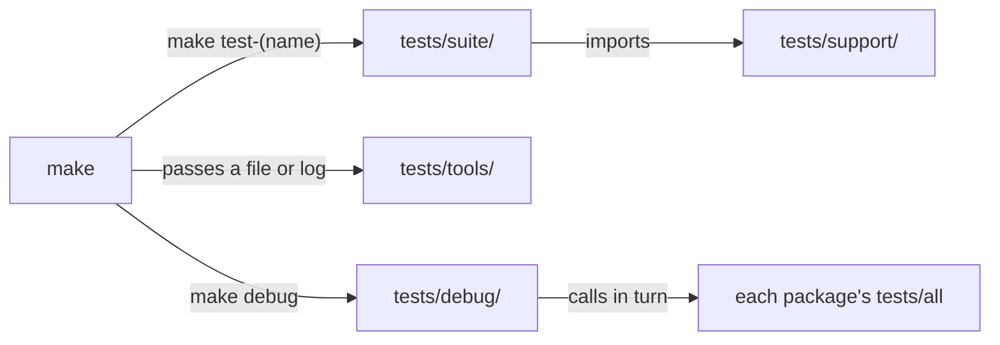

# tests

**The repository's suites live here.** A *suite* is one KSPL program that runs many checks on the repository and prints one verdict. This folder is for whoever adds a test or reads why a gate failed; `make ci` runs everything here. How to write a suite is in [`tests/docs/HOWTO-write-a-suite.md`](docs/HOWTO-write-a-suite.md); why the suites are built this way is in [`tests/docs/DESIGN.md`](docs/DESIGN.md).

## Run it

Build the tree once with `make`, then run one suite or all of them:

```sh
make test-conventions   # one suite: the conventions the documents state hold in the tree
make test-suites        # every suite here and in ksplc's folder, in parallel under make -j
```

Each check prints a `pass` or `FAIL` line, and the run ends with one `RESULT:` line, such as `RESULT: ALL PASS`.

## Placement and naming

Each folder here holds one kind of thing, so a folder's name tells you whether `make` runs a file or a file is material for one. The diagram shows who calls what.



| Folder | What lives there |
|---|---|
| `tests/suite/` | One suite that runs with no arguments. `make test-<name>` calls it |
| `tests/support/` | The code a suite reads. Not what it runs against |
| `tests/tools/` | A tool `make` calls directly, passing its subject as an argument (a file or log to inspect) |
| `tests/debug/` | `make debug`'s entry point, `main.kspls`: it calls each package's `tests/all` in turn. One package alone is `make debug-<name>`, through that package's own `<package>/tests/main.kspls` |
| `tests/freestanding/` | Fixtures for one check, `make test-freestanding-math`. A *fixture* is a fixed input a check runs against. Here `probe.kspls` exports std/math's functions as built for a target with no operating system, and `harness.c`, a C program, calls them and compares each answer with the C library's |
| `tests/docs/` | This folder's documents (["Further reading"](#further-reading) below) |

**Do not put a `.kspls` directly under `tests/`**: its name would not say whether `make` runs it or it is material. Only this guide and `ksplc.cfg` live there. Settings are found by walking upwards from a file's folder, so `ksplc.cfg` must be here to cover all of `tests/`.

Inside `tests/support/`, the name splits the files in two.

| Name | Role |
|---|---|
| `harness*` | The foundation every suite shares. **A fix here reaches every suite here** |
| `<suite name>_<subject>` | A piece for that suite alone, used from `tests/suite/` |

Caution: **Do not put a foundation under a name other than `harness`.** Then the name does not say whether a file is shared or exclusive, and nobody can tell how far a fix reaches.

The foundation is split by the reason for reading it.

| File | The reason to read it |
|---|---|
| `harness` | What knows the repository: finding the root, a suite's start on its paths, `make` from the root, a temporary folder under `out/tmp`, the files git knows |
| `harness_text` | Looking at strings (one UTF-8 character, a word boundary, a text's words, a list written in a file, the line after a mark, whether a list holds a string) |

The compiler's suites have their own foundation in ksplc's folder, including the build helper and the runner of `EXPECT:` fixtures ([ksplc](../ksplc/README.md)). **Its `harness` is the layer beneath this one**: `harness.begin` starts it on the repository's paths, and a suite here ends, starts a process and runs the compiler under test through it, imported as `ksplc_harness`.

## The suites

Each suite has a make target, `make test-<name>`, and its opening comment says what it pins down.

**The list of suites is `SUITES` in [`mk/test.mk`](../mk/test.mk)**, and `make help` prints one line for each target.

**Suites that check only the compiler live in ksplc's folder** ([`ksplc/README.md`](../ksplc/README.md)), and `make test-<name>` runs them from here too. What stays here reads more than one package ("What stays in the root tests folder" in [`tests/docs/DESIGN.md`](docs/DESIGN.md)).

**Fuzzing is each package's own `make test-fuzz`**, run from here as `make test-std-fuzz` / `test-kspage-fuzz` / `test-ksai-fuzz` (ksplc's as `make test-fuzz`), with seeds read from the repository root. *Fuzzing* feeds a program many broken or random inputs to find one that crashes it; the *seeds* are the valid inputs those are made from.

## The tools in tests/tools

These are checks that read one file or log `make` hands them, rather than the whole tree.

| Thing | How it is called |
|---|---|
| `tests/tools/llvm_ir_abi_check.kspls` | `make test-llvm-abi` passes it the generated `.ll` files (LLVM's text form of a compiled program). They must include one whose `main` returns a Result, since no other program exercises the entry point's failure path |
| `tests/tools/perf_guard.kspls` | `make perf-log` (a gate of `make ci-linux`) passes it the two translation logs it measures, cold and warm (reference values in `perf_baseline.json`) |

## The fixture folders

These folders hold material that a package's own checks run against; this table says which command runs each.

| Folder | How it is called |
|---|---|
| `tests/freestanding/` | `make test-freestanding-math`, comparing `#cfg(freestanding)`'s std/math (the build with no operating system under it) against the real libm |
| `ksos/tests/` | ksos's own tests, run by its own [`ksos/Makefile`](../ksos/Makefile) (`make debug-ksos` from here, `make test-extract` in CI): the unit tests, the USB descriptors read as text, and elf2uf2 fed broken ELFs. `make test-ksos-qemu` reads the demos' UART output through `uart_probe.py` |
| `kspage/tests/wasm/` `kspage/tests/browser/` | kspage's checks on its page, run by its own [`kspage/Makefile`](../kspage/Makefile) (`make test-kspage-wasm` / `test-kspage-browser` / `test-kspage-served` from here). How their material is kept apart from the sample shown at startup is in "Each browser-check section has its own document" in [`kspage/docs/DESIGN.md`](../kspage/docs/DESIGN.md) |

## Files near the limit and how they split

Two files here have their split planned before they reach the line limit for one file; the table says what moves out of each and where. How to choose where a file splits is "Choosing where to split a file" in [`docs/DESIGN.md`](../docs/DESIGN.md). A package's tests live in its `tests/`, so how they split is in that package's README.

| File | What to split out | Destination | Why it parts there |
| :-- | :-- | :-- | :-- |
| `tests/suite/docref_test.kspls` | the "what may refer to what" side: `layer_from` / `layer_to` / `spec_may_reach_up` / `ref_heads` / `ref_names` / `group_of` / `may_refer` / `unit_ref_defects` | a new `docref_layer.kspls` under `tests/support/` | It answers "may this folder point at that one" from folder names alone. It is the one part that reads no reference, so the split leaves `docref_refs` and `docref_cite` untouched |
| `tests/suite/conventions_test.kspls` | the shape of a comment in a source: `max_comment_lines` / `max_header_lines` / `is_header_lead` / `check_comments` / `check_summary_inside` | a new `conventions_comment.kspls` under `tests/support/` | It reads a source as lines of text alone: how long a `//` run may stand over the code, and where a `//<` run goes when the declaration has braces. It touches no AST (the compiler's tree of a parsed program) and no other check's tables |

## Further reading

| Document | What it holds | Who reads it |
| :-- | :-- | :-- |
| [`tests/docs/HOWTO-write-a-suite.md`](docs/HOWTO-write-a-suite.md) | Where a new test goes, the steps to add a suite, the manners for writing one, showing that a check can fire | Whoever adds a test |
| [`tests/docs/DESIGN.md`](docs/DESIGN.md) | Why the seed runs the suites, what stays here, why harness holds the arena | Whoever changes a suite or the shared foundation |
| [`../docs/SPEC-gates.md`](../docs/SPEC-gates.md) | The gates, the verdict line, and the verification scope per platform | Whoever reads a gate's result |
| [`../docs/DESIGN.md`](../docs/DESIGN.md) | The Development Principles the manners rest on (Principle 8 is why a check shows it can fire) | Whoever changes Kanso |
| [`../ksplc/docs/DESIGN.md`](../ksplc/docs/DESIGN.md) | The design grounds of the compiler these suites inspect | Whoever changes the compiler |
