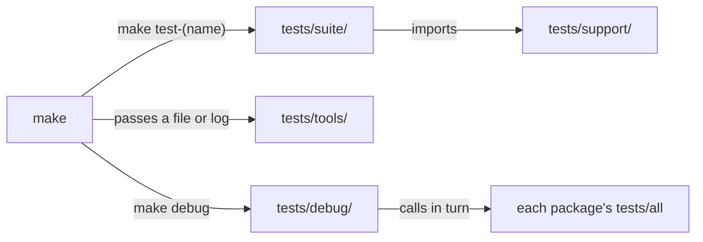

# tests

**The repository's suites live here.** A *suite* is one KSPL program that runs many checks on the repository and prints one verdict. This folder is for whoever adds a test or reads why a gate failed; `make ci` runs everything here.

## Run it

Build the tree once with `make`, then run one suite or all of them:

```sh
make test-conventions   # one suite: the conventions the documents state hold in the tree
make test-suites        # every suite here and in ksplc's folder, in parallel under make -j
```

Each check prints a `pass` or `FAIL` line, and the run ends with one `RESULT:` line.

## Placement and naming

The diagram shows who calls what.



Each folder here holds one kind of thing, so a folder's name tells you whether `make` runs a file or a file is material for one.

| Folder | What lives there |
|---|---|
| `tests/suite/` | One suite that runs with no arguments. `make test-<name>` calls it |
| `tests/support/` | The code a suite reads. Not what it runs against |
| `tests/tools/` | A tool `make` calls directly, passing its subject as an argument (below) |
| `tests/debug/` | `make debug`'s entry point, `main.kspl`: it calls each package's `tests/all` in turn. One package alone is `make debug-<name>`, through that package's own `<package>/tests/main.kspl` |
| `tests/freestanding/` | Fixtures for `make test-freestanding-math`. `probe.kspl` exports std/math's functions as built with no operating system (`#cfg(freestanding)`). `harness.c` calls them and compares each answer with the real libm |
| `tests/docs/` | This folder's documents (["Further reading"](#further-reading) below) |

**Do not put a `.kspl` directly under `tests/`**: only this guide and `ksplc.cfg` live there, which covers all of `tests/`.

**Inside `tests/support/`, a name starting `harness` is the foundation every suite shares**, and `<suite name>_<subject>` is a piece for that suite alone. **A fix to the foundation reaches every suite here.**

Caution: **Do not put a foundation under a name other than `harness`.** Then nobody can tell how far a fix reaches.

| File | The reason to read it |
|---|---|
| `harness` | What knows the repository: finding the root, a suite's start on its paths, `make` from the root, a temporary folder under `out/tmp`, the files git knows |
| `harness_text` | Looking at strings: one UTF-8 character, a word boundary and a text's words. Also a list written in a file, the line after a mark, and whether a list holds a string |
| `harness_sanitizer` | Building a program through ksplc with a sanitizer, and running it with the package's environment (`race` and `sanitize` build through it) |

**ksplc's own `harness` is the layer beneath this one** ([ksplc](../ksplc/README.md)). A suite here imports it as `ksplc_harness` to end, start a process and run the compiler under test.

## The suites

Each suite has a make target, `make test-<name>`, and its opening comment says what it pins down. **The list of suites is `SUITES` in [`mk/test.mk`](../mk/test.mk)**, and `make help` prints one line for each target.

**Suites that check only the compiler live in ksplc's folder** ([`ksplc/README.md`](../ksplc/README.md)), and `make test-<name>` runs them from here too ("What stays in the root tests folder" in [`tests/docs/DESIGN-suites.md`](docs/DESIGN-suites.md)).

**Fuzzing is each package's own `make test-fuzz`**, run from here as `make test-std-fuzz` / `test-ksai-fuzz` (ksplc's as `make test-fuzz`), with seeds read from the repository root. *Fuzzing* feeds a program many broken inputs, made from valid *seeds*, to find one that crashes it.

## The tools in tests/tools

| Thing | How it is called |
|---|---|
| `tests/tools/llvm_ir_abi_check.kspl` | `make test-llvm-abi` passes it the generated `.ll` files (LLVM's text form). They must include one whose `main` returns a Result, since no other program exercises the entry point's failure path |
| `tests/tools/perf_guard.kspl` | `make perf-log` (a gate of `make ci`) passes it the two translation logs it measures, cold and warm (reference values in `perf_baseline.json`) |

## The fixture folders

Other packages' material is run by their own `Makefile`:

| Folder | How it is called |
|---|---|
| `ksos/tests/` | [`ksos/Makefile`](../ksos/Makefile) (`make debug-ksos` from here, `make test-extract` in CI): the unit tests, the USB descriptors read as text, and elf2uf2 fed broken ELFs |
| `ksmd/tests/browser/` | [`ksmd/Makefile`](../ksmd/Makefile) (`make test-ksmd-browser` from here): ksmd's checks on its page in a browser |

## Files near the limit and how they split

How to choose where a file splits is "Choosing where to split a file" in [`docs/DESIGN-principles.md`](../docs/DESIGN-principles.md). A package's tests split as that package's README says.

| File | What to split out | Destination | Why it parts there |
| :-- | :-- | :-- | :-- |
| `tests/suite/docref_test.kspl` | the "what may refer to what" side: `LAYER_FROM` / `LAYER_TO` / `SPEC_MAY_REACH_UP` / `REF_HEADS` / `REF_NAMES` / `group_of` / `may_refer` / `unit_ref_defects` | a new `docref_layer.kspl` under `tests/support/` | It answers "may this folder point at that one" from folder names alone. It is the one part that reads no reference, so the split leaves `docref_refs` and `docref_cite` untouched |

## Further reading

| Document | What it holds | Who reads it |
| :-- | :-- | :-- |
| [`tests/docs/HOWTO-write-a-suite.md`](docs/HOWTO-write-a-suite.md) | Where a new test goes, the steps to add a suite, the manners for writing one, showing that a check can fire | Whoever adds a test |
| [`tests/docs/DESIGN-suites.md`](docs/DESIGN-suites.md) | Why the seed runs the suites, what stays here, why harness holds the arena | Whoever changes a suite or the shared foundation |
| [`../docs/SPEC-gates.md`](../docs/SPEC-gates.md) | The gates, the verdict line, and the verification scope per platform | Whoever reads a gate's result |
| [`../docs/DESIGN-principles.md`](../docs/DESIGN-principles.md) | The Development Principles the manners rest on (Principle 8 is why a check shows it can fire) | Whoever changes Kanso |
| [`../ksplc/docs/DESIGN-compiler.md`](../ksplc/docs/DESIGN-compiler.md) | The design grounds of the compiler these suites inspect | Whoever changes the compiler |
