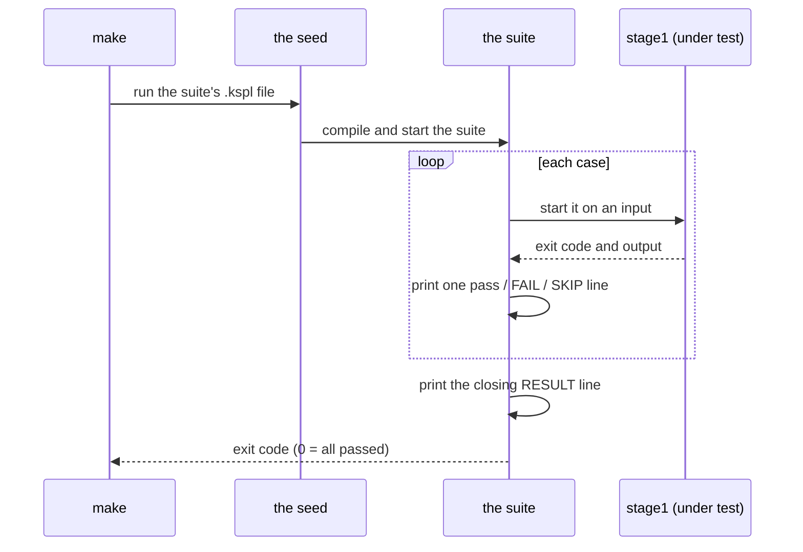

# tests — the design

**Why the repository's suites are built the way they are.** A *suite* is one KSPL program under `tests/suite/` that runs many checks and reports one verdict. This document is for whoever changes a suite or the code the suites share. How to write one is in [`tests/docs/HOWTO-write-a-suite.md`](HOWTO-write-a-suite.md), and each folder's place is in [`tests/README.md`](../README.md).

## The seed runs the suites

Two compilers take part in every suite run. A fixed, older one runs the suite, and the suite tests the new one.

| Compiler | What it is | Its job in a suite run |
| :-- | :-- | :-- |
| **The seed** (`out/ksplc_seed.exe`) | A copy of the compiler frozen as C source (`ksplc/seed.c`). `make` builds it before stage1 | Compiles and runs the suite itself |
| **Stage1** (`out/ksplc_stage1.exe`) | The compiler built from the current source, with your edit in it | What the suite checks. The suite starts it as a separate process |

The diagram shows one run of `make test-<name>`, from start to verdict.

**The exit code carries the verdict to `make`.** The `pass` / `FAIL` / `SKIP` lines and the closing `RESULT:` line are for a person reading the log.

Caution: **Do not build the suites with the compiler under inspection.** A broken compiler and a failed test would then show the same symptom. The seed is a fixed point built from `ksplc/seed.c`, so it does not change with the edit being tested.

**What it gives up: a suite can use only the notations the seed knows.** A fix to the language or to code generation reaches the suites only after the seed is re-baked (rebuilt from the current compiler).

## What stays in the root tests folder

**A suite stays in the root `tests/` only when it reads more than one package; a suite about one package lives inside that package.** A suite here checks the compiler against something outside its folder, or it gates the repository itself. "Outside its folder" means, for example:

* the language specification;
* kspage's highlighter and the editor's grammar;
* the root `Makefile`'s rebuild list;
* every package's generated C;
* the whole tree.

So a package carved out of the tree leaves these suites behind, and takes its own tests with it.

**A suite lives where what it reads lives.**

| Suite | What it reads | Where it lives |
| :-- | :-- | :-- |
| `lsp-tree`, `fmt-tree` | The whole tree | Here |
| ksplc's `lsp`, `kspls` | ksplc's folder only | In ksplc's folder |

`lsp-tree` starts its own language server on the workspace that only this folder offers.

**The tests `make debug` builds are not suites.** They are what is inspected ("does a program written in KSPL run correctly"), not what gives the verdict: the Makefile gives that, from the exit code and the output. So they live in each package's `tests/`, and only the run that calls them is here.

## A folder holds a role, and a file name holds a role within it

The folder tells you whether a file is run or read, and the file name tells you whether it is shared.

| What you look at | What it tells you |
| :-- | :-- |
| The folder (`tests/suite/` or `tests/support/`) | Whether the file is run, or read by what is run |
| The name inside `tests/support/` (`harness*` or `<suite>_<subject>`) | Whether every suite shares the file, or one suite owns it |

With only one of the two, what is run and what it runs against mix together in an `ls`.

## Why harness holds the arena

The shared helpers in `tests/support/harness*` keep one memory area for the whole suite, so a suite does not pass it to every call.

An *arena* is a block of memory that hands out pieces and frees them all at once. `harness.begin()` makes one arena for the suite, and the `harness.*` helpers allocate from it.

**`harness.*` does not take the arena per call**, because lines that only pass it along would make up a meaningful share of a suite's code.

**This is not a rule that an arena is never passed.** What decides is where the result goes, not where the receiver lives. A list kept only for one function's length is given `null`, the global heap (`List.new(null)`, freed at once with a `defer`), since a temporary list in a long-lived arena only grows.

Caution: **Confirm before dropping the arena argument from another function.** Plant a check in harness that fails where the arena passed differs from the main arena, and run every suite.
