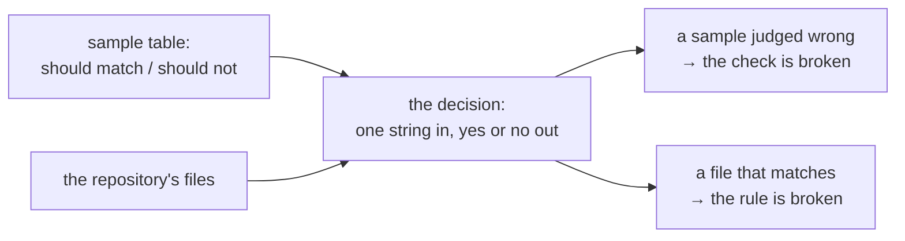

# Writing a suite

This guide shows where a test goes, and how to write and run it. A *suite* is one KSPL program that runs many checks and prints one verdict. Why the suites are built this way is in [`tests/docs/DESIGN-suites.md`](DESIGN-suites.md).

## What you need first

* **A built tree.** Run `make` once at the repository root. It builds the seed, `out/ksplc_seed.exe`, which compiles and runs the suite, and Stage1, `out/ksplc_stage1.exe`, which the suite checks. Why two compilers take part is "The seed runs the suites" in [`tests/docs/DESIGN-suites.md`](DESIGN-suites.md).
* **Some KSPL.** [`docs/TUTORIAL-programming-language.md`](../../docs/TUTORIAL-programming-language.md) walks through the language in one program.

## Where a new test goes

Put a test next to what it checks. A test that looks inside one package (a top-level folder such as `std/`) lives in that package; only a suite that reads several packages lives here.

| What the test checks | Where it goes | What runs it |
| :-- | :-- | :-- |
| The inside of one package (its functions, called directly) | That package's `tests/`, reached through `<package>/tests/all.kspl` | `make debug` (not the suites here) |
| kssrv's programs, or ksai's examples | Their own folder, with no `all.kspl`: they build their programs and start them | That folder's `make test`: `make debug-kssrv` / `make debug-ksai` from here, `make test-extract` in CI |
| Only the compiler, from outside | ksplc's folder ([ksplc](../../ksplc/README.md)) | `make test-<name>` |
| More than one package | `tests/suite/` | `make test-<name>` |

Why is "A test of a unit's inside goes inside that unit" in [`docs/DESIGN-repository.md`](../../docs/DESIGN-repository.md).

**Name a new test `test_…`, and do nothing else.** The suite in `<package>/tests/all.kspl` runs every `test_…` function of the files it imports ("8.5 Tests: functions named `test_`, run by a suite" in [`docs/SPEC-programming-language.md`](../../docs/SPEC-programming-language.md)). A test takes nothing, or the suite's fields its parameters name (an arena, say). A step that another test calls is named `check_…`, or the suite would run it on its own too.

Caution: **A new file of tests needs one import line in `<package>/tests/all.kspl`.** Until then `make test-conventions` fails with "a file of tests is imported, so a suite can run them". A function in a file of tests that nothing calls is warning [W0503], and a `test_…` function that no suite runs is [W0214].

**Do not write individual tests into `tests/debug/`.** It holds only the run that calls each package's entry point in turn. A test there would need everything it inspects to be `pub`.

## Adding a suite, step by step

1. **Write the suite** as `tests/suite/<stem>_test.kspl` (the compiler's own: `ksplc/tests/suite/<stem>_test.kspl`), starting from the program in "The manners for writing a suite" below. Its name is the stem with `-` for `_` (`lsp_tree_test.kspl` is `lsp-tree`).
2. **List it in [`mk/test.mk`](../../mk/test.mk)**, in one of:
   * `SUITES`, longest CPU time first (`make test-suites` prints each suite's time), for most suites;
   * `LINUX_SUITES`, for a suite whose tool only Linux's image holds; it then needs a gate of its own ("A gate" in [`docs/HOWTO-add-a-gate.md`](../../docs/HOWTO-add-a-gate.md)).

   A name in `SUITES` can also go into `SUITES_TEXT`, when its answer cannot differ by platform (it then runs on Linux alone). Or it goes into `SUITES_B`, to balance CI's two halves.

   **A suite of the compiler's own goes in `SUITES` in [`ksplc/Makefile`](../../ksplc/Makefile) instead.** It runs through `make test-extract-ksplc`, and macOS runs it only with a gate row of its own.

   `make` stops at start-up, saying which, when a suite file stands in no list, or a list names a suite with no file.
3. **Name it in the platform table**, "What each platform runs" in [`docs/SPEC-gates.md`](../../docs/SPEC-gates.md), usually in a row's bracketed list. Until then `make test-conventions` fails with "the platform table names every gate and suite CI runs".
4. **A new module of the conventions suite** (`tests/support/conventions_<x>.kspl`) is called from `main` in `tests/suite/conventions_test.kspl`, or from a module it already calls; one nothing calls checks nothing.
5. **If the suite needs a fix you just made to the language or to code generation, re-bake the seed first** with `make commit-seed`. The seed runs the suite, so a suite can use only the notations the seed knows. Without this step the suite passes on the stage1 just built, while `make test-<name>` alone fails.
6. **Run it**: `make test-<name>`, then `make test-conventions`. The run prints one line per check and a closing verdict:

   ```
   pass docref: SPEC files cite no DESIGN or PLAN and no specification below or beside them
   pass docref: numbered headings are unique and consecutive per document
   RESULT: ALL PASS
   ```

   A failed check prints a `FAIL` line, the run goes on, and the last line reads `RESULT: SOME FAILED (<count>) -> <the failed checks>`.

## The manners for writing a suite

Every suite is built from the same shared helpers, so each finds the root and the compiler, and reports, the same way. **The root's `harness` (`tests/support/harness.kspl`) knows the repository**: its root, `make` from it, the files git knows. Its `begin` starts ksplc's harness on the repository's paths. **ksplc's harness under `ksplc/tests/support/`, imported as `ksplc_harness`, does the rest**: the arena, the compiler under test, running a child and ending the suite. `std/verdict.kspl` prints the verdict lines.

The smallest suite starts the compiler under test once and checks its exit code:

```kspl
#!/usr/bin/env -S ksplc run
import "ksplc/tests/support/harness" as ksplc_harness
import "std/verdict"
import "tests/support/harness"

fn main(): I32
    harness.begin(8 * 1024 * 1024)
    r: = ksplc_harness.ksplc(U8[][]::{ "info", "std-dir" })
    verdict.check("the exit code is 0", r.exited_with(0), r.out)
    return ksplc_harness.finish()
```

Each row below is one manner: what to use, and what goes wrong without it.

| To do this | Use | Why |
| :-- | :-- | :-- |
| End the suite | `return ksplc_harness.finish()` at the end of `main` | **The exit code carries the verdict.** The `RESULT:` line is for people and the log; the Makefile greps it as a marker for some targets only |
| Report a case that could not be confirmed | `verdict.skip_check()` | `check(.., true, ..)` would print a pass |
| Report a case whose tool is missing, where Linux's image holds that tool | `ksplc_harness.require_or_skip(name, switch, lacks)` | Where the switch reads 1 (Linux's default), the case fails and names `<switch>=0`. So an image that lost the tool cannot go green ("The switches that require a tool" in [`docs/SPEC-gates.md`](../../docs/SPEC-gates.md)) |
| Get a folder to write in | `harness.sandbox("<suite name>")` | It deletes the last runs' `out/tmp/<suite name>_…` folders and returns a fresh one. **Give each suite its own name**: suites run in parallel under `make -j` |
| Read a file the compiler generated | `ksplc_harness.read_generated` | ksplc writes in text mode, so on Windows the newlines become `\r\n`. Compared raw, a check fails only there, as "the head does not match" or "a blank line is not found" |
| Read a file the repository holds | `harness.read_under_root` | `.gitattributes` pins the repository's files to LF, so nothing needs converting |
| Take one line out of a child's output | `htext.line_after()` | A child's stdout is in text mode too, so a line cut at `'\n'` keeps a trailing `\r` on Windows. `make test-conventions` refuses cutting it by hand |
| Build a `U8[]` (a string), such as a case name passed to `check` | `arena.text().s("…").take()`, the notation for "allocate and keep" | Interpolation (`\{x\}`) can be written only inside a `Writer`'s `.s()` ("The destination is always named" in [`std/docs/DESIGN-core.md`](../../std/docs/DESIGN-core.md)). **Where no arena is in reach, use `ksplc_harness.arena()`** |
| Run several cases at once | `ksplc_harness.run_all` | It runs the cases in parallel through `std/verdict`'s `run_children`, and returns the results **in input order**. `verdict.jobs()` sets the parallelism; `KANSO_TEST_JOBS=1` makes it sequential to narrow down a failure |

Caution: **Do not write to a fixed path (`/tmp/out.c` and the like).** Take the folder from `harness.sandbox` instead.

**Where the amount of material is part of the verdict, give the reason in the suite's opening comment**, as `visibility` does for its three files.

## The arena is held by harness

`harness.begin()` makes the suite's arena (one block of memory freed all at once) and hands it back, and `ksplc_harness.finish()` frees it. The suite can use it for its own allocations, as in `List<|T|>(arena)`. Why is "Why harness holds the arena" in [`tests/docs/DESIGN-suites.md`](DESIGN-suites.md).

Caution: **Do not free it with a `defer`.** `finish` / `fatal` free it, so a `defer arena.free()` frees it twice.

**Still pass an arena where the arena decides where the result goes**, as with `fs.join`.

## Showing that a check can fire

**A convention check must prove that it can catch a violation**: `make test-conventions` is green on a clean tree even when a check is broken.

So a rule's decision is factored out into a function that takes one string. Beside it, **in the same file as the rule**, sits a table of sample strings that should and should not match. `TMP_SAMPLES` and `check_tmp_fires` in `tests/support/conventions_win.kspl` are the shape. The table goes to `scan.misjudged`, which puts each sample to the decision (`opens_tmp`). `verdict.check_list` then reports the ones it misjudged.

The flow below shows the two halves: the samples test the decision, and the real check uses the same decision on the tree.



| Manner | Why |
| :-- | :-- |
| **Make the decision a pure function of one string** | If it reads a file, no sample can be passed to it. If the decision is inline in the check, factor it out first |
| **A file holding a table excludes itself from that rule's check** | Its samples would show as real findings. Exclude that one file only: anything excluded drops out of the rule's check entirely |
| **Do not put the samples in a file** | Keeping that file out of scope needs machinery, and a missed exclusion fails the real check, as `ksplc/tests/negative/`'s scattered exclusions show |

Caution: **List both the matching and the non-matching side.** A one-sided table lets "always true" or "always false" slip past.

This checks only the decision. `harness.tracked_matching`, which picks the files, stops when a string without a wildcard matches nothing.

## Moving a tool out of Python

**When a tool moves out of Python, check that it gives the Python version's verdict, broken input included.** For `llvm_ir_abi_check`, the extracted type list had to agree with real IR line for line. The output had to match byte for byte on four ways of breaking the IR. Two versions wrong in the same way still agree on counts.

**A scan built on regular expressions need not keep them when it moves**: `llvm_ir_abi_check` counts separators instead (its header says why).

## If it goes wrong

| Symptom | Cause | Fix |
| :-- | :-- | :-- |
| `make` stops at start-up, before any suite runs | The files under `tests/suite/` and the lists in `mk/test.mk` disagree | Step 2 of "Adding a suite, step by step" |
| A new package test never runs, and everything stays green | Its file is not imported and called from `<package>/tests/all.kspl` | "Where a new test goes" |
| The suite passes on the stage1 just built, but `make test-<name>` alone fails | The suite uses a notation the seed does not know yet | Re-bake the seed (step 5) |
