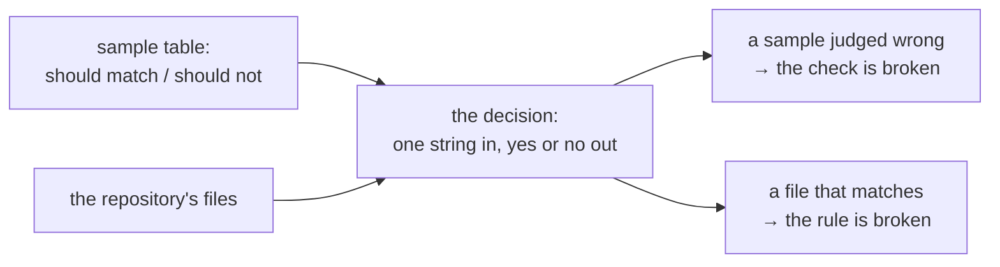

# Writing a suite

This guide shows how to add a test to the repository: where the file goes, how to write it, and how to run it. A *suite* is one KSPL program that runs many checks and prints one verdict. Each folder's place is in [`tests/README.md`](../README.md); why the suites are built this way is in [`tests/docs/DESIGN.md`](DESIGN.md).

## What you need first

You need a built tree and enough KSPL to read a short program.

* **A built tree.** Run `make` once at the repository root. It builds the two compilers every suite run uses:

  | File | What it is | Its job in a suite run |
  | :-- | :-- | :-- |
  | `out/ksplc_seed.exe` | The *seed*: a frozen copy of the compiler, kept as C source in `ksplc/seed.c` | Compiles and runs the suite |
  | `out/ksplc_stage1.exe` | *Stage1*: the compiler built from the current source, with your edit in it | What the suite checks |

  Why two compilers take part is "The seed runs the suites" in [`tests/docs/DESIGN.md`](DESIGN.md).
* **Some KSPL.** [`docs/TOUR.md`](../../docs/TOUR.md) walks through the language in one program.

## Where a new test goes

Put a test next to what it checks. A test that looks inside one package lives in that package; only a suite that reads several packages lives here. A *package* is one top-level folder such as `std/` or `ksplc/`.

| What the test checks | Where it goes | What runs it |
| :-- | :-- | :-- |
| The inside of one package (its functions, called directly) | That package's `tests/`, reached through `<package>/tests/all.kspls` | `make debug` (not the suites here) |
| kssrv's programs, or ksai's examples | Their own folder: they build their programs and start them, so there is no `all.kspls` entry point | That folder's `make test` ([`kssrv/Makefile`](../../kssrv/Makefile), [`ksai/Makefile`](../../ksai/Makefile)): `make debug-kssrv` / `make debug-ksai` from here, and `make test-extract` in CI, which repeats any line they skipped as its own |
| Only the compiler, from outside | ksplc's folder ([ksplc](../../ksplc/README.md)) | `make test-<name>` |
| More than one package | `tests/suite/` | `make test-<name>` |

"A test inspecting the inside of a unit goes inside that unit" in [`docs/DESIGN.md`](../../docs/DESIGN.md) lists the packages and why.

Caution: **After adding a test, add its import and call to that package's `<package>/tests/all.kspls`.** `make debug` cannot see a file no entry point calls, so forgetting this stays green.

**Do not write individual tests into `tests/debug/`.** It holds only the run that calls each package's entry point in turn. A test placed there sits outside the package it checks, so everything it inspects would have to be `pub` (visible to every file).

## Adding a suite, step by step

These steps add a suite under `tests/suite/`. A suite of the compiler's own goes under `ksplc/tests/suite/` instead, registered in `ksplc/Makefile`; its steps are "A suite" in [`docs/HOWTO-add-a-gate.md`](../../docs/HOWTO-add-a-gate.md).

1. **Write the suite** as `tests/suite/<stem>_test.kspls`, starting from the program in "The manners for writing a suite" below. A suite name with a `-` takes `_` in the file name (`lsp-tree` is `lsp_tree_test.kspls`).
2. **Register it in [`mk/test.mk`](../../mk/test.mk)**: add a line `suite_<name> := suite/<stem>_test.kspls`, and add `<name>` to one list:
   * `SUITES`, longest CPU time first (`make test-suites` prints each suite's time), for most suites;
   * `LINUX_SUITES`, for a suite whose tool only Linux's image holds; it then needs a gate of its own ("A gate" in [`docs/HOWTO-add-a-gate.md`](../../docs/HOWTO-add-a-gate.md)).

   A name in `SUITES` may also go into `SUITES_TEXT`, when its answer cannot differ by platform (it then runs on Linux alone), or `SUITES_B`, to balance CI's two halves. `make` stops at start-up, saying which, when a suite file has no `suite_<name>`, a name stands in no list, or a list names an unknown suite.
3. **Name it in the platform table**, "What each platform runs" in [`docs/SPEC-gates.md`](../../docs/SPEC-gates.md), usually in a row's bracketed list. `make test-conventions` fails with "the platform table names every gate and suite CI runs" until it is there.
4. **A new module of the conventions suite** (`tests/support/conventions_<x>.kspls`) is called from `main` in `tests/suite/conventions_test.kspls`, or from a module it already calls; one nothing calls checks nothing.
5. **If the suite needs a fix you just made to the language or to code generation, re-bake the seed first**: run `make commit-seed`. The seed runs the suite, so a suite can use only the notations the seed knows. Without this step the suite passes on the stage1 just built, while `make test-<name>` alone fails.
6. **Run it**: `make test-<name>`, then `make test-conventions`. You should see one line per check and a closing verdict:

   ```
   pass keywords: there is no unexpected line
   pass keywords: the groups and the total line come out
   RESULT: ALL PASS
   ```

   A failed check prints a `FAIL` line, the run goes on, and the last line reads `RESULT: SOME FAILED (<count>)`.

## The manners for writing a suite

Every suite is built from the same shared helpers: `tests/support/harness.kspls`, `ksplc/tests/support/harness.kspls` beneath it, and `std/verdict.kspls` for the verdict lines. **The root's `harness` knows the repository** (its root, `make` from it, the files git knows), and its `begin` starts ksplc's harness on the repository's paths; **`ksplc_harness` does the rest**: the arena, the compiler under test, running a child and ending the suite. If each suite found the repository root and the compiler under test, formatted its verdict lines and used exit codes in its own way, CI's log would become unreadable.

The smallest suite starts the compiler under test once and checks its exit code:

```kspls
#!/usr/bin/env -S ksplc run
import "ksplc/tests/support/harness" as ksplc_harness
import "std/verdict"
import "tests/support/harness"

fn main(): I32
    harness.begin(8 * 1024 * 1024)
    r: = ksplc_harness.ksplc(U8[][]::{ "info", "std-dir" })
    verdict.check("the exit code is 0", r.code == 0, r.out)
    return ksplc_harness.finish()
```

Each row below is one manner: what to use, and what goes wrong without it.

| To do this | Use | Why |
| :-- | :-- | :-- |
| End the suite | `return ksplc_harness.finish()` at the end of `main` | **The exit code carries the verdict.** The `RESULT:` line is for people and the log; the Makefile greps it as a marker for some targets only |
| Report a case that could not be confirmed | `verdict.skip_check()` | Written as `check(.., true, ..)`, a case that confirmed nothing prints the same line as one that confirmed something, and the log cannot tell them apart |
| Get a folder to write in | `harness.sandbox("<suite name>")` | It deletes the last runs' `out/tmp/<suite name>_…` folders and returns a fresh one, so their leftovers do not mix into this run's verdict |
| Read a file the compiler generated | `ksplc_harness.read_generated` | ksplc writes in text mode, so on Windows the newlines become `\r\n` |
| Read a file the repository holds | `harness.read_under_root` | `.gitattributes` pins the repository's files to LF, so nothing needs converting |
| Take one line out of a child's output | `htext.line_after()` | A line cut at `'\n'` keeps a trailing `\r` on Windows (below) |
| Build a `U8[]` (a string), such as a case name passed to `check` | `arena.text().s("…").take()`, the notation for "allocate and keep" | Interpolation (`\{x\}`) can be written only inside a `Writer`'s `.s()` (why there are only three shapes: "The destination is always named" in [`std/docs/DESIGN.md`](../../std/docs/DESIGN.md)). **Where no arena is in reach, use `ksplc_harness.arena()`** |
| Run several cases at once | `ksplc_harness.run_all` | It runs the cases given to it in parallel, through `std/verdict`'s `run_children`, and returns the results **in input order**. `verdict.jobs()` sets the parallelism; `KANSO_TEST_JOBS=1` makes it sequential to narrow down a failure. Otherwise a suite runs its cases one at a time, in order |

Caution: **Do not write to a fixed path (`/tmp/out.c` and the like).** Take the folder from `harness.sandbox` instead.

**Why the Windows newlines matter**: compared raw, the same generated content fails only on Windows, as "the head does not match" or "a blank line is not found", never as a newline mismatch. A child's stdout is in text mode by default, so its log gets CRLF (`\r\n`) too, and a stray `\r` stays unseen until the string lands in a header or a token. `make test-conventions` refuses a test that cuts a child's output into lines by hand.

Caution: **Give each suite its own workspace name.** Suites themselves run in parallel under `make -j`, so two sharing a workspace read each other's output.

**Where the amount of material is part of the verdict, give the reason in the suite's opening comment**, which anyone reducing it reads first. For example, `visibility` needs three files: without another folder and another package, the difference at the boundary does not show.

## The arena is held by harness

`harness.begin()` makes the suite's arena and hands it back, and `ksplc_harness.finish()` frees it. An *arena* is one block of memory that many allocations share and that is freed all at once. The suite can use it directly for its own allocations, so `List.new(arena)` and the like read as usual. Why the harness's helpers do not take the arena per call is in "Why harness holds the arena" in [`tests/docs/DESIGN.md`](DESIGN.md).

Caution: **Do not free it with a `defer`.** `finish` / `fatal` free it, so a `defer arena.free()` frees it twice.

**Still pass an arena where the arena decides where the result goes**, as with `fs.join`.

## Showing that a check can fire

A convention check must prove that it can catch a violation. The convention checks (`make test-conventions`) are **green when the repository is clean, and so green even when a check is broken**. A check *fires* when it catches a violation; one that cannot fire guards nothing.

So a rule's decision is factored out into a function that takes one string. Beside it, **in the same file as the rule**, sits a table of sample strings that should and should not match. `tmp_samples` and `check_tmp_fires` in `tests/support/conventions_win.kspls` are the shape: the table, then `scan.misjudged` putting each sample to the decision (`opens_tmp`), and `verdict.check_list` reporting the ones it misjudged.

The flow below shows the two halves: the samples test the decision, and the real check uses the same decision on the tree.



| Manner | Why |
| :-- | :-- |
| **Make the decision a pure function of one string** | If it reads a file, no sample can be passed to it. If the decision is inline in the check, factor it out first |
| **A file holding a table excludes itself from that rule's check** | Its samples would show as real findings. Exclude that one file only: anything excluded drops out of the rule's check entirely |
| **Do not put the samples in a file** | Keeping that file out of scope needs machinery, and a missed exclusion fails the real check. `ksplc/tests/negative/`'s exclusions, scattered per check, show that shape |

Caution: **List both the matching and the non-matching side.** A one-sided table lets one kind of breakage ("always true" or "always false") slip past.

This checks only the decision. Which files are looked at is checked by `harness.tracked_matching`: it stops when a string without a wildcard matches nothing.

## Moving a tool out of Python

**When a tool moves out of Python, check that it gives the Python version's verdict, broken input included.** For `llvm_ir_abi_check`, that means the extracted type list agrees with real IR line for line, and the output matches byte for byte on four ways of breaking the IR. Comparing counts alone is not enough: two versions wrong in the same way still agree.

**A scan built on regular expressions need not keep them when it moves**: `llvm_ir_abi_check` counts separators instead (its header says why).

## If it goes wrong

Each row is a symptom you may meet, what causes it, and where the fix is described.

| Symptom | Cause | Fix |
| :-- | :-- | :-- |
| `make` stops at start-up, before any suite runs | `suite_<name>` and `SUITES` in `mk/test.mk` disagree | Step 2 of "Adding a suite, step by step" |
| A new package test never runs, and everything stays green | Its file is not imported and called from `<package>/tests/all.kspls` | "Where a new test goes" |
| The suite passes on the stage1 just built, but `make test-<name>` alone fails | The suite uses a notation the seed does not know yet | Re-bake the seed (step 3) |
| A check fails only on Windows, as "the head does not match" or "a blank line is not found" | A generated file read raw, so it holds `\r\n` | `ksplc_harness.read_generated` |
| A header or token holds a stray `\r` on Windows, or `make test-conventions` reports "a test does not cut a child's output into lines by hand" | A child's output cut into lines at `'\n'` by hand | `htext.line_after()` |
| Two suites fail together, each seeing the other's files | They share a workspace name | Give each suite its own name in `harness.sandbox` |
| The arena is freed twice at the suite's end | A `defer arena.free()` on the arena from `harness.begin()` | Remove the `defer`: `finish` frees it |
