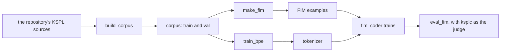

# ai_assist — the coding assistant

This folder holds the pipeline (data, evaluation, training) that builds a small AI to fill in a missing line of KSPL code. It measures how often the compiler accepts what the AI writes. It is kept apart from the language core and the AI engine (`ksai`). Why it is built this way is "The coding assistant" in [`tools/docs/DESIGN-tools.md`](../docs/DESIGN-tools.md). What is left is in the "tools" section of [`docs/PLAN.md`](../../docs/PLAN.md).

Note: If how an AI works is new to you, read [`../../ksai/README.md`](../../ksai/README.md) (the introduction to the KSPL-native AI engine) first.

Words used here: the *corpus* is the body of source text the model learns from. *FIM* (fill-in-the-middle) is a training example made by cutting a hole out of code; the model learns to fill it from the code around it. The *oracle* is the compiler used as the judge: a completion is good if `ksplc` accepts the file.

## Run it

```sh
make fim-corpus   # the corpus and the FIM examples -> tools/ai_assist/corpus/
make fim-model    # the tokenizer, then the KSPL-native model -> out/fim_coder.safetensors
make fim-eval     # the model's held-out loss, then the rate at which ksplc accepts its completions
```

The held-out loss is the model's error on validation files it never trained on. Each KSPL tool also runs alone: `./out/ksplc_stage1.exe run tools/ai_assist/<tool>.kspl`, with the usage in the file's header.



## What is here

| File | What it does |
| :-- | :-- |
| `ksplc_oracle.kspl` | The compiler oracle's shared parts: an error count plus the diagnostics, and reading JSONL (one JSON value per line). It has no executable of its own. |
| `build_corpus.kspl` / `corpus_count.kspl` | Normalizes every source through `fmt`, removes duplicates, splits train/val and counts, writing to `corpus/`. `corpus_count.kspl` holds the counting rules, split off so it can be tested. |
| `make_fim.kspl` | Writes FIM training examples to `corpus/fim_{train,val}.jsonl`. The source compiles, so the middle is the correct completion by definition. |
| `eval_fim.kspl` | Hides single lines of the validation files, inserts a model's completion, and measures the rate at which `ksplc` accepts the file (`make fim-eval`). `--model=native` runs `ksai/examples/fim_coder` as its own process. |
| `train_bpe.kspl` | Derives the BPE vocabulary and merges from the corpus into `tokenizer/`, which `Tokenizer.load` in `ksai/tokenizer.kspl` reads. It splits the corpus by the tokenizer's own rule (`chunk_end` in `ksai/pretokenizer.kspl`), so every merge it learns can apply. |
| `lora_finetune_external.py` | Fine-tunes a LoRA (a small set of added weights) outside KSPL, on a GPU machine, and writes safetensors in the KSPL convention. `--help` lists its options. |
| `export_qwen_to_kspl.py` / `export_qwen_tokenizer.py` | Convert Hugging Face Qwen's weights and tokenizer into the files `ksai` reads. |
| `gen_unicode_class.py` | Writes `ksai/unicode_class.kspl`, the Unicode classes the tokenizer's rule reads, from llama.cpp's `unicode-data.cpp`. `--check` compares instead of writing. |
| `check_qwen_tokenizer.py` / `tokenize_lists.kspl` | Compare ksai's tokenizer with llama.cpp's on a GGUF model, text by text (below). `tokenize_lists.kspl` loads the GGUF file's lists through `Tokenizer.load_lists` and prints each text's IDs. |
| `qwen_logit_parity.py` | Prints Hugging Face's logits (the scores for each next token) for the same input, to compare with KSPL's. |
| `qwen_gguf_check.py` | Runs ksai's Qwen model (`ksai/benches/bench_qwen.kspl`) and llama.cpp on the same GGUF file and compares them ("Checking against llama.cpp" below). |
| `make_qwen_fixtures.py` / `make_qwen35_fixtures.py` | Write the tiny Qwen3 and Qwen3.5 models and the chat-template cases that ksai's tests read (`ksai/tests/qwen_data/`), with llama.cpp's packages as the reference. |
| `safetensors_io.py` | Writes safetensors, for `export_qwen_to_kspl.py` and `lora_finetune_external.py`. |
| `make_quant_fixtures.py` | Writes the reference files that ksai's GGUF formats are tested against (`ksai/tests/quant_data/`), from llama.cpp's `gguf` package and C library. |
| `gguf_quant_check.py` | Takes a few real tensors of each format out of GGUF files, for checking ksai's decoding by hand (`ksai/benches/README.md`). |
| `tests/` | `ai_assist_test.kspl`: counting the corpus, and the oracle, which starts the real compiler. `make debug-tools` runs them. |

**`corpus/` and `tokenizer/` are generated and reproducible**, and git ignores them. The fixture files are committed, so the tests need no Python.

### The outside packages needed

**They are not needed to build.** They serve only the Python helpers here; the repository builds and passes `make ci` without them.

```sh
python3 -m venv .venv && . .venv/bin/activate
pip install numpy torch transformers peft safetensors gguf llama-cpp-python jinja2
```

**`tools/kspl_lldb.py`'s `lldb` is not among them.** It comes with LLVM, not from pip ([`.devcontainer/Dockerfile`](../../.devcontainer/Dockerfile)).

### How borrowed models are handled

**You bring the borrowed model's weights yourself: they are not in this repository.** `export_qwen_to_kspl.py` converts the weights you obtain (`--base-model Qwen/Qwen2.5-Coder-0.5B`). Only the conversion procedure is distributed here, so the [MIT](../../LICENSE.md) notice does not cover the model.

**The converted safetensors inherit the original model's license.** To distribute them, meet its conditions (the Qwen2.5 family is Apache-2.0, which requires attribution).

The `ksai/examples/llama_engine/mini_llama.safetensors` and `ksos/demo/cortex_m/pilot_policy.safetensors` in the repository are tiny models made here, not borrowed ones.

## Checking against a real Qwen

These two checks show that KSPL runs a real Qwen2.5-Coder-0.5B as the reference Python library does. They need the outside packages above.

**The logit check** runs the same tokens through KSPL and through Hugging Face:

```sh
python3 tools/ai_assist/export_qwen_to_kspl.py --base-model Qwen/Qwen2.5-Coder-0.5B \
    --out out/qwen_kspl.safetensors
make qwen
echo "3 1 4" | ./out/qwen_infer.exe out/qwen_kspl.safetensors
python3 tools/ai_assist/qwen_logit_parity.py --base-model Qwen/Qwen2.5-Coder-0.5B --tokens "3 1 4"
```

The two print the same argmax (the token with the top score). Their logits differ only by floating-point rounding, since the matrix products are added in a different order.

**Generating text** adds the tokenizer:

```sh
python3 tools/ai_assist/export_qwen_tokenizer.py --base-model Qwen/Qwen2.5-Coder-0.5B \
    --out-dir out/qwen_tokenizer
make qwen
echo "def add(a, b):
    return a" | ./out/qwen_infer.exe generate out/qwen_kspl.safetensors \
    out/qwen_tokenizer/vocab.txt out/qwen_tokenizer/merges.txt 151643
```

It writes Python that stays coherent across several functions. **The prompt is Python on purpose.** The model has never seen KSPL, so a KSPL prompt could not show whether the pipeline is broken. Decoding is greedy with no repetition penalty, so a numeric prompt such as `let n = ` can repeat digits without end.

## Checking against llama.cpp

This check shows that ksai runs the user's model, Qwen3-4B-Instruct-2507, as llama.cpp runs the same GGUF file. It needs `gguf`, `llama-cpp-python` and `numpy`, and the file that [`models/README.md`](../../models/README.md) names:

```sh
out/ksplc_stage1.exe build "--cflags=-O3 -march=native" ksai/benches/bench_qwen.kspl out/bench_qwen.exe
python3 tools/ai_assist/qwen_gguf_check.py --model models/Qwen3-4B-Instruct-2507-Q4_K_M.gguf
python3 tools/ai_assist/qwen_gguf_check.py --model models/Qwen3.5-9B-Q3_K_M.gguf
```

The prompts' token IDs come from llama.cpp, so the tokenizers do not mix in. Each check prints `agree` or `DIFFER`:

* **The first 32 greedy tokens** equal llama.cpp's, for prompts in English, Japanese and code, and a conversation with tools. A parting within the scores' tolerance prints `tie`.
* **The scores after a fixed prompt** agree within a tolerance, since both sides round each product's inputs to 8 bits. Beside it stands llama.cpp against itself, reading a prompt in one batch and token by token.
* **The chat template**: llama.cpp renders each conversation of `template_cases.json`, or `template35_cases.json` for Qwen3.5, in `ksai/tests/qwen_data/`. ksai's tests check that `chat_server` renders the same texts.

Last it prints how fast each side reads a prompt of 350 tokens and generates 64, on the same machine.

## Checking the tokenizer against llama.cpp

This check shows that ksai's tokenizer gives the same token IDs as llama.cpp for a real model. It needs the `gguf` and `llama_cpp` Python packages, a built `ksplc` and a downloaded GGUF model.

```sh
python3 tools/ai_assist/check_qwen_tokenizer.py --model Qwen3-4B-Instruct-2507-Q4_K_M.gguf
```

It reads which rule splits the text from the file's `tokenizer.ggml.pre`: `qwen2` for Qwen3-4B-Instruct-2507, `qwen35` for Qwen3.5-9B. Run it on each model the server runs.

The texts are samples written into the script, 5,000 seeded random strings, and every text file the repository tracks. **It passes when the last line says `0 differ`.** `--random`, `--seed` and `--file-limit` change the random strings and the largest file read.

**Check the Unicode table too when llama.cpp changes.** With llama.cpp's source in the version the model runs with, run:

```sh
python3 tools/ai_assist/gen_unicode_class.py <llama.cpp>/src/unicode-data.cpp --check
```

It fails when `ksai/unicode_class.kspl` differs from what that source gives. Run it again without `--check` to write the new table.

## Further reading

* [`tools/docs/DESIGN-tools.md`](../docs/DESIGN-tools.md) — why the assistant is built this way: what is borrowed, how a completion is scored, and why it runs alone.
* The "tools" section of [`docs/PLAN.md`](../../docs/PLAN.md) — what is left of the coding assistant.
* [ksai](../../ksai/README.md) — the engine the assistant's tools feed, with the examples that load what it makes.
* [`../README.md`](../README.md) — the other tools, and their tests in `tools/tests/`.
