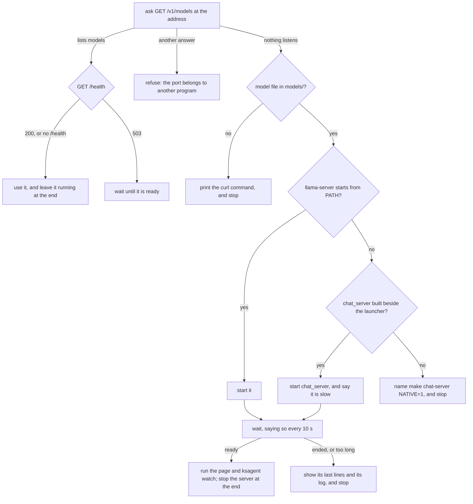

# tools — the design

**Why Kanso's own development tools are built the way they are.** It is for whoever changes a tool in `tools/`. What each file does is in the table in [`tools/README.md`](../README.md); the rules every document follows are in [`docs/SPEC-documents.md`](../../docs/SPEC-documents.md).

## The API record

Every package keeps a plain text list of the names it publishes, its *API record* `SURFACE.txt`: one line per published function, type or constant. `tools/surface.kspl` and `surface_rows.kspl` write and check it. The browsable *reference* is `ksplc doc`'s output, which `pages` writes under `out/docs/`. What the gate checks is "The record of a published API" in [`docs/SPEC-gates.md`](../../docs/SPEC-gates.md).

### Why the record and the reference are two renderings

**Both render the lines of one walk** (`surface_lines` in `ksplc/tools/surface.kspl`), so they cannot disagree. Only the record goes into git; why is "The reference is rendered when asked, not committed" in [`docs/DESIGN-repository.md`](../../docs/DESIGN-repository.md).

| | The record (`SURFACE.txt`) | The reference (`out/docs/`) |
| :-- | :-- | :-- |
| Committed to git? | yes | no |
| What it holds | each published name and its signature, with no formatting | the same names, plus the descriptions of each parameter and return value |
| What a diff of it means | "the API changed", and nothing else | nothing to diff: it is rebuilt when asked |

**The reference holds more than the record**: the `//<` rows for parameters and return values, which `SURFACE.txt` leaves out ("Writing out the published API" in [`ksplc/docs/SPEC-tools.md`](../../ksplc/docs/SPEC-tools.md)). **The pages under `out/docs/` are `ksplc doc`'s output and nothing else**, so no gate needs to check them.

**A file that cannot be read on its own stops the record.** A record missing a file would show every entry in it as removed.

## Explaining a make target

**`make explain T=<target>` says what one target is made of, in one screen** (`tools/make_explain.kspl`, with `tools/make_settings.kspl` and `tools/make_db.kspl`). The build is the root `Makefile`, the files in `mk/` and the packages' own Makefiles. A target's recipe names variables that other files define, and those name more. Without this command, a person follows each name by hand, file by file.

The answer has five parts, in this order:

1. Where the rule is written (`file:line`), and its `##` line from `make help`.
2. Each prerequisite: how the rule writes it, where it is made, and whether make would remake it now.
3. The commands, filled in for the settings given.
4. Every variable the recipe and the prerequisites read: its value, its operator, where it is set. A value made of variables is followed below it, one level at a time.
5. The settings it takes on the command line: the value given or the default, what leaving each out does, and who reads it.

**`T=<folder>:<target>` explains a package's own Makefile** as `make -C <folder> <target>` reads it. The settings typed beside it (`make explain T=chat MODEL=x.gguf`) are explained as given.

| Decision | Why |
| :-- | :-- |
| **Every value and place comes from make itself**: its database (`make -p`), `make -n`, and `--eval` | A hand-written description drifts from the make files. Make's own answer cannot, whatever a make file does |
| **No recipe line runs: every target's shell is one that does nothing** (`--eval='%: SHELL := true'`) | Make runs a line holding `$(MAKE)`, or starting with `+`, even under `-n` and `-q`, so a look at a gate ran the whole gate. The shell is set per target, so a `$(shell)` read while make parses still runs, and the values stay the build's |
| **Make is run with its messages in English** (`LC_MESSAGES=C`, no `LC_ALL` or `LANGUAGE`) | A make in a Japanese locale writes the database's comments in Japanese, and every target then reads as unknown. The character set stays the person's: under `LC_ALL=C` it is ASCII, and the root make file warns of that. The messages make prints are fixed text in this language alone |
| **The make files are read only for what the database leaves out** | The database names no line for a rule without a recipe, writes `?=` as `=`, and records no line in a branch not taken |
| **A rule line read from the files is kept only where the database holds its prerequisites** | Reading alone cannot tell which `ifeq` branch make took. Make's record of the prerequisites can |
| **The commands are `make -n` with the prerequisites taken as made** (`-o`) | Its own recipe stays on the screen. The prerequisites' builds would bury it, and each is explained by its own `make explain` |
| **Each prerequisite gets one line, with its state from one `make -pqk`** | The line answers whether asking for the target builds that prerequisite first, without printing its commands |
| **A file that is there is shown as if its first prerequisite had changed** (`-W`), decided from the database | With its prerequisites taken as made, `make -n` remakes only a phony target or a missing file, and prints nothing for the rest. Make's words for that ("is up to date") are not read |
| **A simple variable is followed through the line that sets it** (`BOOT_CFLAGS := $(CFLAGS)`) | Its value is already expanded, so the value alone hides the names it was made of |
| **Every line that sets a variable is listed, with the conditionals around it** | The database names only the line that took effect. A setting such as `LLVM=1` acts through an `ifeq` around another line |
| **A recursive variable's current value is asked of make only where expanding cannot act** | Expanding a value that holds `$(shell)` or `$(error)`, in either bracket, would run a command or stop make. Such a value is shown as written |
| **A setting is a name it reads that is unset, set with `?=`, given, or taken from the environment** | These are the names a person is meant to set. A plain `=` or `:=` in a make file is the build's own value |
| **Where a setting is handed to a program, the program and its source are named, and its `--help` tells the rest** | Make only passes the value on. What the program does with it, and its own default, are the program's to say |
| **A setting given that the target never reads is named, with the nearest name it reads** | A misspelt `MODLE=x` otherwise changes nothing, and nothing says so (Principle 5 in [`docs/DESIGN-principles.md`](../../docs/DESIGN-principles.md)) |
| **An unknown target is refused, with the nearest names** | "No rule to make target" alone leaves the person to search the files again |
| **The seed runs it** | A compiler broken by the change at hand does not stop the explanation of how to rebuild it |
| **Only GNU make 4 or later is asked**; any other make is refused by name | The database's format and `--eval` are GNU make's. macOS's own make is 3.81, so the target passes gmake where it is installed |
| **The calling make's flags are not handed on**, only its settings | Its `-n` would stop every answer, and its `-j` hands on a jobserver the tool cannot use |
| **The answer is plain text, one form for a person and a model alike** | A second format would be a second thing to keep right, and a model reads the text as it stands |

**What it gives up**:

* **A rule made by `$(eval)` is placed by its recipe's line alone.** A target name built by a function, such as `$($(x))`, is not found in the make files.
* **A value that would run a command when expanded is shown as written**, not as make would expand it. In the commands, a `$(shell)` gives nothing, and a line under them says so.
* **A target that sets its own `SHELL` keeps it**, as make lets a target's own value win. Its `$(MAKE)` lines would then run. The repository's make files set none.
* **A sub-make's own target is not followed.** The answer names the sub-make, and `T=<folder>:<target>` explains that target.
* **It asks make several times**, each a parse of the whole build. That takes a few seconds, and runs any `$(shell)` the make files run at parse time.

## The coding assistant

`tools/ai_assist/` builds an AI that fills in missing KSPL code, and the KSPL compiler decides whether each answer is good. What each file does is in [`tools/ai_assist/README.md`](../ai_assist/README.md); what is left is in the "tools" section of [`docs/PLAN.md`](../../docs/PLAN.md).

The task is *fill-in-the-middle* (FIM): the model sees the code before and after a gap (a *hole*) and writes what goes in the gap.

### The approach: borrow for training, KSPL for checking and serving

| Part | What it uses |
| :-- | :-- |
| **Training** | It can borrow an existing model: a large LLM, or LoRA fine-tuning of a small coding model (training only a few added parameters) |
| **Checking** | KSPL's own tools: `ksplc` (compiling), `lint` and `fmt` |
| **Serving** (running the model) | KSPL: inference runs on `ksai` with safetensors weights (`ksai/examples/fim_coder` and `ksai/examples/qwen_infer`) |

**The compiler is the judge** (the *compiler oracle*). What is generated and trained on is checked by a program, not by a person. The main measure is the rate at which `ksplc` accepts a file once the completion is inserted.

**It lives in `tools/`, not in `ksai/`, because it runs only inside the whole tree**: it starts the compiler and reads this repository as its corpus. It runs the engine's examples as processes, and imports only the tokenizer, which is trained on the same chunks that it encodes.

### Implementation language: KSPL for data, evaluation and the gate

**Whatever reduces to the compiler oracle is KSPL.** Calling `ksplc` as a child process and judging the result needs no machine-learning library; it uses `run_capture` in [`std/subproc.kspl`](../../std/subproc.kspl).

**What depends on the outside ML ecosystem stays in Python on purpose** (`transformers`, `peft`, `torch` and the like): it is an outside reference that checks the KSPL code. Those helpers import the libraries inside a function, so a file loads without them.

### How a completion is scored

**A hole counts only where removing its line breaks compilation** (`eval_fim.kspl`). So the original line scores 100% and an empty completion 0%, by construction. A comment or a blank line compiles when empty, and counting it would let "nothing" pass.

**`fim_coder complete` returns several candidates, and the compiler chooses among them.** This scores clearly higher than the single most likely (*greedy*) candidate. So `eval_fim --model=native` reports both:

| Score | What it counts |
| :-- | :-- |
| pass@1 | the greedy candidate compiles |
| pass@K | any one of K candidates compiles |

**A line the compiler accepts is not always the line meant.** Far fewer completions match the original line exactly. So the rate measures valid KSPL, not right KSPL.

**Settings are compared by the held-out loss, not by the compiler's rate.** The *held-out loss* is the model's error on code it was not trained on. At this model size, a new random seed moves the compiler's rate more than a change of optimizer or batch does. The held-out loss hardly moves. So `make fim-eval` prints the held-out loss (`fim_coder loss`) before the rates. The loss `train` prints is on its training data, so it cannot stand in.

**The held-out loss is printed over every position, and over the middle alone** (the hole's tokens and its end marker), which is the task itself.

**Adam is the default optimizer** (`FIM_OPTIMIZER=sgd` selects SGD). At the default batch and step count it reaches a lower held-out loss than SGD, by more than two seeds of one setting differ. Its steps take longer.

### Why the assistant runs outside the language server

**The AI runs as its own process, not inside the language server.** Inside, it would cost memory and delay on every keystroke, and its crash would take the server down. Kept apart, the compiler and the seed are untouched.

`fim_coder complete` fills a file of holes. **An editor bridge is not built until the completions are worth its cost**, since it adds work to every keystroke.

## The desktop opener

Double-clicking a `.ksmd` document runs ksmd's opener, [`../ksmd_open.kspl`](../ksmd_open.kspl). It makes sure a local kssrv server is running for the document's workspace, then makes the browser open the document's page. It chooses only the folder to serve and the port to start from; the rest is [`../opener.kspl`](../opener.kspl). ksagent's chat opener shares it ("Opening the chat page" below). The steps that tie the file type to it are "Opening a `.ksmd` document on a double-click" in [`docs/HOWTO-set-up-a-project.md`](../../docs/HOWTO-set-up-a-project.md#opening-a-ksmd-document-on-a-double-click).

```mermaid
sequenceDiagram
    participant U as the user
    participant O as the opener
    participant R as the saved record
    participant S as kssrv
    participant B as the browser
    U->>O: double-clicks a .ksmd
    O->>R: take the lock; is a server for this folder listed?
    O->>S: if listed, ask /api/status with its token
    alt no live server for this folder
        O->>S: start one on a free port
        S-->>O: prints its URL and token once, into the log
        O->>R: add this server to the record
    end
    O->>R: let the lock go
    O->>B: start it on a small page (the token is inside the page, not on the command line)
    B->>S: the page moves on to the URL and loads the document
    O-->>U: says where the page is, without the token, then exits
```

### Where the double-click opener lives

**The opener is a leaf** ([`../opener.kspl`](../opener.kspl)), because only a leaf can know both the server and the page. (A *leaf* is a folder such as `tools/` that can point at every package but that no package points at.) `kssrv` knowing the `?doc=` shape, or `ksmd` knowing how the server is started, would be a sideways reference ("Reference direction between documents" in [`docs/SPEC-documents.md`](../../docs/SPEC-documents.md)).

**Which folder is served, and from where the page comes:**

| Decision | Why |
| :-- | :-- |
| **The page is served from outside the root** (`kssrv --page=<file>`), not copied into the user's folder. | Copying a 2MB page into the folder at every opening would fail on a read-only folder. |
| **The folder served is the document's workspace** ("Opening a `.ksmd` document" below). | Serving only the document's folder would leave the files it includes unreachable. |
| **The served folder is remembered as an absolute path.** | `.` and `/home/me/devel` are one folder but two strings, and would start two servers on the same folder. |

Why that one named page file gives the client no more reach is "Where it listens" in [`docs/SPEC-local-server.md`](../../docs/SPEC-local-server.md).

**Reusing a server:**

* **A running server is reused, but only one serving the same folder, never one picked by its port number.** One server per document would multiply, and a server for another folder cannot read the document. So the saved record holds a list of servers (`state_text` in `tools/opener_aim.kspl`).
* **The record drops a server when it stops answering, never at a count.** Cut at a count, it would drop a server still running, which `--list` and `--stop-all` then cannot reach. On Windows its program file would stay locked against the build.
* **When the named port is taken, the next one is tried**, tested with the same binding kssrv uses. Giving up after one would make every document in another folder fail to open.
* **A server counts as alive only when it accepts the token.** Any program can be listening on an open port. On a local server, `/api/status` needs the token, so a 200 means the peer is kssrv.

**Several documents opened at once** (each starts its own opener, at the same moment):

* **One lock is held from looking at the record to writing it** (`out/tmp/ksmd_open.lock`, `open_or_start` in [`../opener.kspl`](../opener.kspl)), and `--list`, `--stop` and `--stop-all` take it too. Without it, two openers each start a server, and one record overwrites the other, losing a server nobody can then reach.
* **The lock is the operating system's** (`fs.File_lock`), let go however the process ends. A lock file the opener made would outlive a crash and stop every later opening.
* **Each server writes its own log, named by its port** (`out/tmp/ksmd_open.<port>.log`), chosen free under the lock. One shared log would hand one opener the URL another's server printed.
* **What it gives up**: an opening waits while another starts its server, a few seconds at most.

**Keeping the token secret:**

* **The token is kept in files that only their owner can read**: the record (`out/tmp/ksmd_open.state`), the server's log and the page handed to the browser. Each is created with mode 0600 (`fs.write_unique`), and replaced with `fs.replace_file`'s owner-only rule (`write_owned` in [`../opener_aim.kspl`](../opener_aim.kspl)). On Windows no mode is set, and the folder decides who can read them.
* **The token never goes on a command line**, where `ps` shows it to every user on the machine. The opener reads it from the line kssrv prints once at start-up. It hands it to the browser inside a page ("The browser is handed a page, never the URL" below).
* **The token is put out only with `--show` or `--list`**, which a person asks for at a terminal. A double-click sends the opener's output where others can read it, such as the system journal. So when it opens a document without `--show`, the opener puts out the URL without its fragment.

**Starting the browser:**

* **The opener tries the environment's tools in turn, and always says how to open the page by hand.** Where one tool is absent, nothing happens and nothing says so. Each environment has its own list (`OPENERS` / `OPENERS_WIN` in `tools/opener.kspl`).
* **On POSIX, a tool is looked up on the PATH before it is started.** Starting even a missing tool creates the child there, and the failure shows only inside it.
* **Do not mix the environments' tools in one list.** On Windows a tool counts as handed over as soon as it starts, so MSYS2's `xdg-open` first would report success without starting any browser.
* **On Windows, the page goes to `explorer.exe`**, which opens one file with the program the system holds for its type: the default browser for `.html`. Its path is written with `\`.
* **`cmd /c start` cannot be used.** Each argument is passed in its own quotation marks (`kspl_win_build_cmdline` in [`../../ksplc/gen/runtime/hosted_spawn.c`](../../ksplc/gen/runtime/hosted_spawn.c)), and cmd does not recognise `"start"` as an internal command. Do not fix it by dropping the quoting: that function stops argument injection.
* **"Handed over" is not reported as "opened"**, since a tool can start and still show nothing. So the opener always prints how to open the page by hand and where the messages are.
* **On Windows, a path's `\` becomes `/` inside the URL.** On POSIX, `\` can be part of a file name, so it is kept there.

**How it is installed and checked:**

* **The file association points at the built executable** (`out/ksmd_open.exe`, built by `make ksmd`), which finds kssrv beside itself. Started by a double-click, `ksplc run ...` would run in home or `/`, where neither `std/` nor `out/` can be found.
* **The opener exits once the URL is passed to a browser, and the server stays** for the next opening. Only with `--show` does it wait and pass the server's output through (`tools/tests/ksmd_launch.kspl` uses that).
* **The document to double-click is an example the tree keeps**, [`ksmd/examples/overview.ksmd`](../../ksmd/examples/overview.ksmd), which `make ksmd` names. It holds a table that calculates and an include, so the opened page shows both working.

**What it gives up**:

* **Only the servers in the record can be listed and stopped.** One started by hand, or one that has stopped answering, is left to the operating system's own tools.
* **Only the Linux association is installed automatically**, by `make install` through `make install-desktop`. The gates install it into a scratch folder and check the files there.
* **On Linux, the files go to the user's data folder**, `$XDG_DATA_HOME` or `~/.local/share`, or under a named `PREFIX`'s `share`. The two caches are rebuilt where their tools exist; a missing tool is a note.
* **Only the user's own install sets the default program** (`xdg-mime default`). Under a named `PREFIX` other users can share the files, and the choice of program stays each user's.
* **On Windows, make writes no registry entry.** Only Windows' own "Open with" dialog sets a file type's default program, so the person ties the type there, once.

### The browser is handed a page, never the URL

**The URL carries the token, so the browser is started on a small page, which moves on to the URL at once** (`page_text` in [`../opener_aim.kspl`](../opener_aim.kspl)). A browser's command line is open to every user while the starter runs, and the browser keeps it among its own arguments.

The page moves on with a `refresh`, and the fragment (the part after `#`) travels with it. So the page reads the token as from a URL typed by hand. The page offers the link too, for a browser that does not follow a `refresh`.

| Decision | Why |
| :-- | :-- |
| **Each run writes a page of its own** (`fs.write_unique`). | Several openers at once would hand each browser the page written last. |
| **A page is removed by a later run, once it is older than `page_keep_s`** (`sweep_pages`). | The opener exits as soon as the browser is started, and a cold browser can take a while to read the page. |
| **The page lies in `tmp/` next to the server, not in a hidden folder.** | A browser confined by its packaging (a snap) reads no hidden folder under home. |

**What it gives up**: a browser on another system (Windows' browser started from inside WSL) can fail to reach the page's path. `--show`'s URL is then the way in.

### Listing and stopping the servers it left

**The server stays running after an opening, so the opener can also list those servers and stop them.** `--list` prints each running server's URL and folder; `--stop=<folder>` stops the one serving that folder, and `--stop-all` every one (`tend` in [`../opener.kspl`](../opener.kspl)).

**A server counts as running only when it answers with its token.** A process number is handed to the next process, so a stop by number could end an unrelated program.

**A server is picked by the folder it serves, not by its port**, which changes when a taken one is skipped. The folder is made absolute and loses a trailing separator first (`trim_end_sep` in [`../opener_aim.kspl`](../opener_aim.kspl)), so the one typed with tab completion is the one the record holds.

**A stop is asked of the server itself** (`POST /api/stop`, "Stopping it when asked" in [`docs/SPEC-local-server.md`](../../docs/SPEC-local-server.md)), with the token from the record. It is reported only once the server no longer answers.

**The URL printed carries the token**: it opens the page again, and whoever can run the opener can read the record anyway.

**Each mode stands alone.** A document or another option beside `--list`, `--stop` or `--stop-all` is refused rather than ignored. A folder with no server is a failure, so a mistyped folder does not read as stopped. `--stop-all` with nothing running is not a failure.

### The opener opens no console, yet prints to the parent's

**On Windows the opener is built for the windowing subsystem, and attaches to the console it was started from when there is one.** Double-clicked, it shows no black console window. Typed in a terminal, it still prints the address to open there. The generated entry point attaches to the parent's console before anything is written (`kspl_io_attach_console` in [`../../ksplc/gen/runtime/hosted.c`](../../ksplc/gen/runtime/hosted.c)).

**Two executables are ruled out**, because the choice would be made twice: by whoever types the name, and by the file association. The price is that the prompt returns before the last line.

**The server it starts gets no console window either.** A windowing program that starts a console program gets a fresh console window for the child (`spawn_redirect` in [`../../std/subproc.kspl`](../../std/subproc.kspl)). With no window to close, the server stops itself once no page holds it open: when the last ksmd tab closes.

**With `--show`, the server shares the opener's console instead** (`spawn_beside`). It has no idle stop then, so the Ctrl+C that stops the opener must reach the server too. Without a console, the server would keep running.

Note: The server's output and the browser's are written beside the opener, under the names `LOG_EXT` / `Where.browser` in [`../opener.kspl`](../opener.kspl).

### Opening a `.ksmd` document

**ksmd's opener is a program of its own, `tools/ksmd_open.kspl`, built as `out/ksmd_open.exe`.** ksmd is a library and a page, with no program to add an `open` command to. Only a leaf may know both kssrv and ksmd's page.

ksmd needs a workspace that holds the document's includes, and one port for it on every run ("Opening a document from the desktop" in [`ksmd/docs/DESIGN-ksmd.md`](../../ksmd/docs/DESIGN-ksmd.md)). The rules are in [`../opener_aim.kspl`](../opener_aim.kspl), each checked alone by [`../tests/ksmd_aim_test.kspl`](../tests/ksmd_aim_test.kspl).

**Which folder is the workspace:**

| Decision | Why |
| :-- | :-- |
| **The workspace is the nearest folder at or above the document that holds a file named `.ksmd-workspace`.** Without one, it is the document's own folder. `--workspace=<folder>` names it for one run instead | An include that climbs with `../` must stay inside the folder the person chose. The mark keeps that choice in the folder, so no list of known folders goes stale |
| **Only `.ksmd-workspace` marks a workspace; a `.git` folder does not** | A repository at the home folder would then serve every file there to whoever holds the token |
| **`--workspace` exists beside the mark** | A folder can be read-only, or shared with others |
| **A path holding `..` is refused, not folded away.** `.` and doubled separators drop, and a Windows drive letter is upper-cased | The port follows from the path's text, so one folder needs one spelling. Windows ignores a drive letter's case. Behind a link, `a/link/..` is another folder than `a` |
| **A document that is a link, or lies under a folder that is one, is refused before anything starts** | The server opens no link inside its root (`fs.stays_under`), and the opener asks the same function |
| **A name not ending in `.ksmd` is refused, in any case** | Windows and the Linux MIME globs both hand `NOTES.KSMD` to the association |

**Which port it gets:**

| Decision | Why |
| :-- | :-- |
| **The port is 20000 plus the FNV-1a hash of the workspace's absolute path, modulo 10000** (`home_port`) | The browser keeps drafts per address, the port included. A port that changed between runs would hide every draft held before |
| **The port is worked out, never remembered** | A record can be lost with `out/` or another clone |
| **Ports 20000 to 29999** | The OS hands out outgoing ports from 32768 on Linux and 49152 on Windows and macOS. Development servers mostly take ports below 10000 |
| **Do not change the formula** | Every workspace would move, with its drafts. The test pins a few values, so a change fails it |
| **A running server for the workspace is reused, whatever its port** | A server that started on another port keeps its drafts there until it stops |
| **A taken port is skipped, and the run says so.** The next free port of the 16 after it is used | The page cannot see another port's drafts, so the line says why they seem gone. Once the port is free again, the next run returns to it |

**What it gives up:**

* **Two workspaces can share a port.** With ten workspaces, the chance is about one in 200. While both run, the second one opened takes the next free port.
* **One folder spelt two ways is two workspaces**, such as another letter case on Windows or a path through a link.
* **Each opening shows a new browser tab.** The opener cannot bring forward a tab that another program opened. Two tabs on one document keep two drafts, so nothing is lost.

### Opening the chat page

**Asking about a folder is one command, `make chat DIR=<folder>`, which runs `tools/ksagent_chat.kspl`, built as `out/ksagent_chat.exe`.** It makes sure a model server answers ("Starting the model server" below). It starts or reuses a local server that serves the chat page for the folder, and hands the URL to the browser. It then runs `ksagent watch` on the folder in the foreground, so one command both opens the page and answers it. **`make chat` hands it every option, empty where a setting is not given**, and the launcher makes every choice ("A run target writes every option out" in [`docs/DESIGN-repository.md`](../../docs/DESIGN-repository.md)). `out/ksagent_chat.exe --help` names each default.

**It shares the desktop opener** (`tools/opener.kspl`): the lock, the note, the free port, the handed page and `--list` / `--stop`. Each opener names what it opens in an `App` (`tools/opener_aim.kspl`): its name, its page beside the server, and the start of its files' names in `tmp/`.

| Decision | Why |
| :-- | :-- |
| **A leaf starts the server and `ksagent watch` together** | ksagent and kssrv do not know each other ("Reference direction between documents" in [`docs/SPEC-documents.md`](../../docs/SPEC-documents.md)), and a page may start no program |
| **The chat opener keeps its own note** (`ksagent_chat.state`) | A ksmd server and a chat server for one folder serve different pages, so neither may be reused for the other |
| **A new chat server looks for a free port from 30000** | ksmd's workspaces take 20000 to 29999, and the chat page keeps no draft, so its port needs not stay the same |
| **The page is copied beside the server** (`out/ksagent/chat.html`) | The page is served from outside the root, as ksmd's is. It is one file, so the copy is all its build |
| **With `--show`, the server it started stops when `ksagent watch` ends** | A server started for `--show` has no idle stop, so it would outlive the run |

**What it gives up**: the browser check drives it with `--show` (`make test-ksagent-chat`), so no gate checks how it starts a browser, as for ksmd's opener.

### Starting the model server

**The launcher uses a model server that already answers where ksagent asks.** Otherwise it starts one, waits until it has loaded, and stops it at the end (`tools/model_server.kspl`). So a person runs one command in one terminal, and no server outlives it holding the graphics card's memory.



| Decision | Why |
| :-- | :-- |
| **The launcher starts the model server, though a page may start no program** | The person's own command starts it, once, before any page opens. No page request reaches it ("It starts no program" in [`docs/SPEC-local-server.md`](../../docs/SPEC-local-server.md)) |
| **It chooses the server itself: `llama-server` where it starts from PATH, otherwise `chat_server`** | The person makes no choice. `llama-server` uses the graphics card. `chat_server` needs nothing from outside, so the command works without llama.cpp, slowly, and says so |
| **Starting `llama-server` is the test of whether it is on PATH** | The runtime looks a bare name up in PATH alone, on every OS. A second lookup could disagree with it |
| **Where neither `llama-server` nor a built `chat_server` is there, the launcher stops and names `make chat-server NATIVE=1`** | Installing llama.cpp is the better way. A build that started by itself would commit the person to answers that take minutes. A program that make started would also need make's name and settings to build |
| **A model server is one whose `GET /v1/models` lists models** | Something else on the port answers otherwise, and is refused by name, not taken for a server that never gets ready |
| **`GET /health` answering 503 means that it still loads** | `llama-server` listens before its model is loaded, and answers `/v1/models` meanwhile. `chat_server` listens only once it is ready, and has no `/health` |
| **The wait says what it waits for, and again every 10 seconds** | Loading takes seconds to minutes; a silent wait reads as a hang |
| **A server that ends before it is ready shows its last 12 lines and its log's path** | Its own words name the cause, such as memory that ran out. A hint follows where it says `out of memory` |
| **A missing model file stops the launcher with the `curl` command to run** | A download of gigabytes that starts by itself holds the terminal for minutes with no choice. The person sees the size first |
| **Only the server this run started is stopped** | A server the person started is theirs, and other programs can use it too |
| **The server shares the launcher's console** (`spawn_beside` in [`std/subproc.kspl`](../../std/subproc.kspl)) | Ctrl+C at the console reaches it as it reaches the launcher, so it stops even when the launcher is stopped before it can act |
| **The launcher takes the model server's port, `--port`, and hands `ksagent watch` the address on this machine** | The address is made once, so the server started and the server asked cannot differ. `make chat PORT=<n>` names the port |
| **A model file named for a server not started here is refused** | That server keeps its own model, so the name would change nothing (Principle 5 in [`docs/DESIGN-principles.md`](../../docs/DESIGN-principles.md)) |
| **With `chat_server`, ksagent waits an hour for one reply** | It reads a prompt several times slower than `llama-server`, and ksagent's own limit would end a question it still answers |
| **`llama-server`'s options stand in `tools/model_server.kspl` alone**, and `make model-server` runs the launcher with `--model-only` | `ksagent ask` and `eval` need a server alone. Through the launcher it gets the same options, the same choice and the same messages |
| **`llama-server` keeps the conversation's memory at 8 bits** (`--cache-type-k q8_0 --cache-type-v q8_0`) | At 16 bits, 32,768 tokens of the first model take 4.5 GiB, and the model and its conversation do not fit a 6 GB card together. At 8 bits the conversation takes 2.4 GiB. The sums are at `LLAMA_OPTIONS` |
| **`--flash-attn on` is written out, and needs llama.cpp b6325 (August 2025) or later** | An 8-bit value cache needs flash attention. Written out, the need does not hang on a default that changed between builds. A build that runs the second model is newer anyway |

**What it gives up**:

* **Two launchers can share one model server**, and the one that started it stops it at its end. The other's questions then fail with a line that says so, until the person runs it again.
* **A launcher killed outright leaves its model server running.** Ctrl+C and closing the terminal reach the server too; `kill -9` and the Task Manager do not. Holding the server in a job that the OS ends with the launcher would need a change in the C runtime and a new seed.
* **On Windows, only the cross-compiled link is checked here.** The stop on Ctrl+C is confirmed on Linux alone (`make test-ksagent-chat`).
* **A built `chat_server` is not built again after its sources change.** Run `make chat-server NATIVE=1` again after pulling a change to it.
* **The launcher asks a model server on this machine only.** For a server on another machine, run `ksagent watch --model-url=<url>` yourself.
* **The launcher does not check llama.cpp's version.** An older build refuses `--flash-attn on`, and the last lines the launcher shows say `invalid argument`.
