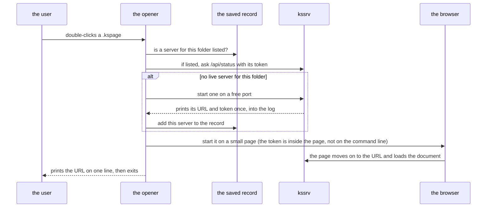

# tools — the design

**Why Kanso's own development tools are built the way they are.** It is for whoever changes a tool in `tools/`. What each file does is in the table in [`tools/README.md`](../README.md); the rules every document follows are in [`docs/SPEC-documents.md`](../../docs/SPEC-documents.md).

## Contents

* [The API record](#the-api-record)
* [The coding assistant](#the-coding-assistant)
* [The desktop opener](#the-desktop-opener)

---

## The API record

Every package keeps a plain text list of the names it publishes (its API), and a tool writes and checks that list. A second tool turns the same information into pages you can browse.

The list is the package's *API record*, `SURFACE.txt`: one line per published function, type or constant. `tools/surface.kspls` and `surface_rows.kspls` write and check it. The browsable *reference* is `ksplc doc`'s output, which `pages` writes under `out/docs/`. What the gate checks is in "The record of a published API" in [`docs/SPEC-gates.md`](../../docs/SPEC-gates.md).

### Why the record and the reference are two renderings

Both come from one walk over the published names, so they cannot disagree. Only the record goes into git.

Both render the lines of one walk (`surface_lines` in `ksplc/tools/surface.kspls`).

| | The record (`SURFACE.txt`) | The reference (`out/docs/`) |
| :-- | :-- | :-- |
| Committed to git? | yes | no |
| What it holds | each published name and its signature, with no formatting | the same names, plus the descriptions of each parameter and return value |
| What a diff of it means | "the API changed", and nothing else | nothing to diff: it is rebuilt when asked |

**Only the record is committed.** It holds no formatting, so its diff means "the API changed" and nothing else: adding one function changes one line. If the reference were committed too, a change to the page layout would rewrite every page without publishing anything new. A copy of every description would also sit beside its source. Go splits it the same way: its `api/go1.txt` sits beside godoc rather than inside it. Why the reference is not committed at all is in "13.11 The reference is rendered when asked, not committed" in [`docs/DESIGN.md`](../../docs/DESIGN.md).

**The reference holds more than the record.** The rows written with `//<` for a parameter and a return value are the half of a reference a reader most needs. `SURFACE.txt` leaves them out ("Writing out the published API" in [`ksplc/docs/SPEC-tools.md`](../../ksplc/docs/SPEC-tools.md)). That is the one place where the two need different content, not only a different shape. The split is the same: share the walk, not the output.

**The pages under `out/docs/` are `ksplc doc`'s output and nothing else.** `pages` runs the command once per publishing file and once for the package. So a page cannot say anything the command would not, and no gate needs to check them.

**A file that cannot be read on its own stops the record.** A record missing a file would show every entry in it as removed.

## The coding assistant

`tools/ai_assist/` builds an AI that fills in missing KSPL code, and the KSPL compiler decides whether each answer is good.

The folder makes the training data, scores the completions and trains the model. What each file does is in [`tools/ai_assist/README.md`](../ai_assist/README.md); what is left to build is in [`tools/docs/PLAN.md`](PLAN.md).

The task is *fill-in-the-middle* (FIM): the model sees the code before and after a gap (a *hole*) and writes what goes in the gap.

### The approach: borrow for training, use KSPL for checking and serving

| Part | What it uses |
| :-- | :-- |
| **Training** | may borrow an existing model: a large LLM, or LoRA fine-tuning of a small coding model (LoRA trains only a few added parameters, not the whole model) |
| **Checking** | KSPL's own tools: `ksplc` (compiling), `lint` and `fmt` |
| **Serving** (running the model) | KSPL: inference runs on `ksai` with safetensors weights (`ksai/examples/fim_coder` and `ksai/examples/qwen_infer`) |

**The compiler is the judge.** What is generated and trained on is checked and filtered by a program, not by a person. The main measure is the rate at which `ksplc` accepts a file once the completion is inserted. Using the compiler this way is called the *compiler oracle* below.

**It lives in `tools/`, not in `ksai/`, because it imports nothing from the engine.** It starts the compiler and reads this repository as its corpus, so it runs only inside the whole tree. The engine's examples take the corpus and the tokenizer by path, and this folder runs them as processes.

### The implementation language: KSPL for the data, the evaluation and the gate

**Whatever reduces to the compiler oracle is KSPL.** Calling `ksplc` as a child process and judging the result needs no outside machine-learning library; it uses `run_capture` in [`std/subproc.kspls`](../../std/subproc.kspls).

**What depends on the outside ML ecosystem stays in Python on purpose** (`transformers`, `peft`, `torch` and the like). Porting it would gain little. It would also lose its value as an outside reference that checks the KSPL code. Those helpers import the libraries inside a function, so a file loads without them.

### How a completion is scored

A hole is only counted where the compiler would notice it is empty, and several answers are tried per hole.

**A hole counts only where removing its line breaks compilation** (`eval_fim.kspls`). So the original line (the oracle) scores 100% and an empty completion 0%, by construction. A comment or a blank line compiles when empty, and counting it would let "nothing" pass.

**`fim_coder complete` returns several candidates, and the compiler chooses among them.** This scores clearly higher than the model's single most likely answer (the *greedy* candidate). So `eval_fim --model=native` reports both:

| Score | What it counts |
| :-- | :-- |
| pass@1 | the greedy candidate compiles |
| pass@K | any one of K candidates compiles |

**A line the compiler accepts is not always the line meant.** Far fewer completions match the original line exactly. So the rate measures whether the code is valid KSPL, not whether it is right.

**Settings are compared by the held-out loss, not by the compiler's rate.** The *held-out loss* is the model's error on code it was not trained on. At this model size, retraining one setting with only the random seed changed moves the compiler's rate more than changing the optimizer or the batch does. The held-out loss hardly moves. So `make fim-eval` prints the held-out loss (`fim_coder loss`) before the rates. The loss `train` prints is on its training data, so it cannot stand in for the held-out loss.

**The held-out loss is printed twice: over every position, and over the middle alone** (the hole's tokens and its end marker). The first is mostly the prefix and the suffix, which the model is given, not asked to write. The second is the task itself.

**Adam is the default optimizer** (`FIM_OPTIMIZER=sgd` selects SGD). At the default batch and step count it reaches a lower held-out loss than SGD, by more than two seeds of one setting differ. Its steps take longer.

### Why the assistant runs outside the language server

**The AI runs as its own process, not inside the language server** (the program that gives an editor its completions and diagnostics). A model inside the server's process costs memory and delay on every keystroke, and its crash takes the server down. Kept apart, the compiler is untouched and the seed is unaffected.

`fim_coder complete` fills a file of holes; nothing serves an editor as the user types. **An editor bridge is not built until the completions are worth its cost**: passing completions over, with a fallback on a timeout, adds work to every keystroke.

## The desktop opener

Double-clicking a `.kspage` document runs `tools/kspage_open.kspls`. It makes sure a local kssrv server is running for the document's folder, then makes the browser open the document's page.

The steps that tie the file type to it are in "Opening a `.kspage` document on a double-click" in [`docs/HOWTO-set-up-a-project.md`](../../docs/HOWTO-set-up-a-project.md#opening-a-kspage-document-on-a-double-click).

This is what one opening does. The sections below give the reason for each step.

### Where the double-click opener lives

**The opener is a leaf** ([`../kspage_open.kspls`](../kspage_open.kspls)), because only a leaf may know both the server and the page. (A *leaf* is a folder such as `tools/` that may point at every package but that no package points at.) Packages refer to each other only in the direction of import. So `kssrv` knowing the `?doc=` shape, or `kspage` knowing how the server is started, would be a sideways reference ("Reference direction between documents" in [`docs/SPEC-documents.md`](../../docs/SPEC-documents.md)).

**Which folder is served, and from where the page comes:**

| Decision | Why |
| :-- | :-- |
| **The page is served from outside the root** (`kssrv --page=<file>`). Do not copy the page into the user's folder. | The server serves only what is under its root (the folder it serves). Requiring the page there means copying a 2MB page into that folder at every opening, and a read-only folder could not be opened at all. |
| **For a document inside a KSPL tree, the tree's root is served**; for any other document, its own folder. `std/` marks a tree. | Serving only the document's folder would leave nothing beside it reachable from the page, since the server refuses everything outside its root. |
| **The served folder is remembered as an absolute path.** | `.` and `/home/me/devel` are one folder but two strings. Remembered as written, they make `make kspage` and the file association start two servers on the same tree. |

Why that one named page file gives the client no more reach, and why it is never a folder, is in "Where it listens" in [`docs/SPEC-local-server.md`](../../docs/SPEC-local-server.md).

**Reusing a server:**

* **A running server is reused, but only one serving the same folder, never one picked by its port number.** Do not start a server without looking: one per document multiplies, and their ports collide and are refused. A server for another folder cannot read the document. So the saved record holds a list of servers (`state_text` in `tools/kspage_aim.kspls`). Holding only one, it would lose the first as soon as a second started.
* **When the named port is taken, the next one is tried.** Giving up after one would make every document in another folder fail to open. The question is "can I listen", not "is someone listening", and it is tested with the same binding kssrv uses.
* **A server counts as alive only when it accepts the token.** Do not trust an open port: any program may be listening there. On a local server, `/api/status` needs the token (a secret string the server makes at start-up), so a 200 means the peer is kssrv.

**Keeping the token secret:**

* **The token is kept in files that only their owner may read**: the record (`out/tmp/kspage_open.state`), the server's log and the page handed to the browser. Each is created with mode 0600 (`fs.write_unique`). The record and the log are created beside their place and renamed over it (`write_owned` in [`../kspage_aim.kspls`](../kspage_aim.kspls)), so one written before under another mode does not keep it. On Windows no mode is set, and who may read them is whatever the folder grants, as for the source beside them.
* **The token never goes on a command line**, where `ps` shows it to every user on the machine. The opener reads it from the line kssrv prints once at start-up. It hands it to the browser inside a page ("The browser is handed a page, never the URL" below).

**Starting the browser:**

* **The opener tries the environment's tools in turn to start the browser, and always prints the URL on one line.** Do not rely on one tool: where it is absent, nothing happens and nothing says so. The printed line opens the document even where no browser could be started. Each environment has its own list (`openers` / `openers_win` in `tools/kspage_open.kspls`).
* **On POSIX, a tool is looked up on the PATH before it is started.** There, starting even a missing tool succeeds in creating the child; the failure shows only inside the child. Judged by that alone, an environment without `xdg-open` "thinks it started one" and stops without trying the next tool. Windows refuses at once, so the lookup is not done there.
* **Do not mix the environments' tools in one list.** Windows does not look at the PATH, so a tool earlier in the list counts as handed over as soon as it starts. With `xdg-open` first, an environment where MSYS2 installed it reports success without starting any browser.
* **On Windows, the page goes to `explorer.exe`**, an executable that opens one file with the program the system holds for its type: the default browser for `.html`. Its path is written with `\`, the separator `explorer.exe` reads.
* **`cmd /c start` cannot be used.** Each argument is passed in its own quotation marks (`kspl_win_build_cmdline` in [`../../ksplc/gen/runtime/hosted_spawn.c`](../../ksplc/gen/runtime/hosted_spawn.c)), so `start` becomes `"start"`. cmd does not recognise an internal command in quotation marks (it says "`'"start"'` is not recognized as an internal or external command..."). Do not fix it by dropping the quoting: that function stops argument injection.
* **"Handed over" is not reported as "opened".** A tool can start successfully and still show nothing on the screen, like the `cmd` above, whose message reaches only the log. So even after handing the URL over, the opener prints how to open it by hand and where the messages are. Otherwise a run where nothing appeared would leave nothing to read.
* **The separator inside a URL is `/`.** A path from a double-click on Windows arrives as `out\sample.kspage`, so its `\` becomes `/`. This happens on Windows only: on POSIX, `\` may be part of a file name, and converting it everywhere would make such a document impossible to open.

**How it is installed and checked:**

* **The file association points at the built executable** (`out/kspage_open.exe`, built by `make kspage`), which finds kssrv beside itself. Do not point it at `ksplc run ...`: started by a double-click, its working folder is home or `/`, where neither `std/` nor `out/` can be found.
* **The opener exits once the URL is passed to a browser, and the server stays** for the next opening. Do not keep a process waiting for someone who is not watching a terminal: one would be left per document opened. Only with `--show` does it wait and pass the server's output through (`make kspage` uses that).
* **The document to double-click is built by `make` too** ([`../kspage_doc.kspls`](../kspage_doc.kspls) writes `out/sample.kspage`, and `make kspage` depends on it). Do not write a `.kspage` by hand. Nothing else checks that the association works. With a path one character off, "a double-click does nothing" and "the document is broken" look alike: started by a double-click, the refusal appears nowhere.
* **It is not the sample shown at start-up.** That one is [`kspage/content/sample.kspls`](../../kspage/content/sample.kspls) (`ensure` in `kspage/port/web/state.kspls`), so with it, a run that read the file and one that did not would look the same. It is the `.kspage` of the fuzzing seed ([`kspage/tests/seeds.kspls`](../../kspage/tests/seeds.kspls)), built to hold one of every shape: a merged table, a heading depth, a column set, a number format. So a path that drops any of them shows it. kspage publishes nothing for this ("What kspage publishes for the opener" in [`kspage/docs/DESIGN.md`](../../kspage/docs/DESIGN.md)).

**What it gives up**:

* **Only the servers in the record can be listed and stopped.** One started by hand (`kssrv --local`), one whose record fell past the cap, or one that has stopped answering is not reached. Ending it is left to the operating system's own tools.
* **Installing the association differs per environment** (the Windows registry, a Linux `.desktop` file, a macOS bundle). `make kspage` can assemble the Linux one and check it with `desktop-file-validate`. Whether a double-click opens the document can be confirmed only on a desktop.

### The browser is handed a page, never the URL

The URL contains the token, so the opener never puts it on the browser's command line. It writes a tiny HTML page holding the URL and starts the browser on that page's file path instead.

**The browser is started on the path of a small page, which moves on to the URL at once** (`page_text` in [`../kspage_aim.kspls`](../kspage_aim.kspls)). The URL carries the token. The command line that starts a browser is open to every user while the starter runs, and a browser started that way keeps it among its own arguments for as long as it runs.

The page moves on with a `refresh` (an HTML instruction to load another address). The fragment (the part after `#`) travels with it, so the page reads the token as from a URL typed by hand. The page offers the link too, for a browser that does not follow a `refresh`.

| Decision | Why |
| :-- | :-- |
| **Each run writes a page of its own** (`fs.write_unique`). | Several documents chosen and opened together start several openers at once, and one shared name would hand each browser the page written last. |
| **A page is removed by a later run, once it is older than `page_keep_s`** (`sweep_pages`). | The opener exits as soon as the browser is started, so nothing tells it when the page has been read, and a cold browser can take a while to start. |
| **The page lies in `tmp/` next to the server, not in a hidden folder.** | A browser confined by its packaging (a snap) reads no hidden folder under home, and a page it cannot read opens nothing. |

**What it gives up**: where the browser runs on another system than the opener (Windows' browser started from inside WSL), it may not reach the page's path, and nothing opens. The URL printed on its own line is then the way in. Handing the URL over instead would put the token back on the command line.

### Listing and stopping the servers it left

The server stays running after an opening, so the opener can also list those servers and stop them.

**`--list` prints each running server's URL and the folder it serves, one per line; `--stop=<folder>` stops the one serving that folder, and `--stop-all` every one** (`tend` in [`../kspage_open.kspls`](../kspage_open.kspls)). Without these, the only way to end a server before its idle time is to find its process and kill it.

**A server counts as running only when it answers with its token**, the test the reuse already makes. A record whose server does not answer is dropped from the record and never listed. Do not judge by a process number instead: a number outlives its process and is handed to the next one. A dead server would then be listed as running, and a stop would end an unrelated program.

**A server is picked by the folder it serves, not by its port.** The folder is what the reuse looks a server up by and what a person knows. The port changes from run to run, since a taken one is skipped. The folder is made absolute and loses a trailing separator first (`trim_end_sep` in [`../kspage_aim.kspls`](../kspage_aim.kspls)), so the one typed with tab completion is the one the record holds.

**A stop is asked of the server itself** (`POST /api/stop`, the rule in "Stopping it when asked" in [`docs/SPEC-local-server.md`](../../docs/SPEC-local-server.md)), with the token from the record. It is reported only once the server no longer answers. A stop that was only answered is not reported as done.

**The URL printed carries the token**, as the line printed at an opening does. It is what opens the page again, and whoever can run the opener can read the record anyway.

**Each mode stands alone.** A document or another option beside `--list`, `--stop` or `--stop-all` would do nothing, so the opener refuses it rather than ignoring it. A folder with no server is a failure, so a mistyped folder does not read as stopped. `--stop-all` with nothing running is not a failure.

### The opener opens no console, yet prints to the one it was started from

On Windows, double-clicking the opener shows no black console window. Typed in a terminal, it still prints to that terminal.

**The opener is built for the windowing subsystem, and attaches to the console it was started from when there is one.** (Windows marks each executable as a console program or a windowing program; a console program always gets a console window.) Opened from a document, it shows no window. Typed in a terminal, it still prints the line saying which address to open. The generated entry point attaches to the parent's console before anything is written (`kspl_io_attach_console` in [`../../ksplc/gen/runtime/hosted.c`](../../ksplc/gen/runtime/hosted.c)).

**Two executables are ruled out**, because the choice would be made twice: once by whoever types the name, and once by the file association, which is set once and never looked at again. The price is that the prompt returns before the last line, since a command processor does not wait for a windowing program. The opener prints a line or two and finishes.

**The server it starts gets no console window either.** A windowing program that starts a console program gets a fresh console window for the child. So hiding only the opener's window would move the black window rather than remove it (`spawn_redirect` in [`../../std/subproc.kspls`](../../std/subproc.kspls)). With no window to close, the server stops itself once no page holds it open: when the last kspage tab closes.

Note: The server's output and the browser's are written beside the opener, under the names `log_rel` / `browser_rel` in [`../kspage_open.kspls`](../kspage_open.kspls).
