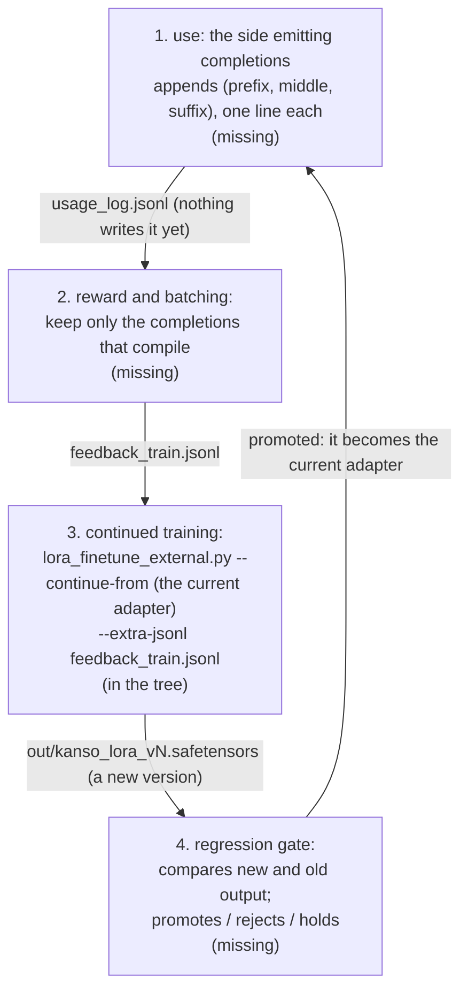

# tools — what is left

**Only what is not done is listed here.** A finished stage is deleted, and its result goes into the document of its kind ("Document naming" in [`SPEC-documents.md`](../../docs/SPEC-documents.md)). What spans packages is in [`docs/PLAN.md`](../../docs/PLAN.md).

All of it belongs to the coding assistant (`tools/ai_assist/`): a small AI model that fills in a gap in KSPL code from the code before and after it. That task is called *fill-in-the-middle* (FIM). What is in place is in [`tools/ai_assist/README.md`](../ai_assist/README.md), and why it is built that way is in "The coding assistant" in [`tools/docs/DESIGN.md`](DESIGN.md).

## The stages

Two stages are left: first an assistant that actually knows KSPL, then a loop that lets it keep learning from use.

| | What is left | What it gives the user | What marks it as done |
| :-- | :-- | :-- | :-- |
| stage 2 | **A LoRA that speaks KSPL.** A *LoRA* (or *adapter*) is a small set of added weights trained on top of an existing coding model, instead of retraining the whole model. No adapter is trained on the FIM corpus yet: the adapter that shows the pipeline runs is close to untrained. Training one needs only the FIM corpus `make_fim.kspls` writes and `lora_finetune_external.py` as it is | Completions that know KSPL, from an existing model | `eval_fim.kspls`'s compile pass rate on `corpus/fim_val.jsonl` (how often a file still compiles once the completion is inserted) beats the base model's |
| stage 3 | **The self-evolution loop**: the assistant keeps training on its own completions that compiled. Of the loop below, only continued training exists (`lora_finetune_external.py --continue-from`). Missing: ① the part that emits completions and writes the usage log, ② the part that scores with `ksplc_oracle` (the compiler used as the judge) and keeps only what passed, ③ the regression gate that compares new and old output and promotes, rejects or holds. ② and ③ need only the compiler reward, so they can be built as soon as ① exists | An assistant that gets better at the code you actually write | The loop turns once end to end: a usage log written, scored, trained on, and the new adapter promoted or rejected by the gate |

The diagram shows stage 3's loop. Each box is a step, each label on an arrow the file passed on, and the note in a box says whether the step exists.

**Continued training starts from the existing adapter at a low learning rate** (1e-4 by default). This avoids *catastrophic forgetting*, where a model trained on new examples loses what it learned before.

## What is decided about the loop

Three choices are fixed already; each keeps the loop safe to run.

| Decision | Why |
| :-- | :-- |
| **The usage log is off by default.** The part that emits completions writes it only when given a path | Privacy comes first |
| **Continued training is started by hand** (no make target starts it) | Background work and automatic retraining go against keeping the compiler light and stable |
| **The regression gate promotes a new version only when it is at least as good as the old one.** While there are few samples, the gate withholds its verdict | So noise neither promotes nor rejects a version |

## Where the native model stands

**The KSPL-native model (`ksai/examples/fim_coder`, built by `make fim-model`) scores above the empty completion and far below the oracle** on `make fim-eval`. The *native* model is the one trained and run entirely in KSPL; the *oracle* is the original line, which scores 100% by construction, and the empty completion scores 0%. The model writes KSPL's surface (the `//<` comments, `fn main(): I32`, `priv const`) and little of its meaning.

## Not yet decided: the editor's signal

**Stage 3 runs on the compiler reward alone.** `ksplc_oracle` gives that reward: objective, deterministic, and callable without limit. The other signal, whether the person in the editor accepted a completion, needs an editor plugin, and none exists (the assistant runs outside the language server: "Why the assistant runs outside the language server" in [`tools/docs/DESIGN.md`](DESIGN.md)).

**Do not fill that signal with made-up or guessed data**: the model would learn from answers no editor gave.

How the editor reports is decided once an editor plugin exists. One candidate is a two-step exchange: `complete` returns a `request_id`, and `feedback <id> accepted|rejected` reports on it later.
